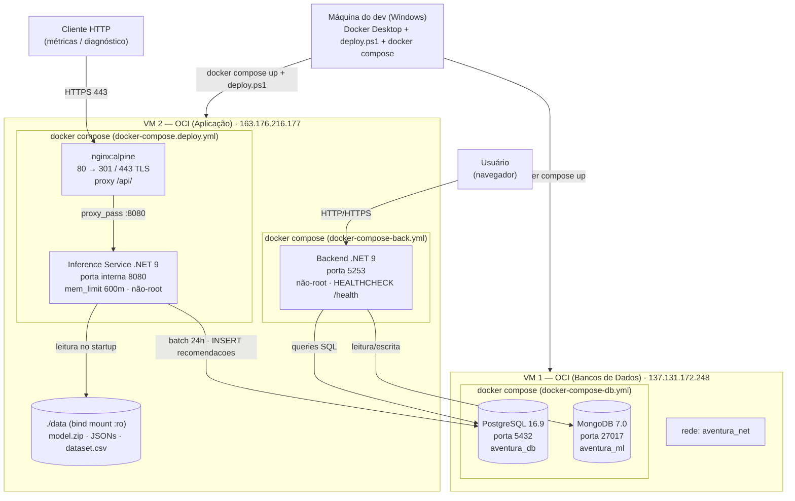

# Deploy do Ambiente — Portal Aventura

Este documento descreve a implantação completa do ambiente de produção do projeto Portal Aventura. Cobre a arquitetura de infraestrutura, a motivação por trás das decisões tomadas, os procedimentos de deploy de cada componente e as limitações conhecidas do ambiente atual. Para detalhes específicos do motor de recomendação (pipeline de inferência, troubleshooting do serviço e runbook de operação), consulte [Deploy_Recomendacao.md](./Deploy_Recomendacao.md).

## Sumário

1. [Visão geral da infraestrutura](#1-visão-geral-da-infraestrutura)
2. [Decisão arquitetural](#2-decisão-arquitetural)
3. [Limitações conhecidas](#3-limitações-conhecidas)
4. [Diagrama de implantação](#4-diagrama-de-implantação)
5. [Artefatos no repositório](#5-artefatos-no-repositório)
6. [Pré-requisitos](#6-pré-requisitos)
7. [Deploy — VM 1 (Bancos de Dados)](#7-deploy--vm-1-bancos-de-dados)
8. [Deploy — VM 2 (Aplicação)](#8-deploy--vm-2-aplicação)
9. [Rede compartilhada entre serviços](#9-rede-compartilhada-entre-serviços)
10. [Verificação do ambiente](#10-verificação-do-ambiente)
11. [Operação no dia a dia](#11-operação-no-dia-a-dia)
12. [Ordem de subida dos serviços](#12-ordem-de-subida-dos-serviços)

---

## 1. Visão geral da infraestrutura

O ambiente de produção está distribuído em **duas máquinas virtuais (VMs) na Oracle Cloud Infrastructure (OCI)**, cada uma com responsabilidades distintas:

| VM | Papel | Serviços |
|---|---|---|
| **VM 1** — Bancos de Dados | Persistência | PostgreSQL, MongoDB |
| **VM 2** — Aplicação | Lógica de negócio e recomendação | Backend .NET, Inference Service, nginx |

A comunicação entre as VMs ocorre via **rede interna da OCI** — o backend na VM 2 conecta ao PostgreSQL e ao MongoDB hospedados na VM 1 usando o IP interno (ou público, conforme a configuração da `.env`).

---

## 2. Decisão arquitetural

A separação em duas VMs é uma **decisão arquitetural motivada pelas restrições do plano gratuito da OCI (Always Free Tier)**:

- O plano disponibiliza exatamente **duas instâncias VM** (`E2.1.Micro`, cada uma com 1 GB de RAM e 1 OCPU).
- Executar todos os serviços em uma única VM excederia os recursos de memória disponíveis, tornando o ambiente instável.
- A separação entre banco de dados e aplicação permite **distribuir a carga de forma mais equilibrada**:
  - A VM 1 dedica seus recursos integralmente à persistência de dados (PostgreSQL e MongoDB).
  - A VM 2 dedica seus recursos à execução do backend e do serviço de inferência.

Essa separação também está alinhada com o princípio de responsabilidade única: falhas ou reinicios em um componente de aplicação não afetam diretamente a camada de dados, e vice-versa.

---

## 3. Limitações conhecidas

### Módulo de treinamento não implantado

O módulo de treinamento do modelo de recomendação (`src/ml`) **não é executado em produção**. A principal razão é a limitação de memória da VM 2:

- Executar simultaneamente o treinamento do modelo, o serviço de inferência e o backend da aplicação excederia 1 GB de RAM.
- O treinamento requer carga completa do dataset em memória e operações intensas de CPU, incompatíveis com a `E2.1.Micro` enquanto os outros serviços estão ativos.

**Em produção, apenas a inferência é executada.** Os artefatos do modelo (arquivo `.zip`, mapeamentos JSON, dataset pré-processado) são gerados localmente pelo desenvolvedor e transferidos para a VM 2 via `scp`, conforme descrito no [procedimento de deploy do motor de recomendação](./Deploy_Recomendacao.md#5-procedimento-de-deploy).

Para regenerar os artefatos localmente:

```bash
cd src/ml
dotnet run preprocess   # gera data/dataset/dataset.csv
dotnet run train        # gera data/models/*
```

---

## 4. Diagrama de implantação



---

## 5. Artefatos no repositório

| Artefato | Papel |
|---|---|
| [`src/backend/Dockerfile`](../src/backend/Dockerfile) | Multi-stage (sdk:9.0.6 → aspnet:9.0.6). Usuário não-root, `HEALTHCHECK /health`, `ASPNETCORE_ENVIRONMENT=Production` |
| [`src/database/Dockerfile`](../src/database/Dockerfile) | Imagem PostgreSQL 16.9 com scripts de init ordenados (`01_`, `02_`, `03_`) |
| [`src/mongodb/Dockerfile`](../src/mongodb/Dockerfile) | Imagem MongoDB 7.0 com script de init (`mongo-init.js`) |
| [`src/inference-service/Dockerfile`](../src/inference-service/Dockerfile) | Multi-stage (sdk:9.0 → aspnet:9.0). Instala `libgomp1`, `libfontconfig1`, `curl`. Usuário não-root. `HEALTHCHECK` com `start_period=180s` |
| [`docker-compose-db.yml`](../docker-compose-db.yml) | Sobe PostgreSQL e MongoDB na VM 1. Define a rede `aventura_net` e healthchecks para ambos os bancos |
| [`src/backend/docker-compose-back.yml`](../src/backend/docker-compose-back.yml) | Sobe o backend na VM 2. Conecta à rede `aventura_net` (external) criada pelo compose de DB |
| [`docker-compose.deploy.yml`](../docker-compose.deploy.yml) | Sobe o Inference Service e o nginx na VM 2. `mem_limit: 600m`, `restart: unless-stopped`, bind mount `./data:/app/data:ro` |
| [`deploy/deploy.ps1`](../deploy/deploy.ps1) | Script PowerShell que orquestra o deploy do inference-service de ponta a ponta (build, save, scp, bootstrap, up) |
| [`deploy/bootstrap-vm.sh`](../deploy/bootstrap-vm.sh) | Provisiona a VM de aplicação (idempotente): Docker Engine, swapfile 2 GB, iptables 80/443 |
| [`deploy/nginx.conf`](../deploy/nginx.conf) | Configuração nginx: HTTP → 301; HTTPS TLS; apenas `/api/` é proxiado para o inference-service |
| `deploy/deploy.config.example` | Template com `VM_HOST`, `VM_USER`, `SSH_KEY`, `REMOTE_DIR` — copiar para `deploy/deploy.config` (gitignored) |
| `.env.deploy.example` | Template de variáveis do inference-service — copiar para `.env.deploy` (gitignored) |
| `.env.example` | Template de variáveis do backend e dos bancos — copiar para `.env` (gitignored) |

---

## 6. Pré-requisitos

### Ferramentas necessárias na máquina do desenvolvedor

- **Docker Desktop** em modo Linux (para buildar imagens `linux/amd64`)
- **OpenSSH** (`ssh`, `scp`) — disponível no Windows via `winget install Microsoft.OpenSSH.Beta`
- **PowerShell 5.1+** — já incluso no Windows 10/11

### Arquivos que precisam existir localmente (não commitados)

| Arquivo | Como obter |
|---|---|
| `.env` | Copiar `.env.example` e preencher todas as variáveis |
| `.env.deploy` | Copiar `.env.deploy.example` e preencher a connection string com a senha real |
| `deploy/deploy.config` | Copiar `deploy/deploy.config.example` e preencher o IP e usuário da VM 2 |
| `chave-back.key` | Chave SSH privada para acesso às VMs (fornecida separadamente) |
| `data/dataset/dataset.csv` | Gerado localmente: `cd src/ml && dotnet run preprocess` |
| `data/models/*` | Gerado localmente: `cd src/ml && dotnet run train` |

### Portas que precisam estar abertas na OCI (Security List)

| VM | Porta | Protocolo | Serviço |
|---|---|---|---|
| VM 1 | 5432 | TCP | PostgreSQL (acesso da VM 2 e do dev) |
| VM 1 | 27017 | TCP | MongoDB (acesso da VM 2) |
| VM 2 | 80 | TCP | nginx (HTTP → redirect) |
| VM 2 | 443 | TCP | nginx (HTTPS — inference-service) |
| VM 2 | 5253 | TCP | Backend .NET (se exposto publicamente) |

> As portas do iptables são abertas automaticamente pelo `bootstrap-vm.sh`. A **Security List da OCI Console** precisa ser configurada manualmente — o script não tem acesso à console.

---

## 7. Deploy — VM 1 (Bancos de Dados)

A VM 1 executa o `docker-compose-db.yml` que sobe PostgreSQL e MongoDB. Este processo é executado a partir da máquina do desenvolvedor via SSH, ou diretamente na VM.

### 7.1 Preparar o ambiente na VM 1 (uma vez)

```bash
# Instalar Docker (Ubuntu/OCI)
sudo apt-get update
sudo apt-get install -y ca-certificates curl gnupg
sudo install -m 0755 -d /etc/apt/keyrings
curl -fsSL https://download.docker.com/linux/ubuntu/gpg | sudo gpg --dearmor -o /etc/apt/keyrings/docker.gpg
sudo chmod a+r /etc/apt/keyrings/docker.gpg
echo "deb [arch=$(dpkg --print-architecture) signed-by=/etc/apt/keyrings/docker.gpg] https://download.docker.com/linux/ubuntu $(. /etc/os-release && echo "$VERSION_CODENAME") stable" | sudo tee /etc/apt/sources.list.d/docker.list > /dev/null
sudo apt-get update
sudo apt-get install -y docker-ce docker-ce-cli containerd.io docker-compose-plugin
sudo usermod -aG docker $USER
```

### 7.2 Transferir os arquivos para a VM 1

Na máquina do desenvolvedor:

```powershell
# Gerar tarball do repo (só arquivos commitados)
git archive HEAD -o repo.tar

# Transferir para a VM 1
scp -i chave-back.key repo.tar ubuntu@137.131.172.248:/home/ubuntu/aventura/
scp -i chave-back.key .env ubuntu@137.131.172.248:/home/ubuntu/aventura/

# Extrair na VM
ssh -i chave-back.key ubuntu@137.131.172.248 "mkdir -p /home/ubuntu/aventura && cd /home/ubuntu/aventura && tar -xf repo.tar && rm repo.tar"
```

### 7.3 Subir os bancos

Na VM 1 (diretamente via SSH ou no terminal da VM):

```bash
cd /home/ubuntu/aventura

# Subir PostgreSQL e MongoDB
sudo docker compose -f docker-compose-db.yml up -d

# Verificar status e healthchecks
sudo docker compose -f docker-compose-db.yml ps
```

O Compose aguarda os healthchecks antes de declarar os serviços como `healthy`:

- **PostgreSQL**: `pg_isready` responde positivo quando o banco estiver pronto para aceitar conexões.
- **MongoDB**: `mongosh --eval "db.adminCommand('ping')"` confirma que o daemon está respondendo.

### 7.4 Verificar os bancos

```bash
# PostgreSQL
sudo docker exec -it postgres_db psql -U $POSTGRES_USER -d $POSTGRES_DB -c "\dt"

# MongoDB
sudo docker exec -it aventura_mongodb mongosh -u $MONGO_USER -p $MONGO_PASSWORD --authenticationDatabase admin aventura_ml --eval "show collections"
```

### 7.5 Atualizar os bancos (deploy subsequente)

Os scripts SQL de init (`docker-entrypoint-initdb.d/`) **só são executados na criação do volume**. Para aplicar migrações em dados existentes:

```bash
# Copiar e executar o script diretamente
sudo docker exec -i postgres_db psql -U $POSTGRES_USER -d $POSTGRES_DB < src/database/03_sprint4_improvements.sql
```

---

## 8. Deploy — VM 2 (Aplicação)

A VM 2 executa dois compose files independentes:

- `src/backend/docker-compose-back.yml` — Backend .NET
- `docker-compose.deploy.yml` — Inference Service + nginx

### 8.1 Provisionar a VM 2 (uma vez)

O script `deploy/bootstrap-vm.sh` é idempotente e pode ser re-executado sem risco. Ele instala Docker, cria um swapfile de 2 GB (necessário para o primeiro batch do modelo) e abre as portas 80 e 443 no iptables:

```powershell
# Da máquina do desenvolvedor
scp -i chave-back.key deploy/bootstrap-vm.sh ubuntu@163.176.216.177:/tmp/
ssh -i chave-back.key ubuntu@163.176.216.177 "bash /tmp/bootstrap-vm.sh"
```

### 8.2 Deploy do Backend

```powershell
# Transferir arquivos
git archive HEAD -o repo.tar
scp -i chave-back.key repo.tar ubuntu@163.176.216.177:/home/ubuntu/aventura/
scp -i chave-back.key .env ubuntu@163.176.216.177:/home/ubuntu/aventura/

# Extrair na VM
ssh -i chave-back.key ubuntu@163.176.216.177 "cd /home/ubuntu/aventura && tar -xf repo.tar && rm repo.tar"

# Subir o backend
ssh -i chave-back.key ubuntu@163.176.216.177 "cd /home/ubuntu/aventura/src/backend && sudo docker compose -f docker-compose-back.yml up -d --build"
```

> **Pré-requisito:** a rede `aventura_net` deve existir antes de subir o backend. Ela é criada automaticamente pelo `docker-compose-db.yml` na VM 1. Como as VMs são separadas, a rede precisa ser criada manualmente na VM 2:
>
> ```bash
> sudo docker network create aventura_net
> ```

### 8.3 Deploy do Inference Service e nginx

O deploy do inference-service é automatizado pelo script `deploy/deploy.ps1`. Ele executa as seguintes etapas em sequência:

1. **[1/5] Build local** da imagem `aventura-recsys-inference:latest` (linux/amd64, na máquina do dev).
2. **[2/5] `git archive HEAD`** — empacota apenas os arquivos commitados.
3. **[3/5] Transferência via `scp`** — envia a imagem (`.tar`), o tarball do repo, o dataset, os artefatos do modelo e o `.env.deploy` para a VM 2.
4. **[4/5] Na VM:** extrai o tarball, executa `bootstrap-vm.sh`, faz `docker load` da imagem, gera o certificado self-signed se ausente e executa `docker compose up -d` (sem `--build`).
5. **[5/5] Smoke test** com retry de ~2 minutos no endpoint `/api/diagnostics/health`.

```powershell
# Executar a partir da raiz do repositório
powershell -File deploy\deploy.ps1
```

Para mais detalhes sobre o deploy do inference-service (incluindo troubleshooting, operação e pendências), consulte [Deploy_Recomendacao.md](./Deploy_Recomendacao.md).

---

## 9. Rede compartilhada entre serviços

O backend (VM 2) precisa se comunicar com o PostgreSQL e o MongoDB (VM 1). Como as VMs são separadas, essa comunicação ocorre via **IP da VM 1**, configurado nas variáveis de ambiente do `.env`.

A rede Docker `aventura_net` serve para comunicação entre os serviços **dentro de cada VM**:

| VM | Serviços na mesma rede `aventura_net` | Comunicação via |
|---|---|---|
| VM 1 | `postgres_db`, `aventura_mongodb` | hostname Docker (ex: `db`, `mongodb`) |
| VM 2 | `aventura_backend` | hostname Docker (para serviços futuros na mesma VM) |

A rede é criada pelo `docker-compose-db.yml` (com `name: aventura_net`) e referenciada como `external: true` no `docker-compose-back.yml`. Isso garante que ambos os serviços na mesma VM se enxerguem pelo nome do container, sem precisar expor portas adicionais.

> O `docker-compose.deploy.yml` (inference + nginx) cria sua própria rede padrão, já que o nginx só precisa se comunicar com o inference-service via `proxy_pass`.

---

## 10. Verificação do ambiente

Após o deploy de todos os serviços, execute as verificações abaixo na ordem indicada.

### VM 1 — Bancos de Dados

```bash
# Healthcheck dos containers
sudo docker compose -f docker-compose-db.yml ps

# Conectividade PostgreSQL
sudo docker exec postgres_db pg_isready -U $POSTGRES_USER -d $POSTGRES_DB

# Conectividade MongoDB
sudo docker exec aventura_mongodb mongosh --eval "db.adminCommand('ping')"
```

### VM 2 — Backend

```bash
# Status do container
sudo docker compose -f src/backend/docker-compose-back.yml ps

# Healthcheck HTTP
curl http://localhost:5253/health
# Esperado: 200 OK com corpo JSON indicando "Healthy"
```

### VM 2 — Inference Service

```bash
# Status + healthcheck
sudo docker compose -f docker-compose.deploy.yml ps

# Health via nginx (HTTPS self-signed)
curl -k https://localhost/api/diagnostics/health
# Esperado: 200 OK quando os artefatos do modelo estiverem carregados
# Durante o carregamento (~7s local / até 180s na VM): 503

# Informações do modelo
curl -k https://localhost/api/diagnostics/model-info
```

### Verificação end-to-end

```sql
-- Conferir recomendações geradas pelo batch (conectar ao PostgreSQL)
SELECT count(*), max(data_geracao) FROM recomendacoes;
```

```bash
# Verificar acesso público (substituir pelo IP real da VM 2)
curl -k https://163.176.216.177/api/diagnostics/health
```

---

## 11. Operação no dia a dia

### VM 1 — Bancos de Dados

```bash
# Logs em tempo real
sudo docker compose -f docker-compose-db.yml logs -f

# Reiniciar um serviço específico
sudo docker compose -f docker-compose-db.yml restart db
sudo docker compose -f docker-compose-db.yml restart mongodb

# Parar tudo (dados persistem nos volumes)
sudo docker compose -f docker-compose-db.yml down

# Parar e remover volumes (DESTRUTIVO — apaga todos os dados)
sudo docker compose -f docker-compose-db.yml down -v
```

### VM 2 — Backend

```bash
# Logs em tempo real
sudo docker compose -f src/backend/docker-compose-back.yml logs -f backend

# Reiniciar o backend
sudo docker compose -f src/backend/docker-compose-back.yml restart backend
```

### VM 2 — Inference Service

```bash
# Logs em tempo real
sudo docker compose -f docker-compose.deploy.yml logs -f inference

# Forçar um novo batch de recomendações (o batch também roda no startup)
sudo docker compose -f docker-compose.deploy.yml restart inference

# Atualizar modelo/dataset sem rebuild de imagem
# 1. Gerar novos artefatos localmente (src/ml)
# 2. Re-executar deploy.ps1 — ele transfere os novos artefatos por scp
#    e reinicia o serviço via compose restart
```

---

## 12. Ordem de subida dos serviços

A ordem correta para subir o ambiente do zero é:

```
1. VM 1: docker compose -f docker-compose-db.yml up -d
         (aguardar healthchecks: postgres_db e aventura_mongodb ficarem "healthy")

2. VM 2: sudo docker network create aventura_net  # se ainda não existir
         cd src/backend && docker compose -f docker-compose-back.yml up -d --build

3. VM 2: powershell -File deploy\deploy.ps1       # inference-service + nginx
```

Respeitar essa ordem garante que:
- O PostgreSQL e o MongoDB estejam prontos antes de o backend tentar conectar.
- A rede `aventura_net` exista antes de o backend tentar se juntar a ela.
- Os artefatos do modelo estejam presentes antes de o inference-service tentar carregá-los.

> Os healthchecks definidos no `docker-compose-db.yml` permitem verificar programaticamente quando os bancos estão prontos:
> ```bash
> # Aguardar até os bancos ficarem healthy
> sudo docker compose -f docker-compose-db.yml ps --format json | python3 -c "import sys,json; [print(s['Name'], s['Health']) for s in json.load(sys.stdin)]"
> ```
