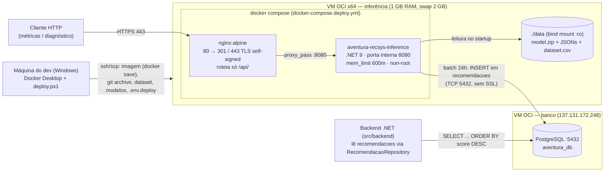

# Deploy do Motor de Recomendação — Portal Aventura

Este documento descreve como o motor de recomendação híbrido (Funk SVD + afinidade de categoria, ver [Modelo_Recomendacao.md](./Modelo_Recomendacao.md)) é empacotado e implantado em produção: o host `src/inference-service` (.NET 9) roda em Docker numa VM Oracle Cloud, atrás de um nginx com HTTPS, e grava recomendações no PostgreSQL que já atende o backend. Cobre as decisões de infraestrutura, o diagrama de implantação exigido na Sprint 4, o procedimento de deploy, a operação no dia a dia e o que ficou pendente. Implementação na issue #252 (commits `f04c616` e `cf15e28`).

## Sumário

1. [Visão geral e escopo](#1-visão-geral-e-escopo)
2. [Diagrama de implantação](#2-diagrama-de-implantação)
3. [Decisões de deploy](#3-decisões-de-deploy)
4. [Artefatos no repositório](#4-artefatos-no-repositório)
5. [Procedimento de deploy](#5-procedimento-de-deploy)
6. [Verificação e estado atual](#6-verificação-e-estado-atual)
7. [Operação](#7-operação)
8. [Troubleshooting](#8-troubleshooting)
9. [Pendências e evoluções](#9-pendências-e-evoluções)
10. [Rastreabilidade](#10-rastreabilidade)

## 1. Visão geral e escopo

O escopo deste deploy é **apenas o sistema de recomendação** — o processo descrito aqui sobe o `src/inference-service` numa VM própria, sem tocar no backend, no frontend nem no banco. Essa independência é deliberada: o RNF08 (modularidade do serviço de recomendação) pede exatamente que reimplantar o motor não exija alteração nos demais serviços, e o contrato com o backend é só a tabela `recomendacoes` no PostgreSQL.

O que sobe na VM de inferência:

- **`inference-service`** [IMPLEMENTADO]: carrega os artefatos de `data/models/` no startup (`HybridModelLoader`, fail-fast se faltar arquivo), roda um batch de recomendações a cada 24h (`RecommendationBatchJob`) e expõe `GET /api/diagnostics/health`, `/api/diagnostics/model-info` e `/api/metrics` (controllers `DiagnosticsController` e `MetricsController`).
- **nginx** [IMPLEMENTADO]: único contêiner exposto (80/443), com HTTPS self-signed, roteando somente `/api/` para o serviço.

O PostgreSQL (`aventura_db`) continua na VM já existente `137.131.172.248`, fora deste processo.

> ⚠️ O enunciado da Sprint 4 exige "ambiente funcionando no **servidor Inteli**, dockerizado", sob pena de demérito de 3,0. A infraestrutura do grupo está na **Oracle Cloud (OCI)**. `[equipe: confirmar com o orientador se a VM OCI atende o requisito, ou se é preciso replicar o compose no servidor Inteli — o docker-compose.deploy.yml roda em qualquer host Docker x64]`

## 2. Diagrama de implantação

A distribuição física tem três nós: a máquina de quem faz o deploy (build da imagem), a VM de inferência (serviço + nginx) e a VM de banco. O backend consome o resultado do batch lendo a tabela `recomendacoes` — ele não conhece o modelo nem o serviço de inferência.



Dois detalhes do diagrama que importam na prática: o serviço **não tem porta publicada** (só `expose: 8080`; quem fala com o mundo é o nginx) e os artefatos de modelo **não vão dentro da imagem** — entram por bind mount somente leitura, o que permite atualizar o modelo sem rebuild.

## 3. Decisões de deploy

As escolhas abaixo foram tomadas para uma VM `E2.1.Micro` de 1 GB de RAM e para um time sem acesso à console da OCI — restrições que aparecem em quase todas as linhas.

| Decisão | Escolha | Por quê |
|---|---|---|
| Escopo | Só o `inference-service`; Postgres fica onde está | RNF08: reimplantação independente do motor |
| Build | **Local** (Docker Desktop, linux-x64) + `docker save`/`scp`/`docker load` | A VM de 1 GB não aguenta compilar; `up -d` na VM roda **sem** `--build` |
| Exposição | nginx + HTTPS com certificado self-signed | Não há domínio definido; o serviço nunca fica exposto direto |
| Autenticação | Endpoints **sem auth** por enquanto (decisão de 11/06/2026) | Risco aceito; mitigação pronta no §8. `[equipe: registrar no texto a justificativa da decisão — por que o risco do /api/metrics foi aceito nesta sprint]` |
| CI/CD | Nenhum; script manual `deploy/deploy.ps1` | Deploy ainda não é rotina; ver evolução no §9 |
| Mapeamento D4 | Resolvido via coluna `ml_id` em `usuarios` (populada no script do banco) | Não foi a tabela `ml_user_mapping`; os 3 usuários do seed são mapeados a `user_id` do dataset, ver §8 e §9 |

## 4. Artefatos no repositório

Tudo que o deploy usa está versionado, exceto segredos e dados (gitignored). O `deploy.ps1` empacota via `git archive HEAD` — **só vai para a VM o que está commitado**, mais os arquivos enviados explicitamente (dataset, modelos, `.env.deploy`).

| Arquivo | Papel |
|---|---|
| [`src/inference-service/Dockerfile`](../src/inference-service/Dockerfile) | Multi-stage (sdk:9.0 → aspnet:9.0). Instala `libgomp1` (binário nativo do MatrixFactorization), `libfontconfig1` (ScottPlot) e `curl` (healthcheck). Usuário não-root. `HEALTHCHECK` com `start_period=180s` — o health responde 503 durante o carregamento dos artefatos |
| [`docker-compose.deploy.yml`](../docker-compose.deploy.yml) | Serviços `inference` (`mem_limit: 600m`, `restart: unless-stopped`, bind mount `./data:/app/data:ro`) e `nginx` (`depends_on: service_healthy`) |
| [`deploy/nginx.conf`](../deploy/nginx.conf) | 80 → redirect 301; 443 TLS; só `location /api/` é proxiado (`proxy_read_timeout 300s` por causa do `/api/metrics` sem cache); resto responde 404 |
| [`deploy/bootstrap-vm.sh`](../deploy/bootstrap-vm.sh) | Provisiona a VM (idempotente): Docker Engine + compose, swapfile de 2 GB, iptables liberando 80/443 |
| [`deploy/deploy.ps1`](../deploy/deploy.ps1) | Orquestra o deploy de ponta a ponta em 5 etapas (ver §5) |
| `deploy/deploy.config.example` | Template de `VM_HOST`/`VM_USER`/`SSH_KEY`/`REMOTE_DIR`; a cópia preenchida é gitignored |
| `.env.deploy.example` | Template com `ConnectionStrings__DefaultConnection` e `ASPNETCORE_ENVIRONMENT=Production`; a cópia com senha real é gitignored |
| `.dockerignore` | Mantém o build context (raiz do repo) enxuto: exclui `node_modules/`, `**/bin`, `**/obj`, `data/` |

A connection string entra por variável de ambiente padrão do .NET (`ConnectionStrings__DefaultConnection`), sem mudança de código — o repositório de escrita já lê `GetConnectionString("DefaultConnection")`.

## 5. Procedimento de deploy

### Pré-requisitos manuais (uma vez)

1. **VM:** copiar `deploy/deploy.config.example` → `deploy/deploy.config` (gitignored) e preencher `VM_HOST` com o IP da VM de inferência.
2. **OCI Console:** liberar ingress **TCP 80 e 443 na Security List** da VM — único passo que o script não automatiza (o firewall local é aberto pelo `bootstrap-vm.sh`).
3. **Chave SSH:** `chave-back.key` na raiz do repo (gitignored — nunca commitar).
4. **Banco — parâmetros confirmados (11/06/2026, via `.env` real do backend):** host `137.131.172.248`, porta `5432`, banco **`aventura_db`**, usuário `postgres`, servidor **sem SSL** (o `6543 + sslmode=require` do `.env.example` do backend é resquício). Sanity check a partir da VM de inferência:

   ```bash
   psql "host=137.131.172.248 port=5432 dbname=aventura_db user=postgres sslmode=prefer" -c "\conninfo"
   ```

5. **Env do serviço:** copiar `.env.deploy.example` → `.env.deploy` (gitignored) e preencher a senha real.
6. **Dataset:** `data/dataset/dataset.csv` precisa existir localmente (é gitignored; se faltar: `cd src/ml && dotnet run preprocess`).
7. **Docker Desktop** em modo Linux na máquina de quem faz o deploy.

### Execução

```powershell
powershell -File deploy\deploy.ps1
```

O script valida config/chave/env/dataset e então: **[1/5]** builda a imagem local (linux-x64) e faz `docker save`; **[2/5]** gera o tarball do repo com `git archive HEAD`; **[3/5]** transfere tudo por `scp -C` (imagem, tarball, `dataset.csv`, `data/models/*`, `.env.deploy`); **[4/5]** na VM roda `bootstrap-vm.sh`, `docker load`, gera o certificado self-signed se ausente e `docker compose up -d` (sem `--build`); **[5/5]** smoke test com retry de ~2 min no health e despeja os últimos logs.

Mudou compose, nginx.conf ou script? **Commit antes de deployar** — o `git archive HEAD` ignora o working tree.

## 6. Verificação e estado atual

A verificação local (11/06/2026, Docker Desktop, `docker compose -f docker-compose.deploy.yml up --build`) mediu: carregamento completo em **~7 s** (dataset 3 s + modelo 4 s), health respondendo 200 em **menos de 5 s** após o bind e **~190 MiB** de memória no início do batch. O `start_period=180s` do healthcheck é margem deliberada para a CPU fraca da `E2.1.Micro`.

Na VM, o estado em 12/06/2026 é outro: `curl -k https://163.176.216.177/api/diagnostics/health` **não conecta** — a liberação de 80/443 na Security List da OCI segue pendente (o time não tem acesso à console). Os artefatos estão prontos e verificados localmente, mas **o serviço ainda não está acessível publicamente**.

`[equipe: quando a Security List for liberada, rodar o deploy.ps1, colar aqui o resultado do smoke test (health 200 + logs) e remover este gancho — sem isso a entrega corre o risco do demérito de 3,0 por ambiente fora do ar]`

Verificação fim-a-fim depois do deploy:

- Health: `curl -k https://<VM_HOST>/api/diagnostics/health` → 200 com o modelo carregado.
- Métricas: `curl -k "https://<VM_HOST>/api/metrics?k=10&rankingUsers=200"`.
- Persistência: `SELECT count(*), max(data_geracao) FROM recomendacoes;` — em banco recriado com o seed, o batch grava recomendações para os **3 usuários mapeados** (`ml_id` 63261/14888/55251); **0** só se o banco não tiver o seed/mapeamento (ver §8).

## 7. Operação

Comandos do dia a dia, executados na VM (diretório `/home/ubuntu/aventura-recsys`):

```bash
# Logs em tempo real
sudo docker compose -f docker-compose.deploy.yml logs -f inference

# Status + healthcheck
sudo docker compose -f docker-compose.deploy.yml ps

# Forçar uma rodada do batch (ele roda no startup e a cada 24h)
sudo docker compose -f docker-compose.deploy.yml restart inference
```

Para atualizar modelo ou dataset sem rebuild: re-treinar localmente (`cd src/ml && dotnet run train`), rodar o `deploy.ps1` de novo — os artefatos vão por `scp` e entram pelo bind mount.

## 8. Troubleshooting

### Health retorna 503 logo após subir

**Normal durante o carregamento.** O Kestrel sobe antes do `HybridModelLoader`; o endpoint responde 503 até os artefatos carregarem e 200 quando pronto. O `HEALTHCHECK` tem `start_period=180s` de carência. Se o 503 persistir por vários minutos, ver logs — o loader é fail-fast: artefato ausente derruba a aplicação (confira o bind mount `./data:/app/data`).

### Container `unhealthy` e nginx que não sobe

O compose puro **não reinicia** container `unhealthy`, e o nginx tem `depends_on: service_healthy` — se o carregamento estourar `start_period` + `retries`×`interval`, o nginx nunca sobe. Com o load medido em ~7 s local, os 180 s são margem; se na VM o load passar de ~90 s, aumentar o `start_period` para ~2× o valor observado.

### Crash loop / OOM no primeiro batch

O `RecommendationBatchJob` roda o primeiro batch **imediatamente após o load** (não em T+24h) — o pico de memória é no startup, sob `mem_limit: 600m`. Assinatura: container reiniciando em ciclos, log cortando no meio do batch.

```bash
sudo docker compose -f docker-compose.deploy.yml logs --tail 50 inference
dmesg | grep -i oom
```

Mitigação já aplicada: swap de 2 GB (bootstrap). Se persistir: subir `mem_limit` (a VM tem 1 GB — margem curta) ou migrar para shape A1 Flex (exige validar ML.NET em arm64: o trainer de Matrix Factorization usa binário nativo; a imagem passaria a ser buildada para arm64).

### Tabela `recomendacoes` vazia

**Quase sempre é falta do mapeamento/seed, não bug de deploy.** O writer traduz o `user_id` do dataset para `usuarios.id` (UUID) pela coluna `ml_id`; se nenhum usuário tiver o `ml_id` correspondente, ele resolve `usuario_id` como null e sai sem inserir, logando `"Não foi possível persistir…"`. Para gravar, é preciso: **(1)** o seed (`02_initial_data.sql`) ter criado os usuários e **(2)** os `UPDATE` de mapeamento no fim de `02_sprint4_improvements.sql` terem rodado — o que exige **banco recriado do zero** (`docker compose -f docker-compose-db.yml down -v && up -d --build`). Diagnóstico:

```sql
-- Os 3 usuários do seed devem aparecer com ml_id mapeado:
SELECT email, ml_id FROM usuarios WHERE ml_id IN (63261, 14888, 55251);
-- Após o batch, a contagem deve ser > 0 (recomendações dos usuários mapeados):
SELECT count(*), max(data_geracao) FROM recomendacoes;
```

### Erro de conexão com o Postgres

Testar da VM de inferência com o `psql` do §5. Causas comuns: nome do banco errado (`aventura`?), porta (5432 × 6543), SSL, senha, ou egress/ingress entre as duas VMs na OCI.

### Serviço lento / fora do ar após chamadas a `/api/metrics`

Os endpoints estão **sem autenticação** (decisão de 11/06/2026). O `/api/metrics` dispara avaliação cara (~200 usuários × 446 itens; o resultado é cacheado por parâmetro, mas variar `k`/`rankingUsers` força recomputo) — numa VM de 1 GB, chamadas repetidas com parâmetros variados podem saturar CPU/memória. Se virar problema, reintroduzir no `location /api/` do `deploy/nginx.conf` uma allowlist de IP (`allow <ip>; deny all;`) ou `auth_basic` + `.htpasswd`.

### Warning "Failed to determine the https port" no log

Inofensivo. `Program.cs` chama `UseHttpsRedirection()`, mas atrás do nginx o serviço só fala HTTP interno — o middleware vira no-op com esse warning. Não investigar.

## 9. Pendências e evoluções

- **Security List 80/443** [PENDENTE]: bloqueia o acesso público à VM de inferência; depende da console OCI.
- **D4 — mapeamento `user_id` ↔ `usuarios.id`** [RESOLVIDO]: feito via coluna `ml_id` (`UPDATE` no fim de `02_sprint4_improvements.sql`) para os 3 usuários do seed — habilita a persistência real em `recomendacoes` e fecha o ciclo batch → backend. Evolução futura: mapear por identidade real os usuários autenticados em escala (não só o seed).
- **HTTPS de verdade** [PLANEJADO]: quando houver domínio (ou via `sslip.io` sobre o IP), trocar o self-signed por Let's Encrypt; clientes deixam de precisar de `-k`.
- **Registry** [PLANEJADO]: se o deploy virar rotina, substituir `docker save`/`scp` (~400–600 MB por deploy) por um registry e `docker pull` na VM.
- **CI/CD** [PLANEJADO]: hoje o deploy é manual por decisão (§3); automatizar quando houver pipeline.

## 10. Rastreabilidade

Como este deploy atende os requisitos já definidos no [Projeto.md](./Projeto.md) e os obrigatórios da Sprint 4:

| Item | Onde é atendido |
|---|---|
| Sprint 4 — diagrama de implantação | §2 deste documento |
| Sprint 4 — ambiente dockerizado no servidor | §4–§6 (Dockerfile, compose, procedimento); ressalva OCI × servidor Inteli no §1 |
| Sprint 4 — API de recomendação | Endpoints do `inference-service` (§1) + contrato JSON e rotas no [Modelo_Recomendacao.md](./Modelo_Recomendacao.md) §3 |
| RNF08 — modularidade do serviço de recomendação | Deploy independente: nada do backend/frontend muda ou cai quando o motor é reimplantado (§1, §3) |
| RNF05 — disponibilidade da plataforma | `restart: unless-stopped`, `HEALTHCHECK`, smoke test com retry (§4–§5) |
| RNF06 — capacidade sob carga | Limites explícitos (`mem_limit: 600m`, swap 2 GB) e risco do `/api/metrics` documentado (§8) |
| RF10 / RF02 — recomendações personalizadas e regionais | São servidas pela tabela `recomendacoes` que o batch deste serviço alimenta; com a D4 resolvida (§9), a persistência já ocorre para os usuários mapeados |
