# Gestão do Projeto
----

## Grupo 2 - Aventureiros

## Projeto - RecomendaShow

## Integrantes

- [Alexsander da Silva Barbosa](https://www.linkedin.com/in/alexsander-dsbarbosa/)
- [Carlos Eduardo Serrano Quaglia](https://www.linkedin.com/in/carlos-quaglia-309088357/)
- [Catarina Sayuri Arashiro Braga Felipe](https://www.linkedin.com/in/catarina-sayuri/)
- [Débora Pereira Nogueira](https://www.linkedin.com/in/debora-pereira-nogueira/)
- [Isaac Souza Santos](https://www.linkedin.com/in/isaac-souza-santos/)
- [Nicholas Anantha Krishnan Millani](https://www.linkedin.com/in/nicholas-millani-83a950357/)
- [Paulo Henrique Bueno Fernandes](https://www.linkedin.com/in/paulo-henrique0601/)

## Objetivo do Documento

Este documento registra a gestão do projeto ao longo das sprints, reunindo retrospectivas, planejamentos, pontos fortes, pontos de melhoria, problemas identificados, ações propostas e evolução entre ciclos. Seu objetivo é apresentar de forma organizada o acompanhamento do trabalho da equipe, preservando o histórico das decisões e melhorias realizadas durante o desenvolvimento do projeto.

## Sumário

 - [Sprint 1](#1-sprint-1)
 - [Sprint 2](#2-sprint-2)
 - [Sprint 3](#3-sprint-3)
 - [Sprint 4 - Gestão Evolutiva](#4-sprint-4---gestão-evolutiva)
 - [Planejamento da Sprint 5](#5-planejamento-da-sprint-5)
 - [Consolidação Final da Gestão Evolutiva](#6-consolidação-final-da-gestão-evolutiva)
 - [Atendimento aos Critérios do Escritório de Projetos](#7-atendimento-aos-critérios-do-escritório-de-projetos)
 - [Uso das Políticas de Gestão de Configuração](#8-uso-das-políticas-de-gestão-de-configuração)
 - [Referências](#9-referências)

---

## 1. Sprint 1

### 1.1 Retrospectiva da Sprint 1

A retrospectiva da Sprint 1 tem como objetivo analisar o desempenho da equipe, identificando pontos positivos, dificuldades encontradas e ações de melhoria para a próxima sprint.

#### 1.1.1 Pontos fortes

- Boa priorização de tarefas, garantindo fluxo contínuo de trabalho sem ociosidade da equipe
- Quebra adequada das tarefas, evitando commits muito grandes e facilitando revisão
- Colaboração entre áreas, com membros atuando tanto em dados quanto em documentação
- Uso consistente de issues e commits seguindo o padrão Conventional Commits
- Estruturação inicial organizada do repositório, facilitando o entendimento do projeto

#### 1.1.2 Pontos fracos

- Parte dos artefatos foi validada apenas próximo da entrega final, gerando retrabalho em diagramas e ajustes estruturais após feedback recebido
- Algumas Merge Requests permaneceram abertas por longos períodos, impactando o fluxo de integração e atrasando tarefas dependentes

#### 1.1.3 Ações de melhoria

| Problema | Ação | Indicador de Sucesso |
|---|---|---|
| Falta de validação contínua | Planejar checkpoints com professores antes das entregas | Redução de retrabalho |
| Demora na aprovação de PRs | Estabelecer prazo máximo de revisão de 24h | Redução do tempo de merge |
| Feedback tardio | Abrir PRs parciais para revisão antecipada | Revisões mais rápidas |
| Tasks muito amplas | Quebrar tarefas grandes em subtarefas menores | Aumento da granularidade |

### 1.2 Planejamento da Sprint 2

O planejamento da Sprint 2 organiza as entregas com base nos artefatos definidos, estruturando as tarefas de forma detalhada, priorizada e com estimativas realistas.

#### 1.2.1 Critério de estimativa

| Tamanho | Tempo estimado |
|------|------|
| PP | Até 15 minutos |
| P | Até 30 minutos |
| M | Até 1 hora |
| G | Até 2 horas |
| GG | Acima de 2 horas |

### 1.3 Evolução entre Sprint 1 e Sprint 2

| Aspecto | Sprint 1 | Sprint 2 | Evolução |
|---|---|---|---|
| Planejamento | Tasks muito amplas | Maior granularidade | Melhorando |
| Pull Requests | Revisões lentas | Revisões mais frequentes | Parcial |
| Organização Git | Estrutura inicial | Fluxo consolidado | Melhorou |
| Conventional Commits | Uso parcial | Uso padronizado | Melhorou |
| Validação contínua | Próxima da entrega | Checkpoints definidos | Melhorando |

---

## 2. Sprint 2

### 2.1 Retrospectiva da Sprint 2

A retrospectiva da Sprint 2 tem como objetivo analisar o desempenho da equipe ao longo da sprint, identificando os pontos que contribuíram positivamente para o desenvolvimento do projeto, as principais dificuldades encontradas durante o processo e as ações de melhoria que podem ser aplicadas nas próximas entregas, em comparação à Sprint 1.

---

### 2.2 Pontos Fortes

* **Proatividade:** Boa iniciativa da equipe na resolução de problemas e suporte mútuo entre os integrantes.
* **Granularidade de Tarefas:** Manutenção de uma boa divisão das tasks, facilitando o acompanhamento e evitando sobrecarga.
* **Eficiência em Code Review:** Melhora significativa no tempo de revisão e aprovação de Pull Requests em relação à sprint anterior.
* **Alinhamento:** Realização de reuniões para garantir a sincronia sobre prioridades e mudanças de rumo no projeto.
* **Padronização Técnica:** Uso organizado de issues, branches e commits padronizados, garantindo rastreabilidade e organização.
* **Colaboração Multidisciplinar:** Apoio mútuo entre as frentes de documentação, desenvolvimento e modelagem.

---

### 2.3 Pontos Fracos

* **Restrição de Tempo Útil:** O tempo de desenvolvimento foi reduzido por ponderadas de sala que se estenderam além do esperado.
* **Interdependência entre Tasks:** Atrasos em atividades críticas impactaram diretamente o início ou conclusão de tarefas relacionadas.
* **Ruído na Comunicação (Dailies):** Falhas pontuais no repasse de informações sobre o andamento e, principalmente, sobre impedimentos enfrentados.
* **Subestimação de Prazos:** Algumas atividades demandaram mais tempo que o previsto, agravado pela interdependência citada.
* **Concentração de Tasks Grandes:** Apesar da melhora na granularidade em relação à Sprint 1, ainda houve predominância de tarefas classificadas como G, dificultando a previsibilidade da sprint.

---

### 2.4 Impactos dos Pontos Fracos no Projeto

* **Gargalo no Fluxo de Trabalho (Efeito Cascata):** A interdependência não mapeada gerou ociosidade forçada ou "mudança de contexto" constante, onde membros precisaram abandonar tarefas pela metade para trabalhar em itens secundários enquanto aguardavam liberações.
* **Assimetria de Informação:** O ruído nas *Dailies* dificultou a compreensão sobre o que estava sendo feito pelos membros.
* **Sobrecarga:** A subestimação de prazos aliada à perda de tempo de dev gasto em ponderadas resultou em uma aceleração não planejada no final da sprint, prejudicando a sustentabilidade do ritmo de trabalho.
* **Baixa Previsibilidade:** A existência de tasks muito amplas dificultou estimativas mais precisas e acompanhamento detalhado do progresso.

#### Tabela de Consequências

| Problema Raiz | Impacto Gerado | Risco Associado |
| :--- | :--- | :--- |
| **Reuniões Longas** | Perda de foco e redução do *throughput*. | Atraso nas entregas principais. |
| **Interdependência** | Bloqueio de tarefas e tempo de espera. | Ineficiência no uso da mão de obra. |
| **Ruído na Daily** | Desalinhamento sobre impedimentos. | Retrabalho por falta de orientação. |
| **Subestimação** | Entrega no limite do prazo. | Comprometimento da estabilidade do código. |
| **Tasks Grandes** | Dificuldade de acompanhamento detalhado. | Redução da previsibilidade da sprint. |

---

### 2.5 Plano de Ação para a Sprint 3 (Melhorias)

Para garantir que as melhorias sejam rastreáveis e menos superficiais, a equipe adotará as seguintes ações:

| Ação de Melhoria | Descrição Detalhada (O "Como") | Indicador de Sucesso / Rastreabilidade |
| :--- | :--- | :--- |
| **Mapeamento de Dependências** | Durante a Planning, utilizaremos a técnica de "Dependency Mapping". Identificaremos quais tarefas bloqueiam outras e sinalizaremos via links de "bloqueado por" no Board. | Redução no tempo de espera (*idle time*) de tarefas dependentes. |
| **Sincronização de Fluxo (Daily)** | Adotar o padrão de 3 perguntas focado no fluxo: 1. O que concluí? 2. O que pretendo concluir hoje? 3. **Existe algum impedimento?**. | Atualização em tempo real do board e ausência de surpresas sobre bloqueios. |
| **Refinamento de Estimativas** | Durante a Planning, tasks consideradas muito amplas serão quebradas em subtarefas menores, reduzindo concentração de tasks G. | Aumento da quantidade de tasks P e M na Sprint 3. |
| **Timeboxing de Reuniões** | Definir limite de tempo para ponderadas e alinhamentos internos, evitando impacto excessivo no tempo útil de desenvolvimento. | Maior tempo efetivo dedicado ao desenvolvimento técnico. |

---

### 2.6 Evolução em Relação à Sprint 1

| Aspecto | Sprint 1 | Sprint 2 | Evolução |
| :--- | :--- | :--- | :--- |
| Granularidade das Tasks | Predomínio de tasks médias/grandes | Inclusão de tasks menores | Melhorou |
| Code Review | Revisões lentas | Revisões mais rápidas | Melhorou |
| Organização Técnica | Estrutura inicial | Fluxo mais consolidado | Melhorou |
| Comunicação | Alinhamento básico | Melhor frequência de reuniões | Parcial |
| Estimativas | Pouca previsibilidade | Melhor divisão, mas ainda com subestimação | Parcial |

---

### 2.7 Conclusão

A Sprint 2 mostrou uma evolução na organização técnica e na colaboração interna. Em comparação à Sprint 1, houve melhora na granularidade das tarefas, na velocidade de revisão de Pull Requests e na consolidação das práticas de organização técnica.

O foco da Sprint 3 será o refinamento da comunicação, a antecipação de bloqueios e o aumento da rastreabilidade das tarefas, garantindo que a interdependência entre atividades não comprometa o cronograma final nem a qualidade técnica da entrega.

---

## 3. Sprint 3

### 3.1 Retrospectiva da Sprint 3

A retrospectiva da Sprint 3 tem como objetivo analisar o desempenho da equipe ao longo da sprint, identificando os pontos que contribuíram positivamente para o desenvolvimento do projeto, as principais dificuldades encontradas durante o processo e as ações de melhoria que podem ser aplicadas nas próximas entregas, em comparação à Sprint anterior.

Durante esta sprint, a equipe apresentou avanços importantes relacionados à comunicação e à colaboração entre os integrantes. Entretanto, ainda foram observadas dificuldades relacionadas à organização das tarefas, estimativas de esforço e granularização das atividades, impactando diretamente a previsibilidade do desenvolvimento.

---

### 3.2 Pontos Fortes

| Ponto Forte | Evidência Observada | Impacto Positivo |
| :--- | :--- | :--- |
| **Proatividade da equipe** | Os integrantes demonstraram maior autonomia na resolução de problemas técnicos e apoio mútuo durante o desenvolvimento das tarefas. | Redução de bloqueios e maior continuidade do desenvolvimento. |
| **Melhoria na comunicação** | Houve maior frequência de alinhamentos durante a sprint e melhor compartilhamento de informações entre os membros. | Menor ocorrência de dúvidas não resolvidas e melhor integração da equipe. |
| **Maior colaboração entre os integrantes** | Integrantes auxiliaram colegas em tarefas técnicas e revisões de implementação. | Melhor distribuição do conhecimento técnico do projeto. |
| **Maior acompanhamento das atividades** | A equipe realizou checkpoints mais frequentes durante o andamento da sprint. | Melhor visibilidade sobre o progresso das tarefas. |
| **Comprometimento com as entregas** | Mesmo diante de dificuldades, a equipe buscou concluir as entregas prioritárias planejadas. | Garantia da continuidade do projeto dentro da sprint. |

---

### 3.3 Pontos Fracos

| Ponto Fraco | Evidência Observada | Consequência |
| :--- | :--- | :--- |
| **Demora na execução das tarefas** | Algumas atividades permaneceram abertas por períodos maiores do que o inicialmente planejado. | Impacto no cronograma e atraso em entregas dependentes. |
| **Estimativas inconsistentes de esforço** | A soma das horas previstas nas tarefas ficou abaixo das horas reais de desenvolvimento da sprint. | Dificuldade em prever corretamente a capacidade da equipe. |
| **Tarefas pouco granularizadas** | Algumas tasks continham múltiplas responsabilidades ou escopo amplo. | Dificuldade no acompanhamento do progresso real da sprint. |
| **Planejamento técnico insuficiente** | Algumas implementações exigiram ajustes posteriores devido à ausência de detalhamento inicial. | Ocorrência de retrabalho e aumento do tempo de desenvolvimento. |

---

### 3.4 Impactos dos Pontos Fracos no Projeto

Os problemas identificados durante a Sprint 3 impactaram principalmente a previsibilidade e o acompanhamento do desenvolvimento. A baixa granularização das tarefas dificultou a visualização clara do andamento da sprint, enquanto as estimativas inconsistentes afetaram o planejamento da carga de trabalho da equipe.

Além disso, a demora na conclusão de algumas atividades gerou dependências entre tarefas e aumento no risco de atrasos em entregas prioritárias. Em determinados casos, a falta de detalhamento técnico inicial também resultou em retrabalho e necessidade de ajustes durante o desenvolvimento.

#### Tabela de Consequências

| Problema Raiz | Impacto Gerado | Risco Associado |
| :--- | :--- | :--- |
| **Demora na execução das tarefas** | Atraso no fluxo de desenvolvimento | Não conclusão de tarefas dentro da sprint |
| **Estimativas inconsistentes** | Planejamento desalinhado da capacidade da equipe | Sobrecarga de integrantes |
| **Tarefas pouco granularizadas** | Baixa visibilidade do progresso | Dificuldade de acompanhamento da sprint |
| **Planejamento técnico insuficiente** | Necessidade de retrabalho | Redução da produtividade |
| **Dependência entre tarefas** | Bloqueio de atividades subsequentes | Acúmulo de tarefas pendentes |

---

### 3.5 Plano de Ação para a Sprint 4 (Melhorias)

Com base nas dificuldades identificadas na Sprint 3, a equipe definiu ações de melhoria diretamente relacionadas aos problemas encontrados, buscando aumentar a rastreabilidade e garantir evolução contínua entre as sprints.

| Problema Identificado | Ação de Melhoria | Como Será Aplicado | Status Esperado / Indicador |
| :--- | :--- | :--- | :--- |
| **Tarefas pouco granularizadas** | Melhor divisão das tasks | Dividir tarefas grandes em subtarefas menores e mais específicas antes do início da sprint. | Tasks menores e com menor tempo médio de conclusão. |
| **Estimativas inconsistentes** | Revisão das estimativas de esforço | Utilizar como referência o tempo real gasto nas tarefas das sprints anteriores. | Maior compatibilidade entre horas previstas e realizadas. |
| **Demora na execução das tarefas** | Checkpoints frequentes | Realizar acompanhamentos periódicos para identificar bloqueios rapidamente. | Redução de tarefas atrasadas ao final da sprint. |
| **Planejamento técnico insuficiente** | Refinamento técnico prévio | Definir previamente requisitos técnicos e critérios de implementação das tarefas. | Redução de retrabalho durante o desenvolvimento. |
| **Dependências entre atividades** | Mapeamento de dependências | Identificar tarefas bloqueadoras antes do início da sprint. | Redução de gargalos no fluxo de desenvolvimento. |

#### Relação entre as Ações da Sprint Anterior e os Resultados Obtidos

| Ação da Sprint Anterior | Objetivo | Resultado Obtido | Situação |
| :--- | :--- | :--- | :--- |
| **Melhorar comunicação da equipe** | Reduzir falhas de alinhamento | Houve melhora perceptível na troca de informações entre integrantes. | **Concluído parcialmente com sucesso** |
| **Maior acompanhamento das tarefas** | Melhorar visibilidade do progresso | Os checkpoints ajudaram no acompanhamento, porém ainda existem dificuldades com tasks amplas. | **Parcialmente concluído** |
| **Reduzir bloqueios técnicos** | Aumentar fluidez do desenvolvimento | Houve evolução na colaboração da equipe, mas ainda ocorreram dependências entre tarefas. | **Parcialmente concluído** |
| **Melhorar planejamento das tarefas** | Tornar sprint mais previsível | Ainda foram identificadas inconsistências nas estimativas e na granularização. | **Não concluído completamente** |

### 3.6 Relação entre Problemas Identificados e Issues da Sprint

Para garantir maior rastreabilidade das dificuldades encontradas durante a Sprint 3, os problemas identificados foram associados diretamente às issues e tarefas relacionadas no board da sprint.

| Problema Identificado | Issue / Task Relacionada | Evidência Observada | Impacto Gerado |
| :--- | :--- | :--- | :--- |
| **Demora na execução das tarefas** | **ISSUE #-123** — Implementação do schema do banco de dados | Task permaneceu vários dias em andamento sem atualização. | Atraso em tarefas dependentes. |
| **Estimativas inconsistentes** | **ISSUE #-147** — Desenvolvimento dos testes de integração | Tempo real ultrapassou significativamente o estimado inicialmente. | Planejamento desalinhado da sprint. |
| **Tarefas pouco granularizadas** | **ISSUE #-147** — Desenvolvimento dos testes de integração | Essa task concentrava trabalho demais, o que poderia ser dividido em tarefas menores. | Dificuldade no acompanhamento do progresso. |

#### Objetivo da Relação com Issues

O relacionamento entre problemas e issues permite:

- Identificar exatamente onde os problemas ocorreram;
- Facilitar análises futuras entre sprints;
- Melhorar a rastreabilidade das ações corretivas;
- Medir se as melhorias propostas realmente reduziram os problemas identificados;
- Criar histórico comparativo de evolução do processo da equipe.

---

### 3.7 Evolução em Relação à Sprint Anterior

| Aspecto | Sprint Anterior | Sprint Atual | Evolução |
| :--- | :--- | :--- | :--- |
| **Comunicação da equipe** | Comunicação menos frequente | Maior alinhamento e troca de informações | Evolução positiva |
| **Colaboração entre integrantes** | Trabalho mais individualizado | Maior apoio entre membros da equipe | Evolução positiva |
| **Acompanhamento das tarefas** | Menor visibilidade do progresso | Checkpoints mais frequentes | Evolução moderada |
| **Planejamento de tempo** | Estimativas imprecisas | Persistência de divergências entre tempo previsto e real | Sem evolução significativa |
| **Granularização das tasks** | Tarefas amplas e pouco específicas | Problema ainda presente em parte da sprint | Necessita melhoria |

---

### 3.8 Conclusão

A Sprint 3 apresentou avanços importantes principalmente na comunicação, colaboração e acompanhamento das atividades da equipe. Os integrantes demonstraram maior proatividade durante o desenvolvimento e houve melhora no alinhamento interno em relação às sprints anteriores.

Por outro lado, ainda persistem desafios relacionados à estimativa de esforço, granularização das tarefas e planejamento técnico inicial, fatores que impactaram diretamente a previsibilidade da sprint e o controle das entregas.

Para a Sprint 4, o foco principal será melhorar a organização e divisão das tarefas, tornar as estimativas mais próximas da realidade e reduzir dependências entre atividades, garantindo maior eficiência, rastreabilidade e previsibilidade no fluxo de desenvolvimento do projeto.

---

## 4. Sprint 4 - Gestão Evolutiva

### 4.1 Objetivo da Sprint 4

A Sprint 4 teve como foco consolidar entregas, revisar artefatos já produzidos, melhorar a organização documental e preparar o projeto para a etapa final de refinamento. A análise da sprint considera observações feitas em plannings, dailies, acompanhamento do Kanban e revisão dos documentos versionados no repositório.

### 4.2 Retrospectiva da Sprint 4

A retrospectiva da Sprint 4 consolida os pontos fortes, pontos fracos, ações de melhoria e evolução observada em relação à sprint anterior.

#### 4.2.1 Pontos Fortes

| Ponto forte | Evidência concreta | Impacto no projeto |
|---|---|---|
| Comunicação mais constante entre integrantes | Observado nas dailies e alinhamentos da sprint; registro do board ou ata de acompanhamento será revisado na Sprint 5 final. | Melhorou a visibilidade sobre impedimentos, prioridades e andamento das tasks. |
| Revisão documental mais cuidadosa | Arquivos como `docs/GestaoProjeto.md`, `docs/Projeto.md`, `docs/Index.md`, `docs/Gestao_Projeto_Configuracao.md` e `docs/projeto_visual.md` passaram por revisão de estrutura, cabeçalho, sumário e padronização. | Reduziu inconsistências entre documentos e deixou a entrega mais alinhada aos critérios de avaliação. |
| Colaboração entre frentes de trabalho | A sprint envolveu ajustes em gestão do projeto, documentação técnica, documentação visual e organização de referências internas. | Diminuiu a dependência de uma única frente e ajudou na continuidade das entregas mesmo com ajustes acumulados. |
| Uso do Kanban para acompanhamento | O andamento das tasks foi acompanhado no Kanban; a evidência exportada ou link público do board será revisado na Sprint 5 final. | Facilitou a identificação de pendências, tarefas em andamento e itens que precisavam de revisão. |
| Preparação para o refinamento final | A seção de planejamento da Sprint 5 foi estruturada com métrica t-shirt e campos para priorização, dependências e critérios de aceite. | Criou uma base objetiva para transformar os problemas da Sprint 4 em ações planejadas na Sprint 5. |

#### 4.2.2 Pontos Fracos

| Ponto fraco | Evidência concreta | Consequência |
|---|---|---|
| Revisões acumuladas de sprints anteriores | A Sprint 4 precisou corrigir e padronizar documentos já existentes, incluindo sumários, cabeçalhos e organização de conteúdo. | Reduziu o tempo disponível para novas entregas e aumentou o volume de retrabalho documental. |
| Demora para concluir tasks | Observado no acompanhamento do Kanban e nas dailies; o registro dos cards que permaneceram mais tempo em andamento será revisado na Sprint 5 final. | Reduziu a previsibilidade da sprint e concentrou ajustes perto do fechamento. |
| Granularidade irregular das tasks | A necessidade de refinamento na Sprint 4 indica que parte das atividades anteriores ainda estava ampla ou pouco detalhada. | Dificultou medir progresso real, estimar esforço e identificar bloqueios rapidamente. |
| Redução de tempo útil por feriado | O calendário da sprint teve menos dias úteis; o registro da data do feriado considerado será revisado na Sprint 5 final. | Diminuiu a janela disponível para desenvolvimento, revisão e validação das entregas. |
| Validação final concentrada | Correções finais de documentação e links foram feitas próximas ao fechamento da sprint. | Aumentou o risco de retrabalho e reduziu o tempo para revisão cruzada pela equipe. |

#### 4.2.3 Ações de Melhoria para a Sprint 5

| Problema identificado | Ação de melhoria | Indicador de sucesso | Issue relacionada | Status esperado |
|---|---|---|---|---|
| Revisões acumuladas de sprints anteriores | Priorizar a Sprint 5 como refinamento final dos artefatos principais. | 100% dos documentos principais revisados antes da entrega final. | #265, #268, #273, #277, #279 e #282. | Planejada |
| Demora para concluir tasks | Reduzir o escopo de cada task e acompanhar o avanço diariamente no Kanban. | Pelo menos 80% das tasks concluídas no prazo definido para a sprint. | #266, #270 e #278. | Planejada |
| Granularidade irregular das tasks | Quebrar atividades grandes em tasks menores antes do início da execução. | Pelo menos 70% das tasks classificadas como P ou M pela métrica t-shirt. | #259, #262, #263, #272, #274, #275, #276, #280 e #281. | Planejada |
| Redução de tempo útil por feriado | Considerar a capacidade reduzida no planejamento e priorizar primeiro as tarefas críticas. | 100% das tarefas críticas priorizadas antes das tarefas complementares. | #257, #261, #269, #271, #273, #275, #276 e #277. | Planejada |
| Validação final concentrada | Antecipar revisão documental, build e testes ao longo da sprint. | 100% dos merges para a branch principal com build/testes executados antes do merge, quando aplicável. | #257, #258, #261, #262, #263, #275, #276, #280 e #281. | Planejada |
| Evidências incompletas de acompanhamento | Registrar evidências objetivas do board, dailies e fechamento da sprint. | 100% dos pontos fortes e fracos da Sprint 5 acompanhados por evidência, justificativa ou pendência explícita. | #264, #265, #266, #267, #271, #272, #278 e #282. | Planejada |

#### 4.2.4 Status das Ações da Sprint Anterior

| Ação planejada na sprint anterior | Resultado na Sprint 4 | Status | Evidência ou justificativa |
|---|---|---|---|
| Melhor divisão das tasks | Houve maior atenção à granularidade, mas ainda foram identificadas atividades amplas que precisam ser quebradas na Sprint 5. | Parcialmente concluída | Evidência observada no Kanban; o registro dos cards específicos será revisado na Sprint 5 final. |
| Revisão das estimativas de esforço | A equipe identificou a necessidade de considerar capacidade reduzida e impacto de calendário no planejamento. | Parcialmente concluída | A Sprint 5 já prevê uso da métrica t-shirt P, M e G para estimativa. |
| Checkpoints frequentes | Dailies e alinhamentos apoiaram a comunicação e o acompanhamento de pendências. | Concluída | Evidência observada nas rotinas de acompanhamento; o registro formal será revisado na Sprint 5 final. |
| Refinamento técnico prévio | Parte das revisões técnicas e documentais ainda ocorreu perto do fechamento. | Parcialmente concluída | A Sprint 5 deve antecipar revisão documental, build e testes antes do fechamento. |
| Mapeamento de dependências | As dependências foram discutidas, mas ainda houve impacto de tasks demoradas e ajustes acumulados. | Parcialmente concluída | A Sprint 5 deve registrar dependências diretamente nas tasks planejadas. |

#### 4.2.5 Síntese da Evolução da Sprint

Em relação à Sprint 3, a Sprint 4 evoluiu na comunicação da equipe, na revisão dos documentos e na preparação do refinamento final. Porém, ainda persistiram problemas de granularidade, demora na conclusão de tasks, concentração de validações no fim da sprint e falta de evidências formais para alguns acompanhamentos. O planejamento da Sprint 5 responde a esses pontos ao priorizar refinamento final, uso da métrica t-shirt, registro de dependências, indicadores numéricos e validações antes do fechamento da entrega.

---

## 5. Planejamento da Sprint 5

### 5.1 Objetivo da Sprint 5

A Sprint 5 terá como objetivo realizar o refinamento final do projeto, revisando os artefatos principais, corrigindo lacunas pendentes, validando a consistência técnica e preparando a entrega final com documentação, evidências e organização adequadas.

### 5.2 Critério de Priorização

O detalhamento das tasks da Sprint 5 foi definido no board da equipe. A priorização considerou dependência técnica, impacto na nota, risco de entrega, capacidade do time, tempo útil disponível e necessidade de corrigir lacunas apontadas no feedback. A métrica t-shirt adotada para estimativa foi:

| Tamanho | Estimativa |
|---|---|
| P | Até 30 minutos |
| M | Entre 30 e 60 minutos |
| G | Entre 60 e 120 minutos |

### 5.3 Lista de Tasks da Sprint 5

A Sprint 5 será voltada ao refinamento final do projeto. As tasks abaixo foram organizadas em uma sequência lógica, priorizando primeiro validações críticas de backend, integração, deploy e documentação principal; depois testes, refinamentos finais, conformidade com critérios do Escritório de Projetos e consolidação reflexiva do projeto. Todas as tasks listadas já estão presentes no GitLab e são rastreadas pelos IDs de issue apresentados na tabela.

| Ordem | Issue relacionada | Task | Descrição | Prioridade | Tamanho t-shirt | Estimativa | Dependências | Critério de aceite |
|---|---|---|---|---|---|---|---|---|
| 1 | #257 | Validar execução final do backend | Garantir que o backend compile, execute e responda aos endpoints principais sem erro. | Crítica | M | 30-60 min | Banco configurado; variáveis de ambiente definidas | Backend compila, sobe e endpoints principais respondem corretamente. |
| 2 | #258 | Validar Swagger funcional no ambiente final | Conferir se o Swagger está acessível e coerente com os endpoints implementados. | Alta | P | Até 30 min | Backend em execução | Swagger acessível, com link registrado no `Projeto.md`. |
| 3 | #259 | Atualizar diagrama e documentação da arquitetura final | Atualizar a arquitetura final da solução, incluindo backend, frontend, banco, Docker e integrações. | Alta | G | 60-120 min | Estrutura final do sistema definida | Diagrama e explicação da arquitetura atualizados e coerentes com a implementação. |
| 4 | #260 | Consolidar status final das features | Registrar o status final das funcionalidades planejadas, com evidências ou justificativas. | Alta | M | 30-60 min | Features mapeadas; evidências disponíveis | Tabela de features concluída, com status e evidências. |
| 5 | #261 | Executar testes unitários finais do backend | Rodar a suíte final de testes unitários do backend, com foco nos Services. | Crítica | M | 30-60 min | Backend compilando; projeto de testes configurado | Testes executados e resultados documentados no `Projeto.md`. |
| 6 | #262 | Executar testes funcionais finais | Validar os requisitos funcionais principais da aplicação na versão final. | Alta | G | 60-120 min | Aplicação em execução; RFs definidos | Testes funcionais executados, com resultados e evidências registradas. |
| 7 | #263 | Executar testes de integração finais | Validar a comunicação entre backend, frontend, banco, recomendação e APIs externas ou mocks. | Alta | G | 60-120 min | Backend, frontend e banco disponíveis | Integrações críticas testadas e limitações documentadas. |
| 8 | #264 | Consolidar testes de usabilidade finais | Documentar participantes, fluxos, taxa de sucesso, SUS, dificuldades e melhorias. | Média | G | 60-120 min | Resultados dos testes de usabilidade disponíveis | Usabilidade documentada com participantes, resultados e melhorias. |
| 9 | #265 | Atualizar GestaoProjeto.md com retrospectiva da Sprint 5 | Registrar pontos fortes, pontos fracos, evidências e ações de melhoria da Sprint 5. | Alta | G | 60-120 min | Dados da Sprint 5; issues e MRs identificados | Retrospectiva da Sprint 5 adicionada ao `GestaoProjeto.md`. |
| 10 | #266 | Levantar métricas de gestão de todas as sprints | Consolidar métricas como velocity, lead time, issues planejadas/concluídas e distribuição por tamanho. | Alta | M | 30-60 min | Board do GitLab atualizado; histórico das sprints disponível | Métricas registradas por sprint, com fonte e análise. |
| 11 | #267 | Revisar e documentar incorporação dos feedbacks | Mapear feedbacks anteriores e registrar correções incorporadas ou pendências justificadas. | Alta | G | 60-120 min | Feedbacks das sprints anteriores disponíveis | Tabela de feedbacks criada com status, correção e evidência. |
| 12 | #268 | Atualizar README.md final | Atualizar a visão geral, instruções de execução, links, estrutura, licença e documentação do projeto. | Alta | M | 30-60 min | Estrutura final e documentos principais definidos | `README.md` completo, atualizado e sem links quebrados. |
| 13 | #269 | Criar manual_deploy.md para o parceiro | Criar manual de implantação com pré-requisitos, variáveis, Docker, backend, frontend e validação. | Crítica | G | 60-120 min | Ambiente de deploy definido; comandos conhecidos | `manual_deploy.md` criado com passo a passo claro e sem credenciais reais. |
| 14 | #270 | Revisar organização final do repositório | Conferir estrutura de pastas, arquivos obrigatórios, `.gitignore` e remoção de arquivos indevidos. | Alta | M | 30-60 min | Branch base atualizada; critérios do EP disponíveis | Repositório organizado conforme padrão esperado. |
| 15 | #271 | Produzir vídeo demonstrativo final | Gravar vídeo com aplicação funcionando e console/terminal visível. | Crítica | G | 60-120 min | Aplicação funcional; ambiente disponível | Vídeo gravado e link registrado no `Projeto.md`. |
| 16 | #272 | Estruturar apresentação final da Sprint 5 | Preparar roteiro ou slides da apresentação final com técnica definida pelo grupo. | Alta | G | 60-120 min | Entregas finais mapeadas; evidências disponíveis | Apresentação estruturada, cobrindo solução, testes, gestão, deploy e aprendizados. |
| 17 | #273 | Revisar Projeto.md final | Revisar a documentação principal do projeto, garantindo coerência com código, testes e evidências. | Crítica | G | 60-120 min | Conteúdos principais adicionados; evidências disponíveis | `Projeto.md` completo, coerente e sem placeholders. |
| 18 | #274 | Aplicar refinamentos finais no frontend | Ajustar telas, navegação, mensagens, fluxos e inconsistências visuais da interface. | Alta | G | 60-120 min | Frontend executando; feedbacks de usabilidade disponíveis | Fluxos principais revisados e frontend sem erros críticos. |
| 19 | #275 | Revisar e refinar integração do sistema | Validar e ajustar integração entre frontend, backend, banco, recomendação e APIs/mocks. | Crítica | G | 60-120 min | Backend, frontend e banco executando | Fluxos integrados principais funcionando e contratos alinhados. |
| 20 | #276 | Configurar ambiente dockerizado e realizar deploy final | Preparar Docker, variáveis e ambiente final, executando o deploy da solução. | Crítica | G | 60-120 min | Dockerfiles revisados; servidor/ambiente acessível | Aplicação disponível no ambiente final, com evidências documentadas. |
| 21 | #277 | Documentar desenvolvimento final da solução | Consolidar no `Projeto.md` a versão final do desenvolvimento, incluindo arquitetura, features, testes e evidências. | Crítica | G | 60-120 min | Backend/frontend estabilizados; evidências disponíveis | Desenvolvimento final documentado de forma completa e rastreável. |
| 22 | #278 | Analisar cumprimento dos critérios do Escritório de Projetos | Verificar se repositório, README, documentos, links e arquivos obrigatórios atendem ao padrão do EP. | Alta | M | 30-60 min | Critérios do EP disponíveis; documentação finalizada | Checklist de conformidade preenchido e pendências corrigidas ou justificadas. |
| 23 | #279 | Atualizar GuiaPadroesDesenvolvimento.md e padrões de projeto | Consolidar padrões de código, branches, commits, testes, arquitetura e padrões criacional/comportamental. | Alta | M | 30-60 min | Guia existente ou pronto para criação; padrões reais mapeados | Guia atualizado, com Factory e Strategy documentados corretamente. |
| 24 | #280 | Executar e documentar testes finais do frontend | Rodar e documentar testes de telas, componentes, services e fluxos principais do frontend. | Alta | M | 30-60 min | Frontend executando; dependências instaladas | Testes de frontend executados e resultados registrados no `Projeto.md`. |
| 25 | #281 | Executar e documentar testes de RNFs finais | Validar desempenho, segurança e usabilidade conforme os RNFs planejados. | Alta | G | 60-120 min | Sistema executável; RNFs definidos; ferramentas escolhidas | RNFs testados, métricas registradas e limitações documentadas. |
| 26 | #282 | Elaborar análise post-mortem final do projeto | Consolidar aprendizados, pontos positivos, problemas recorrentes e recomendações para projetos futuros. | Alta | M | 30-60 min | Retrospectivas e métricas disponíveis | Post-mortem incluído no `GestaoProjeto.md` com análise reflexiva e evidências. |

### 5.4 Métricas Planejadas da Sprint 5

| Indicador | Valor planejado | Interpretação |
|---|---:|---|
| Total de tasks planejadas | 26 | Escopo planejado para a etapa final do projeto. |
| Tasks críticas | 8 | Itens com impacto direto em execução, deploy, documentação final e demonstração. |
| Tasks altas | 17 | Itens importantes para testes, conformidade, refinamento e documentação. |
| Tasks médias | 1 | Item de consolidação de usabilidade, dependente de evidências já coletadas. |
| Tasks P | 1 | Atividade curta, ligada à validação do Swagger após backend ativo. |
| Tasks M | 10 | Atividades de documentação, revisão, consolidação e checklist. |
| Tasks G | 15 | Atividades com maior esforço por envolverem testes, deploy, integração, frontend, vídeo, apresentação ou revisão ampla. |

### 5.5 Análise do Planejamento da Sprint 5

Esta seção analisa o planejamento da Sprint 5 antes de sua execução, destacando pontos fortes, riscos identificados e ações preventivas para apoiar o acompanhamento da sprint.

#### 5.5.1 Pontos Fortes do Planejamento

| Ponto forte | Evidência no planejamento | Impacto esperado |
|---|---|---|
| Planejamento final mais objetivo | A sprint foi planejada com 26 tasks explícitas, cada uma com prioridade, dependência e critério de aceite. | Aumentar a rastreabilidade entre planejamento, execução e entrega final. |
| Priorização das atividades críticas | O board destaca tarefas críticas de backend, deploy, integração, vídeo e documentação principal. | Reduzir o risco de finalizar documentos sem validar o funcionamento real da solução. |
| Integração entre gestão e documentação técnica | Tasks de `GestaoProjeto.md`, `Projeto.md`, README, guia de padrões e manual de deploy foram planejadas em conjunto. | Manter coerência entre código, operação, testes e narrativa do projeto. |
| Critérios de aceite claros | Todas as tasks possuem definição objetiva de conclusão. | Facilitar revisão, acompanhamento de pendências e validação cruzada pela equipe. |

#### 5.5.2 Riscos e Pontos de Atenção do Planejamento

| Risco ou ponto de atenção | Evidência no planejamento | Possível impacto |
|---|---|---|
| Alto volume de tasks grandes | 15 das 26 tasks foram classificadas como G. | Pode concentrar entregas complexas no final da sprint. |
| Forte dependência de ambiente funcional | Várias tasks dependem de backend, frontend, banco, Docker e ambiente final em execução. | Problemas de infraestrutura podem bloquear testes, vídeo, deploy e validações finais. |
| Entregas documentais dependentes de evidências | Projeto, gestão, README, guia, manual de deploy e apresentação dependem de resultados técnicos validados. | Atrasos técnicos podem gerar retrabalho documental. |
| Validações finais concentradas na sprint | Testes unitários, funcionais, integração, frontend, RNFs e usabilidade estão previstos para a sprint final. | Pode haver execução superficial se a equipe não controlar prioridades e dependências. |

#### 5.5.3 Ações Preventivas para a Execução

| Risco identificado | Ação preventiva | Frente responsável | Indicador de acompanhamento |
|---|---|---|---|
| Concentração de tarefas grandes | Quebrar tasks G em checkpoints menores de validação, execução, evidência e revisão. | Gestão do projeto e líderes técnicos | Tasks G acompanhadas por subtarefas ou checkpoints claros no board. |
| Dependências técnicas fortes | Registrar dependências no board e priorizar backend, banco, variáveis de ambiente, Swagger e Docker. | Backend, infraestrutura e integração | Validações críticas de ambiente concluídas antes de vídeo, testes finais e documentação final. |
| Evidências espalhadas | Centralizar evidências principais no `Projeto.md` e referenciar documentos específicos quando necessário. | Documentação e QA | Evidências localizáveis por seção e sem dependência de explicação oral. |
| Validações acumuladas | Definir ordem de execução dos testes e registrar resultado logo após cada rodada. | QA, backend e frontend | Resultados de testes registrados com comando, escopo, resultado e limitação. |
| Inconsistência entre código, documentação e apresentação | Fazer revisão cruzada final entre documentos, repositório e apresentação. | Documentação, gestão e apresentação | Documentos principais coerentes entre si e sem placeholders críticos. |

---

## 6. Consolidação Final da Gestão Evolutiva

Esta seção consolida a gestão evolutiva do projeto em sua etapa final, contemplando a retrospectiva da Sprint 5, a evolução das métricas ao longo das sprints e a análise post-mortem do ciclo de desenvolvimento.

### 6.1 Retrospectiva Final da Sprint 5

A Sprint 5 teve como foco principal a consolidação final do projeto, reunindo ajustes de documentação, validação técnica, revisão dos feedbacks recebidos nas sprints anteriores e organização das evidências necessárias para a entrega acadêmica. Diferente das sprints anteriores, em que o esforço esteve mais concentrado na construção incremental das funcionalidades, esta etapa exigiu uma visão transversal do repositório: documentação, backend, frontend, banco de dados, motor de recomendação, deploy, testes e critérios de entrega precisaram ser revisados em conjunto.

A retrospectiva abaixo considera o estado final do repositório, os artefatos documentais produzidos, as evidências de testes registradas e os pontos de atenção identificados durante a preparação da entrega final.

#### 6.1.1 Pontos Fortes da Sprint 5

| Ponto forte | Evidência | Impacto no projeto |
|---|---|---|
| Consolidação da documentação final | Os documentos `Projeto.md`, `Modelo_Recomendacao.md`, `Deploy_Recomendacao.md`, `GuiaPadroesDesenvolvimento.md`, `projeto_visual.md`, `Index.md`, `README.md` e `GestaoProjeto.md` passaram a cobrir visão de produto, arquitetura, recomendação, deploy, padrões de desenvolvimento, identidade visual e gestão do projeto. | A entrega ficou mais completa e auditável, permitindo que avaliadores compreendam tanto a proposta do produto quanto as decisões técnicas e de gestão adotadas pelo grupo. |
| Revisão dos artefatos a partir dos feedbacks anteriores | A Sprint 5 incluiu tarefas específicas de atualização do `Projeto.md`, revisão do modelo de recomendação, consolidação de testes, atualização do README, revisão de deploy e análise dos critérios da entrega final. | O projeto evoluiu de uma coleção de entregáveis parciais para uma versão final mais coerente, com melhor alinhamento entre documentação, funcionalidades implementadas e critérios acadêmicos. |
| Integração entre produto, tecnologia e recomendação | O repositório reúne backend em .NET, frontend mobile em Expo/React Native, banco PostgreSQL, serviço de inferência, pipeline de machine learning em ML.NET e scripts/documentos de deploy. | A solução deixou de ser apenas uma interface de catálogo e passou a demonstrar um fluxo técnico mais completo, com cadastro, autenticação, eventos, interações, avaliações e recomendação personalizada. |
| Organização das evidências de validação | A pasta `assets/testes` concentra resultados de testes unitários, integração, cobertura, testes de inferência, testes de desempenho com k6, evidências de requisitos não funcionais e validações de API externa. | As evidências fortalecem a rastreabilidade da qualidade do sistema e reduzem a dependência de afirmações apenas textuais na documentação final. |
| Refinamento do motor de recomendação | A documentação do modelo descreve a abordagem híbrida, combinando SVD com afinidade por categoria, enquanto o código mantém componentes separados para treinamento, inferência e integração com a aplicação. | O sistema passou a justificar melhor como as recomendações são geradas e como elas se conectam ao comportamento do usuário, aumentando a consistência entre proposta de valor e implementação. |
| Maior alinhamento com os critérios da entrega final | A documentação de gestão passou a relacionar tarefas, riscos, métricas, README, licença, configuração, execução, testes e estrutura do repositório. | O projeto ganhou uma leitura mais objetiva, facilitando a verificação dos requisitos da entrega e a localização dos artefatos principais. |

#### 6.1.2 Pontos Fracos da Sprint 5

| Ponto fraco | Evidência | Impacto no projeto |
|---|---|---|
| Alta concentração de ajustes na sprint final | A Sprint 5 concentrou tarefas de documentação, revisão de critérios, deploy, testes, README, modelo de recomendação, apresentação final, lições aprendidas e correção de pendências acumuladas. | O volume de frentes simultâneas aumentou a pressão sobre o grupo e reduziu a margem para revisões profundas em cada artefato. |
| Dependência entre documentação, código e evidências | Algumas seções dependiam diretamente da validação de módulos técnicos, como backend, frontend, banco, inferência, deploy e testes de requisitos não funcionais. | Qualquer inconsistência entre implementação e documentação poderia comprometer a clareza da entrega final, exigindo revisões cruzadas frequentes. |
| Complexidade de manutenção do repositório | O projeto possui múltiplos ambientes e tecnologias, incluindo aplicação mobile, API .NET, banco PostgreSQL, serviço de inferência, scripts SQL, pipeline de recomendação e arquivos de deploy. | A diversidade tecnológica aumentou o risco de comandos, caminhos, variáveis de ambiente ou descrições ficarem desatualizados entre os documentos. |
| Validações finais dependentes de evidências manuais e externas | Parte da comprovação do trabalho envolve prints, arquivos de execução, resultados exportados, links, testes locais e registros de ferramentas externas de gestão. | Isso torna a entrega mais sensível à organização dos anexos e à disponibilidade correta das evidências no momento da avaliação. |
| Integração entre recomendação e usuários reais ainda sensível | A documentação técnica indica a necessidade de mapear corretamente identificadores de usuários, interações e eventos para alimentar o modelo de recomendação. | Caso esse fluxo não seja mantido de forma consistente, a personalização pode perder precisão ou exigir retrabalho na evolução futura do produto. |
| Pouco tempo útil para uma revisão final completa | O planejamento da sprint já apontava redução de tempo disponível e risco de concentração das validações finais. | A equipe precisou priorizar os pontos com maior impacto na entrega acadêmica, deixando menor espaço para melhorias de refinamento ou automação adicional. |

#### 6.1.3 Ações de Melhoria da Sprint 5

| Ponto de melhoria | Ação proposta | Responsável | Aplicação futura |
|---|---|---|---|
| Antecipação da revisão documental | Criar uma revisão incremental de documentação ao final de cada sprint, validando se os documentos refletem o código implementado, os testes executados e os feedbacks recebidos. | Todos os integrantes, com consolidação pela frente de gestão/documentação. | Reduzir o acúmulo de correções na sprint final e manter os artefatos sempre próximos do estado real do projeto. |
| Checklist único de entrega | Manter uma lista central com critérios de README, execução local, variáveis de ambiente, testes, deploy, licença, links, evidências e documentos obrigatórios. | Gestão do projeto e responsáveis técnicos de cada módulo. | Facilitar auditorias internas antes das entregas e diminuir o risco de itens obrigatórios ficarem incompletos. |
| Congelamento progressivo de interfaces técnicas | Definir prazos internos para estabilizar endpoints, modelos de dados, contratos entre frontend/backend, estrutura do banco e artefatos do modelo de recomendação. | Backend, frontend, banco de dados e machine learning. | Evitar alterações estruturais próximas da entrega final e permitir testes mais confiáveis. |
| Centralização das evidências de teste | Padronizar nomes, localização e referência dos arquivos de evidência, mantendo resultados de testes automatizados, manuais, desempenho e requisitos não funcionais em uma estrutura única. | Responsáveis por QA/testes e documentação. | Tornar a comprovação da qualidade mais rápida de consultar e mais fácil de reaproveitar em relatórios futuros. |
| Validação cruzada entre documentação e execução | Antes de cada entrega, executar os comandos descritos no README e nos documentos técnicos, verificando se instalação, build, testes e execução local funcionam conforme descrito. | Responsáveis técnicos de backend, frontend, banco e recomendação. | Aumentar a confiabilidade das instruções entregues e reduzir inconsistências entre texto e prática. |
| Registro contínuo de decisões e riscos | Documentar durante a sprint as principais decisões, limitações conhecidas, riscos técnicos e justificativas de escopo. | Gestão do projeto, com apoio dos responsáveis de cada frente. | Melhorar a rastreabilidade das escolhas do grupo e facilitar retrospectivas mais objetivas em projetos futuros. |
| Separação mais clara de responsabilidades por artefato | Associar cada documento, módulo de código e grupo de evidências a um responsável principal e a um revisor. | Scrum Master/gestão e equipe completa. | Evitar lacunas de revisão e distribuir melhor o esforço final entre os integrantes. |

### 6.2 Análise de Evolução das Métricas

Esta seção apresenta a evolução das métricas de gestão acompanhadas ao longo das sprints do projeto. A análise considera os gráficos enviados pela orientadora durante o acompanhamento das sprints, os dados registrados no Kanban e nas issues do GitLab, além dos gráficos consolidados finais gerados a partir dos dados coletados.

O objetivo desta análise é compreender a evolução do desempenho da equipe ao longo do projeto, avaliando capacidade de entrega, previsibilidade, aderência ao planejamento, distribuição de trabalho e maturidade no uso das práticas de gestão.

#### 6.2.1 Fonte dos Dados

| Fonte | Dados utilizados | Observação |
|---|---|---|
| Gráficos de acompanhamento por sprint | Evolução ideal x real, issues concluídas/em aberto, atividade temporal, conformidade de commits e distribuição de atividade por integrante. | Imagens armazenadas em `assets/graficos` e referenciadas na seção 6.2.2. |
| Kanban e issues do GitLab | Issues planejadas, issues concluídas, status das tarefas, responsáveis e movimentação ao longo das sprints. | Base para consolidar planejamento, conclusão, taxa de conclusão e evolução do acompanhamento do trabalho. |
| Histórico de commits e Merge Requests | Conformidade dos commits, relação com issues e distribuição de contribuições por integrante. | Apoia a análise de padronização técnica e colaboração da equipe. |
| Retrospectivas das sprints | Pontos fortes, pontos fracos, riscos, ações de melhoria e aprendizados registrados ao longo do projeto. | Usadas para interpretar os dados quantitativos e explicar variações entre sprints. |
| Planejamento da Sprint 5 | Total de tasks planejadas, prioridade, tamanho t-shirt, dependências e critérios de aceite. | Usado como referência planejada para a sprint final, antes da consolidação do fechamento. |

#### 6.2.2 Análise Gráfica por Sprint

##### Sprint 1

A Sprint 1 representa o primeiro ciclo de organização da equipe, uso do Kanban, abertura de issues e aplicação dos padrões de commits. Os gráficos abaixo ajudam a observar a diferença entre o comportamento planejado e o comportamento real da equipe nesse início de projeto.

<div align="center">
<sub>Gráfico 01 - Evolução ideal e real da Sprint 1</sub><br>
  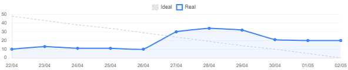<br>
  <sup>Fonte: Material produzido pelos autores, 2026.</sup>
</div>

O primeiro gráfico compara a linha ideal de evolução da sprint com a linha real registrada ao longo dos dias. Observa-se que a curva real não acompanhou a redução gradual esperada, apresentando crescimento significativo entre os dias 27/04 e 29/04. Esse comportamento indica concentração de movimentações ou ajustes no meio da sprint, sugerindo que parte do trabalho foi reorganizada ou registrada depois do início do ciclo. Como aprendizado, a equipe identificou a necessidade de manter o board atualizado diariamente para melhorar a previsibilidade e evitar leituras distorcidas do progresso.

<div align="center">
<sub>Gráfico 02 - Conformidade dos commits da Sprint 1</sub><br>
  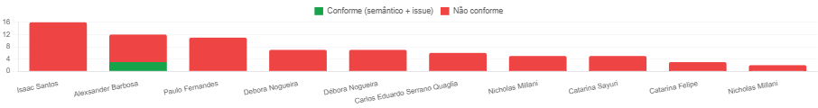<br>
  <sup>Fonte: Material produzido pelos autores, 2026.</sup>
</div>

O segundo gráfico apresenta a conformidade dos commits com o padrão definido pela equipe, considerando uso semântico e vínculo com issue. A predominância de commits não conformes mostra que, na Sprint 1, o padrão ainda não estava consolidado entre os integrantes. Esse resultado reforçou a necessidade de padronizar mensagens, relacionar commits às issues e orientar a equipe sobre o uso consistente de Conventional Commits.

<div align="center">
<sub>Gráfico 03 - Distribuição de atividade por integrante na Sprint 1</sub><br>
  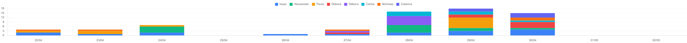<br>
  <sup>Fonte: Material produzido pelos autores, 2026.</sup>
</div>

O terceiro gráfico mostra a distribuição de atividades por integrante ao longo dos dias da sprint. A maior concentração ocorre entre 28/04 e 30/04, indicando aumento de atividade próximo ao fechamento do ciclo. Apesar de haver participação de diferentes membros, a concentração temporal sugere que a equipe ainda precisava melhorar a distribuição do esforço ao longo da sprint, evitando acúmulo de trabalho no final.

##### Sprint 2

A Sprint 2 permite observar a evolução da equipe em relação ao primeiro ciclo, principalmente na atualização do board, no fechamento de tarefas e na adoção dos padrões de commit. Os gráficos abaixo foram organizados em pares quando representam visões complementares da mesma dimensão de gestão.

<div align="center">
<table>
  <tr>
    <td width="50%" align="center">
      <sub>Gráfico 04 - Evolução ideal e real da Sprint 2</sub><br>
      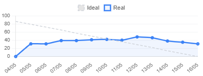<br>
      <sup>Fonte: Material produzido pelos autores, 2026.</sup>
    </td>
    <td width="50%" align="center">
      <sub>Gráfico 05 - Issues concluídas e em aberto na Sprint 2</sub><br>
      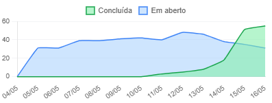<br>
      <sup>Fonte: Material produzido pelos autores, 2026.</sup>
    </td>
  </tr>
</table>
</div>

Os gráficos 04 e 05 mostram visões complementares do fluxo da Sprint 2. No gráfico de evolução ideal e real, a linha real se mantém acima da curva ideal em boa parte da sprint, indicando que o volume de trabalho em aberto permaneceu elevado por mais tempo do que o esperado. Já o gráfico de issues concluídas e em aberto mostra avanço expressivo no fechamento das tarefas nos dias finais, especialmente entre 14/05 e 16/05. Essa leitura indica que a equipe conseguiu concluir uma parte relevante do escopo, mas ainda concentrou fechamentos perto do encerramento da sprint, o que impacta a previsibilidade.

<div align="center">
<sub>Gráfico 06 - Evolução temporal de atividade da Sprint 2</sub><br>
  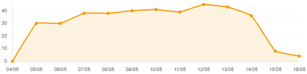<br>
  <sup>Fonte: Material produzido pelos autores, 2026.</sup>
</div>

O gráfico 06 reforça a leitura de acúmulo de atividade ao longo da sprint. A métrica cresce nos primeiros dias, permanece em patamar elevado durante boa parte do ciclo e cai apenas próximo ao final. Esse comportamento sugere que a equipe manteve um volume significativo de trabalho em andamento antes de reduzir pendências no fechamento, evidenciando a necessidade de acompanhar gargalos com mais frequência durante a execução.

<div align="center">
<table>
  <tr>
    <td width="45%" align="center">
      <sub>Gráfico 07 - Conformidade dos commits da Sprint 2</sub><br>
      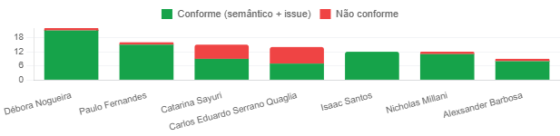<br>
      <sup>Fonte: Material produzido pelos autores, 2026.</sup>
    </td>
    <td width="55%" align="center">
      <sub>Gráfico 08 - Distribuição de atividade por integrante na Sprint 2</sub><br>
      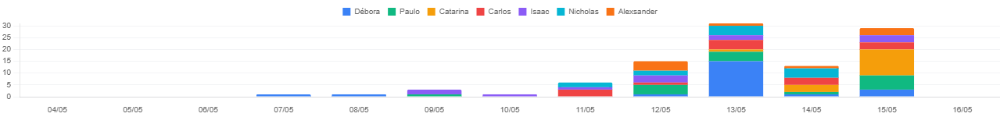<br>
      <sup>Fonte: Material produzido pelos autores, 2026.</sup>
    </td>
  </tr>
</table>
</div>

Os gráficos 07 e 08 mostram evolução em organização técnica e participação da equipe. Em comparação com a Sprint 1, a proporção de commits conformes aumentou, indicando melhor adesão ao padrão semântico e ao vínculo com issues. A distribuição de atividade também mostra maior participação de diferentes integrantes, com maior concentração nos dias 13/05 e 15/05. Assim, a Sprint 2 evidencia avanço na colaboração e na padronização, mas ainda apresenta concentração temporal de entregas.

##### Sprint 3

A Sprint 3 evidencia uma nova etapa de amadurecimento do fluxo da equipe. Os gráficos mostram melhora no fechamento de tarefas ao final do ciclo e maior volume de atividade registrada, mas também indicam concentração relevante de trabalho nos últimos dias da sprint.

<div align="center">
<table>
  <tr>
    <td width="50%" align="center">
      <sub>Gráfico 09 - Evolução ideal e real da Sprint 3</sub><br>
      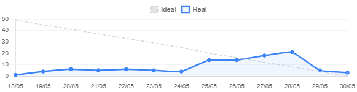<br>
      <sup>Fonte: Material produzido pelos autores, 2026.</sup>
    </td>
    <td width="50%" align="center">
      <sub>Gráfico 10 - Issues concluídas e em aberto na Sprint 3</sub><br>
      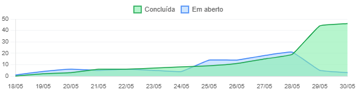<br>
      <sup>Fonte: Material produzido pelos autores, 2026.</sup>
    </td>
  </tr>
</table>
</div>

Os gráficos 09 e 10 mostram que a Sprint 3 teve crescimento do trabalho real entre 25/05 e 28/05, seguido de queda acentuada no fim do ciclo. No gráfico de issues concluídas e em aberto, observa-se aumento expressivo das tarefas concluídas entre 28/05 e 30/05, ao mesmo tempo em que as tarefas em aberto caem. Isso indica que a equipe conseguiu avançar no fechamento do escopo, mas concentrou parte importante das conclusões no encerramento da sprint.

<div align="center">
<sub>Gráfico 11 - Evolução temporal de atividade da Sprint 3</sub><br>
  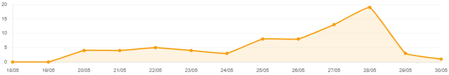<br>
  <sup>Fonte: Material produzido pelos autores, 2026.</sup>
</div>

O gráfico 11 reforça a tendência de aumento progressivo da atividade até 28/05, quando ocorre o maior pico da sprint. A queda nos dias seguintes sugere fechamento ou estabilização das pendências, mas o pico próximo ao fim evidencia que o esforço ainda ficou concentrado em uma janela curta. Esse comportamento confirma a necessidade de melhorar a distribuição das tarefas ao longo da sprint e antecipar validações.

<div align="center">
<table>
  <tr>
    <td width="45%" align="center">
      <sub>Gráfico 12 - Conformidade dos commits da Sprint 3</sub><br>
      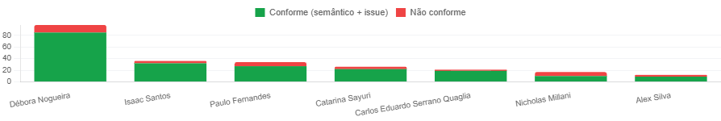<br>
      <sup>Fonte: Material produzido pelos autores, 2026.</sup>
    </td>
    <td width="55%" align="center">
      <sub>Gráfico 13 - Distribuição de atividade por integrante na Sprint 3</sub><br>
      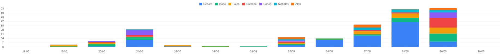<br>
      <sup>Fonte: Material produzido pelos autores, 2026.</sup>
    </td>
  </tr>
</table>
</div>

Os gráficos 12 e 13 mostram que a conformidade dos commits continuou majoritariamente positiva na Sprint 3, com predominância de commits conformes em relação aos não conformes. A distribuição de atividade por integrante mostra participação de vários membros, mas com concentração elevada em alguns dias, especialmente 28/05 e 29/05. Assim, a Sprint 3 demonstra avanço na padronização técnica, porém mantém o desafio de distribuir melhor o esforço no decorrer do ciclo.

##### Sprint 4

A Sprint 4 teve sua primeira semana impactada por feriado, reduzindo a quantidade de dias úteis disponíveis para execução. Esse contexto ajuda a explicar a menor movimentação inicial e a concentração de atividade na segunda metade do ciclo. Ainda assim, os gráficos indicam avanço no fechamento de tarefas e manutenção da padronização técnica dos commits.

<div align="center">
<table>
  <tr>
    <td width="50%" align="center">
      <sub>Gráfico 14 - Evolução ideal e real da Sprint 4</sub><br>
      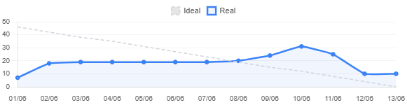<br>
      <sup>Fonte: Material produzido pelos autores, 2026.</sup>
    </td>
    <td width="50%" align="center">
      <sub>Gráfico 15 - Issues concluídas e em aberto na Sprint 4</sub><br>
      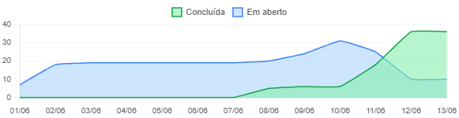<br>
      <sup>Fonte: Material produzido pelos autores, 2026.</sup>
    </td>
  </tr>
</table>
</div>

Os gráficos 14 e 15 mostram que a linha real permaneceu relativamente estável no início da Sprint 4 e cresceu entre 08/06 e 10/06, antes de cair nos últimos dias. Essa dinâmica deve ser analisada considerando o feriado na primeira semana, que reduziu a capacidade inicial da equipe. No gráfico de issues concluídas e em aberto, o avanço mais forte nas conclusões acontece a partir de 10/06, quando as tarefas concluídas ultrapassam as tarefas em aberto. Isso indica recuperação do ritmo na segunda metade da sprint, mas também reforça o risco de concentração de entregas perto do encerramento.

<div align="center">
<sub>Gráfico 16 - Evolução temporal de atividade da Sprint 4</sub><br>
  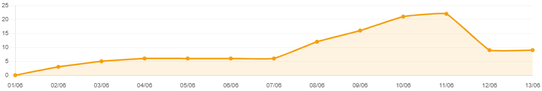<br>
  <sup>Fonte: Material produzido pelos autores, 2026.</sup>
</div>

O gráfico 16 reforça o deslocamento da atividade para a segunda metade da Sprint 4. A métrica cresce de forma gradual até 07/06 e apresenta aumento mais forte entre 08/06 e 11/06, período em que a equipe compensou a menor disponibilidade da primeira semana. A queda posterior indica fechamento de pendências, mas a concentração confirma a importância de ajustar capacidade e planejamento quando houver feriados.

<div align="center">
<table>
  <tr>
    <td width="45%" align="center">
      <sub>Gráfico 17 - Conformidade dos commits da Sprint 4</sub><br>
      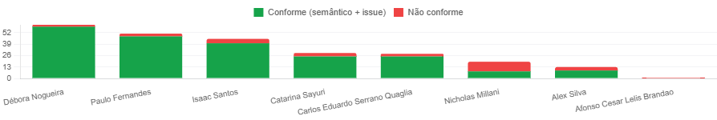<br>
      <sup>Fonte: Material produzido pelos autores, 2026.</sup>
    </td>
    <td width="55%" align="center">
      <sub>Gráfico 18 - Distribuição de atividade por integrante na Sprint 4</sub><br>
      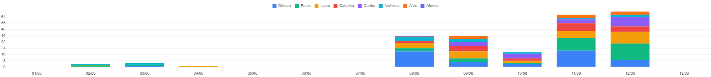<br>
      <sup>Fonte: Material produzido pelos autores, 2026.</sup>
    </td>
  </tr>
</table>
</div>

Os gráficos 17 e 18 mostram que a conformidade dos commits permaneceu majoritariamente positiva na Sprint 4, indicando consolidação maior do padrão semântico e do vínculo com issues. A distribuição de atividade por integrante mostra participação ampla da equipe, com maior concentração nos dias 08/06, 11/06 e 12/06. Considerando o feriado da primeira semana, essa concentração é parcialmente explicada pela menor janela útil inicial, mas segue como ponto de atenção para a previsibilidade do fluxo.

##### Síntese Comparativa das Sprints

Os gráficos a seguir consolidam a evolução das principais métricas das quatro primeiras sprints, permitindo observar o comportamento geral da equipe ao longo do projeto. A Sprint 5 não foi incluída nestes gráficos por ser a sprint final de consolidação, fechamento e análise geral do projeto; seus resultados devem ser registrados na retrospectiva final da seção 6.1. Eles funcionam como fechamento da análise gráfica por sprint, relacionando volume de entregas, taxa de conclusão e conformidade das issues e commits.

<div align="center">
<sub>Gráfico 19 - Comparação normalizada das principais métricas por sprint</sub><br>
  <br>
  <sup>Fonte: Material produzido pelos autores, 2026.</sup>
</div>

O gráfico 19 apresenta uma visão integrada das principais métricas em escala normalizada. Observa-se crescimento consistente no volume de entregas entre as sprints, especialmente a partir da Sprint 3, além de evolução expressiva na conformidade das issues e commits após a Sprint 1. A taxa de conclusão oscila mais, com queda na Sprint 2, recuperação na Sprint 3 e nova redução na Sprint 4, indicando que o aumento de volume não elimina a necessidade de controlar escopo, dependências e capacidade disponível.

<div align="center">
<sub>Gráfico 20 - Taxa de conclusão por sprint</sub><br>
  <br>
  <sup>Fonte: Material produzido pelos autores, 2026.</sup>
</div>

<div align="center">
<sub>Gráfico 21 - Evolução da conformidade das issues e commits por sprint</sub><br>
  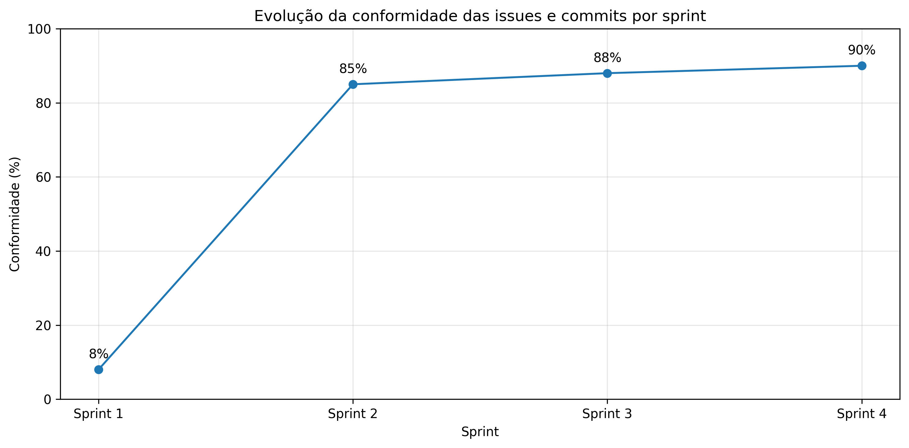<br>
  <sup>Fonte: Material produzido pelos autores, 2026.</sup>
</div>

Os gráficos 20 e 21 detalham duas dimensões importantes da evolução da equipe. A taxa de conclusão mostra desempenho alto na Sprint 1, queda na Sprint 2, pico na Sprint 3 e redução na Sprint 4, que deve ser interpretada considerando o feriado e a redução de dias úteis no início do ciclo. Além disso, parte da diferença entre tarefas concluídas e tarefas em aberto ocorreu por falta de atenção da equipe na movimentação dos cards: algumas issues foram revisadas e realizadas na prática, mas não foram movidas para review ou finalizadas no Kanban. Isso gerou uma despadronização entre o estado real das entregas e o status registrado no board. Já a conformidade das issues e commits apresenta evolução contínua, saindo de um patamar baixo na Sprint 1 para níveis próximos de 90% na Sprint 4. Em conjunto, os gráficos indicam amadurecimento das práticas de gestão e versionamento, ainda que a previsibilidade de conclusão continue sensível a escopo, calendário, concentração de entregas e atualização correta dos cards.

#### 6.2.3 Evolução Quantitativa por Sprint

As métricas quantitativas foram consolidadas a partir dos gráficos apresentados na seção 6.2.2 e dos dados de planejamento registrados neste documento. Para cumprir a análise de evolução do projeto, foram priorizadas métricas diretamente aferidas ou calculadas com base nas evidências disponíveis: issues planejadas, velocity/issues concluídas, taxa de conclusão, conformidade de issues e commits e esforço estimado por tamanho.

Embora lead time e cycle time sejam métricas relevantes para análise de fluxo, elas não foram utilizadas como métricas quantitativas nesta consolidação, pois exigem o histórico completo de criação, início efetivo, movimentação entre colunas e fechamento de cada issue. Como esse histórico não foi extraído de forma padronizada ao longo de todas as sprints, optou-se por não gerar valores artificiais. Em seu lugar, foi utilizada a métrica complementar de esforço estimado por tamanho, baseada no t-shirt sizing das tasks.

Também foi incluído o esforço estimado por sprint com base na técnica de t-shirt sizing. Essa métrica não representa lead time ou cycle time real, pois não mede o tempo de permanência das issues no fluxo do Kanban nem o tempo efetivo entre início e conclusão. O objetivo é estimar o volume de esforço associado às tasks fechadas ou planejadas, conforme a base utilizada em cada sprint.

Foram adotados os seguintes pesos para cálculo:

| Tamanho | Valor adotado |
|---|---:|
| PP | 15 minutos |
| P | 30 minutos |
| M | 60 minutos |
| G | 120 minutos |
| GG | 180 minutos |

A fórmula utilizada foi:

```text
Esforço estimado da sprint =
(qtd_PP x 15) + (qtd_P x 30) + (qtd_M x 60) + (qtd_G x 120) + (qtd_GG x 180)

Esforço estimado em horas = esforço estimado em minutos / 60
```

As métricas de issues planejadas, velocity/issues concluídas, taxa de conclusão e conformidade foram consolidadas a partir dos gráficos de acompanhamento, Kanban e registros das issues. Já o esforço estimado por tamanho foi calculado a partir das issues fechadas com marcação de tamanho nas Sprints 1 a 4. Na Sprint 5, por se tratar da sprint final ainda em consolidação, foi usado o esforço planejado das 26 tasks registradas.

| Métrica | Sprint 1 | Sprint 2 | Sprint 3 | Sprint 4 | Sprint 5 | Tendência observada |
|---|---:|---:|---:|---:|---:|---|
| Issues planejadas | 70 | 85 | 48 | 46 | 26 | O planejamento variou conforme escopo e refinamento de cada sprint; a Sprint 5 correspondeu ao planejamento final de consolidação. |
| Velocity / Issues concluídas | 67 | 55 | 46 | 36 | A consolidar após fechamento final da Sprint 5 | A velocity foi medida pela quantidade de issues concluídas por sprint, representando a capacidade de entrega da equipe em cada ciclo. |
| Taxa de conclusão | 95,7% | 64,7% | 95,8% | 78,3% | A consolidar após fechamento final da Sprint 5 | A taxa oscilou ao longo do projeto, indicando melhora na Sprint 3 e queda na Sprint 4 por capacidade reduzida e problemas de atualização do board. Na Sprint 5, as avaliações acadêmicas também atrapalharam parcialmente a execução da consolidação final. |
| Conformidade de issues e commits | 8% | 85% | 88% | 90% | A consolidar após fechamento final da Sprint 5 | Houve evolução contínua da padronização técnica, indicando amadurecimento no vínculo entre commits e issues. |
| Esforço estimado por tamanho | 59,2 horas | 78,5 horas | 73 horas | 73 horas | 40,5 horas | Permite comparar o volume de esforço considerado por sprint, mas não substitui lead time ou cycle time real. |

Para a Sprint 5, o esforço estimado foi calculado a partir das 26 tasks planejadas: 1 task P, 10 tasks M e 15 tasks G. O cálculo foi: `(1 x 30) + (10 x 60) + (15 x 120) = 2430 minutos`, equivalente a `40,5 horas`. Como as Sprints 1 a 4 foram calculadas a partir das issues fechadas com tamanho registrado, seus valores representam o esforço estimado do trabalho fechado e documentado no export, podendo apresentar diferença em relação ao volume total exibido nos gráficos.

#### 6.2.4 Análise de Tendências

| Tendência analisada | Evidência | Interpretação | Conclusão |
|---|---|---|---|
| Relação entre planejamento e conclusão | As issues planejadas variaram de 70 na Sprint 1 para 85 na Sprint 2, 48 na Sprint 3, 46 na Sprint 4 e 26 na Sprint 5. As issues concluídas oscilaram entre 67, 55, 46 e 36 nas quatro primeiras sprints. | A equipe ajustou o escopo ao longo do projeto, mas a conclusão não acompanhou o planejamento de forma uniforme em todas as sprints. Na Sprint 2, parte dos cards foi movida para concluído depois do período de fechamento, e na Sprint 5 as avaliações acadêmicas reduziram a disponibilidade da equipe. | A previsibilidade melhorou na Sprint 3, mas ainda depende de escopo bem calibrado, atenção ao calendário acadêmico e atualização correta dos cards. |
| Melhora na conformidade de issues e commits | A conformidade saiu de 8% na Sprint 1 para cerca de 90% na Sprint 4. | O padrão de commits, vínculo com issues e organização técnica foi assimilado progressivamente. | A equipe amadureceu nas práticas de versionamento e gestão de configuração. |
| Oscilação na taxa de conclusão | A taxa de conclusão apresentou queda na Sprint 2, recuperação na Sprint 3 e nova redução na Sprint 4. | A previsibilidade foi afetada por escopo, calendário, feriado na Sprint 4 e atualização incorreta de alguns cards no Kanban. | A equipe deve manter atenção ao fechamento correto das issues e ao ajuste de capacidade em semanas reduzidas. |
| Estimativa de esforço por tamanho | O esforço estimado foi calculado para todas as sprints: 59,2h na Sprint 1, 78,5h na Sprint 2, 73h na Sprint 3, 73h na Sprint 4 e 40,5h planejadas na Sprint 5. | O t-shirt sizing permite estimar o volume de esforço considerado em cada sprint, mas não representa o tempo real de fluxo das issues. | A equipe deve usar essa métrica como apoio ao planejamento, sem confundi-la com lead time ou cycle time. |
| Concentração de atividade no fim das sprints | Os gráficos por sprint mostram picos próximos ao encerramento dos ciclos. | Parte das entregas foi concluída ou registrada tardiamente, especialmente em sprints com maior volume ou menor janela útil. | É necessário distribuir melhor o esforço e atualizar o board de forma contínua. |
| Diferença entre execução real e status do board | Algumas issues foram realizadas e revisadas, mas não foram movidas para review ou concluídas no Kanban. | O board nem sempre refletiu com precisão o estado real das entregas. | A equipe deve padronizar o fechamento dos cards para evitar distorções nas métricas. |

#### 6.2.5 Conclusão das Métricas

A análise das métricas evidencia uma evolução consistente da maturidade da equipe ao longo do projeto. O principal avanço observado foi na conformidade de issues e commits, que saiu de 8% na Sprint 1 para 90% na Sprint 4, demonstrando amadurecimento no uso de commits semânticos, vínculo entre entregas e issues, rastreabilidade técnica e gestão de configuração.

Em relação à capacidade de entrega, a equipe manteve volume significativo de conclusão nas quatro primeiras sprints, com destaque para a Sprint 3, que apresentou a melhor relação entre issues planejadas e concluídas. A taxa de conclusão, porém, oscilou ao longo do projeto, indicando que a previsibilidade foi influenciada por fatores como escopo planejado, movimentação tardia de cards na Sprint 2, feriado na Sprint 4, avaliações acadêmicas durante a Sprint 5 e falhas pontuais na atualização do Kanban.

A análise também mostrou que parte das entregas ficou concentrada nos dias finais das sprints. Esse comportamento demonstra capacidade de reação da equipe diante dos prazos, mas também aponta riscos de sobrecarga, revisão tardia e distorção das métricas de acompanhamento. Além disso, a diferença entre execução real e status registrado no board evidenciou a necessidade de maior disciplina na movimentação dos cards, principalmente para que as métricas reflitam com precisão o estado das entregas.

As métricas de lead time e cycle time não foram calculadas por dependerem de histórico detalhado de movimentação dos cards; por isso, a análise priorizou métricas aferíveis e utilizou o esforço estimado por tamanho como complemento ao planejamento.

Conclui-se que o grupo evoluiu em organização, rastreabilidade, padronização técnica e entendimento do próprio processo de trabalho. Para projetos futuros, recomenda-se registrar lead time e cycle time desde a primeira sprint, atualizar o Kanban como parte obrigatória da Definition of Done, considerar feriados e avaliações acadêmicas no planejamento e distribuir melhor as entregas ao longo do ciclo. Dessa forma, a equipe tende a aumentar a previsibilidade, reduzir distorções nas métricas e melhorar a qualidade da gestão evolutiva.

---

### 6.3 Análise Post-Mortem Final
Esta seção consolida a análise post-mortem do RecomendaShow, considerando o ciclo completo de desenvolvimento, desde a definição inicial do problema e das personas até a consolidação final de backend, frontend, banco de dados, recomendação, deploy, testes e documentação. Como a Sprint 5 representa o encerramento do projeto, a análise não propõe novas mudanças para o produto atual; ela registra uma leitura crítica sobre o que funcionou, o que gerou dificuldade e quais aprendizados podem orientar projetos acadêmicos futuros.

#### 6.3.1 Pontos Positivos do Projeto


| Ponto positivo | Evidência ao longo do projeto | Lição aprendida |
|---|---|---|
| Evolução clara da solução ao longo das sprints | O projeto saiu da definição de problema, público e requisitos para uma solução com aplicativo mobile, API backend, banco PostgreSQL, serviço de inferência, modelo de recomendação e documentação de deploy. | A divisão por sprints permitiu transformar uma proposta ampla em entregas progressivas, mesmo com ajustes e retrabalho ao longo do caminho. |
| Boa integração entre visão de produto e implementação técnica | As personas, jornadas, requisitos, arquitetura e testes foram conectados às funcionalidades implementadas, como onboarding, busca, favoritos, avaliações, catálogo, recomendações e cadastro com endereço. | Documentar o produto junto com a implementação ajuda a manter a solução orientada ao usuário, não apenas à entrega de código. |
| Separação técnica entre os principais módulos do código | O repositório organiza frontend mobile, backend, banco de dados, machine learning, serviço de inferência, deploy e documentação em áreas próprias. | A separação de responsabilidades facilita entendimento, manutenção e evolução, especialmente em projetos com múltiplas tecnologias. |
| Consolidação de um motor de recomendação documentado | O modelo híbrido combina SVD com afinidade por categoria, possui documentação própria, artefatos de treino, serviço de inferência e contrato com o backend via tabela `recomendacoes`. | Recomendações personalizadas exigem tanto implementação quanto explicação técnica, incluindo dados usados, limitações, fallback e métricas. |
| Validação por diferentes tipos de teste | A documentação registra testes unitários, integração, frontend, inferência, requisitos não funcionais, API externa, desempenho e usabilidade, com evidências associadas. | A qualidade do projeto fica mais convincente quando há múltiplas formas de validação, cobrindo código, experiência do usuário e requisitos de operação. |
| Aprimoramento da gestão ao longo do tempo | As retrospectivas mostram evolução em comunicação, uso do Kanban, detalhamento de tasks, identificação de riscos e preparação da entrega final. | A gestão evolutiva ganha valor quando registra não só o que foi feito, mas também como a equipe aprendeu a trabalhar melhor. |

#### 6.3.2 Oportunidades de Melhoria


| Oportunidade de melhoria | Como apareceu no projeto | Recomendação para projetos futuros |
|---|---|---|
| Reduzir acúmulo de documentação no final | Várias revisões importantes de documentação, critérios de entrega, links, evidências e alinhamento técnico ficaram concentradas na Sprint 5. | Manter documentação viva desde as primeiras sprints, com revisão obrigatória sempre que uma funcionalidade ou decisão técnica mudar. |
| Melhorar granularidade e previsibilidade das tarefas | As retrospectivas das sprints anteriores indicaram tasks grandes, dependências entre atividades e dificuldade de medir progresso real. | Quebrar tarefas grandes em entregas menores, com critérios de aceite objetivos e responsáveis definidos desde o planejamento. |
| Antecipar validações técnicas críticas | Backend, frontend, banco, inferência, deploy e testes precisaram ser revisados de forma transversal no encerramento. | Reservar checkpoints técnicos intermediários para build, execução, integração e testes antes da sprint final. |
| Padronizar evidências desde sua geração | Evidências de testes, prints, resultados exportados e registros de validação precisaram ser organizados no fechamento do projeto. | Definir uma estrutura padrão para evidências com nome, data, contexto, comando executado e relação com o requisito validado. |
| Formalizar decisões e limitações continuamente | Algumas limitações técnicas, como cobertura do recomendador, mapeamento entre usuários do dataset e usuários reais, deploy manual e riscos de operação, ficaram mais explícitas na consolidação final. | Registrar decisões arquiteturais, limitações e trade-offs no momento em que ocorrem, evitando reconstruir justificativas apenas no encerramento. |
| Integrar gestão e critérios de avaliação desde o início | Parte da Sprint 5 foi dedicada a verificar aderência a README, licença, execução local, critérios do Escritório de Projetos e organização do repositório. | Mapear os critérios avaliativos já na Sprint 1 e revisá-los como parte do Definition of Done de cada entrega. |


#### 6.3.3 Lições Aprendidas Consolidadas


| Tema | Lição aprendida | Aplicação futura |
|---|---|---|
| Produto | Personas, jornadas e requisitos precisam orientar decisões concretas de funcionalidade, não apenas descrever perfis de usuário. | Usar cada dor mapeada como entrada para funcionalidades, critérios de aceite e testes de experiência. |
| Arquitetura | Separar frontend, backend, banco, recomendação e inferência aumenta clareza, mas exige contratos bem documentados entre os módulos. | Definir contratos de API, tabelas, variáveis de ambiente e fluxos de dados antes de avançar para integrações complexas. |
| Machine Learning | Um modelo de recomendação só é completo quando seus dados, métricas, limitações, fallback e integração com o produto são documentados. | Tratar modelos de ML como componentes de software versionados, testáveis e auditáveis. |
| Testes | A combinação de testes automatizados, manuais, usabilidade, desempenho e requisitos não funcionais oferece uma visão mais realista da qualidade. | Planejar testes desde o início da implementação, associando cada suíte a riscos específicos do produto. |
| Gestão | Retrospectivas são mais úteis quando conectam problemas recorrentes a evidências, impacto e ações concretas. | Evitar retrospectivas genéricas e manter um histórico de evolução entre sprints. |
| Documentação | Documentação final não deve ser apenas um relatório; ela precisa permitir que outra pessoa entenda, execute, avalie e mantenha o projeto. | Escrever documentos como artefatos operacionais, com contexto, comandos, decisões, evidências e limitações. |
| Entrega acadêmica | Critérios de avaliação, evidências e rastreabilidade têm peso semelhante ao funcionamento técnico da solução. | Planejar a entrega como produto completo: código, documentação, testes, apresentação, justificativas e organização do repositório. |


#### 6.3.4 Recomendações Finais


| Recomendação | Justificativa | Aplicação futura |
|---|---|---|
| Manter um checklist de entrega desde a primeira sprint | O projeto exigiu validação de muitos itens: README, licença, execução local, variáveis de ambiente, deploy, testes, documentos e evidências. | Criar um checklist vivo e revisá-lo a cada sprint, evitando concentração de conferências no encerramento. |
| Vincular cada requisito a evidências de implementação e teste | A rastreabilidade entre requisitos, código, testes e documentação fortalece a avaliação da solução. | Usar uma matriz simples que relacione requisito, funcionalidade, arquivo principal, teste e evidência. |
| Registrar decisões técnicas no momento em que são tomadas | Decisões sobre arquitetura, deploy, recomendação, banco e limitações ficaram mais fáceis de justificar quando documentadas. | Manter um log de decisões arquiteturais e de produto, mesmo que simples, ao longo do desenvolvimento. |
| Planejar deploy e operação antes da etapa final | O deploy do serviço de recomendação envolveu Docker, VM, nginx, variáveis de ambiente, banco remoto e verificação de health. | Tratar deploy como parte do desenvolvimento, não como uma atividade isolada no final do projeto. |
| Definir responsáveis por revisão de cada artefato | A entrega final envolveu muitos documentos e módulos técnicos, aumentando o risco de inconsistências. | Atribuir responsáveis e revisores por documento, módulo e grupo de evidências desde o início de cada sprint. |
| Considerar limitações de ML como parte do escopo | O recomendador possui riscos próprios, como cold-start, dados históricos enviesados, cobertura de testes e dependência de mapeamento de usuários. | Incluir avaliação, explicabilidade, viés, fallback e atualização de modelo como critérios de qualidade do componente de recomendação. |
| Reservar tempo real para refinamento final | A Sprint 5 demonstrou que a etapa final exige leitura transversal do projeto, não apenas pequenos ajustes. | Planejar a última sprint com menor carga de novas funcionalidades e maior foco em validação, consistência e apresentação. |


#### 6.3.5 Conclusão do Post-Mortem


O post-mortem do RecomendaShow indica que o projeto alcançou uma entrega tecnicamente ampla e coerente com a proposta de recomendação de experiências culturais para a Aventura Teatros. Ao longo das sprints, a equipe construiu uma solução que articula produto, dados, experiência mobile, backend, banco de dados, recomendação personalizada, deploy e validação por testes.


Os principais ganhos estiveram na capacidade de transformar uma necessidade de negócio em uma arquitetura funcional e documentada, com evidências de implementação e preocupação com experiência do usuário, segurança, LGPD, desempenho e explicabilidade. Por outro lado, o projeto também revelou desafios típicos de entregas acadêmicas complexas: concentração de revisões no fim, dependências entre frentes técnicas, necessidade de evidências mais padronizadas e dificuldade de manter documentação, código e critérios de avaliação sempre sincronizados.


Como aprendizado final, a equipe conclui que projetos com múltiplas frentes técnicas precisam tratar documentação, testes, gestão e deploy como partes contínuas do desenvolvimento, e não como etapas finais separadas. A Sprint 5 cumpriu o papel de consolidar a entrega, explicitar limitações e organizar os aprendizados, deixando uma base mais clara para avaliação do projeto e para a execução de trabalhos futuros com escopo semelhante.


---

## 7. Atendimento aos Critérios do Escritório de Projetos

### 7.1 README

| Nº | Critério | Evidência no repositório/documentação | Status | Ajuste necessário, se houver |
|---|---|---|---|---|
| 1 | Nome do projeto presente? | `README.md` inicia com `# RecomendaShow` e `## Projeto - RecomendaShow`. | Atendido | Nenhum ajuste identificado. |
| 2 | Nome do grupo presente? | `README.md` apresenta `## Grupo 2 - Aventureiros`. | Atendido | Nenhum ajuste identificado. |
| 3 | Integrantes descritos? | Seção `Equipe` do `README.md` lista os sete integrantes. | Atendido | Nenhum ajuste identificado. |
| 4 | Links presentes ou corretos dos integrantes? | Cada integrante está listado com link de LinkedIn no formato `- [Nome](link)`. | Atendido | Nenhum ajuste identificado |
| 5 | Apresenta descrição curta do projeto? | `README.md` apresenta `Recomendação de Espetáculos no Portal Aventura` e a seção `Descrição do Projeto`. | Atendido | Nenhum ajuste identificado. |
| 6 | Apresenta estrutura de pastas conforme o modelo? | `README.md` possui a seção `Estrutura do Repositório`, com `docs/`, `src/` e os principais módulos da solução. | Atendido | Nenhum ajuste identificado. |
| 8 | Apresenta histórico de lançamentos? | `README.md` possui a seção `Histórico de Versões`. | Atendido | Nenhum ajuste identificado. |
| 9 | Histórico de lançamentos adequado? | Histórico apresenta versões `0.1.0`, `0.2.0`, `0.3.0` e `0.4.0`, com datas e descrições. | Atendido | Nenhum ajuste identificado. |
| 10 | Apresenta licença? | `README.md` possui seção `Licença` com Creative Commons Attribution 4.0. | Atendido | Nenhum ajuste identificado. |
| 11 | Inteli consta na licença? | A licença menciona e linka `Inteli`. | Atendido | Nenhum ajuste identificado. |
| 12 | Nome do grupo ou integrantes presentes na licença? | A licença menciona explicitamente `Grupo 2 - Aventureiros` e lista os integrantes. | Atendido | Nenhum ajuste identificado. |
| 13 | Link dos integrantes ou grupo corretos na licença? | A licença mantém link do repositório e links corretos dos integrantes. | Atendido | Nenhum ajuste identificado. |
| 15 | Não apresenta nenhuma outra imagem além da logo do Inteli? | Não foram identificadas imagens no `README.md`. | Atendido | Caso o critério exija a logo do Inteli, adicionar apenas essa imagem. |
| 16 | Instruções iniciais removidas? | Não foram encontradas instruções iniciais de template no `README.md`. | Atendido | Nenhum ajuste identificado. |

### 7.2 Documentação

| Nº | Critério | Evidência no repositório/documentação | Status | Ajuste necessário, se houver |
|---|---|---|---|---|
| 1 | Apresenta pasta `documentos`, `docs` ou `documents` na raiz do projeto? | Existe pasta `docs` na raiz. | Atendido | Nenhum ajuste identificado. |
| 2 | Apresenta arquivo `Index.md` preenchido que indexa todos os documentos da pasta `docs`? | Existe `docs/Index.md`, indexando os documentos principais encontrados na pasta `docs`. | Atendido | Nenhum ajuste identificado. |
| 3 | Documentação encontrada? | A pasta `docs` contém `Projeto.md`, `GestaoProjeto.md`, `Gestao_Projeto_Configuracao.md`, `Modelo_Recomendacao.md` e `projeto_visual.md`. | Atendido | Nenhum ajuste identificado. |
| 4 | Sumário de todos os documentos `.md` navegáveis? | Documentos principais em `docs` possuem seção `Sumário`. | Atendido | A conferência manual dos links internos será revisada na Sprint 5 final. |
| 5 | Instruções e observações dos documentos removidas? | Não foram identificadas instruções iniciais de template nos documentos principais. A seção de planejamento da Sprint 5 em `GestaoProjeto.md` foi preenchida com as 26 tasks finais. | Atendido | Nenhum ajuste identificado em `GestaoProjeto.md`. |
| 6 | Links acessíveis? | Links locais principais do `docs/Index.md` apontam para documentos existentes na pasta `docs`. | Atendido | A validação manual de links externos, quando houver, será revisada na Sprint 5 final. |
| 7 | Não compartilha dados sensíveis? | Documentação não expõe senhas, tokens ou chaves reais; o README orienta uso de `.env`, o `.gitignore` impede versionamento de `.env` e apenas templates como `.env.example` e `.env.deploy.example` estão versionados. | Atendido | Nenhum ajuste identificado. |
| 8 | Possui referências bibliográficas, se for o caso? | `docs/Projeto.md` contém seção de referências bibliográficas. | Atendido | Nenhum ajuste identificado. |
| 9 | Formatação adequada? | Documentos principais usam Markdown com títulos, tabelas e sumários. | Atendido | A revisão final de links e quebras de linha será realizada na Sprint 5 final antes da entrega. |
| 10 | Apresenta todas as seções preenchidas? | `GestaoProjeto.md` não possui mais placeholders de tasks; ainda há campos de consolidação final de testes em `Projeto.md`. | Parcialmente atendido | A análise consolidada dos testes em `Projeto.md` será revisada e completada na Sprint 5 final antes da entrega. |
| 11 | Arquivos de instrução `.txt` ou não relevantes para o projeto foram removidos? | Não há arquivos `.txt` relevantes na raiz ou em `docs`; há arquivos gerados em ambientes/dependências. | Parcialmente atendido | A verificação de dependências geradas e pastas como `.venv311` e `node_modules` será revisada na Sprint 5 final. |
| 12 | Links acessíveis sem solicitação de permissão? | Links de documentos locais são relativos; links externos dependem de acesso público. | Parcialmente atendido | A validação de links externos e remoção de links que exijam permissão será revisada na Sprint 5 final. |

### 7.3 Aplicação

| Nº | Critério | Evidência no repositório/documentação | Status | Ajuste necessário, se houver |
|---|---|---|---|---|
| 1 | Possui pasta `src`? | Existe pasta `src` na raiz do projeto. | Atendido | Nenhum ajuste identificado. |
| 2 | Possui pasta para a lógica/codificação da aplicação? | `src` contém `backend`, `frontend`, `inference-service`, `ml`, `recommendation-service` e `training-service`. | Atendido | Nenhum ajuste identificado. |
| 3 | Possui arquivo `README.md` com informações sobre como executar a aplicação? | `README.md` possui seções `Configuração` e `Execução Local`, com comandos para banco, frontend, backend, ML e inferência. | Atendido | A conferência dos comandos com o estado atual do código será revisada na Sprint 5 final. |

---

## 8. Uso das Políticas de Gestão de Configuração

As regras de gestão de configuração utilizadas pelo grupo foram descritas no documento [Gestao_Projeto_Configuracao.md](Gestao_Projeto_Configuracao.md). A tabela abaixo resume como essas políticas orientam o fluxo de versionamento, branches, commits, Pull Requests, issues e releases do projeto.

| Política | Como foi aplicada | Evidência no projeto | Status |
|---|---|---|---|
| Gitflow | O projeto utiliza `develop` como branch de integração e `main` como branch estável, conforme regra descrita em [Gestao_Projeto_Configuracao.md](Gestao_Projeto_Configuracao.md). | O histórico Git registra merges de branches como `fix/reorganizacao-modelo`, `feat/docker-mongodb`, `feat/front-back-login-integration` e `feat/db-lgpd-fields` para `develop`. | Aplicada |
| Padrão de branches | As branches seguem prefixos por tipo de atividade, como `feature/`, `fix/` e `docs/`, conforme convenção definida no documento de gestão de configuração. | Branch atual `docs/standardize-project-management` e histórico com branches `fix/reorganizacao-modelo`, `feat/docker-mongodb`, `feat/front-back-login-integration` e `feat/recommendation-unit-tests`. | Aplicada |
| Fluxo de criação e atualização de branches | Alterações de documentação e desenvolvimento são realizadas em branches específicas antes da integração. | A branch atual concentra ajustes de documentação de gestão; o histórico mostra merges de branches de feature e fix para `develop`. | Aplicada |
| Conventional Commits | Os commits seguem a estrutura `tipo: descrição`, com tipos como `docs`, `feat` e `fix`. | Histórico Git contém commits como `docs: add sprint 4 management and sprint 5 planning #248`, `docs: consolidate project management documentation #248`, `feat: mongodb docker #239` e `fix: trim aplicado no ItemId e TipoEvento #238`. | Aplicada |
| Pull Requests e revisão | As alterações devem ser integradas por Pull Request e revisão antes do merge, conforme política definida no documento de gestão de configuração. | O histórico local registra merges de branches para `develop`; os links ou IDs dos Pull Requests serão revisados na Sprint 5 final para evidência direta da revisão. | Aplicada |
| Relação com issues | Commits, branches e Pull Requests devem estar relacionados ao escopo das issues sempre que possível. | Histórico Git registra commits vinculados a issues, como `#248`, `#238`, `#239`, `#223` e `#234`. | Aplicada |
| Exclusão de branches finalizadas | Branches finalizadas devem ser removidas após merge para manter o repositório organizado. | A política está definida em [Gestao_Projeto_Configuracao.md](Gestao_Projeto_Configuracao.md); a validação no repositório remoto sobre branches já mergeadas será revisada na Sprint 5 final. | Aplicada |
| Versionamento SemVer | O projeto adota versionamento semântico no formato `MAJOR.MINOR.PATCH`. | O `README.md` possui histórico de versões `0.1.0`, `0.2.0`, `0.3.0` e `0.4.0`, com descrição das entregas. | Aplicada |
| Aplicação prática no projeto | O fluxo recomendado inclui criação de branch, commits, envio ao remoto, abertura de Pull Request, revisão, merge e exclusão da branch. | O histórico Git apresenta commits e merges compatíveis com o fluxo definido. | Aplicada  |

---

## 9. Referências

As informações deste documento foram registradas a partir das observações realizadas durante as plannings, dailies e acompanhamento do Kanban da equipe ao longo das sprints. Também foram considerados os registros documentais já produzidos anteriormente pelo grupo.
