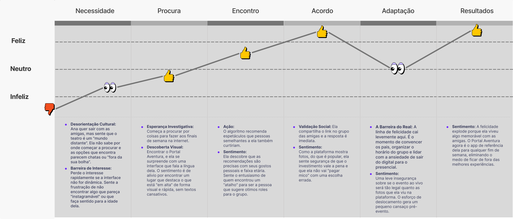

# 5. Personas e Jornada do Usuário

---

## 5.1 Personas

### 5.1.1 Ana Luiza — Cliente em Formação (Descoberta)

Ana Luiza representa um perfil emergente de consumidores culturais em formação: jovens que ainda não possuem o hábito consolidado de frequentar teatro, mas demonstram interesse quando expostos a estímulos visuais, sociais e tendências digitais. Sua relação com o lazer é fortemente influenciada por redes sociais e pelo grupo de amigos, tornando a descoberta de experiências mais espontânea do que planejada.

Apesar de não ser uma consumidora ativa do setor, Ana exerce influência significativa na decisão de compra, especialmente em contextos familiares. No entanto, enfrenta barreiras como a falta de direcionamento, dificuldade em identificar conteúdos adequados para sua faixa etária e baixa atratividade das plataformas tradicionais. Esse cenário evidencia a necessidade de soluções que tornem a experiência mais visual, intuitiva e alinhada ao comportamento digital, incentivando o interesse e reduzindo a distância entre o público jovem e o consumo cultural.

  Imagem 03 - Persona do cliente 
   
  Fonte: Material produzido pelos autores, 2026.

---

### 5.1.2 Marcos Abrantes — Cliente Ativo (Decisão e Consumo)

Marcos Abrantes representa um perfil crescente de consumidores culturais urbanos: jovens adultos com rotina intensa, que buscam no lazer uma forma de descanso e inspiração, mas ainda têm uma relação pouco estruturada com o consumo de teatro. Seu contato com espetáculos acontece de forma reativa, mediado por redes sociais e indicações, o que torna sua jornada fragmentada. Apesar do interesse genuíno e do potencial de consumo, Marcos enfrenta dificuldades para descobrir novas produções com confiança, revelando uma oportunidade clara para soluções que organizem, personalizem e qualifiquem sua experiência de decisão.

  Imagem 04 - Persona do cliente 
   
  Fonte: Material produzido pelos autores, 2026.

---

## 5.2 Jornada do Usuário

### 5.2.1 Jornada de Ana Luiza — Cliente em Formação

  Imagem 05 - Jornada do usuário: Ana Luiza 
   
  Fonte: Material produzido pelos autores, 2026.

| Etapa | Sentimento | Ações e Percepções |
|---|---|---|
| **Necessidade** | Infeliz | **Desorientação Cultural:** Ana quer sair com as amigas, mas sente que o teatro é um "mundo distante". Não sabe por onde começar a procurar e as opções que encontra parecem chatas ou "fora da sua bolha". **Barreira de Interesse:** Perde o interesse rapidamente se a interface não for dinâmica. Sente a frustração de não encontrar algo que pareça "instagramável" ou que faça sentido para a idade dela. |
| **Procura** | Neutro | **Esperança Investigativa:** Começa a procurar por coisas para fazer aos finais de semana na internet. **Descoberta Visual:** Encontra o Portal Aventura, e se surpreende com uma interface que fala a língua dela. O sentimento é de alívio por encontrar um lugar que destaca o que está "em alta" de forma visual e rápida, sem textos cansativos. |
| **Encontro** | Feliz | **Ação:** O algoritmo recomenda espetáculos que pessoas semelhantes a ela também curtiram. **Sentimento:** Ela descobre que as recomendações são precisas com seus gostos pessoais e faixa etária. Sente o entusiasmo de quem encontrou um "atalho" para ser a pessoa que sugere ótimos roles para o grupo. |
| **Acordo** | Feliz | **Validação Social:** Ela compartilha o link no grupo das amigas e a resposta é imediata. **Sentimento:** Como a plataforma mostra fotos, do que é popular, ela sente segurança de que o investimento vale a pena e que ela não vai "pagar mico" com uma escolha errada. |
| **Adaptação** | Neutro | **A Barreira do Real:** A linha de felicidade cai levemente aqui. É o momento de convencer os pais, organizar o horário do grupo e lidar com a ansiedade de sair do digital para o presencial. **Sentimento:** Uma leve insegurança sobre se o evento ao vivo será tão legal quanto as fotos que ela viu na plataforma. O esforço de deslocamento gera um pequeno cansaço pré-evento. |
| **Resultados** | Feliz | **Sentimento:** A felicidade explode porque ela viveu algo memorável com as amigas. O Portal Aventura agora é o app de referência dela para qualquer fim de semana, eliminando o medo de ficar de fora das melhores experiências. |

---

### 5.2.2 Jornada de Marcos Abrantes — Cliente Ativo

  Imagem 06 - Jornada do usuário: Marcos Abrantes 
   
  Fonte: Material produzido pelos autores, 2026.

| Etapa | Sentimento | Ações e Percepções |
|---|---|---|
| **Necessidade** | Infeliz | **Fadiga de Decisão e Desconexão:** Se sente fadigado por conta da rotina, além disso sente dificuldade em encontrar espetáculos parecidos com os que ele gosta sem pesquisar em vários locais. |
| **Procura** |  Neutro | **Ação:** Começa a buscar proativamente em portais e redes sociais, e descobre a plataforma que centraliza os espetáculos. **Revelação Estratégica:** Sente alívio momentâneo por encontrar um hub, mas ainda com ressalvas. Ele se anima com a promessa de não precisar mais pesquisar em lugares diferentes. |
| **Exploração** | Neutro | **Ação:** Explora a plataforma e começa a mostrar seus gostos. **Identificação e Validação:** Começa colocando os espetáculos que ele gostaria de ou assistiu para testar o sistema, mas sentiu dúvida se o sistema recomendaria seu gosto corretamente. |
| **Descoberta** | Feliz | **Ação:** Observa as recomendações feitas pelo algoritmo. **Fim da Incerteza, o Match Perfeito:** Descobre que as recomendações foram precisas com seus gostos pessoais, mostrando espetáculos que o interessaram. |
| **Adaptação** | Feliz | **Ação:** Ele assiste a um musical recomendado e sai do teatro. **Encantamento e Fidelização:** O espetáculo supera as expectativas. Ele viveu algo memorável e sente que o tempo livre foi bem aproveitado. Ele compartilha a experiência com amigos e se torna um cliente leal a longo prazo. |