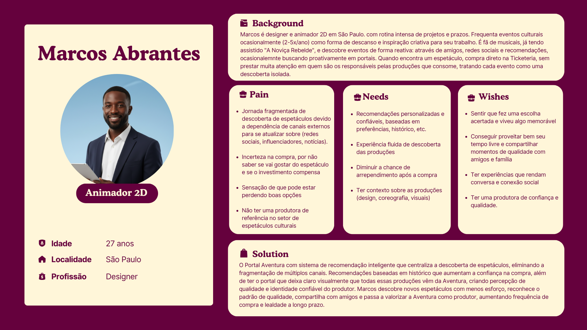

# Projeto - Sistema de Recomendação - Aventura

## Sumário

- [1. Problema](#1-problema)
- [2. Contexto da Indústria do Parceiro](#2-contexto-da-indústria-do-parceiro)
- [3. Visão e Objetivos do Produto](#3-visão-e-objetivos-do-produto)
- [4. O que o Produto Faz e o que Não Faz](#4-o-que-o-produto-faz-e-o-que-não-faz)
- [6. Fluxo do Negócio](#6-fluxo-do-negócio)
- [7. Brainstorming de Features](#7-brainstorming-de-features)
- [8. Business Model Canvas do MVP](#8-business-model-canvas-do-mvp)
- [9. Requisitos Funcionais](#9-requisitos-funcionais)
- [10. Requisitos Não Funcionais](#10-requisitos-não-funcionais)
- [11. Correlação entre RFs e RNFs](#11-correlação-entre-rfs-e-rnfs)
- [12. Termos e Abreviações](#12-termos-e-abreviações)
- [Referências](#referências)

---

## 1. Problema

A **Aventura Teatros**, fundada em 2008, consolidou-se como uma plataforma cultural completa e referência na economia criativa brasileira, acumulando mais de 50 produções de alto nível e um alcance de 5 milhões de espectadores. No entanto, esse sucesso no ambiente físico encontra um gargalo crítico em sua presença digital: atualmente a empresa só possui um site de informações de forma estática e linear, carecendo de um motor inteligente de recomendação de conteúdos e espetáculos.

### Descrição do Problema
O problema central reside na fragmentação da jornada do usuário dentro da plataforma. Atualmente, ao acessar a página de um espetáculo ou equipamento cultural específico, o visitante não é impactado por sugestões personalizadas que conectem outros ativos do ecossistema da empresa. Essa ausência de um sistema de recomendação, interrompe o fluxo de exploração, fazendo com que o potencial de descoberta de novos conteúdos seja subutilizado e, consequentemente, reduzindo as taxas de conversão em vendas.

### Relevância no Contexto do Parceiro
A resolução desta lacuna tecnológica é vital e estratégica para a Aventura por três pilares fundamentais:

* **Prioridade de Vendas:** Retenção e Aumento de Vendas: O fator de maior impacto esperado para o negócio é a retenção de vendas por meio de recomendações estratégicas. A ferramenta é vista como um motor essencial para impulsionar a venda de ingressos, pois direciona ativamente o espectador para novos espetáculos de seu interesse, reduzindo a evasão do site e facilitando a jornada até o momento da compra.
* **Fortalecimento do Rebranding:** O projeto atua diretamente na mitigação do baixo engajamento digital, servindo como uma ferramenta de suporte ao atual esforço de reposicionamento da marca no mercado.
* **Sinergia do Ecossistema:** A solução visa criar uma jornada conectada entre as diversas produções (teatro musical, festivais e ballet), incentivando o público a consumir a multiplicidade artística oferecida pela produtora, mostarndo de forma mais dinâmica e pessoal seus espetáculos.

### Desafios e Oportunidades

* **Desafios:** O principal desafio técnico consiste em projetar uma arquitetura orientada a serviços (SOA) que suporte o processamento de dados de interesse do usuário para gerar recomendações assertivas em tempo real, com os dados que foram disponibilizados. Além do desafio técnico, existe também um desafio de negócio: garantir que as recomendações realmente agreguem valor à experiência do usuário, evitando sugestões genéricas e contribuindo efetivamente para ampliar a descoberta de conteúdos e a conversão no portal.
* **Oportunidades:** Apesar dos desafios, o projeto apresenta uma oportunidade clara de transformação digital para o parceiro. Ao incorporar uma camada de recomendação inteligente, o Portal Aventura pode deixar de ser uma plataforma de navegação estática e passar a atuar como um hub dinâmico de entretenimento e descoberta cultural. Essa mudança tende a aumentar o tempo de permanência dos usuários no portal, melhorar a experiência de navegação, estimular o consumo cruzado entre diferentes produções e fortalecer o vínculo do público com o ecossistema da Aventura. 
Dessa forma, a solução proposta não apenas responde a uma lacuna tecnológica existente, mas também cria condições para que a experiência digital da Aventura se torne mais conectada, personalizada e estratégica para a geração de valor ao negócio.
---

## 2. Contexto da Indústria do Parceiro

Para compreender o ambiente competitivo em que a Aventura Teatros está inserida, é fundamental analisar a estrutura da indústria de produção teatral sob a ótica do modelo das 5 Forças de Porter. Essa abordagem permite avaliar não apenas a concorrência direta, mas também as dinâmicas que envolvem novos entrantes, fornecedores, clientes e produtos substitutos, oferecendo uma visão sistêmica do setor.

A figura a seguir apresenta uma síntese dessas forças aplicadas ao contexto da Aventura Teatros, servindo como base para a análise detalhada de cada dimensão competitiva nas seções seguintes. A partir dessa estrutura, torna-se possível identificar os principais fatores que influenciam a competitividade da empresa, bem como os riscos e oportunidades que impactam sua atuação nos mercados de São Paulo e Rio de Janeiro.

Imagem 01 - Cinco Forças de Porter 
   
  Source: Material produced by the authors, 2026.

### 2.1 Rivalidade entre concorrentes

**Risco: Alto**

A Aventura Teatros é uma empresa de produção de espetáculos que atua principalmente nas cidades de São Paulo e Rio de Janeiro, os dois maiores polos culturais do país. Nesses mercados, a rivalidade competitiva é intensa: apenas em São Paulo, a APETESP, Associação de Produtores de Espetáculos Teatrais do Estado de São Paulo, representa cerca de 108 empresas produtoras, evidenciando a densa concentração de concorrentes na principal praça de atuação da Aventura. No Rio de Janeiro, a disputa é igualmente acirrada, com a APTR, Associação dos Produtores de Teatro do Rio de Janeiro, reunindo produtoras locais de expressiva atuação.

Além da quantidade de competidores, a rivalidade se manifesta na disputa por recursos escassos: patrocínios privados, editais de fomento cultural, datas em teatros de prestígio e elencos renomados. A produção teatral abrange diferentes formatos, como musicais, teatro de grupo, produções comerciais e independentes, além de apresentações em teatros de shopping, centros culturais, praças e parques, o que amplia o leque de competidores diretos e indiretos com os quais a Aventura precisa se posicionar. Some-se a isso a sazonalidade do setor, que concentra a disputa por público em períodos específicos do ano, como férias escolares e fim de ano, intensificando ainda mais a competição. 

Diante de um mercado com mais de uma centena de produtoras concorrentes nos principais centros culturais do país, recursos finitos e demanda sazonalmente concentrada, a rivalidade entre os players estabelecidos é estruturalmente alta. Para a Aventura Teatros, isso significa que crescimento e sustentabilidade dependem não apenas da qualidade dos espetáculos, mas da capacidade de construir uma identidade de marca reconhecível e de fidelizar parceiros estratégicos.

### 2.2 Ameaça de novos entrantes

**Risco: Médio**

No mercado de produção teatral, o principal obstáculo à entrada de novos competidores é o capital. Produções musicais de grande porte podem demandar captações superiores a R$7 milhões, e mesmo projetos de menor escala envolvem custos expressivos com elenco, cenografia, figurino, iluminação e equipe técnica. O financiamento do setor é fortemente dependente de incentivos fiscais como a Lei Rouanet, cujo acesso exige histórico, credibilidade e conhecimento burocrático, ativos que novos entrantes não possuem de imediato. Além disso, a disputa por elencos qualificados, teatros com boa localização e datas estratégicas favorece as produtoras já estabelecidas, que contam com relacionamentos consolidados no setor, criando uma vantagem competitiva difícil de replicar no curto prazo.

Por outro lado, as barreiras regulatórias são baixas: não há exigências de licenças especiais ou certificações específicas para atuar como produtora teatral, o que permite que novos agentes, inclusive produtores independentes e grupos artísticos, entrem no mercado com produções de menor escala. A digitalização e o crescimento das plataformas de financiamento coletivo também reduziram parte da barreira financeira, abrindo espaço para estreantes que não dependem exclusivamente de editais ou patrocínios corporativos. Dessa forma, o risco mais concreto para a Aventura Teatros não vem de grandes produtoras entrantes, mas de competidores de nicho que operam com estruturas enxutas, custos reduzidos e propostas artísticas diferenciadas, capazes de disputar públicos e espaços específicos sem precisar competir no mesmo patamar de investimento.

### 2.3 Poder de barganha dos fornecedores

**Risco: Médio-Alto**

O poder de barganha dos fornecedores da Aventura é classificado como médio-alto. A cadeia produtiva de seus espetáculos depende de atores, diretores, cenógrafos e músicos com reconhecimento público, profissionais escassos num mercado que comporta apenas dez a doze grandes produções musicais em cartaz simultaneamente (Infoteatro, 2025). Esse cenário eleva o custo de troca para a Aventura e é agravado pela dinâmica da Lei Rouanet, que ao injetar patrocínio privado via renúncia fiscal elevou os preços de cachês e serviços técnicos ao longo dos anos (Infoteatro, 2025). Adicionalmente, títulos licenciados da Broadway presentes no portfólio da empresa, como "Mamma Mia!" e "A Noviça Rebelde" (Inteli & Aventura, 2024), criam dependência de licenciadores estrangeiros com poder de negociação elevado.

### 2.4 Poder de barganha dos clientes

**Risco: Médio**

O poder de barganha dos compradores da Aventura é classificado como médio. O alto grau de diferenciação de suas produções, com mais de 5 milhões de espectadores históricos e parcerias exclusivas com Disney-Pixar (Inteli & Aventura, 2024), limita o poder de negociação do consumidor individual ao dificultar a substituição por concorrentes. Ainda assim, a sensibilidade ao preço é uma variável relevante: o ticket médio dos espetáculos ao vivo no Brasil atingiu R$ 432 em 2024 (Anafima, 2024), e pesquisa da Revista Diálogo com a Economia Criativa (ESPM, 2018) aponta a política de preços como um dos fatores mais determinantes na decisão de consumo de teatro musical no país.

### 2.5 Ameaça de produtos substitutos

**Risco: Médio**

A Aventura Teatros compete por um bem escasso: o tempo de lazer do consumidor. Nesse campo, os substitutos são numerosos e estão em expansão acelerada. O streaming consolidou-se como o principal meio de entretenimento doméstico no Brasil, com dezenas de milhões de lares assinando ao menos uma plataforma, oferecendo acesso praticamente ilimitado a conteúdo cultural por uma fração do valor de um ingresso teatral. O cinema, por sua vez, também avança com força, em 2024, os cinemas brasileiros venderam mais de 116 milhões de ingressos, crescimento de 6,5% em relação ao ano anterior, enquanto shows e eventos ao vivo disputam as mesmas datas e o mesmo orçamento do público. Em conjunto, essas alternativas formam um ecossistema de entretenimento cada vez mais acessível e conveniente, o que pressiona o teatro a justificar seu custo mais elevado.
No entanto, a substituição é apenas parcial. O teatro acontece com a presença viva dos artistas em cena, compartilhando o mesmo espaço com a plateia por um determinado tempo, uma dimensão que nenhuma tela consegue replicar. A singularidade de cada apresentação, a efemeridade do ao vivo e o pertencimento coletivo à experiência conferem ao espetáculo teatral um valor simbólico próprio, que fideliza seu público e dificulta a substituição plena. Dessa forma, a ameaça dos substitutos é real e crescente na disputa pelo tempo e pela renda do consumidor, mas limitada quando se trata de replicar a experiência teatral em si, o que posiciona essa força em um nível médio de pressão sobre a Aventura Teatros.

### 2.6 Análise SWOT
 
Complementar às 5 Forças de Porter, a análise SWOT permite consolidar os fatores internos e externos que influenciam o posicionamento estratégico da Aventura Teatros, conectando os elementos competitivos identificados anteriormente a uma visão integrada de forças, fraquezas, oportunidades e ameaças.
 

Imagem 02 - Análise SWOT 
   
  Source: Material produced by the authors, 2026.

#### **Forças**
 
A principal força da Aventura Teatros está em seu posicionamento em produções de grande escala, especialmente musicais. Esse modelo se beneficia do uso de propriedades intelectuais conhecidas, como biografias ou marcas culturais, o que reduz incertezas de demanda. Esse fenômeno é discutido no relatório Global Entertainment & Media Outlook da PwC, que aponta que conteúdos baseados em marcas consolidadas tendem a apresentar maior previsibilidade de audiência no setor de entretenimento.
 
Além disso, a empresa apresenta alto grau de consolidação, refletido em seu histórico de produções e alcance de público. Essa trajetória favorece a captação de recursos por meio de mecanismos formais de incentivo. Segundo a página oficial da Lei Rouanet (Lei nº 8.313/1991), projetos culturais aprovados podem captar recursos junto a empresas via renúncia fiscal, sendo comum que produtores com histórico consolidado tenham maior taxa de sucesso nesse processo. Essa vantagem reforça a capacidade da Aventura Teatros de viabilizar projetos de maior escala.
 
#### **Fraquezas**
 
O modelo adotado pela empresa implica um alto custo estrutural de produção, característica típica do setor de artes performáticas. De acordo com o relatório Cultural Times: The First Global Map of Cultural and Creative Industries, publicado pela UNESCO, produções ao vivo possuem elevada dependência de custos fixos e menor escalabilidade em comparação a conteúdos digitais, o que aumenta sua exposição a riscos financeiros.
 
Esse fator contribui diretamente para o alto valor do ticket médio, necessário para garantir a viabilidade econômica dos espetáculos. No contexto brasileiro, essa limitação é reforçada por dados da pesquisa Desigualdades Sociais por Cor ou Raça no Brasil e levantamentos de consumo cultural do IBGE, que indicam que o acesso a atividades culturais pagas ainda é concentrado em parcelas da população com maior renda. Assim, o modelo de precificação restringe o público potencial e torna a demanda mais sensível a variações econômicas.
 
#### **Oportunidades**
 
Uma oportunidade relevante está na expansão para mercados fora do eixo tradicional. Dados da Associação Paulista dos Produtores de Teatro mostram que a maior parte das produções teatrais está concentrada em São Paulo, enquanto o Rio de Janeiro também se destaca como polo relevante. Essa concentração sugere a existência de demanda reprimida em outras capitais, onde a concorrência é menor e o acesso a grandes produções ainda é limitado.
 
Outra oportunidade está no crescimento do investimento privado em experiências culturais. O relatório Global Entertainment & Media Outlook da PwC destaca o aumento do interesse de marcas em experiências presenciais como forma de engajamento, especialmente em um cenário de saturação da publicidade digital. No Brasil, esse movimento é potencializado por mecanismos como a Lei Rouanet, que permite às empresas direcionar parte de seus impostos para projetos culturais.
 
Além disso, a diversificação de formatos representa uma oportunidade estratégica relevante. O crescimento do stand-up comedy e de produções menores reflete uma mudança no padrão de consumo, com maior valorização de experiências mais acessíveis e frequentes. Embora não exista um único relatório centralizador desse movimento, ele é amplamente observado na expansão de circuitos de comédia e na ocupação crescente de teatros por esse tipo de espetáculo, indicando uma tendência de flexibilização do setor.
 
#### **Ameaças**
 
Entre as ameaças, destaca-se a competição por espaços físicos, intensificada pela expansão de outros formatos de entretenimento ao vivo, como shows e apresentações de comédia. Esse fenômeno impacta diretamente a disponibilidade de teatros e pode elevar custos operacionais, especialmente em grandes centros urbanos.
 
Além disso, a concorrência com plataformas digitais representa uma transformação estrutural no setor. Segundo o relatório Global Entertainment & Media Outlook 2023–2027 da PwC, o consumo de streaming continua em crescimento global, com aumento significativo do tempo gasto em plataformas digitais. Serviços como Netflix e YouTube oferecem conteúdo sob demanda, com menor custo e maior conveniência, competindo diretamente pela atenção do consumidor e reduzindo a atratividade relativa de experiências presenciais.

## 3. Visão e Objetivos do Produto

### 3.1 Visão do Produto

A visão do produto é conceber e estabelecer um novo ecossistema digital da Aventura Teatros. Através de um motor de recomendação orientado a dados, o sistema conectará o público ao vasto catálogo da produtora, antecipando interesses e sugerindo espetáculos de forma fluida. O propósito é criar uma jornada digital que retenha o usuário no ecossistema da marca, convertendo esse engajamento contínuo em um aumento real na venda de ingressos.

### 3.2 Objetivos do Produto
O desenvolvimento desta solução tem metas claras, alinhadas diretamente às necessidades de negócio da Aventura Teatros e ao valor entregue aos usuários:

* **Maximizar a Retenção e Conversão de Vendas:** Atuar como o principal motor de direcionamento estratégico da empresa. Ao sugerir de forma inteligente novos espetáculos antes que o usuário abandone a página, o sistema visa reter o cliente no portal, transformando o tempo de navegação em aumento direto na venda de ingressos.
* **Personalizar a Jornada de Descoberta:** Transformar a experiência do usuário de reativa para proativa. O objetivo é que cada visitante sinta que o portal entende suas preferências, recebendo recomendações assertivas que reduzem o atrito na busca por entretenimento.
* **Integrar o Ecossistema Aventura:** Quebrar os silos entre as diferentes produções (teatros, musical, festivais, etc.). O sistema deve criar pontes fluidas, incentivando o público de um nicho a descobrir e consumir a multiplicidade artística da produtora.
* **Implementar Arquitetura Escalável:** Entregar uma base tecnológica moderna através de uma Arquitetura Orientada a Serviços (SOA), capaz de processar os dados de interesse do usuário em tempo real e fornecer as recomendações de forma ágil, escalável e com alto desempenho.

### 3.3 Métricas de Sucesso (KPIs)
Para garantir e monitorar que os objetivos acima sejam atingidos, o produto focará nos seguintes indicadores chave:
* **Taxa de Conversão:** Aumento na porcentagem de usuários que clicam em uma recomendação e são direcionados ao parceiro de bilheteria.
* **Engajamento e Retenção:** Aumento do tempo médio de sessão e do número de páginas/telas acessadas por visita.
* **Taxa de Cliques (CTR):** Volume de interação direta com os carrosséis de vitrines dinâmicas e notificações push.

---

## 4. O que o Produto Faz e o que Não Faz

Considerando o desafio de criar um hub digital dinâmico, é fundamental estabelecer fronteiras claras de atuação. Para garantir o alinhamento de expectativas e o foco na entrega de valor estratégico para a Aventura Teatros, utilizamos a matriz **"É / Não É / Faz / Não Faz"**. Esta estrutura delimita com precisão o escopo do projeto, definindo o papel do motor de recomendação e da aplicação multiplataforma (Web e Mobile) dentro do ecossistema da empresa, e evitando sobreposições com sistemas já consolidados, como as parcerias com a bilheteria.

### 4.1. O Produto É:
* **Uma solução multiplataforma:** Uma aplicação disponível tanto em versão Web quanto em aplicativo móvel híbrido (iOS e Android), garantindo uma experiência consistente em diferentes dispositivos.
* **Um motor de recomendação inteligente:** Um sistema (via API/SOA) que personaliza o conteúdo exibido no app com base no perfil do usuário.
* **Um hub de engajamento digital:** Uma ferramenta estratégica para reter o público da Aventura Teatros através de uma jornada conectada e fluida.

### 4.2. O Produto Não É:
* **Um sistema de e-commerce ou bilheteria (Ticketing):** O produto não é um gateway de pagamento e não processa transações financeiras internamente; ele atua como um canal de captação e direcionamento.
* **Um Sistema de Gestão de Conteúdo (CMS):** Não substitui o banco de dados ou painel onde a Aventura cadastra seus eventos.
* **Uma rede social:** O foco é a recomendação de ativos da Aventura, e não a interação social entre usuários.

### 4.3. O Produto Faz:
* **Notificações Personalizadas (Push):** Utiliza o motor de recomendação para enviar sugestões relevantes diretamente ao smartphone do usuário.
* **Exibe Vitrines Dinâmicas:** Apresenta carrosséis de espetáculos, teatros e conteúdos baseados no comportamento de navegação no app.
* **Integra-se com APIs da Aventura:** Consome os dados de eventos e peças para organizar as recomendações em tempo real.
* **Monitora Interesses do Usuário:** Mapeia quais categorias (musicais, festivais) o usuário mais acessa para refinar as sugestões.

### 4.4. O Produto Não Faz:
* **Não vende ingressos diretamente:** A finalização da compra ocorre via redirecionamento para o parceiro de ticketing.
* **Não funciona offline:** Por depender de um motor de recomendação em tempo real e atualização de catálogo, o app exige conexão com a internet.
* **Não gerencia a logística dos teatros:** O escopo é estritamente informativo e de recomendação, sem controle de assentos ou entrada física (QR Code de acesso pode estar fora de escopo, dependendo do que vocês decidiram).

---

## 5. Personas e Jornada do Usuário

### 5.1 Personas

**5.1.2: Marcos Abrantes - a persona do cliente**

Marcos Abrantes representa um perfil crescente de consumidores culturais urbanos: jovens adultos com rotina intensa, que buscam no lazer uma forma de descanso e inspiração, mas ainda têm uma relação pouco estruturada com o consumo de teatro. Seu contato com espetáculos acontece de forma reativa, mediado por redes sociais e indicações, o que torna sua jornada fragmentada. Apesar do interesse genuíno e do potencial de consumo, Marcos enfrenta dificuldades para descobrir novas produções com confiança, revelando uma oportunidade clara para soluções que organizem, personalizem e qualifiquem sua experiência de decisão.

   
  Imagem 02 - Persona do cliente 
  Fonte: Material produzido pelos autores, 2026.

### 5.2 Jornada do usuário

---

## 6. Fluxo do Negócio

Nesta seção, apresentamos o fluxo de negócios da Plataforma Aventura modelado em BPMN (Business Process Model and Notation). O diagrama mapeia as interações entre três participantes principais — o Cliente, o Sistema de Recomendação e a Gestão de Conteúdo — demonstrando como esses processos se integram para oferecer uma experiência personalizada ao usuário. A notação BPMN foi escolhida por permitir uma leitura clara e padronizada dos fluxos, facilitando tanto a comunicação entre equipes técnicas quanto a compreensão por stakeholders de negócio.

Imagem 03 - Fluxo de Negócio (BPMN) 
   
  Source: Material produced by the authors, 2026.

O diagrama revela uma arquitetura de processos bem estruturada e orientada à personalização. O fluxo do cliente é direto e centrado na tomada de decisão: após acessar o portal e visualizar as recomendações, o sistema captura um ponto crítico — o interesse do usuário — que determina se há conversão ou abandono. Em paralelo, o Sistema de Recomendação opera de forma contínua, retroalimentado pelo catálogo preparado pela Gestão de Conteúdo, o que garante que as sugestões exibidas ao cliente sejam sempre baseadas em dados atualizados. Esse desenho evidencia uma preocupação com a experiência do usuário desde a entrada até a conversão, minimizando fricções e maximizando a relevância do conteúdo apresentado.

---

## 7. Brainstorming de Features

Para o projeto de plataforma digital baseada em arquitetura orientada a serviços, desenvolvido em parceria com a **Aventura Teatros**, o desafio central identificado é a ausência de um sistema estruturado de recomendação no Portal Aventura. Isso limita o potencial de descoberta de novos conteúdos e impacta diretamente a conversão em vendas de ingressos.

Esta documentação detalha o brainstorm de *features* realizado em grupo.

### 1. Visão Geral do Modelo (Backend & Inteligência)

O motor de recomendação será alimentado por dados demográficos e comportamentais para personalizar a experiência do usuário no portal.

* **Geolocalização:** Filtragem baseada na localização do usuário.
* **Perfil Demográfico:** Segmentação por idade e gênero.
* **Rastreio de Ações:** Monitoramento do comportamento de navegação dentro da plataforma.
* **Indicadores de Interesse:** Gatilhos de conversão, como o clique no link da ticketeira (venda de ingressos).
* **Integração com Wishlist:** O sistema deve reconhecer se o espetáculo já está na lista de desejos para refinar as sugestões.

### 2. Interface do Usuário (Front-end)

### 2.1 Fluxo de Cadastro e Onboarding
Essencial para coletar os dados iniciais que alimentarão o sistema de recomendação inteligente.
* **Credenciais:** E-mail e senha.
* **Dados Pessoais:** Nome, Idade, Gênero e CEP.
* **Questionário de Preferências:**
    * Frequência de ida ao teatro.
    * Tipos de preferência (Show musical, stand-up, espetáculo, espetáculo musical).
    * Seleção de gêneros favoritos.

### 2.2 Estrutura de Navegação
* **Home:** Visão geral e destaques.
* **Componentes de Descoberta:** Carrosséis e "Prateleiras" de recomendações personalizadas.
* **Filtros Regionais:** Seleção rápida entre São Paulo (SP) e Rio de Janeiro (RJ).
* **Retenção:** Seção "Assista Novamente" e acesso rápido à Wishlist.
* **Perfil:** Gestão de dados e preferências do usuário.
* **Teatro:** Páginas com informações fixas sobre os equipamentos geridos pela Aventura.

### 3. Funcionalidades Core

* **Direcionamento para Compra:** Link direto e facilitado para a aquisição de ingressos.
* **Busca:** Sistema de pesquisa interna de conteúdos e espetáculos.
* **Gestão de Wishlist:** Botão para salvar experiências de interesse futuro.

### 4. Roadmap: Funcionalidades Adicionais (Futuro)

* **Sistema de Feedback:** Avaliação de espetáculos por meio de "Like/Dislike" para aprimorar o algoritmo.
* **Notificações Push:** Alertas automáticos quando um espetáculo salvo na Wishlist entrar em cartaz ou tiver novas datas disponíveis.

---

## 8. Business Model Canvas do MVP

O Business Model Canvas apresentado a seguir sintetiza a estratégia do MVP da Plataforma Aventura, estruturando em nove blocos os elementos centrais do modelo de negócio. A partir das definições de proposta de valor, segmentos de clientes, canais, recursos e parcerias, o canvas oferece uma visão integrada de como a solução se posiciona no mercado e de que forma cada componente contribui para a geração de valor, tanto para o usuário final quanto para a Aventura Teatros como negócio.

Imagem 04 - Business Model Canvas do MVP 
   
  Source: Material produced by the authors, 2026.

| Bloco | Descrição |
|---|---|
| Proposta de valor | Motor de recomendação personalizado que transforma o portal da Aventura de uma navegação estática em um hub dinâmico de descoberta cultural, conectando o usuário ao catálogo completo de produções (musicais, ballet, festivais) e reduzindo o atrito na jornada até a compra do ingresso. |
| Segmentos de clientes | Frequentadores de teatro e espetáculos musicais nas praças de São Paulo e Rio de Janeiro; público digital com perfil de early adopter cultural; apreciadores de produções internacionais; e novos públicos a serem convertidos por meio das recomendações personalizadas. |
| Canais | Aplicativo móvel híbrido (iOS e Android), plataforma web responsiva e notificações push. O redirecionamento para a compra de ingressos ocorre via parceiros de bilheteria (ticketeras). |
| Relacionamento com clientes | Experiência proativa e personalizada por meio de vitrines dinâmicas no app e na web, além de notificações push baseadas no comportamento de navegação do usuário. A plataforma ainda não existe, sendo este o modelo-alvo da solução. |
| Fontes de receita | Receita indireta via aumento da taxa de conversão de ingressos, com o fluxo financeiro passando pelas ticketeras parceiras. Há potencial futuro de destaque pago para espetáculos internacionais e valorização da marca Aventura como referência digital no setor cultural. |
| Recursos principais | Base de dados de espetáculos da Aventura, equipe interna de engenharia e dados, infraestrutura SOA desenvolvida pelo time e catálogo histórico de produções. |
| Atividades principais | Desenvolvimento e manutenção do motor de recomendação, curadoria e atualização do catálogo, monitoramento de comportamento do usuário, envio de notificações push personalizadas e integração contínua com as APIs da Aventura. |
| Parcerias principais | Parceiros de bilheteria (ticketeras), licenciadores internacionais (Broadway, Disney-Pixar), patrocinadores via Lei Rouanet e teatros e equipamentos culturais parceiros da Aventura. |
| Estrutura de custos | Desenvolvimento e manutenção da plataforma pela equipe interna, infraestrutura de servidores e nuvem, evolução contínua do motor de recomendação e integração com APIs externas. Por ser desenvolvida internamente, a plataforma não exige investimento direto em licenças de software de terceiros. |

---

## 9. Requisitos Funcionais

> Especificação dos requisitos funcionais em formato de user story: *"Como \<perfil\>, eu quero \<realizar uma ação\>"*.

### RF01 — \<Nome do requisito\>

**User story:** Como , eu quero .

**Testes de usuário:**

| Campo | Descrição |
|---|---|
| Pré-condição | |
| Procedimento de teste | |
| Resultado esperado | |
| Pós-condição | |

---

### RF02 — \<Nome do requisito\>

**User story:** Como , eu quero .

**Testes de usuário:**

| Campo | Descrição |
|---|---|
| Pré-condição | |
| Procedimento de teste | |
| Resultado esperado | |
| Pós-condição | |

---

## 10. Requisitos Não Funcionais

> Especificação dos requisitos não funcionais com base nas características de qualidade da **ISO 25010**, em formato de user story.

### RNF01 — \<Nome do requisito\>

**Característica ISO 25010:** \<ex: Desempenho, Usabilidade, Segurança...\>

**User story:** Como , eu quero .

**Testes de usuário:**

| Campo | Descrição |
|---|---|
| Pré-condição | |
| Procedimento de teste | |
| Resultado esperado | |
| Pós-condição | |

---

### RNF02 — \<Nome do requisito\>

**Característica ISO 25010:** \<ex: Desempenho, Usabilidade, Segurança...\>

**User story:** Como , eu quero .

**Testes de usuário:**

| Campo | Descrição |
|---|---|
| Pré-condição | |
| Procedimento de teste | |
| Resultado esperado | |
| Pós-condição | |

---

## 11. Correlação entre RFs e RNFs

> Tabela explicitando as relações diretas entre requisitos não funcionais e requisitos funcionais.

| RNF | RF relacionados | Justificativa |
|---|---|---|
| RNF01 | RF01, RF02 | |
| RNF02 | RF01 | |

---

## 12. Termos e Abreviações

> Glossário de termos e abreviações utilizados neste documento.

| Termo / Abreviação | Definição |
|---|---|
| RF | Requisito Funcional |
| RNF | Requisito Não Funcional |
| MVP | Minimum Viable Product (Produto Mínimo Viável) |
| BPMN | Business Process Model and Notation |

## Referências

ASSOCIAÇÃO DOS PRODUTORES DE ESPETÁCULOS TEATRAIS DO ESTADO DE SÃO PAULO (APETESP). Wikipédia, a enciclopédia livre. Disponível em: https://pt.wikipedia.org/wiki/Associa%C3%A7%C3%A3o_dos_Produtores_de_Espet%C3%A1culos_Teatrais_do_Estado_de_S%C3%A3o_Paulo. Acesso em: 23 abr. 2026.

ASSOCIAÇÃO DOS PRODUTORES DE TEATRO DO RIO DE JANEIRO (APTR). Sites Nacionais de Associações e Entidades. Centro Brasileiro Teatro para a Infância e Juventude. Disponível em: https://cbtij.org.br/associacoes-e-entidades-nacionais/. Acesso em: 23 abr. 2026.

PRADO, Miguel Arcanjo. APTI, JLeiva e iBT fazem mapeamento do teatro em pesquisa inédita. Blog do Arcanjo, 12 mar. 2025. Disponível em: https://www.blogdoarcanjo.com/2025/03/12/apti-jleiva-e-ibt-fazem-mapeamento-do-teatro-em-pesquisa-inedita/. Acesso em: 23 abr. 2026.

AGÊNCIA BRASIL. Projetos da Lei Rouanet têm novos limites; ingressos custarão R$ 150 em média. Brasília, 21 mar. 2017. Disponível em: https://agenciabrasil.ebc.com.br/cultura/noticia/2017-03/projetos-da-lei-rouanet-passam-ter-limite-ingressos-custarao-r-150-em-media. Acesso em: 23 abr. 2026.

INCENTIV. Produção teatral e leis de incentivo: entenda o impacto social positivo. Disponível em: https://incentiv.me/blog/2024/03/28/leis-de-incentivo-na-producao-teatral/. Acesso em: 23 abr. 2026.

NOTICIAS DO BRASIL. Governo libera R$ 7,1 milhões via Lei Rouanet para musical inédito sobre Ziraldo. 24 fev. 2026. Disponível em: https://noticias-do-brasil.news/cultura/cultura-eventos/lei-rouanet-libera-r-71-mi-para-musical-sobre-ziraldo.html. Acesso em: 23 abr. 2026.

PORTAL EXIBIDOR. Balanço 2024: cinemas superam expectativas e público aumenta 6,5%; filmes brasileiros crescem quase 300%. Disponível em: https://www.exibidor.com.br/noticias/mercado/14480-balanco-2024-cinemas-superam-expectativas-e-publico-aumenta-65-filmes-brasileiros-crescem-quase-300. Acesso em: 23 abr. 2026.

COREDAÇÃO. O desafio de reduzir a desigualdade no acesso ao teatro no Brasil. Disponível em: https://coredacao.com/temas-de-redacao/o-desafio-de-reduzir-a-desigualdade-no-acesso-ao-teatro-no-brasil/. Acesso em: 23 abr. 2026.

ANAFIMA. *PIB da Música no Brasil*. Valor Cultural, 2024. Disponível em: https://valorcultural.com.br/mercado-da-musica-fatura-r-116-bilhoes-mas-carece-de-valorizacao-institucional/. Acesso em: 23 abr. 2026.

ESPM. Teatro Musical no Rio de Janeiro: Uma pesquisa com consumidores cariocas. *Diálogo com a Economia Criativa*, 2018. Disponível em: https://dialogo.espm.br/revistadcec-rj/article/view/155. Acesso em: 23 abr. 2026.

INFOTEATRO. O Impacto do Teatro Musical no Cenário Brasileiro. 2025. Disponível em: https://infoteatro.com.br/o-impacto-do-teatro-musical-no-cenario-brasileiro/. Acesso em: 23 abr. 2026.

INFOTEATRO. Afinal, o que é a Lei Rouanet e como funciona? 2025. Disponível em: https://infoteatro.com.br/afinal-o-que-e-a-lei-rouanet-e-como-funciona/. Acesso em: 23 abr. 2026.

INTELI; AVENTURA. TAPI — ESMD6: Plataforma digital baseada em arquitetura orientada a serviços. 2024.

PRICEWATERHOUSECOOPERS (PwC). Global Entertainment & Media Outlook 2023–2027. Disponível em: https://www.pwc.com/outlook. Acesso em: 26 abr. 2026.

UNESCO. Cultural Times: The First Global Map of Cultural and Creative Industries. Paris: UNESCO, 2015. Disponível em: https://unesdoc.unesco.org. Acesso em: 26 abr. 2026.

INSTITUTO BRASILEIRO DE GEOGRAFIA E ESTATÍSTICA (IBGE). Pesquisa de Orçamentos Familiares 2017–2018: análise do consumo cultural no Brasil. Rio de Janeiro: IBGE, 2020. Disponível em: https://www.ibge.gov.br. Acesso em: 26 abr. 2026.
Lei Rouanet.

BRASIL. Lei nº 8.313, de 23 de dezembro de 1991. Institui o Programa Nacional de Apoio à Cultura (PRONAC). Diário Oficial da União: seção 1, Brasília, DF, 24 dez. 1991. Disponível em: http://www.planalto.gov.br. Acesso em: 26 abr. 2026.

ASSOCIAÇÃO PAULISTA DOS PRODUTORES DE TEATRO (APPT). Dados e relatórios sobre produção teatral em São Paulo. Disponível em: https://www.appt.org.br. Acesso em: 26 abr. 2026.
Aventura Teatros.

AVENTURA TEATROS. Site oficial. Disponível em: https://aventurateatros.com.br. Acesso em: 26 abr. 2026.