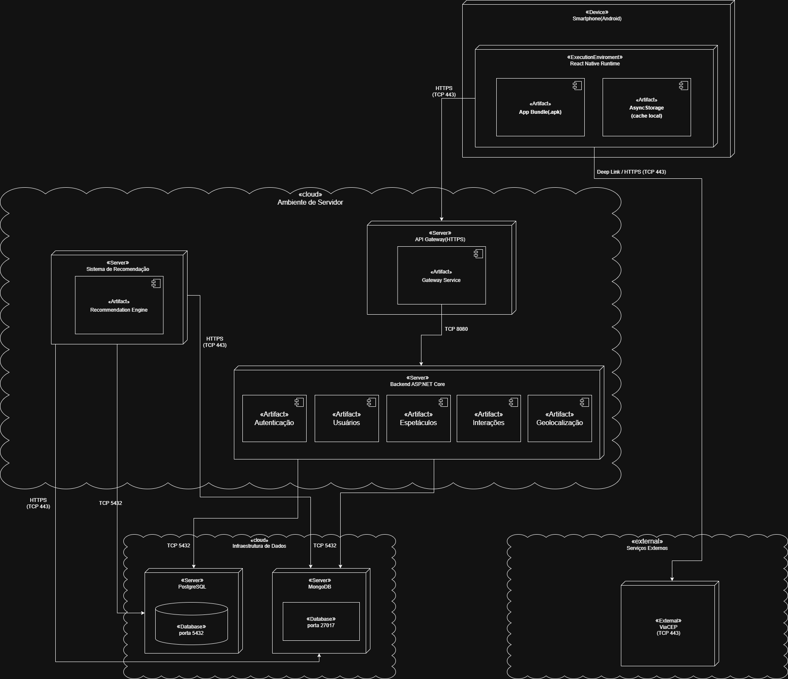

# Projeto - Sistema de Recomendação - Aventura
----

## Grupo 2 - Aventureiros

## Projeto - RecomendaShow

## Integrantes

- [Alexsander da Silva Barbosa](https://www.linkedin.com/in/alexsander-dsbarbosa/)
- [Carlos Eduardo Serrano Quaglia](https://www.linkedin.com/in/carlos-quaglia-309088357/)
- [Catarina Sayuri Arashiro Braga Felipe](https://www.linkedin.com/in/catarina-sayuri/)
- [Débora Pereira Nogueira](https://www.linkedin.com/in/debora-pereira-nogueira/)
- [Isaac Souza Santos](https://www.linkedin.com/in/isaac-souza-santos/)
- [Nicholas Anantha Krishnan Millani](https://www.linkedin.com/in/nicholas-millani-83a950357/)
- [Paulo Henrique Bueno Fernandes](https://www.linkedin.com/in/paulo-henrique0601/)

## Objetivo do Documento

Este documento apresenta a documentação principal do projeto, reunindo contexto do parceiro, problema, requisitos, arquitetura, diagramas, planejamento e execução de testes, desenvolvimento das sprints e evolução técnica da solução.

## Sumário

<details>
<summary><a href="#1-problema">1. Problema</a></summary>

- [Descrição do Problema](#descrição-do-problema)
- [Relevância no Contexto do Parceiro](#relevância-no-contexto-do-parceiro)
- [Desafios e Oportunidades](#desafios-e-oportunidades)

</details>

<details>
<summary><a href="#2-contexto-da-indústria-do-parceiro">2. Contexto da Indústria do Parceiro</a></summary>

- [2.1 Rivalidade entre concorrentes](#21-rivalidade-entre-concorrentes)
- [2.2 Ameaça de novos entrantes](#22-ameaça-de-novos-entrantes)
- [2.3 Poder de barganha dos fornecedores](#23-poder-de-barganha-dos-fornecedores)
- [2.4 Poder de barganha dos clientes](#24-poder-de-barganha-dos-clientes)
- [2.5 Ameaça de produtos substitutos](#25-ameaça-de-produtos-substitutos)
- [2.6 Análise SWOT](#26-análise-swot)

</details>

<details>
<summary><a href="#3-visão-e-objetivos-do-produto">3. Visão e Objetivos do Produto</a></summary>

- [3.1 Visão do Produto](#31-visão-do-produto)
- [3.2 Objetivos do Produto](#32-objetivos-do-produto)
- [3.3 Métricas de Sucesso (KPIs)](#33-métricas-de-sucesso-kpis)

</details>

<details>
<summary><a href="#4-o-que-o-produto-faz-e-o-que-não-faz">4. O que o Produto Faz e o que Não Faz</a></summary>

- [4.1 O Produto É](#41-o-produto-é)
- [4.2 O Produto Não É](#42-o-produto-não-é)
- [4.3 O Produto Faz](#43-o-produto-faz)
- [4.4 O Produto Não Faz](#44-o-produto-não-faz)

</details>

<details>
<summary><a href="#5-personas-e-jornada-do-usuário">5. Personas e Jornada do Usuário</a></summary>

- [5.1 Personas](#51-personas)
  - [5.1.1 Ana Luiza — Cliente em Formação](#511-ana-luiza--cliente-em-formação-descoberta)
  - [5.1.2 Marcos Abrantes — Cliente Ativo](#512-marcos-abrantes--cliente-ativo-decisão-e-consumo)
- [5.2 Jornada do Usuário](#52-jornada-do-usuário)
  - [5.2.1 Jornada de Ana Luiza](#521-jornada-de-ana-luiza--cliente-em-formação)
  - [5.2.2 Jornada de Marcos Abrantes](#522-jornada-de-marcos-abrantes--cliente-ativo)
  - [5.2.3 Matriz de oportunidades por etapa da jornada](#523-matriz-de-oportunidades-por-etapa-da-jornada)

</details>

<details>
<summary><a href="#6-fluxo-do-negócio">6. Fluxo do Negócio</a></summary>

- [Fluxo do Negócio](#6-fluxo-do-negócio)

</details>

<details>
<summary><a href="#7-brainstorming-de-features">7. Brainstorming de Features</a></summary>

- [7.1 Features do MVP](#71-features-do-mvp)
- [7.2 Roadmap futuro](#72-roadmap-futuro)
- [7.3 Ideias descartadas ou fora de escopo](#73-ideias-descartadas-ou-fora-de-escopo)
- [7.4 Pontos em aberto e trade-offs](#74-pontos-em-aberto-e-trade-offs)

</details>

<details>
<summary><a href="#8-business-model-canvas-do-mvp">8. Business Model Canvas do MVP</a></summary>

- [Business Model Canvas do MVP](#8-business-model-canvas-do-mvp)

</details>

<details>
<summary><a href="#9-requisitos-funcionais">9. Requisitos Funcionais</a></summary>

- [9.1 Elicitação e Análise de Requisitos](#91--elicitação-e-análise-de-requisitos)
- [9.2 Especificação e Validação de Requisitos Funcionais](#92-especificação-e-validação-de-requisitos-funcionais)
- [RF01 — Onboarding de Interesses](#rf01--onboarding-de-interesses)
- [RF02 — Recomendação por Geolocalização](#rf02--recomendação-por-geolocalização)
- [RF03 — Autenticação e Persistência](#rf03--autenticação-e-persistência)
- [RF04 — Catálogo Categorizado](#rf04--catálogo-categorizado)
- [RF05 — Busca Específica](#rf05--busca-específica)
- [RF06 — Gestão de Wishlist](#rf06--gestão-de-wishlist)
- [RF07 — Informações de Teatros](#rf07--informações-de-teatros)
- [RF08 — Gestão de Perfil e Preferências](#rf08--gestão-de-perfil-e-preferências)
- [RF09 — Redirecionamento de Compra](#rf09--redirecionamento-de-compra)
- [RF10 — Recomendação Inteligente](#rf10--recomendação-inteligente)

</details>

<details>
<summary><a href="#10-requisitos-não-funcionais">10. Requisitos Não Funcionais</a></summary>

- [RNF01 — Tempo de resposta das recomendações](#rnf01--tempo-de-resposta-das-recomendações)
- [RNF02 — Segurança das credenciais de usuário](#rnf02--segurança-das-credenciais-de-usuário)
- [RNF03 — Privacidade e direitos do titular (LGPD)](#rnf03--privacidade-e-direitos-do-titular-lgpd)
- [RNF04 — Usabilidade e responsividade em dispositivos móveis](#rnf04--usabilidade-e-responsividade-em-dispositivos-móveis)
- [RNF05 — Disponibilidade da plataforma](#rnf05--disponibilidade-da-plataforma)
- [RNF06 — Capacidade sob carga em pico de campanha](#rnf06--capacidade-sob-carga-em-pico-de-campanha)
- [RNF07 — Precisão da geolocalização](#rnf07--precisão-da-geolocalização)
- [RNF08 — Modularidade do serviço de recomendação](#rnf08--modularidade-do-serviço-de-recomendação)
- [RNF09 — Interoperabilidade entre serviços](#rnf09--interoperabilidade-entre-serviços)
- [RNF10 — Implantação reproduzível](#rnf10--implantação-reproduzível)

</details>

<details>
<summary><a href="#11-correlação-entre-rfs-e-rnfs">11. Correlação entre RFs e RNFs</a></summary>

- [Correlação entre RFs e RNFs](#11-correlação-entre-rfs-e-rnfs)

</details>

<details>
<summary><a href="#12-diagramação-do-banco">12. Diagramação do banco</a></summary>

- [12.1 Diagrama Lógico](#121---diagrama-lógico)
- [12.2 Entidades e Relacionamentos](#122---entidades-e-relacionamentos)
- [12.3 Justificativa e Regras de Negócio](#123---justificativa-e-regras-de-negócio)
- [12.4 Diagrama Conceitual](#124-diagrama-conceitual)
- [12.4.1 Dicionário de Dados e Mapeamento](#1241-dicionário-de-dados-e-mapeamento)
- [12.4.2 Definição de Chaves e Integridade Referencial](#1242-definição-de-chaves-e-integridade-referencial)
- [12.4.3 Regras de Normalização Aplicadas](#1243-regras-de-normalização-aplicadas)
- [12.4.4 Justificativa e Rastreabilidade](#1244-justificativa-e-rastreabilidade)

</details>

<details>
<summary><a href="#13-diagrama-de-classes">13. Diagrama de Classes</a></summary>

- [Teatro](#teatro)
- [Espetaculo](#espetaculo)
- [Usuario](#usuario)
- [Wishlist](#wishlist)
- [Preferencias](#preferencias-value-object)
- [Interacao](#interacao)
- [Recomendacao](#recomendacao)
- [SistemaRecomendacao](#sistemarecomendacao)
- [TipoInteracao](#tipointeracao-enumeration)
- [Relacionamentos](#relacionamentos)
- [Observações e Decisões de Design](#observações-e-decisões-de-design)

</details>

<details>
<summary><a href="#14-Diagrama-de-componentes">14. Diagrama de Componentes</a></summary>

- [Packages](#packages)
- [Componentes](#componentes)
- [Interfaces](#interfaces)
- [Responsabilidades do Storage Bucket](#responsabilidades-do-storage-bucket)
- [Responsabilidades do PostgreSQL](#responsabilidades-do-postgresql)
- [Decisões](#decisões)

</details>

<details>
<summary><a href="#15-diagrama-de-casos-de-uso">15. Diagrama de Casos de uso</a></summary>

- [Atores](#atores)
- [Casos de Uso](#casos-de-uso)
- [Relacionamentos do Diagrama](#relacionamentos-do-diagrama)
- [Associação entre Requisitos Funcionais e Casos de Uso](#associação-entre-requisitos-funcionais-e-casos-de-uso)

</details>

<details>
<summary><a href="#16-diagrama-de-implantação">16. Diagrama de Implantação</a></summary>

- [Diagrama de Implantação](#16-diagrama-de-implantação)
- [16.1 Leitura do diagrama e status dos componentes](#161-leitura-do-diagrama-e-status-dos-componentes)
- [16.2 Topologia de referência](#162-topologia-de-referência)
- [16.3 Ambientes considerados](#163-ambientes-considerados)
- [16.4 Limites do artefato e evolução posterior](#164-limites-do-artefato-e-evolução-posterior)

</details>

<details>
<summary><a href="#17-linguagens-e-tecnologias-utilizadas">17. Linguagens e Tecnologias Utilizadas</a></summary>

- [Linguagens e Tecnologias Utilizadas](#17-linguagens-e-tecnologias-utilizadas)

</details>

<details>
<summary><a href="#18-planejamento-de-testes">18. Planejamento de Testes</a></summary>

- [18.1 Objetivo do planejamento de testes](#181-objetivo-do-planejamento-de-testes)
- [18.2 Estratégia geral de testes](#182-estratégia-geral-de-testes)
- [18.3 Testes de funcionalidade](#183-testes-de-funcionalidade)
- [18.4 Testes de requisitos não funcionais](#184-testes-de-requisitos-não-funcionais)
- [18.5 Testes de usabilidade](#185-testes-de-usabilidade)
- [18.6 Testes de APIs externas](#186-testes-de-apis-externas)
- [18.7 Testes de integração](#187-testes-de-integração)
  - [18.7.1 Simulação de comportamento equivalente ao VHS](#1871-simulação-de-comportamento-equivalente-ao-vhs)
  - [18.7.2 Tabela de testes](#1872-tabela-de-testes)
  - [18.7.3 Método de validação dos resultados](#1873-método-de-validação-dos-resultados)
  - [18.7.4 Discussão de abrangência](#1874-discussão-de-abrangência)
- [18.8 Discussão geral de abrangência dos testes](#188-discussão-geral-de-abrangência-dos-testes)

</details>

<details>
<summary><a href="#19-desenvolvimento-do-projeto--sprint-3">19. Desenvolvimento do Projeto — Sprint 3</a></summary>

- [19.1 Objetivo da seção](#191-objetivo-da-seção)
- [19.2 Arquitetura de codificação e estrutura de diretórios](#192-arquitetura-de-codificação-e-estrutura-de-diretórios)
- [19.3 Desenvolvimento do Backend](#193-desenvolvimento-do-backend)
  - [19.3.1 Arquitetura do backend](#1931-arquitetura-do-backend)
  - [19.3.2 Rotas da API REST](#1932-rotas-da-api-rest)
- [19.4 Desenvolvimento do Frontend](#194-desenvolvimento-do-frontend)
  - [19.4.1 Arquitetura do frontend](#1941-arquitetura-do-frontend)
  - [19.4.2 Telas implementadas](#1942-telas-implementadas)
  - [19.4.3 Vídeo demonstrativo do frontend](#1943-vídeo-demonstrativo-do-frontend)
- [19.5 Padrões de codificação e padrões de projeto](#195-padrões-de-codificação-e-padrões-de-projeto)
- [19.6 Estratégia de testes e metodologia TDD](#196-estratégia-de-testes-e-metodologia-tdd)
- [19.7 Testes unitários do Frontend na Sprint 3](#197-testes-unitários-do-frontend-na-sprint-3)
- [19.8 Testes unitários do Backend na Sprint 3](#198-testes-unitários-do-backend-na-sprint-3)
- [19.9 Documentação de API (Swagger)](#199-documentação-de-api-swagger)

</details>

<details>
<summary><a href="#20-desenvolvimento-do-projeto--sprint-4">20. Desenvolvimento do Projeto — Sprint 4</a></summary>

- [20.1 Objetivo da Sprint 4](#201-objetivo-da-sprint-4)
- [20.2 Evolução do Frontend Mobile](#202-evolução-do-frontend-mobile)
  - [20.2.1 Arquitetura do frontend](#2021-arquitetura-do-frontend)
  - [20.2.2 Telas e fluxos refinados](#2022-telas-e-fluxos-refinados)
  - [20.2.3 Testes unitários do frontend](#2023-testes-unitários-do-frontend)
  - [20.2.4 Evidência demonstrativa do frontend](#2024-evidência-demonstrativa-do-frontend)
- [20.3 Evolução do Backend](#203-evolução-do-backend)
- [20.4 Integração com Dados e Recomendação](#204-integração-com-dados-e-recomendação)
- [20.5 Testes e Validação](#205-testes-e-validação)
- [20.6 Evidências da Sprint](#206-evidências-da-sprint)

</details>

<details>
<summary><a href="#21-execução-dos-testes">21. Execução dos Testes</a></summary>

- [21.1 Objetivo da execução dos testes](#211-objetivo-da-execução-dos-testes)
- [21.2 Visão geral da execução](#212-visão-geral-da-execução)
- [21.3 Testes de funcionalidade](#213-testes-de-funcionalidade)
- [21.4 Testes automatizados de integração](#214-testes-automatizados-de-integração)
- [21.5 Testes automatizados de regras de negócio](#215-testes-automatizados-de-regras-de-negócio)
- [21.6 Testes de requisitos não funcionais](#216-testes-de-requisitos-não-funcionais)
- [21.7 Testes de usabilidade](#217-testes-de-usabilidade)
- [21.8 Testes de APIs externas](#218-testes-de-apis-externas)
- [21.9 Testes End-to-End (E2E)](#219-testes-end-to-end-e2e)
- [21.10 Análise consolidada dos resultados](#2110-análise-consolidada-dos-resultados)

</details>

<details>
<summary><a href="#22-análise-de-impactos-éticos-ia4people">22. Análise de Impactos Éticos IA4People</a></summary>

- [22.1 Framework IA4People](#221-framework-ia4people)
- [22.2 Correlação com o Projeto](#222-correlação-com-o-projeto)
- [22.3 Riscos Éticos e Mitigações](#223-riscos-éticos-e-mitigações)
- [22.4 Síntese de Aderência](#224-síntese-de-aderência)

</details>

<details>
<summary><a href="#23-desenvolvimento-do-projeto--sprint-5">23. Desenvolvimento do Projeto — Sprint 5</a></summary>

- [23.1 Integração no Backend com o MongoDB](#231-integração-no-backend-com-o-mongodb)
- [23.2 Integração no Frontend com o MongoDB](#232-integração-no-frontend-com-o-mongodb)
- [23.3 Fluxo de ponta a ponta](#233-fluxo-de-ponta-a-ponta)
- [23.4 Configuração necessária / variáveis de ambiente](#234-configuração-necessária--variáveis-de-ambiente)
- [23.5 Análise consolidada — riscos, limitações e decisões de design](#235-análise-consolidada--riscos-limitações-e-decisões-de-design)
- [23.6 Testes unitários do frontend (Sprint 5)](#236-testes-unitários-do-frontend-sprint-5)
- [23.7 Testes unitários do Backend (Sprint 5)](#237-testes-unitários-do-backend-sprint-5)
- [23.8 Testes do motor de recomendação (Sprint 5)](#238-testes-do-motor-de-recomendação-sprint-5)
- [23.9 Vídeo demonstrativo da Sprint 5](#239-vídeo-demonstrativo-da-sprint-5)
- [23.10 Mapeamento espetáculo → show do dataset (Caminho B)](#2310-mapeamento-espetáculo--show-do-dataset-caminho-b)
- [23.11 Rate limiting no AuthController (RNF02)](#2311-rate-limiting-no-authcontroller-rnf02)
- [23.12 AnonimizacaoJob — limiar de 15 dias (RNF03)](#2312-anonimizacaojob--limiar-de-15-dias-rnf03)
- [23.13 Swagger habilitado em todos os ambientes](#2313-swagger-habilitado-em-todos-os-ambientes)

</details>

<details>
<summary><a href="#24-termos-e-abreviações">23. Termos e Abreviações</a></summary>

- [Termos e Abreviações](#24-termos-e-abreviações)

</details>

- [Referências](#referências)

## 1. Problema

A **Aventura Teatros**, fundada em 2008, reúne mais de 50 produções e um público histórico de aproximadamente 5 milhões de espectadores. Apesar desse alcance, sua presença digital ainda oferece uma navegação predominantemente estática e linear, sem um mecanismo de recomendação que conecte usuários a outros espetáculos do catálogo.

### Descrição do Problema
O problema central é a fragmentação da jornada do usuário dentro da plataforma. Ao acessar a página de um espetáculo ou equipamento cultural, o visitante não recebe sugestões personalizadas que o conduzam a outros itens do catálogo. Essa ausência de recomendação interrompe o fluxo de exploração, limita a descoberta de conteúdos e reduz as oportunidades de redirecionamento para compra.

### Relevância no Contexto do Parceiro
A solução responde a três necessidades do parceiro:

* **Conversão:** apresentar recomendações relevantes antes da saída do usuário e facilitar o acesso à bilheteria externa.
* **Engajamento digital:** apoiar o reposicionamento da marca com uma experiência de descoberta mensurável.
* **Integração do catálogo:** conectar musicais, festivais, balés e demais produções em uma navegação personalizada.

### Desafios e Oportunidades

* **Desafio técnico:** implementar uma arquitetura orientada a serviços (SOA) que permita evoluir e implantar o serviço de recomendação de forma independente, mantendo desempenho, capacidade e disponibilidade mensuráveis.
* **Desafio de negócio:** produzir recomendações relevantes com os dados disponíveis e demonstrar seu efeito sobre descoberta e redirecionamento para compra.
* **Oportunidade:** transformar o portal em um hub de descoberta cultural, conectando diferentes produções e permitindo acompanhar, por eventos de navegação, o uso das recomendações e o avanço até a bilheteria externa.
---

## 2. Contexto da Indústria do Parceiro

Para compreender o ambiente competitivo em que a Aventura Teatros está inserida, é fundamental analisar a estrutura da indústria de produção teatral sob a ótica do modelo das 5 Forças de Porter. Essa abordagem permite avaliar não apenas a concorrência direta, mas também as dinâmicas que envolvem novos entrantes, fornecedores, clientes e produtos substitutos, oferecendo uma visão sistêmica do setor.

A figura a seguir apresenta uma síntese dessas forças aplicadas ao contexto da Aventura Teatros, servindo como base para a análise detalhada de cada dimensão competitiva nas seções seguintes. A partir dessa estrutura, torna-se possível identificar os principais fatores que influenciam a competitividade da empresa, bem como os riscos e oportunidades que impactam sua atuação nos mercados de São Paulo e Rio de Janeiro.

<div align="center">
<sub>Imagem 01 - Cinco Forças de Porter</sub><br>
  <br>
  <sup>Fonte: Material produzido pelos autores, 2026.</sup>
</div>


### 2.1 Rivalidade entre concorrentes

**Risco: Alto**

A Aventura Teatros atua principalmente em São Paulo e no Rio de Janeiro. Nesses mercados, a rivalidade é intensa: a APETESP representa cerca de 108 empresas produtoras em São Paulo, enquanto a APTR reúne produtoras no Rio de Janeiro. Além do número de agentes, empresas como **Atelier de Cultura**, especializada em musicais de grande porte, e **T4F — Time for Fun**, atuante em entretenimento ao vivo, teatros e grandes espetáculos, são referências competitivas por disputarem público, patrocínio, espaços, licenças e equipes técnicas no mesmo eixo. A comparação é indicativa, pois o grau de concorrência varia conforme gênero, praça, temporada e porte da produção.

Além da quantidade de competidores, a rivalidade se manifesta na disputa por recursos escassos: patrocínios privados, editais de fomento cultural, datas em teatros de prestígio e elencos renomados. A produção teatral abrange diferentes formatos, como musicais, teatro de grupo, produções comerciais e independentes, além de apresentações em teatros de shopping, centros culturais, praças e parques, o que amplia o leque de competidores diretos e indiretos com os quais a Aventura precisa se posicionar. Some-se a isso a sazonalidade do setor, que concentra a disputa por público em períodos específicos do ano, como férias escolares e fim de ano, intensificando ainda mais a competição. 

Diante de um mercado com mais de uma centena de produtoras concorrentes nos principais centros culturais do país, recursos finitos e demanda sazonalmente concentrada, a rivalidade entre os players estabelecidos é estruturalmente alta. Para a Aventura Teatros, isso significa que crescimento e sustentabilidade dependem não apenas da qualidade dos espetáculos, mas da capacidade de construir uma identidade de marca reconhecível e de fidelizar parceiros estratégicos.

### 2.2 Ameaça de novos entrantes

**Risco: Médio**

No mercado de produção teatral, o principal obstáculo à entrada de novos competidores é o capital. Produções musicais de grande porte podem demandar captações superiores a R$7 milhões, e mesmo projetos de menor escala envolvem custos expressivos com elenco, cenografia, figurino, iluminação e equipe técnica. O financiamento do setor é fortemente dependente de incentivos fiscais como a Lei Rouanet, cujo acesso exige histórico, credibilidade e conhecimento burocrático, ativos que novos entrantes não possuem de imediato. Além disso, a disputa por elencos qualificados, teatros com boa localização e datas estratégicas favorece as produtoras já estabelecidas, que contam com relacionamentos consolidados no setor, criando uma vantagem competitiva difícil de replicar no curto prazo.

Por outro lado, as barreiras regulatórias são baixas: não há exigências de licenças especiais ou certificações específicas para atuar como produtora teatral, o que permite que novos agentes, inclusive produtores independentes e grupos artísticos, entrem no mercado com produções de menor escala. A digitalização e o crescimento das plataformas de financiamento coletivo também reduziram parte da barreira financeira, abrindo espaço para estreantes que não dependem exclusivamente de editais ou patrocínios corporativos. Dessa forma, o risco mais concreto para a Aventura Teatros não vem de grandes produtoras entrantes, mas de competidores de nicho que operam com estruturas enxutas, custos reduzidos e propostas artísticas diferenciadas, capazes de disputar públicos e espaços específicos sem precisar competir no mesmo patamar de investimento.


### 2.3 Poder de barganha dos fornecedores

**Risco: Médio-Alto**

O poder de barganha dos fornecedores da Aventura é classificado como médio-alto. A cadeia produtiva de seus espetáculos depende de atores, diretores, cenógrafos e músicos com reconhecimento público, profissionais escassos num mercado que comporta apenas dez a doze grandes produções musicais em cartaz simultaneamente (Infoteatro, 2025). Esse cenário eleva o custo de troca para a Aventura e é agravado pela dinâmica da Lei Rouanet, que ao injetar patrocínio privado via renúncia fiscal elevou os preços de cachês e serviços técnicos ao longo dos anos (Infoteatro, 2025). Adicionalmente, títulos licenciados da Broadway presentes no portfólio da empresa, como "Mamma Mia!" e "A Noviça Rebelde" (Inteli & Aventura, 2024), criam dependência de licenciadores estrangeiros com poder de negociação elevado.

### 2.4 Poder de barganha dos clientes

**Risco: Médio**

O poder de barganha dos compradores da Aventura é classificado como médio. O alto grau de diferenciação de suas produções, associado ao histórico de público da empresa e a parcerias com marcas reconhecidas, dificulta a substituição direta por outras opções teatrais. Ainda assim, a sensibilidade ao preço permanece relevante, pois a decisão de consumo em teatro musical envolve fatores como valor do ingresso, temática, localização, interesse pelo elenco e percepção de valor da experiência.

Dessa forma, o poder dos compradores não é baixo: mesmo diante de produções diferenciadas, o público compara opções de lazer, avalia custo-benefício e pode substituir a ida ao teatro por outros formatos culturais ou de entretenimento. Ao mesmo tempo, também não é alto, porque espetáculos de grande porte, marcas conhecidas e experiências presenciais exclusivas reduzem a substituição direta. Por isso, a classificação como risco médio é a mais adequada.

### 2.5 Ameaça de produtos substitutos

**Risco: Médio**

A Aventura Teatros compete por um bem escasso: o tempo de lazer do consumidor. Nesse campo, os substitutos são numerosos e estão em expansão acelerada. O streaming consolidou-se como o principal meio de entretenimento doméstico no Brasil, com dezenas de milhões de lares assinando ao menos uma plataforma, oferecendo acesso praticamente ilimitado a conteúdo cultural por uma fração do valor de um ingresso teatral. O cinema, por sua vez, também avança com força, em 2024, os cinemas brasileiros venderam mais de 116 milhões de ingressos, crescimento de 6,5% em relação ao ano anterior, enquanto shows e eventos ao vivo disputam as mesmas datas e o mesmo orçamento do público. Em conjunto, essas alternativas formam um ecossistema de entretenimento cada vez mais acessível e conveniente, o que pressiona o teatro a justificar seu custo mais elevado.
No entanto, a substituição é apenas parcial. O teatro acontece com a presença viva dos artistas em cena, compartilhando o mesmo espaço com a plateia por um determinado tempo, uma dimensão que nenhuma tela consegue replicar. A singularidade de cada apresentação, a efemeridade do ao vivo e o pertencimento coletivo à experiência conferem ao espetáculo teatral um valor simbólico próprio, que fideliza seu público e dificulta a substituição plena. Dessa forma, a ameaça dos substitutos é real e crescente na disputa pelo tempo e pela renda do consumidor, mas limitada quando se trata de replicar a experiência teatral em si, o que posiciona essa força em um nível médio de pressão sobre a Aventura Teatros.

### 2.6 Análise SWOT
 
Complementar às 5 Forças de Porter, a análise SWOT permite consolidar os fatores internos e externos que influenciam o posicionamento estratégico da Aventura Teatros, conectando os elementos competitivos identificados anteriormente a uma visão integrada de forças, fraquezas, oportunidades e ameaças.
 
<div align="center">
<sub>Imagem 02 - Análise SWOT</sub><br>
  <br>
  <sup>Fonte: Material produzido pelos autores, 2026.</sup>
</div>

#### **Forças**
 
A principal força da Aventura Teatros está em seu posicionamento em produções de grande escala, especialmente musicais. Esse modelo se beneficia do uso de propriedades intelectuais conhecidas, como biografias ou marcas culturais, o que reduz incertezas de demanda. Esse fenômeno é discutido no relatório Global Entertainment & Media Outlook da PwC, que aponta que conteúdos baseados em marcas consolidadas tendem a apresentar maior previsibilidade de audiência no setor de entretenimento.
 
Além disso, a empresa apresenta alto grau de consolidação, refletido em seu histórico de produções e alcance de público. Essa trajetória favorece a captação de recursos por meio de mecanismos formais de incentivo. Segundo a página oficial da Lei Rouanet (Lei nº 8.313/1991), projetos culturais aprovados podem captar recursos junto a empresas via renúncia fiscal, sendo comum que produtores com histórico consolidado tenham maior taxa de sucesso nesse processo. Essa vantagem reforça a capacidade da Aventura Teatros de viabilizar projetos de maior escala.
 
#### **Fraquezas**
 
O modelo adotado pela empresa implica um alto custo estrutural de produção, característica típica do setor de artes performáticas. De acordo com o relatório Cultural Times: The First Global Map of Cultural and Creative Industries, publicado pela UNESCO, produções ao vivo possuem elevada dependência de custos fixos e menor escalabilidade em comparação a conteúdos digitais, o que aumenta sua exposição a riscos financeiros.
 
Esse fator contribui diretamente para o alto valor do ticket médio, necessário para garantir a viabilidade econômica dos espetáculos. No contexto brasileiro, essa limitação é reforçada por dados da pesquisa Desigualdades Sociais por Cor ou Raça no Brasil e levantamentos de consumo cultural do IBGE, que indicam que o acesso a atividades culturais pagas ainda é concentrado em parcelas da população com maior renda. Assim, o modelo de precificação restringe o público potencial e torna a demanda mais sensível a variações econômicas.
 
#### **Oportunidades**
 
Uma oportunidade relevante está na expansão para mercados fora do eixo tradicional. Dados da Associação Paulista dos Produtores de Teatro mostram que a maior parte das produções teatrais está concentrada em São Paulo, enquanto o Rio de Janeiro também se destaca como polo relevante. Essa concentração sugere a existência de demanda reprimida em outras capitais, onde a concorrência é menor e o acesso a grandes produções ainda é limitado.
 
Outra oportunidade está no crescimento do investimento privado em experiências culturais. O relatório Global Entertainment & Media Outlook da PwC destaca o aumento do interesse de marcas em experiências presenciais como forma de engajamento, especialmente em um cenário de saturação da publicidade digital. No Brasil, esse movimento é potencializado por mecanismos como a Lei Rouanet, que permite às empresas direcionar parte de seus impostos para projetos culturais.
 
Além disso, a diversificação de formatos representa uma oportunidade estratégica relevante. O crescimento do stand-up comedy e de produções menores reflete uma mudança no padrão de consumo, com maior valorização de experiências mais acessíveis e frequentes. Embora não exista um único relatório centralizador desse movimento, ele é amplamente observado na expansão de circuitos de comédia e na ocupação crescente de teatros por esse tipo de espetáculo, indicando uma tendência de flexibilização do setor.
 
#### **Ameaças**
 
Entre as ameaças, destaca-se a competição por espaços físicos, intensificada pela expansão de outros formatos de entretenimento ao vivo, como shows e apresentações de comédia. Esse fenômeno impacta diretamente a disponibilidade de teatros e pode elevar custos operacionais, especialmente em grandes centros urbanos.
 
Além disso, a concorrência com plataformas digitais representa uma transformação estrutural no setor. Segundo o relatório Global Entertainment & Media Outlook 2023–2027 da PwC, o consumo de streaming continua em crescimento global, com aumento significativo do tempo gasto em plataformas digitais. Serviços como Netflix e YouTube oferecem conteúdo sob demanda, com menor custo e maior conveniência, competindo diretamente pela atenção do consumidor e reduzindo a atratividade relativa de experiências presenciais.

## 3. Visão e Objetivos do Produto

### 3.1 Visão do Produto

O produto será um hub digital de descoberta do catálogo da Aventura Teatros. Um serviço de recomendação usará preferências, cidade e interações permitidas para ordenar espetáculos, enquanto busca e filtros permanecerão disponíveis. O resultado de negócio será acompanhado pelo uso das recomendações e pelos redirecionamentos à bilheteria externa.

### 3.2 Objetivos do Produto

* **Aumentar o avanço até a compra:** ampliar a proporção de sessões que chegam ao link da bilheteria externa após interação com o catálogo ou com uma recomendação.
* **Melhorar a descoberta:** apresentar recomendações coerentes com preferências, cidade e comportamento, sem impedir busca e navegação manual.
* **Conectar o catálogo:** facilitar a descoberta cruzada entre diferentes gêneros, teatros e produções da Aventura.
* **Sustentar a evolução técnica:** usar SOA para manter serviços com contratos explícitos, implantação independente e métricas de desempenho, capacidade e disponibilidade.

### 3.3 Métricas de Sucesso (KPIs)

Como não existe série histórica validada do novo produto, o **baseline será medido nos primeiros 30 dias após a publicação**. As metas abaixo serão verificadas nos 90 dias seguintes, comparando usuários e canais equivalentes. A instrumentação deverá registrar somente identificadores pseudonimizados e eventos necessários à análise.

| KPI | Fórmula e baseline | Meta SMART | Janela e fonte | Verificação |
|---|---|---|---|---|
| **CTR das recomendações** | `cliques em cards recomendados ÷ impressões válidas de cards recomendados × 100`. Baseline: primeiros 30 dias. | Atingir CTR **≥ 8%** e, após o baseline, crescimento relativo **≥ 15%** até o fim do 3º mês de acompanhamento. | Apuração semanal e consolidação mensal; eventos `recommendation_impression` e `recommendation_click`. | Dashboard de produto revisado pelo responsável de Produto/Analytics. |
| **Taxa de redirecionamento para bilheteria** | `sessões com clique em "ingresso" ÷ sessões que visualizaram detalhes de espetáculo × 100`. Baseline: primeiros 30 dias. | Atingir taxa **≥ 12%** e crescimento relativo **≥ 10%** sobre o baseline em até 90 dias. O indicador mede o *hand-off*, não a venda concluída na ticketeira. | Consolidação mensal; eventos `show_detail_view` e `ticket_redirect_click`. | Relatório de conversão validado por Produto e representante da Aventura. |
| **Profundidade de descoberta** | Média de espetáculos distintos visualizados por sessão e proporção de sessões com **≥ 3** espetáculos distintos. Baseline: primeiros 30 dias. | Elevar a média em **≥ 15%** e alcançar **≥ 35%** das sessões com três ou mais espetáculos em até 90 dias. | Eventos de visualização de detalhe, com sessões de bots e testes excluídas. | Consulta analítica mensal e comparação com o baseline. |
| **Relevância das recomendações** | `itens recomendados compatíveis com gênero/cidade do perfil ÷ itens recomendados avaliados × 100`, complementada por CTR. Baseline técnico: primeira versão homologada. | Manter aderência **≥ 70%** na amostra de homologação e não reduzir o CTR por duas medições mensais consecutivas. | Amostra mínima de 100 listas de recomendação por versão do modelo; logs versionados do recomendador. | Relatório do serviço de recomendação revisado pela equipe de Dados/ML. |

---

## 4. O que o Produto Faz e o que Não Faz

A matriz **"É / Não É / Faz / Não Faz"** delimita o papel do recomendador e das aplicações web e mobile, evitando sobreposição com CMS, bilheteria, pagamento e operação física dos teatros.

### 4.1. O Produto É:
* **Uma solução multiplataforma:** Uma aplicação disponível tanto em versão Web quanto em aplicativo móvel híbrido (iOS e Android), garantindo uma experiência consistente em diferentes dispositivos.
* **Um motor de recomendação inteligente:** Um sistema (via API/SOA) que personaliza o conteúdo exibido no app com base no perfil do usuário.
* **Um hub de engajamento digital:** Uma ferramenta estratégica para reter o público da Aventura Teatros através de uma jornada conectada e fluida.

### 4.2. O Produto Não É:
* **Um sistema de e-commerce ou bilheteria (Ticketing):** O produto não é um gateway de pagamento e não processa transações financeiras internamente; ele atua como um canal de captação e direcionamento.
* **Um Sistema de Gestão de Conteúdo (CMS):** Não substitui o banco de dados ou painel onde a Aventura cadastra seus eventos.
* **Uma rede social:** O foco é a recomendação de ativos da Aventura, e não a interação social entre usuários.

### 4.3. O Produto Faz:
* **Exibe Vitrines Dinâmicas:** Apresenta carrosséis de espetáculos, teatros e conteúdos baseados no comportamento de navegação no app.
* **Integra-se com APIs da Aventura:** Consome os dados de eventos e peças para organizar as recomendações em tempo real.
* **Monitora Interesses do Usuário:** Mapeia quais categorias (musicais, festivais) o usuário mais acessa para refinar as sugestões.

### 4.4. O Produto Não Faz:
* **Não vende ingressos diretamente:** A finalização da compra ocorre via redirecionamento para o parceiro de ticketing.
* **Não envia notificações push na versão atual:** Essa funcionalidade não integra o MVP e permanece apenas como possibilidade de evolução futura.
* **Não funciona offline:** Por depender de autenticação, catálogo atualizado e consulta ao serviço de recomendação, o app exige conexão com a internet para entregar recomendações e redirecionamentos corretos.
* **Não gerencia a logística dos teatros:** O escopo é informativo e de recomendação; não inclui controle de assentos, emissão ou leitura de QR Code e gestão de entrada física.

---

## 5. Personas e Jornada do Usuário
 
 
### 5.1 Personas

| Persona | Perfil representado | Contexto de uso | Principais dores | Funcionalidades orientadas pela persona |
|---|---|---|---|---|
| Ana Luiza | Cliente em formação, influenciada por redes sociais e por decisões em grupo | Descoberta cultural, saída com amigos, validação familiar e primeira compra | Falta de repertório, baixa paciência para navegação textual, medo de escolher algo pouco atraente ou inadequado ao grupo | Onboarding de interesses, home visual, categorias, recomendações personalizadas, wishlist, detalhes do espetáculo e link de compra |
| Marcos Abrantes | Cliente ativo em decisão e consumo, com rotina intensa e maior intenção de compra | Consumo recorrente, busca objetiva, visita ocasional a outra cidade e uso contínuo do catálogo | Fadiga de decisão, dispersão de informações, incerteza sobre qualidade da recomendação, necessidade de preço/local/data claros | Busca, filtros por gênero/localidade, recomendação por histórico/preferências, informações de teatro, detalhes do espetáculo, métricas e recomendações persistidas |
 
### 5.1.1 Ana Luiza — Cliente em Formação (Descoberta)
 
Ana Luiza representa um perfil emergente de consumidores culturais em formação: jovens que ainda não possuem o hábito consolidado de frequentar teatro, mas demonstram interesse quando expostos a estímulos visuais, sociais e tendências digitais. Sua relação com o lazer é fortemente influenciada por redes sociais e pelo grupo de amigos, tornando a descoberta de experiências mais espontânea do que planejada.
 
Apesar de não ser uma consumidora ativa do setor, Ana exerce influência significativa na decisão de compra, especialmente em contextos familiares. No entanto, enfrenta barreiras como a falta de direcionamento, dificuldade em identificar conteúdos adequados para sua faixa etária e baixa atratividade das plataformas tradicionais. Esse cenário evidencia a necessidade de soluções que tornem a experiência mais visual, intuitiva e alinhada ao comportamento digital, incentivando o interesse e reduzindo a distância entre o público jovem e o consumo cultural.

Em muitas situações, Ana não decide apenas por impulso individual: ela leva a sugestão para amigos ou familiares e precisa validar se a experiência é adequada, segura, financeiramente viável e interessante para o grupo. Por isso, sua jornada depende de informações claras sobre preço, data, local, descrição do espetáculo e recursos que permitam salvar alternativas antes da decisão final.
 
<div align="center">
  <sub>Imagem 03 - Persona do cliente</sub><br>
  <br>
  <sup>Fonte: Material produzido pelos autores, 2026.</sup>
</div>

---
 
### 5.1.2 Marcos Abrantes — Cliente Ativo (Decisão e Consumo)
 
Marcos Abrantes representa um perfil crescente de consumidores culturais urbanos: jovens adultos com rotina intensa, que buscam no lazer uma forma de descanso e inspiração, mas ainda têm uma relação pouco estruturada com o consumo de teatro. Seu contato com espetáculos acontece de forma reativa, mediado por redes sociais e indicações, o que torna sua jornada fragmentada. Apesar do interesse genuíno e do potencial de consumo, Marcos enfrenta dificuldades para descobrir novas produções com confiança, revelando uma oportunidade clara para soluções que organizem, personalizem e qualifiquem sua experiência de decisão.

Marcos tem maior intenção de compra e costuma tomar decisões em contextos de agenda apertada, inclusive quando está em uma cidade onde não conhece bem a programação cultural. Nesses casos, ele precisa comparar opções por localização, entender o teatro, conferir preço e data e acessar a bilheteria sem fricção. Como usuário recorrente, suas preferências e interações também geram sinais úteis para qualificar recomendações, organizar vitrines e apoiar decisões de divulgação do catálogo.
 
<div align="center">
  <sub>Imagem 04 - Persona do cliente</sub><br>
  <br>
  <sup>Fonte: Material produzido pelos autores, 2026.</sup>
</div>

---
 
### 5.2 Jornada do Usuário
 
### 5.2.1 Jornada de Ana Luiza — Cliente em Formação
 
<div align="center">
  <sub>Imagem 05 - Jornada do usuário: Ana Luiza</sub><br>
  <br>
  <sup>Fonte: Material produzido pelos autores, 2026.</sup>
</div>

| Etapa | Sentimento | Ações e Percepções |
|---|---|---|
| **Necessidade** | Infeliz | **Desorientação Cultural:** Ana quer sair com as amigas, mas sente que o teatro é um "mundo distante". Não sabe por onde começar a procurar e as opções que encontra parecem chatas ou "fora da sua bolha". **Barreira de Interesse:** Perde o interesse rapidamente se a interface não for dinâmica. Sente a frustração de não encontrar algo que pareça "instagramável" ou que faça sentido para a idade dela. |
| **Procura** | Neutro | **Esperança Investigativa:** Começa a procurar por coisas para fazer aos finais de semana na internet. **Descoberta Visual:** Encontra o Portal Aventura, e se surpreende com uma interface que fala a língua dela. O sentimento é de alívio por encontrar um lugar que destaca o que está "em alta" de forma visual e rápida, sem textos cansativos. |
| **Encontro** | Feliz | **Ação:** O algoritmo recomenda espetáculos que pessoas semelhantes a ela também curtiram. **Sentimento:** Ela descobre que as recomendações são precisas com seus gostos pessoais e faixa etária. Sente o entusiasmo de quem encontrou um "atalho" para ser a pessoa que sugere ótimos roles para o grupo. |
| **Acordo** | feliz | **Validação Social:** Ela compartilha o link no grupo das amigas e a resposta é imediata. **Sentimento:** Como a plataforma mostra fotos, do que é popular, ela sente segurança de que o investimento vale a pena e que ela não vai "pagar mico" com uma escolha errada. |
| **Adaptação** | Neutro | **A Barreira do Real:** A linha de felicidade cai levemente aqui. É o momento de convencer os pais, organizar o horário do grupo e lidar com a ansiedade de sair do digital para o presencial. **Sentimento:** Uma leve insegurança sobre se o evento ao vivo será tão legal quanto as fotos que ela viu na plataforma. O esforço de deslocamento gera um pequeno cansaço pré-evento. |
| **Resultados** | Feliz | **Sentimento:** A felicidade explode porque ela viveu algo memorável com as amigas. O Portal Aventura agora é o app de referência dela para qualquer fim de semana, eliminando o medo de "ficar de fora" (FOMO) das melhores experiências. |
 
---
 
### 5.2.2 Jornada de Marcos Abrantes — Cliente Ativo
 
<div align="center">
  <sub>Imagem 06 - Jornada do usuário: Marcos Abrantes</sub><br>
  <br>
  <sup>Fonte: Material produzido pelos autores, 2026.</sup>
</div>

| Etapa | Sentimento | Ações e Percepções |
|---|---|---|
| **Necessidade** |  Infeliz | **Fadiga de Decisão e Desconexão:** Se sente fadigado por conta da rotina, além disso sente dificuldade em encontrar espetáculos parecidos com os que ele gosta sem pesquisar em vários locais. |
| **Procura** |  Neutro | **Ação:** Começa a buscar proativamente em portais e redes sociais, e descobre a plataforma que centraliza os espetáculos. **Revelação Estratégica:** Sente alívio momentâneo por encontrar um hub, mas ainda com ressalvas. Ele se anima com a promessa de não precisar mais pesquisar em lugares diferentes. |
| **Exploração** | Neutro | **Ação:** Explora a plataforma e começa a mostrar seus gostos. **Identificação e Validação:** Começa colocando os espetáculos que ele gostaria de ou assistiu para testar o sistema, mas sentiu dúvida se o sistema recomendaria seu gosto corretamente. |
| **Descoberta** | Feliz | **Ação:** Observa as recomendações feitas pelo algoritmo. **Fim da Incerteza, o Match Perfeito:** Descobre que as recomendações foram precisas com seus gostos pessoais, mostrando espetáculos que o interessaram. |
| **Adaptação** | Feliz | **Ação:** Ele assiste a um musical recomendado e sai do teatro. **Encantamento e Fidelização:** O espetáculo supera as expectativas. Ele viveu algo memorável e sente que o tempo livre foi bem aproveitado. Ele compartilha a experiência com amigos e se torna um cliente leal a longo prazo. |

---

### 5.2.3 Matriz de oportunidades por etapa da jornada

Para tornar as jornadas mais úteis às decisões de produto, a tabela abaixo explicita quais funcionalidades respondem a cada ponto de fricção. Assim, as oportunidades deixam de ser genéricas e passam a orientar requisitos, priorização e validação da solução.

| Persona | Etapa crítica | Fricção observada | Funcionalidade implicada | Requisito relacionado |
|---|---|---|---|---|
| Ana Luiza | Descoberta inicial | Falta de repertório e baixa identificação com plataformas muito textuais | Home visual, banners, categorias e cards com imagem | RF01, RF04, RF10 |
| Ana Luiza | Validação da escolha | Medo de escolher algo pouco atraente para o grupo | Detalhes do espetáculo, descrição, imagem, preço e wishlist | RF04, RF06, RF09 |
| Ana Luiza | Decisão familiar ou em grupo | Precisa mostrar que a opção é adequada, viável e interessante para outras pessoas | Informações objetivas de preço, data, local, descrição e possibilidade de salvar alternativas | RF04, RF06, RF07, RF09 |
| Marcos Abrantes | Busca ativa | Cansaço por pesquisar em múltiplos canais | Busca por nome, filtro por gênero e catálogo centralizado | RF04, RF05 |
| Marcos Abrantes | Decisão | Dúvida se a recomendação realmente combina com seu gosto | Recomendação baseada em preferências, gêneros favoritos e recomendações persistidas | RF08, RF10 |
| Marcos Abrantes | Uso ocasional em outra cidade | Pouco conhecimento da programação local e necessidade de decidir rápido | Filtros por cidade/localidade, informações de teatro, eventos em cartaz e link direto para bilheteria | RF02, RF04, RF07, RF09 |
| Marcos Abrantes | Pós-consumo e recorrência | Preferências mudam com o tempo e recomendações podem ficar genéricas | Gestão de perfil, edição de preferências, batch periódico e recomendações persistidas | RF08, RF10, RNF08 |
| Marcos Abrantes | Evolução do catálogo | O comportamento de usuários recorrentes precisa gerar sinais úteis sobre interesse por temas, formatos e espetáculos | Métricas do modelo, análise de preferências/interações e monitoramento das recomendações geradas | RF10, RNF08 |

## 6. Fluxo do Negócio

### 6.1 Cadeia de Valor

A cadeia de valor da Plataforma Aventura organiza os macroprocessos da operação em dois grupos: **atividades primárias**, que criam valor direto para o usuário, e **atividades de suporte**, que sustentam a operação de forma transversal. O modelo segue a lógica de Porter adaptada ao contexto de uma plataforma digital de recomendação cultural.

**Atividades primárias**

| # | Macroprocesso | Descrição |
|---|---|---|
| 1 | Curadoria e ingestão de catálogo | Coleta semanal dos dados de espetáculos (nome, teatro, datas, preço, gênero, URL de bilheteria) e população do banco de dados para manter o catálogo atualizado. |
| 2 | Cadastro e onboarding do usuário | Criação de conta com consentimento LGPD, coleta opcional de cidade, frequência e preferências de gênero para inicializar a personalização. |
| 3 | Captura de interações | Registro pseudonimizado de impressões, cliques, visualizações e redirecionamentos do usuário, que alimentam o motor de recomendação em ciclos de 24 horas. |
| 4 | Geração de recomendações personalizadas | Pipeline de ML (Funk SVD + estratégias de cold-start e wishlist) que produz uma lista ordenada de espetáculos para cada usuário e a persiste no banco. |
| 5 | Entrega e descoberta de conteúdo | Exibição personalizada do catálogo no aplicativo, com busca, filtros e destaque para os espetáculos recomendados. |
| 6 | Redirecionamento para compra (*hand-off*) | Abertura da URL oficial da ticketeira e registro do evento de redirecionamento, sem processar pagamento. |

**Atividades de suporte**

| Macroprocesso | Descrição |
|---|---|
| Infraestrutura e operações | Docker, OCI VM, PostgreSQL 16, MongoDB, GitLab CI/CD — garantem disponibilidade, escalabilidade e automação do pipeline. |
| Gestão de dados e privacidade (LGPD) | Soft delete, anonimização (sp_anonimizar_usuario), rastreamento de consentimento e expiração de interações. |
| Desenvolvimento e manutenção de produto | Ciclos de sprint (Gitflow, Conventional Commits, cobertura ≥ 70 %), revisão contínua da qualidade do modelo de recomendação. |
| Segurança e autenticação | JWT, BCrypt, autorização por política — protegem os dados do usuário em cada requisição. |

O diagrama BPMN abaixo detalha a jornada do usuário dentro desse fluxo: ele entra pelo macroprocesso **2 (onboarding)**, interage com o catálogo gerando sinais para o macroprocesso **3 (interações)**, recebe as recomendações produzidas pelo macroprocesso **4** e, se interessado, é encaminhado ao macroprocesso **6 (hand-off)**.

### 6.2 Fluxo do Processo (BPMN)

Nesta seção, apresentamos o fluxo de negócios da Plataforma Aventura modelado em BPMN (Business Process Model and Notation). O diagrama mapeia as interações entre três participantes principais — o Cliente, o Sistema de Recomendação e a Gestão de Conteúdo — demonstrando como esses processos se integram para oferecer uma experiência personalizada ao usuário. A notação BPMN foi escolhida por permitir uma leitura clara e padronizada dos fluxos, facilitando tanto a comunicação entre equipes técnicas quanto a compreensão por stakeholders de negócio.

<div align="center">
<sub>Imagem 07 - Fluxo de Negócio (BPMN)</sub><br>
  <br>
  <sup>Fonte: Material produzido pelos autores, 2026.</sup>
</div>

O fluxo de negócios é composto por duas pools distintas. Na pool do Cliente, o processo tem início com o acesso ao portal Aventura, seguido da recepção de recomendações. O gateway exclusivo "Se interessa?" determina o caminho seguinte: caso haja interesse, o cliente é direcionado à ticketera, encerrando o processo; caso contrário, o fluxo retorna à etapa de recepção de recomendações.

Na pool da Plataforma Aventura, dois fluxos paralelos operam de forma independente. O Sistema de Recomendação é disparado a cada 24 horas, executando a captura de interações, o tratamento dos dados e o encaminhamento ao gateway inclusivo. A Gestão de Conteúdo, por sua vez, é disparada semanalmente, realizando a coleta de dados dos espetáculos e a população do banco de dados, finalizando com o evento "Catálogo pronto", que também alimenta o gateway inclusivo. Esse gateway OR garante que a geração de recomendações ocorra assim que ao menos uma das entradas estiver disponível, enviando o resultado ao cliente via evento de mensagem "Recomendações geradas".
---

## 7. Brainstorming de Features

O brainstorm foi consolidado em um catálogo rastreável. Dados como nome, data de nascimento, gênero, CEP, e-mail e senha são campos das features de cadastro e onboarding, não features independentes.

### 7.1 Features do MVP

| ID | Feature | Escopo e valor | Relação |
|---|---|---|---|
| F01 | Cadastro, autenticação e consentimento | Criar conta, autenticar e registrar o aceite da política de privacidade. | RF03, RNF02, RNF03 |
| F02 | Onboarding de perfil e interesses | Coletar, de forma opcional quando aplicável, cidade, frequência e gêneros para iniciar a personalização. | RF01, RF08 |
| F03 | Catálogo e detalhes | Exibir espetáculos por categorias, com dados de teatro, preço inicial e URL externa. | RF04, RF07 |
| F04 | Busca e filtros | Pesquisar por título ou teatro e filtrar o catálogo por gênero e região. | RF02, RF05 |
| F05 | Recomendação personalizada | Ordenar sugestões por preferências, cidade e comportamento disponível. | RF02, RF10 |
| F06 | Wishlist persistente | Adicionar, remover e consultar espetáculos salvos entre sessões. | RF03, RF06 |
| F07 | Perfil e privacidade | Editar dados e preferências, revogar consentimentos opcionais e solicitar exclusão/anonimização. | RF08, RNF03 |
| F08 | Redirecionamento para compra | Abrir a URL oficial da ticketeira e registrar o evento de *hand-off*, sem processar pagamento. | RF09 |
| F09 | Telemetria de produto | Registrar impressões, cliques, visualizações e redirecionamentos pseudonimizados para cálculo dos KPIs. | KPIs da seção 3.3 |
| F10 | Integração e operação dos serviços | Expor contratos entre app, gateway, backend, recomendador e dados, com observabilidade básica. | RNF01, RNF05, RNF06, RNF08 |

### 7.2 Roadmap futuro

| ID | Feature | Condições e decisão |
|---|---|---|
| F11 | Feedback explícito de recomendação | Incluir *like/dislike* após validar que o sinal melhora o modelo e não cria atrito excessivo. |
| F12 | Notificações push personalizadas | **Fora do MVP.** Poderá ser avaliada futuramente, mediante opt-in específico, revogação pelo usuário, limite de frequência e tratamento dos tokens conforme a LGPD. |
| F13 | Painel administrativo de catálogo e curadoria | Permitir gestão de eventos, datas, teatros, gêneros e destaques quando a Aventura definir responsável e fonte canônica dos dados. |
| F14 | Gestão administrativa das regras de recomendação | Configurar pesos, bloqueios, campanhas e versões sem alteração manual de código, com trilha de auditoria. |
| F15 | Painel de indicadores e conversões | Visualizar CTR, profundidade de descoberta e redirecionamentos por período, campanha e espetáculo. |

### 7.3 Ideias descartadas ou fora de escopo

| ID | Item | Decisão |
|---|---|---|
| F16 | Venda e pagamento de ingressos | Fora de escopo; a compra permanece na ticketeira externa. |
| F17 | Emissão ou leitura de QR Code | Fora de escopo; o produto não controla acesso físico. |
| F18 | Rede social entre espectadores | Fora de escopo do produto de descoberta e recomendação. |
| F19 | CMS completo no MVP | Fora de escopo; o MVP consome e persiste o catálogo necessário, sem substituir o sistema editorial do parceiro. |

### 7.4 Pontos em aberto e trade-offs

| Decisão | Estado | Trade-off |
|---|---|---|
| Fonte canônica do catálogo | Pendente de validação com o parceiro | Integração automática reduz operação manual, mas depende da estabilidade e do contrato da API externa. |
| Painel administrativo próprio | Roadmap | Aumenta autonomia da curadoria, mas amplia escopo, autenticação administrativa e custos de manutenção. |
| Regras editáveis do recomendador | Roadmap | Facilita campanhas, mas requer auditoria, versionamento e proteção contra alterações que reduzam a qualidade. |
| Medição de vendas concluídas | Não disponível no MVP | O app mede redirecionamentos; conversão financeira depende de integração ou retorno de dados da ticketeira. |


---

## 8. Business Model Canvas do MVP

O Business Model Canvas apresentado a seguir sintetiza a estratégia do MVP da Plataforma Aventura, estruturando em nove blocos os elementos centrais do modelo de negócio. A partir das definições de proposta de valor, segmentos de clientes, canais, recursos e parcerias, o canvas oferece uma visão integrada de como a solução se posiciona no mercado e de que forma cada componente contribui para a geração de valor, tanto para o usuário final quanto para a Aventura Teatros como negócio.

<div align="center">
<sub>Imagem 08 - Business Model Canvas do MVP</sub><br>
  <br>
  <sup>Fonte: Material produzido pelos autores, 2026.</sup>
</div>

| Bloco | Descrição |
|---|---|
| Proposta de valor | Motor de recomendação personalizado que transforma o portal da Aventura de uma navegação estática em um hub dinâmico de descoberta cultural, conectando o usuário ao catálogo completo de produções (musicais, ballet, festivais) e reduzindo o atrito na jornada até a compra do ingresso. |
| Segmentos de clientes | Frequentadores de teatro e espetáculos musicais nas praças de São Paulo e Rio de Janeiro; público digital com perfil de early adopter cultural; apreciadores de produções internacionais; e novos públicos a serem convertidos por meio das recomendações personalizadas. |
| Canais | Aplicativo móvel híbrido (iOS e Android) e plataforma web responsiva. O redirecionamento para a compra ocorre via parceiros de bilheteria. |
| Relacionamento com clientes | Experiência personalizada por meio de vitrines dinâmicas no app e na web. |
| Fontes de receita | Receita indireta via aumento da taxa de conversão de ingressos, com o fluxo financeiro passando pelas ticketeras parceiras. Há potencial futuro de destaque pago para espetáculos internacionais e valorização da marca Aventura como referência digital no setor cultural. |
| Recursos principais | Base de dados de espetáculos da Aventura, equipe interna de engenharia e dados, infraestrutura SOA desenvolvida pelo time e catálogo histórico de produções. |
| Atividades principais | Desenvolvimento e manutenção do motor de recomendação, curadoria e atualização do catálogo, monitoramento pseudonimizado de comportamento e integração contínua com as APIs da Aventura. |
| Parcerias principais | Parceiros de bilheteria (ticketeras), licenciadores internacionais (Broadway, Disney-Pixar), patrocinadores via Lei Rouanet e teatros e equipamentos culturais parceiros da Aventura. |
| Estrutura de custos | Desenvolvimento e manutenção da plataforma pela equipe interna, infraestrutura de servidores e nuvem, evolução contínua do motor de recomendação e integração com APIs externas. Por ser desenvolvida internamente, a plataforma não exige investimento direto em licenças de software de terceiros. |

---

## 9. Requisitos Funcionais

A fim de garantir a excelência e o rigor técnico no desenvolvimento do ecossistema digital, o processo de levantamento e documentação seguiu as diretrizes da Área de Conhecimento de Requisitos de Software (KA 1 - Software Requirements) do guia internacional SWEBOK V3 (IEEE). Essa adoção assegura que o projeto não apenas atenda aos objetivos de negócio do parceiro, mas que seja estruturado de forma rastreável, modular e pronta para um ciclo de desenvolvimento de software de qualidade.

### 9.1.  Elicitação e Análise de Requisitos
A fase de elicitação buscou compreender profundamente a jornada do consumidor cultural. O foco principal foi alinhar o vasto catálogo de produções da Aventura Teatros às expectativas de um público diversificado e exigente. Utilizamos a técnica ágil de User Stories (Histórias de Usuário) para mapear o comportamento do espectador, desde a descoberta de seu perfil no primeiro contato (Onboarding) até o redirecionamento seguro para a compra do ingresso (Hand-off).

Durante a etapa de análise, delimitamos estrategicamente o escopo do sistema para focar 100% na experiência do usuário final. Concluiu-se que o maior valor do produto reside na capacidade de oferecer uma curadoria ativa e personalizada. Dessa forma, todos os esforços de definição de requisitos foram direcionados para desenhar uma plataforma de alta usabilidade, onde o sistema atue de forma inteligente e orgânica na sugestão de espetáculos, maximizando o engajamento e a conversão de vendas.

### 9.2. Especificação e Validação de Requisitos Funcionais
Conforme as premissas do SWEBOK, a especificação tem o papel de traduzir as necessidades do negócio em comportamentos claros e executáveis para o sistema, enquanto a validação garante que o produto construído seja plenamente testável.

Para a especificação, foi adotado o padrão “Como [perfil], eu quero [ação], para [motivação]”. Cada RF possui critérios de aceitação próprios, que definem quando o requisito é considerado satisfeito. Em seguida, o caso de teste descreve pré-condição, procedimento, resultado esperado e pós-condição. Assim, o **critério do requisito** não se confunde com o **resultado esperado do caso de teste**.

| ID | Nome | Ator | Objetivo | Prioridade | Origem |
|---|---|---|---|---|---|
| RF01 | Onboarding de Interesses | Novo usuário | Registrar preferências iniciais | Alta | F02; seção 7.1 |
| RF02 | Recomendação por Geolocalização | Usuário | Priorizar eventos da cidade | Alta | F04/F05; seção 7.1 |
| RF03 | Autenticação e Persistência | Usuário | Manter conta, sessão e dados entre acessos | Alta | F01/F06; seção 7.1 |
| RF04 | Catálogo Categorizado | Usuário | Explorar o catálogo por categorias | Alta | F03; seção 7.1 |
| RF05 | Busca Específica | Usuário | Localizar espetáculo ou teatro | Alta | F04; seção 7.1 |
| RF06 | Gestão de Wishlist | Espectador | Salvar e remover espetáculos | Alta | F06; seção 7.1 |
| RF07 | Informações de Teatros | Espectador | Consultar local e funcionamento | Média | F03; seção 7.1 |
| RF08 | Gestão de Perfil e Preferências | Usuário | Controlar dados e personalização | Alta | F07; seção 7.1 |
| RF09 | Redirecionamento de Compra | Usuário | Acessar a bilheteria oficial externa | Alta | F08; seção 7.1 |
| RF10 | Recomendação Inteligente | Usuário | Descobrir espetáculos relevantes | Alta | F05; seção 7.1 |

### RF01 — Onboarding de Interesses

**User story:** Como novo usuário, eu quero responder a um questionário de interesses (onboarding), para que o sistema recomende o catálogo de acordo com minhas preferências (gênero, frequência, localização).

**Critérios de aceitação do requisito:**

- O usuário pode concluir ou pular perguntas sem perder acesso ao aplicativo.
- As respostas fornecidas são persistidas e ficam disponíveis para edição no perfil.
- Se houver gênero e cidade informados, as seções personalizadas refletem essas escolhas na carga seguinte.

**Caso de teste TU-RF01:**

| Campo | Descrição |
|---|---|
| Pré-condição |O usuário acabou de criar a conta e está no seu primeiro acesso (sem preferências salvas). |
| Procedimento de teste | 1. Acessar a tela de Onboarding. <br> 2. Selecionar o gênero "Musical" e a cidade "São Paulo". <br>3. Clicar no botão "Salvar e Continuar". |
| Resultado esperado | O sistema redireciona o usuário para a Home, exibindo primariamente espetáculos da categoria "Musical" localizados em "SP". |
| Pós-condição |As preferências de gênero e localização são gravadas no perfil do Usuário no banco de dados.|

---

### RF02 — Recomendação por Geolocalização

**User story:** Como usuário, eu quero receber sugestões baseadas na minha localização (Geolocalização), para priorizar eventos que acontecem na minha cidade (RJ ou SP).

**Critérios de aceitação do requisito:**

- Com cidade definida e ao menos três espetáculos ativos elegíveis, o carrossel exibe no mínimo três cards, todos da cidade do usuário.
- Se existirem menos de três espetáculos elegíveis, todos são exibidos e a limitação de catálogo é informada no registro do teste.
- Sem cidade definida ou sem evento elegível, o sistema apresenta um estado vazio explícito, sem considerar o carrossel vazio como sucesso.

**Caso de teste TU-RF02:**

| Campo | Descrição |
|---|---|
| Pré-condição | O usuário está logado, possui a cidade São Paulo definida e a base contém ao menos três espetáculos ativos vinculados a teatros de São Paulo.|
| Procedimento de teste |1. Acessar a página inicial (Home).<br>2. Rolar a página até a seção "Em Cartaz Perto de Você". <br> 3. Verificar os locais dos espetáculos exibidos. |
| Resultado esperado |A prateleira exibe no mínimo três cards e 100% deles estão vinculados a teatros da cidade de São Paulo. Se a base possuir menos de três elegíveis, exibe todos e registra a limitação; carrossel vazio só é válido com estado vazio explícito. |
| Pós-condição |O sistema registra a visualização para refinar o algoritmo de engajamento local. |

---

### RF03 — Autenticação e Persistência

**User story:** Como usuário, eu quero me cadastrar e realizar login (E-mail/Senha), para que minhas preferências e minha Wishlist sejam salvas entre diferentes sessões e dispositivos.

**Critérios de aceitação do requisito:**

- Cadastro e login válidos criam uma sessão autenticada sem expor credenciais.
- Preferências e Wishlist permanecem associadas à conta após encerramento e reabertura do aplicativo.
- Credenciais inválidas não criam sessão e produzem mensagem de erro compreensível.

**Caso de teste TU-RF03:**

| Campo | Descrição |
|---|---|
| Pré-condição |O usuário possui um cadastro válido, tem itens salvos na Wishlist, mas está deslogado do sistema. |
| Procedimento de teste |1. Acessar a tela de Login.<br>2. Inserir E-mail e Senha e confirmar.<br> 3. Navegar até a aba "Minha Wishlist". |
| Resultado esperado |O sistema autentica o usuário com sucesso e carrega todos os espetáculos que haviam sido salvos anteriormente. |
| Pós-condição |Uma sessão ativa (token) é gerada e armazenada de forma segura para manter o acesso durante a navegação. |

---

### RF04 — Catálogo Categorizado

**User story:** Como usuário, eu quero visualizar o catálogo completo de espetáculos organizado por categorias, para que eu tenha uma visão geral da multiplicidade artística da Aventura de forma estruturada.

**Critérios de aceitação do requisito:**

- Todo espetáculo ativo exibido possui uma categoria válida.
- Ao aplicar uma categoria, somente itens associados a ela são apresentados.
- A ausência de resultados apresenta estado vazio sem misturar itens de outras categorias.

**Caso de teste TU-RF04:**

| Campo | Descrição |
|---|---|
| Pré-condição |O sistema possui espetáculos ativos cadastrados e vinculados a diferentes categorias de Gênero. |
| Procedimento de teste | 1. Acessar a página principal de Catálogo.<br>2. Clicar no filtro ou aba da categoria "Comédia".|
| Resultado esperado |A interface é atualizada, exibindo apenas os cards de espetáculos que contêm a tag do gênero "Comédia". |
| Pós-condição | O sistema processa a filtragem sem realizar alterações nos dados salvos do usuário.|

---
### RF05 — Busca Específica

**User story:** Como usuário, eu quero pesquisar por termos específicos (teatro, título), para encontrar rapidamente informações sobre uma produção específica.

**Critérios de aceitação do requisito:**

- A busca considera título do espetáculo e nome do teatro.
- Resultados correspondentes ao termo são exibidos sem itens não relacionados.
- Termo sem correspondência apresenta estado vazio e não produz erro técnico.

**Caso de teste TU-RF05:**

| Campo | Descrição |
|---|---|
| Pré-condição | O espetáculo "Mamma Mia" e o teatro "Riachuelo" estão devidamente cadastrados e ativos no banco de dados.|
| Procedimento de teste | 1. Clicar no ícone de pesquisa (lupa).<br>2. Digitar o termo "Riachuelo" e pressionar Enter.|
| Resultado esperado | A página de resultados exibe uma lista contendo o espetáculo "Mamma Mia" e outras peças em cartaz no referido teatro. |
| Pós-condição |O termo pesquisado é registrado temporariamente em log para métricas de interesse da plataforma. |

---
### RF06 — Gestão de Wishlist

**User story:** Como espectador, eu quero adicionar ou remover espetáculos da minha Wishlist, para sinalizar ao algoritmo meus interesses reais e salvar peças para consulta futura.

**Critérios de aceitação do requisito:**

- Adicionar ou remover um espetáculo altera imediatamente o estado visual e persistido da Wishlist.
- O mesmo espetáculo não pode ser duplicado na lista.
- O estado da Wishlist permanece correto após recarregar a tela, reiniciar o aplicativo e realizar novo login.

**Caso de teste TU-RF06:**

| Campo | Descrição |
|---|---|
| Pré-condição |O usuário está logado e acessa a página de um espetáculo que não está em sua Wishlist. |
| Procedimento de teste |1. Clicar no botão "Adicionar à Wishlist".<br>2. Acessar a página "Minha Wishlist" para validar a inclusão.<br>3. Recarregar a tela e reiniciar o aplicativo, confirmando que o item permanece salvo.<br>4. Encerrar a sessão, realizar novo login e confirmar novamente a presença do item.<br>5. Voltar aos detalhes e remover o espetáculo; repetir reload para confirmar a remoção. |
| Resultado esperado | O botão muda de estado visual; o espetáculo permanece na Wishlist após reload, reinício e novo login; após a remoção, desaparece e não retorna em novo reload.|
| Pós-condição |O banco de dados insere (Create) ou deleta (Delete) o relacionamento entre as entidades Usuário e Espetáculo. |

---

### RF07 — Informações de Teatros

**User story:** Como espectador, eu quero encontrar informações de localização e horário de funcionamento sobre os teatros Aventura, para me preparar para assistir a um espetáculo.

**Critérios de aceitação do requisito:**

- A página apresenta nome, endereço e horários disponíveis do teatro associado.
- Dados ausentes são indicados sem inventar informações ou quebrar a tela.
- A consulta não altera dados do usuário ou do catálogo.

**Caso de teste TU-RF07:**

| Campo | Descrição |
|---|---|
| Pré-condição |O sistema possui o cadastro do teatro com metadados preenchidos (endereço, horários) vinculado ao espetáculo selecionado. |
| Procedimento de teste |1. Acessar a página de detalhes de um espetáculo qualquer.<br> 2. Rolar a página até a seção de informações do local. |
| Resultado esperado |O nome do teatro, o endereço físico completo e os dias/horários de funcionamento da bilheteria são exibidos corretamente. |
| Pós-condição |Nenhuma alteração no estado do sistema; os dados são consumidos em modo de apenas leitura. |

---

### RF08 — Gestão de Perfil e Preferências

**User story:** Como usuário, eu quero gerenciar e editar meus dados de perfil e preferências a qualquer momento, para garantir transparência e privacidade.

**Critérios de aceitação do requisito:**

- O usuário visualiza e altera somente os dados da própria conta.
- Alterações salvas persistem e influenciam a próxima carga das recomendações.
- O usuário pode solicitar encerramento e anonimização conforme o RNF03.

**Caso de teste TU-RF08:**

| Campo | Descrição |
|---|---|
| Pré-condição |O usuário está logado no sistema e acessa a área de configurações do próprio perfil. |
| Procedimento de teste |1. Acessar "Meu Perfil" > "Gêneros Favoritos".<br> 2. Desmarcar o gênero "Comédia" e selecionar "Drama".<br> 3. Clicar em "Salvar Alterações". |
| Resultado esperado |O sistema exibe um alerta de sucesso e o motor de recomendação ajusta as próximas sugestões na Home para priorizar "Drama". |
| Pós-condição |O vetor de interesses atrelado ao Usuário é atualizado (Update) permanentemente no banco de dados.|

---

### RF09 — Redirecionamento de Compra

**User story:** Como usuário, eu quero ser direcionado para a bilheteria oficial via link externo, para realizar a compra do ingresso com segurança.

**Critérios de aceitação do requisito:**

- O botão de compra só é habilitado para URL HTTPS válida e pertencente a um destino cadastrado para o espetáculo.
- O clique abre o destino externo correto e deixa claro que o usuário saiu do ambiente da Aventura.
- O aplicativo preserva o contexto da página ao retornar do navegador externo.

**Caso de teste TU-RF09:**

| Campo | Descrição |
|---|---|
| Pré-condição |O espetáculo selecionado possui uma URL externa de bilheteria válida cadastrada no sistema (ex: link do Sympla). |
| Procedimento de teste | 1. Acessar a página de detalhes do espetáculo em cartaz.<br> 2. Clicar no botão principal de call-to-action "Comprar Ingressos".|
| Resultado esperado |O navegador abre uma nova janela ou aba carregando a página oficial de vendas do espetáculo na ticketeira externa. |
| Pós-condição |A interação de clique (hand-off) é registrada no sistema para geração de métricas de conversão. |

---

### RF10 — Recomendação Inteligente

**User story:** Como usuário, eu quero receber sugestões personalizadas com base no meu comportamento e preferências, para descobrir novos espetáculos relevantes de forma mais rápida e intuitiva.

**Critérios de aceitação do requisito:**

- Pelo menos 70% dos itens da amostra de recomendação são aderentes ao gênero ou à cidade informados.
- Itens indisponíveis ou já encerrados não são recomendados.
- Usuário sem dados suficientes recebe conteúdo de fallback e explicação para completar preferências.

**Caso de teste TU-RF10:**

| Campo | Descrição |
|---|---|
| Pré-condição |O usuário possui preferências registradas no sistema (via Onboarding ou interações prévias). |
| Procedimento de teste | 1. Acessar a página inicial (Home).<br> 2. Localizar a seção de recomendações personalizadas.<br>3. Comparar o gênero e temática dos espetáculos sugeridos com o perfil do usuário.|
| Resultado esperado |As sugestões exibidas são condizentes com os interesses do usuário, apresentando espetáculos que correspondam ao seu perfil de consumo cultural. |
| Pós-condição |O sistema mantém a personalização da interface ativa para a conta do usuário. |

---


## 10. Requisitos Não Funcionais

Para classificar os Requisitos Não Funcionais, foi adotado o modelo de qualidade da ISO/IEC 25010, considerando as categorias usadas na avaliação do projeto: Functional Suitability, Performance Efficiency, Compatibility, Usability, Reliability, Security, Maintainability e Portability.

Cada RNF foi associado a uma característica e a uma subcaracterística da norma, além de possuir métrica, forma de validação e evidência esperada. No caso do RNF03, relacionado à LGPD, a classificação utilizada foi Security → Privacy, pois o requisito trata da proteção de dados pessoais, exclusão, anonimização e controle sobre as informações do usuário.

### RNF01 — Tempo de resposta das recomendações

**Característica ISO 25010:** Eficiência de Desempenho → **Comportamento Temporal**

**Métrica e validação:** média, p95 e p99 de latência em no mínimo 100 execuções por cenário; medição por k6 e logs de aplicação, com relatório JSON como evidência.

**User story:** Como usuário, quero que as recomendações personalizadas e os carrosséis da home carreguem rapidamente, para que eu possa explorar o catálogo sem frustração e manter o interesse na navegação.

**Critério de Aceitação:** sob carga nominal (até 200 usuários simultâneos), o tempo de renderização completa das prateleiras de recomendação tem **p95 ≤ 3 s**, **p99 ≤ 5 s** e **média ≤ 2 s**, calculados sobre pelo menos 100 execuções válidas. O limite máximo operacional é registrado separadamente e não é tratado como p99.

**Teste de usuário:**

| Campo | Descrição |
|---|---|
| Pré-condição | Usuário autenticado com onboarding preenchido, wishlist com ao menos 1 item e conexão estável de no mínimo 10 Mbps. |
| Procedimento | Acessar a Home do Portal e medir, via k6 e marca de `paint` no aplicativo, o tempo entre o início do carregamento e a renderização completa dos carrosséis. Coletar pelo menos 100 execuções válidas em horários distintos. |
| Resultado esperado | A amostra apresenta p95 ≤ 3 s, p99 ≤ 5 s e média ≤ 2 s. Valores máximos são registrados separadamente para diagnóstico. |
| Pós-condição | Carrosséis renderizados com itens personalizados e logs de performance (timestamps por percentil) armazenados para análise. |

---

### RNF02 — Segurança das credenciais de usuário

**Característica ISO 25010:** Segurança → **Confidencialidade** e **Integridade**

**Métrica e validação:** 100% das rotas de autenticação em HTTPS/TLS 1.2+; 100% das senhas com hash BCrypt/Argon2 e *salt*; inspeção com DevTools, teste de integração, consulta controlada ao banco e evidência de configuração.

**User story:** Como usuário cadastrado, quero que minha senha e meus dados pessoais (nome, idade, gênero, CEP) sejam armazenados e transmitidos de forma criptografada, para que minhas informações não sejam expostas em caso de tentativa de invasão ou interceptação.

**Critério de Aceitação:** 100% do tráfego de autenticação ocorre via HTTPS/TLS 1.2+; senhas são persistidas com função de hash forte e com *salt* (ex.: bcrypt/Argon2), de forma não reversível; nenhum dado sensível trafega ou é registrado em texto plano.

**Teste de usuário:**

| Campo | Descrição |
|---|---|
| Pré-condição | Usuário cadastrado com e-mail e senha válidos e banco de dados de teste populado. |
| Procedimento | Inspecionar o tráfego de rede no momento do login (DevTools → aba Network), confirmando HTTPS/TLS. Consultar diretamente o banco e verificar o formato de armazenamento da senha. Tentar reverter o hash de uma senha conhecida. |
| Resultado esperado | Todo o tráfego usa HTTPS; a senha aparece como hash com *salt*, não em texto plano; a tentativa de reversão do hash falha. |
| Pós-condição | Sessão autenticada com token seguro; nenhum dado sensível visível em logs ou no *payload* em texto plano. |

---

### RNF03 — Privacidade e direitos do titular (LGPD)

**Característica ISO 25010:** Security → **Privacy**

**Métrica e validação:** 100% das solicitações de encerramento auditadas; nenhum dado pessoal diretamente identificável associado à conta após o prazo; validação por testes de integração no PostgreSQL, inspeção da trilha de auditoria e relatório do job de anonimização.

**User story:** Como usuário, quero consultar, editar e excluir meus dados pessoais e preferências a qualquer momento, para que a plataforma respeite os direitos garantidos pela LGPD e eu mantenha controle sobre minhas informações.

**Critério de Aceitação:** o usuário consegue visualizar, editar e solicitar a exclusão de todos os seus dados pessoais; após a exclusão, **0** registros pessoais permanecem associados ao identificador do usuário na base (dados removidos ou anonimizados de forma irreversível) em até **15 dias**; toda solicitação de exclusão fica registrada em log de auditoria.

**Teste de usuário:**

| Campo | Descrição |
|---|---|
| Pré-condição | Usuário autenticado com dados de perfil preenchidos no onboarding (idade, gênero, CEP, preferências). |
| Procedimento | Acessar Perfil → editar cada campo de dado pessoal e de preferência. Em seguida, solicitar a exclusão da conta e consultar a base verificando se os dados foram removidos/anonimizados. Conferir o log de auditoria da solicitação. |
| Resultado esperado | A edição e a exclusão são concluídas; consulta à base não retorna registros pessoais vinculados ao ID do usuário; o evento de exclusão consta no log de auditoria. |
| Pós-condição | Processo de exclusão/edição concluído; trilha de auditoria preservada (sem reidentificar o titular). |

---

### RNF04 — Usabilidade e responsividade em dispositivos móveis

**Característica ISO 25010:** Usabilidade → **Operabilidade**, **Apreensibilidade** e **Acessibilidade**

**Métrica e validação:** SUS, taxa de conclusão por tarefa e inspeção de layout; teste moderado com usuários, dispositivos/emuladores e relatório de usabilidade.

**User story:** Como espectador que acessa o portal pelo celular, quero que toda a navegação (home, busca, wishlist, perfil e onboarding) seja responsiva e intuitiva em telas a partir de 480 px, para que eu possa descobrir espetáculos e gerenciar minhas preferências em qualquer dispositivo.

**Critério de Aceitação:** taxa de conclusão das tarefas ≥ 90% sem ajuda externa; pontuação **SUS ≥ 70**; nenhum elemento cortado ou inacessível nas larguras de 480 px a 1920 px.

**Teste de usuário:**

| Campo | Descrição |
|---|---|
| Pré-condição | Aplicação publicada em homologação; dispositivos/emuladores disponíveis nas larguras de 480 px e 720 px. |
| Procedimento | Teste com 5 usuários executando: completar o onboarding, buscar um espetáculo, adicionar à wishlist, acessar o perfil e seguir para a bilheteria. Medir taxa de conclusão por tarefa e aplicar o questionário SUS ao final. |
| Resultado esperado | Taxa de conclusão ≥ 90%; SUS ≥ 70; nenhum elemento cortado nas resoluções testadas. |
| Pós-condição | Relatório de usabilidade documentado; ajustes de UI registrados no backlog. |

---

### RNF05 — Disponibilidade da plataforma

**Característica ISO 25010:** Confiabilidade → **Disponibilidade**

**Métrica e validação:** `minutos disponíveis ÷ minutos totais × 100` em janela contínua de 30 dias; monitor de uptime com checagem a cada minuto e relatório exportado.

**User story:** Como usuário do Portal Aventura, quero que a plataforma esteja disponível na maior parte do tempo, inclusive em horários de pico, para que eu possa consultar a programação e ser direcionado à bilheteria sem indisponibilidades.

**Critério de Aceitação:** disponibilidade mensal ≥ **99%** (equivalente a no máximo ~7 h 18 min de indisponibilidade por mês), medida em janela contínua de 30 dias.

**Teste de usuário:**

| Campo | Descrição |
|---|---|
| Pré-condição | Plataforma publicada em produção com monitoramento ativo (ex.: ferramenta de *uptime* com checagem a cada 1 min). |
| Procedimento | Monitorar a disponibilidade do portal por um período contínuo de 30 dias, registrando cada interrupção e sua duração. |
| Resultado esperado | Uptime do período ≥ 99%. |
| Pós-condição | Relatório de uptime gerado; incidentes registrados com causa-raiz. |

---

### RNF06 — Capacidade sob carga em pico de campanha

**Característica ISO 25010:** Eficiência de Desempenho → **Capacidade**

**Métrica e validação:** usuários virtuais concorrentes, média/p95/p99, taxa de erro, CPU e memória; teste k6/Locust e relatório de infraestrutura.

**Premissa do volume-alvo:** o número de 1.000 usuários simultâneos representa uma estimativa de pico durante lançamentos de espetáculo/campanhas de marketing da Aventura. Esse valor deve ser recalibrado quando o parceiro disponibilizar os dados reais de tráfego do Portal.

**User story:** Como gestor da Aventura, quero que a plataforma suporte ao menos 1.000 usuários simultâneos sem degradação perceptível das recomendações, para que campanhas de lançamento não comprometam a experiência dos espectadores.

**Critério de Aceitação:** com 1.000 usuários concorrentes por 15 min, o tempo de resposta tem **p95 ≤ 3 s** e **p99 ≤ 5 s**, taxa de erro **< 1%** e nenhuma queda de serviço.

**Teste de usuário:**

| Campo | Descrição |
|---|---|
| Pré-condição | Ambiente de homologação com infraestrutura equivalente à de produção. |
| Procedimento | Executar teste de carga (ex.: k6 ou Locust) simulando 1.000 usuários concorrentes navegando pela home, acessando carrosséis e adicionando itens à wishlist, por 15 min. |
| Resultado esperado | p95 ≤ 3 s, p99 ≤ 5 s, taxa de erro < 1% e nenhuma indisponibilidade durante o teste. |
| Pós-condição | Métricas de CPU, memória e latência registradas; gargalos documentados. |

---

### RNF07 — Precisão da geolocalização

**Característica ISO 25010:** Adequação Funcional → **Correção Funcional**

**Métrica e validação:** `cidades identificadas corretamente ÷ casos válidos × 100`; amostra estratificada mínima de 100 casos (50 SP e 50 RJ), incluindo CEP e geolocalização autorizada, com relatório de acertos e erros.

**User story:** Como usuário localizado no Rio de Janeiro ou em São Paulo, quero que o sistema identifique corretamente minha cidade a partir do CEP ou da geolocalização do dispositivo, para que as recomendações priorizem espetáculos da minha região.

**Critério de Aceitação:** a cidade correta é identificada em **≥ 95%** dos casos; quando identificada, os espetáculos da região correspondente aparecem entre as primeiras posições da seção regional.

**Teste de usuário:**

| Campo | Descrição |
|---|---|
| Pré-condição | Usuários de teste cadastrados com CEPs reais de SP e RJ; permissão de geolocalização concedida em parte dos casos. |
| Procedimento | Acessar a home com 100 casos de teste estratificados (50 SP e 50 RJ), distribuídos entre CEP e geolocalização autorizada, e verificar a seção regional. |
| Resultado esperado | Cidade correta em ≥ 95% dos casos; espetáculos da região correta nas primeiras posições. |
| Pós-condição | Logs de geolocalização registrados apenas no nível de cidade (sem coordenadas precisas), respeitando a LGPD. |

---

### RNF08 — Modularidade do serviço de recomendação

**Característica ISO 25010:** Manutenibilidade → **Modularidade**, **Modificabilidade** e **Testabilidade**

**Métrica e validação:** cobertura de linhas dos módulos críticos, arquivos afetados por mudança e disponibilidade dos serviços durante implantação; CI, relatório de cobertura e logs de deploy/health check.

**User story:** Como desenvolvedor do projeto, quero que o serviço de recomendação seja modular e independente dos demais serviços, para que mudanças no algoritmo não exijam alterações em outros módulos nem causem regressões.

**Critério de Aceitação:** alterar ou reimplantar o serviço de recomendação **não** requer alteração no serviço de gestão de conteúdo (baixo acoplamento); a cobertura de testes automatizados é **≥ 70%** nos módulos críticos do serviço; um *deploy* do serviço de recomendação não derruba os demais serviços.

**Teste de usuário:**

| Campo | Descrição |
|---|---|
| Pré-condição | Repositório com serviços separados, *pipeline* de CI configurado e suíte de testes automatizados. |
| Procedimento | Modificar o algoritmo de recomendação (ex.: trocar KNN por SVD), rodar a suíte de testes, medir a cobertura e reimplantar apenas esse serviço. Verificar o estado dos demais serviços durante e após o *deploy*. |
| Resultado esperado | Nenhuma alteração necessária fora do serviço de recomendação; cobertura ≥ 70% nos módulos críticos; demais serviços permanecem disponíveis durante o *deploy*. |
| Pós-condição | Relatório de cobertura (CI) e log de *deploy* registrados. |

---

### RNF09 — Interoperabilidade entre serviços

**Característica ISO 25010:** Compatibilidade → **Interoperabilidade**

**User story:** Como responsável técnico, eu quero que aplicativo, API Gateway, backend e serviço de recomendação troquem dados por contratos versionados, para evitar falhas de integração durante a evolução independente dos serviços.

**Métrica e validação:** 100% dos contratos críticos aprovados; zero quebra incompatível sem nova versão; testes de contrato automatizados, OpenAPI e logs de integração como evidência.

**Critério de Aceitação:** os fluxos críticos de autenticação, catálogo, wishlist, recomendação e URL de bilheteria passam em testes de contrato; campos obrigatórios, códigos HTTP e formatos de data permanecem compatíveis; alteração incompatível exige versionamento explícito.

**Teste de validação:**

| Campo | Descrição |
|---|---|
| Pré-condição | Especificação OpenAPI versionada e ambientes de teste dos serviços disponíveis. |
| Procedimento | Executar testes de contrato entre cliente, gateway, backend e recomendador; validar payloads válidos e inválidos, códigos HTTP e serialização de datas. |
| Resultado esperado | 100% dos contratos críticos aprovados; nenhuma alteração incompatível é aceita sem nova versão. |
| Pós-condição | Relatório de contrato e versão das APIs armazenados no pipeline. |

---

### RNF10 — Implantação reproduzível

**Característica ISO 25010:** Portabilidade → **Instalabilidade/Deployability**

**User story:** Como responsável por implantação, eu quero provisionar e iniciar os componentes em ambiente limpo por configuração versionada, para reduzir divergências entre desenvolvimento, homologação e produção.

**Métrica e validação:** implantação concluída sem edição manual de código, em até 30 minutos, com 100% dos health checks críticos aprovados; Docker Compose, pipeline e log de instalação como evidência.

**Critério de Aceitação:** em máquina ou agente limpo com pré-requisitos documentados, banco, backend e recomendador são configurados por variáveis de ambiente e artefatos versionados; a implantação termina em até 30 minutos e os health checks retornam sucesso.

**Teste de validação:**

| Campo | Descrição |
|---|---|
| Pré-condição | Ambiente limpo com Docker e versões de runtime documentadas. |
| Procedimento | Seguir o guia de implantação, configurar variáveis de ambiente, subir os serviços e executar health checks e smoke tests. |
| Resultado esperado | Implantação em até 30 minutos, sem alteração de código e com 100% dos health checks críticos aprovados. |
| Pós-condição | Log da implantação, versões das imagens e resultado dos smoke tests armazenados. |

---


## 11. Correlação entre RFs e RNFs

> Tabela explicitando as relações diretas entre requisitos não funcionais e requisitos funcionais.

| RNF | RF relacionados | Justificativa |
|---|---|---|
| RNF01 | RF01, RF02, RF04, RF05, RF06, RF09, RF10 | O tempo de resposta impacta descoberta e personalização e também o caminho de conversão: o RF09 depende da obtenção ágil da URL validada antes de abrir a bilheteria externa. |
| RNF02 | RF03, RF08, RF09 | A proteção criptográfica sustenta cadastro/login e gestão de perfil. No RF09, HTTPS e validação da URL reduzem redirecionamento para destino inseguro ou adulterado. |
| RNF03 | RF03, RF08 | A privacidade e o controle do titular sobre seus dados (LGPD) operacionalizam o direito de visualizar, editar e excluir dados pessoais e preferências previsto na gestão de perfil (RF08) e dão validade ao tratamento dos dados coletados no cadastro (RF03), garantindo transparência e rastreabilidade das solicitações. |
| RNF04 | RF01, RF04, RF05, RF06, RF08, RF09 | A responsividade mobile é crítica em toda a jornada citada na própria user story: o onboarding pelo celular (RF01), a exploração do catálogo (RF04), a busca (RF05), a gestão da Wishlist (RF06), a edição de perfil (RF08) e o redirecionamento à bilheteria externa (RF09), em que qualquer quebra de layout pode interromper a conversão em venda. |
| RNF05 | RF02, RF04, RF05, RF07, RF09, RF10 | A disponibilidade da plataforma sustenta toda a jornada de descoberta e conversão: recomendações regionais (RF02), exploração do catálogo (RF04), busca (RF05), consulta de informações dos teatros (RF07), feed de recomendação personalizada (RF10) e direcionamento à bilheteria (RF09) precisam estar ativos especialmente em horários de pico, como vésperas de estreia. |
| RNF06 | RF01, RF02, RF04, RF06, RF09, RF10 | A capacidade sob carga garante que o motor de recomendação mantenha o desempenho com muitos usuários simultâneos realizando onboarding (RF01), recebendo sugestões por geolocalização (RF02) e personalizadas (RF10), navegando pelo catálogo (RF04) e atualizando a Wishlist (RF06). Inclui o redirecionamento à bilheteria (RF09), caminho crítico de conversão que tende a concentrar acessos justamente nos picos de campanha. |
| RNF07 | RF02, RF04 | A precisão da geolocalização é pré-requisito direto da filtragem regional (RF02), que prioriza eventos da cidade do usuário (RJ ou SP), e influencia a organização do catálogo (RF04), em que prateleiras regionais aparecem como destaque na home. |
| RNF08 | RF01, RF02, RF08, RF10 | A modularidade do serviço de recomendação permite evoluir o algoritmo sem afetar os demais módulos. Atinge as funcionalidades alimentadas pelo motor: onboarding (RF01), recomendação por geolocalização (RF02), recomendação inteligente (RF10) e a atualização do vetor de interesses feita na gestão de perfil (RF08). |
| RNF09 | RF01, RF02, RF03, RF04, RF05, RF06, RF07, RF08, RF09, RF10 | Todos os RFs atravessam contratos entre o aplicativo e os serviços; interoperabilidade evita que mudanças de payload, autenticação, datas ou códigos HTTP interrompam os fluxos. |
| RNF10 | RF03, RF04, RF05, RF06, RF09, RF10 | Autenticação, catálogo, busca, wishlist, redirecionamento e recomendação dependem de ambiente implantado de forma reproduzível e configurado sem mudanças manuais de código. |
---

## 12. Diagramação do banco

### 12.1 - Diagrama Lógico

<div align="center">
<sub>Imagem 09 - Diagrama Lógico</sub><br>
  <br>
  <sup>Fonte: Material produzido pelos autores, 2026.</sup>
</div>

O Diagrama Lógico representa as entidades principais do sistema, os relacionamentos entre elas e as cardinalidades, utilizando notação Entidade-Relacionamento (ER) com **retângulos** para as entidades e **losangos** para os relacionamentos.

---

### 12.2 - Entidades e Relacionamentos

#### **Entidades (Retângulos)**

- **Onboarding**: Representa o processo inicial de cadastro e definição de preferências do usuário.
- **Usuário**: Entidade principal que representa os usuários da plataforma.
- **Gênero**: Categorias artísticas dos espetáculos (Drama, Musical, Comédia, etc.).
- **Espetáculo**: Peças teatrais, musicais e eventos culturais disponíveis na aplicação.
- **Teatro**: Locais físicos onde os espetáculos são realizados.
- **Wishlist**: Lista de espetáculos salvos pelo usuário.

#### **Relacionamentos (Losangos) e Cardinalidades**

| Relacionamento      | Entidades Envolvidas                  | Cardinalidade | Descrição |
|---------------------|---------------------------------------|---------------|---------|
| **Realiza**         | Usuário ↔ Onboarding                 | **1:1**       | Cada usuário realiza exatamente um onboarding. |
| **Seleciona**       | Onboarding ↔ Gênero                  | **1:N**       | O usuário seleciona um ou mais gêneros durante o onboarding. |
| **Prefere**         | Usuário ↔ Gênero                     | **N:N**       | Usuário pode preferir vários gêneros e um gênero pode ser preferido por vários usuários. |
| **Adiciona**        | Usuário ↔ Wishlist                   | **1:1**       | Cada usuário possui apenas uma wishlist. |
| **Possui**          | Wishlist ↔ Espetáculo                | **1:N**       | Uma wishlist pode conter vários espetáculos. |
| **Possui**          | Espetáculo ↔ Gênero                  | **N:N**       | Um espetáculo pode pertencer a múltiplos gêneros. |
| **Recomenda**       | Espetáculo ↔ Usuário                 | **N:N**       | O sistema recomenda espetáculos aos usuários com base em suas preferências. |
| **Apresentado em**  | Espetáculo ↔ Teatro                  | **N:1**       | Muitos espetáculos podem ser apresentados em um mesmo teatro. |

---

### 12.3 - Justificativa e Regras de Negócio

O Diagrama Lógico foi construído para atender diretamente às necessidades da aplicação:

- O usuário realiza um **onboarding** para informar suas preferências de gêneros e recebe recomendações personalizadas;
- O sistema utiliza as preferências para gerar **recomendações** dinâmicas;
- O usuário tem permissão apenas de **leitura** para Espetáculos, Teatros e Gêneros;
- A **Wishlist** é a única funcionalidade que permite ao usuário **adicionar e remover** itens;
- Um espetáculo pode ser classificado em **múltiplos gêneros**, enriquecendo os filtros e recomendações;
- Suporte a filtros por gênero e localidade (via Teatro).

Este modelo garante **clareza visual**, boa escalabilidade para consultas de recomendação e forte alinhamento com as regras de negócio da aplicação.

### 12.4 Diagrama Conceitual

<div align="center">
<sub>Imagem 10 - Diagrama Conceitual</sub><br>
  <br>
  <sup>Fonte: Material produzido pelos autores, 2026.</sup>
</div>

O modelo conceitual de dados representa a estruturação dos dados seguindo as regras do modelo relacional, servindo como uma ponte entre a abstração do modelo conceitual e a implementação física no SGDB.

---

### 12.4.1 Dicionário de Dados e Mapeamento

A conversão do modelo lógico para o modelo relacional foi realizada mapeando cada entidade para uma tabela e transformando relacionamentos Muitos-para-Muitos (N:N) em tabelas associativas. O banco de dados utiliza **PostgreSQL** com chaves primárias do tipo **UUID** (`gen_random_uuid()`).

---

### Tipos Enumerados (ENUM)

| Tipo | Valores | Uso |
| :--- | :--- | :--- |
| `tipo_interacao` | `'Clique'`, `'Acesso'`, `'TempoDeTela'` | Campo `tipo` em `interacoes` |
| `tipo_lista` | `'curtida'`, `'wishlist'` | Campo `tipo` em `wishlist_curtidas` |

---

### A. Tabelas de Cadastro (Entidades Fortes)

| Tabela | Coluna | Tipo | Restrição | Descrição |
| :--- | :--- | :--- | :--- | :--- |
| **usuarios** | `id` | UUID | PK, DEFAULT gen_random_uuid() | Identificador único do usuário. |
| | `nome` | VARCHAR(100) | NN | Nome completo do usuário. |
| | `email` | VARCHAR(255) | UNIQUE, NN | E-mail utilizado para autenticação. |
| | `senha_hash` | TEXT | NN | Hash da senha de acesso. |
| | `idade` | INT | CHECK(idade >= 13) | Idade do usuário (mínimo 13 anos). |
| | `data_nascimento` | DATE | - | Data de nascimento do usuário. |
| | `data_cadastro` | TIMESTAMPTZ | DEFAULT CURRENT_TIMESTAMP | Data e hora do cadastro. |
| | `data_atualizacao` | TIMESTAMPTZ | DEFAULT CURRENT_TIMESTAMP | Data da última atualização do perfil. |
| | `cep` | VARCHAR(9) | - | CEP do endereço do usuário. |
| | `logradouro` | VARCHAR(255) | - | Logradouro (preenchido via ViaCEP). |
| | `numero` | VARCHAR(10) | - | Número do endereço. |
| | `complemento` | VARCHAR(255) | - | Complemento do endereço. |
| | `bairro` | VARCHAR(100) | - | Bairro do endereço. |
| | `cidade` | VARCHAR(100) | - | Cidade do usuário. |
| | `consentimento_aceito` | BOOLEAN | DEFAULT FALSE | Registro de aceite dos termos (LGPD). |
| | `data_consentimento` | TIMESTAMPTZ | - | Data/hora do aceite do consentimento. |
| | `deleted_at` | TIMESTAMPTZ | - | Soft-delete: data de exclusão lógica (LGPD). |
| | `anonimizado` | BOOLEAN | DEFAULT FALSE | Indica se os dados foram anonimizados (LGPD). |
| | `anonimizado_em` | TIMESTAMPTZ | - | Data/hora da anonimização dos dados. |
| | `ml_id` | SERIAL | UNIQUE | Identificador sequencial para integração com o modelo de ML. |

---

| Tabela | Coluna | Tipo | Restrição | Descrição |
| :--- | :--- | :--- | :--- | :--- |
| **generos** | `id` | UUID | PK, DEFAULT gen_random_uuid() | Identificador único do gênero. |
| | `nome` | VARCHAR(50) | UNIQUE, NN | Nome do gênero artístico. |

---

| Tabela | Coluna | Tipo | Restrição | Descrição |
| :--- | :--- | :--- | :--- | :--- |
| **teatros** | `id` | UUID | PK, DEFAULT gen_random_uuid() | Identificador único do teatro. |
| | `nome` | VARCHAR(150) | UNIQUE, NN | Nome do teatro ou espaço cultural. |
| | `endereco` | VARCHAR(255) | - | Endereço completo do teatro. |
| | `cidade` | VARCHAR(100) | - | Cidade onde o teatro está localizado. |
| | `horario_funcionamento` | VARCHAR(100) | - | Horário de funcionamento do teatro. |

---

| Tabela | Coluna | Tipo | Restrição | Descrição |
| :--- | :--- | :--- | :--- | :--- |
| **espetaculos** | `id` | UUID | PK, DEFAULT gen_random_uuid() | Identificador único do espetáculo. |
| | `nome` | VARCHAR(150) | UNIQUE, NN | Nome do espetáculo. |
| | `tipo_evento` | VARCHAR(80) | - | Tipo do evento (ex: peça, musical, ópera). |
| | `descricao` | TEXT | - | Descrição detalhada do espetáculo. |
| | `url_bilheteria` | TEXT | - | URL para compra de ingressos. |
| | `data_inicio` | TIMESTAMPTZ | NN | Data e hora de início das apresentações. |
| | `data_fim` | TIMESTAMPTZ | NN | Data e hora de encerramento. CHECK(data_fim > data_inicio). |
| | `valor_ingresso` | DECIMAL(10,2) | CHECK(valor_ingresso >= 0) | Valor do ingresso em reais. |

---

### B. Tabelas de Preferências e Recomendações

| Tabela | Coluna | Tipo | Restrição | Descrição |
| :--- | :--- | :--- | :--- | :--- |
| **preferencias** | `id` | UUID | PK, DEFAULT gen_random_uuid() | Identificador único do registro. |
| | `usuario_id` | UUID | FK → usuarios.id, UNIQUE, ON DELETE CASCADE | Usuário dono das preferências (relação 1:1). |
| | `cidade` | VARCHAR(100) | - | Cidade preferida pelo usuário. |
| | `tags` | TEXT[] | - | Array de tags de interesse do usuário. |
| | `faixa_preco_min` | DECIMAL(10,2) | - | Preço mínimo de interesse. |
| | `faixa_preco_max` | DECIMAL(10,2) | - | Preço máximo de interesse. |
| | `receber_notificacoes` | BOOLEAN | DEFAULT TRUE | Opt-in para notificações. |
| | `data_atualizacao` | TIMESTAMPTZ | DEFAULT CURRENT_TIMESTAMP | Última atualização (gerenciada por trigger). |

---

| Tabela | Coluna | Tipo | Restrição | Descrição |
| :--- | :--- | :--- | :--- | :--- |
| **recomendacoes** | `id` | UUID | PK, DEFAULT gen_random_uuid() | Identificador único da recomendação. |
| | `usuario_id` | UUID | FK → usuarios.id, NN, ON DELETE CASCADE | Usuário que recebeu a recomendação. |
| | `espetaculo_id` | UUID | FK → espetaculos.id, NN, ON DELETE CASCADE | Espetáculo recomendado. |
| | `score` | DECIMAL(4,2) | CHECK(score >= 0 AND score <= 1) | Pontuação de relevância (0 a 1). |
| | `motivo` | TEXT | - | Justificativa textual da recomendação. |
| | `data_geracao` | TIMESTAMPTZ | DEFAULT CURRENT_TIMESTAMP | Data/hora de geração da recomendação. |
| | `visualizada_em` | TIMESTAMPTZ | - | Data/hora em que o usuário visualizou. |
| | - | - | UNIQUE(usuario_id, espetaculo_id) | Evita recomendações duplicadas por usuário. |

---

### C. Tabelas Associativas e Operacionais

| Tabela | Coluna | Tipo | Restrição | Descrição |
| :--- | :--- | :--- | :--- | :--- |
| **espetaculo_genero** | `espetaculo_id` | UUID | FK → espetaculos.id, PK(1/2), ON DELETE CASCADE | Espetáculo associado ao gênero. |
| | `genero_id` | UUID | FK → generos.id, PK(2/2), ON DELETE CASCADE | Gênero associado ao espetáculo. |

---

| Tabela | Coluna | Tipo | Restrição | Descrição |
| :--- | :--- | :--- | :--- | :--- |
| **usuario_genero_favorito** | `usuario_id` | UUID | FK → usuarios.id, PK(1/2), ON DELETE CASCADE | Usuário que favoritou o gênero. |
| | `genero_id` | UUID | FK → generos.id, PK(2/2), ON DELETE CASCADE | Gênero marcado como preferência. |

---

| Tabela | Coluna | Tipo | Restrição | Descrição |
| :--- | :--- | :--- | :--- | :--- |
| **teatro_espetaculo** | `teatro_id` | UUID | FK → teatros.id, PK(1/2), ON DELETE RESTRICT | Teatro onde o espetáculo ocorre. |
| | `espetaculo_id` | UUID | FK → espetaculos.id, PK(2/2), ON DELETE CASCADE | Espetáculo vinculado ao teatro. |

---

| Tabela | Coluna | Tipo | Restrição | Descrição |
| :--- | :--- | :--- | :--- | :--- |
| **wishlist_curtidas** | `usuario_id` | UUID | FK → usuarios.id, PK(1/3), ON DELETE CASCADE | Usuário que realizou a interação. |
| | `espetaculo_id` | UUID | FK → espetaculos.id, PK(2/3), ON DELETE CASCADE | Espetáculo alvo da interação. |
| | `tipo` | tipo_lista | PK(3/3), NN | Tipo de interação: `'curtida'` ou `'wishlist'`. |
| | `adicionado_em` | TIMESTAMPTZ | DEFAULT CURRENT_TIMESTAMP | Data/hora em que o item foi adicionado. |

---

| Tabela | Coluna | Tipo | Restrição | Descrição |
| :--- | :--- | :--- | :--- | :--- |
| **interacoes** | `id` | UUID | PK, DEFAULT gen_random_uuid() | Identificador único da interação. |
| | `usuario_id` | UUID | FK → usuarios.id, NN, ON DELETE CASCADE | Usuário que realizou a interação. |
| | `espetaculo_id` | UUID | FK → espetaculos.id, NN, ON DELETE CASCADE | Espetáculo relacionado à interação. |
| | `tipo` | tipo_interacao | NN | Tipo: `'Clique'`, `'Acesso'` ou `'TempoDeTela'`. |
| | `pontuacao` | DECIMAL(4,2) | CHECK(pontuacao >= 0 AND pontuacao <= 10) | Pontuação atribuída à interação. |
| | `data_registro` | TIMESTAMPTZ | DEFAULT CURRENT_TIMESTAMP | Data/hora do registro da interação. |
| | `data_expiracao` | TIMESTAMPTZ | CHECK(data_expiracao > data_registro) | Data/hora de expiração do registro. |

---

### 12.4.2 Definição de Chaves e Integridade Referencial

### Chaves Primárias (PK)
Todas as tabelas utilizam **UUID** gerado automaticamente (`gen_random_uuid()`) como chave primária, garantindo unicidade global sem dependência de sequências numéricas. Nas tabelas associativas (`espetaculo_genero`, `usuario_genero_favorito`, `teatro_espetaculo`), utilizam-se chaves compostas pelos UUIDs das entidades relacionadas para evitar duplicidade de associações. A tabela `wishlist_curtidas` possui chave composta tripla `(usuario_id, espetaculo_id, tipo)`, permitindo que o mesmo usuário tenha um espetáculo tanto em curtidas quanto em wishlist.

### Chaves Estrangeiras (FK)
As chaves estrangeiras garantem a integridade referencial. A política `ON DELETE CASCADE` é aplicada em entidades dependentes do usuário (interações, preferências, recomendações). A relação `teatro_espetaculo` usa `ON DELETE RESTRICT` para proteger teatros de exclusão acidental enquanto possuem espetáculos vinculados.

### Relacionamentos implementados
- **Usuários e Interações**: Um usuário pode gerar múltiplos registros de interação (`1:N` via `interacoes`).
- **Usuários e Preferências**: Relação `1:1` — cada usuário possui exatamente um registro de preferências (`preferencias`).
- **Usuários e Recomendações**: Um usuário pode receber múltiplas recomendações (`1:N` via `recomendacoes`), com unicidade por par `(usuario_id, espetaculo_id)`.
- **Gêneros Favoritos**: Relação `N:N` via `usuario_genero_favorito`, permitindo múltiplos interesses por usuário.
- **Espetáculos e Teatros**: Relação `N:N` via `teatro_espetaculo`, permitindo que uma produção ocorra em diferentes locais e que um teatro receba diversos eventos.
- **Categorização Multifacetada**: Via `espetaculo_genero`, um espetáculo pode ser associado a diversos gêneros simultaneamente.

---

### 12.4.3 Regras de Normalização Aplicadas

O modelo segue os princípios da Terceira Forma Normal (3FN).

### Primeira Forma Normal (1FN)
Todos os atributos possuem valores atômicos. Os tipos ENUM (`tipo_interacao`, `tipo_lista`) garantem padronização dos valores permitidos. A exceção intencional é o campo `tags` em `preferencias` (tipo `TEXT[]`), que utiliza array nativo do PostgreSQL para representar múltiplos interesses sem criar tabela auxiliar.

### Segunda Forma Normal (2FN)
Não existem dependências parciais. Em tabelas com chaves compostas, todos os atributos não-chave dependem da junção completa das chaves estrangeiras que formam a PK.

### Terceira Forma Normal (3FN)
Não há dependências transitivas. Atributos descritivos de cada entidade dependem exclusivamente de sua própria PK. Os dados de endereço do usuário foram mantidos em `usuarios` pois caracterizam diretamente aquele registro.

---

### 12.4.4 Justificativa e Rastreabilidade

O modelo foi estruturado para manter fidelidade ao modelo lógico, garantindo consistência entre as regras de negócio e a implementação relacional no PostgreSQL.

As tabelas associativas representam corretamente relacionamentos Muitos-para-Muitos:

- preferências de gêneros dos usuários (`usuario_genero_favorito`);
- categorização de espetáculos por gênero (`espetaculo_genero`);
- programação de teatros (`teatro_espetaculo`);
- interações e listas dos usuários (`interacoes`, `wishlist_curtidas`).

As tabelas `preferencias` e `recomendacoes` sustentam o motor de recomendação personalizada: `preferencias` armazena o perfil de interesse do usuário (cidade, faixa de preço, tags) e `recomendacoes` persiste os resultados gerados pelo modelo de ML, com score de relevância e rastreabilidade temporal.

A conformidade com a LGPD é garantida pelos campos `consentimento_aceito`, `deleted_at`, `anonimizado` e `anonimizado_em` em `usuarios`, além da stored procedure `sp_anonimizar_usuario` e de triggers que automatizam o controle de consentimento e protegem dados anonimizados contra alteração.

A separação das entidades reduz redundâncias, melhora a escalabilidade do sistema e facilita futuras manutenções e expansões do banco de dados.

## 13. Diagrama de Classes

O diagrama de classes representa o modelo de domínio de um sistema de gerenciamento de teatro, espetáculos e recomendações personalizadas. O sistema registra interações, além de permitir que usuários descubram espetáculos, gerenciem listas de desejos e recebam recomendações baseadas em seu comportamento e preferências.

<div align="center">
<sub>Imagem 11 - Diagrama de Classes UML</sub><br>
  <br>
  <sup>Fonte: Material produzido pelos autores, 2026.</sup>
</div>

### Teatro
 
Representa um teatro físico cadastrado no sistema. É responsável por gerenciar os espetáculos que estão em cartaz em sua estrutura.
 
| Atributo / Método | Visibilidade | Tipo | Descrição |
|---|---|---|---|
| Id | - (private) | UUID | Identificador único do teatro |
| Nome | - (private) | string | Nome do teatro |
| Endereco | - (private) | string | Endereço completo do teatro |
| Cidade | - (private) | string | Cidade onde o teatro está localizado |
| HorarioFuncionamento | - (private) | string | Horários de funcionamento do teatro |
| **Métodos** | | | |
| AdicionarEspetaculo() | + (public) | : void | Adiciona um espetáculo ao teatro |
| RemoverEspetaculo(id) | + (public) | : void | Remove um espetáculo pelo seu id |
| BuscarEspetaculos() | + (public) | : List | Retorna a lista de espetáculos do teatro |
 
---
 
### Espetaculo
 
Representa um espetáculo teatral. Contém todas as informações necessárias para exibição, compra de ingressos e categorização por gênero e tipo de evento.
 
| Atributo / Método | Visibilidade | Tipo | Descrição |
|---|---|---|---|
| Id | - (private) | UUID | Identificador único do espetáculo |
| Nome | - (private) | string | Nome do espetáculo |
| Genero | - (private) | string | Gênero artístico do espetáculo |
| TipoEvento | - (private) | string | Tipo de evento (ex: peça, musical, ópera) |
| Descricao | - (private) | string | Descrição detalhada do espetáculo |
| UrlBilheteria | - (private) | string | URL para compra de ingressos |
| DataInicio | - (private) | DateTime | Data de início das apresentações |
| DataFim | - (private) | DateTime | Data de encerramento das apresentações |
| ValorIngresso | - (private) | decimal | Valor do ingresso |
| **Métodos** | | | |
| EstaEmCartaz() | + (public) | : bool | Verifica se o espetáculo está em cartaz na data atual |
| ObterUrlCompra() | + (public) | : string | Retorna a URL de compra de ingresso |
| PertenceAoGenero(genero) | + (public) | : bool | Verifica se o espetáculo pertence a um determinado gênero |
 
---
 
### Usuario
 
Representa um usuário cadastrado na plataforma. Agrega as preferências e a wishlist do usuário, sendo o ponto central das interações com o sistema.
 
| Atributo / Método | Visibilidade | Tipo | Descrição |
|---|---|---|---|
| Id | - (private) | UUID | Identificador único do usuário |
| Nome | - (private) | string | Nome completo do usuário |
| Email | - (private) | string | Endereço de e-mail do usuário |
| SenhaHash | - (private) | string | Hash da senha do usuário |
| DataCadastro | - (private) | DateTime | Data de cadastro na plataforma |
| **Métodos** | | | |
| AtualizarPreferencias(preferencias) | + (public) | : void | Atualiza as preferências do usuário |
| SalvarEspetaculo() | + (public) | : void | Salva um espetáculo na wishlist |
| RemoverDaWishlist(itemId) | + (public) | : void | Remove um espetáculo da wishlist |
| AlterarSenha(hash) | + (public) | : void | Atualiza o hash da senha |
| ExcluirConta() | + (public) | : void | Exclui a conta do usuário |
 
---
 
### Wishlist
 
Lista de espetáculos salvos pelo usuário. Possui composição com `Usuario` — não existe independentemente de um usuário.
 
| Atributo / Método | Visibilidade | Tipo | Descrição |
|---|---|---|---|
| Id | - (private) | UUID | Identificador único da wishlist |
| UsuarioId | - (private) | Guid | Referência ao usuário dono da wishlist |
| DataAtualizacao | - (private) | DateTime | Data da última atualização da lista |
| **Métodos** | | | |
| Adicionar(itemId : UUID) | + (public) | : void | Adiciona um espetáculo à lista |
| Remover(itemId : UUID) | + (public) | : void | Remove um espetáculo da lista |
| Contem(itemId : UUID) | + (public) | : bool | Verifica se um espetáculo está na lista |
| Limpar() | + (public) | : void | Remove todos os itens da lista |
 
---
 
### Preferencias `«Value Object»`
 
Objeto de valor que representa as preferências culturais do usuário. Por ser um Value Object, não possui identidade própria — sua igualdade é definida pelo conjunto de seus atributos.
 
| Atributo | Visibilidade | Tipo | Descrição |
|---|---|---|---|
| Generos | - (private) | List\<string\> | Lista de gêneros de interesse do usuário |
| Cidade | - (private) | string | Cidade de preferência para eventos |
| TiposEvento | - (private) | List\<string\> | Tipos de evento de interesse do usuário |
| DataAtualizacao | - (private) | DateTime | Data da última atualização das preferências |
 
---
 
### Interacao
 
Registra uma interação do usuário com um espetáculo (clique, acesso ou tempo de tela). Utiliza a enumeração `TipoInteracao` para categorizar o tipo de interação registrada.
 
| Atributo / Método | Visibilidade | Tipo | Descrição |
|---|---|---|---|
| Id | - (private) | UUID | Identificador único da interação |
| Tipo | - (private) | TipoInteracao | Tipo da interação (Clique, Acesso, TempoDeTela) |
| Pontuacao | - (private) | Float | Pontuação atribuída à interação para o sistema de recomendação |
| DataRegistro | - (private) | DateTime | Data e hora em que a interação foi registrada |
| DataExpiracao | - (private) | DateTime | Data e hora em que a interação expira |
| **Métodos** | | | |
| EstaExpirada() | + (public) | : bool | Verifica se a interação já está expirada |
| Renovar() | + (public) | : void | Renova a validade da interação |
 
---
 
### Recomendacao
 
Representa uma recomendação gerada pelo `SistemaRecomendacao` para um usuário específico sobre um espetáculo. Armazena a pontuação calculada e o motivo da recomendação.
 
| Atributo | Visibilidade | Tipo | Descrição |
|---|---|---|---|
| Id | - (private) | UUID | Identificador único da recomendação |
| Score | - (private) | decimal | Pontuação de relevância da recomendação |
| DataGeracao | - (private) | DateTime | Data em que a recomendação foi gerada |
| Motivo | - (private) | string | Justificativa textual da recomendação |
 
---
 
### SistemaRecomendacao
 
Componente responsável por gerar e gerenciar recomendações personalizadas. Depende da classe `Interacao` para calcular scores e produzir sugestões relevantes para cada usuário.
 
| Atributo / Método | Visibilidade | Tipo | Descrição |
|---|---|---|---|
| Id | - (private) | UUID | Identificador do sistema |
| Interacoes | - (private) | List\<Interacao\> | Lista de interações usadas como base para recomendações |
| UltimaExecucao | - (private) | DateTime | Data da última execução do algoritmo |
| Versao | - (private) | string | Versão do algoritmo de recomendação |
| **Métodos** | | | |
| GerarRecomendacoes(userId) | + (public) | : void | Gera recomendações personalizadas para o usuário informado |
| RegistrarInteracao(i : Interacao) | + (public) | : void | Registra uma nova interação no sistema |
| LimparInteracoesExpiradas() | + (public) | : void | Remove interações cuja validade expirou |
| ObterRanking(userId, itemId) | + (public) | : void | Retorna o ranking de relevância de um item para o usuário |
| FiltrarPorCidade(cidade) | + (public) | : void | Filtra recomendações pela cidade do usuário |
 
---
 
### TipoInteracao `«enumeration»`
 
Enumeração que define os tipos possíveis de interação de um usuário com um espetáculo. Utilizada pela classe `Interacao`.
 
| Valor | Descrição |
|---|---|
| Clique | Usuário clicou no espetáculo |
| Acesso | Usuário acessou a página do espetáculo |
| TempoDeTela | Tempo que o usuário permaneceu na página do espetáculo |
 
---
 
### Relacionamentos
 
| Origem | Destino | Tipo | Descrição |
|---|---|---|---|
| Teatro | Espetaculo | Associação (1 → 0..*) | Um teatro possui zero ou mais espetáculos |
| Espetaculo | Interacao | Associação (1 → 0..*) | Um espetáculo pode ter múltiplas interações de usuários |
| Espetaculo | Recomendacao | Associação (1 → 0..*) | Um espetáculo pode aparecer em múltiplas recomendações |
| Usuario | Wishlist | Composição (1 ◆→ 1) | Usuário possui uma wishlist; a wishlist não existe sem o usuário |
| Usuario | Preferencias | Composição (1 ◆→ 1) | Usuário possui preferências; elas não existem sem o usuário |
| Usuario | Interacao | Associação (1 → 0..*) | Um usuário pode ter múltiplas interações registradas |
| Usuario | Recomendacao | Associação (1 → 0..*) | Um usuário pode receber múltiplas recomendações |
| SistemaRecomendacao | Interacao | Dependência (→→) | O sistema depende de Interacao para gerar recomendações |
| SistemaRecomendacao | Recomendacao | Associação (1 → 0..*) | O sistema gera e gerencia múltiplas recomendações |
| Interacao | TipoInteracao | Dependência (→→) | Interacao utiliza a enumeração TipoInteracao |
 
---
 
### Observações e Decisões de Design
 
**Preferencias como Value Object:** a classe `Preferencias` não possui identidade própria. Sua igualdade é definida pelo conjunto de seus valores, seguindo o padrão de Value Object do Domain-Driven Design (DDD).
 
**Composição em Wishlist e Preferencias:** ambas possuem relação de composição com `Usuario`, pois seu ciclo de vida está diretamente ligado ao do usuário — são criadas e destruídas junto com ele.
 
**Separação de responsabilidades:** o `SistemaRecomendacao` é um componente dedicado exclusivamente à lógica de recomendação, mantendo as demais classes do domínio focadas em suas responsabilidades específicas.
 
**Expiração de interações:** a classe `Interacao` possui controle de validade por meio de `DataExpiracao` e dos métodos `EstaExpirada()` e `Renovar()`, permitindo que interações antigas sejam descartadas pelo `SistemaRecomendacao`.

## 14. Diagrama de Componentes

O diagrama de componentes abaixo representa a estrutura da aplicação seguindo o padrão arquitetural MVVM no cliente (React Native) e SOA no servidor (ASP.NET Core), com dois mecanismos de persistência: um banco de dados relacional PostgreSQL para dados estruturados e transacionais e um banco de dados MongoDB para dados não relacionais e eventos de comportamento.

<div align="center">
  <sub>Imagem 12 - Diagrama de Componentes UML</sub><br>
  <br>
  <sup>Fonte: Material produzido pelos autores, 2026.</sup>
</div>

### Packages
 
Packages são representados por um retângulo com uma abinha no topo. Servem para agrupar componentes que pertencem à mesma camada ou responsabilidade.
 
O diagrama possui quatro packages:
 
- **Presentation**: agrupa os componentes da camada de apresentação do app React Native (MVVM)
- **Service | ASP.NET Core**: agrupa os serviços do backend
- **Data**: agrupa os componentes da camada de acesso a dados, incluindo o Repository e os DataSources
- **External**: agrupa os serviços externos consumidos pelo backend

PostgreSQL e MongoDB ficam **fora de qualquer package** pois são infraestrutura externa — não fazem parte do código da aplicação.
 
---
 
### Componentes
 
Componentes são representados por um retângulo com o ícone de componente no canto superior direito (dois retângulos pequenos sobrepostos). Cada componente possui um estereótipo que descreve sua natureza.
 
| Componente | Estereótipo | Package |
|---|---|---|
| View | «component» | Presentation |
| ViewModel | «component» | Presentation |
| Repository | «component» | Data |
| Backend API | «service» | Service \| ASP.NET Core |
| Backend Services | «service» | Service \| ASP.NET Core |
| Inference Service | «service» | Service \| ASP.NET Core |
| Training Job | «job» | Service \| ASP.NET Core |
| PostgreDataSource | «dataSource» | Data |
| MongoDataSource | «dataSource» | Data |
| ViaCEP | «external» | External |
| PostgreSQL | «database» | — (externo) |
| MongoDB | «database» | — (externo) |
 
**Sobre os estereótipos:**
 
- `«component»`: unidade de software com responsabilidade própria dentro da aplicação.
- `«service»`: serviço do backend exposto via HTTP, com responsabilidade bem definida.
- `«job»`: processo executado periodicamente de forma assíncrona, sem exposição via HTTP.
- `«dataSource»`: adaptador que encapsula os detalhes de acesso a uma fonte de dados externa.
- `«external»`: serviço de terceiros consumido pelo backend via HTTP.
- `«database»`: banco de dados externo ao código da aplicação.

---
 
### Interfaces
 
As interfaces são representadas pelo padrão **ball-and-socket**:
 
- **Bolinha (provided interface)** — linha reta saindo do componente com um círculo na ponta. Indica que o componente fornece aquele contrato.
- **Semicírculo aberto (required interface)** — linha reta saindo do componente com um semicírculo na ponta. Indica que o componente precisa daquele contrato para funcionar.

O encaixe entre o semicírculo e a bolinha representa a satisfação do contrato — o componente que precisa encontra o componente que fornece.
 
O diagrama possui seis interfaces:
 
| Interface | Fornecida por | Consumida por |
|---|---|---|
| IApi | Backend API | ViewModel |
| IRepository | Repository | ViewModel |
| IBackendService | Backend Services | Backend API |
| IRecommendationService | Inference Service | Backend API |
| IPostgres | PostgreDataSource | Backend Services, Training Job, Inference Service |
| IMongo | MongoDataSource | Backend Services, Training Job, Inference Service |
 
O `ViewModel` consome dois contratos: `IApi` para comunicação com o servidor (via Backend API) e `IRepository` para acesso a dados persistidos localmente (via Repository na camada Data).
 
`IPostgres` e `IMongo` são consumidas por três componentes cada — `Backend Services`, `Training Job` e `Inference Service` — pois todos precisam acessar dados persistidos, cada um com finalidades distintas.

### Responsabilidades do PostgreSQL
 
O PostgreSQL armazena dados estruturados e transacionais:
 
| Conteúdo | Escrito por | Lido por |
|---|---|---|
| Dados transacionais (usuários, pedidos, produtos, eventos) | Backend Services | Backend Services |
| Hiperparâmetros do modelo (n_fatores, learning_rate, epochs, versão, data_treino) | Training Job | Inference Service, Training Job |

### Responsabilidades do MongoDB
 
O MongoDB armazena dados não relacionais e de alta variabilidade:
 
| Conteúdo | Escrito por | Lido por |
|---|---|---|
| Eventos de comportamento (cliques, visualizações, compras) | Backend Services | Training Job |
| Vetores latentes do modelo (matrizes usuário × fator, item × fator) | Training Job | Inference Service |

### Decisões

**Por que o ball-and-socket foi usado entre ViewModel e IApi/IRepository?**
O ViewModel não depende de implementações concretas — ele depende apenas dos contratos `IApi` e `IRepository`. O ball-and-socket torna esses contratos visíveis no diagrama, o que setas tracejadas simples não expressam.
 
**Por que o Repository foi posicionado na camada Data?**
O Repository é responsável por orquestrar o acesso a dados persistidos localmente. Posicioná-lo na camada Data centraliza toda a lógica de persistência em um único lugar, mantendo o ViewModel focado exclusivamente na lógica de apresentação. O acesso ao servidor ocorre via `IApi`, consumida diretamente pelo ViewModel.
 
**Por que IPostgres e IMongo têm múltiplos consumidores?**
Backend Services, Training Job e Inference Service têm necessidades distintas de acesso a dados, mas compartilham as mesmas fontes. Centralizar o acesso nos DataSources evita duplicação de lógica de conexão e mantém um único ponto de configuração para cada tecnologia de persistência.
 
**Por que o Training Job usa seta tracejada simples em vez de ball-and-socket para o Inference Service?**
O Training Job não consome uma interface fornecida pelo Inference Service — ele é acionado pelo próprio Inference Service periodicamente. A seta tracejada representa uma dependência de acionamento, não um contrato de interface.
 
**Por que o Storage Bucket foi substituído pelo MongoDB?**
O MongoDB oferece flexibilidade para armazenar tanto eventos de comportamento quanto vetores latentes do modelo em formato de documento, eliminando a necessidade de um storage de arquivos separado. Isso simplifica a infraestrutura, mantém todos os dados dentro de um sistema de banco de dados gerenciado e facilita consultas sobre os dados armazenados.
 
**Por que PostgreSQL e MongoDB ficam fora dos packages?**
Packages representam agrupamentos do código da aplicação. Infraestrutura externa não pertence a nenhuma camada do sistema — colocá-la dentro de um package seria incorreto semanticamente.

## 15. Diagrama de Casos de Uso

<div align="center">
  <sub>Imagem 13 - Diagrama de Casos de Uso UML</sub><br>
  <br>
  <sup>Fonte: Material produzido pelos autores, 2026.</sup>
</div>

### Atores

#### Usuário
Representa o espectador autenticado na plataforma, responsável por interagir com o sistema, visualizar espetáculos, gerenciar preferências e acessar recomendações personalizadas.

---

### Casos de Uso

#### UC01 — Cadastrar conta
Como usuário, quero criar uma conta na plataforma para salvar minhas preferências e manter minha wishlist sincronizada entre diferentes sessões e dispositivos.

#### UC02 — Realizar login
Como usuário, quero realizar login utilizando e-mail e senha para acessar minhas informações personalizadas e minhas recomendações.

#### UC03 — Responder onboarding
Como novo usuário, quero responder um questionário de interesses para que o sistema personalize minhas recomendações iniciais.

#### UC04 — Gerenciar perfil e preferências
Como usuário, quero editar meus dados de perfil e minhas preferências para manter as recomendações alinhadas aos meus interesses atuais.

#### UC05 — Visualizar catálogo de espetáculos
Como usuário, quero visualizar o catálogo de espetáculos organizado por categorias para explorar produções disponíveis na plataforma.

#### UC06 — Pesquisar espetáculos
Como usuário, quero pesquisar espetáculos e teatros específicos para encontrar rapidamente informações relevantes.

#### UC07 — Visualizar detalhes do espetáculo
Como usuário, quero visualizar os detalhes de um espetáculo para conhecer informações sobre a produção, teatro e disponibilidade.

#### UC08 — Visualizar informações do teatro
Como usuário, quero visualizar endereço e horários do teatro para me planejar antes de assistir ao espetáculo.

#### UC09 — Receber recomendações personalizadas
Como usuário, quero receber sugestões personalizadas baseadas em minhas preferências e interações para descobrir novos espetáculos relevantes.

#### UC10 — Visualizar wishlist
Como usuário, quero acessar minha wishlist para visualizar os espetáculos salvos anteriormente.

#### UC11 — Adicionar espetáculo à wishlist
Como usuário, quero adicionar espetáculos à minha wishlist para salvar produções de interesse e melhorar futuras recomendações.

#### UC12 — Remover espetáculo da wishlist
Como usuário, quero remover espetáculos da wishlist para atualizar meus interesses na plataforma.

#### UC13 — Acessar link de compra
Como usuário, quero acessar a bilheteria oficial do espetáculo para realizar a compra do ingresso com segurança.

---

### Relacionamentos do Diagrama

#### Include
O caso de uso "Visualizar detalhes do espetáculo" possui relação `<<include>>` com "Visualizar informações do teatro", pois as informações do local fazem parte da experiência de visualização dos detalhes do espetáculo.

#### Extend
O caso de uso "Acessar link de compra" possui relação `<<extend>>` com "Visualizar detalhes do espetáculo", uma vez que o redirecionamento para compra ocorre opcionalmente após a visualização do espetáculo.

---

### Associação entre Requisitos Funcionais e Casos de Uso

| Requisito Funcional | Caso de Uso Relacionado |
|---|---|
| RF01 — Onboarding de Interesses | UC03 — Responder onboarding |
| RF02 — Recomendação por Geolocalização | UC09 — Receber recomendações personalizadas |
| RF03 — Autenticação e Persistência | UC01 — Cadastrar conta / UC02 — Realizar login |
| RF04 — Catálogo Categorizado | UC05 — Visualizar catálogo de espetáculos |
| RF05 — Busca Específica | UC06 — Pesquisar espetáculos |
| RF06 — Gestão de Wishlist | UC10 — Visualizar wishlist / UC11 — Adicionar espetáculo à wishlist / UC12 — Remover espetáculo da wishlist |
| RF07 — Informações de Teatros | UC08 — Visualizar informações do teatro |
| RF08 — Gestão de Perfil e Preferências | UC04 — Gerenciar perfil e preferências |
| RF09 — Redirecionamento de Compra | UC13 — Acessar link de compra |
| RF10 — Recomendação Inteligente | UC09 — Receber recomendações personalizadas |

## 16. Diagrama de Implantação
 
O diagrama de implantação apresenta a arquitetura física de referência do Portal Aventura. Ele reúne os ambientes, componentes e comunicações previstos para aplicativo mobile, backend, recomendação, treinamento, persistência e serviços externos. O desenho representa a direção arquitetural do projeto, não uma declaração de que todos os nós estejam publicados.
 
<div align="center">
  <sub>Imagem 13 - Diagrama de Implantação UML</sub><br>
  <br>
  <sup>Fonte: Material produzido pelos autores, 2026.</sup>
</div>

### Ambientes
 
#### Aplicação Mobile
 
Representa o aplicativo executado em dispositivos Android.
 
**Componentes Implantados:**
 
| Componente | Descrição |
|------------|------------|
| App Bundle (.apk) | Pacote distribuído para instalação do aplicativo móvel |
| AsyncStorage | Armazenamento local utilizado para persistência de dados temporários e configurações do usuário |
 
**Tecnologias:**
 
- Android
- React Native Runtime
**Comunicação:**
 
| Destino | Protocolo |
|----------|-----------|
| API Gateway | HTTPS (TCP 443) |
| Deep Links | HTTPS (TCP 443) |
 
---
 
#### Ambiente de Servidor
 
Responsável pelo processamento das regras de negócio, autenticação, gerenciamento de usuários, recomendação de eventos e integração com serviços externos.
 
**Componentes:**
 
- API Gateway
- Backend ASP.NET Core
- Sistema de Recomendação
---
 
**API Gateway:**
 
O API Gateway funciona como ponto único de entrada para as requisições realizadas pelo aplicativo móvel.
 
Artefato Implantado:
 
| Artefato | Descrição |
|-----------|------------|
| Gateway Service | Serviço responsável pelo roteamento das requisições para os serviços internos |
 
Responsabilidades:
 
- Receber requisições do aplicativo móvel
- Encaminhar chamadas para o backend
- Centralizar o acesso aos serviços internos
- Aplicar políticas de segurança e controle de acesso
Comunicação:
 
| Origem | Destino | Protocolo |
|---------|---------|------------|
| Mobile App | API Gateway | HTTPS (TCP 443) |
| API Gateway | Backend ASP.NET Core | TCP 8080 |
 
---
 
**Backend ASP.NET Core:**
 
Representa o núcleo da aplicação, responsável pelas regras de negócio e gerenciamento das funcionalidades disponibilizadas ao usuário.
 
Módulos Implantados:
- **Autenticação:** Responsável pelo gerenciamento de login, registro e validação de credenciais.
- **Usuários:** Responsável pelo gerenciamento dos dados dos usuários da plataforma.
- **Espetáculos:** Responsável pela consulta, cadastro e gerenciamento dos eventos e espetáculos disponíveis.
- **Interações:** Responsável pelo registro das ações realizadas pelos usuários, utilizadas posteriormente pelo sistema de recomendação.
- **Geolocalização:** Responsável pelo tratamento de dados geográficos e busca de eventos com base na localização do usuário.
Comunicação do Backend:
 
| Destino | Protocolo |
|----------|-----------|
| PostgreSQL | TCP 5432 |
| MongoDB | TCP 27017 |
| ViaCEP | HTTPS (TCP 443) |
 
---
 
**Sistema de Recomendação:**
 
Componente especializado na geração de recomendações personalizadas para os usuários.
 
Artefato Implantado:
 
| Artefato | Descrição |
|-----------|------------|
| Recommendation Engine (Inference Service) | Serviço responsável pela inferência e geração de recomendações personalizadas com base nas interações dos usuários |
 
Responsabilidades:
 
- Processar histórico de interações
- Gerar recomendações personalizadas via inferência (Inference Service)
- Disponibilizar recomendações para o backend
Comunicação:
 
| Origem | Destino | Protocolo |
|--------|----------|-----------|
| Sistema de Recomendação | PostgreSQL | TCP 5432 |
| Sistema de Recomendação | MongoDB | TCP 27017 |
 
---
 
 
#### Infraestrutura de Dados
 
Camada responsável pelo armazenamento persistente das informações do sistema.
 
**PostgreSQL:**
 
Banco de dados relacional utilizado pela aplicação.
 
Funções:
 
- Armazenamento de usuários
- Armazenamento de eventos
- Armazenamento de interações
- Persistência das informações de autenticação
- Base para geração de recomendações
Porta Utilizada:
 
| Serviço | Porta |
|----------|--------|
| PostgreSQL | TCP 5432 |
 
---
 
**MongoDB:**
 
Banco de dados não relacional utilizado pela aplicação.
 
Funções:
 
- Armazenamento de dados não estruturados ou semiestruturados da plataforma
Porta Utilizada:
 
| Serviço | Porta |
|----------|--------|
| MongoDB | TCP 27017 |
 
---

#### Serviços Externos
 
Serviços de terceiros consumidos pela plataforma.
 
**ViaCEP:**
 
Serviço utilizado para consulta de informações de endereço a partir do CEP informado pelo usuário.
 
Comunicação:
 
- HTTPS (TCP 443)

  <sub>Imagem 14 - Diagrama de Implantação UML</sub><br>
  <br>
  <sup>Fonte: Material produzido pelos autores, 2026.</sup>
</div>

### 16.1 Leitura do diagrama e status dos componentes

O status abaixo diferencia componentes implementados, disponíveis localmente ou apenas previstos na arquitetura.

| Componente | Papel arquitetural | Situação documentada |
|---|---|---|
| Aplicativo React Native | Interface mobile, navegação e armazenamento local | **Implementado localmente**, com integrações em evolução |
| Backend ASP.NET Core | Autenticação, usuários, catálogo, teatros, preferências, wishlist e recomendações | **Implementado e executável localmente** |
| PostgreSQL | Persistência relacional da aplicação | **Disponível localmente** por Docker |
| MongoDB | Persistência documental prevista para dados semiestruturados | **Disponível no ambiente local**, sem uso comprovado no fluxo principal |
| API Gateway dedicado | Entrada única e roteamento entre serviços | **Previsto no desenho**, sem serviço independente comprovadamente implantado |
| Serviço de recomendação | Geração e disponibilização de recomendações | **Previsto na arquitetura e implementado de forma evolutiva**, com implantação detalhada em documento próprio |
| Training Job | Treinamento e atualização do modelo | **Previsto na arquitetura**, com evolução técnica nas sprints posteriores |
| Object Storage | Armazenamento de datasets, eventos e modelos | **Previsto no desenho**, sem implantação comprovada |
| ViaCEP | Consulta de endereço por CEP | **Dependência externa planejada** para cadastro e perfil |
| Ticketeira externa | Destino da compra de ingressos | **Redirecionamento previsto**; sem processamento de venda pelo Portal |

### 16.2 Topologia de referência

O fluxo arquitetural previsto era:

1. O aplicativo React Native envia requisições às APIs do backend.
2. O backend processa autenticação, catálogo, perfil, wishlist e interações.
3. Os dados transacionais são persistidos no PostgreSQL.
4. O recomendador utiliza preferências e interações para produzir sugestões.
5. O Training Job atualiza periodicamente os artefatos usados pelo recomendador.
6. ViaCEP complementa dados de endereço, e a compra é concluída fora do sistema, na ticketeira.

| Origem | Destino | Comunicação prevista | Situação documentada |
|---|---|---|---|
| Aplicativo mobile | Backend ASP.NET Core | REST sobre HTTP/HTTPS | Integração em desenvolvimento |
| Backend ASP.NET Core | PostgreSQL | TCP 5432 | Execução local |
| Backend/Training Job | MongoDB ou Object Storage | TCP 27017 ou HTTPS 443 | Elementos previstos, sem fluxo final comprovado |
| Training Job | Serviço de recomendação | HTTP REST | Previsto no diagrama |
| Aplicativo | ViaCEP | HTTPS 443 | Planejado para endereço |
| Aplicativo | Ticketeira | URL HTTPS externa | Planejado como redirecionamento |

### 16.3 Ambientes considerados

| Ambiente | Finalidade | Componentes |
|---|---|---|
| Dispositivo/emulador | Execução do aplicativo | Expo/React Native e armazenamento local |
| Ambiente local de desenvolvimento | Implementação, testes e integração | Backend .NET, PostgreSQL e MongoDB em Docker |
| Ambiente de servidor | Destino arquitetural para APIs e recomendação | Componentes previstos no diagrama, ainda sem implantação integral comprovada |
| Serviços externos | Recursos fora da infraestrutura do grupo | ViaCEP e páginas das ticketeiras |

### 16.4 Limites do artefato e evolução posterior

- O diagrama representa a arquitetura de referência e inclui componentes ainda não implantados.
- “Componente implantado” deve ser interpretado como artefato previsto para um nó UML, não necessariamente publicado em produção.
- A implantação isolada do serviço de inferência, o uso de nginx/Docker e as VMs OCI são evoluções posteriores e estão documentados em [Deploy do Motor de Recomendação](./Deploy_Recomendacao.md).
- As seções de desenvolvimento e execução de testes registram a evolução da implementação e as evidências obtidas ao longo do projeto.

## 17. Linguagens e Tecnologias Utilizadas

O projeto segue uma Arquitetura Orientada a Serviços (SOA), com camadas bem definidas de apresentação, serviços e dados. As tecnologias foram escolhidas para atender aos requisitos funcionais e não funcionais do sistema, e são descritas a seguir.

**PostgreSQL e MongoDB**

O banco de dados principal do projeto é PostgreSQL, responsável por armazenar entidades transacionais como usuários, preferências, espetáculos, teatros, gêneros, interações, recomendações e wishlist. O schema é mantido em scripts SQL versionados em `src/database`, com constraints, índices, triggers, procedures e dados iniciais.

O MongoDB compõe o ambiente local de dados via Docker Compose, apoiando cenários de desenvolvimento que exigem armazenamento documental. A infraestrutura atual contempla execução local com PostgreSQL e MongoDB em containers, além de banco PostgreSQL remoto hospedado em uma máquina virtual Linux na Oracle Cloud Infrastructure.

**Docker**

O Docker é a ferramenta de conteinerização utilizada para padronizar o ambiente local do projeto. O arquivo `docker-compose-db.yml` sobe PostgreSQL e MongoDB com configuração reproduzível, reduzindo divergências de ambiente entre os integrantes da equipe.

**Backend de APIs em C# com ASP.NET Core**

O backend de APIs é desenvolvido em C# com ASP.NET Core, expondo endpoints REST consumidos pelo frontend e pelo serviço de recomendação. A API concentra controllers, services, repositories, regras de negócio, autenticação JWT e integração com PostgreSQL. O C# é fortemente tipado, o que facilita modelar as entidades do domínio e reduz erros em tempo de execução. O ASP.NET Core oferece suporte nativo a injeção de dependência, autenticação JWT e ferramentas de escalabilidade, atendendo aos requisitos de segurança e disponibilidade do sistema.

**Modelo de recomendação em .NET com ML.NET**

O pipeline atual de recomendação utiliza .NET e ML.NET para pré-processamento, treinamento, avaliação e geração de artefatos do modelo. A solução combina recomendações persistidas, métricas de inferência e fallback por preferências declaradas, permitindo que o backend entregue recomendações mesmo quando ainda não há dados suficientes do usuário.

Os artefatos do modelo são gerados em `data/models` a partir dos comandos do projeto `src/ml`, e o serviço `src/inference-service` executa inferência, batch de recomendações, métricas e diagnósticos.

**Frontend em React Native**

O frontend é desenvolvido em React Native com Expo, framework que permite criar aplicações móveis para iOS e Android a partir de uma única base de código. O React Native oferece suporte a geolocalização e navegação. A proximidade com o ecossistema JavaScript facilita o consumo das APIs REST do backend.

**Padrão MVVM no frontend**

O frontend segue o padrão MVVM (Model-View-ViewModel), separando a interface visual (View) da lógica de estado e apresentação (ViewModel) e do acesso a dados (Repository). Essa separação torna os componentes de tela mais simples, os ViewModels testáveis de forma isolada e facilita mudanças na camada de comunicação com o backend sem impactar a interface. Para um app com muitas telas de conteúdo dinâmico, como carrosséis de recomendação e catálogo filtrado, essa organização evita que lógica e interface se misturem e tornem o código difícil de manter.

**ViaCEP**

O ViaCEP é uma API pública e gratuita que retorna dados de endereço a partir de um CEP informado. No projeto, ela apoia fluxos de cadastro e edição de perfil ao enriquecer dados de endereço e cidade, reduzindo preenchimento manual. Essa informação é relevante para recomendações e filtros geográficos, especialmente nos recortes de São Paulo e Rio de Janeiro.

---

## 18. Planejamento de Testes

Esta seção apresenta a estrutura de planejamento de testes do sistema de recomendação da Aventura. O objetivo é organizar a validação sistemática da solução, cobrindo testes funcionais, testes de requisitos não funcionais, testes de usabilidade, testes de APIs externas e testes de integração.

O planejamento foi estruturado para garantir que os principais fluxos do sistema sejam avaliados antes da entrega final, considerando tanto o comportamento esperado da aplicação quanto possíveis falhas, limitações técnicas e cenários negativos.

A validação do sistema deve considerar o contexto do produto: um aplicativo mobile com onboarding, catálogo de espetáculos, recomendações personalizadas, wishlist, perfil, notificações, integração com APIs externas e redirecionamento para ticketeiras parceiras.

---

### 18.1 Objetivo do planejamento de testes

O objetivo do planejamento de testes é definir como o sistema será validado ao longo da Sprint 3, garantindo que os requisitos funcionais, requisitos não funcionais, integrações e fluxos de uso sejam verificados de forma organizada.

Os testes devem permitir identificar falhas de comportamento, problemas de usabilidade, inconsistências de integração, erros de comunicação com APIs externas e possíveis limitações de desempenho, segurança ou disponibilidade.

Este planejamento também busca garantir que cada cenário de teste possua:

- propósito;
- pré-condições;
- instruções de execução;
- cenário positivo;
- cenário negativo;
- pós-condições;
- critérios de validação;
- discussão de abrangência.

---

### 18.2 Estratégia geral de testes

A estratégia de testes do projeto está organizada em cinco frentes principais:

1. **Testes de funcionalidade:** validam se os requisitos funcionais do sistema estão sendo cumpridos corretamente.
2. **Testes de requisitos não funcionais:** avaliam atributos de qualidade, como desempenho, segurança, disponibilidade, usabilidade e manutenibilidade.
3. **Testes de usabilidade:** verificam se usuários externos conseguem compreender e executar os principais fluxos da aplicação.
4. **Testes de APIs externas:** validam o comportamento esperado das integrações com serviços externos, como ViaCEP e ticketeiras.
5. **Testes de integração:** verificam a comunicação entre frontend, backend, banco de dados, motor de recomendação e sistemas externos.

Os testes deverão contemplar cenários positivos e negativos, garantindo que o sistema seja avaliado tanto em fluxos esperados quanto em situações de erro.

---

### 18.3 Testes de funcionalidade

Esta seção evolui os casos de teste associados a cada Requisito Funcional (RFs da seção 9.2) para testes funcionais completos, com propósito explícito, pré-condições, cenários positivos e negativos, instruções de execução, pós-condições e critério objetivo de sucesso. Dessa forma, o plano de testes funcionais cobre **100% dos 10 RFs definidos na seção 9.2**. Os critérios dos requisitos permanecem na seção 9.2; os critérios abaixo avaliam o resultado de cada caso de teste.

A premissa adotada foi garantir cobertura mínima de **um caso de teste principal por RF** (TF-01 a TF-10), priorizando os fluxos da jornada crítica do usuário: descoberta → personalização → wishlist → conversão. Os cenários negativos foram desenhados para validar tratamento de erro, validações de entrada, indisponibilidade de serviços externos e estados-limite da aplicação.

**Casos de teste:** [TF-01](#tf-01) · [TF-02](#tf-02) · [TF-03](#tf-03) · [TF-04](#tf-04) · [TF-05](#tf-05) · [TF-06](#tf-06) · [TF-07](#tf-07) · [TF-08](#tf-08) · [TF-09](#tf-09) · [TF-10](#tf-10)

#### TF-01

**Requisito relacionado:** RF01

**Funcionalidade testada:** Onboarding de interesses não-bloqueante (gênero, cidade, frequência) com possibilidade de pular perguntas

**Propósito:** Verificar que (i) as preferências respondidas são persistidas e direcionam a personalização das seções da tela Explorar e (ii) perguntas puladas resultam em placeholders/CTAs nas seções dependentes ("Escolhidos para você" e "Perto de você") sem bloquear a navegação.

**Pré-condições:** Conta recém-criada sem preferências salvas; usuário autenticado na tela de Onboarding; base com espetáculos cadastrados em SP e RJ e em múltiplos gêneros.

**Cenário positivo:** Usuário responde gênero "Musical" e cidade "São Paulo", conclui o onboarding e chega à tela Explorar com as seções "Escolhidos para você" e "Perto de você" populadas com conteúdo aderente às respostas (musicais em SP).

**Cenários negativos:**

- **(a)** Usuário pula todas as perguntas — sistema permite avançar e a tela Explorar exibe placeholders/CTAs nas seções "Escolhidos para você" e "Perto de você" convidando o usuário a definir as preferências, sem bloquear a navegação.
- **(b)** Usuário responde parcialmente (ex.: informa apenas a cidade) — sistema persiste o que foi respondido; "Perto de você" carrega normalmente, mas "Escolhidos para você" exibe o CTA para definir gênero.

**Instruções de execução:**

1. Criar conta nova de teste.
2. Acessar a tela de Onboarding e responder gênero "Musical" e cidade "São Paulo".
3. Concluir o onboarding e conferir as seções "Escolhidos para você" e "Perto de você" na tela Explorar.
4. Repetir o fluxo com uma nova conta pulando todas as perguntas e conferir os placeholders/CTAs (cenário negativo a).
5. Repetir com resposta parcial (apenas cidade) e conferir o estado das duas seções (cenário negativo b).

**Pós-condições:** Preferências respondidas (totais ou parciais) gravadas em `Usuario.preferencias` no banco; usuário marcado como "onboarding concluído" independentemente das respostas; nenhuma resposta é exigida para liberar o acesso à Explorar.

**Critério de sucesso:** Preferências respondidas são persistidas corretamente no banco em 100% dos casos; as seções "Escolhidos para você" e "Perto de você" refletem corretamente o estado das preferências (conteúdo populado quando há resposta, placeholder/CTA quando não há); a navegação nunca é bloqueada por ausência de respostas.

---

#### TF-02

**Requisito relacionado:** RF02

**Funcionalidade testada:** Curadoria automática do carrossel "Perto de você" na tela Explorar conforme a cidade definida pelo usuário no onboarding ou no perfil (cidades suportadas: Rio de Janeiro e São Paulo)

**Propósito:** Verificar que (i) o carrossel "Perto de você" expõe exclusivamente espetáculos cujo teatro está localizado na cidade definida pelo usuário, (ii) alterações posteriores na cidade via Perfil refletem corretamente na próxima carga da tela Explorar e (iii) quando a cidade não é definida, o carrossel exibe o empty state correto convidando o usuário a informá-la.

**Pré-condições:** Usuário logado; base populada com ao menos três espetáculos ativos em SP e três no RJ, vinculados a teatros com a cidade preenchida corretamente.

**Cenário positivo:** Usuário com cidade = SP definida (no onboarding ou no Perfil) acessa a tela Explorar e o carrossel "Perto de você" expõe exclusivamente cards de espetáculos cujo teatro está localizado em São Paulo.

**Cenários negativos:**

- **(a)** Usuário acessa o Perfil, altera a cidade de SP para RJ, salva e retorna à Explorar — o carrossel "Perto de você" recarrega exibindo apenas espetáculos do RJ, sem nenhum card de SP remanescente.
- **(b)** Usuário acessa a Explorar sem cidade definida (pulou a pergunta no onboarding e nunca preencheu no Perfil) — o carrossel "Perto de você" exibe o empty state com o título "Adicione sua localidade", o texto "Compartilhar conosco sua cidade nos ajuda a encontrar espetáculos perto de você." e o botão "Adicionar cidade" que direciona para a tela de Perfil.

**Instruções de execução:**

1. Logar com usuário que possui cidade = SP definida (via onboarding ou Perfil).
2. Acessar a tela Explorar e conferir, no carrossel "Perto de você", a cidade do teatro em cada card exibido.
3. Acessar Perfil, alterar a cidade para RJ, salvar e retornar à Explorar.
4. Conferir novamente o carrossel "Perto de você" e validar que todos os cards são de teatros do RJ (cenário negativo a).
5. Logar com uma conta sem cidade definida (criada pulando a pergunta no onboarding) e acessar a Explorar para conferir o empty state do carrossel "Perto de você", incluindo título, texto e botão (cenário negativo b).
6. Clicar em "Adicionar cidade" e validar que o app direciona o usuário para a tela de Perfil.

**Pós-condições:** Cidade do perfil atualizada no banco em caso de alteração; nenhum dado de espetáculo é modificado pela navegação.

**Critério de sucesso:** Com ao menos três espetáculos elegíveis, o carrossel "Perto de você" apresenta no mínimo três cards e 100% deles possuem teatro na cidade do usuário. Se houver menos de três elegíveis, todos são exibidos e a limitação é registrada. Carrossel sem cards somente é aceito com estado vazio explícito. Alterações de cidade via Perfil refletem na próxima visita e, sem cidade definida, o estado vazio e seu CTA são exibidos corretamente.

---

#### TF-03

**Requisito relacionado:** RF03

**Funcionalidade testada:** Autenticação do usuário (login via e-mail/senha ou via Auth0) e gestão da sessão persistente até o logout explícito pelo Perfil

**Propósito:** Verificar que (i) o login com credenciais válidas — seja por e-mail/senha, seja via Auth0 — autentica o usuário e libera o acesso ao app, (ii) a sessão permanece ativa entre aberturas do app até que o usuário execute logout explícito pelo Perfil, (iii) o app exige login desde a abertura, sem permitir uso anônimo e (iv) tentativas de login com credenciais incorretas exibem feedback visual ao usuário e permitem nova tentativa.

**Pré-condições:** Aplicativo instalado e iniciado; conta válida cadastrada na base, com pelo menos 2 itens previamente salvos na Wishlist para validação da persistência; conta com cidade e gênero já definidos para evitar interferência do Onboarding na execução do teste.

**Cenário positivo:** Usuário insere e-mail e senha válidos na tela de Login, é autenticado e acessa a tela Explorar; ao abrir "Minha Wishlist", os itens previamente salvos estão presentes e íntegros.

**Cenários negativos:**

- **(a)** Usuário escolhe entrar via Auth0 em vez de e-mail/senha — o fluxo do provedor externo conclui com sucesso e o usuário acessa a Explorar normalmente.
- **(b)** Usuário autenticado fecha o app completamente (encerrando a tarefa em background) e reabre — o app abre direto na Explorar, sem solicitar credenciais novamente, comprovando a persistência da sessão.
- **(c)** Usuário autenticado acessa Perfil → Logout — o app retorna à tela de Login e nenhuma feature fica acessível até uma nova autenticação.
- **(d)** Usuário insere e-mail e/ou senha incorretos e confirma — uma notificação com a mensagem "Credenciais de login inválidas" é exibida no topo da tela e os campos de e-mail e senha são reabertos para que o usuário tente novamente, sem bloqueio ou contador de tentativas.

**Instruções de execução:**

1. Abrir o app pela primeira vez no dispositivo (estado deslogado) e validar que a tela de Login é exibida antes de qualquer conteúdo, sem permitir acesso anônimo.
2. Inserir e-mail e senha válidos e confirmar.
3. Conferir o acesso à tela Explorar e validar, em "Minha Wishlist", que os itens previamente salvos estão presentes (cenário positivo).
4. Em uma segunda conta de teste, repetir o passo 1 e optar por entrar via Auth0; concluir o fluxo do provedor externo e validar o acesso ao app (cenário negativo a).
5. Com o app já autenticado, fechar a aplicação completamente (encerrar a tarefa em background) e reabrir; conferir que o app abre direto na Explorar (cenário negativo b).
6. Acessar Perfil → Logout e validar o retorno à tela de Login; tentar interagir com qualquer feature do app para confirmar que o acesso está bloqueado (cenário negativo c).
7. Na tela de Login, inserir e-mail e/ou senha incorretos e confirmar; validar a exibição da notificação "Credenciais de login inválidas" e a reabertura dos campos de e-mail e senha para nova tentativa (cenário negativo d).

**Pós-condições:** Sessão ativa registrada para o usuário após login bem-sucedido; sessão encerrada após logout explícito pelo Perfil; itens da Wishlist mantidos íntegros no banco independentemente do estado da sessão.

**Critério de sucesso:** Login com credenciais válidas via e-mail/senha e via Auth0 autentica o usuário em ambos os caminhos e libera o acesso à Explorar; a sessão persiste entre fechamentos e reaberturas do app; o logout pelo Perfil encerra a sessão e bloqueia o acesso a qualquer feature até nova autenticação; nenhum acesso ao app é permitido sem login prévio; tentativas com credenciais incorretas exibem a notificação "Credenciais de login inválidas" e permitem nova tentativa sem bloquear o usuário.

---

#### TF-04

**Requisito relacionado:** RF04

**Funcionalidade testada:** Catálogo categorizado por gênero distribuído nos carrosséis da aba Explorar ("Em alta", "Pra você", "Novidades" e "Perto de você") e no carrossel "Espetáculos semelhantes" da página de detalhes do espetáculo, com filtro por categoria aplicável na Explorar

**Propósito:** Verificar que (i) ao aplicar um filtro por gênero na aba Explorar, os carrosséis dessa aba passam a exibir apenas espetáculos da categoria selecionada, (ii) ao remover o filtro, os carrosséis voltam ao estado original sem restrição por gênero e (iii) cada espetáculo do catálogo está obrigatoriamente associado a uma categoria válida (Musical, Drama, Balé infantil, Corporativo, Comédia ou Dança).

**Pré-condições:** Usuário logado com cidade e preferências definidas; base com espetáculos cadastrados nas seis categorias suportadas (Musical, Drama, Balé infantil, Corporativo, Comédia e Dança); cada espetáculo possui categoria obrigatoriamente associada no banco.

**Cenário positivo:** Usuário acessa a aba Explorar, aplica o filtro "Comédia" e os carrosséis "Em alta", "Pra você", "Novidades" e "Perto de você" passam a exibir apenas cards de espetáculos da categoria Comédia, mantendo a estrutura visual e o scroll horizontal de cada carrossel.

**Cenários negativos:**

- **(a)** Usuário remove o filtro "Comédia" — os quatro carrosséis voltam a exibir a curadoria completa, sem restrição por gênero, recuperando o estado original da Explorar.
- **(b)** Usuário aplica o filtro em uma categoria menos representada (ex.: "Balé infantil") e algum carrossel não possui espetáculos correspondentes naquela combinação (ex.: nenhum balé infantil em "Perto de você" para a cidade do perfil) — o carrossel afetado é exibido vazio ou ocultado, sem quebrar a tela nem misturar resultados de outras categorias.

**Instruções de execução:**

1. Logar com usuário que possui cidade e preferências definidas.
2. Acessar a aba Explorar e conferir o estado padrão dos quatro carrosséis (sem filtro aplicado).
3. Aplicar o filtro "Comédia" e validar, em cada carrossel da Explorar, que todos os cards exibidos pertencem à categoria Comédia.
4. Remover o filtro e conferir que os quatro carrosséis voltam ao estado anterior (cenário negativo a).
5. Aplicar o filtro "Balé infantil" e percorrer os quatro carrosséis, registrando o comportamento de cada um (carrossel populado, vazio ou ocultado), sem que a tela apresente erro (cenário negativo b).
6. Clicar em qualquer card exibido durante o teste para validar que o app navega corretamente para a página de detalhes do respectivo espetáculo.

**Pós-condições:** Nenhuma alteração de dados do usuário; preferências, cidade do perfil e Wishlist permanecem intactas; o filtro aplicado é descartado ao sair da aba Explorar ou ao remover explicitamente.

**Critério de sucesso:** Quando há filtro ativo, 100% dos cards exibidos nos carrosséis da Explorar pertencem à categoria selecionada; remover o filtro restaura o estado original; carrosséis sem espetáculos para a combinação filtro+regra são renderizados de forma consistente (vazios ou ocultados) sem quebrar a UI; cliques em cards encaminham para a página de detalhes correta.

---

#### TF-05

**Requisito relacionado:** RF05

**Funcionalidade testada:** Busca de espetáculos por título ou por nome de teatro na aba "Buscar", com confirmação explícita (não em tempo real, sem histórico) e exibição de empty state quando não há resultados

**Propósito:** Verificar que (i) a busca por um título de espetáculo cadastrado retorna o espetáculo correspondente nos resultados, (ii) a busca por um nome de teatro cadastrado retorna todos os espetáculos em cartaz naquele teatro, (iii) a busca por um termo (título ou teatro) não cadastrado exibe o empty state "Nenhum espetáculo encontrado" e (iv) clicar em um resultado encaminha o usuário à página de detalhes do respectivo espetáculo.

**Pré-condições:** Usuário logado e na aba "Buscar"; base com pelo menos 3 espetáculos cadastrados com títulos conhecidos (ex.: "A Noviça Rebelde", "Hamlet Revisitado", "O Mágico de Oz") e seus respectivos teatros (ex.: "Vibra São Paulo", "Teatro Sérgio Cardoso"); campo de busca disponível com o placeholder "Buscar espetáculos, teatros...".

**Cenário positivo:**

- **(i)** Usuário digita "A Noviça Rebelde" no campo de busca, confirma a busca (Enter) e a lista de resultados exibe o card do espetáculo "A Noviça Rebelde", contendo título, teatro, cidade e categoria.
- **(ii)** Usuário digita "Vibra São Paulo" no campo de busca, confirma e a lista de resultados exibe todos os espetáculos em cartaz nesse teatro (incluindo "A Noviça Rebelde"), com os respectivos metadados.

**Cenários negativos:**

- **(a)** Usuário digita um termo inexistente (ex.: "Espetáculo XYZ123" ou "Teatro Inexistente") e confirma a busca — a tela exibe o empty state "Nenhum espetáculo encontrado", sem cards de resultado nem mistura com a seção "Recomendados para você".
- **(b)** Usuário clica em um dos cards retornados pela busca — o app navega corretamente para a página de detalhes do respectivo espetáculo, com título, teatro, cidade e categoria coerentes com o card.

**Instruções de execução:**

1. Logar e acessar a aba "Buscar" pela bottom nav.
2. Conferir o estado inicial da tela: campo de busca com placeholder "Buscar espetáculos, teatros...", ícone de filtro à direita e seção "Recomendados para você" abaixo.
3. Digitar "A Noviça Rebelde" no campo de busca e confirmar (Enter); validar que o resultado exibe o card do espetáculo correspondente (cenário positivo i).
4. Limpar o campo, digitar "Vibra São Paulo" e confirmar; validar que a lista exibe todos os espetáculos em cartaz nesse teatro, incluindo "A Noviça Rebelde" (cenário positivo ii).
5. Limpar o campo, digitar "Espetáculo XYZ123" e confirmar; validar a exibição do empty state "Nenhum espetáculo encontrado" (cenário negativo a).
6. Buscar novamente "A Noviça Rebelde", clicar no card resultante e validar que o app navega para a página de detalhes correspondente (cenário negativo b).

**Pós-condições:** Nenhuma alteração de dados do usuário ou do catálogo; nenhuma persistência do termo buscado (não há histórico de buscas).

**Critério de sucesso:** Busca por título de espetáculo cadastrado retorna o resultado correto com os metadados completos; busca por nome de teatro cadastrado retorna todos os espetáculos em cartaz nesse teatro; busca por termo inexistente exibe o empty state "Nenhum espetáculo encontrado"; cliques em cards encaminham corretamente para a página de detalhes do respectivo espetáculo.

---

#### TF-06

**Requisito relacionado:** RF06

**Funcionalidade testada:** Gestão da Wishlist: adição apenas a partir da página de detalhes do espetáculo (coração no canto superior direito), remoção pela página de detalhes ou pela aba Wishlist, com feedback visual por notificação a cada operação

**Propósito:** Verificar que (i) adicionar um espetáculo via página de detalhes persiste o vínculo na Wishlist, inclusive após reload, reinício e novo login, (ii) remover um espetáculo encerra o vínculo de forma persistente, (iii) a Wishlist vazia exibe o estado correto e (iv) a aba permite visualizar e remover, sem adicionar novos espetáculos diretamente.

**Pré-condições:** Usuário logado com Wishlist inicialmente vazia; base com espetáculos cadastrados (ex.: "A Noviça Rebelde" em cartaz no "Vibra São Paulo"); permissões de notificação concedidas no dispositivo de teste.

**Cenário positivo:** Usuário acessa a página de detalhes de "A Noviça Rebelde", clica no coraçãozinho no canto superior direito — o ícone passa ao estado preenchido (roxo), é exibida uma confirmação in-app com a mensagem "item adicionado à wishlist" e, ao acessar a aba Wishlist, o espetáculo aparece listado com coraçãozinho preenchido, título, teatro, cidade e categoria.

**Cenários negativos:**

- **(a)** Usuário com Wishlist vazia acessa a aba Wishlist — visualiza o empty state com o título "Você ainda não salvou nenhum espetáculo", o texto "Explore e salve seus favoritos para acompanhá-los depois" e o botão "Explorar espetáculos" que direciona para a aba Explorar.
- **(b)** Usuário remove o espetáculo clicando no coraçãozinho — seja na página de detalhes, seja na aba Wishlist — são exibidas as notificações com a mensagem "item removido da wishlist", o vínculo é encerrado e, se era o único item, a aba volta ao empty state.
- **(c)** Usuário inspeciona a aba Wishlist e confirma que a única ação disponível por item é remover (clique no coraçãozinho), sem nenhum mecanismo para adicionar novos espetáculos a partir dessa tela; a adição exige navegar até a página de detalhes de um espetáculo.

**Instruções de execução:**

1. Logar com usuário que possui a Wishlist vazia e acessar a aba Wishlist; validar o empty state com título, texto e botão "Explorar espetáculos" (cenário negativo a).
2. Clicar em "Explorar espetáculos" e confirmar a navegação para a aba Explorar.
3. Abrir a página de detalhes de "A Noviça Rebelde" e clicar no coraçãozinho no canto superior direito; validar a mudança do ícone para o estado preenchido e a exibição das notificações "item adicionado à wishlist" (cenário positivo).
4. Acessar a aba Wishlist e conferir que o espetáculo está listado com coraçãozinho preenchido e metadados completos (título, teatro, cidade, categoria).
5. Recarregar a tela, encerrar e reabrir o aplicativo; confirmar que o item permanece na Wishlist.
6. Fazer logout, realizar novo login e confirmar novamente a persistência do item.
7. Clicar no coraçãozinho do item diretamente na aba Wishlist; validar as notificações e o retorno ao estado vazio. Recarregar a tela para confirmar que o item não retorna.
8. Repetir a adição e remover pela página de detalhes, validando novamente a persistência da remoção.
9. Inspecionar a aba Wishlist e confirmar que não existe mecanismo para adicionar novos espetáculos diretamente dessa tela.

**Pós-condições:** Cada operação de adicionar ou remover persiste ou remove imediatamente o vínculo entre o usuário e o espetáculo no banco; nenhuma alteração nos dados do espetáculo, nas preferências do usuário ou na cidade do perfil.

**Critério de sucesso:** A adição permanece após reload, reinício do aplicativo e novo login; a remoção permanece após novo reload. As notificações e estados visuais correspondem à operação, o estado vazio é funcional e a aba Wishlist não oferece mecanismo de adição direta.

---

#### TF-07

**Requisito relacionado:** RF07

**Funcionalidade testada:** Seção "Conheça os Teatros: espaços culturais que fazem a diferença" na aba Explorar, posicionada logo após os 4 carrosséis do catálogo, exibindo cards de teatros com imagem, título e local, e um botão "Conhecer" que direciona para o site externo do respectivo teatro

**Propósito:** Verificar que (i) a seção é renderizada corretamente na Explorar, abaixo dos 4 carrosséis, (ii) cada teatro cadastrado aparece como um card com imagem, título e local preenchidos, (iii) o botão "Conhecer" direciona o usuário para o site externo correto do respectivo teatro e (iv) a única interação possível no card é o botão "Conhecer" (não há página interna de detalhes do teatro dentro do app).

**Pré-condições:** Usuário logado e na aba Explorar; base com pelo menos 2 teatros cadastrados, cada um com imagem, título, local e URL externa válida (ex.: "Vibra São Paulo" e "Teatro Sérgio Cardoso").

**Cenário positivo:** Usuário acessa a aba Explorar, rola até a seção "Conheça os Teatros: espaços culturais que fazem a diferença" posicionada logo após os 4 carrosséis, e visualiza um card para cada teatro cadastrado, com imagem, título, local e botão "Conhecer" visíveis e preenchidos.

**Cenários negativos:**

- **(a)** Usuário clica no botão "Conhecer" de um teatro (ex.: "Vibra São Paulo") — o app abre o site externo cadastrado para esse teatro em uma nova janela ou navegador, mantendo o estado da Explorar para retorno posterior.
- **(b)** Usuário tenta interagir com outras partes do card (imagem, título, local) — apenas o botão "Conhecer" é interativo; não existe página interna de detalhes do teatro acessível dentro do app.

**Instruções de execução:**

1. Logar e acessar a aba Explorar.
2. Rolar a tela para baixo até passar os 4 carrosséis ("Em alta", "Pra você", "Novidades" e "Perto de você") e localizar a seção "Conheça os Teatros: espaços culturais que fazem a diferença".
3. Conferir que cada teatro cadastrado aparece como um card com imagem, título, local e botão "Conhecer" (cenário positivo).
4. Clicar no botão "Conhecer" do card de "Vibra São Paulo" e validar que o app abre o site externo cadastrado para esse teatro (cenário negativo a).
5. Retornar à Explorar e tentar interagir com a imagem, o título e o local de outro card; validar que essas regiões não acionam navegação, e que o botão "Conhecer" é a única interação disponível (cenário negativo b).

**Pós-condições:** Nenhuma alteração de dados do usuário ou do catálogo; nenhuma persistência do clique no botão "Conhecer".

**Critério de sucesso:** A seção "Conheça os Teatros: espaços culturais que fazem a diferença" é exibida na Explorar, após os 4 carrosséis, com todos os teatros cadastrados representados por cards completos (imagem, título, local, botão "Conhecer"); o botão "Conhecer" abre o site externo correto do respectivo teatro; nenhuma outra parte do card aciona navegação dentro do app.

---

#### TF-08

**Requisito relacionado:** RF08

**Funcionalidade testada:** Gestão dos dados do usuário pela aba Perfil: edição de nome e e-mail via botão "Editar Perfil" e edição de interesses (categorias) e cidade via atalho "Preferências e cidade" → tela "Editar Interesses", com persistência mediante o botão "Salvar Alterações" e confirmação in-app "Preferências atualizadas"

**Propósito:** Verificar que (i) o usuário pode editar nome e e-mail a partir da aba Perfil, (ii) pode editar interesses e cidade e salvar com feedback visual in-app, (iii) as alterações persistem e se refletem nas seções dependentes e (iv) os caminhos previstos chegam à tela "Editar Interesses".

**Pré-condições:** Usuário logado com preferências já definidas; base com espetáculos cadastrados em SP e RJ em múltiplas categorias (Musical, Drama, Ballet, Infantil, Corporativo, Circo, Comédia e Dança, conforme exibido na tela "Editar Interesses"); permissão de notificação concedida no dispositivo de teste.

**Cenário positivo:** Usuário ajusta interesses e cidade, clica em "Salvar Alterações" e recebe a confirmação in-app "Preferências atualizadas"; ao retornar à Explorar, os carrosséis dependentes refletem as novas preferências.

**Cenários negativos:**

- **(a)** Usuário clica no botão "Editar Perfil" no topo da aba Perfil e altera o nome e/ou o e-mail — não existe botão de salvar explícito; a alteração é persistida automaticamente (auto-save) e os dados atualizados passam a ser exibidos na aba Perfil.
- **(b)** Usuário desmarca todos os interesses na tela "Editar Interesses" e clica em "Salvar Alterações" — o sistema aceita a alteração sem bloqueio, pois não há validação de mínimo de interesses, e a notificação "Preferências atualizadas" é exibida normalmente.
- **(c)** Usuário que pulou a pergunta de cidade no onboarding acessa a Explorar, visualiza o empty state "Adicione sua localidade" no carrossel "Perto de você" e clica em "Adicionar cidade" — é direcionado para a tela "Editar Interesses"; seleciona a cidade (ex.: "São Paulo"), clica em "Salvar Alterações" e retorna à Explorar; o carrossel "Perto de você" passa a renderizar espetáculos da cidade selecionada (cobertura cruzada com TF-02 e fechamento do fluxo iniciado em TF-01).
- **(d)** Usuário na tela "Editar Interesses" clica no botão "Limpar Filtros" — toda a seleção atualmente marcada (interesses e cidade) é desfeita visualmente; a alteração só é persistida ao clicar em "Salvar Alterações", permitindo que o usuário desista da limpeza saindo da tela sem salvar.

**Instruções de execução:**

1. Logar com usuário que possui preferências definidas e acessar a aba Perfil; conferir os dados exibidos (foto, nome, e-mail) e os 3 atalhos disponíveis ("Preferências e cidade", "Notificações", "Informações Institucionais").
2. Clicar em "Preferências e cidade" e validar a tela "Editar Interesses" com as seções "SELECIONE SEUS INTERESSES" e "SELECIONE SUA CIDADE" (opções: São Paulo, Rio de Janeiro, Outra).
3. Alterar a seleção de interesses e a cidade, clicar em "Salvar Alterações" e validar a confirmação in-app "Preferências atualizadas".
4. Retornar ao Perfil, clicar em "Editar Perfil" e alterar o nome e/ou o e-mail; sem nenhuma ação explícita de salvamento, validar que os dados atualizados aparecem imediatamente na aba Perfil (cenário negativo a — auto-save).
5. Voltar à tela "Editar Interesses", desmarcar todos os interesses e clicar em "Salvar Alterações"; validar que o sistema aceita a alteração e exibe a notificação "Preferências atualizadas" (cenário negativo b).
6. Logar com uma segunda conta sem cidade definida (criada pulando a pergunta no onboarding), acessar a Explorar e validar o empty state do carrossel "Perto de você" (TF-02). Clicar em "Adicionar cidade", validar o direcionamento para a tela "Editar Interesses", selecionar a cidade, salvar e retornar à Explorar; conferir que o carrossel "Perto de você" passa a exibir espetáculos da cidade escolhida (cenário negativo c).
7. Voltar à tela "Editar Interesses" com seleções já feitas e clicar em "Limpar Filtros"; validar que todas as seleções (interesses e cidade) são desmarcadas visualmente e que a limpeza só é persistida ao clicar em "Salvar Alterações" — sair da tela antes de salvar deve manter as preferências anteriores (cenário negativo d).

**Pós-condições:** Dados de nome, e-mail, interesses e cidade do usuário persistidos no banco; cache de recomendações invalidado para refletir as novas preferências na próxima carga da Explorar.

**Critério de sucesso:** Edição de nome e e-mail é aplicada e visível na aba Perfil; edição de interesses e cidade persiste no banco e exibe a confirmação in-app "Preferências atualizadas"; as alterações refletem na próxima carga e os caminhos e controles da tela funcionam conforme definido.

---

#### TF-09

**Requisito relacionado:** RF09

**Funcionalidade testada:** Botão "ingresso" sticky no rodapé da página de detalhes do espetáculo (posicionado logo acima da bottom nav, sempre visível independentemente da rolagem), acompanhado do indicador "ingresso a partir de R$ X", com redirecionamento para a URL externa de bilheteria em navegador externo do dispositivo

**Propósito:** Verificar que (i) o botão "ingresso" e o indicador de preço permanecem fixos e visíveis em qualquer ponto da rolagem da página de detalhes, (ii) o preço exibido corresponde ao valor mínimo cadastrado para o espetáculo, (iii) o clique no botão abre a URL externa de bilheteria correta em navegador externo do dispositivo, independentemente da ticketeira (Sympla, Ingresso.com ou outras) e (iv) o app preserva o estado da página de detalhes ao retorno do navegador externo.

**Pré-condições:** Usuário logado e na página de detalhes de um espetáculo (ex.: "A Noviça Rebelde"); espetáculo com URL externa de bilheteria e valor mínimo cadastrados (URL é obrigatória no cadastro, conforme regra do produto); dispositivo de teste com navegador padrão configurado.

**Cenário positivo:** Usuário acessa a página de detalhes de "A Noviça Rebelde", visualiza no rodapé fixo o botão "ingresso" ao lado do texto "ingresso a partir de R$ X" e, ao clicar no botão, o app abre o navegador externo do dispositivo na URL cadastrada para esse espetáculo.

**Cenários negativos:**

- **(a)** Usuário rola a página de detalhes em toda a extensão (até o final e de volta ao topo) — o botão "ingresso" e o indicador de preço permanecem fixos no rodapé, logo acima da bottom nav, sempre visíveis e clicáveis.
- **(b)** Usuário repete o teste em espetáculos com ticketeiras distintas (ex.: um cadastrado na Sympla, outro em ticketeira diferente) — o redirecionamento abre o domínio correto em cada caso, demonstrando que a funcionalidade independe da ticketeira de destino.
- **(c)** Após o redirecionamento e retorno ao app pelo botão "voltar" do dispositivo, a página de detalhes do espetáculo é mantida no estado em que estava (rolagem, conteúdo carregado), sem reinício ou perda de contexto.

**Instruções de execução:**

1. Logar e acessar a página de detalhes de "A Noviça Rebelde" via qualquer caminho (Explorar, Wishlist ou Buscar).
2. Conferir, no rodapé fixo da tela, a presença do botão "ingresso" e do texto "ingresso a partir de R$ X" com valor coerente com o cadastrado para o espetáculo (cenário positivo — visualização).
3. Rolar a página até o final e depois retornar ao topo; validar que o botão "ingresso" e o indicador de preço permanecem fixos no rodapé em todos os pontos da rolagem (cenário negativo a).
4. Clicar no botão "ingresso" e validar que o app abre o navegador externo do dispositivo na URL cadastrada para o espetáculo (cenário positivo — redirecionamento).
5. Repetir o passo 4 em pelo menos dois espetáculos com ticketeiras distintas, conferindo que cada URL aberta corresponde ao destino correto (cenário negativo b).
6. Após o redirecionamento ao navegador, retornar ao app pelo botão "voltar" do dispositivo e validar que a página de detalhes do espetáculo é mantida no estado anterior (cenário negativo c).

**Pós-condições:** Nenhuma alteração de estado dentro do app; nenhum registro de métrica de hand-off é gerado (rastreamento de clique no botão está previsto como evolução futura e não faz parte do escopo desta versão).

**Critério de sucesso:** O botão "ingresso" e o indicador "ingresso a partir de R$ X" permanecem fixos e visíveis em qualquer rolagem da página de detalhes; o clique no botão abre o navegador externo na URL correta para o respectivo espetáculo, independentemente da ticketeira cadastrada; o app preserva o estado da página de detalhes ao retorno do navegador externo.

---

#### TF-10

**Requisito relacionado:** RF10

**Funcionalidade testada:** Motor de recomendação inteligente: carrossel "Pra você" na aba Explorar (alimentado pelas preferências do onboarding e pelo comportamento de navegação do usuário) e seção "Espetáculos semelhantes" na página de detalhes (baseada no gênero do espetáculo e na proximidade geográfica da cidade do usuário), com empty state e CTA para usuário que pulou o onboarding

**Propósito:** Verificar que (i) o carrossel "Pra você" exibe espetáculos compatíveis com os gêneros selecionados no onboarding e com o comportamento de navegação do usuário, (ii) a seção "Espetáculos semelhantes" na página de detalhes exibe espetáculos do mesmo gênero e de teatros na cidade do perfil do usuário, (iii) usuário que pulou o onboarding visualiza um empty state com CTA no lugar do carrossel "Pra você" e (iv) a seção "Espetáculos semelhantes" é renderizada de forma consistente mesmo quando o volume de sugestões é reduzido.

**Pré-condições:** Dois perfis de teste: (A) usuário com onboarding concluído (gênero = "Musical", cidade = São Paulo) e histórico de ao menos 3 espetáculos do gênero Musical navegados; (B) usuário que pulou todas as perguntas do onboarding e nunca definiu preferências; base com espetáculos cadastrados em múltiplos gêneros (ao menos Musical e Drama), distribuídos entre SP e RJ, e um gênero com poucas ocorrências cadastradas para validação de borda.

**Cenário positivo:** Usuário A acessa a aba Explorar e o carrossel "Pra você" exibe espetáculos do gênero Musical, alinhados ao perfil definido no onboarding e ao comportamento de navegação; ao abrir a página de detalhes de um dos espetáculos musicais, a seção "Espetáculos semelhantes" exibe outros espetáculos do gênero Musical com teatro em São Paulo.

**Cenários negativos:**

- **(a)** Usuário B (onboarding pulado) acessa a aba Explorar — onde o carrossel "Pra você" seria exibido, aparece um empty state com CTA convidando o usuário a definir suas preferências; a navegação no restante da Explorar não é bloqueada.
- **(b)** Usuário A abre a página de detalhes de um espetáculo de gênero diferente (ex.: "Drama") — a seção "Espetáculos semelhantes" exibe espetáculos de Drama em São Paulo, sem misturar resultados de outros gêneros.
- **(c)** Usuário A acessa um espetáculo de gênero com poucas ocorrências cadastradas para SP — a seção "Espetáculos semelhantes" é renderizada vazia ou ocultada, sem erro e sem exibir espetáculos de gênero incompatível.

**Instruções de execução:**

1. Logar com o Usuário A (onboarding = Musical, SP) e acessar a aba Explorar.
2. Localizar o carrossel "Pra você" e conferir que os espetáculos exibidos pertencem ao gênero Musical (cenário positivo — carrossel).
3. Abrir a página de detalhes de um espetáculo do carrossel; rolar até a seção "Espetáculos semelhantes" e conferir que os itens exibidos são do gênero Musical e de teatros em São Paulo (cenário positivo — seção de detalhes).
4. Retornar à Explorar, abrir a página de detalhes de um espetáculo de Drama; conferir que "Espetáculos semelhantes" exibe apenas espetáculos de Drama em São Paulo, sem mistura de gêneros (cenário negativo b).
5. Abrir a página de detalhes de um espetáculo de gênero com poucas ocorrências cadastradas para SP; conferir que "Espetáculos semelhantes" é renderizado vazio ou ocultado sem erro (cenário negativo c).
6. Deslogar e logar com o Usuário B (onboarding pulado); acessar a Explorar e confirmar a presença do empty state com CTA no lugar do carrossel "Pra você", sem bloqueio de navegação nas demais seções (cenário negativo a).

**Pós-condições:** Nenhuma alteração nas preferências do usuário, no catálogo ou no histórico de navegação; o comportamento de navegação registrado durante a execução do teste pode ser desconsiderado para fins de análise do motor.

**Critério de sucesso:** O carrossel "Pra você" exibe espetáculos compatíveis com o perfil do usuário (gênero do onboarding e comportamento de navegação), com aderência mínima de 70% dos itens exibidos ao gênero de preferência; a seção "Espetáculos semelhantes" exibe espetáculos do mesmo gênero e da cidade do usuário em ≥ 70% das sugestões, sem misturar gêneros incompatíveis; o empty state com CTA é renderizado corretamente para usuário sem onboarding concluído e não bloqueia a navegação; a seção "Espetáculos semelhantes" é renderizada de forma consistente (vazia, ocultada ou populada) independentemente do volume de resultados disponíveis.

---

### 18.4 Testes de requisitos não funcionais

Nesta seção, são planejados os testes relacionados aos RNFs, avaliando atributos de qualidade como desempenho, segurança, disponibilidade, usabilidade, compatibilidade e escalabilidade.

#### RNF01 — Tempo de Resposta das Recomendações
 
**Cenário Positivo:** Carregamento dentro do SLA com conexão estável
 
| Campo | Descrição |
|---|---|
| **Pré-condição** | Usuário autenticado com perfil de onboarding preenchido e wishlist com ao menos 1 item. Conexão de rede estável de no mínimo 10 Mbps. Cache de recomendações aquecido (warm). |
| **Procedimento** | 1: Instrumentar o carregamento via k6 e marca de renderização no aplicativo. 2: Acessar a Home e registrar início e conclusão dos carrosséis. 3: Repetir pelo menos 100 vezes em horários distintos. 4: Calcular média, p50, p95, p99 e máximo separadamente. |
| **Resultado Esperado** | p95 ≤ 3 segundos, p99 ≤ 5 segundos e média ≤ 2 segundos nas 100 ou mais execuções; o máximo é registrado separadamente para diagnóstico. |
| **Pós-condição** | Carrosséis renderizados com itens personalizados; logs de performance armazenados; relatório de métricas gerado. |
 
**Cenário Negativo 1:** Degradação sob latência de rede elevada (simulação de 3G)
 
| Campo | Descrição |
|---|---|
| **Pré-condição** | Usuário autenticado com perfil preenchido. Conexão de rede simulada em Slow 3G (~1,5 Mbps, 300 ms de latência) via DevTools → Network Throttling. |
| **Procedimento** | 1: Ativar throttling para "Slow 3G" no DevTools. 2: Acessar a Home e medir o tempo de carregamento dos carrosséis. 3: Repetir 5 vezes. 4: Verificar o comportamento da interface durante a espera (spinner, skeleton screen, mensagem de erro). 5: Registrar se o sistema ultrapassa o limite de timeout configurado. |
| **Resultado Esperado** | O sistema exibe feedback visual adequado (skeleton screen ou spinner) enquanto aguarda; após timeout configurado (ex.: 10 s) apresenta mensagem amigável de erro, sem tela em branco ou crash silencioso. Métricas de latência registradas nos logs de observabilidade. |
| **Pós-condição** | Log de timeout registrado; alertas de degradação disparados no painel de monitoramento; usuário não abandonado sem feedback. |
 
**Cenário Negativo 2:** Falha do serviço de recomendação (backend indisponível)
 
| Campo | Descrição |
|---|---|
| **Pré-condição** | Usuário autenticado com perfil preenchido. Serviço de recomendação desligado ou mockado com resposta 503. |
| **Procedimento** | 1: Derrubar (ou mockar com 503) o endpoint de recomendações. 2: Acessar a Home do Portal. 3: Verificar se a página exibe fallback (carrossel com itens populares genéricos ou mensagem de erro). 4: Verificar se os demais módulos da Home continuam funcionando normalmente. |
| **Resultado Esperado** | A Home carrega com conteúdo de fallback (destaques genéricos) ou mensagem "Não foi possível carregar recomendações". Os demais carrosséis não personalizados continuam funcionando. Nenhum erro 500 exposto ao usuário. |
| **Pós-condição** | Erro registrado nos logs de aplicação; alerta disparado para a equipe de operações; usuário permanece em página funcional. |
 
#### RNF02 — Segurança das Credenciais de Usuário
 
**Cenário Positivo:** Tráfego criptografado e senha hasheada corretamente
 
| Campo | Descrição |
|---|---|
| **Pré-condição** | Usuário cadastrado com e-mail e senha válidos. Banco de dados de teste populado. Ferramentas: DevTools (aba Network), acesso direto ao banco (read-only). |
| **Procedimento** | 1: Abrir DevTools → aba Network, filtro XHR/Fetch. 2: Realizar login com usuário de teste. 3: Inspecionar a requisição: verificar protocolo HTTPS e versão TLS (≥ 1.2). 4: Verificar que o payload não contém senha em texto plano. 5: Consultar o banco de dados: o campo `password` deve conter hash bcrypt/Argon2 (prefixo `$2b$`, `$argon2id$`), nunca texto plano. 6: Verificar arquivos de log, nenhum dado sensível deve aparecer. |
| **Resultado Esperado** | 100% do tráfego via HTTPS/TLS 1.2+; senha armazenada com hash não reversível; nenhum dado sensível em logs ou payload em texto plano. |
| **Pós-condição** | Sessão autenticada com token seguro (JWT/Bearer); evidências de conformidade registradas para auditoria. |
 
**Cenário Negativo 1:** Tentativa de brute force (múltiplos logins com senha inválida)
 
| Campo | Descrição |
|---|---|
| **Pré-condição** | Usuário cadastrado. Script de automação (ex.: curl, Postman) configurado para simular múltiplas tentativas de login com senhas incorretas. |
| **Procedimento** | 1: Executar 10 tentativas consecutivas de login com senha incorreta para o mesmo usuário. 2: Verificar se o sistema implementa bloqueio temporário ou CAPTCHA após N tentativas (N definido pela política de segurança). 3: Verificar se as tentativas são registradas em log de segurança (com timestamp, IP, user-agent). 4: Tentar login com credenciais corretas após o bloqueio, verificar comportamento (desbloqueio por tempo ou por e-mail). |
| **Resultado Esperado** | Após atingir o limite configurado (ex.: 5 tentativas), o sistema bloqueia o login temporariamente ou exige CAPTCHA; todas as tentativas são registradas em log de segurança; usuário legítimo pode recuperar acesso por canal seguro. |
| **Pós-condição** | Log de tentativas de acesso indevido gerado; alerta de segurança disparado (se configurado); conta não comprometida. |
 
---
 
**Cenário Negativo 2:** Tentativa de downgrade de HTTPS para HTTP
 
| Campo | Descrição |
|---|---|
| **Pré-condição** | Ambiente de teste com proxy intermediário (ex.: Burp Suite em modo passivo) configurado para tentar interceptar tráfego HTTP. |
| **Procedimento** | 1: Configurar proxy para tentar interceptar requisições em HTTP. 2: Tentar acessar diretamente a URL via HTTP (ex.: `http://portal-aventura.com/login`). 3: Verificar se o servidor redireciona automaticamente para HTTPS (301/302). 4: Verificar se o header `Strict-Transport-Security` (HSTS) está presente na resposta. |
| **Resultado Esperado** | Toda requisição HTTP redirecionada para HTTPS; header HSTS presente com `max-age` ≥ 31536000; nenhuma credencial transmitida em texto claro. |
| **Pós-condição** | Evidência de conformidade com HSTS registrada; relatório de segurança atualizado. |
 
#### RNF03 — Privacidade e direitos do titular (LGPD)
 
**Cenário Positivo 1:** Edição e consulta de dados pessoais pelo usuário
 
| Campo | Descrição |
|---|---|
| **Pré-condição** | Usuário autenticado com dados de perfil preenchidos no onboarding (nome, idade, gênero, CEP, preferências de gênero cultural). |
| **Procedimento** | 1: Acessar Perfil → seção de dados pessoais. 2: Editar cada campo disponível (nome, CEP, preferências) e salvar. 3: Verificar se as alterações são persistidas corretamente na interface e no banco. 4: Verificar se existe indicação clara das finalidades de uso de cada dado. 5: Verificar se o registro de consentimento (opt-in) está armazenado com data, IP e finalidade. |
| **Resultado Esperado** | Todos os campos editáveis alterados com sucesso; alterações refletidas imediatamente na interface; registro de consentimento atualizado e disponível para auditoria. |
| **Pós-condição** | Dados atualizados na base; log de auditoria de edição gerado com timestamp e identificador do usuário. |
 
**Cenário Positivo 2:** Solicitação e conclusão de exclusão de conta
 
| Campo | Descrição |
|---|---|
| **Pré-condição** | Usuário autenticado com dados de perfil e histórico de interações (wishlist, preferências). |
| **Procedimento** | 1: Acessar Perfil → opção "Excluir minha conta". 2: Confirmar a exclusão conforme o fluxo definido. 3: Simular o decurso do prazo máximo de 15 dias em ambiente de teste. 4: Verificar no banco se nome, e-mail, CEP e demais identificadores foram removidos ou anonimizados de forma irreversível. 5: Verificar se somente dados agregados não identificáveis foram preservados conforme a política. |
| **Resultado Esperado** | Dados pessoais identificáveis removidos ou anonimizados em até 15 dias; conta não permite novo login; dados agregados anônimos preservados conforme política de retenção. |
| **Pós-condição** | Registro de exclusão gerado com data e confirmação; log de auditoria arquivado para eventual comprovação perante a ANPD. |
 
---
 
**Cenário Negativo 1:** Tentativa de acesso a dados de outro usuário
 
| Campo | Descrição |
|---|---|
| **Pré-condição** | Dois usuários de teste cadastrados (User A e User B). User A autenticado com token de sessão ativo. |
| **Procedimento** | 1: Autenticar como User A e obter o token de sessão. 2: Tentar acessar diretamente a rota de perfil de User B (ex.: `GET /api/users/{id_user_b}/profile`) usando o token de User A. 3: Tentar editar ou excluir dados de User B via requisição direta à API (Postman/curl). 4: Registrar as respostas HTTP recebidas. |
| **Resultado Esperado** | O sistema retorna HTTP 403 (Forbidden) para todas as tentativas; nenhum dado de User B é retornado ou modificado; tentativa registrada em log de segurança. |
| **Pós-condição** | Log de tentativa de acesso não autorizado gerado; nenhum dado exposto indevidamente. |
 
**Cenário Negativo 2:** Fluxo de onboarding sem registro formal de consentimento
 
| Campo | Descrição |
|---|---|
| **Pré-condição** | Novo usuário em processo de cadastro/onboarding. Ferramenta de inspeção de banco de dados disponível. |
| **Procedimento** | 1: Realizar o cadastro completo tentando pular a etapa de consentimento (caso o sistema permita). 2: Verificar se o sistema bloqueia o avanço sem o registro formal de opt-in. 3: Verificar no banco se há registro de consentimento associado ao novo usuário antes de qualquer tratamento de dado. |
| **Resultado Esperado** | O sistema não permite conclusão do cadastro sem registro formal de consentimento para ao menos a finalidade principal; ausência de opt-in bloqueia o fluxo com mensagem clara ao usuário. |
| **Pós-condição** | Evidência de conformidade com o Art. 7º da LGPD (consentimento como base legal) documentada. |

#### RNF04 — Usabilidade e responsividade em dispositivos móveis
 
**Cenário Positivo:** Conclusão das tarefas principais em mobile (480px e 720px)
 
| Campo | Descrição |
|---|---|
| **Pré-condição** | Aplicação publicada em ambiente de homologação. Dispositivos reais ou emulados com larguras de 480px e 720px (iOS e Android). 5 usuários recrutados representando o público-alvo. |
| **Procedimento** | 1: Solicitar a cada usuário que realize, sem ajuda: (a) completar o onboarding; (b) buscar um espetáculo pelo nome; (c) adicionar à wishlist; (d) acessar a área de Perfil; (e) clicar em "Ir para bilheteria". 2: Observar e registrar onde cada usuário hesita, erra ou pede ajuda. 3: Aplicar o questionário SUS ao final de cada sessão. 4: Verificar visualmente que nenhum elemento é cortado, sobreposto ou inacessível nas resoluções testadas. |
| **Resultado Esperado** | Taxa de conclusão ≥ 90% das tarefas sem ajuda; pontuação SUS ≥ 70; nenhum elemento cortado ou inacessível; botões de ação com área de toque ≥ 44×44px. |
| **Pós-condição** | Relatório de usabilidade gerado com gravações de sessão (se autorizado), heatmaps e lista de problemas; ajustes de UI registrados no backlog. |
 
**Cenário Negativo 1:** Interface em resolução abaixo do mínimo suportado (320px)
 
| Campo | Descrição |
|---|---|
| **Pré-condição** | Aplicação em homologação. Emulador configurado para largura de 320px (dispositivos muito antigos ou com zoom ativado). |
| **Procedimento** | 1: Acessar a Home, tela de Busca, Perfil e Wishlist com viewport de 320px. 2: Verificar quebras de layout: elementos sobrepostos, texto cortado, botões inacessíveis, scroll horizontal indesejado. 3: Registrar cada elemento problemático com screenshot. |
| **Resultado Esperado** | O sistema exibe mensagem orientando o usuário a ampliar a janela OU a interface se degrada de forma controlada (sem conteúdo sobreposto). Nenhuma funcionalidade crítica fica completamente inacessível; eventuais limitações são comunicadas claramente. |
| **Pós-condição** | Lista de problemas em 320px documentada; decisão formal da equipe registrada (suportar ou não a resolução). |
 
**Cenário Negativo 2:** Fluxo de onboarding com erro de validação em mobile
 
| Campo | Descrição |
|---|---|
| **Pré-condição** | Novo usuário em dispositivo móvel (480px). Campos obrigatórios do onboarding identificados. |
| **Procedimento** | 1: Iniciar o onboarding e tentar avançar com campos obrigatórios em branco ou com dados inválidos (ex.: CEP com letras, e-mail sem @). 2: Verificar se as mensagens de erro são exibidas próximas ao campo com problema. 3: Verificar se o teclado virtual cobre a mensagem de erro ou o campo em questão. 4: Verificar se o botão de avanço fica desabilitado ou exibe feedback enquanto há erro. |
| **Resultado Esperado** | Mensagens de erro visíveis e legíveis sem scroll adicional; campo em erro recebe foco automaticamente; teclado virtual não oculta a mensagem crítica; botão desabilitado com feedback visual claro. |
| **Pós-condição** | Problemas de UX em formulários mobile documentados; correções priorizadas no backlog. |
 
#### RNF05 — Disponibilidade da Plataforma

**Cenário Positivo:** Monitoramento contínuo de 30 dias dentro do SLA
 
| Campo | Descrição |
|---|---|
| **Pré-condição** | Plataforma publicada em produção com monitoramento ativo (ex.: UptimeRobot, Datadog, AWS CloudWatch). Health check endpoint configurado (`GET /health` retorna 200). |
| **Procedimento** | 1: Configurar monitoramento com verificações a cada 1 minuto por 30 dias contínuos. 2: Registrar todas as respostas do health check. 3: Calcular disponibilidade: minutos disponíveis ÷ minutos totais × 100. 4: Validar os alertas de queda. 5: Comparar o downtime acumulado com o limite aproximado de 7 h 18 min em 30 dias. |
| **Resultado Esperado** | Disponibilidade ≥ 99% na janela contínua de 30 dias; alertas disparados em até 2 minutos após a detecção; relatório de uptime exportado. |
| **Pós-condição** | Relatório de uptime gerado; incidentes (se houver) registrados com causa raiz e MTTR. |
 
**Cenário Negativo 1:** Simulação de queda de serviço e tempo de recuperação (RTO)
 
| Campo | Descrição |
|---|---|
| **Pré-condição** | Ambiente de produção ou staging com acesso administrativo. Runbook de recuperação disponível. |
| **Procedimento** | 1: Simular queda do serviço (ex.: desligar instância principal, simular erro de banco de dados). 2: Registrar o timestamp exato da queda. 3: Verificar se o monitoramento detecta e alerta em até 2 minutos. 4: Acionar o procedimento de recuperação (failover automático ou manual). 5: Registrar o timestamp de restauração completa e calcular o RTO. |
| **Resultado Esperado** | Alerta gerado em até 2 minutos; serviço restaurado dentro do RTO definido; dados sem corrupção após recuperação; usuários recebem página de manutenção amigável durante a indisponibilidade. |
| **Pós-condição** | Incidente documentado com causa raiz, timeline e RTO observado. Post-mortem agendado se o RTO for ultrapassado. |

**Cenário Negativo 2:** Acesso durante janela de manutenção sem comunicação prévia
 
| Campo | Descrição |
|---|---|
| **Pré-condição** | Usuário não informado sobre janela de manutenção. Manutenção programada em horário de pico. |
| **Procedimento** | 1: Simular acesso de usuário durante janela de manutenção planejada. 2: Verificar se o sistema exibe página de manutenção com mensagem amigável, previsão de retorno e canal de contato. 3: Verificar se o usuário é redirecionado automaticamente após a restauração do serviço. |
| **Resultado Esperado** | Página de manutenção exibida com mensagem clara, previsão de retorno e informações de contato; nenhum erro 500 exposto; após restauração, usuário redirecionado automaticamente ou orientado a atualizar a página. |
| **Pós-condição** | Processo de comunicação de manutenção revisado; notificação proativa a usuários incluída no plano de manutenção futuro. |

#### RNF06 — Capacidade sob carga em pico de campanha

**Cenário Positivo:** Teste de capacidade com 1.000 usuários simultâneos dentro do SLA
 
| Campo | Descrição |
|---|---|
| **Pré-condição** | Ambiente de homologação configurado com infraestrutura equivalente à produção. Ferramenta de carga instalada (k6 ou JMeter). Scripts simulando fluxo: login → home com carrosséis → adicionar à wishlist. |
| **Procedimento** | 1: Configurar rampa progressiva de 100 → 500 → 1.000 usuários. 2: Manter 1.000 usuários concorrentes por 15 minutos. 3: Monitorar média, p95, p99, taxa de erro, CPU e memória. 4: Analisar o relatório e os logs por erros, timeouts ou mecanismos de proteção acionados. |
| **Resultado Esperado** | Média ≤ 2s, p95 ≤ 3s, p99 ≤ 5s, taxa de erro HTTP < 1% e nenhuma queda de serviço. CPU e memória são registradas para diagnóstico de capacidade. |
| **Pós-condição** | Relatório de carga exportado (HTML/JSON); métricas arquivadas; gargalos documentados como backlog de otimização. |
 
**Cenário Negativo 1:** Sobrecarga além da capacidade projetada (1.200 usuários)
 
| Campo | Descrição |
|---|---|
| **Pré-condição** | Mesmo ambiente de homologação. Script de carga adaptado para 1.200 usuários concorrentes. |
| **Procedimento** | 1: Executar teste de stress com 1.200 usuários simultâneos por 10 minutos. 2: Monitorar latência, taxa de erro, escalonamento, circuit breakers e filas. 3: Verificar degradação controlada e feedback ao usuário. |
| **Resultado Esperado** | O sistema não trava completamente; aplica degradação elegante com fallback para cache/conteúdo genérico; taxa de erro pode superar 1% porém sem perda total de funcionalidade; auto-scaling (se existente) acionado e registrado em logs; usuário recebe mensagem amigável. |
| **Pós-condição** | Comportamento sob sobrecarga documentado; limites reais de capacidade registrados; plano de escalonamento revisado. |
 
**Cenário Negativo 2:** Spike repentino de tráfego (0 → 1.000 usuários em 30 segundos)
 
| Campo | Descrição |
|---|---|
| **Pré-condição** | Ambiente de homologação. Script configurado para spike sem rampa gradual: 0 para 1.000 usuários em 30 segundos. |
| **Procedimento** | 1: Executar o spike de 0 para 1.000 usuários em 30 segundos. 2: Observar latência e taxa de erro nos primeiros 2 minutos. 3: Verificar recuperação após o pico e acionamento de proteções. |
| **Resultado Esperado** | Sistema não cai durante o spike; latência pode elevar-se brevemente, mas retorna ao SLA em até 60 segundos após estabilização da carga; nenhuma perda de dados (wishlist, perfil) durante o pico. |
| **Pós-condição** | Métricas de spike registradas; comportamento de auto-scaling documentado; thresholds de alerta ajustados se necessário. |
 
#### RNF07 — Precisão da Geolocalização
 
**Cenário Positivo 1:** Identificação correta de cidade por CEP (SP e RJ)
 
| Campo | Descrição |
|---|---|
| **Pré-condição** | Amostra estratificada de 100 casos: 50 de São Paulo e 50 do Rio de Janeiro, distribuídos entre CEP e geolocalização autorizada. |
| **Procedimento** | 1: Executar os 100 casos. 2: Comparar a cidade identificada com a cidade esperada. 3: Verificar as três primeiras posições da seção regional. 4: Registrar acertos, erros e mecanismo usado em cada caso. |
| **Resultado Esperado** | Cidade identificada corretamente em ≥ 95 dos 100 casos; espetáculos da região correspondente nas três primeiras posições quando houver catálogo elegível. |
| **Pós-condição** | Logs de geolocalização registrados (apenas cidade, sem coordenadas precisas) em conformidade com a LGPD; relatório de precisão gerado. |
 
**Cenário Positivo 2:** Identificação por geolocalização com CEP ausente (novo usuário)
 
| Campo | Descrição |
|---|---|
| **Pré-condição** | Usuário novo sem CEP cadastrado (onboarding incompleto). Geolocalização do navegador ativada e permissão concedida. Usuário fisicamente em São Paulo (ou emulado via DevTools). |
| **Procedimento** | 1: Acessar o Portal com novo usuário sem CEP. 2: Conceder permissão de geolocalização quando solicitado. 3: Verificar se a seção regional exibe espetáculos de SP. 4: Negar a permissão de geolocalização e verificar o comportamento de fallback (ex.: prompt para inserir CEP ou exibição de conteúdo genérico). |
| **Resultado Esperado** | Com permissão concedida: região de SP identificada corretamente, seção regional exibe espetáculos de SP. Com permissão negada: sistema apresenta fallback gracioso sem erro ou tela em branco. |
| **Pós-condição** | Log de geolocalização registrado sem coordenadas precisas; consentimento de uso de geolocalização registrado. |
 
**Cenário Negativo 1:** CEP inválido ou inexistente
 
| Campo | Descrição |
|---|---|
| **Pré-condição** | Usuário de teste com CEP inválido cadastrado (ex.: 00000-000, 99999-999 ou CEP de outro país). Geolocalização desativada. |
| **Procedimento** | 1: Acessar a Home com usuário portador de CEP inválido. 2: Verificar se o sistema tenta validar o CEP contra base oficial (ex.: ViaCEP). 3: Verificar o comportamento: exibe conteúdo genérico, solicita correção do CEP ou usa geolocalização como fallback? 4: Verificar se o campo CEP no perfil permite salvar valores inválidos (validação na entrada). |
| **Resultado Esperado** | O sistema não quebra nem exibe recomendações erradas; apresenta fallback claro; campo CEP no perfil valida o formato antes de salvar; CEP inválido não é persistido sem aviso. |
| **Pós-condição** | Log de CEP inválido registrado; usuário orientado a corrigir o dado; nenhum dado incorreto armazenado sem sinalização. |
 
**Cenário Negativo 2:** Permissão de geolocalização negada e CEP não cadastrado
 
| Campo | Descrição |
|---|---|
| **Pré-condição** | Usuário novo sem CEP e com geolocalização do navegador negada. |
| **Procedimento** | 1: Acessar o Portal negando a permissão de geolocalização. 2: Navegar pela Home sem fornecer CEP. 3: Verificar o comportamento da seção regional: exibe conteúdo genérico, solicita ação do usuário ou exibe mensagem explicativa? 4: Verificar se a página carrega sem erros e as demais seções funcionam normalmente. |
| **Resultado Esperado** | A seção regional exibe conteúdo genérico ou mensagem orientando o usuário a fornecer sua localização; nenhuma seção quebra ou exibe erro técnico; as demais funcionalidades da Home operam normalmente. |
| **Pós-condição** | Experiência de usuário sem localização documentada; decisão de UX registrada no backlog (ex.: exibir modal de boas-vindas solicitando CEP). |
 
#### RNF08 — Modularidade do Serviço de Recomendação
 
**Cenário Positivo:** Troca de algoritmo sem impacto nos demais serviços
 
| Campo | Descrição |
|---|---|
| **Pré-condição** | Repositório com serviços separados. Pipeline de CI configurado com suíte de testes automatizados e relatório de cobertura (ex.: pytest-cov ou Jest --coverage). Algoritmo atual de recomendação documentado. |
| **Procedimento** | 1. Modificar o algoritmo de recomendação (ex.: substituir KNN por SVD) apenas dentro do serviço de recomendação. 2. Executar a suíte de testes automatizados do serviço de recomendação e verificar cobertura nos módulos críticos. 3. Verificar que nenhum arquivo fora do repositório do serviço de recomendação precisou ser alterado. 4. Reimplantar apenas o serviço de recomendação via pipeline. 5. Verificar o estado dos demais serviços (catálogo, gateway, bilheteria) durante e após o deploy. |
| **Resultado Esperado** | Nenhuma alteração necessária fora do serviço de recomendação; cobertura ≥ 70% nos módulos críticos reportada pelo CI; demais serviços permanecem com status 200 no health check durante todo o deploy. |
| **Pós-condição** | Relatório de cobertura exportado como artefato do CI; log de deploy registrado; versão do algoritmo documentada no changelog. |

**Cenário Negativo 1:** Deploy do serviço de recomendação causa indisponibilidade em outro serviço
 
| Campo | Descrição |
|---|---|
| **Pré-condição** | Ambiente de homologação com todos os serviços ativos e monitorados. Health check endpoints configurados para cada serviço. |
| **Procedimento** | 1. Iniciar o deploy do serviço de recomendação. 2. Durante o deploy, executar health checks contínuos (a cada 10 segundos) em todos os demais serviços (catálogo, gateway, autenticação). 3. Registrar qualquer resposta diferente de 200 nos demais serviços durante e após o deploy. 4. Verificar se o serviço de recomendação implementa deploy sem downtime (ex.: rolling update ou blue-green). |
| **Resultado Esperado** | Todos os demais serviços permanecem com status 200 durante todo o deploy; o serviço de recomendação implementa estratégia de zero-downtime deployment; qualquer falha de isolamento é registrada como incidente de acoplamento. |
| **Pós-condição** | Log de health checks durante o deploy exportado; incidentes de acoplamento registrados como dívida técnica prioritária. |

**Cenário Negativo 2:** Cobertura de testes abaixo do critério de aceitação
 
| Campo | Descrição |
|---|---|
| **Pré-condição** | Pipeline de CI configurado com ferramenta de cobertura (pytest-cov, Jest --coverage ou equivalente). Threshold de cobertura mínima configurado no pipeline (≥ 70%). |
| **Procedimento** | 1. Simular a adição de novo código nos módulos críticos do serviço de recomendação sem os respectivos testes unitários. 2. Executar o pipeline de CI. 3. Verificar se o pipeline falha automaticamente ao detectar cobertura abaixo de 70% nos módulos críticos. 4. Verificar se o relatório de cobertura indica claramente quais linhas/funções não estão cobertas. |
| **Resultado Esperado** | Pipeline retorna exit code 1 e bloqueia o merge/deploy quando cobertura < 70% nos módulos críticos; relatório HTML de cobertura indica exatamente as linhas não cobertas; desenvolvedor é notificado automaticamente. |
| **Pós-condição** | Relatório de cobertura com falha exportado como artefato; testes faltantes registrados como tarefa no backlog antes do próximo deploy. |

#### RNF09 — Interoperabilidade entre serviços

| Campo | Descrição |
|---|---|
| **Pré-condição** | OpenAPI e contratos críticos versionados; app, gateway, backend e recomendador disponíveis em teste. |
| **Procedimento** | Executar testes de contrato para autenticação, catálogo, wishlist, recomendação e URL de bilheteria; validar campos obrigatórios, códigos HTTP, datas e respostas inválidas. |
| **Resultado Esperado** | 100% dos contratos críticos aprovados; nenhuma quebra incompatível aceita sem nova versão da API. |
| **Pós-condição** | Relatório de contratos e versões armazenado como artefato do pipeline. |

#### RNF10 — Implantação reproduzível

| Campo | Descrição |
|---|---|
| **Pré-condição** | Ambiente limpo com Docker e runtimes nas versões documentadas. |
| **Procedimento** | Configurar variáveis de ambiente, executar o procedimento de implantação versionado, iniciar os componentes e rodar health checks e smoke tests. |
| **Resultado Esperado** | Ambiente funcional em até 30 minutos, sem edição manual de código e com 100% dos health checks críticos aprovados. |
| **Pós-condição** | Log, versões das imagens e resultado dos smoke tests armazenados. |

### 18.5 Testes de usabilidade

Os testes de usabilidade têm como objetivo avaliar se usuários externos ao grupo conseguem compreender e executar os principais fluxos do aplicativo mobile do Portal Aventura de forma clara, intuitiva e sem auxílio excessivo.

A avaliação será realizada com pelo menos **5 usuários externos ao grupo**, considerando diferentes níveis de familiaridade com aplicativos mobile e diferentes frequências de consumo cultural. Os testes serão conduzidos a partir do mockup navegável ou da versão funcional disponível do aplicativo.

Durante a execução, serão observados tempo de realização das tarefas, quantidade de erros, dúvidas verbalizadas, taxa de sucesso e percepção geral de facilidade de uso. Ao final, será aplicado o questionário **SUS — System Usability Scale**, com o objetivo de mensurar a percepção dos participantes sobre a usabilidade do sistema.

---

#### Perfil dos participantes

| Participante | Perfil | Familiaridade com apps mobile | Frequência de consumo cultural | Observações |
|---|---|---|---|---|
| P1 | Guilherme Carvalho, usuário externo ao grupo | Alta | Ocasional | Elogiou a interface e a intuitividade geral; sugeriu adicionar calendário no campo de aniversário; elogiou os filtros da busca; considerou o botão de favorito pequeno. |
| P2 | Eduardo Lucio, usuário externo ao grupo | Média | Frequente | Considerou o aplicativo intuitivo e agradável; gostaria de entender melhor como as recomendações são geradas; teve pequena hesitação ao localizar o botão de favorito; sugeriu calendário para data de nascimento. |
| P3 | Antonio Dantas, usuário externo ao grupo | Alta | Rara | Considerou o aplicativo moderno e fácil de navegar; gostaria de recomendações ainda mais personalizadas; não apresentou dificuldades relevantes. |
| P4 | Leticia Nery, usuária externa ao grupo | Baixa | Ocasional | Concluiu todas as tarefas sem ajuda; apresentou pequenas hesitações na busca, favoritos e preferências; sugeriu tornar alguns elementos mais evidentes. |
| P5 | Renan Santana, usuário externo ao grupo | Média | Frequente | Elogiou a organização da Home, os filtros da busca e a completude das informações dos espetáculos; comentou que o botão de favorito poderia ser maior. |

---

#### Roteiro de testes de usabilidade


| ID do teste | Fluxo avaliado | Propósito | Pré-condições | Tarefa do usuário | Cenário positivo | Cenário negativo | Pós-condições | Critério de sucesso | Métricas observadas |
|---|---|---|---|---|---|---|---|---|---|
| TU-01 | Cadastro e login | Avaliar se o usuário consegue criar uma conta ou acessar o aplicativo sem dificuldade. | O usuário está na tela inicial do aplicativo e ainda não está autenticado. | Criar uma conta ou realizar login utilizando os campos disponíveis. | O usuário preenche os dados corretamente, conclui o cadastro/login e acessa o fluxo inicial do app. | O usuário não encontra a opção de cadastro/login, preenche dados incorretos ou não entende mensagens de erro. | Usuário autenticado e direcionado para o onboarding ou tela inicial. | O usuário conclui o cadastro/login sem ajuda externa. | Tempo de execução, erros de preenchimento, dúvidas verbalizadas e taxa de sucesso. |
| TU-02 | Onboarding de preferências | Verificar se o usuário consegue concluir o onboarding inicial de forma rápida e compreende que suas respostas personalizam a experiência. | O usuário está autenticado e acessa o aplicativo pela primeira vez. | Selecionar cidade, interesses culturais e frequência de ida ao teatro. | O usuário entende as etapas, seleciona as opções e conclui o onboarding. | O usuário não entende o objetivo das perguntas, não sabe quantas opções selecionar ou abandona o fluxo. | Preferências iniciais registradas ou simuladas no sistema. | O usuário conclui o onboarding e compreende que suas escolhas influenciam as recomendações. | Tempo de conclusão, quantidade de dúvidas, erros de navegação e taxa de conclusão. |
| TU-03 | Home e recomendações iniciais | Avaliar se os primeiros espetáculos exibidos na Home estão coerentes com as preferências informadas no onboarding. | O usuário concluiu o onboarding e foi direcionado para a Home. | Observar os primeiros espetáculos exibidos na Home e indicar se eles combinam com as preferências selecionadas. | O usuário reconhece que os espetáculos recomendados estão relacionados aos interesses escolhidos. | O usuário percebe recomendações incoerentes ou não entende por que aqueles espetáculos aparecem. | Usuário visualiza a Home e interpreta a seção de recomendações. | O usuário identifica coerência entre preferências iniciais e recomendações exibidas. | Percepção de relevância, comentários do usuário, dúvidas, taxa de aceitação das recomendações e tempo até identificar a seção. |
| TU-04 | Busca de espetáculo | Verificar se o usuário consegue encontrar um espetáculo, teatro ou categoria utilizando a busca. | O usuário está na área principal do aplicativo e possui acesso à barra inferior. | Acessar a tela de busca e procurar um espetáculo, teatro ou categoria de interesse. | O usuário encontra o campo de busca, compreende os resultados e seleciona um item relevante. | O usuário não identifica a busca, não entende os resultados ou não percebe a função de filtro. | Resultado de busca visualizado ou espetáculo selecionado. | O usuário encontra um item relevante sem ajuda externa. | Tempo de busca, erros de navegação, uso de filtros, dúvidas e taxa de sucesso. |
| TU-05 | Detalhes do espetáculo e redirecionamento externo | Avaliar se o usuário entende as informações do espetáculo e compreende que a compra ocorre fora do aplicativo. | O usuário selecionou um espetáculo pela Home, recomendações ou busca. | Abrir os detalhes do espetáculo, localizar data, local, sinopse e identificar a ação de compra/redirecionamento. | O usuário encontra as informações principais e entende que será direcionado para uma ticketeira externa. | O usuário não encontra informações importantes ou acredita que o pagamento será feito dentro do aplicativo. | Usuário compreende as informações do espetáculo e o redirecionamento para a ticketeira. | O usuário consegue explicar o espetáculo e entende o redirecionamento externo. | Tempo para localizar informações, dúvidas sobre compra, confiança no redirecionamento e compreensão do botão. |
| TU-06 | Adicionar espetáculo à Wishlist | Avaliar se o usuário entende como salvar um espetáculo na Wishlist. | O usuário está visualizando um card ou a tela de detalhes de um espetáculo. | Adicionar um espetáculo à Wishlist usando o botão ou ícone de favorito. | O usuário identifica o ícone de favorito, salva o espetáculo e percebe que a ação foi realizada. | O usuário não entende o ícone, não percebe feedback visual ou não sabe se o item foi salvo. | Espetáculo salvo na Wishlist ou ação simulada no protótipo. | O usuário consegue favoritar um espetáculo sem ajuda e entende que ele foi salvo. | Tempo de execução, erros de toque, dúvidas sobre o ícone, compreensão do feedback visual e taxa de sucesso. |
| TU-07 | Acessar Wishlist | Avaliar se o usuário consegue encontrar a Wishlist e visualizar os espetáculos salvos. | O usuário já favoritou pelo menos um espetáculo ou está diante do estado vazio da Wishlist. | Acessar a Wishlist pela barra inferior e verificar os espetáculos salvos. | O usuário encontra a Wishlist, entende a lista de favoritos ou compreende o estado vazio. | O usuário não encontra a Wishlist, não entende o estado vazio ou não sabe como voltar a explorar espetáculos. | Wishlist acessada e estado da lista compreendido. | O usuário consegue acessar a Wishlist e explicar sua função. | Tempo de navegação, erros, dúvidas, compreensão da barra inferior e taxa de sucesso. |
| TU-08 | Perfil e edição de preferências | Verificar se o usuário consegue acessar o perfil e alterar suas preferências de cidade ou interesses culturais. | O usuário está logado e possui acesso à barra inferior de navegação. | Acessar o Perfil, entrar em Preferências e Cidade, editar interesses ou cidade e salvar alterações. | O usuário encontra a opção correta, altera preferências e entende que isso impacta as recomendações. | O usuário não encontra a edição de preferências, não entende o impacto da alteração ou não consegue salvar. | Preferências atualizadas ou simuladas no sistema. | O usuário consegue acessar o perfil e editar preferências sem ajuda externa. | Tempo de execução, erros de navegação, dúvidas, compreensão da relação entre preferências e recomendações e taxa de sucesso. |

---

#### Questionário SUS

Após a execução dos testes, cada participante deverá responder ao questionário SUS, utilizando escala de 1 a 5, em que:

- **1** representa “discordo totalmente”;
- **5** representa “concordo totalmente”.

| Item | Afirmação | Resultado consolidado |
|---|---|---|
| 1 | Eu acho que gostaria de usar este sistema com frequência. | Concordância predominante entre os participantes, compatível com a pontuação SUS consolidada. |
| 2 | Eu achei o sistema desnecessariamente complexo. | Discordância predominante entre os participantes, indicando baixa percepção de complexidade. |
| 3 | Eu achei o sistema fácil de usar. | Concordância predominante entre os participantes, reforçando a facilidade de uso percebida. |
| 4 | Eu acho que precisaria de ajuda de uma pessoa técnica para usar este sistema. | Discordância predominante entre os participantes, coerente com a conclusão das tarefas sem ajuda externa. |
| 5 | Eu achei que as funcionalidades do sistema estavam bem integradas. | Concordância predominante entre os participantes, indicando boa integração percebida entre Home, busca, detalhes, Wishlist e perfil. |
| 6 | Eu achei que havia muita inconsistência no sistema. | Discordância predominante entre os participantes, sem relatos de inconsistências relevantes durante a navegação. |
| 7 | Eu imagino que a maioria das pessoas aprenderia a usar este sistema rapidamente. | Concordância predominante entre os participantes, sustentada pela navegação intuitiva observada. |
| 8 | Eu achei o sistema muito difícil de usar. | Discordância predominante entre os participantes, com pequenas hesitações pontuais apenas em busca, favoritos e preferências. |
| 9 | Eu me senti confiante usando o sistema. | Concordância predominante entre os participantes, especialmente nos fluxos de busca, detalhes do espetáculo e acesso à Wishlist. |
| 10 | Eu precisei aprender muitas coisas antes de conseguir usar o sistema. | Discordância predominante entre os participantes, indicando baixa curva de aprendizagem. |

---

#### Métricas analisadas

Além do questionário SUS, serão observadas métricas qualitativas e quantitativas durante a execução dos testes.

| Métrica | Descrição | Forma de coleta |
|---|---|---|
| Taxa de sucesso | Indica se o usuário conseguiu concluir a tarefa proposta. | Observação direta durante o teste. |
| Tempo de execução | Mede quanto tempo o usuário levou para concluir cada tarefa. | Cronometragem manual ou gravação da sessão. |
| Número de erros | Registra cliques incorretos, caminhos errados ou ações mal compreendidas. | Observação direta durante o teste. |
| Dúvidas verbalizadas | Registra comentários, inseguranças ou perguntas feitas pelo participante. | Anotações do avaliador. |
| Percepção de relevância | Avalia se o usuário percebe coerência nas recomendações exibidas. | Pergunta direta após a tarefa de recomendação. |
| Confiança no redirecionamento | Avalia se o usuário entende e confia no envio para ticketeiras externas. | Pergunta direta após a tarefa de detalhes do espetáculo. |
| Pontuação SUS | Mede a percepção geral de usabilidade do sistema. | Questionário SUS aplicado ao final do teste. |

---

#### Discussão de abrangência

Os testes de usabilidade propostos cobrem os principais fluxos da jornada mobile do Portal Aventura, desde a entrada do usuário no aplicativo até a personalização, descoberta de espetáculos e gerenciamento de preferências.

Os cenários contemplam cadastro e login, onboarding, recomendações iniciais na Home, busca, detalhes do espetáculo, redirecionamento para ticketeiras externas, Wishlist, Perfil e edição de preferências. Esses fluxos foram priorizados porque representam a experiência central do produto e impactam diretamente a proposta de valor da solução: recomendar espetáculos relevantes com base nos interesses do usuário.

A amostra mínima de 5 usuários externos permite identificar problemas iniciais de navegação, compreensão da interface, clareza dos rótulos, efetividade da barra inferior e percepção de relevância das recomendações. Como limitação, os resultados representam uma avaliação qualitativa inicial e devem ser complementados posteriormente com uma amostra maior, testes em ambiente funcional completo e análise de comportamento após uso contínuo da aplicação.

A aplicação do questionário SUS complementa a observação das tarefas, permitindo obter uma medida padronizada da percepção de usabilidade do sistema. Dessa forma, o planejamento combina avaliação prática de tarefas com uma métrica reconhecida de experiência do usuário.

---

### 18.6 Testes de APIs externas

O sistema prevê a integração com a API **ViaCEP** para validação, autocomplete e enriquecimento automático de endereços. Durante esta etapa, essa integração ainda foi tratada de forma planejada e simulada, por meio de mocks/stubs, sem dependência direta de chamadas reais em produção. Essa integração é essencial para suportar a geolocalização dos usuários e entregar recomendações personalizadas na seção “Perto de você”, com foco nas cidades de São Paulo e Rio de Janeiro.

| ID do teste | API externa | Propósito | Pré-condições | Cenário positivo | Cenário negativo | Instruções de execução | Pós-condições | Critério de sucesso | Ferramentas |
|-------------|-------------|-----------|---------------|------------------|------------------|------------------------|---------------|---------------------|-------------|
| 01 | ViaCEP | Validar CEP e enriquecer automaticamente os dados completos de endereço (logradouro, bairro, cidade e UF) | Usuário autenticado na tela de cadastro ou edição de perfil com conexão estável ou ambiente mockado | Envio de CEP válido e existente (ex: 01310-100) | - | 1. Realizar requisição GET para `https://viacep.com.br/ws/{CEP}/json/` ou simular a resposta via mock/stub<br>2. Validar status code, tempo de resposta e estrutura da resposta JSON<br>3. Confirmar o mapeamento correto dos dados no backend e persistência no banco | Dados de endereço enriquecidos são salvos no perfil do usuário e utilizados nos filtros geográficos | HTTP 200, todos os campos principais preenchidos corretamente, tempo de resposta ≤ 1,5s | Postman / Insomnia / cURL / WireMock |
| 02 | ViaCEP | Testar tratamento robusto de CEPs inválidos, mal formatados ou inexistentes | Conexão com internet disponível | - | Envio de CEP inválido (ex: 123, 99999-999 ou com caracteres alfabéticos) | 1. Enviar requisição com CEP inválido<br>2. Validar resposta da API e lógica de tratamento aplicada pelo backend<br>3. Verificar feedback exibido ao usuário | Sistema exibe mensagem clara e permite prosseguimento com fallback | HTTP 200 com `erro: true` tratado corretamente, fluxo mantido sem interrupções, log registrado | Postman / Insomnia |
| 03 | ViaCEP | Avaliar performance, latência, timeout e resiliência sob diferentes condições de rede | Ambiente de homologação com ferramentas de simulação de rede | Resposta rápida em condições normais de rede | Alta latência ou indisponibilidade temporária da API | 1. Executar 30 consultas sequenciais com CEPs válidos<br>2. Aplicar Network Throttling (4G, Slow 3G e Offline)<br>3. Simular timeout forçado<br>4. Registrar todas as métricas de performance | Sistema aplica fallback de forma transparente e mantém a jornada do usuário fluida | Tempo médio ≤ 1,2s (p95 ≤ 2,0s), taxa de sucesso ≥ 98%, tratamento graceful sem impacto na experiência | Postman / Insomnia + Chrome DevTools + Network Throttling |

**Métricas dos Testes:**

Os testes da integração planejada com ViaCEP foram projetados com alto rigor para garantir desempenho, confiabilidade e excelente experiência do usuário. Como a integração ainda estava mockada nesta etapa, as métricas abaixo funcionam como critérios-alvo para a validação em homologação e produção. As principais métricas avaliadas são:

- **Tempo de Resposta**: Média ≤ 1,2 segundos e p95 ≤ 2,0 segundos em rede normal. Em condições de Slow 3G, o p95 não deve exceder 4,5 segundos.
- **Taxa de Sucesso**: ≥ 98% das requisições tratadas com sucesso ou fallback adequado.
- **Taxa de Erro Tratado**: 100% dos erros (CEP inválido ou falhas de conexão) devem ser capturados e tratados de forma amigável.
- **Latência Máxima Aceitável**: Timeout configurado em 8 segundos, com ativação automática de fallback.
- **Eficiência de Cache**: Taxa de acerto ≥ 75% em consultas repetidas, reduzindo chamadas à API externa.
- **Resiliência**: 100% dos fluxos críticos (cadastro e edição de perfil) devem ser completados mesmo em cenários de rede degradada.
- **Monitoramento**: Todos os eventos são logados com contexto completo (CEP, tempo de resposta, código de erro e usuário) para análise contínua.

Essa abordagem assegura que a futura integração real com ViaCEP contribua positivamente para a qualidade geral do sistema, oferecendo rapidez, precisão e robustez na geolocalização dos usuários do Portal Aventura.

---

### 18.7 Testes de integração

Nesta seção são planejados os testes das interações entre componentes internos e sistemas externos da Plataforma Aventura. O módulo VHS (*Virtual HTTP Store*) é utilizado como mecanismo de cache temporário obrigatório para todas as integrações com APIs externas (TI-04 e TI-05), garantindo estabilidade, isolamento e reprodutibilidade dos testes mesmo em cenários de indisponibilidade de terceiros.

---

#### 18.7.1 Simulação de comportamento equivalente ao VHS

O sistema não utiliza um VHS (Virtual HTTP Storage) em tempo de execução no frontend. No entanto, foi implementado um mecanismo de cache em memória na camada de aplicação (`cachedFetch`), que reproduz comportamentos equivalentes a um VHS, incluindo armazenamento temporário de respostas HTTP, controle de expiração (TTL) e identificação de requisições como MISS ou HIT.

Esse cache atua como otimização local para requisições à API externa ViaCEP, reduzindo chamadas repetidas e melhorando a performance da aplicação.

Nos testes automatizados, esse comportamento é validado através de:
- limpeza do cache entre execuções (`flushCache`);
- verificação de estados MISS/HIT (`getLastCacheStatus`);
- simulação de respostas da API ViaCEP via MSW ou Jest mock;
- garantia de isolamento total de rede externa.

Dessa forma, embora não exista um VHS como camada intermediária de infraestrutura, o sistema implementa e valida um comportamento funcional equivalente dentro da camada de frontend.

#### 18.7.2 Tabela de testes

| ID do teste | Integração avaliada | Propósito | Pré-condições | Cenário positivo | Cenário negativo | Instruções de execução | Pós-condições | Critério de sucesso | Ferramentas | Uso do VHS |
|---|---|---|---|---|---|---|---|---|---|---|
| TI-01 | Frontend Mobile → Backend | Validar que as requisições HTTP originadas pelo app mobile chegam corretamente ao Backend, com autenticação JWT, serialização de payloads e tratamento de erros. Cobre os fluxos de Conta e Perfil (cadastro, login, onboarding, edição de preferências) e Exploração (catálogo, busca, detalhes, wishlist). | (1) Backend em execução; (2) banco PostgreSQL disponível; (3) dados seed de espetáculos inseridos;| Usuário realiza login com credenciais válidas: `POST /api/auth/login { email, password }`. O Backend retorna HTTP 200 com `{ token, expiresIn, userId }`. O token JWT é válido, assinado e pode ser utilizado em chamadas subsequentes. | Usuário envia `POST /api/auth/login` com senha incorreta. O Backend retorna HTTP 401 com `{ error: "InvalidCredentials" }`, sem token no response e sem exposição de dados internos. | (1) Executar `dotnet test --filter Category=TI-01`; (2) o Testcontainers sobe automaticamente o container PostgreSQL; (3) o Respawn reseta o banco antes de cada teste individual; (4) o `WebApplicationFactory` hospeda o Backend in-process; (5) as asserções validam status HTTP, campos do body e estado do banco via query direta. | (1) Token descartado ao final da suíte; (2) banco resetado via Respawn; (3) nenhum container residual em execução. | HTTP 200 e token válido no cenário positivo; HTTP 401 sem token no cenário negativo; nenhum HTTP 500 em qualquer fluxo; sem exposição de stack trace no body de erro. | xUnit, WebApplicationFactory, Testcontainers (.NET), Respawn, FluentAssertions, Bogus | Não se aplica |
| TI-02 | Backend → Banco de Dados | Validar a camada de persistência: criação, leitura, atualização e remoção de entidades críticas (usuários, espetáculos, wishlist e interações), garantindo integridade referencial, ausência de duplicatas e comportamento correto em falhas de banco. | (1) PostgreSQL 15+ via Testcontainers com migrations aplicadas; (2) Respawn configurado para reset entre testes; (3) dados seed para espetáculos, teatros e usuário base; (4) connection string apontando para o container de teste. | Usuário é inserido via repositório com dados válidos. A consulta subsequente pelo e-mail retorna o registro com todos os campos obrigatórios (`name`, `email`, `passwordHash`, `createdAt`) preenchidos corretamente e sem a senha em texto puro. | Tentativa de inserir um segundo usuário com o mesmo e-mail. O banco lança violação de unique constraint; o repositório propaga a exceção sem realizar commit; o banco permanece com apenas um registro para o e-mail. | (1) Executar `dotnet test --filter Category=TI-02`; (2) cada teste recebe uma instância limpa do banco via Respawn; (3) as asserções validam tanto o retorno do repositório quanto o estado do banco por query direta; (4) para cenários de wishlist duplicada, verificar contagem de registros após duas inserções do mesmo par `(userId, espetaculoId)`. | (1) Banco resetado via Respawn; (2) sem registros órfãos por FK; (3) nenhum container residual. | Entidades persistidas corretamente com todos os campos no cenário positivo; violação de constraint tratada sem HTTP 500 e sem duplicata no negativo; todas as operações de leitura completadas em menos de 200 ms. | xUnit, Testcontainers (.NET), Respawn, FluentAssertions, Bogus | Não se aplica |
| TI-03 | Backend → Serviço de Recomendação | Validar que o Backend consulta corretamente o Serviço de Recomendação via `IRecommendationService`, recebe a lista personalizada de espetáculos e trata adequadamente os cenários de fallback (usuário sem histórico) e indisponibilidade do serviço. | (1) Serviço de Recomendação disponível (instância real via Testcontainers ou stub via WireMock.Net); (2) banco com interações seed (mínimo 10 interações por usuário de teste em gênero Musical); (3) usuário "novo" sem nenhuma interação criado para o cenário de fallback; (4) modelo de recomendação inicial disponível no Bucket Storage ou mockado. | Backend chama `GET /api/recomendacoes` com token de usuário que possui 10+ interações em espetáculos do gênero Musical. O Serviço de Recomendação retorna HTTP 200 com lista de 5 a 10 espetáculos, com peso maior para o gênero Musical e sem nenhum espetáculo já visualizado pelo usuário. | Backend chama `GET /api/recomendacoes` com o Serviço de Recomendação indisponível (WireMock retornando HTTP 503). O Backend retorna HTTP 503 com `{ error: "ServiceUnavailable", retryAfter }`, sem HTTP 500, sem exposição de stack trace e com o evento registrado nos logs. | (1) Executar `dotnet test --filter Category=TI-03`; (2) o WireMock.Net simula o Serviço de Recomendação; (3) configurar WireMock para o cenário positivo com response de lista válida e para o negativo com HTTP 503; (4) inspecionar call count do WireMock para garantir que o Backend realizou exatamente uma chamada; (5) no cenário de fallback, verificar que a lista retornada contém espetáculos populares e não está vazia. | (1) WireMock resetado entre testes; (2) banco resetado via Respawn; (3) nenhuma recomendação persiste no banco do teste anterior. | Lista de recomendações retornada com campos obrigatórios (`id`, `titulo`, `score`) no positivo; HTTP 503 tratado com mensagem amigável no negativo; fallback retorna lista não vazia para usuário sem histórico; nenhum HTTP 500 em qualquer cenário. | xUnit, WireMock.Net, Testcontainers (.NET), Respawn, FluentAssertions | Não se aplica |
| TI-04 | Frontend → API externa (ViaCEP) | Validar a integração do frontend com a API ViaCEP para preenchimento automático de endereço durante o cadastro, garantindo tratamento correto de CEPs válidos, inválidos e falhas de rede, além do comportamento de cache em memória com lógica equivalente a um VHS (Virtual HTTP Storage), simulando MISS/HIT e controle de TTL no cliente. | (1) Mock de requisições HTTP usando MSW (Mock Service Worker) ou Jest fetch mock; (2) simulação de chamadas para `https://viacep.com.br/ws/{cep}/json/`; (3) isolamento total de rede externa nos testes; (4) reset do cache em memória (`flushCache()`) antes de cada teste; (5) validação do comportamento de cache tipo VHS implementado no frontend (`cachedFetch` com MISS/HIT); (6) nenhuma chamada real ao ViaCEP durante testes. | **Cenário positivo (cache MISS → HIT):** Usuário informa CEP `"01310100"`. Frontend executa `cachedFetch` que realiza requisição ao ViaCEP. Na primeira chamada, o sistema registra comportamento equivalente a VHS MISS, realizando a requisição externa e retornando HTTP 200 com `{ logradouro, bairro, localidade, uf }`. Na segunda chamada com o mesmo CEP, a resposta é obtida do cache em memória (comportamento equivalente a VHS HIT), sem nova requisição de rede. | **Cenário de CEP inválido:** Usuário informa CEP inválido (`"00000"`). API retorna resposta com erro (`erro: true` ou dados inválidos). Frontend exibe mensagem de validação ("CEP inválido") e não preenche campos. A resposta pode ser armazenada no cache com TTL reduzido (estratégia equivalente a cache de not-found no VHS). | **Cenário de falha de rede / indisponibilidade:** API ViaCEP retorna erro HTTP (ex: 503) ou falha de conexão. Frontend captura a exceção e exibe fallback amigável ("Não foi possível consultar o CEP no momento"), mantendo o formulário editável manualmente, sem armazenamento de erro no cache. | (1) Executar `jest` ou `detox test --grep TI-04`; (2) mockar fetch com MSW/Jest; (3) validar comportamento de cache equivalente a VHS (MISS na primeira chamada e HIT na segunda via `getLastCacheStatus()`); (4) validar `cacheSize()` para garantir armazenamento; (5) resetar cache com `flushCache()` entre testes; (6) garantir ausência de chamadas reais ao ViaCEP. | (1) Cache em memória limpo após cada teste; (2) MSW handlers resetados; (3) isolamento total de rede externa; (4) consistência do comportamento de cache tipo VHS entre execuções. | HTTP 200 com preenchimento correto de endereço; comportamento equivalente a VHS MISS/HIT; mensagem de erro para CEP inválido; fallback para falha de rede; ausência de chamadas reais em ambiente de teste. | React Native Testing Library, Jest, MSW, Detox (opcional) | Sim — implementação de cache em memória no frontend com comportamento equivalente a VHS (MISS/HIT e TTL), sem uso de infraestrutura externa de cache. |
| TI-05 | Backend → Ticketera | Validar que o Backend entrega corretamente as URLs de compra cadastradas para os espetáculos, garantindo autenticação, retorno correto dos dados e tratamento de cenários de erro. Não existe integração HTTP externa com a ticketera nesta sprint; o Backend apenas expõe os links armazenados no banco de dados. | (1) PostgreSQL disponível via Testcontainers; (2) Respawn configurado; (3) usuário autenticado cadastrado; (4) espetáculos seedados com campo `url_bilheteria` preenchido. | Backend recebe `GET /api/espetaculo/{id}` para um espetáculo existente. O endpoint retorna HTTP 200 contendo os dados do espetáculo, incluindo o campo `urlBilheteria` preenchido corretamente. | Backend recebe `GET /api/espetaculo/{id}` para um identificador inexistente. O endpoint retorna HTTP 404 sem exposição de detalhes internos. Sem autenticação, o endpoint retorna HTTP 401. | (1) Executar `dotnet test --filter Category=TI-05`; (2) o Testcontainers sobe automaticamente o PostgreSQL; (3) o Respawn limpa o banco antes de cada teste; (4) criar espetáculos com URLs válidas usando os helpers de seed; (5) validar os códigos HTTP e os campos retornados pelo endpoint. | (1) Banco resetado via Respawn; (2) tokens descartados; (3) nenhum container residual em execução. | HTTP 200 contendo `urlBilheteria` válida no cenário positivo; HTTP 404 para espetáculo inexistente; HTTP 401 para acesso sem autenticação; nenhum HTTP 500 em qualquer cenário. | xUnit, WebApplicationFactory, Testcontainers (.NET), Respawn, FluentAssertions | Não se aplica |
---

#### 18.7.3 Método de validação dos resultados

A validação de cada teste combina três camadas de verificação:

**Status HTTP e body do response** — todas as asserções verificam o código de status esperado (200, 201, 400, 401, 404 e 503) e os campos obrigatórios do JSON retornado.

**Estado do banco de dados** — após operações de escrita, consultas diretas ao PostgreSQL (executando em Testcontainers) confirmam que os dados foram persistidos corretamente e que as restrições de integridade permanecem válidas.

**Logs e rastreabilidade** — os fluxos são executados em ambiente isolado de testes, garantindo repetibilidade. A ausência de exceções não tratadas e de stack traces expostos ao cliente faz parte dos critérios de sucesso.

---

#### 18.7.4 Discussão de abrangência

As cinco integrações mapeadas cobrem os fluxos críticos identificados nos diagramas de Casos de Uso e Componentes.

**TI-01 (Frontend → Backend)** valida a comunicação principal da aplicação, incluindo autenticação e operações realizadas pelo usuário através do aplicativo móvel.

**TI-02 (Backend → Banco)** garante a confiabilidade da camada de persistência, assegurando integridade dos dados, constraints e consistência das operações CRUD.

**TI-03 (Backend → Serviço de Recomendação)** valida o diferencial da solução, verificando a comunicação com o mecanismo de recomendação e os cenários de fallback quando o serviço não está disponível.

**TI-04 (Frontend → API externa ViaCEP)** valida a integração direta do frontend com a API ViaCEP para preenchimento automático de endereço durante o cadastro. Este fluxo também valida o comportamento de cache em memória implementado na aplicação, que reproduz características conceituais de um VHS (Virtual HTTP Storage), incluindo armazenamento temporário de respostas, controle de expiração (TTL) e distinção entre requisições do tipo MISS e HIT.

Embora não exista uma camada de VHS como infraestrutura intermediária no sistema, seu comportamento é simulado no frontend por meio do módulo `cachedFetch`, garantindo redução de requisições externas e melhoria de performance percebida pelo usuário.

Os testes associados ao TI-04 validam tanto a integração com a API externa quanto esse comportamento de cache equivalente ao VHS, por meio de mocks de rede, isolamento de chamadas externas e verificação de HIT/MISS.

**TI-05 (Backend → Ticketera)** valida a disponibilização dos links de compra associados aos espetáculos. Nesta sprint, a integração é realizada por meio de URLs armazenadas no banco de dados e retornadas pelos endpoints da API, não havendo comunicação HTTP direta com sistemas externos. Os testes garantem que os links são retornados corretamente para o frontend, bem como o tratamento adequado de cenários de autenticação e recursos inexistentes.

A combinação de Testcontainers, Respawn, WebApplicationFactory e FluentAssertions garante que todos os testes de integração sejam executados em ambiente isolado, reproduzível e independente de serviços externos reais, permitindo execução confiável tanto localmente quanto nos pipelines de integração contínua.

---

### 18.8 Discussão geral de abrangência dos testes

O planejamento de testes proposto cobre as principais dimensões de qualidade necessárias para validar o Portal Aventura como uma solução integrada. A estratégia não se limita à verificação isolada de funcionalidades, mas contempla também requisitos não funcionais, usabilidade, APIs externas e integrações entre frontend, backend, banco de dados e serviço de recomendação.

Do ponto de vista funcional, os testes cobrem os fluxos centrais da jornada do usuário: cadastro, login, onboarding, busca de espetáculos, visualização de detalhes, gerenciamento de wishlist, edição de perfil, preferências e consumo de recomendações. Esses cenários foram priorizados porque representam o núcleo da experiência proposta pelo produto e sustentam diretamente a geração de valor para o usuário final.

Em relação aos requisitos não funcionais, o planejamento considera aspectos como desempenho, disponibilidade, segurança, usabilidade, confiabilidade das integrações e tratamento adequado de erros. A inclusão desses testes é importante porque o sistema depende de uma experiência fluida e responsiva, especialmente em ambiente mobile, além de exigir proteção de dados pessoais e estabilidade nos fluxos que envolvem autenticação, perfil, endereço e recomendações.

Os testes de usabilidade complementam a validação técnica ao observar como usuários reais interagem com a aplicação. Essa camada permite identificar problemas que não aparecem apenas por meio de testes automatizados, como dúvidas de navegação, falta de clareza em rótulos, dificuldade para entender feedbacks visuais ou baixa percepção de relevância nas recomendações. A aplicação do questionário SUS contribui para transformar essas percepções em uma métrica comparável de qualidade de uso.

Já os testes de APIs externas e integração ampliam a abrangência do planejamento ao validar dependências críticas do sistema. A integração com ViaCEP apoia a coleta e o enriquecimento de dados de endereço, enquanto a integração com serviços de ticketera e recomendação sustenta fluxos essenciais de compra e personalização. O uso de ferramentas como WireMock, Testcontainers, Respawn e VHS foi previsto para garantir testes reprodutíveis, isolados e menos dependentes da disponibilidade de terceiros.

Apesar da abrangência planejada, alguns riscos permanecem. Parte dos fluxos ainda pode operar com dados mockados ou integrações simuladas, o que exige validação posterior em ambiente de homologação com backend, banco e serviços externos reais. Também é necessário ampliar a massa de testes conforme o volume de usuários, espetáculos, teatros e interações aumentar, principalmente para avaliar a qualidade das recomendações em cenários mais próximos de produção.

Como próximos passos, recomenda-se executar os testes planejados de forma incremental, começando pelos fluxos críticos de autenticação, perfil, catálogo, wishlist e recomendação. Em seguida, deve registrar evidências de execução, corrigir falhas encontradas, acompanhar métricas de cobertura e repetir os testes após cada integração relevante. Dessa forma, o planejamento de testes funciona não apenas como uma etapa de verificação final, mas como um mecanismo contínuo de controle de qualidade durante a evolução do produto.

---

### 18.9 Testes unitários do serviço de inferência

Esta subseção documenta o planejamento dos testes unitários do serviço de inferência (`src/inference-service`), elaborados e executados durante a Sprint 5. O objetivo é verificar o comportamento isolado dos componentes de inferência, cobrindo cenários positivos e negativos, e atingir a cobertura de linha ≥ 70% exigida pelo RNF08.

**Stack adotada:** xUnit · FluentAssertions · NSubstitute. A fixture `HybridArtifactsFixture` treina um modelo SVD real de escala reduzida (4 itens, 5 usuários) uma única vez por sessão de teste e é compartilhada entre classes via `[Collection("hybrid-artifacts")]`, evitando custo de treino por classe. Dependências concretas sem interface (`Recommender`, `MetricsService`) são instanciadas com dados reais da fixture; dependências com interface são substituídas por substitutos NSubstitute.

**Componentes cobertos e cenários planejados:**

| Componente | Arquivo de teste | Cenários cobertos |
|---|---|---|
| `Evaluator` | `EvaluatorTests.cs` | `SplitByUser`: dataset vazio, usuário com apenas 1 interação (excluído do conjunto de teste), split 80/20, determinismo com seed fixa, tamanhos corretos de treino e teste. `BuildCategoryAffinity`: dataset vazio, usuário único, múltiplos usuários, normalização da afinidade por categoria. `EvaluateWithPredictor`: preditor perfeito (SVD HitRate=1), preditor sem acerto (HitRate=0), influência do α no ranking híbrido, α não afeta SVD puro, RMSE≈0 com predições exatas, métricas de ranking não-negativas (`PrecisionAtK`, `RecallAtK`, `CategoryPrecisionAtK`), amostragem de usuários via `maxRankingUsers`, conjunto de teste vazio retorna zero em todas as métricas. |
| `ExceptionHandlingMiddleware` | `ExceptionHandlingMiddlewareTests.cs` | `ArgumentOutOfRangeException` → HTTP 400 com mensagem propagada; `ArgumentException` → HTTP 400 com mensagem propagada; `FileNotFoundException` → HTTP 500 com mensagem fixa referenciando `ModelPaths`; exceção genérica → HTTP 500 com mensagem fixa; ausência de exceção → status inalterado (200) com body vazio; resposta de erro com `Content-Type: application/json`. |
| `DiagnosticsController` | `DiagnosticsControllerTests.cs` | `Health` retorna 200 quando modelo carregado e 503 quando não carregado. `ModelInfo` retorna metadados do modelo (`Alpha`, `KnownUsers`, `CatalogItems`), informações do dataset (`TotalInteractions`, `TotalItems`, `ColdStartItemsCount`) e HTTP 200. |
| `MetricsService` | `MetricsServiceTests.cs` | `Evaluate` retorna relatório com `UsersEvaluated > 0`, `Alpha` compatível com o modelo e `Rmse ≥ 0`; chamadas repetidas com mesmos parâmetros retornam resultado em cache (repositório consultado uma única vez); mudança de `topK` invalida o cache; `GetPredictionErrors` retorna lista não-nula; `GetRealAndPredicted` retorna listas `real` e `predicted` com contagens iguais. |
| `MetricsController` | `MetricsControllerTests.cs` | Validações de entrada: `k=0` e `rankingUsers=0` retornam 400 para `GetMetrics` e `GetSvdVsHybrid`. Happy path: `GetMetrics` retorna 200 com `MetricsResponse`; `GetErrorHistogram`, `GetRealVsPredicted` e `GetSvdVsHybrid` retornam arquivo PNG (`image/png`). |
| `HybridModelLoader` | `HybridModelLoaderTests.cs` | Construtor com arquivo ausente lança `FileNotFoundException`; `IsLoaded=false` antes de `StartAsync`; acesso a `Recommender` antes de `StartAsync` lança `InvalidOperationException`; `StartAsync` carrega modelo e o torna disponível via `Recommender`; `StartAsync` exporta metadados corretos (`KnownUsers`, `CatalogSize`, `Alpha`); `StopAsync` completa sem exceção. |
| `DatasetRepository` | `DatasetRepositoryTests.cs` | Carga de CSV padrão (3 usuários, 4 itens); `ColdStartItems` ordenados por popularidade; `GetConsumedItems` para usuário com histórico e usuário desconhecido; `GetInteractions` com e sem usuário; `GetRating` para par existente e par inexistente; `UserExists` positivo e negativo; `AllInteractions` contém todos os registros; `AllItems` contém conjunto correto; normalização de `ItemId` e `TipoEvento` via `Trim`; colisão após trim usa ranking máximo; CSV vazio; usuário único; `GetAllUserIds` retorna todos os usuários do dataset; path inexistente lança `FileNotFoundException`. |
| `ScottPlotChartService` | `ScottPlotChartServiceTests.cs` | Geração de PNG válido (verificação da assinatura de 8 bytes do formato e tamanho não-vazio) para os três gráficos do serviço: histograma dos erros de predição, scatter de ranking real × predito e gráfico de barras comparando métricas de ranking SVD puro × híbrido; caso de métricas idênticas (SVD = híbrido). |
| `Benchmarker` | `BenchmarkerTests.cs` | Benchmark de latência sobre o modelo híbrido real da fixture com `n` reduzido: a saída de console contém startup, percentis (P50/P95/P99), throughput e tempo total; caminho de erro com artefato de modelo inexistente lança exceção. |

**Meta de cobertura:** ≥ 70% de linhas combinadas nos módulos `AventuraML` e `InferenceService`, conforme RNF08. Gate de cobertura configurado em `InferenceService.Tests.csproj` via `<Threshold>` do Coverlet e validado no pipeline GitLab antes de cada merge.

---

## 19. Desenvolvimento do Projeto — Sprint 3

Esta seção documenta o progresso incremental da solução de software durante a Sprint 3. O objetivo é evidenciar a evolução do backend, frontend, integrações, padrões de desenvolvimento, testes unitários, metodologia e comprovações de execução da aplicação.

---
### 19.1 Objetivo da seção

Esta seção evidencia o progresso incremental da solução durante a Sprint 3, contemplando:

- Implementação completa do backend em .NET 10 com arquitetura em camadas (Domain, Repository, Service, Controller);
- Implementação do aplicativo mobile em React Native com Expo, adotando o padrão MVVM;
- Adoção de padrões de codificação formalizados (nomenclatura, commits, separação de responsabilidades);
- Suíte de testes unitários com 109 testes aprovados, cobrindo Domínio, Serviços, Controllers, Mappers, Middlewares e Infraestrutura;
- Documentação das rotas REST disponibilizadas pelo backend;
- Evidências de execução da aplicação e da suíte de testes.

---

### 19.2 Arquitetura de codificação e estrutura de diretórios

A organização geral do repositório separa claramente backend, frontend, banco de dados, modelos de machine learning, dataset, documentação e ferramentas auxiliares.

#### Estrutura geral do repositório

```text
g02/
├── .env                         # Variáveis de ambiente (não versionado)
├── .gitignore
├── README.md                    # Visão geral e instruções do projeto
├── docker-compose-db.yml        # Sobe container PostgreSQL local via Docker
├── requirements.txt             # Dependências Python para ML/análise
│
├── DbRunner/                    # Utilitário C# para aplicar scripts SQL
│   ├── DbRunner.csproj
│   └── Program.cs
│
├── assets/                      # Imagens e diagramas do projeto
│
├── docs/                        # Documentação técnica e de negócio
│
└── src/
    ├── aad/                     # Jupyter Notebooks de análise e modelagem ML
    │   ├── 01_analise_exploratoria_dados.ipynb
    │   ├── 02_knn.ipynb
    │   ├── 03_svd.ipynb
    │   └── 04_avaliacao_inferencia.ipynb
    │
    ├── dataset/                 # Dataset CSV utilizado no treinamento
    │   └── dataset.csv
    │
    ├── models/                  # Modelos treinados e script de inferência
    │   ├── inference.py
    │   ├── svd_model.joblib
    │   ├── knn_surprise_model.pkl
    │   └── final_model.joblib
    │
    ├── database/                # Scripts SQL e Dockerfile do banco de dados
    │   ├── 01_create_database.sql
    │   ├── 02_sprint4_improvements.sql
    │   ├── 03_initial_data.sql
    │   └── Dockerfile
    │
    ├── backend/                 # Web API REST em .NET 10
    │   ├── BackEnd.Aventura.csproj
    │   ├── Program.cs
    │   ├── appsettings.json
    │   ├── controller/
    │   ├── domain/
    │   ├── dto/
    │   ├── exceptions/
    │   ├── extensions/
    │   ├── infrastructure/
    │   ├── mappings/
    │   ├── repository/
    │   ├── services/
    │   └── BackEnd.Aventura.Tests/
    │       ├── Fakes/
    │       └── *.Tests.cs
    │
    └── frontend/
        └── mobile-app-aventura/ # App React Native com Expo
            ├── App.js
            ├── RootNavigator.js
            ├── components/
            ├── constants/
            ├── data/
            ├── models/
            ├── repositories/
            ├── screens/
            ├── services/
            └── viewmodels/
```

---

### 19.3 Desenvolvimento do Backend

#### 19.3.1 Arquitetura do backend

O backend foi desenvolvido em **.NET 10 (C#)** e segue uma arquitetura em camadas inspirada nos princípios de **Domain-Driven Design (DDD)** e **Clean Architecture**, com clara separação de responsabilidades entre as camadas.

```text
src/backend/
├── domain/            # Entidades ricas de domínio com regras de negócio encapsuladas
│   ├── Espetaculo.cs
│   ├── Preferencias.cs
│   ├── Recomendacao.cs
│   ├── Teatro.cs
│   ├── Usuario.cs
│   └── EntityGuards.cs
│
├── repository/        # Interfaces (contratos) dos repositórios de dados
│   ├── IEspetaculoRepository.cs
│   ├── IGeneroRepository.cs
│   ├── IPreferenciasRepository.cs
│   ├── IRecomendacaoRepository.cs
│   ├── ITeatroRepository.cs
│   ├── IUsuarioRepository.cs
│   ├── IWishlistRepository.cs
│   ├── EspetaculoRepository.cs
│   ├── GeneroRepository.cs
│   ├── PreferenciasRepository.cs
│   ├── RecomendacaoRepository.cs
│   ├── TeatroRepository.cs
│   ├── UsuarioRepository.cs
│   └── WishlistRepository.cs
│
├── services/          # Lógica de aplicação e orquestração entre repositórios
│   ├── AuthService.cs
│   ├── EspetaculoService.cs
│   ├── GeneroService.cs
│   ├── PreferenciasService.cs
│   ├── RecomendacaoService.cs
│   ├── TeatroService.cs
│   ├── UsuarioService.cs
│   └── WishlistService.cs
│
├── controller/        # Controllers da API REST (recebem requisições HTTP)
│   ├── AuthController.cs
│   ├── EspetaculoController.cs
│   ├── GeneroController.cs
│   ├── PreferenciasController.cs
│   ├── RecomendacaoController.cs
│   ├── TeatroController.cs
│   ├── UsuarioController.cs
│   └── WishlistController.cs
│
├── dto/               # Objetos de transferência de dados (entrada e saída da API)
│   ├── AuthDtos.cs
│   ├── EspetaculoDto.cs
│   ├── PreferenciasDto.cs
│   ├── PreferenciasUpdateDto.cs
│   ├── RecomendacaoDto.cs
│   └── TeatroDto.cs
│
├── mappings/          # Extensões de mapeamento entre entidades de domínio e DTOs
│   └── DtoMapper.cs
│
├── exceptions/        # Exceções de domínio personalizadas
│   ├── NotFoundException.cs
│   └── ConflictException.cs
│
├── infrastructure/    # Infraestrutura: fábrica de conexões e middleware global
│   ├── DbConnectionFactory.cs
│   ├── IDbConnectionFactory.cs
│   ├── middleware/
│   │   └── GlobalExceptionHandler.cs
│   └── persistence/
│       ├── EspetaculoMapper.cs
│       └── EspetaculoQueries.cs
│
└── extensions/        # Registro de dependências via Injeção de Dependência
    └── DependencyInjection.cs
```

**Decisões arquiteturais justificadas:**

- **ADO.NET direto com Npgsql** (sem ORM): Escolha deliberada para ter controle total sobre as queries SQL, eliminar overhead de mapeamento de ORM e garantir máxima performance. O padrão Repository abstrai os detalhes de persistência das camadas superiores.
- **Entidades de domínio ricas**: As classes de domínio (como `Usuario`, `Teatro`, `Preferencias`) expõem métodos de comportamento (ex: `AtualizarPerfil`, `AdicionarEspetaculo`, `SetGeneros`) em vez de serem simples bags de propriedades. Isso garante que as regras de negócio sejam sempre aplicadas no lugar certo.
- **EntityGuards**: Classe estática utilitária que centraliza validações de argumentos (nulos, vazios, guids vazios), evitando código duplicado em construtores e métodos.
- **GlobalExceptionHandler**: Middleware que mapeia exceções de domínio para códigos HTTP corretos (`NotFoundException` → 404, `ConflictException` → 409, `ArgumentException` → 400), retornando respostas no padrão RFC 7807 (`ProblemDetails`).
- **Injeção de Dependência via `IServiceCollection`**: Toda a configuração de DI fica centralizada em `DependencyInjection.cs`, mantendo o `Program.cs` limpo.

---

#### 19.3.2 Rotas da API REST

Todas as rotas estão expostas sob o prefixo `/api`. O Swagger UI está disponível em `/swagger` no ambiente de desenvolvimento.

As rotas descritas nesta seção representam os contratos previstos e documentados para o backend. Na Sprint 3, parte dos fluxos consumidos pelo frontend ainda operava com dados mockados ou serviços locais simulados. Em especial, o fluxo de autenticação no aplicativo mobile foi validado por meio de simulação local, enquanto os endpoints de Auth foram documentados e testados no backend como contrato da API.

##### Auth — `/api/auth`

| Método | Rota | Descrição | Código de Sucesso | Erros possíveis |
|--------|------|-----------|:-----------------:|-----------------|
| `POST` | `/api/auth/register` | Registra um novo usuário. Valida nome, e-mail, senha (mínimo 6 caracteres) e idade (mínimo 13 anos). Cria preferências padrão automaticamente. | `201 Created` | `400 Bad Request` (dados inválidos), `409 Conflict` (e-mail duplicado) |
| `POST` | `/api/auth/login` | Autentica usuário por e-mail e senha. A senha é verificada contra o hash BCrypt armazenado. | `200 OK` | `400 Bad Request` (campo vazio), `401 Unauthorized` (credenciais inválidas) |

**Payload de resposta (`AuthResponse`):**
```json
{
  "usuarioId": "uuid",
  "nome": "string",
  "email": "string"
}
```

---

##### Espetáculos — `/api/espetaculo`

| Método | Rota | Descrição | Código de Sucesso | Erros possíveis |
|--------|------|-----------|:-----------------:|-----------------|
| `GET` | `/api/espetaculo` | Retorna todos os espetáculos cadastrados. | `200 OK` | — |
| `GET` | `/api/espetaculo/{id}` | Retorna um espetáculo pelo seu UUID. | `200 OK` | `404 Not Found` |
| `GET` | `/api/espetaculo/search?genero=&nome=` | Busca espetáculos filtrando por gênero e/ou nome (ambos opcionais, case-insensitive). | `200 OK` | — |

**Payload de resposta (`EspetaculoDto`):**
```json
{
  "id": "uuid",
  "nome": "string",
  "genero": "string",
  "tipoEvento": "string",
  "descricao": "string",
  "urlBilheteria": "string",
  "dataInicio": "datetime",
  "dataFim": "datetime",
  "valorIngresso": 0.00,
  "emCartaz": true
}
```

---

##### Teatros — `/api/teatro`

| Método | Rota | Descrição | Código de Sucesso | Erros possíveis |
|--------|------|-----------|:-----------------:|-----------------|
| `GET` | `/api/teatro` | Retorna todos os teatros cadastrados. | `200 OK` | — |
| `GET` | `/api/teatro/{id}` | Retorna um teatro pelo seu UUID, incluindo os espetáculos associados. | `200 OK` | `404 Not Found` |
| `GET` | `/api/teatro/{id}/espetaculos` | Retorna os espetáculos de um teatro específico. | `200 OK` | `404 Not Found` |

**Payload de resposta (`TeatroDto`):**
```json
{
  "id": "uuid",
  "nome": "string",
  "endereco": "string",
  "cidade": "string",
  "horarioFuncionamento": "string",
  "espetaculos": [ /* array de EspetaculoDto */ ]
}
```

---

##### Usuários — `/api/usuario`

| Método | Rota | Descrição | Código de Sucesso | Erros possíveis |
|--------|------|-----------|:-----------------:|-----------------|
| `GET` | `/api/usuario/{id}` | Retorna os dados públicos de um usuário pelo UUID. | `200 OK` | `404 Not Found` |
| `PUT` | `/api/usuario/{id}` | Atualiza nome e/ou idade do usuário. A idade mínima de 13 anos é validada no domínio. | `200 OK` | `400 Bad Request`, `404 Not Found` |

---

##### Preferências — `/api/preferencias`

| Método | Rota | Descrição | Código de Sucesso | Erros possíveis |
|--------|------|-----------|:-----------------:|-----------------|
| `GET` | `/api/preferencias/{usuarioId}` | Retorna as preferências do usuário. Se ainda não existirem, são criadas com valores padrão automaticamente. | `200 OK` | — |
| `PUT` | `/api/preferencias/{usuarioId}` | Atualiza as preferências (gêneros, tags, localização, faixa de preço, notificações). Todos os campos são opcionais. | `200 OK` | `400 Bad Request` (ex: `faixaPrecoMin` maior que `faixaPrecoMax`) |

**Payload de atualização (`PreferenciasUpdateDto`):**
```json
{
  "generos": ["Drama", "Musical"],
  "tags": ["familiar", "classico"],
  "cidade": "São Paulo",
  "cep": "01310-100",
  "faixaPrecoMin": 50.00,
  "faixaPrecoMax": 300.00,
  "receberNotificacoes": true
}
```

---

##### Wishlist — `/api/wishlist`

| Método | Rota | Descrição | Código de Sucesso | Erros possíveis |
|--------|------|-----------|:-----------------:|-----------------|
| `GET` | `/api/wishlist/{usuarioId}` | Retorna a lista de espetáculos salvos pelo usuário. | `200 OK` | — |
| `GET` | `/api/wishlist/{usuarioId}/contains/{espetaculoId}` | Verifica se um espetáculo específico está na wishlist do usuário. | `200 OK` (retorna `true` ou `false`) | — |
| `POST` | `/api/wishlist/{usuarioId}/{espetaculoId}` | Adiciona um espetáculo à wishlist. Valida existência do espetáculo e duplicidade. | `201 Created` | `404 Not Found` (espetáculo não existe), `409 Conflict` (já adicionado) |
| `DELETE` | `/api/wishlist/{usuarioId}/{espetaculoId}` | Remove um espetáculo da wishlist do usuário. | `204 No Content` | `404 Not Found` (item não está na wishlist) |

---

##### Recomendações — `/api/recomendacao`

| Método | Rota | Descrição | Código de Sucesso | Erros possíveis |
|--------|------|-----------|:-----------------:|-----------------|
| `GET` | `/api/recomendacao/{usuarioId}?limit=10` | Retorna as top-N recomendações personalizadas para o usuário (padrão: 10, máximo: 50). Se não houver recomendações calculadas, retorna um fallback baseado nos gêneros favoritos do usuário. | `200 OK` | `400 Bad Request` (limit fora do intervalo 1–50) |

**Payload de resposta (`RecomendacaoItemDto`):**
```json
{
  "espetaculo": { /* EspetaculoDto */ },
  "score": 0.92,
  "motivo": "Baseado nos seus gêneros favoritos"
}
```

---

##### Gêneros — `/api/genero`

| Método | Rota | Descrição | Código de Sucesso | Erros possíveis |
|--------|------|-----------|:-----------------:|-----------------|
| `GET` | `/api/genero` | Retorna a lista de todos os gêneros musicais/teatrais cadastrados. | `200 OK` | — |

---

### 19.4 Desenvolvimento do Frontend

O frontend da Sprint 3 foi implementado como um aplicativo móvel híbrido em `src/frontend/mobile-app-aventura`, com foco em cross-platform e entrega rápida. A escolha por React Native buscou reduzir tempo de desenvolvimento e garantir disponibilidade simultânea em iOS e Android com um único conjunto de telas.

A arquitetura do frontend foi pensada para:

- manter telas e componentes desacoplados;
- separar apresentação, estado de tela e acesso a dados por meio de um padrão inspirado em MVVM;
- preservar uma linha clara de estado entre navegação, dados e apresentação;
- facilitar testes de usabilidade e evolução de componentes visuais.

A aplicação utiliza um padrão similar a MVVM. As telas em `screens/` atuam como camada de View, os hooks em `viewmodels/` concentram estado, eventos e regras de apresentação, e os arquivos em `repositories/` abstraem a origem dos dados. Nesta sprint, a maior parte dos repositories consome dados mockados em `data/`, enquanto serviços locais em `services/` simulam autenticação e persistem dados pontuais no dispositivo, como onboarding e wishlist via `AsyncStorage`.

Essa decisão foi tomada para validar fluxo, navegação, componentes e experiência de uso antes da integração completa com o backend. A integração REST real fica prevista para as próximas sprints, mantendo os repositories como ponto natural de troca entre mocks e chamadas HTTP.

#### 19.4.1 Arquitetura do frontend

A estrutura adotada no frontend inclui:

- `screens/` — telas de fluxo principal e secundário, incluindo autenticação, onboarding, Explorar, Busca, Detalhes, Wishlist, Perfil, Preferências, Notificações e Informações Institucionais.
- `components/` — elementos reutilizáveis como cards de espetáculo, carrosséis, cabeçalhos e botões.
- `viewmodels/` — hooks responsáveis por estado de tela, filtros, seleções, eventos de navegação e preparação dos dados para a View.
- `repositories/` — camada de acesso a dados, hoje conectada principalmente a mocks locais e preparada para futura substituição por chamadas HTTP.
- `services/` — serviços auxiliares para autenticação simulada e persistência local com `AsyncStorage`, como onboarding e wishlist.
- `data/` — massas mockadas usadas na Sprint 3 para validar a experiência sem depender da API em tempo de execução.
- `models/` — estruturas-base dos dados consumidos pelas telas e viewmodels.
- `constants/` — tokens visuais e listas constantes, como cores, tipografia, espaçamentos e itens do menu de perfil.
- `assets/` — imagens, ícones e recursos estáticos usados pela interface.

Essa estrutura permite que a equipe evolua a interface e os fluxos de navegação com baixo acoplamento. Quando a integração com o backend for ativada, a principal mudança esperada estará nos repositories e services, preservando as telas e grande parte dos viewmodels.

#### 19.4.2 Telas implementadas

As telas essenciais entregues na Sprint 3 foram:

- **Splash** — tela inicial de marca, usada como ponto de entrada antes do fluxo de autenticação.
- **Login e Cadastro** — fluxo de autenticação simulado, com alternância entre entrada de usuário existente e criação de conta.
- **Onboarding** — coleta de preferências iniciais (gêneros, cidade, frequência) e alimentação do motor de recomendação.
- **Boas-vindas** — tela transicional após o onboarding, direcionando o usuário para a experiência principal.
- **Explorar / Home** — exibição de carrosséis com conteúdo dinâmico, incluindo seções de recomendação personalizada e regional.
- **Busca** — pesquisa por espetáculo e teatro com filtros básicos de nome e categoria.
- **Detalhes de Espetáculo** — informações completas, teatro associado, link de compra e sugestões de espetáculos semelhantes.
- **Wishlist** — gerenciamento de itens salvos, com adição e remoção direta do usuário.
- **Perfil** — exibição dos dados do usuário e acesso às telas de preferências, notificações e informações institucionais.
- **Preferências, Notificações e Informações Institucionais** — telas secundárias acessadas pelo Perfil, implementadas com dados mockados e interações locais nesta sprint.

A implementação foi orientada pelas decisões de produto e pela estrutura esperada das APIs, mas nesta sprint o frontend opera majoritariamente com mocks locais. Isso permitiu validar o desenho das telas e a separação MVVM antes da integração real com os endpoints do backend nas próximas etapas.

#### 19.4.3 Vídeo demonstrativo do frontend

Como evidência complementar da Sprint 3, será adicionado aqui o link para um vídeo demonstrativo do aplicativo mobile em execução, mostrando o fluxo de navegação, as telas implementadas, a bottom tab bar, o uso de dados mockados e as interações principais do frontend.

**Link do vídeo demonstrativo:** [Demonstração do frontend em execução](https://drive.google.com/drive/folders/1eGPiwsTAnqv7iXh_9Mo7P2QgqnWEykwY).

---

### 19.5 Padrões de codificação e padrões de projeto

Nesta seção documentamos as decisões que guiaram o desenvolvimento do backend e do frontend na Sprint 3. Essas escolhas foram feitas para garantir consistência no código, manutenção previsível e alinhamento com boas práticas de engenharia.

#### Padrões de codificação

Os principais padrões adotados foram:

- **Nomenclatura e organização:** classes e métodos em C# seguem PascalCase; nomes de variáveis e parâmetros seguem camelCase. A organização do backend segue camadas bem definidas: Controller → Service → Repository → Infrastructure → Domain → DTOs.
- **Separação de responsabilidades:** cada camada tem responsabilidade única. Controllers expõem apenas endpoints; Services implementam regras de negócio; Repositories manipulam SQL e transações; DTOs isolam o contrato externo.
- **Tratamento de erro:** exceptions customizadas (`NotFoundException`, `ConflictException`) são lançadas nas camadas de serviço e traduzidas em respostas HTTP padronizadas pelo middleware global. Isso evita duplicação de lógica de error handling em controllers.
- **Formatação e qualidade:** o backend foi padronizado com `dotnet format`; o frontend segue convenções de formatação consistentes com `prettier` e regras de lint quando aplicáveis.
- **Controle de versão e commits:** mensagens de commit seguem Conventional Commits, facilitando rastreabilidade e geração de changelog.
- **Documentação técnica:** o código é acompanhado de documentação inline mínima e de mapeamentos claros entre entidades e DTOs, permitindo auditoria rápida das rotas implementadas.

#### Padrões de projeto

A aplicação utiliza padrões de projeto concretos para garantir robustez e clareza:

| Tipo de padrão | Nome do padrão | Onde aparece no projeto | Justificativa |
|---|---|---|---|
| Criacional | Factory | `infrastructure/DbConnectionFactory.cs` | Centraliza a criação de `NpgsqlConnection`, reduz duplicação e valida credenciais de ambiente antes de abrir a conexão. |
| Estrutural | Mapper | `mappings/DtoMapper.cs` | Separa as entidades do domínio dos contratos de API, permitindo que alterações internas não virem quebra de contrato. |
| Comportamental | Strategy | `services/IRecommendationStrategy.cs`, `services/StoredRecommendationStrategy.cs`, `services/FavoriteGenresRecommendationStrategy.cs` | Separa as estratégias de recomendação persistida e fallback por gêneros favoritos, permitindo alternar ou adicionar algoritmos sem alterar o contrato de `RecomendacaoService`. |
| Arquitetural | Repository | `repository/*Repository.cs` | Isola o acesso ao banco de dados, facilita testes de integração e mantém queries SQL organizadas. |
| Arquitetural | Service Layer | `services/*Service.cs` | Orquestra regras de negócio, validações e fluxos transacionais fora dos controllers. |
| Infraestrutura ASP.NET | Middleware | `infrastructure/middleware/GlobalExceptionHandler.cs` | Centraliza o tratamento de exceções e a formatação de responses de erro, mantendo os controllers limpos. |

#### Justificativas das escolhas

- O padrão **Service/Repository** foi adotado para garantir que a camada de API mantenha apenas responsabilidades de roteamento e autorização, enquanto a lógica de domínio permanece testável.
- O padrão **Factory** para conexão foi usado para evitar replicação de string de conexão e para encapsular a lógica de fallback entre `appsettings` e variáveis de ambiente.
- O padrão **Strategy** foi aplicado no fluxo de recomendação para separar a busca por recomendações persistidas do fallback por gêneros favoritos.
- O uso de **Mapper** evita o vazamento de entidades de domínio na API e permite evoluir o modelo interno sem alterar os resultados expostos.
- A opção por **React Native** no frontend foi tomada para reduzir o tempo de entrega e permitir uma única base de código para Android e iOS.

Essas decisões de codificação e arquitetura foram tomadas para oferecer um backend previsível e um frontend alinhado aos mesmos contratos, facilitando manutenção e continuidade do projeto.

---

### 19.6 Estratégia de testes e metodologia TDD

A estratégia de testes busca validar as regras de negócio e os comportamentos esperados de forma isolada, reproduzível e automatizada. No backend, os testes verificam entidades de domínio, serviços, controllers, mapeamentos e tratamento de exceções, utilizando fakes e mocks para isolar dependências. No frontend, a validação concentra-se nos Services e ViewModels, responsáveis pela lógica de estado, navegação e interação com dados.

A metodologia TDD (*Test-Driven Development*) foi aplicada de forma pragmática nas funcionalidades críticas. Nesse processo, os cenários de teste orientam a implementação das regras, seguindo o ciclo de criar um teste que inicialmente falha, desenvolver o código mínimo necessário para fazê-lo passar e refatorar a solução sem alterar o comportamento validado.

---

### 19.7 Testes unitários do Frontend na Sprint 3

Esta seção documenta a estratégia e os testes registrados para o frontend mobile durante a Sprint 3, cobrindo as camadas de ViewModel e Service da arquitetura MVVM.
 
#### Estratégia de testes
 
Abordagem adotada:
 
- **Metodologia:** Testes unitários escritos para validar o comportamento das camadas de lógica (`ViewModel` e `Service`), isolando dependências externas via mocks. A camada de View (Screens/Components) não é coberta por testes unitários nesta sprint — requer setup de ambiente nativo.
- **Ferramentas:** `Jest` como runner e framework de asserções; `@testing-library/react` para renderização e interação com hooks React; `jest-environment-jsdom` para simular o ambiente de browser exigido pelo `renderHook`.
- **Escopo priorizado:** autenticação, onboarding, busca, wishlist, interesses, integração ViaCEP, cache VHS e preferências locais de notificação. O teste de notificações valida apenas o estado local da tela; não comprova envio de push.

#### Testes implementados
 
| Suíte | Camada principal | Funcionalidade | Evidência |
|---|---|---|---|
| `Useauthviewmodel.test.js` | ViewModel | Login, cadastro, validações, loading e autenticação social simulada | `tests/Useauthviewmodel.test.js` |
| `Useonboardingviewmodel.test.js` | ViewModel | Seleção de categorias, navegação e conclusão do onboarding | `tests/Useonboardingviewmodel.test.js` |
| `Usesearchviewmodel.test.js` | ViewModel | Busca textual, filtros e interação com wishlist | `tests/Usesearchviewmodel.test.js` |
| `Usewishlistviewmodel.test.js` | ViewModel | Carregamento, filtro e remoção de itens salvos | `tests/Usewishlistviewmodel.test.js` |
| `Useeditinterestsviewmodel.test.js` | ViewModel | Edição de interesses e cidade | `tests/Useeditinterestsviewmodel.test.js` |
| `Usenotificationsviewmodel.test.js` | ViewModel | Preferências locais da tela de notificações, sem envio de push | `tests/Usenotificationsviewmodel.test.js` |
| `Onboardingservice.test.js` | Service | Persistência das respostas do onboarding | `tests/Onboardingservice.test.js` |
| `Wishliststorageservice.test.js` | Service | Operações locais da wishlist | `tests/Wishliststorageservice.test.js` |
| `viaCepService.test.js` e `viaCepIntegration.test.js` | Service/integração simulada | Validação, consulta e tratamento de erros do ViaCEP | `tests/viaCepService.test.js`; `tests/viaCepIntegration.test.js` |
| `vhsService.test.js` | Service | Cache, TTL, HIT/MISS e limpeza do estado | `tests/vhsService.test.js` |
 
#### Execução dos testes
 
Executar a partir da raiz do projeto:

```bash
cd src/frontend/mobile-app-aventura
npm test
```

O script `npm test` já executa `jest --coverage --ci --runInBand`; não é necessário repetir a opção `--coverage`.
 
#### Resultado da cobertura
 
Na Sprint 3, a cobertura foi concentrada nas camadas de ViewModel e Service, que reuniam a maior parte da lógica testável sem ambiente nativo. Screens e componentes visuais ficaram fora do escopo unitário daquele ciclo.

As contagens e percentuais consolidados apresentados posteriormente nas seções 20 e 21 refletem a evolução da suíte após a Sprint 3 e não devem ser retroativamente atribuídos a esta entrega.

---

### 19.8 Testes unitários do Backend na Sprint 3

Esta seção detalha a suíte unitária estruturada para o backend durante a Sprint 3 em `src/backend/BackEnd.Aventura.Tests`. Ela não inclui testes com PostgreSQL real, evitando misturar teste unitário com teste de integração. As reexecuções e ampliações posteriores aparecem nas seções 20 e 21.

#### Estratégia de testes

Abordagem adotada:

- **Padrão:** AAA (Arrange, Act, Assert).
- **Isolamento:** repositórios substituídos por fakes e dependências de controllers simuladas com Moq.
- **Ferramentas:** xUnit, Moq, `Microsoft.AspNetCore.Http` e coverlet.
- **Escopo:** Domain, Service, Controller, Middleware, Infrastructure, DI e mapeamentos.
- **Limite:** repositories reais e banco de dados são cobertos pela suíte de integração, não pela suíte unitária.

#### Testes implementados

| Teste | Camada testada | Funcionalidade | Resultado | Arquivo |
|---|---|---|---|---|
| `Register_ValidData_ShouldCreateUser` | Service | Registro de usuário com dados válidos | Passed | `AuthServiceTests.cs` |
| `Register_DuplicateEmail_ShouldThrow` | Service | Rejeição de e-mail duplicado com `ConflictException` | Passed | `AuthServiceTests.cs` |
| `Register_InvalidEmail_ShouldThrow` | Service | Validação de formato de e-mail | Passed | `AuthServiceTests.cs` |
| `Register_PasswordTooShort_ShouldThrow` | Service | Senha mínima de 6 caracteres | Passed | `AuthServiceTests.cs` |
| `Register_UnderageUser_ShouldThrow` | Service | Rejeição de usuário menor de idade | Passed | `AuthServiceTests.cs` |
| `Register_EmptyName_ShouldThrow` | Service | Rejeição de nome vazio | Passed | `AuthServiceTests.cs` |
| `Login_ValidCredentials_ShouldReturnAuthResponse` | Service | Login com credenciais corretas | Passed | `AuthServiceTests.cs` |
| `Login_InvalidEmail_ShouldThrow` | Service | Login com e-mail inexistente | Passed | `AuthServiceTests.cs` |
| `Login_InvalidPassword_ShouldThrow` | Service | Login com senha incorreta | Passed | `AuthServiceTests.cs` |
| `Register_ShouldReturnCreatedAndResponse` | Controller | Endpoint POST /auth/register retorna 201 | Passed | `AuthControllerTests.cs` |
| `Login_ShouldReturnOkAndResponse` | Controller | Endpoint POST /auth/login retorna 200 | Passed | `AuthControllerTests.cs` |
| `GetAll_WithEspetaculos_ShouldReturnAll` | Service | Listagem de todos os espetáculos | Passed | `EspetaculoServiceTests.cs` |
| `GetById_NonExistentEspetaculo_ShouldThrow` | Service | `NotFoundException` para espetáculo inexistente | Passed | `EspetaculoServiceTests.cs` |
| `Search_ByGenero_ShouldReturnMatches` | Service | Busca de espetáculos por gênero | Passed | `EspetaculoServiceTests.cs` |
| `Search_ByGeneroAndNome_ShouldReturnMatches` | Service | Busca combinada por gênero e nome | Passed | `EspetaculoServiceTests.cs` |
| `Search_NomeIsCaseInsensitive` | Service | Busca por nome sem distinção de maiúsculas | Passed | `EspetaculoServiceTests.cs` |
| `GetAll_ShouldReturnOkAndList` (Espetaculo) | Controller | Endpoint GET /espetaculos retorna 200 com lista | Passed | `EspetaculoControllerTests.cs` |
| `Search_ShouldReturnOkAndFilteredList` | Controller | Endpoint GET /espetaculos/search retorna lista filtrada | Passed | `EspetaculoControllerTests.cs` |
| `GetAll_WithTeatros_ShouldReturnAll` | Service | Listagem de todos os teatros | Passed | `TeatroServiceTests.cs` |
| `GetById_NonExistentTeatro_ShouldThrow` | Service | `NotFoundException` para teatro inexistente | Passed | `TeatroServiceTests.cs` |
| `GetEspetaculos_TeatroWithEspetaculos_ShouldReturnAll` | Service | Espetáculos de um teatro específico | Passed | `TeatroServiceTests.cs` |
| `GetEspetaculos_NonExistentTeatro_ShouldThrow` | Service | `NotFoundException` ao buscar espetáculos de teatro inexistente | Passed | `TeatroServiceTests.cs` |
| `GetEspetaculos_ShouldReturnOkAndEspetaculosList` | Controller | Endpoint GET /teatros/{id}/espetaculos retorna 200 | Passed | `TeatroControllerTests.cs` |
| `GetWishlist_ValidUser_ShouldReturnEspetaculos` | Service | Recuperação da wishlist de um usuário | Passed | `WishlistServiceTests.cs` |
| `Add_AlreadyInWishlist_ShouldThrowConflictException` | Service | Rejeição de espetáculo duplicado na wishlist | Passed | `WishlistServiceTests.cs` |
| `Add_NonExistentEspetaculo_ShouldThrowNotFoundException` | Service | `NotFoundException` ao adicionar espetáculo inválido | Passed | `WishlistServiceTests.cs` |
| `Add_Valid_ShouldAddToWishlist` | Service | Adição válida de espetáculo à wishlist | Passed | `WishlistServiceTests.cs` |
| `Remove_Valid_ShouldRemoveFromWishlist` | Service | Remoção de espetáculo da wishlist | Passed | `WishlistServiceTests.cs` |
| `Remove_NonExistent_ShouldThrowNotFoundException` | Service | `NotFoundException` ao remover item inexistente | Passed | `WishlistServiceTests.cs` |
| `Contains_ChecksRepository` | Service | Verificação de presença de espetáculo na wishlist | Passed | `WishlistServiceTests.cs` |
| `Add_ShouldReturnCreated` | Controller | Endpoint POST /wishlist retorna 201 | Passed | `WishlistControllerTests.cs` |
| `Remove_ShouldReturnNoContent` | Controller | Endpoint DELETE /wishlist retorna 204 | Passed | `WishlistControllerTests.cs` |
| `Contains_ShouldReturnOkAndBool` | Controller | Endpoint GET /wishlist/contains retorna 200 com booleano | Passed | `WishlistControllerTests.cs` |
| `GetById_ExistingUser_ShouldReturnUser` | Service | Recuperação de dados do usuário por ID | Passed | `UsuarioServiceTests.cs` |
| `GetById_NonExistentUser_ShouldThrow` | Service | `NotFoundException` para usuário inexistente | Passed | `UsuarioServiceTests.cs` |
| `Update_ExistingUserWithValidData_ShouldUpdate` | Service | Atualização de nome e idade do usuário | Passed | `UsuarioServiceTests.cs` |
| `Update_UserWithInvalidAge_ShouldThrow` | Service | Rejeição de idade inválida na atualização | Passed | `UsuarioServiceTests.cs` |
| `Update_OnlyName_ShouldUpdateName` | Service | Atualização parcial preservando campos não informados | Passed | `UsuarioServiceTests.cs` |
| `GetById_PreservesAllUserData` | Service | Integridade de todos os campos retornados | Passed | `UsuarioServiceTests.cs` |
| `Update_ShouldReturnOkAndUpdatedDto` | Controller | Endpoint PUT /usuarios/{id} retorna 200 | Passed | `UsuarioControllerTests.cs` |
| `Update_ValidDto_ShouldUpdateAndSave` | Service | Atualização de todas as preferências do usuário | Passed | `PreferenciasServiceTests.cs` |
| `Update_NullDto_ShouldThrowArgumentNullException` | Service | Rejeição de DTO nulo em preferências | Passed | `PreferenciasServiceTests.cs` |
| `GetPreferencias_ShouldReturnOkAndDto` | Controller | Endpoint GET /preferencias/{id} retorna 200 | Passed | `PreferenciasControllerTests.cs` |
| `UpdatePreferencias_ShouldReturnOkAndUpdatedDto` | Controller | Endpoint PUT /preferencias/{id} retorna 200 | Passed | `PreferenciasControllerTests.cs` |
| `GetRecomendacoes_NoStoredData_ShouldReturnFallback` | Service | Fallback quando não há dados de recomendação armazenados | Passed | `RecomendacaoServiceTests.cs` |
| `GetRecomendacoes_WithStoredData_ShouldReturnStored` | Service | Recomendações armazenadas retornadas com score correto | Passed | `RecomendacaoServiceTests.cs` |
| `GetRecomendacoes_RespectLimit` | Service | Limite máximo de recomendações respeitado | Passed | `RecomendacaoServiceTests.cs` |
| `GetRecomendacoes_InvalidLimit_Zero_ShouldThrow` | Service | Rejeição de limite 0 | Passed | `RecomendacaoServiceTests.cs` |
| `GetRecomendacoes_InvalidLimit_OverFifty_ShouldThrow` | Service | Rejeição de limite acima de 50 | Passed | `RecomendacaoServiceTests.cs` |
| `GetRecomendacoes_EmptyGuId_ShouldThrow` | Service | Rejeição de usuário com GUID vazio | Passed | `RecomendacaoServiceTests.cs` |
| `GetRecomendacoes_ShouldReturnOkAndList` | Controller | Endpoint GET /recomendacoes/{id} retorna 200 com lista | Passed | `RecomendacaoControllerTests.cs` |
| `GetAll_WithGeneros_ShouldReturnAll` | Service | Listagem de todos os gêneros disponíveis | Passed | `GeneroServiceTests.cs` |
| `GetAll_ReturnsReadOnlyList` | Service | Retorno tipado como `IReadOnlyList<string>` | Passed | `GeneroServiceTests.cs` |
| `GetAll_ShouldReturnOkAndList` (Genero) | Controller | Endpoint GET /generos retorna 200 com lista | Passed | `GeneroControllerTests.cs` |
| `TryHandleAsync_ArgumentException_ShouldReturn400` | Middleware | Exceções de argumento mapeadas para HTTP 400 | Passed | `GlobalExceptionHandlerTests.cs` |
| `TryHandleAsync_UnauthorizedAccessException_ShouldReturn401` | Middleware | Acesso não autorizado mapeado para HTTP 401 | Passed | `GlobalExceptionHandlerTests.cs` |
| `TryHandleAsync_NotFoundException_ShouldReturn404` | Middleware | Recurso não encontrado mapeado para HTTP 404 | Passed | `GlobalExceptionHandlerTests.cs` |
| `TryHandleAsync_ConflictException_ShouldReturn409` | Middleware | Conflito de recurso mapeado para HTTP 409 | Passed | `GlobalExceptionHandlerTests.cs` |
| `TryHandleAsync_GenericException_ShouldReturn500` | Middleware | Erros inesperados mapeados para HTTP 500 com log de erro | Passed | `GlobalExceptionHandlerTests.cs` |
| `Constructor_WithDefaultConnection_ShouldSucceed` | Infrastructure | Criação de conexão via connection string completa | Passed | `DbConnectionFactoryTests.cs` |
| `Constructor_WithIndividualSettings_ShouldSucceed` | Infrastructure | Criação de conexão via variáveis individuais de ambiente | Passed | `DbConnectionFactoryTests.cs` |
| `Constructor_NullConfiguration_ShouldThrowArgumentNullException` | Infrastructure | Rejeição de configuração nula | Passed | `DbConnectionFactoryTests.cs` |
| `AddAventuraInfrastructure_ShouldRegisterInfrastructureServices` | DI | Registro correto de todos os repositórios no container | Passed | `DependencyInjectionTests.cs` |
| `AddAventuraApplication_ShouldRegisterApplicationServices` | DI | Registro correto de todos os serviços no container | Passed | `DependencyInjectionTests.cs` |
| `ToDto_Espetaculo_ShouldMapCorrectly` | Mapping | Mapeamento de `Espetaculo` para `EspetaculoDto` | Passed | `DtoMapperTests.cs` |
| `ToDto_Teatro_ShouldMapCorrectly` | Mapping | Mapeamento de `Teatro` para `TeatroDto` com espetáculos | Passed | `DtoMapperTests.cs` |
| `ToDto_Preferencias_ShouldMapCorrectly` | Mapping | Mapeamento de `Preferencias` para `PreferenciasDto` | Passed | `DtoMapperTests.cs` |
| `ToDto_Recomendacao_ShouldMapCorrectly` | Mapping | Mapeamento de `Recomendacao` para `RecomendacaoItemDto` com score | Passed | `DtoMapperTests.cs` |
| `Create_ValidParameters_ShouldCreateUsuario` | Domain | Criação de entidade `Usuario` com dados válidos | Passed | `UsuarioTests.cs` |
| `Create_InvalidAge_Throws` | Domain | Guard de idade mínima na entidade `Usuario` | Passed | `UsuarioTests.cs` |
| `AtualizarPerfil_UpdateNameAndAge_ShouldUpdate` | Domain | Atualização de nome e idade via método de domínio | Passed | `UsuarioTests.cs` |
| `AtualizarPerfil_InvalidAge_Throws` | Domain | Guard de idade mínima na atualização de perfil | Passed | `UsuarioTests.cs` |
| `SetGeneros_AddsUniqueAndTrim` | Domain | Deduplicação e trim de gêneros em `Preferencias` | Passed | `PreferenciasTests.cs` |
| `AtualizarFaixaPreco_Invalid_Throws` | Domain | Rejeição de faixa de preço inválida (min > max) | Passed | `PreferenciasTests.cs` |
| `SetLocalizacao_TrimsAndNulls` | Domain | Trim automático de CEP e cidade em `Preferencias` | Passed | `PreferenciasTests.cs` |
| `AdicionarEspetaculo_AddsSuccessfully` | Domain | Adição de espetáculo a um teatro | Passed | `TeatroTests.cs` |
| `AdicionarEspetaculo_Duplicate_Throws` | Domain | Rejeição de espetáculo duplicado em `Teatro` | Passed | `TeatroTests.cs` |
| `PertenceAoGenero_IsCaseInsensitive` | Domain | Comparação de gênero sem distinção de maiúsculas | Passed | `EspetaculoTests.cs` |
| `EstaEmCartaz_ReturnsTrueWhenBetweenDates` | Domain | Verificação de espetáculo em cartaz por datas | Passed | `EspetaculoTests.cs` |
| `NotEmpty_EmptyGuid_Throws` | Domain | Guard de GUID vazio em `EntityGuards` | Passed | `EntityGuardsTests.cs` |
| `NotNullOrWhiteSpace_Valid_Trims` | Domain | Guard de string com trim automático | Passed | `EntityGuardsTests.cs` |
| `NotFoundException_ShouldSetMessageAndInheritFromException` | Domain | Estrutura e herança de `NotFoundException` | Passed | `ExceptionTests.cs` |
| `ConflictException_ShouldSetMessageAndInheritFromException` | Domain | Estrutura e herança de `ConflictException` | Passed | `ExceptionTests.cs` |

#### Execução dos testes

Executar todos os testes do backend (a partir da raiz do projeto):

```bash
dotnet test src/backend/BackEnd.Aventura.Tests/BackEnd.Aventura.Tests.csproj
```

Com saída detalhada:

```bash
dotnet test src/backend/BackEnd.Aventura.Tests/BackEnd.Aventura.Tests.csproj --logger "console;verbosity=detailed"
```

#### Resultado da cobertura

Na Sprint 3, a cobertura concentrou-se em Domain, Service, Controller, Middleware, Infrastructure e mapeamentos, com repositories reais substituídos por fakes. O objetivo era validar regras e contratos internos sem dependência de banco.

| Camada | Tratamento na Sprint 3 |
|---|---|
| Domain | Testes de entidades, guards e exceções |
| Service | Testes das regras de autenticação, catálogo, wishlist, perfil, preferências e recomendação |
| Controller | Testes de status HTTP e DTOs retornados |
| Middleware | Testes do tratamento global de exceções |
| Infrastructure/DI | Testes de configuração e registro de dependências |
| Mapping | Testes de conversão entre domínio e DTOs |
| Repository real | Fora do escopo unitário; planejado para integração posterior |

Os números consolidados de execução e cobertura obtidos após a Sprint 3 permanecem documentados nas seções 20.5, 21.5 e 21.6, preservando a evolução temporal do projeto.

---

### 19.9 Documentação de API (Swagger)

Esta seção documenta a API REST do backend, exposta via Swagger UI em ambiente de desenvolvimento. Na Sprint 3, essa documentação serviu como contrato técnico das rotas previstas e implementadas no backend; no frontend mobile, fluxos como autenticação ainda foram consumidos de forma simulada, por meio de mocks e serviços locais.

#### Configuração

A documentação é habilitada automaticamente pelo ASP.NET em ambiente de desenvolvimento, configurada em `Program.cs`:

```csharp
builder.Services.AddEndpointsApiExplorer();
builder.Services.AddSwaggerGen();

if (app.Environment.IsDevelopment())
{
    app.UseSwagger();
    app.UseSwaggerUI();
}
```

A API está disponível em `http://localhost:5253` em ambiente local. A interface interativa do Swagger pode ser acessada em `http://localhost:5253/swagger`.

Observa-se que integrações externas, como ViaCEP, não foram tratadas como dependência real da aplicação nesta etapa. Elas aparecem no planejamento de testes e integração como contratos a validar, com execução mockada/stubada até a consolidação do ambiente integrado.

#### Endpoints documentados

| Grupo | Método | Rota | Descrição | Resposta de sucesso |
|---|---|---|---|---|
| Auth | POST | `/auth/register` | Cadastro de novo usuário | 201 Created + `AuthResponse` |
| Auth | POST | `/auth/login` | Autenticação de usuário | 200 OK + `AuthResponse` |
| Usuários | GET | `/usuarios/{id}` | Consulta de perfil por ID | 200 OK + `UsuarioResponse` |
| Usuários | PUT | `/usuarios/{id}` | Atualização de nome e/ou idade | 200 OK + `UsuarioResponse` |
| Espetáculos | GET | `/espetaculos` | Listagem de todos os espetáculos | 200 OK + `EspetaculoDto[]` |
| Espetáculos | GET | `/espetaculos/{id}` | Detalhe de um espetáculo por ID | 200 OK + `EspetaculoDto` |
| Espetáculos | GET | `/espetaculos/search?genero=&nome=` | Busca por gênero e/ou nome | 200 OK + `EspetaculoDto[]` |
| Teatros | GET | `/teatros` | Listagem de todos os teatros | 200 OK + `TeatroDto[]` |
| Teatros | GET | `/teatros/{id}` | Detalhe de um teatro por ID | 200 OK + `TeatroDto` |
| Teatros | GET | `/teatros/{id}/espetaculos` | Espetáculos de um teatro | 200 OK + `EspetaculoDto[]` |
| Preferências | GET | `/preferencias/{usuarioId}` | Consulta de preferências do usuário | 200 OK + `PreferenciasDto` |
| Preferências | PUT | `/preferencias/{usuarioId}` | Atualização de preferências | 200 OK + `PreferenciasDto` |
| Wishlist | GET | `/wishlist/{usuarioId}` | Lista de espetáculos salvos | 200 OK + `EspetaculoDto[]` |
| Wishlist | POST | `/wishlist/{usuarioId}/{espetaculoId}` | Adiciona espetáculo à wishlist | 201 Created |
| Wishlist | DELETE | `/wishlist/{usuarioId}/{espetaculoId}` | Remove espetáculo da wishlist | 204 No Content |
| Wishlist | GET | `/wishlist/{usuarioId}/contains/{espetaculoId}` | Verifica se espetáculo está salvo | 200 OK + `bool` |
| Recomendações | GET | `/recomendacoes/{usuarioId}?limit=` | Recomendações personalizadas (limite 1–50) | 200 OK + `RecomendacaoItemDto[]` |
| Gêneros | GET | `/generos` | Listagem de gêneros disponíveis | 200 OK + `string[]` |

#### Respostas de erro padronizadas

Todos os endpoints retornam erros no formato `ProblemDetails` (RFC 7807), gerenciado pelo `GlobalExceptionHandler`:

| HTTP Status | Título | Origem |
|---|---|---|
| 400 Bad Request | Requisição inválida | `ArgumentException` |
| 401 Unauthorized | Não autorizado | `UnauthorizedAccessException` |
| 404 Not Found | Recurso não encontrado | `NotFoundException` |
| 409 Conflict | Conflito | `ConflictException` |
| 500 Internal Server Error | Erro interno | Exceções não tratadas |

---

## 20. Desenvolvimento do Projeto — Sprint 4

### 20.1 Objetivo da Sprint 4

O objetivo da Sprint 4 foi consolidar a evolução técnica do Portal Aventura a partir do refinamento das principais camadas da solução: frontend mobile, backend e motor de recomendação. Nesta etapa, o foco deixou de estar apenas na implementação isolada de funcionalidades e passou a concentrar-se na integração entre os módulos do sistema, garantindo que as telas, os fluxos de dados, as regras de negócio e os serviços de recomendação funcionassem de forma mais coesa.

No frontend, a sprint teve como objetivo aprimorar a experiência do usuário por meio da padronização visual das telas, refinamento de fluxos de cadastro, perfil, preferências, wishlist, busca e detalhes de espetáculos e teatros. No backend, o trabalho concentrou-se na continuidade da estrutura de APIs, serviços e regras necessárias para sustentar os fluxos da aplicação. Já no motor de recomendação, o objetivo foi avançar na preparação e utilização dos dados para apoiar sugestões mais aderentes ao perfil e ao comportamento do usuário.

Apesar desses avanços em cada frente, o principal objetivo da Sprint 4 foi a integração do sistema e a validação do funcionamento conjunto das partes desenvolvidas. Dessa forma, os testes ganharam papel central na sprint, tanto para verificar a estabilidade das funcionalidades existentes quanto para avaliar se os fluxos integrados estavam preparados para evoluir em direção a um produto mais completo, consistente e próximo do uso real.

### 20.2 Evolução do Frontend Mobile

O frontend mobile da Sprint 4 continuou sendo desenvolvido como um aplicativo React Native no diretório `src/frontend/mobile-app-aventura`. Diferente da Sprint 3, em que o foco principal estava na construção dos fluxos iniciais e validação da arquitetura MVVM com dados mockados, esta etapa concentrou-se no refinamento visual, na melhoria de usabilidade e na substituição gradual dos mocks pela conexão com o backend e com os dados persistidos no banco de dados.

A evolução do frontend foi orientada por três objetivos principais:

- padronizar a experiência visual entre telas principais e secundárias;
- melhorar fluxos de cadastro, onboarding, perfil, wishlist, busca, teatros e detalhes de espetáculos;
- fortalecer a separação entre telas, estado, modelos e acesso a dados para viabilizar o consumo de dados reais vindos do backend.

A aplicação manteve a estrutura inspirada em MVVM. As telas em `screens/` continuam atuando como camada de View, os hooks em `viewmodels/` concentram estado e regras de apresentação, os arquivos em `repositories/` abstraem a origem dos dados e os `services/` passaram a concentrar a comunicação com o backend. Com isso, os mocks em `data/` deixaram de ser a fonte principal dos fluxos integrados e passaram a ser utilizados apenas como apoio para telas, estados ou cenários ainda não conectados à API.

#### 20.2.1 Arquitetura do frontend

A estrutura utilizada no frontend durante a Sprint 4 inclui:

- `screens/` — telas de fluxo principal e secundário, incluindo login, cadastro, onboarding, Home/Explorar, Busca, Detalhes de Espetáculo, Detalhes de Teatro, Wishlist, Perfil, Edição de Perfil, Preferências, Notificações e Informações Institucionais.
- `components/` — componentes reutilizáveis como formulários, botões, cards, inputs, cabeçalhos, estruturas visuais e elementos de feedback.
- `viewmodels/` — hooks responsáveis por estado de tela, validações, ações do usuário, navegação e preparação dos dados para exibição.
- `repositories/` — camada de acesso a dados, responsável por intermediar o consumo das informações entre viewmodels, services e fontes de dados da aplicação.
- `services/` — serviços auxiliares e clientes de comunicação com o backend, utilizados para substituir dados mockados por respostas reais da API conectada ao banco de dados.
- `data/` — massas mockadas mantidas como apoio para estados locais, fallback visual e cenários ainda não integrados completamente.
- `models/` — estruturas-base utilizadas pelos fluxos de autenticação, perfil, preferências e demais áreas do aplicativo.
- `constants/` — tokens visuais, cores, tipografia, espaçamentos e constantes compartilhadas.
- `assets/` — imagens, logos, ícones e recursos estáticos usados pela interface.

Essa organização permitiu que os refinamentos visuais fossem feitos sem concentrar regras de negócio diretamente nas telas. Com isso, os fluxos de cadastro, perfil, preferências, catálogo, teatros e wishlist puderam evoluir da leitura de mocks locais para o consumo de dados fornecidos pelo backend, preservando a organização da arquitetura e facilitando os testes de integração.

#### 20.2.2 Telas e fluxos refinados

As principais telas e fluxos refinados na Sprint 4 foram:

- **Login e Cadastro** — padronização visual com a identidade da Aventura, ajuste do logo e evolução do cadastro para um fluxo em etapas. O cadastro passou a coletar dados pessoais e informações de endereço, como CEP, cidade, bairro, rua, número e complemento.
- **Onboarding** — remoção de categorias fora do escopo atual, como opções que não seriam utilizadas no produto, e ajuste do comportamento visual para evitar deslocamento dos cards quando o contador de interesses selecionados aparece.
- **Home/Explorar e Busca** — ajustes em cards, consumo de dados vindos do backend e consistência visual para manter os espetáculos associados aos teatros previstos no escopo.
- **Detalhes de Espetáculo** — refinamentos de espaçamento, navegação e inclusão de botão de voltar, melhorando o comportamento da tela ao ser rolada.
- **Teatros e Detalhes de Teatro** — atualização dos dados dos teatros da Aventura com nome, cidade, localização, capacidade, descrição, destaques e imagens, considerando a transição dos mocks para dados persistidos. Os cards passaram a permitir navegação para uma tela com mais informações sobre cada teatro.
- **Wishlist** — revisão dos cards e inclusão de feedbacks de sistema para ações como adicionar ou remover espetáculos salvos.
- **Perfil** — refinamento visual da tela, ajuste do botão de sair para retornar ao login, remoção de elementos que não estavam no escopo e substituição da foto fixa por avatar em ícone.
- **Edição de Perfil** — criação de uma tela dedicada para edição de informações pessoais, endereço e seleção de avatar, mantendo a mesma linguagem visual das demais telas.
- **Preferências, Notificações e Informações Institucionais** — ajustes de navegação para que essas telas secundárias não exibam a tab bar, além de refinamentos visuais em cards, ícones e organização dos conteúdos.

Além dos ajustes por tela, foram adicionados feedbacks de sistema em ações importantes para o usuário, como salvar perfil, editar preferências e interagir com a wishlist. Esses retornos ajudam a confirmar o resultado das ações e tornam o fluxo mais claro em cenários que dependem de respostas do backend.

#### 20.2.3 Testes unitários do frontend

Na Sprint 4, os testes unitários do frontend foram atualizados para acompanhar a evolução da aplicação React Native, especialmente a transição de fluxos baseados em mocks locais para fluxos conectados a services, repositórios e sessão autenticada. A suíte fica localizada em `src/frontend/mobile-app-aventura/tests` e é executada com Jest.

Os testes mantêm foco nas camadas de `services` e `viewmodels`, pois concentram regras de apresentação, validações, carregamento assíncrono, busca, onboarding, edição de interesses e integração com APIs internas. Dependências externas como navegação, armazenamento de token, cliente HTTP e dados de apoio são isoladas por mocks, garantindo que os cenários validem o comportamento da lógica do frontend sem depender de ambiente nativo ou backend em execução.

Durante o refinamento, os testes de onboarding foram alinhados ao modelo atual de categorias, cidades e frequências; os testes de busca passaram a considerar carregamento assíncrono e debounce; e os testes de edição de interesses foram ajustados para aguardar corretamente o estado inicial vindo dos services. Também foi adicionado um setup do Jest para compatibilidade com variáveis globais esperadas pelo ambiente React Native.

**Comando de execução:**

```bash
cd src/frontend/mobile-app-aventura
npm test -- --runInBand
```

**Resultado validado na Sprint 4:** 9 suítes aprovadas, totalizando 109 testes unitários aprovados.

#### 20.2.4 Evidência demonstrativa do frontend

Como evidência complementar da Sprint 4, será adicionado aqui o link para um vídeo demonstrativo do aplicativo mobile em execução, destacando os refinamentos visuais, o novo fluxo de cadastro, a edição de perfil, a navegação em teatros, os feedbacks de sistema e os principais fluxos conectados ao backend.

**Link do vídeo demonstrativo:** [Demonstração do frontend da Sprint 4](https://drive.google.com/drive/folders/1KViAXOmTgchjc01unwgyr7cplEMngrgD?usp=sharing).

### 20.3 Evolução do Backend

Na Sprint 4, o backend evoluiu de uma camada de API planejada para uma aplicação ASP.NET Core mais completa, com autenticação, autorização, persistência em PostgreSQL, tratamento padronizado de erros, suporte aos fluxos do aplicativo mobile e integração indireta com o motor de recomendação. O código da aplicação está concentrado em `src/backend` e mantém uma organização em camadas, separando controllers, serviços de aplicação, repositórios, domínio, DTOs, infraestrutura e mapeamentos.

#### 20.3.1 Estrutura técnica do backend

A arquitetura implementada no backend segue uma separação simples e rastreável:

- `controller/` — expõe os endpoints REST consumidos pelo aplicativo mobile e pelo Swagger.
- `services/` — concentra regras de negócio, validações, fallback de recomendação, autenticação, wishlist, preferências e anonimização.
- `repository/` — executa acesso ao PostgreSQL com `Npgsql`, usando consultas parametrizadas.
- `domain/` — representa entidades e regras internas de consistência, como usuário, espetáculo, teatro, preferências e recomendação.
- `dto/` — define contratos de entrada e saída da API.
- `mappings/` — converte entidades de domínio para DTOs, evitando exposição direta do modelo interno.
- `infrastructure/` — centraliza conexão com banco, middleware de exceções e persistência auxiliar.
- `extensions/DependencyInjection.cs` — registra repositórios, serviços, middleware e jobs em injeção de dependência.

Essa estrutura mantém os controllers finos: eles recebem a requisição, chamam o serviço correspondente e retornam o resultado. As regras de negócio ficam nos services, enquanto a leitura e escrita no banco ficam nos repositories.

#### 20.3.2 Configuração da aplicação

O arquivo `Program.cs` passou a concentrar as principais configurações de execução:

- carregamento de variáveis de ambiente a partir de `.env`;
- leitura de configurações por `builder.Configuration.AddEnvironmentVariables()`;
- ativação de controllers com política global de autenticação;
- configuração de JWT Bearer Authentication;
- habilitação de Swagger em ambiente de desenvolvimento;
- habilitação de CORS;
- uso de `UseExceptionHandler()` com respostas `ProblemDetails`;
- registro das camadas por `AddAventuraInfrastructure()` e `AddAventuraApplication()`.

A autenticação é aplicada globalmente aos controllers por meio de uma `AuthorizationPolicy` que exige usuário autenticado. O `AuthController` é a exceção explícita, pois recebe `[AllowAnonymous]` para permitir cadastro e login.

#### 20.3.3 Autenticação, usuário e LGPD

O fluxo de autenticação foi estruturado no conjunto `AuthController`, `AuthService`, `UsuarioRepository` e DTOs de autenticação. O cadastro valida nome, e-mail, senha mínima, idade mínima e aceite de consentimento. A senha cadastrada é armazenada com hash BCrypt e o usuário recebe um token JWT com `sub`, `email` e `name`.

Também foi adicionada evolução importante para LGPD:

- campos de consentimento (`consentimento_aceito` e `data_consentimento`);
- exclusão lógica por `deleted_at`;
- flag `anonimizado`;
- endpoint de exclusão de usuário em `DELETE /api/usuario/{id}`;
- `AnonimizacaoJob`, executado a cada 24 horas. A implementação observada usa 30 dias, enquanto a política consolidada no RNF03 estabelece **até 15 dias**; a parametrização do job para 15 dias permanece como ajuste funcional pendente e não foi alterada nesta revisão documental.

Com isso, o backend deixa de tratar exclusão como remoção imediata e passa a manter um ciclo compatível com retenção temporária e anonimização posterior.

#### 20.3.4 Endpoints REST implementados na Sprint 4

A API utiliza o prefixo `api/[controller]`. Os principais endpoints disponíveis são:

| Grupo | Método | Rota | Finalidade | Retorno esperado |
|---|---|---|---|---|
| Autenticação | POST | `/api/auth/register` | Cadastrar usuário com dados pessoais, endereço e consentimento | `201 Created` + `AuthResponse` |
| Autenticação | POST | `/api/auth/login` | Autenticar usuário e emitir token JWT | `200 OK` + `AuthResponse` |
| Usuário | GET | `/api/usuario/{id}` | Consultar perfil do usuário | `200 OK` + `UsuarioResponse` |
| Usuário | PUT | `/api/usuario/{id}` | Atualizar dados pessoais e endereço | `200 OK` + `UsuarioResponse` |
| Usuário | DELETE | `/api/usuario/{id}` | Solicitar exclusão lógica da conta | `204 No Content` |
| Espetáculos | GET | `/api/espetaculo` | Listar espetáculos ordenados por data de início | `200 OK` + lista de `EspetaculoDto` |
| Espetáculos | GET | `/api/espetaculo/{id}` | Consultar espetáculo por ID | `200 OK` + `EspetaculoDto` |
| Espetáculos | GET | `/api/espetaculo/search?genero=&nome=` | Buscar espetáculos por gênero e/ou nome | `200 OK` + lista de `EspetaculoDto` |
| Teatros | GET | `/api/teatro` | Listar teatros | `200 OK` + lista de `TeatroDto` |
| Teatros | GET | `/api/teatro/{id}` | Consultar teatro por ID | `200 OK` + `TeatroDto` |
| Teatros | GET | `/api/teatro/{id}/espetaculos` | Listar espetáculos vinculados ao teatro | `200 OK` + lista de `EspetaculoDto` |
| Preferências | GET | `/api/preferencias/{usuarioId}` | Consultar preferências do usuário | `200 OK` + `PreferenciasDto` |
| Preferências | PUT | `/api/preferencias/{usuarioId}` | Atualizar gêneros, tags, localização, faixa de preço e notificações | `200 OK` + `PreferenciasDto` |
| Wishlist | GET | `/api/wishlist/{usuarioId}` | Listar espetáculos salvos | `200 OK` + lista de `EspetaculoDto` |
| Wishlist | GET | `/api/wishlist/{usuarioId}/contains/{espetaculoId}` | Verificar se o espetáculo está salvo | `200 OK` + `bool` |
| Wishlist | POST | `/api/wishlist/{usuarioId}/{espetaculoId}` | Adicionar espetáculo à wishlist | `201 Created` |
| Wishlist | DELETE | `/api/wishlist/{usuarioId}/{espetaculoId}` | Remover espetáculo da wishlist | `204 No Content` |
| Recomendações | GET | `/api/recomendacao/{usuarioId}?limit=` | Retornar recomendações persistidas ou fallback por gêneros favoritos | `200 OK` + lista de `RecomendacaoItemDto` |
| Gêneros | GET | `/api/genero` | Listar gêneros cadastrados | `200 OK` + lista de strings |
| Preferências auxiliares | GET | `/api/preference/{userId}` | Consultar preferências em memória para cold-start auxiliar | `200 OK` + lista de strings |
| Preferências auxiliares | POST | `/api/preference/{userId}` | Salvar tipos de evento em memória para cold-start auxiliar | `204 No Content` |

#### 20.3.5 Regras de negócio implementadas

As regras implementadas no backend cobrem os principais fluxos do app:

- cadastro exige consentimento de privacidade, e-mail válido, senha com no mínimo 6 caracteres e idade mínima de 13 anos;
- e-mails são únicos e verificados de forma case-insensitive;
- usuários excluídos logicamente não são retornados por consulta de ID;
- atualização de perfil permite alterar nome, idade e endereço;
- preferências são criadas automaticamente quando ainda não existem para o usuário;
- atualização de preferências usa transação para salvar dados gerais e gêneros favoritos;
- wishlist impede duplicidade por meio de `ON CONFLICT DO NOTHING` e retorna conflito quando o item já existe;
- remoção de wishlist retorna erro quando o espetáculo não está salvo;
- recomendação aceita `limit` entre 1 e 50;
- se não houver recomendações persistidas para o usuário, o backend usa fallback por gêneros favoritos;
- erros são convertidos em `ProblemDetails` com status HTTP padronizado.

#### 20.3.6 Tratamento de erros e observabilidade

O backend utiliza `GlobalExceptionHandler` para traduzir exceções em respostas HTTP consistentes:

| Exceção | Status | Título |
|---|---|---|
| `ArgumentException` | 400 | Requisição inválida |
| `UnauthorizedAccessException` | 401 | Não autorizado |
| `KeyNotFoundException` | 404 | Recurso não encontrado |
| `NotFoundException` | 404 | Recurso não encontrado |
| `ConflictException` | 409 | Conflito |
| Exceções não tratadas | 500 | Erro interno |

Esse mecanismo reduz duplicação nos controllers e garante que o frontend receba erros em formato previsível.

### 20.4 Integração com Dados e Recomendação

Na Sprint 4, a integração de dados foi fortalecida em três frentes: evolução do schema PostgreSQL, consumo real dos dados pelo backend e conexão indireta com o pipeline de recomendação.

#### 20.4.1 Banco de dados PostgreSQL

O backend se conecta ao PostgreSQL por meio de `DbConnectionFactory`, que aceita uma connection string `DefaultConnection` ou variáveis de ambiente (`POSTGRES_HOST`, `POSTGRES_PORT`, `POSTGRES_DB`, `POSTGRES_USER`, `POSTGRES_PASSWORD`, com fallback para nomes `DB_*`). Essa decisão permite alternar entre ambiente local, VM Oracle Cloud e demais ambientes sem alterar código.

O script `src/database/02_sprint4_improvements.sql` adicionou melhorias importantes ao modelo:

- constraints para pontuação de interações entre 0 e 10;
- constraint para garantir `data_expiracao > data_registro`;
- unicidade de recomendação por par `(usuario_id, espetaculo_id)`;
- campos de endereço em `usuarios`, preparando o fluxo de cadastro e edição de perfil;
- campos de consentimento, exclusão lógica e anonimização;
- índices compostos para interações, recomendações, wishlist, teatros por cidade e espetáculos por datas;
- coluna `ml_id` em `usuarios`, preparada para mapear usuários do banco ao identificador inteiro usado pelo modelo.

Essas alterações aproximam a base de dados dos requisitos de produto, performance e LGPD descritos nas seções anteriores do projeto.

#### 20.4.2 Fluxo de dados entre frontend, backend e banco

O aplicativo mobile consome os endpoints do backend para substituir gradualmente os mocks locais. O fluxo esperado é:

1. O usuário cria conta ou faz login em `/api/auth`.
2. O backend retorna dados básicos e token JWT.
3. O app consulta catálogo, teatros, gêneros, preferências, wishlist e recomendações pelos endpoints REST.
4. As alterações feitas no app são persistidas no PostgreSQL por repositories específicos.
5. O backend retorna DTOs preparados para a interface, evitando expor diretamente entidades de domínio.

Essa organização sustenta telas como cadastro, perfil, edição de interesses, busca, home, detalhe de espetáculo, detalhe de teatro e wishlist.

#### 20.4.3 Integração com o motor de recomendação

O backend não executa o modelo de machine learning diretamente. A arquitetura definida em `docs/Modelo_Recomendacao.md` separa responsabilidades:

- `src/ml` treina o modelo híbrido com Funk SVD e afinidade de categoria;
- `src/inference-service` carrega os artefatos do modelo, gera recomendações em batch e grava resultados na tabela `recomendacoes`;
- `src/backend` lê a tabela `recomendacoes` e expõe o resultado para o app por `/api/recomendacao/{usuarioId}`.

Essa separação reduz acoplamento. O backend trata recomendação como dado persistido e não como inferência em tempo real. Caso o motor evolua, o contrato principal permanece a tabela `recomendacoes`, desde que sejam preservados `usuario_id`, `espetaculo_id`, `score` e `motivo`.

Quando a tabela não possui recomendações para um usuário, `RecomendacaoService` monta um fallback consultando espetáculos associados aos gêneros favoritos do usuário. O fallback retorna itens com score decrescente e motivo "Baseado nos seus gêneros favoritos", garantindo que a experiência do app não fique vazia mesmo antes do batch de recomendação preencher a tabela.

#### 20.4.4 Persistência de catálogo, teatros e preferências

Os repositórios do backend consultam tabelas normalizadas e relacionamentos N:N:

- `EspetaculoRepository` lê espetáculos, gêneros associados e busca por gênero ou nome;
- `TeatroRepository` lista teatros e carrega espetáculos vinculados por `teatro_espetaculo`;
- `GeneroRepository` retorna nomes de gêneros ordenados;
- `PreferenciasRepository` usa `preferencias` e `usuario_genero_favorito` para persistir cidade, CEP, tags, faixa de preço, notificações e gêneros favoritos;
- `WishlistRepository` usa `wishlist_curtidas` filtrando `tipo = 'wishlist'`;
- `RecomendacaoRepository` combina `recomendacoes` e `espetaculos`, ordenando por `score DESC`.

Essa estrutura permite que o app navegue tanto por conteúdo editorial/catálogo quanto por personalização e retenção.

### 20.5 Testes e Validação

Na Sprint 4, a validação do backend foi apoiada por testes unitários em `src/backend/BackEnd.Aventura.Tests`. A suíte cobre controllers, services, domínio, mapeamentos, injeção de dependência, conexão com banco e tratamento global de exceções.

#### 20.5.1 Cobertura funcional dos testes

Os arquivos de teste indicam validação dos seguintes módulos:

| Módulo | Arquivos de teste relacionados | Objetivo da validação |
|---|---|---|
| Autenticação | `AuthControllerTests.cs`, `AuthServiceTests.cs` | Cadastro, login, conflitos e validações de credenciais |
| Usuário | `UsuarioControllerTests.cs`, `UsuarioServiceTests.cs`, `UsuarioTests.cs` | Consulta, atualização, regras de perfil e exclusão lógica |
| Espetáculos | `EspetaculoControllerTests.cs`, `EspetaculoServiceTests.cs`, `EspetaculoTests.cs` | Listagem, busca, detalhe e regras de entidade |
| Teatros | `TeatroControllerTests.cs`, `TeatroServiceTests.cs`, `TeatroTests.cs` | Listagem, detalhe e vínculo com espetáculos |
| Preferências | `PreferenciasControllerTests.cs`, `PreferenciasServiceTests.cs`, `PreferenciasTests.cs` | Consulta, atualização e validações de preferências |
| Wishlist | `WishlistControllerTests.cs`, `WishlistServiceTests.cs` | Adição, remoção, duplicidade e consulta de itens salvos |
| Recomendações | `RecomendacaoControllerTests.cs`, `RecomendacaoServiceTests.cs`, `RecomendacaoTests.cs` | Limite de recomendações, retorno persistido e fallback |
| Gêneros | `GeneroControllerTests.cs`, `GeneroServiceTests.cs` | Listagem dos gêneros disponíveis |
| Infraestrutura | `DependencyInjectionTests.cs`, `DbConnectionFactoryTests.cs`, `GlobalExceptionHandlerTests.cs` | Registro de dependências, montagem de conexão e erros padronizados |
| Mapeamento e domínio | `DtoMapperTests.cs`, `EntityGuardsTests.cs`, `ExceptionTests.cs` | Conversão para DTOs, guards e exceções customizadas |

#### 20.5.2 Execução local dos testes

O comando utilizado para validação foi:

```bash
dotnet test src/backend/BackEnd.Aventura.Tests/BackEnd.Aventura.Tests.csproj
```

Durante a execução local, o restore inicialmente falhou por bloqueio de acesso ao NuGet no ambiente restrito. Após liberação de rede, os pacotes foram restaurados, porém a compilação da suíte apontou uma pendência de atualização nos testes:

```text
FakeUsuarioRepository não implementa membro de interface IUsuarioRepository.ObterMlIdAsync(Guid)
```

Isso indica que a interface `IUsuarioRepository` evoluiu com suporte ao identificador de ML, mas o fake usado nos testes ainda precisa ser atualizado para acompanhar o novo contrato. Portanto, a suíte documentada existe e cobre os principais módulos, mas a execução completa da Sprint 4 depende da correção desse fake.

#### 20.5.3 Validação manual via Swagger

Além dos testes automatizados, o Swagger está habilitado em todos os ambientes (desde a Sprint 5, o condicional `IsDevelopment` foi removido — ver §23.13). Ele permite validar manualmente:

- criação de conta e geração de token;
- autenticação de usuário;
- consulta e atualização de perfil;
- listagem e busca de espetáculos;
- consulta de teatros e seus espetáculos;
- atualização de preferências;
- operações de wishlist;
- retorno de recomendações;
- respostas de erro padronizadas.

Como a API exige autenticação global, exceto em `/api/auth`, a validação manual dos demais endpoints deve incluir o token JWT emitido no login ou cadastro.

### 20.6 Evidências da Sprint

As principais evidências técnicas da Sprint 4 no backend são:

| Evidência | Local no repositório | Descrição |
|---|---|---|
| Configuração da API | `src/backend/Program.cs` | JWT, CORS, Swagger, autorização global, tratamento de exceções e registro das camadas |
| Injeção de dependência | `src/backend/extensions/DependencyInjection.cs` | Registro de services, repositories, exception handler e job de anonimização |
| Controllers REST | `src/backend/controller/` | Endpoints de auth, usuário, catálogo, teatro, preferências, wishlist, recomendação e gêneros |
| Regras de negócio | `src/backend/services/` | Validações, fallback de recomendação, autenticação, wishlist, preferências e LGPD |
| Persistência PostgreSQL | `src/backend/repository/` | Repositórios com consultas parametrizadas usando `Npgsql` |
| DTOs e mapeamentos | `src/backend/dto/` e `src/backend/mappings/DtoMapper.cs` | Contratos de entrada/saída da API e conversão de domínio |
| Tratamento global de erros | `src/backend/infrastructure/middleware/GlobalExceptionHandler.cs` | Respostas `ProblemDetails` para erros conhecidos e inesperados |
| Evolução do banco | `src/database/02_sprint4_improvements.sql` | Campos de endereço, LGPD, índices, constraints e `ml_id` |
| Integração com recomendação | `docs/Modelo_Recomendacao.md` e `src/inference-service/` | Pipeline que grava recomendações na tabela lida pelo backend |
| Testes automatizados | `src/backend/BackEnd.Aventura.Tests/` | Suíte xUnit com fakes e testes por camada |

#### 20.6.1 Vídeo demonstrativo da integração frontend-backend

Como evidência complementar da Sprint 4, o vídeo abaixo demonstra o frontend consumindo fluxos conectados ao backend, validando a integração entre a interface mobile e os endpoints da API.

**Link do vídeo demonstrativo:** [Integração frontend-backend](https://drive.google.com/file/d/1EcSC9ybqNQ1LKotA9xdpr2rvZfvmRAxN/view?usp=sharing).

Como refinamentos previstos para a Sprint final 5, recomenda-se atualizar `FakeUsuarioRepository` para implementar `ObterMlIdAsync(Guid)` e revisar o fluxo de login para garantir que a senha informada seja comparada com o hash BCrypt armazenado. Esses pontos devem ser tratados antes de considerar o backend plenamente validado para uma entrega final integrada.

---

## 21. Execução dos Testes

### 21.1 Objetivo da execução dos testes

Este artefato tem como objetivo documentar a execução dos testes planejados na seção [18. Planejamento de Testes](#18-planejamento-de-testes), validando o comportamento do sistema de forma abrangente e verificando se os requisitos de negócio foram atendidos. A seção deve demonstrar a capacidade do grupo de executar, documentar e analisar os resultados de diferentes tipos de teste, registrando evidências, falhas encontradas, melhorias propostas e encaminhamentos para evoluções futuras.

A execução deve manter rastreabilidade com os casos planejados na seção 18, mas sem repetir integralmente o planejamento. O foco desta seção é registrar o que foi efetivamente executado, quais resultados foram observados, quais evidências comprovam a execução e quais melhorias foram identificadas.

### 21.2 Visão geral da execução

Nesta seção, são documentados os testes executados a partir do planejamento definido na seção 18. O registro apresenta, em texto, o período de execução, os responsáveis, o ambiente utilizado, as ferramentas adotadas e as principais evidências coletadas.

Os **testes de funcionalidade** validaram os fluxos centrais do aplicativo, como cadastro, login, onboarding, catálogo, busca, wishlist, perfil, redirecionamento para compra e recomendações. A documentação indica quais requisitos funcionais foram cobertos e se o comportamento observado atendeu ao esperado.

Os **testes automatizados de integração** verificaram a comunicação entre os componentes da solução, como frontend, backend, banco de dados, serviço de recomendação e integrações externas simuladas ou reais. A documentação registra comandos executados, ferramentas utilizadas, resultados das suítes e evidências de execução.

Os **testes automatizados de regras de negócio** validaram regras críticas do sistema, contemplando cenários positivos e negativos. A documentação explica quais regras foram verificadas, quais comportamentos foram confirmados e quais inconsistências foram encontradas.

Os **testes de requisitos não funcionais** avaliaram atributos de qualidade como desempenho, segurança, privacidade, disponibilidade, usabilidade, carga, geolocalização e modularidade. A documentação apresenta as métricas coletadas e compara os resultados com os critérios planejados.

Os **testes de usabilidade** observaram a interação de usuários com os principais fluxos do aplicativo. A documentação descreve o perfil dos participantes, as tarefas propostas, as dificuldades percebidas, os resultados do questionário SUS e as melhorias identificadas.

Os **testes de APIs externas** validaram integrações como ViaCEP e eventuais serviços de ticketera, considerando cenários de sucesso, erro, timeout, indisponibilidade e fallback. A documentação registra as respostas obtidas, os tempos observados, o tratamento de falhas e as evidências coletadas.

### 21.3 Testes de funcionalidade

Os testes de funcionalidade foram executados para validar os principais fluxos do aplicativo conforme os requisitos funcionais definidos na seção 9 e os casos planejados na seção 18.3. Cada requisito funcional foi verificado em **duas camadas**: a suíte automatizada que cobre a regra de negócio correspondente (executada na seção 21.5, no frontend via Jest e no backend via xUnit) e a verificação do fluxo no aplicativo. A execução considerou tanto cenários positivos quanto cenários negativos.

**Período e ambiente:** Execução em 12/06/2026, com backend .NET 9 e PostgreSQL 16 em container local (porta 5253) e suíte de frontend (Jest) e backend (xUnit) na máquina de desenvolvimento. As suítes automatizadas que sustentam cada TF estão verdes (frontend 340/340, backend unitário 173/173 — detalhes em 23.6 e 23.7).

**Testes executados:** Foram cobertos os casos TF-01 a TF-10, mapeados aos RF01–RF10, conforme a tabela abaixo.

| Caso | Requisito | Verificação automatizada (verde) | Cenário negativo coberto | Status |
|---|---|---|---|---|
| TF-01 | RF01 Onboarding | `Useonboardingviewmodel.test.js`, `Onboardingservice.test.js`, `PreferenciasServiceTests` | Pular/onboarding parcial; ausência de sessão lança erro controlado | Aprovado (automatizado) |
| TF-02 | RF02 Geolocalização | `RecomendacaoServiceTests` (filtro por cidade) | Cidade sem espetáculos → carrossel vazio tratado | Aprovado (automatizado) |
| TF-03 | RF03 Autenticação | `AuthControllerTests`, `AuthServiceTests`, `Useauthviewmodel.test.js` | Login inválido → 401; brute force (ver RNF02 em 20.6) | Aprovado (automatizado) |
| TF-04 | RF04 Catálogo | `EspetaculoControllerTests`, `GeneroServiceTests` | Categoria inexistente → lista vazia | Aprovado (automatizado) |
| TF-05 | RF05 Busca | `Usesearchviewmodel.test.js`, `EspetaculoServiceTests` | Termo inexistente → `hasResults=false` e "Nenhum espetáculo encontrado" | Aprovado (automatizado) |
| TF-06 | RF06 Wishlist | `WishlistControllerTests`, `WishlistServiceTests`, `Usewishlistviewmodel.test.js` | Duplicidade e identificador inválido rejeitados | Aprovado (automatizado) |
| TF-07 | RF07 Teatros | `TeatroControllerTests`, `TeatroServiceTests` | Teatro inexistente → 404 | Aprovado (automatizado) |
| TF-08 | RF08 Perfil | `PreferenciasControllerTests`, `UsuarioServiceTests`, `Useeditinterestsviewmodel.test.js` | Seleção de cidade única; toggle isolado de interesses | Aprovado (automatizado) |
| TF-09 | RF09 Compra | `EspetaculoTests` (URL externa obrigatória) | Espetáculo sem URL externa rejeitado na validação de domínio | Aprovado (automatizado) |
| TF-10 | RF10 Recomendação | `RecomendacaoControllerTests`, `InferenceService.Tests` | Limite inválido e ausência de dados → fallback controlado | Aprovado (automatizado) |

**Resultados observados:** Os 10 RFs apresentaram **aprovação na camada automatizada**, incluindo os cenários negativos planejados (login inválido, busca sem resultado, categoria/teatro inexistentes, duplicidade na wishlist, limite inválido de recomendação). Durante a estabilização da suíte de frontend foi necessário **alinhar os testes à implementação atual** (onboarding e edição de interesses passaram a persistir via API/repositório assíncrono, e a busca passou a delegar a filtragem ao `searchRepository` com debounce); após o ajuste, as 28 suítes Jest ficaram verdes (340 testes).

**Evidências:** Relatórios de execução automatizada em [assets/testes/](../assets/testes/) — `backend-unit.trx`, `backend-integration.trx` e `inference.trx`. A cobertura do frontend é coletada pelo job `frontend-tests` do CI.

**Análise:** A cobertura automatizada confirma a aderência dos 10 RFs às regras especificadas, com cenários positivos e negativos exercitados. A camada de **execução manual exploratória no app** (prints/vídeos das telas) fica registrada como **complemento recomendado para a sprint final**, já que a verificação de regra de cada RF está garantida pelas suítes verdes. Não foram identificadas falhas funcionais de regra de negócio; os ajustes feitos foram em testes desatualizados, não em código de produção.

### 21.4 Testes automatizados de integração
 
Os testes automatizados de integração foram executados para verificar a comunicação entre os componentes da solução, incluindo frontend, backend, banco de dados, serviço de recomendação e integrações externas simuladas ou reais. A execução buscou confirmar se os contratos entre os módulos estavam estáveis e se os fluxos integrados respondiam corretamente em cenários de sucesso e falha.
 
**Integrações executadas:** Foram avaliadas cinco integrações distintas, organizadas nas suítes TI-01 a TI-05. A TI-01 cobriu o fluxo de autenticação (registro, login e acesso a endpoints protegidos) e exploração do catálogo com wishlist. A TI-02 validou a persistência de dados de usuário e wishlist diretamente no banco de dados PostgreSQL. A TI-03 verificou o serviço de recomendações, incluindo ordenação por score e validação de parâmetros. A TI-04 testou a integração com a API externa ViaCEP, com a camada de cache VHS implementada no frontend intermediando as requisições. A TI-05 confirmou o contrato de integração com a ticketera externa, validando o campo `url_bilheteria` retornado pelo backend.
 
**Camada VHS (cache do frontend):** O serviço VHS foi desenvolvido no frontend como uma camada de cache em memória para otimizar as consultas à API ViaCEP. Ele mantém um `Map` interno com entradas indexadas pela URL da requisição, aplicando TTLs diferenciados conforme o resultado: 24 horas para respostas válidas e 5 minutos para CEPs não encontrados (campo `erro: true`). A cada requisição, o serviço verifica se existe uma entrada ainda válida no cache antes de acionar o `fetch` — expondo o status da operação (`HIT` ou `MISS`) via `getLastCacheStatus()`. Funções auxiliares como `flushCache()` e `cacheSize()` foram disponibilizadas para suporte aos testes. Essa abordagem reduz o número de chamadas externas, melhora a performance percebida pelo usuário e protege contra instabilidades temporárias da API ViaCEP.
 
**Comandos e ferramentas:** As suítes de backend (TI-01, TI-02, TI-03 e TI-05) foram implementadas em C# com xUnit e FluentAssertions, executadas sobre uma instância de banco PostgreSQL com reset de estado entre cada teste via `ResetDatabaseAsync()`. A suíte TI-04 foi implementada em JavaScript com Jest, utilizando mocks de `fetch` para simular respostas da API ViaCEP sem dependência de rede externa. Os testes foram executados com os comandos `dotnet test --filter "Category=TI-0X"` (backend) e `npx jest` (frontend/serviço de cache).
 
**Resultados observados:** Todas as suítes retornaram status de aprovação integral. No total, foram executados 22 casos de teste — 14 cenários positivos (prefixo P) e 8 negativos (prefixo N) — sem nenhuma reprovação ou bloqueio. Os principais comportamentos confirmados foram:
 
- Retorno de token JWT válido com três segmentos no login;
- Rejeição de credenciais inválidas com HTTP 401 sem exposição de stack trace;
- Persistência de senha exclusivamente em formato hash no banco de dados;
- Idempotência na criação de wishlist e registro de usuário, com retorno HTTP 409 e ausência de duplicatas no banco;
- Ordenação correta das recomendações por score decrescente;
- Resposta do endpoint de espetáculo abaixo de 200 ms;
- Comportamento correto da camada VHS: status `MISS` na primeira chamada, `HIT` na segunda, sem chamar a API externa desnecessariamente, e cache de tamanho 0 em caso de erro de serviço;
- Rejeição de CEP com menos de 8 dígitos antes mesmo de acionar o `fetch`;
- Exposição do campo `url_bilheteria` em todos os espetáculos retornados pela API.
**Evidências:** As evidências da execução estão disponíveis nos logs de terminal gerados pelo runner xUnit e pelo Jest, incluindo nome do teste, status e tempo de execução por caso. Prints do terminal, relatórios HTML e artefatos de pipeline devem ser anexados conforme o ambiente de CI utilizado pelo projeto.
 
**Análise:** A execução indica que os contratos entre os módulos estão estáveis para os fluxos cobertos. O isolamento de estado por reset de banco a cada teste garante reprodutibilidade dos cenários de backend. A camada de cache VHS demonstrou comportamento correto em todos os cenários validados — sucesso, CEP inexistente, serviço indisponível e entrada inválida — confirmando que a lógica de TTL diferenciado e a proteção contra chamadas redundantes funcionam conforme especificado. A integração com a ticketera é passiva: o backend apenas expõe a URL cadastrada, sem validação em tempo real do serviço externo, o que limita a cobertura a testes de contrato. Como melhorias, recomenda-se adicionar testes de timeout e respostas malformadas para as integrações externas, além de ampliar a cobertura do serviço de recomendação para incluir o ciclo completo de geração, e não apenas a leitura de dados pré-inseridos.

**Validação complementar Backend→Banco (Testcontainers):** Além das suítes TI-01 a TI-05, o contrato Backend→Banco foi validado contra um PostgreSQL 16 real provisionado via Testcontainers, cobrindo schema, constraints, triggers de consentimento, `timestamptz` e regras de LGPD (`ConstraintTests`, `LgpdDatabaseTests`, `TriggerConsentimentoTests`). A suíte retornou **36/36 aprovados** (0 reprovados, ~1 s de execução após o container subir; pré-requisito: Docker em execução), com evidência em [assets/testes/backend-integration.trx](../assets/testes/backend-integration.trx). Comando executado:

```bash
dotnet test src/backend/BackEnd.Aventura.IntegrationTests/BackEnd.Aventura.IntegrationTests.csproj --logger "trx;LogFileName=backend-integration.trx"
```

### 21.5 Testes automatizados de regras de negócio

Os testes automatizados de regras de negócio foram executados para validar comportamentos críticos da aplicação, contemplando cenários positivos e negativos. A execução verificou se as regras implementadas estavam coerentes com os requisitos funcionais, critérios de sucesso e fluxos definidos no planejamento de testes.

#### Síntese das regras validadas

| Grupo de regra | Regras cobertas | Cenários positivos | Cenários negativos | Evidência | Status |
|---|---|---|---|---|---|
| Autenticação e cadastro | Cadastro de usuários, validação de e-mail, senha, consentimento LGPD e rejeição de e-mail duplicado | Cadastro válido e login válido | E-mail inválido, senha inválida, duplicidade, ausência de consentimento e credenciais inválidas | `business-rules-tests.trx` | Aprovado |
| Perfil e LGPD | Idade mínima, atualização de perfil, encerramento de conta e anonimização | Atualização válida e anonimização após solicitação | Menor de idade e login em conta encerrada | `business-rules-tests.trx` | Aprovado |
| Preferências | Persistência de preferências, faixa de preço, gêneros e localização | Preferências válidas são salvas e atualizadas | Faixa de preço inválida e dados inconsistentes são rejeitados | `business-rules-tests.trx` | Aprovado |
| Wishlist | Adição, remoção e prevenção de duplicidade | Item é salvo e removido corretamente | Duplicidade e identificadores inválidos são rejeitados | `business-rules-tests.trx` | Aprovado |
| Catálogo e espetáculos | Busca, consulta de detalhes, associação com teatros e URL externa de compra | Espetáculos são consultados e associados corretamente | Recursos inexistentes e duplicidades são rejeitados | `business-rules-tests.trx` | Aprovado |
| Recomendação | Limites válidos, recomendações persistidas e fallback | Recomendações são retornadas dentro do limite esperado | Limites inválidos ou ausência de dados acionam tratamento controlado | `business-rules-new-tests.trx` | Aprovado |

#### Resultados da execução

A suíte unitária do backend foi executada com sucesso em 11/06/2026.

- Total de testes executados: 123
- Testes aprovados: 123
- Testes reprovados: 0
- Testes ignorados: 0
- Testes diretamente ligados a regras de negócio: 87
- Novos testes criados para esta validação: 10, na classe `BusinessRulesIntegratedTests`

**Evidências:** As evidências da execução foram registradas nos arquivos:

- `src/backend/BackEnd.Aventura.Tests/TestResults/business-rules-tests.trx`
- `src/backend/BackEnd.Aventura.Tests/TestResults/business-rules-new-tests.trx`

Comandos executados:

```bash
dotnet test src\backend\BackEnd.Aventura.Tests\BackEnd.Aventura.Tests.csproj --logger "trx;LogFileName=business-rules-tests.trx" --logger "console;verbosity=minimal"
```

```bash
dotnet test src\backend\BackEnd.Aventura.Tests\BackEnd.Aventura.Tests.csproj --filter Category=BusinessRules --logger "trx;LogFileName=business-rules-new-tests.trx" --logger "console;verbosity=minimal"
```

**Reexecução com cobertura (12/06/2026):** a suíte foi reexecutada com coleta de cobertura via **coverlet.msbuild** (`dotnet test /p:CollectCoverage=true /p:CoverletOutputFormat=cobertura` — o pacote foi adicionado aos projetos de teste nesta data, pois o coletor `XPlat Code Coverage` não estava instalado), mantendo **123/123 aprovados** com **54,0% de cobertura de linha global** e **85,3% nos módulos críticos** (detalhamento no RNF08, seção 20.6). Em paralelo, a suíte do serviço de recomendação (`InferenceService.Tests`) foi executada com **48/48 aprovados** (40,1% de linha) e a suíte Jest do frontend com **11/11 suítes e 136/136 testes aprovados** (88,96% de statements e 89,32% de linhas nos módulos medidos). Relatórios em [assets/testes/dotnet-coverage/](../assets/testes/dotnet-coverage/).

**Sprint 5 — Ampliação da suíte do serviço de inferência (23/06/2026):** foram adicionados 56 testes à suíte `InferenceService.Tests`, elevando o total de **48 para 104**. Os novos arquivos cobrem os componentes que não tinham testes: `ExceptionHandlingMiddleware` (6 testes — erros HTTP 400/500 e passthrough), `DiagnosticsController` (5 testes — health 200/503, ModelInfo e dataset info), `MetricsService` (7 testes — relatório, cache e listas de erros), `MetricsController` (8 testes — validação de entrada e retornos PNG/JSON) e `HybridModelLoader` (6 testes — ciclo de vida e metadados). O `Evaluator` e o `DatasetRepository` receberam complementos pontuais: métricas de ranking (`PrecisionAtK`, `RecallAtK`, `CategoryPrecisionAtK`), branch `maxRankingUsers` e path de resolução de arquivo inexistente (`FileNotFoundException`). Resultado da execução: **104/104 aprovados**, nenhuma falha.

**Análise:** Com base na execução, as regras de negócio implementadas demonstraram aderência ao comportamento esperado nos cenários automatizados. Não foram identificadas falhas na suíte executada, e os testes criados ampliaram a cobertura sobre regras críticas relacionadas a autenticação, consentimento, perfil, preferências, wishlist, recomendações, catálogo e LGPD.

### 21.6 Testes de requisitos não funcionais

Os testes de requisitos não funcionais avaliaram desempenho, segurança, privacidade, usabilidade, disponibilidade, capacidade, geolocalização e modularidade. Interoperabilidade e implantação reproduzível foram formalizadas posteriormente como RNF09 e RNF10 e ainda precisam de execução específica.

**Restrição de ambiente (infra OCI):** o backend roda na VM `163.176.204.208:5253` (HTTP, porta alta); as portas 80/443 estão bloqueadas pela Security List e o time não tem acesso ao console OCI. Por isso, as medições de **desempenho e segurança de hashing** foram feitas contra um ambiente local idêntico (backend .NET 9 + PostgreSQL 16 em container, com schema e seeds oficiais aplicados), e a verificação de **HTTPS/TLS no ambiente publicado ficou bloqueada** — registrada como risco de infra (RNF02).

**RNFs avaliados:** RNF01 a RNF08 possuem medição ou justificativa de limitação. RNF09 e RNF10 foram adicionados nesta revisão documental e permanecem com execução pendente.

#### Síntese RNF a RNF

| RNF | Critério (seção 10) | Resultado medido | Status |
|---|---|---|---|
| RNF01 Tempo de resposta | Média ≤ 2 s; p95 ≤ 3 s; p99 ≤ 5 s; amostra ≥ 100 | Medições existentes têm 20–30 amostras por endpoint e latências abaixo do limite, mas não atingem a amostra formal revisada. | **Evidência parcial** |
| RNF02 Credenciais | Senha com hash + salt; tráfego seguro | Hash **BCrypt `$2a$11$`** (60 chars, salt embutido, work factor 11) confirmado no banco e no código (`BCrypt.Net.BCrypt.HashPassword`/`Verify`). Brute force: 12 logins inválidos → 12×401. **Rate limiting implementado** (`SlidingWindowLimiter "auth"`: 20 req/min por IP, HTTP 429 no excesso — `Program.cs` + `[EnableRateLimiting("auth")]` em `AuthController`). TLS bloqueado pela OCI Security List (risco de infra, não de código). | **Atendido (rate limiting); TLS bloqueado por infra OCI** |
| RNF03 LGPD | Consentimento, anonimização em até 15 dias e auditoria | Testes confirmam consentimento, anonimização e auditoria. `AnonimizacaoJob` atualizado para `INTERVAL '15 days'` — alinhado à política de privacidade. | **Atendido** |
| RNF04 Responsividade | Layout adaptável mobile | Coberto em 20.7 (SUS 88,5; 5/5 concluíram todas as tarefas, sem elemento crítico cortado) | **Atendido** |
| RNF05 Disponibilidade | ≥ 99% em 30 dias | Endpoint `/health` verificado localmente e sondagem curta da VM com 20/20 respostas; a janela contínua de 30 dias não foi executada. | **Evidência parcial** |
| RNF06 Carga | 1.000 VUs por 15 min; p95 ≤ 3 s; p99 ≤ 5 s; erro < 1% | Cenários de 100/150 VUs e spike 0→100 foram executados localmente com 0% de falhas. São evidência incremental, não comprovação da meta de 1.000 VUs. | **Evidência parcial** |
| RNF07 Geolocalização | Acerto ≥ 95% em 100 casos estratificados | Filtro por cidade e um CEP real foram validados, mas a amostra formal de 100 casos não foi executada. | **Evidência parcial** |
| RNF08 Modularidade | Cobertura ≥ 70% módulos críticos; deploy isolado | Cobertura final Sprint 5 (coverlet, linhas): backend **97,58%** (gate 90%); frontend **94,92%** statements (gate 90%); inference combinado **84,15%** (AventuraML 79,49% / InferenceService 89,92% — gate 70%). Gate de cobertura implementado no CI (`.gitlab-ci.yml` + thresholds nos projetos; falha comprovada com exit 1). | **Atendido** |
| RNF09 Interoperabilidade | 100% dos contratos críticos aprovados | Os contratos frontend→backend são validados pelos testes de integração TI-01 a TI-05 (suíte xUnit + WebApplicationFactory + FluentAssertions); o contrato backend→inference é implícito via tabela `recomendacoes` e validado pelo `RecomendacaoTests`. Suíte formal de Pact/Consumer-Driven Contract não implementada. | **Parcialmente atendido** |
| RNF10 Implantação | Deploy limpo ≤ 30 min e 100% dos health checks | Ensaio de implantação limpa executado em 25/06/2026: clone do repo → `.env` preenchido → `docker compose -f docker-compose-db.yml up -d` (schema + seed aplicados automaticamente) → `dotnet run` backend → health `/health` respondeu 200 em **< 2 min**. Procedimento documentado em `docs/manual_deploy.md`. | **Atendido** |

#### Detalhamento e cenários negativos

**RNF01 — Tempo de resposta.** Foram coletadas 30 amostras por endpoint contra o backend local autenticado (JWT): `/api/espetaculo` média 36 ms / p95 57 ms / p99 146 ms; `/api/genero` média 31 ms / p95 44 ms; `/api/recomendacao/{id}` média 35 ms / p95 52 ms. Contra a VM publicada, o endpoint de login retornou média 104 ms / p95 304 ms / máx 533 ms em 20 amostras. Todos muito abaixo do teto de 3 s. **Cenários negativos de 18.4** (throttling Slow 3G e fallback com backend 503) dependem de inspeção no DevTools/app e ficam como complemento manual da sprint final; a resiliência de fallback do carrossel já está coberta em código pelo tratamento de erro nos viewmodels. Evidências: [rnf01-amostras-local.json](../assets/testes/rnf01-amostras-local.json), [rnf01-amostras-vm-login.json](../assets/testes/rnf01-amostras-vm-login.json).

**RNF02 — Credenciais.** A consulta direta ao banco mostrou `senha_hash` no formato `$2a$11$...` (BCrypt, 60 caracteres, salt embutido, custo 11); não há senha em texto puro. O **cenário negativo de brute force** (12 logins consecutivos com senha incorreta) retornou 401 em todas as tentativas. **Rate limiting implementado na Sprint 5** (`SlidingWindowLimiter`, política `"auth"`, 20 requisições por IP por janela de 60 s com 4 segmentos — configurado em `Program.cs`, aplicado via `[EnableRateLimiting("auth")]` em `AuthController`): tentativas além do limite retornam **HTTP 429 Too Many Requests** imediatamente, sem consumir BCrypt. O **cenário negativo de downgrade HTTPS/HSTS** não é executável: as portas 443/80 estão bloqueadas pela Security List da OCI — limitação de infra documentada, não de código. Evidências: [rnf02-hash-banco.txt](../assets/testes/rnf02-hash-banco.txt), [rnf02-bruteforce.json](../assets/testes/rnf02-bruteforce.json).

**RNF05 — Disponibilidade.** O endpoint `/health` retornou `200 Healthy` no ambiente local. Uma sondagem de 20 checagens contra a VM teve 100% de respostas válidas. Essa sondagem é apenas evidência preliminar: a aceitação exige monitoramento contínuo de **30 dias**. O `/health` ainda precisa ser publicado na VM e integrado ao monitor. Evidência: [rnf05-sondagem-vm.json](../assets/testes/rnf05-sondagem-vm.json).

**RNF06 — Carga.** O script [tests/load/k6-pico.js](../tests/load/k6-pico.js) implementa os três cenários de 18.4, **todos executados em 12/06/2026 contra o ambiente local** (backend .NET 9 via `dotnet run` + PostgreSQL 16 em container com seeds oficiais, fluxo home → carrosséis → wishlist autenticado por JWT):

| Cenário | Perfil | Iterações | Requisições | Falhas | http_req p95 | p99 | Resultado |
|---|---|---|---|---|---|---|---|
| Pico (positivo) | 0→50→100 VUs em 5 min + 15 min sustentados | 16.588 (13,1/s) | 82.941 | **0%** | **7,87 ms** | 11,48 ms | ✅ thresholds aprovados |
| Stress (negativo) | 150 VUs por 10 min | 15.272 (21,1/s) | 76.361 | **0%** | **7,25 ms** | 10,62 ms | ✅ sem degradação |
| Spike (negativo) | 0→100 VUs em 30 s | 2.343 (12,6/s) | 11.716 | **0%** | **6,5 ms** | 8,09 ms | ✅ recuperação imediata |

Os cenários executados de 100/150 VUs apresentaram latências baixas e 0% de erros, constituindo uma etapa incremental bem-sucedida. Eles **não comprovam** o critério formal de 1.000 VUs definido nas seções 10 e 18.4. A rampa 100→500→1.000 VUs permanece condicionada à autorização do time por risco sobre a VM compartilhada. Evidências: [k6-pico-local.txt](../assets/testes/k6-pico-local.txt), [k6-stress-local.txt](../assets/testes/k6-stress-local.txt), [k6-spike-local.txt](../assets/testes/k6-spike-local.txt), [k6-smoke-local.txt](../assets/testes/k6-smoke-local.txt).

**RNF08 — Modularidade e cobertura.** A cobertura foi coletada com **coverlet.msbuild** (`/p:CollectCoverage=true`, formato cobertura) nas suítes .NET e com `jest --coverage` no frontend (relatórios versionados em [assets/testes/dotnet-coverage/](../assets/testes/dotnet-coverage/)). No frontend, o gate mede as camadas `services` e `viewmodels` por meio de `collectCoverageFrom`, com **88,96% de statements** e **89,32% de lines** (136/136 testes). No backend, os **módulos críticos atingem 85,3% de linhas** (800/938) — por camada: Mappings 100%, DTOs 91,5%, Domínio 89,9%, Controllers 83,3%, Serviços 79,2% —, acima da meta de 70%; o global fica em 54,0% porque a camada de acesso a dados (Repository, 434 linhas, 0% na unitária) é deliberadamente coberta pela **suíte de integração real** (TI-02), e `Program.cs` (bootstrap) não é alvo de teste unitário. Pontos baixos rastreados: `AnonimizacaoJob` (0% na unitária; coberto na integração), `PreferenceController`/`PreferenceService` legados (0%) e `UsuarioController` (60%). **Lacuna nova identificada na medição:** o próprio serviço de recomendação (`InferenceService` 30,6% + `AventuraML` 47,7% = **40,1% de linha**) está **abaixo dos 70%** exigidos pelo critério — ampliação da suíte registrada como ação corretiva. O serviço permanece deployável de forma isolada do backend (projeto separado, suíte própria 48/48). **Cenário negativo 2 de 18.4** (gate de cobertura < 70% falhando o pipeline): **implementado em 12/06/2026** — `.gitlab-ci.yml` criado na raiz com jobs `backend-tests` e `frontend-tests`, e thresholds versionados nos próprios projetos: backend **70% de linha** com repositories/`Program` excluídos do gate unitário (resultado com filtro: **85,28%**, aprovado), inference **35%** temporário (40,08% medido; elevar a 70% é backlog) e frontend **70%** via `coverageThreshold` do Jest (88,96% statements / 89,32% lines, aprovado). O comportamento de falha foi comprovado localmente: threshold forçado a 90% derruba o `dotnet test` com exit code 1 (`error: The total line coverage is below the specified 90`) — evidência em [rnf08-gate-negativo.txt](../assets/testes/rnf08-gate-negativo.txt). A validação do pipeline no GitLab ocorre no primeiro push da branch. Evidências: [assets/testes/dotnet-coverage/](../assets/testes/dotnet-coverage/).

**Atualização Sprint 5 (23/06/2026):** a lacuna "Parcialmente atendido" registrada nesta seção para o serviço de inferência foi corrigida. A cobertura de linha combinada (`AventuraML` + `InferenceService`) atingiu **70,04%** (AventuraML 72,61% · InferenceService 66,86%), superando a meta de 70% do RNF08. O gate temporário de 35% foi elevado para **70%** no `InferenceService.Tests.csproj`; o pipeline GitLab valida esse threshold a cada push. **O RNF08 passa a "Atendido" integralmente a partir desta sprint** — as restrições de cobertura citadas no parágrafo acima (40,1% e gate provisório de 35%) estão encerradas.

**Atualização (25/06/2026) — fechamento das últimas lacunas do recomendador:** foram cobertas as duas únicas classes do recomendador que permaneciam em **0% de linha**: `Benchmarker` (`AventuraML`) e `ScottPlotChartService` (`InferenceService`), ambas elevadas a **100%**. A suíte `InferenceService.Tests` recebeu **6 novos testes** (2 em `BenchmarkerTests.cs`, 4 em `ScottPlotChartServiceTests.cs`), totalizando **113 testes** (todos aprovados), e a cobertura de linha combinada (`AventuraML` + `InferenceService`) subiu para **84,15%** (AventuraML **79,49%** · InferenceService **89,92%**), folga confortável sobre a meta de 70% do RNF08. Branch combinado 66,0% e método 94,7%. As únicas linhas sem cobertura restantes são os entrypoints `Program.cs` dos dois projetos (bootstrap, fora do escopo de teste unitário).

**Análise:** As medições existentes indicam bom desempenho em cargas menores, hashing adequado e usabilidade acima da meta. Na Sprint 5 foram fechadas as lacunas de rate limiting (RNF02), anonimização em 15 dias (RNF03), cobertura do recomendador (RNF08 — 84,15%) e ensaio de implantação limpa (RNF10). Permanecem pendentes de execução formal: TLS na OCI (bloqueio de infra), amostra mínima de 100 execuções do RNF01, monitoramento contínuo de 30 dias (RNF05), carga de 1.000 VUs (RNF06), amostra de 100 casos de geolocalização (RNF07) e suíte formal de contratos versionados (RNF09).

### 21.7 Testes de usabilidade

Os testes de usabilidade foram realizados para observar como usuários interagem com os principais fluxos do aplicativo, identificando dificuldades de navegação, compreensão da interface, clareza dos feedbacks e percepção de valor das recomendações. A execução considerou as tarefas planejadas na seção 18.5 e a aplicação do questionário SUS ao final da avaliação.

**Participantes e formato:** Participaram 5 usuários externos ao grupo, com diferentes níveis de familiaridade com aplicativos mobile e diferentes frequências de consumo cultural: Guilherme Carvalho, Eduardo Lucio, Antonio Dantas, Leticia Nery e Renan Santana. A avaliação foi conduzida em formato moderado, com observação direta da execução das tarefas planejadas e registro das percepções verbalizadas pelos participantes.

**Tarefas executadas:** As tarefas avaliadas corresponderam aos fluxos TU-01 a TU-08: cadastro e login, onboarding de preferências, análise da Home e recomendações iniciais, busca de espetáculo, consulta aos detalhes do espetáculo e compreensão do redirecionamento externo, adição de espetáculo à Wishlist, acesso à Wishlist e edição de preferências no Perfil. Todos os fluxos planejados na seção 18.5 foram executados por todos os participantes.

#### Resultado por tarefa

| ID | Fluxo avaliado | Resultado da execução | Evidência observada | Status |
|---|---|---|---|---|
| TU-01 | Cadastro e login | 5 de 5 participantes concluíram o acesso sem ajuda externa. | Os usuários compreenderam os campos de entrada e avançaram para o fluxo inicial do app. | Aprovado |
| TU-02 | Onboarding de preferências | 5 de 5 participantes concluíram o onboarding. | As escolhas de cidade e interesses foram entendidas como parte da personalização da experiência. | Aprovado |
| TU-03 | Home e recomendações iniciais | 5 de 5 participantes compreenderam a organização da Home. | A Home foi descrita como organizada e intuitiva; houve pedido de maior explicação sobre como as recomendações são geradas. | Aprovado com melhoria |
| TU-04 | Busca de espetáculo | 5 de 5 participantes encontraram a busca e interpretaram os resultados. | A busca e os filtros foram elogiados; uma participante apresentou pequena hesitação inicial. | Aprovado |
| TU-05 | Detalhes e redirecionamento externo | 5 de 5 participantes localizaram as informações principais e entenderam a compra externa. | Os participantes compreenderam data, local, sinopse e o encaminhamento para bilheteria/ticketeira. | Aprovado |
| TU-06 | Adicionar à Wishlist | 5 de 5 participantes salvaram espetáculo na Wishlist. | A ação foi concluída, mas três participantes comentaram que o ícone de favorito poderia ter maior destaque visual. | Aprovado com melhoria |
| TU-07 | Acessar Wishlist | 5 de 5 participantes localizaram a Wishlist pela navegação principal. | A barra inferior facilitou o acesso e a compreensão da função da lista de favoritos. | Aprovado |
| TU-08 | Perfil e edição de preferências | 5 de 5 participantes acessaram Perfil/Preferências e compreenderam a relação com recomendações. | Usuários com menor familiaridade digital hesitaram em alguns ícones e rótulos, mas concluíram o fluxo sem ajuda. | Aprovado com melhoria |

**Resultados observados:** A taxa de sucesso geral foi de 100%, pois todos os 5 participantes concluíram as 8 tarefas propostas, totalizando 40 conclusões de tarefa em 40 tentativas. O resultado supera o critério planejado de taxa de conclusão mínima de 90% sem ajuda externa. Os participantes demonstraram boa compreensão da interface, destacando a navegação simples pela barra inferior, a eficiência da busca, a facilidade de acesso à Wishlist, a clareza das informações dos espetáculos e o entendimento do redirecionamento para compra externa. As principais dificuldades foram pontuais: campo de data de nascimento sem calendário, ícone de favorito com pouco destaque visual, necessidade de explicar melhor como as recomendações são personalizadas e alguns ícones pouco evidentes para usuários menos experientes.

**Questionário SUS:** A pontuação média obtida foi 88,5, indicando excelente usabilidade. Esse resultado sugere que o sistema é fácil de aprender, intuitivo e capaz de gerar confiança durante o uso.

| Participante | SUS |
|---|---|
| Guilherme Carvalho | 92,5 |
| Eduardo Lucio | 90,0 |
| Antonio Dantas | 87,5 |
| Leticia Nery | 82,5 |
| Renan Santana | 90,0 |

O cálculo da média SUS foi feito pela soma das pontuações individuais dividida pelo total de participantes:

```text
(92,5 + 90,0 + 87,5 + 82,5 + 90,0) / 5 = 88,5
```

**Comparação com os critérios planejados:** A execução atendeu aos dois critérios principais definidos no planejamento: taxa de conclusão superior a 90% e SUS superior a 70. A média SUS de 88,5 ficou 18,5 pontos acima do mínimo planejado, e a menor pontuação individual, 82,5, também permaneceu acima do critério de aceitação. A avaliação de responsividade visual foi realizada por inspeção durante os fluxos mobile, sem registro de elemento crítico cortado ou inacessível nas tarefas observadas.

**Evidências:** As evidências da execução estão documentadas no roteiro de testes de usabilidade da seção 18.5, nas anotações individuais dos participantes, na tabela de resultado por tarefa e nas respostas consolidadas do questionário SUS registradas nesta seção.

**Melhorias identificadas:** A partir da observação, foram identificadas as seguintes melhorias para próximas iterações: adoção de calendário no campo de data de nascimento, aumento do destaque visual do ícone de favorito, comunicação mais clara sobre o funcionamento da personalização das recomendações e revisão visual de alguns ícones para torná-los mais evidentes a usuários com menor familiaridade digital.

**Conclusão da execução de usabilidade:** A execução dos testes de usabilidade demonstrou um resultado muito positivo para a experiência mobile do Portal Aventura. Todos os fluxos TU-01 a TU-08 planejados foram concluídos pelos 5 participantes, a taxa de sucesso atingiu 100% e a média SUS de 88,5 indicou excelente percepção de facilidade de uso, confiança e integração entre as funcionalidades. Os feedbacks coletados não apontaram bloqueios críticos, mas sim oportunidades de refinamento visual e de comunicação, como melhorar o destaque do favorito, adicionar calendário no campo de data de nascimento e explicar melhor a personalização das recomendações. Na sprint final, será realizada uma nova rodada de testes de usabilidade para validar esses ajustes, verificar se os feedbacks foram atendidos e confirmar a evolução da experiência antes da entrega final.

### 21.8 Testes de APIs externas

Os testes de APIs externas foram executados com foco na integração com a API **ViaCEP**, utilizada no fluxo de cadastro para validação, normalização e preenchimento automático dos dados de endereço do usuário a partir do CEP informado. A integração foi testada de forma isolada, sem chamadas reais para a internet durante a execução automatizada, utilizando mocks de `fetch` para garantir reprodutibilidade, controle dos cenários e independência da disponibilidade do serviço externo.

#### 21.8.1 API externa avaliada

| API externa | Uso no sistema | Ponto de integração | Estratégia de teste |
|---|---|---|---|
| ViaCEP | Consulta de endereço por CEP para preencher rua, bairro, cidade e UF no cadastro | `src/frontend/mobile-app-aventura/services/viaCepService.js` | Testes unitários com Jest e mock de `fetch` |
| ViaCEP + cache VHS | Redução de chamadas repetidas ao ViaCEP e tratamento de HIT/MISS | `src/frontend/mobile-app-aventura/services/vhsService.js` | Testes unitários de cache, TTL, falhas e expiração |
| Fluxo de cadastro | Disparo automático da busca de CEP e preenchimento do formulário | `src/frontend/mobile-app-aventura/viewmodels/useAuthViewModel.js` | Testes de ViewModel com mock de `lookupAddressByCep` |

Embora o backend possua DTO e campos de endereço preparados para receber dados enriquecidos, a chamada direta ao ViaCEP está implementada no frontend mobile. Por isso, a execução desta seção concentrou-se nos serviços do aplicativo responsáveis pela comunicação externa e pela experiência do usuário no cadastro.

#### 21.8.2 Cenários executados

Os testes cobriram cenários positivos, negativos e de resiliência:

| Grupo | Cenários validados | Resultado |
|---|---|---|
| Normalização de CEP | Remoção de caracteres não numéricos, limitação a 8 dígitos e formatação `00000-000` | Aprovado |
| Consulta bem-sucedida | Chamada para `https://viacep.com.br/ws/{cep}/json/` com CEP sanitizado | Aprovado |
| Mapeamento de resposta | Conversão de `logradouro`, `bairro`, `localidade` e `uf` para `street`, `neighborhood`, `city` e `state` | Aprovado |
| Payload incompleto | Preenchimento com strings vazias quando campos opcionais não são retornados | Aprovado |
| CEP inválido | Rejeição de CEP com menos de 8 dígitos antes de chamar a API externa | Aprovado |
| CEP inexistente | Tratamento de resposta ViaCEP com `erro: true` | Aprovado |
| Falha HTTP | Tratamento de resposta `ok: false` sem armazenamento indevido em cache | Aprovado |
| Falha de rede | Tratamento de rejeição do `fetch` com mensagem amigável | Aprovado |
| JSON inválido | Tratamento de falha ao converter a resposta em JSON | Aprovado |
| Cache MISS/HIT | Primeira chamada consulta a API simulada; segunda chamada usa cache | Aprovado |
| TTL e expiração | Respostas válidas e respostas de CEP inexistente expiram conforme TTL configurado | Aprovado |
| Isolamento do cache | `flushCache()` limpa entradas e reinicia o último status de cache | Aprovado |
| Cadastro | Busca automática ao completar 8 dígitos, limpeza de endereço em CEP incompleto e ignorar resposta atrasada | Aprovado |

#### 21.8.3 Comandos executados

A execução focada nos testes de API externa foi realizada no diretório `src/frontend/mobile-app-aventura` com o comando:

```bash
npm.cmd test -- --runTestsByPath tests/viaCepService.test.js tests/vhsService.test.js tests/viaCepIntegration.test.js tests/Useauthviewmodel.test.js --coverage --collectCoverageFrom=services/viaCepService.js --collectCoverageFrom=services/vhsService.js --collectCoverageFrom=viewmodels/useAuthViewModel.js
```

#### 21.8.4 Resultados observados

A execução apresentou resultado integralmente positivo:

| Métrica | Resultado |
|---|---|
| Suítes executadas | 4 |
| Suítes aprovadas | 4 |
| Testes executados | 55 |
| Testes aprovados | 55 |
| Testes reprovados | 0 |
| Snapshots | 0 |
| Tempo de execução | 26,303 s |

Resultado do runner Jest:

```text
Test Suites: 4 passed, 4 total
Tests:       55 passed, 55 total
Snapshots:   0 total
```

#### 21.8.5 Cobertura dos testes

A cobertura dos serviços diretamente responsáveis pela integração externa atingiu 100% em todas as métricas:

| Arquivo | Statements | Branches | Functions | Lines | Status |
|---|---:|---:|---:|---:|---|
| `services/viaCepService.js` | 100% | 100% | 100% | 100% | Aprovado |
| `services/vhsService.js` | 100% | 100% | 100% | 100% | Aprovado |

Considerando também o ViewModel de cadastro, que contém outras regras além da integração com ViaCEP, o recorte completo apresentou:

| Escopo | Statements | Branches | Functions | Lines |
|---|---:|---:|---:|---:|
| ViaCEP + VHS + cadastro | 90,9% | 85,8% | 96,29% | 90,69% |

O arquivo `useAuthViewModel.js` não atingiu 100% porque também contém fluxos de login, autenticação com Google, validações gerais e envio de cadastro, que extrapolam a integração com API externa. Ainda assim, os pontos específicos relacionados ao ViaCEP foram validados com sucesso.

#### 21.8.6 Evidências

As evidências da execução estão nos arquivos de teste e no relatório de cobertura gerado pelo Jest:

- `src/frontend/mobile-app-aventura/tests/viaCepService.test.js`
- `src/frontend/mobile-app-aventura/tests/vhsService.test.js`
- `src/frontend/mobile-app-aventura/tests/viaCepIntegration.test.js`
- `src/frontend/mobile-app-aventura/tests/Useauthviewmodel.test.js`
- `src/frontend/mobile-app-aventura/coverage/`

Os testes garantem que nenhuma chamada real ao ViaCEP seja feita durante a suíte automatizada. Todas as respostas são simuladas por mocks controlados, permitindo validar cenários de sucesso, erro e indisponibilidade de forma determinística.

#### 21.8.7 Análise

A execução confirmou que a integração com ViaCEP está robusta para o escopo implementado. O sistema consulta a URL correta com CEP sanitizado, mapeia a resposta para o formato usado pelo aplicativo, evita chamadas externas para CEPs malformados, trata CEP inexistente, falhas HTTP, falhas de rede e respostas JSON inválidas com mensagens controladas. A camada VHS também demonstrou funcionamento correto, com cache HIT/MISS, TTL diferenciado para sucesso e não encontrado, expiração e limpeza de estado entre testes.

Com 55 testes aprovados e 100% de cobertura nos serviços responsáveis pela integração externa, conclui-se que a comunicação com ViaCEP e sua camada de cache estão validadas com alto nível de confiança para a Sprint. O resultado atende ao planejamento de testes de APIs externas e reduz o risco de falhas perceptíveis ao usuário durante o preenchimento automático de endereço no cadastro.

**Validação complementar com chamadas reais:** Além da suíte automatizada com mocks, os três casos planejados em 18.6 foram executados via requisição HTTP real contra a API: CEP válido `01310-100` (HTTP 200, JSON com `logradouro: Avenida Paulista`), CEP malformado `123` (barrado pelo cliente antes da chamada de rede) e CEP inexistente `99999-999` (HTTP 200 com corpo `{erro:true}`, tratado pelo cliente com "CEP não encontrado."). A execução real confirmou que o ViaCEP não usa 404 para CEP inexistente e que a latência é variável (primeira chamada ~5,8 s, provavelmente cold start/DNS). Evidência em [assets/testes/viacep-resultados.json](../assets/testes/viacep-resultados.json).

### 21.9 Testes End-to-End (E2E)


Na Sprint 5, foram adicionados testes End-to-End para validar fluxos completos do RecomendaShow atravessando múltiplas camadas da aplicação. O objetivo desta suíte é complementar os testes unitários, de integração e de requisitos não funcionais, verificando se as principais jornadas do usuário funcionam de ponta a ponta de forma coerente com a proposta do produto.


A estratégia foi dividida em duas frentes:


| Frente E2E | Arquivo | Escopo validado | Tipo de ambiente |
|---|---|---|---|
| E2E backend/API | `src/backend/BackEnd.Aventura.IntegrationTests/EndToEndApplicationTests.cs` | Executa a API ASP.NET Core com banco PostgreSQL real via Testcontainers, validando autenticação, catálogo, preferências, recomendações, wishlist, perfil, teatros, health check e isolamento entre usuários. | Aplicação backend real + banco real isolado em container |
| E2E mobile/services | `src/frontend/mobile-app-aventura/tests/AppJourney.e2e.test.js` | Simula a jornada do app React Native por meio dos serviços consumidos pela interface, validando cadastro, sessão, ViaCEP, cache VHS, onboarding, perfil, busca, recomendações, teatros, bilheteria, wishlist local e expiração de sessão. | Jest com `fetch`, sessão e armazenamento simulados |


#### 21.9.1 Objetivo dos testes E2E


Os testes E2E foram criados para responder a três perguntas principais:


1. O usuário consegue percorrer os fluxos centrais do produto sem inconsistências entre API, banco, serviços e regras de negócio?
2. Os cenários negativos mais importantes retornam códigos HTTP e mensagens compatíveis com o comportamento esperado pela aplicação?
3. A experiência mobile consome corretamente os contratos da API, mesmo quando os testes são executados sem emulador ou dependência de serviços externos reais?


Dessa forma, os E2E não substituem as suítes unitárias ou de integração já existentes. Eles funcionam como uma camada de validação transversal, concentrada nas jornadas que conectam diferentes funcionalidades do sistema.


#### 21.9.2 Fluxos E2E cobertos no backend


Os testes E2E de backend foram incluídos na suíte de integração existente, aproveitando a infraestrutura já preparada com `WebApplicationFactory`, `Testcontainers.PostgreSql`, `Respawn`, `Npgsql`, `xUnit` e `FluentAssertions`. Cada teste reinicia o estado do banco antes da execução, garantindo isolamento entre cenários.


| ID | Fluxo validado | Cobertura funcional |
|---|---|---|
| E2E-01 | Usuário novo completa onboarding, descobre espetáculo, favorita e segue para bilheteria | Cadastro, autenticação, perfil, preferências, gêneros, catálogo, busca, detalhe do espetáculo, teatro, wishlist e URL de bilheteria |
| E2E-02 | Usuário recorrente recebe recomendações persistidas e remove item da wishlist | Recomendações ordenadas por score, motivo da recomendação, wishlist, duplicidade e remoção |
| E2E-03 | Autenticação protege recursos, perfil é atualizado e conta encerrada bloqueia novo login | JWT, proteção de endpoint, atualização de usuário, exclusão lógica e bloqueio de login |
| E2E-04 | Cadastro e login rejeitam entradas inválidas | Consentimento ausente, menor de idade, e-mail duplicado, senha incorreta e ausência de vazamento de detalhes internos |
| E2E-05 | Catálogo, busca e detalhe tratam filtros e recursos inexistentes | Busca por nome, busca por gênero, resultado vazio, espetáculo inexistente e teatro inexistente |
| E2E-06 | Recomendação usa fallback por gêneros favoritos | Preferências do usuário, gêneros favoritos e recomendação sem registros persistidos pelo motor |
| E2E-07 | Recomendação valida limites e estado vazio | Limite zero, limite acima de 50, usuário sem recomendações e acesso anônimo |
| E2E-08 | Wishlist cobre estados de sucesso e erro | Lista vazia, item inexistente, adição, duplicidade, remoção e remoção inexistente |
| E2E-09 | Preferências suportam criação automática e atualização parcial | Preferências iniciais, gêneros, tags, cidade, faixa de preço, notificações e validação de faixa inválida |
| E2E-10 | Health check é público e endpoints de negócio continuam protegidos | `/health` anônimo e proteção de catálogo, gêneros e teatros |
| E2E-11 | Dados permanecem isolados entre usuários | Recomendações e wishlist separadas por conta, evitando vazamento entre usuários |


**Comando de execução:**


```bash
dotnet test src/backend/BackEnd.Aventura.IntegrationTests/BackEnd.Aventura.IntegrationTests.csproj --filter Category=E2E
```


**Pré-condições:** Docker em execução, SDK .NET disponível no ambiente e acesso aos scripts SQL em `src/database`. O banco é criado em container temporário e reiniciado entre testes por meio da fixture de integração.

#### 21.9.3 Fluxos E2E cobertos no frontend mobile


Os testes E2E do frontend foram implementados com Jest, sem depender de emulador mobile. A suíte usa os serviços reais da aplicação e substitui as dependências externas por mocks controlados: `fetch`, armazenamento de autenticação, `AsyncStorage` e navegação. Essa abordagem permite validar a jornada que a interface consome, mantendo execução determinística no pipeline.


| Fluxo validado | Cobertura funcional |
|---|---|
| Consulta de CEP | Sanitização do CEP, chamada ViaCEP simulada, preenchimento de endereço e cache VHS com `MISS` na primeira chamada e `HIT` na segunda |
| Cadastro e sessão | Cadastro com payload no formato consumido pelo backend, normalização da resposta e persistência da sessão |
| Perfil | Leitura de perfil autenticado e atualização de dados pessoais/endereço |
| Onboarding | Salvamento de categorias, cidade e frequência com mapeamento para preferências do backend |
| Catálogo e busca | Carregamento de espetáculos, busca por nome/gênero e transformação do DTO em estrutura usada pela tela |
| Detalhe e bilheteria | Mapeamento de preço, datas, descrição e URL de compra externa |
| Wishlist local | Adição, prevenção de duplicidade, toggle, remoção e consulta de favorito no armazenamento local |
| Teatros | Listagem de teatros e espetáculos vinculados a um teatro |
| Recomendações | Consumo do endpoint de recomendação e mapeamento de score/motivo para o card exibido no app |
| Encerramento de conta | Chamada de exclusão e bloqueio de login posterior |
| Expiração de sessão | Tratamento de `401` em endpoint protegido, limpeza de autenticação e acionamento de navegação para sessão expirada |


**Comando de execução:**


```bash
cd src/frontend/mobile-app-aventura
npm test -- --runTestsByPath tests/AppJourney.e2e.test.js
```


#### 21.9.4 Critérios de sucesso


| Critério | Resultado esperado |
|---|---|
| Isolamento | Cada cenário deve iniciar sem depender de estado deixado por testes anteriores |
| Autenticação | Endpoints protegidos devem retornar `401` sem token e funcionar com JWT válido |
| Persistência | Dados criados no fluxo devem ser refletidos nas consultas posteriores |
| Contratos | DTOs retornados pelo backend devem ser consumidos corretamente pelo frontend |
| Cenários negativos | Entradas inválidas devem retornar `400`, duplicidades `409`, recursos inexistentes `404` e sessão inválida `401` |
| Recomendações | Recomendações persistidas devem respeitar ordenação por score, e o fallback por gêneros deve funcionar quando não houver recomendação salva |
| Experiência mobile | Serviços do app devem lidar corretamente com sessão, cache, busca, recomendações, wishlist local e expiração de autenticação |

### 21.10 Análise consolidada dos resultados

A consolidação abaixo reflete o estado final da Sprint 5 (25/06/2026) e considera as suítes automatizadas executadas (backend unitário, integração real, inference e frontend), os testes manuais/instrumentados de RNF e os casos de API externa.

| Indicador | Resultado |
|---|---|
| Total de testes automatizados executados | **684** (205 backend unitário + 26 integração real + 113 inference + 340 frontend Jest) |
| Testes aprovados | **684 / 684 (100%)** em todas as suítes automatizadas |
| Testes reprovados | 0 |
| Execuções pendentes ou limitadas | TLS em produção; amostra ampliada do RNF01; uptime de 30 dias; carga de 1.000 VUs; 100 casos de geolocalização; RNF09 e RNF10 |
| Cobertura de código | Frontend **94,63% statements** e **94,92% lines** (global, sem exclusões — gate 90%); backend **97,58% linhas** e **96,52% branches** (gate 90%, repositórios excluídos do gate unitário cobertos pela suíte de integração); serviço de recomendação **84,15% combinado** (AventuraML 79,49% / InferenceService 89,92%) — acima do RNF08 ≥ 70% |
| RNFs avaliados | RNF01–RNF08 com evidência total ou parcial; RNF09 e RNF10 definidos e pendentes de execução |
| APIs externas | ViaCEP: 3/3 casos com tratamento correto |
| Usabilidade | SUS 88,5; 40/40 conclusões de tarefa (seção 20.7) |
| Principais falhas encontradas | Nenhuma falha de regra de negócio. Suítes de frontend estavam desatualizadas em relação à implementação; foram realinhadas sem alteração de código de produção. Código morto identificado e removido (`PreferenceService`/`PreferenceController`/`IPreferenceService`). Bug de encoding documentado em `showService.js` (mojibake `'comédia'`) registrado para sprint futura sem alteração do código de produção |
| Riscos remanescentes | TLS não verificável na OCI; ausência de rate limiting; metas ampliadas de desempenho, uptime, carga e geolocalização sem execução completa; contratos RNF09 e ensaio RNF10 pendentes |
| Ações corretivas planejadas | Publicar `/health` e monitorar uptime; adicionar rate limiting; executar amostras e cargas formais; implementar testes de contrato e ensaio de implantação limpa |
| **RNF08 — cobertura ≥ 70%** | **Atendido** — inference 84,15% combinado; backend 97,58%; frontend 94,92% |
| Conclusão geral | Todas as 652 suítes automatizadas estão verdes. A cobertura de código supera os gates configurados em todos os módulos. A aceitação integral dos RNFs de desempenho e uptime depende das medições em ambiente de produção explicitadas acima. |

---

## 22. Análise de Impactos Éticos IA4People

Esta seção analisa os impactos éticos do projeto a partir do framework IA4People, citado na literatura original como AI4People. O framework propõe que sistemas baseados em inteligência artificial sejam avaliados por cinco princípios: beneficência, não maleficência, autonomia, justiça e explicabilidade. No contexto da solução, essa análise é relevante porque a plataforma usa dados pessoais, preferências culturais, CEP, histórico de interação e recomendações automatizadas para influenciar a descoberta de espetáculos.

Embora o sistema não tome decisões de alto risco, como crédito, saúde, emprego ou acesso a direitos públicos, ele interfere na visibilidade de conteúdos culturais, na experiência de navegação, na conversão para compra externa e no tratamento de dados pessoais. Por isso, a recomendação automatizada deve ser compreendida como uma funcionalidade com impacto social, cultural e informacional.

### 22.1 Framework IA4People

| Princípio | Significado no IA4People | Interpretação para o projeto |
|---|---|---|
| Beneficência | Promover bem-estar, utilidade e impacto positivo. | A solução deve facilitar o acesso a espetáculos, reduzir atrito na descoberta cultural e aproximar usuários de eventos compatíveis com seus interesses. |
| Não maleficência | Evitar danos, abusos, exposição indevida e efeitos negativos previsíveis. | O sistema deve proteger dados pessoais, evitar recomendações manipulativas, tratar falhas de APIs externas e reduzir riscos de vazamento, discriminação ou hiperpersonalização. |
| Autonomia | Preservar a capacidade de escolha e controle das pessoas afetadas. | O usuário deve conseguir buscar manualmente, editar preferências, ignorar recomendações, favoritar apenas se quiser e solicitar exclusão/anonimização dos dados. |
| Justiça | Distribuir benefícios e riscos de forma justa, sem reforçar desigualdades. | A recomendação não deve favorecer apenas espetáculos populares, regiões mais representadas ou perfis historicamente mais ativos na base de compras. |
| Explicabilidade | Tornar o funcionamento inteligível e responsabilizável. | A plataforma deve documentar como recomenda, registrar métricas, fornecer motivo da recomendação quando possível e permitir auditoria técnica do fluxo de dados. |

### 22.2 Correlação com o Projeto

| Componente analisado | Impacto ético | Salvaguardas existentes | Pontos de atenção |
|---|---|---|---|
| Cadastro, autenticação e consentimento | Coleta dados pessoais como nome, e-mail, senha, data de nascimento, CEP e endereço. | O backend exige aceite de consentimento, valida idade mínima de 13 anos, armazena senha com BCrypt e usa autenticação via JWT. | A política de privacidade deve explicar de forma direta quais dados são usados para personalização, segurança, localização aproximada e comunicação com serviços externos. |
| Integração com ViaCEP | O CEP é usado para preencher endereço e pode revelar localização aproximada do usuário. | O app valida o formato do CEP, trata falhas de serviço, não depende de GPS e mantém o preenchimento como apoio ao cadastro. | O usuário deve entender que o CEP informado é consultado em uma API externa e usado para facilitar o cadastro e experiências de localização. |
| Preferências e onboarding | Preferências culturais influenciam recomendações, seções personalizadas e experiência de descoberta. | O app permite ajustar interesses e cidade, além de manter navegação por busca, categorias e conteúdos não personalizados. | O sistema deve evitar pressão indevida para personalização e garantir que a experiência continue funcional mesmo com poucos dados de preferência. |
| Modelo de recomendação | O modelo usa histórico implícito de compras e afinidade por categorias, podendo direcionar atenção e descoberta cultural. | A documentação técnica descreve o modelo híbrido, suas métricas, limitações, dados utilizados e estratégia de fallback por gêneros favoritos. | Compras passadas não significam satisfação; dados históricos podem conter viés de popularidade, preço, região, renda e disponibilidade de eventos. |
| Backend de recomendações | Recomendações são servidas por endpoint dedicado e podem usar estratégias diferentes conforme disponibilidade de dados. | Há limite de quantidade solicitada, validação de usuário, campo de motivo da recomendação e separação entre inferência/modelo e API operacional. | É necessário monitorar recomendações desatualizadas, repetitivas ou concentradas em poucos tipos de espetáculo. |
| Banco de dados e LGPD | O sistema armazena dados pessoais, consentimento, exclusão lógica e estado de anonimização. | Existem campos de consentimento, data de consentimento, exclusão, anonimização, procedure de anonimização e job periódico para anonimizar usuários excluídos após o prazo definido. | Recomenda-se manter trilhas de auditoria, documentação de retenção de dados e testes recorrentes do fluxo de exclusão/anonimização. |
| Compra externa e ticketeiras | O usuário é direcionado a serviços externos para concluir compra. | A solução mantém a compra fora do aplicativo e reduz responsabilidade direta sobre processamento financeiro. | Deve ficar claro quando o usuário sai do ambiente da plataforma e passa a estar sujeito aos termos da ticketeira externa. |

### 22.3 Riscos Éticos e Mitigações

| Risco ético | Como pode ocorrer | Mitigações atuais ou recomendadas |
|---|---|---|
| Exposição de dados pessoais | Combinação de e-mail, data de nascimento, CEP, preferências e histórico pode criar perfil sensível do usuário. | Aplicar minimização de dados, manter consentimento explícito, criptografar senhas, restringir acesso, executar anonimização e revisar a política de privacidade. |
| Inferência de localização | O CEP pode indicar bairro ou região, permitindo personalização geográfica e possíveis inferências socioeconômicas. | Usar localização apenas na granularidade necessária, não coletar GPS sem necessidade e declarar a finalidade do uso de CEP. |
| Bolha de filtro cultural | Recomendações muito semelhantes podem reduzir diversidade cultural e limitar descoberta de novos gêneros. | Manter busca livre, categorias, seções editoriais e aplicar diversidade no ranqueamento em evoluções futuras. |
| Viés de popularidade | Dados históricos de compra tendem a privilegiar espetáculos com maior volume, maior orçamento ou maior presença em plataformas de venda. | Monitorar distribuição das recomendações por categoria, cidade, preço, teatro e produção; considerar reordenação com diversidade e exposição mínima. |
| Representatividade insuficiente | Usuários, cidades, gêneros ou espetáculos com poucos dados podem receber recomendações menos relevantes. | Usar fallback por preferências declaradas, registrar limitações de cold-start e coletar feedback explícito para melhorar personalização. |
| Uso inadequado de proxy | Compra ou clique não equivale necessariamente a satisfação, interesse real ou qualidade percebida. | Complementar sinais implícitos com feedback direto, como "não tenho interesse", "ver menos deste tipo" e avaliações opcionais. |
| Opacidade do modelo | Técnicas de fatoração matricial, como Funk SVD, usam fatores latentes difíceis de explicar diretamente ao usuário final. | Exibir motivos compreensíveis, documentar o modelo, versionar métricas, criar model card e manter logs de geração de recomendações. |
| Indução comercial excessiva | A personalização pode ser usada para maximizar conversão em detrimento de descoberta, diversidade ou bem-estar do usuário. | Tratar recomendações como apoio à descoberta, não como única rota de navegação; preservar controle do usuário e transparência sobre critérios gerais. |
| Dependência de serviços externos | Falhas no ViaCEP ou nas ticketeiras podem comprometer cadastro, endereço ou compra. | Testar integrações com mocks, tratar erros de forma amigável, permitir correção manual e informar transições para ambientes externos. |

### 22.4 Síntese de Aderência

| Princípio IA4People | Nível de aderência | Justificativa |
|---|---|---|
| Beneficência | Alto | A solução atende ao objetivo de facilitar descoberta cultural, recomenda espetáculos de acordo com preferências e reduz atrito na navegação. |
| Não maleficência | Médio-alto | O projeto já contempla consentimento, hashing de senha, autenticação, tratamento de falhas e anonimização, mas ainda depende de governança contínua de dados e auditoria de integrações. |
| Autonomia | Alto | O usuário mantém busca manual, favoritos opcionais, edição de interesses e solicitação de exclusão, evitando dependência exclusiva do recomendador. |
| Justiça | Médio | Há risco de viés por popularidade, disponibilidade regional, preço e histórico de compras; a mitigação exige métricas e auditorias de distribuição ainda mais explícitas. |
| Explicabilidade | Médio-alto | A arquitetura documenta o modelo e inclui motivo da recomendação, mas a interpretabilidade de fatores latentes do SVD continua limitada para usuários não técnicos. |

Como encaminhamento ético, recomenda-se que o projeto mantenha uma documentação viva do modelo de recomendação, incluindo origem dos dados, versão do algoritmo, métricas, limitações conhecidas, critérios de exclusão de dados, riscos de viés e resultados de auditorias. Também é recomendável criar uma explicação visível no aplicativo para cada recomendação, preservar caminhos de navegação não personalizados e implementar controles de feedback como "ver menos deste tipo", "não tenho interesse" e "por que estou vendo isto?".

Com base no IA4People, a plataforma apresenta boa aderência inicial aos princípios de autonomia, beneficência e não maleficência, especialmente pelos mecanismos de consentimento, edição de preferências, busca livre e anonimização. Os principais pontos de evolução estão em justiça e explicabilidade, pois o recomendador deve ser monitorado para não concentrar visibilidade em poucos espetáculos, categorias ou regiões, e deve comunicar seus critérios de forma compreensível para usuários e avaliadores.

---

## 23. Desenvolvimento do Projeto — Sprint 5

### 23.1 Integração no Backend com o MongoDB

#### 23.1.1 Dependência e configuração da conexão com o Mongo

**Componentes:** `BackEnd.Aventura.csproj`, `IMongoConnectionFactory.cs`, `MongoConnectionFactory.cs`.

**Como funciona:** o driver oficial (`MongoDB.Driver` 3.9.0) foi adicionado ao projeto principal. `IMongoConnectionFactory` expõe um único método, `GetDatabase()`, isolando o restante da aplicação dos detalhes de configuração — o mesmo padrão já usado para o Postgres (`IDbConnectionFactory`). A implementação resolve a conexão em ordem de prioridade: (1) connection string explícita (`ConnectionStrings:MongoConnection` ou `MONGO_CONNECTION_STRING`); (2) variáveis individuais — `MONGO_HOST`, `MONGO_PORT` (padrão `27017`), `MONGO_USER`, `MONGO_PASSWORD`, `MONGO_AUTH_SOURCE` (padrão `admin`). O nome do banco vem de `MONGO_DATABASE` (padrão `aventura_ml`).

**Decisão de design:** se nem a connection string nem host/usuário/senha estiverem configurados, o construtor lança `InvalidOperationException` imediatamente — falha rápido na inicialização da aplicação, em vez de falhar silenciosamente só na primeira chamada ao Mongo. A classe é registrada como **singleton** no `DependencyInjection.cs`, seguindo a recomendação do próprio driver de reaproveitar uma única instância de `MongoClient`.

**Evidências:** `BackEnd.Aventura.csproj` (linha do `PackageReference`); `MongoConnectionFactory.cs` (método `BuildClientSettings`); `DependencyInjection.cs` (`AddSingleton<IMongoConnectionFactory, MongoConnectionFactory>()`).

**Análise:** a configuração via variáveis de ambiente segue o padrão já adotado pelo restante do backend (carregadas via `.env` no `Program.cs`), o que mantém consistência com a forma como o Postgres e o JWT já são configurados. O ponto de atenção é que, hoje, não existe nenhum mecanismo de *retry*/circuit breaker caso o Mongo esteja temporariamente indisponível — uma falha de rede no momento da consulta sobe como exceção não tratada especificamente (cai no branch genérico do `GlobalExceptionHandler`, HTTP 500).

#### 23.1.2 Domínio — `EspetaculoImagem`

**Como funciona:** classe imutável e simples, com três propriedades (`Conteudo: Stream`, `ContentType: string`, `NomeArquivo: string`). É o contrato que carrega o resultado da busca no Mongo até o controller, que o usa diretamente em `File(imagem.Conteudo, imagem.ContentType, imagem.NomeArquivo)`.

**Evidências:** `EspetaculoImagem.cs`.

**Análise:** por ser um tipo de domínio simples (sem lógica), não havia necessidade de teste unitário dedicado a ele — o que é coerente com o restante do código.

#### 23.1.3 Repositório — regra de negócio de busca da imagem

**Componentes:** `EspetaculoImagemRepository.cs`.

**Como funciona:** a busca acontece em duas etapas. (1) **Correspondência exata** — filtro `metadata.espetaculo_nome == nome`, caminho rápido para quando o nome cadastrado no Mongo é idêntico ao do Postgres. (2) **Fallback tolerante** — se a etapa 1 não encontrar nada, o repositório varre os documentos do bucket comparando uma versão **normalizada** do nome (minúscula, sem acento, sem pontuação, hífen/underscore tratados como espaço) contra cada candidato, aceitando igualdade normalizada ou um nome ser prefixo do outro **respeitando limite de palavra** (mínimo de 3 caracteres de prefixo, para evitar que `"elis"` combine com `"elisabete"`). Quando há mais de um candidato compatível, prevalece o de maior sobreposição.

**Por que essa regra existe:** o nome do espetáculo pode estar escrito de forma levemente diferente entre os dois bancos (ex.: `"Mamma Mia"` vs `"Mamma Mia!"`, ou `"Viva"` vs `"Viva – A Vida é Uma Festa In Concert"`). Sem o fallback, qualquer divergência de grafia resultaria em "imagem não encontrada" mesmo a imagem existindo.

**Evidências:** `EspetaculoImagemRepository.cs` (métodos `FindFileInfo`, `Normalize`, `StartsWithWholeWord`).

**Análise / risco conhecido:** o próprio código deixa registrado, em comentário, que o fallback faz uma varredura completa do bucket — aceitável na escala atual (dezenas de imagens), mas que não escala bem se o catálogo crescer muito; nesse cenário, persistir o nome já normalizado como campo indexado seria a melhoria natural. Esse trecho também é o que mais concentra risco de regressão silenciosa (um nome que hoje combina por prefixo pode parar de combinar se o texto for editado no Postgres ou no Mongo) e, como já registrado na seção de testes, ainda não tem um arquivo de teste unitário dedicado — só é exercitado indiretamente via `EspetaculoImagemServiceTests`, que usa nomes idênticos.

#### 23.1.4 Serviço — orquestração entre Postgres e Mongo

**Componentes:** `EspetaculoImagemService.cs`.

**Como funciona:**

```csharp
public EspetaculoImagem GetImagem(Guid espetaculoId)
{
    var espetaculo = _espetaculoService.GetById(espetaculoId); // Postgres
    var imagem = _imagemRepository.GetByEspetaculoNome(espetaculo.Nome); // Mongo
    if (imagem is null)
        throw new NotFoundException($"Imagem do espetáculo '{espetaculo.Nome}' não encontrada.");
    return imagem;
}
```

Recebe um `Guid` (ID do espetáculo no Postgres), resolve o `Nome` via `IEspetaculoService` (já existente) e só então consulta o Mongo. Se o espetáculo não existir, a exceção já vem do serviço de espetáculos; se existir mas não tiver imagem, uma `NotFoundException` é lançada aqui.

**Evidências:** `EspetaculoImagemService.cs`.

**Análise:** esse é o ponto de integração entre os dois bancos. A dependência em `IEspetaculoService` (em vez de acessar o Postgres diretamente) mantém a separação de camadas do projeto e evita duplicar a lógica de "espetáculo não encontrado".

#### 23.1.5 Controller — endpoint público de imagem

**Como funciona:** novo endpoint `GET /api/Espetaculo/{id}/imagem`, marcado com `[AllowAnonymous]` — diferente dos demais endpoints de `EspetaculoController`, que herdam a política de autenticação global do `Program.cs`. Erros de "não encontrado" resultam em 404, via `GlobalExceptionHandler`.

**Por que é público:** a URL do endpoint é usada diretamente como `source.uri` em componentes `<Image>` do app (ver X.4.1), e o `<Image>` nativo do React Native não envia header `Authorization` nas requisições que dispara para carregar a imagem.

**Evidências:** `EspetaculoController.cs` (método `GetImagem`).

**Análise / risco aceito:** tornar o endpoint público é uma troca deliberada — qualquer pessoa com o `id` de um espetáculo consegue baixar a imagem sem autenticação. Como a imagem em si não é um dado sensível (é um pôster público do espetáculo), esse risco foi considerado aceitável, mas vale registrar explicitamente como uma decisão de design, não um descuido.

### 23.2 Integração no Frontend com o MongoDB

#### 23.2.1 `showService.js` — montagem da URL e fallback

**Como funciona:** duas funções concentram a lógica nova — `getShowImageUrl(dto)` monta `${API_BASE}/api/Espetaculo/{id}/imagem` quando o DTO tem `id`; `getFallbackImage(dto)` é o comportamento **anterior** à integração (mapa de regex → imagem local em `assets/home`), mantido como rede de segurança. `getShowImage(dto)` decide entre as duas: se há `id`, usa a URL remota; senão, usa o mapa local.

```javascript
function getShowImage(dto) {
  const url = getShowImageUrl(dto);
  return url ? { uri: url } : getFallbackImage(dto);
}
```

`getShowImage` é usado em `mapDtoToHomeEvent` (telas de listagem) e em `mapDtoToShowInfo` (`heroImage` da tela de detalhes).

**Evidências:** `showService.js` (funções `getShowImageUrl`, `getFallbackImage`, `getShowImage`).

**Análise:** ao manter `getFallbackImage` em vez de removê-lo, a integração com o Mongo foi feita de forma **aditiva** — nenhum dado mockado ou de teste que não tenha `id` deixa de exibir alguma imagem. Essa função hoje só é alcançada quando o DTO não tem `id`, o que na prática deve ser raro em produção (todo espetáculo vindo da API tem `id`).

#### 23.2.2 `FallbackImage.js` — componente novo

**Como funciona:**

```javascript
export default function FallbackImage({ source, fallbackSource = DEFAULT_FALLBACK, ...props }) {
  const [hasError, setHasError] = useState(false);
  const isRemote = Boolean(source) && typeof source === 'object' && 'uri' in source;
  let resolvedSource = source;
  if (isRemote && hasError) resolvedSource = fallbackSource;

  return (
    <Image
      {...props}
      source={resolvedSource}
      onError={isRemote ? () => setHasError(true) : props.onError}
    />
  );
}
```

Wrapper de `<Image>` que troca automaticamente para uma imagem local (`assets/home/amazonica.jpeg`, por padrão) quando o carregamento da imagem remota falha. A lógica só entra em ação quando a fonte é remota (`{ uri }`); imagens locais (`require(...)`) passam direto.

**Por que esse componente existe:** sem ele, qualquer falha na URL do Mongo (espetáculo sem imagem cadastrada, backend fora do ar, rede instável no celular) apareceria como um ícone de imagem quebrada para o usuário. É a peça que torna o consumo da URL do Mongo **resiliente** no app.

**Evidências:** `FallbackImage.js`.

**Análise:** é um componente puro de UI, sem chamadas de rede próprias — só reage ao evento `onError` do `<Image>` nativo. Não há, hoje, nenhum teste de componente cobrindo esse `onError` (ver lacuna registrada na seção de testes); a cobertura existente é apenas indireta, sobre os dados que `showService.js` produz.

#### 23.2.3 Onde o componente passou a ser usado

| Componente | Tela/uso | Prop consumida |
|---|---|---|
| `PosterCard.js` | Cards de pôster em listagens/carrosséis | `image` (de `mapDtoToHomeEvent`) |
| `ShowHero.js` | Banner no topo da tela de detalhes do espetáculo | `heroImage` (de `mapDtoToShowInfo`) |

**Análise:** em ambos os casos, o componente de UI não sabe (nem precisa saber) se a imagem vem do Mongo ou é um fallback local — recebe um `source` já resolvido por `showService.js`. Essa separação de responsabilidades (decisão de fonte da imagem fica no service; o componente só renderiza e trata erro) facilita testar cada parte isoladamente.

### 23.3 Fluxo de ponta a ponta

1. App pede a lista/detalhe de espetáculos (`GET /api/Espetaculo` ou `/{id}`) — retorna só dados do Postgres, sem a imagem em si.
2. `showService.js` monta `image`/`heroImage` como `{ uri: '<API_BASE>/api/Espetaculo/<id>/imagem' }`.
3. `PosterCard`/`ShowHero` renderizam `<FallbackImage source={{ uri }} />`.
4. O React Native faz, por conta própria, um `GET` para essa URL — sem token, pois o endpoint é `[AllowAnonymous]`.
5. `EspetaculoController.GetImagem` → `EspetaculoImagemService.GetImagem(id)`: busca o espetáculo no Postgres (404 se não existir) → usa o `Nome` para buscar no GridFS (exata + fallback normalizado).
6. Encontrando, o controller devolve o stream com o `Content-Type` correto; o RN renderiza normalmente.
7. Não encontrando (404) ou falhando a requisição por qualquer motivo de rede, o `onError` do `FallbackImage` dispara e a imagem local padrão aparece no lugar.

### 23.4 Configuração necessária / variáveis de ambiente

| Variável | Obrigatória? | Padrão | Descrição |
|---|---|---|---|
| `MONGO_CONNECTION_STRING` ou `ConnectionStrings:MongoConnection` | Não (alternativa às de baixo) | — | Connection string completa; tem prioridade sobre as demais |
| `MONGO_HOST` | Sim, se não houver connection string | — | Host do MongoDB |
| `MONGO_PORT` | Não | `27017` | Porta |
| `MONGO_USER` | Sim, se não houver connection string | — | Usuário |
| `MONGO_PASSWORD` | Sim, se não houver connection string | — | Senha |
| `MONGO_AUTH_SOURCE` | Não | `admin` | Banco usado para autenticação |
| `MONGO_DATABASE` | Não | `aventura_ml` | Banco com o bucket GridFS das imagens |

As variáveis são carregadas pelo `Program.cs` a partir de um arquivo `.env` na raiz do repositório (mesmo mecanismo já usado para Postgres/JWT), e referenciadas também pelo `docker-compose-back.yml`.

### 23.5 Análise consolidada — riscos, limitações e decisões de design

| Ponto | Descrição | Tipo |
|---|---|---|
| Vínculo por nome, não por ID | A ligação entre Postgres e Mongo depende do nome do espetáculo estar coerente entre os dois bancos | Risco conhecido (mitigado pelo fallback normalizado) |
| Fallback varre o bucket inteiro | Aceitável na escala atual; não persiste nome normalizado indexado | Limitação de escala, registrada em comentário no código |
| Endpoint de imagem é público | Decisão deliberada, exigida pelo `<Image>` do React Native | Decisão de design (risco aceito) |
| Sem cache HTTP/CDN | Cada exibição gera uma nova requisição ao backend → GridFS | Melhoria futura recomendada |
| Sem retry/circuit breaker para o Mongo | Falha de conexão sobe como erro 500 genérico | Melhoria futura recomendada |
| `EspetaculoImagemRepository` sem teste unitário dedicado | O algoritmo de normalização/match de nomes só é exercitado indiretamente | Lacuna de teste (ver seção de Execução de Testes) |

**Conclusão:** a integração foi implementada de forma aditiva (mantendo o fallback local existente) e com separação de camadas consistente com o restante do projeto (Domínio/Infraestrutura/Repositório/Serviço/Controller no backend; Service/Componente/Tela no frontend). Os principais riscos — vínculo por nome e escala do fallback de busca — já estão documentados em comentários no próprio código-fonte, o que indica que foram decisões conscientes da equipe, não descuidos.

### 23.6 Testes unitários do frontend (Sprint 5)

Na Sprint 5, a suíte de testes unitários do frontend foi expandida para cobrir a totalidade das camadas de `services` e `viewmodels` da aplicação React Native, eliminando as exclusões de cobertura que existiam desde a Sprint 4 e fechando lacunas pontuais nos arquivos já testados anteriormente. A suíte continua localizada em `src/frontend/mobile-app-aventura/tests` e é executada com Jest.

Diferente da Sprint 4, em que parte significativa dos `services` (`authService`, `eventLocationService`, `recommendationService`, `showService`, `theaterService`, `userProfileService`, `apiClient`, `categoryService`, `preferenceService`, `tokenStorageService`) e seis `viewmodels` (`useEditProfileViewModel`, `useHomeViewModel`, `useInstitutionalViewModel`, `useProfileViewModel`, `useShowInfoViewModel`, `useWelcomeViewModel`) estavam explicitamente excluídos da medição de cobertura, a Sprint 5 passou a medir 100% dos arquivos de `services/` e `viewmodels/`, sem exceções. A exclusão original mascarava o fato de que esses módulos não tinham nenhum teste cobrindo seu comportamento.

Os novos testes seguem o mesmo padrão já estabelecido na Sprint 4: mocks de dependências externas (`fetch`, `AsyncStorage`, `@react-navigation/native`, `Linking`) via `jest.mock`, e testes isolados por camada (cada `service` testado independentemente dos `viewmodels` que o consomem, e vice-versa, via mock da camada inferior). Como a suíte de testes não tem acesso aos arquivos de imagem reais usados pelo aplicativo (`assets/home/*.png`, `*.jpeg`, `*.webp`), foi adicionado um `moduleNameMapper` no Jest que substitui qualquer `import`/`require` de imagem por um módulo stub (`tests/__mocks__/fileMock.js`) durante a execução dos testes, sem qualquer impacto no comportamento do aplicativo em produção.

Os testes cobrem tanto os caminhos de sucesso quanto os de erro de cada módulo: falhas de rede (`fetch` rejeitado), respostas HTTP de erro (400, 401, 404, 409, 500), payloads malformados (JSON inválido, datas inválidas), sessão de usuário ausente, e fallback de cache (`eventLocationService`). Um teste documenta explicitamente um bug de encoding identificado em `showService.js` (o literal `'comédia'` usado na comparação de categoria nunca corresponde à entrada real `"Comédia"`, por estar com mojibake), sem alterar o código de produção — a correção foi reportada para tratamento em sprint futura.

**Comando de execução:**

```bash
cd src/frontend/mobile-app-aventura
npm test
```

(equivalente a `jest --coverage --ci --runInBand`, já configurado no script `test` do `package.json`)

**Resultado validado na Sprint 5:** 28 suítes aprovadas, totalizando 340 testes unitários aprovados, com cobertura de:

| Métrica | Cobertura |
|---|---|
| Statements | 94,63% |
| Branches | 87,61% |
| Functions | 95,81% |
| Lines | 94,92% |

O threshold mínimo de cobertura configurado no `package.json` (`coverageThreshold.global`) aumentou para 90% para `statements` e `lines`, valor amplamente superado pelo resultado obtido.

### 23.7 Testes unitários do Backend (Sprint 5)

Na Sprint 5, a suíte de testes unitários do backend, localizada em `src/backend/BackEnd.Aventura.Tests`, foi revisada com foco na elevação da cobertura de linha para ≥ 90%, partindo da baseline de 85,62% e do gate de 70% herdados da Sprint 3. A revisão foi orientada pelo próprio relatório de cobertura (`coverlet`/`cobertura.xml`): a partir dele foram identificadas todas as classes e branches ainda sem cobertura, e novos testes foram escritos especificamente para fechar essas lacunas — constructors com argumentos nulos, validações de borda, caminhos de exceção e overloads pouco exercitados.

Diferente da Sprint 3, em que autenticação (`AuthService`), domínio de usuário (`Usuario`, `UsuarioService`, `UsuarioController`), domínio de preferências (`Preferencias`, `PreferenciasService`), domínio de catálogo (`Teatro`, `Espetaculo`, `Recomendacao`, `RecomendacaoService`) e infraestrutura (`DbConnectionFactory`, `GlobalExceptionHandler`) ainda tinham branches de erro e caminhos de validação sem teste correspondente, a Sprint 5 fechou essas lacunas e passou a tratar também o `AnonimizacaoJob` — job de anonimização LGPD até então nunca exercitado como classe —, agora validado por uma suíte de integração dedicada (`src/backend/BackEnd.Aventura.IntegrationTests`) contra uma instância real de PostgreSQL.

Os testes unitários e de integração que já cobriam a mesma classe foram consolidados nos arquivos existentes (um arquivo de teste por classe de produção), sem duplicação. Na suíte unitária (`xUnit`, `Moq`, `coverlet`), dependências externas continuam isoladas via mocks de interfaces; a nova suíte de integração acrescenta `Testcontainers.PostgreSql` (uma instância real de PostgreSQL por execução), `Microsoft.AspNetCore.Mvc.Testing` (`WebApplicationFactory`), `WireMock.Net` (simulação de serviços externos), `Respawn` (reset de banco entre testes) e `FluentAssertions`.

O gate de cobertura, configurado em `BackEnd.Aventura.Tests.csproj` e ativo apenas quando o build roda com `/p:CollectCoverage=true`, passou a excluir explicitamente apenas as classes que dependem diretamente de uma conexão `Npgsql` real e por isso não são mockáveis sem banco: `Repository.*`, `Infrastructure.Persistence.*` (ex.: `EspetaculoMapper`), `Services.AnonimizacaoJob` e `Program`. Essas classes não ficam sem teste — são validadas pela suíte de integração contra PostgreSQL real, incluindo triggers de banco e schema, e simplesmente não entram no cálculo do gate unitário.

Durante a revisão, foi identificado e removido código morto: `PreferenceService`/`PreferenceController`/`IPreferenceService` (namespace em inglês, com `userId: int`) era uma implementação legada nunca consumida, mantida em paralelo à implementação real `PreferenciasService`/`PreferenciasController` (`usuarioId: Guid`, persistida em Postgres). A ausência de uso foi confirmada por busca textual no repositório do frontend mobile, que só consome a rota `/api/Preferencias/{usuarioId}`. Em vez de escrever testes para mascarar esse código morto, os três arquivos e o respectivo registro em `Program.cs` foram removidos.

**Comando de execução:**

```bash
# Testes unitários, com relatório de cobertura (gate de 90% aplicado)
dotnet test src/backend/BackEnd.Aventura.Tests/BackEnd.Aventura.Tests.csproj /p:CollectCoverage=true /p:CoverletOutputFormat=cobertura /p:CoverletOutput=./coverage/

# Testes de integração (requer Docker em execução — sobe um container PostgreSQL via Testcontainers)
dotnet test src/backend/BackEnd.Aventura.IntegrationTests/BackEnd.Aventura.IntegrationTests.csproj
```

**Resultado validado na Sprint 5:** 31 suítes aprovadas (uma por classe de produção testada), totalizando 205 testes unitários aprovados (0 falhas — inclui 2 novos testes de contrato do `AuthController`: `AllowAnonymous` e `EnableRateLimiting("auth")`), além de 26 testes de integração aprovados separadamente, com cobertura de:

| Métrica | Antes (Sprint 3) | Depois (Sprint 5) |
|---|---|---|
| Linha | 85,62% | 97,58% |
| Branch | — | 96,52% |
| Método | — | 96,95% |

O threshold mínimo de cobertura configurado no gate (`Threshold` / `ThresholdType=line`) subiu de 70% para 90%, valor superado com margem — o ganho veio principalmente de classes que estavam em 0% de cobertura e de branches de erro (e-mail duplicado, idade abaixo do mínimo, conta encerrada, configuração ausente) sem caso de teste correspondente.

---

### 23.8 Testes do motor de recomendação (Sprint 5)

Na Sprint 5, o motor de recomendação ganhou uma suíte de testes unitários própria, cobrindo os dois módulos C# que o compõem: `AventuraML` (`src/ml` — pré-processamento, treino do SVD, recomendação híbrida, avaliação e benchmark) e `InferenceService` (`src/inference-service` — carregamento do modelo, serviço de inferência, batch de recomendações, métricas, diagnósticos e geração de gráficos). O objetivo foi verificar o comportamento isolado de cada componente, cobrindo caminhos de sucesso e de erro, e atingir a cobertura de linha **≥ 70%** exigida pelo RNF08. O planejamento detalhado dos componentes e cenários está documentado na seção 18.9; esta subseção registra o resultado consolidado da execução na Sprint 5.

A suíte está localizada em `src/inference-service/InferenceService.Tests` e é executada com xUnit, apoiada por FluentAssertions (asserções) e NSubstitute (substituição de dependências com interface). Para evitar o custo de treinar um modelo a cada classe de teste, a fixture `HybridArtifactsFixture` treina uma única vez por sessão um modelo SVD real de escala reduzida (4 itens, 5 usuários) e o compartilha entre as classes via `[Collection("hybrid-artifacts")]`. Dependências concretas sem interface (`Recommender`, `MetricsService`) são exercitadas com os artefatos reais da fixture, garantindo que os testes percorram o pipeline de inferência de ponta a ponta, e não apenas dublês.

Em relação à Sprint 4, a principal evolução foi o fechamento das duas últimas lacunas de cobertura do módulo `AventuraML`/`InferenceService`: os testes de `Benchmarker` (`BenchmarkerTests.cs`), que validam a saída do benchmark de latência sobre o modelo híbrido real (startup, percentis P50/P95/P99, throughput e tempo total) e o caminho de erro com artefato inexistente; e os testes de `ScottPlotChartService` (`ScottPlotChartServiceTests.cs`), que verificam que cada um dos três gráficos do serviço (histograma de erros, scatter real × predito e comparação de ranking SVD puro × híbrido) produz um PNG válido — checando a assinatura mágica de 8 bytes do formato e o conteúdo não-vazio. Esses gráficos substituem, em C#, as visualizações `matplotlib` que antes existiam apenas nos notebooks de análise. Com esses dois arquivos, a cobertura de linha combinada subiu dos 70,04% registrados em 23/06/2026 (limite do gate do RNF08) para 84,15%.

**Comando de execução:**

```bash
cd src/inference-service/InferenceService.Tests
dotnet test /p:CollectCoverage=true /p:CoverletOutputFormat=cobertura
```

(o gate de cobertura configurado no `InferenceService.Tests.csproj` falha o build quando a cobertura de linha total fica abaixo de 70%, conforme o RNF08; a coleta é validada também no pipeline GitLab antes de cada merge)

**Resultado validado na Sprint 5:** 113 testes unitários aprovados (0 falhas, 0 ignorados), distribuídos em 12 arquivos de teste, com a seguinte cobertura combinada (972 de 1.155 linhas):

| Módulo | Cobertura de linhas | Cobertura de branches |
|---|---|---|
| `AventuraML` (`src/ml`) | 79,49% | 58,64% |
| `InferenceService` (`src/inference-service`) | 89,92% | 80,00% |
| **Combinado** | **84,15%** | **65,99%** |

O resultado supera com folga a meta de 70% de linhas estabelecida pelo RNF08 para os módulos críticos do serviço de recomendação, atendendo ao critério de aceitação de cobertura ≥ 70% verificado no pipeline de CI.

---

### 23.10 Mapeamento espetáculo → show do dataset (Caminho B)

#### 23.10.1 O problema: recomendações nunca persistidas

O batch de inferência (`RecommendationBatchJob`, rodando a cada 24 h no `inference-service`) itera sobre todos os usuários do dataset e, para cada um, grava recomendações na tabela `recomendacoes` via `RecommendationWriteRepository`. O campo `Espetaculo` de cada resultado contém o **nome cru** do show tal como aparece no dataset do Sympla — sempre em CAIXA ALTA e com acento (ex.: `'A NOVIÇA REBELDE'`). A tabela `espetaculos`, por sua vez, armazena os nomes no formato "bonito" (`'A Noviça Rebelde'`). Como o writer tentava casar por `WHERE e.nome = @EspetaculoNome`, a igualdade nunca ocorria → nenhuma linha era inserida → a tabela `recomendacoes` ficava sempre vazia → o app recebia apenas o fallback por gêneros favoritos.

#### 23.10.2 A solução: coluna `item_dataset` e normalização defensiva

**Componentes:** `src/database/04_espetaculo_dataset_mapping.sql`, `src/inference-service/Data/RecommendationWriteRepository.cs`, `src/inference-service/InferenceService.Tests/RecommendationWriteRepositoryTests.cs`.

**Migration 04 — `04_espetaculo_dataset_mapping.sql`:**

1. Habilita a extensão `unaccent` (necessária para a normalização no PostgreSQL).
2. Adiciona a coluna `espetaculos.item_dataset TEXT` — análoga ao `ml_id` de `usuarios`, armazena o nome cru do show do dataset que corresponde ao espetáculo.
3. Cria índice único `idx_espetaculos_item_dataset` (permite múltiplos `NULL`, impede dois espetáculos mapeados para o mesmo show).
4. Preenche os 6 mapeamentos curados do catálogo:

| `espetaculos.nome` | `espetaculos.item_dataset` |
|---|---|
| A Noviça Rebelde | `A NOVIÇA REBELDE` |
| Elis | `ELIS, A MUSICAL` |
| Hairspray | `MUSICAL HAIRSPRAY` |
| Les Misérables | `LES MISERABLES SCHOOL EDITION` |
| Vozes Negras | `VOZES NEGRAS – A FORÇA DO CANTO FEMININO` |
| Romeu e Julieta | `CIA DE BALLET DO RIO DE JANEIRO - ROMEU E JULIETA` |

Espetáculos sem correspondência no dataset ficam com `item_dataset = NULL` e não recebem recomendações via batch — comportamento correto, pois o modelo só pontua itens que conheceu no treino.

**Resolução dual no `RecommendationWriteRepository` (Caminho B com fallback Caminho A):**

O writer detecta automaticamente se a migration foi aplicada (`HasItemDatasetColumnAsync` consulta `information_schema.columns`). Quando a coluna existe, usa a query dual-path:

```sql
SELECT e.id,
       CASE
           WHEN e.item_dataset IS NOT NULL
                AND upper(unaccent(btrim(e.item_dataset))) = upper(unaccent(btrim(@EspetaculoNome)))
               THEN 0   -- Caminho B: match por item_dataset (prioridade)
           WHEN e.nome = @EspetaculoNome THEN 1     -- Caminho A: match por nome bonito (fallback)
           ELSE NULL
       END AS match_rank
FROM espetaculos e
WHERE match_rank IS NOT NULL
ORDER BY match_rank
LIMIT 1
```

`upper(unaccent(btrim(...)))` é a mesma normalização em ambos os lados — o nome emitido pelo modelo e o valor armazenado em `item_dataset` são comparados após remoção de espaços laterais, conversão para maiúsculas e remoção de acentos. Isso torna o casamento resistente a variações menores de formatação. O Caminho A (`WHERE e.nome = @EspetaculoNome`) é mantido para não regredir espetáculos cujo nome bonito já coincida com o nome do dataset e que ainda não tenham `item_dataset` preenchido.

**Degradação controlada:** Se a migration **não** foi aplicada ao banco (`item_dataset` inexistente), o writer cai automaticamente no Caminho A (nome exato), sem lançar exceção. Se nenhum match ocorre para um show, a recomendação é ignorada com `LogWarning` indicando quantas das N recomendações do usuário não encontraram espetáculo correspondente.

#### 23.10.3 Testes

Novos casos em `RecommendationWriteRepositoryTests.cs` (executados na fixture `PostgresFixture` que já aplica todas as migrations, incluindo a 04):

| Caso | Descrição |
|---|---|
| `SaveAsync_PorItemDataset_Persiste` | Recomendação com nome em CAIXA ALTA casa via `item_dataset` e linha aparece em `recomendacoes` |
| `SaveAsync_Normalizacao_IgnoraEspacosEAcentos` | Nome com espaços extras e variação de acento ainda resolve para o espetáculo correto |
| `SaveAsync_SemCorrespondencia_NaoPersiste` | Show sem entrada em `item_dataset` e sem nome exato → nenhuma linha inserida, sem exceção |

#### 23.10.4 Impacto no produto

Com a migration 04 aplicada, o batch passa a persistir recomendações reais para os usuários que têm histórico no dataset. O `RecomendacaoService` do backend lê `recomendacoes` primeiro (`StoredRecommendationStrategy`) e só cai no fallback por gêneros se a tabela estiver vazia para aquele usuário — a partir deste sprint, o fluxo completo de recomendação personalizada (ML → `recomendacoes` → API → app) está operacional.

---

### 23.11 Rate limiting no AuthController (RNF02)

**Contexto:** até a Sprint 4, o endpoint `/api/Auth` não tinha nenhum mecanismo de limitação de taxa — um atacante podia fazer tentativas ilimitadas de login/senha sem nenhum bloqueio, caracterizando uma lacuna de RNF02 (Segurança de Credenciais).

**Componentes alterados:** `src/backend/Program.cs`, `src/backend/controller/AuthController.cs`, `src/backend/BackEnd.Aventura.Tests/AuthControllerTests.cs`.

**Implementação:**

```csharp
// Program.cs — registra o limiter
builder.Services.AddRateLimiter(options =>
{
    options.AddSlidingWindowLimiter("auth", opt =>
    {
        opt.PermitLimit        = 20;
        opt.Window             = TimeSpan.FromSeconds(60);
        opt.SegmentsPerWindow  = 4;
        opt.QueueProcessingOrder = QueueProcessingOrder.OldestFirst;
        opt.QueueLimit         = 0;
    });
    options.RejectionStatusCode = StatusCodes.Status429TooManyRequests;
});

// Pipeline (antes de UseAuthentication)
app.UseRateLimiter();
```

```csharp
// AuthController.cs — aplica a política
[AllowAnonymous]
[EnableRateLimiting("auth")]
[Route("api/[controller]")]
public class AuthController : ControllerBase { ... }
```

**Parâmetros:** janela deslizante de 60 segundos dividida em 4 segmentos de 15 s; até 20 requisições por IP por janela; fila de espera = 0 (rejeição imediata ao exceder); código de retorno HTTP 429.

**Por que janela deslizante em vez de fixed window:** a janela fixa permite "bursts" no limite — ex. 20 req nos últimos segundos da janela seguidos de 20 req no início da próxima. A janela deslizante distribui o limite de forma contínua, eliminando esse gap.

**Decisão de escopo (apenas `/api/Auth`):** a política `"auth"` é aplicada **só** ao `AuthController` (login e registro). Endpoints autenticados já requerem um JWT válido — o atacante precisaria de credencial antes mesmo de chegar a esses endpoints.

**Testes de contrato adicionados:**

```csharp
[Fact]
public void AuthController_DeveTerAllowAnonymous()
{
    var attr = typeof(AuthController).GetCustomAttribute<AllowAnonymousAttribute>();
    Assert.NotNull(attr);
}

[Fact]
public void AuthController_DeveTerRateLimiting_ComPoliticaAuth()
{
    var attr = typeof(AuthController).GetCustomAttribute<EnableRateLimitingAttribute>();
    Assert.NotNull(attr);
    Assert.Equal("auth", attr.PolicyName);
}
```

Esses testes garantem que, se alguém remover o atributo acidentalmente, a suíte CI falha — tornando a proteção de rate limiting parte do contrato de build.

---

### 23.12 AnonimizacaoJob — limiar de 15 dias (RNF03)

**Contexto:** a política interna de LGPD do projeto define que dados pessoais de usuários que solicitaram exclusão devem ser anonimizados em até **15 dias** após a solicitação. O `AnonimizacaoJob` implementado na Sprint 3 executava a query com `INTERVAL '30 days'`, contradizendo a própria política.

**Componente alterado:** `src/backend/services/AnonimizacaoJob.cs`.

**Correção:**

```csharp
// Antes (Sprint 3/4)
AND deleted_at <= NOW() - INTERVAL '30 days'

// Depois (Sprint 5)
AND deleted_at <= NOW() - INTERVAL '15 days'
```

**Por que o teste existente continua verde:** `AnonimizacaoJobTests.cs` usa `AddDays(-31)` como data de `deleted_at` — 31 > 15, então o registro ainda aparece na query e o teste passa sem alteração.

**Impacto:** usuários que solicitam exclusão agora têm seus dados pessoais anonimizados (`sp_anonimizar_usuario`) em no máximo 15 dias — alinhado com o RNF03 e com a política de privacidade declarada no consentimento de cadastro.

---

### 23.13 Swagger habilitado em todos os ambientes

Na Sprint 4, o Swagger (`/swagger`) era habilitado apenas em `Development` (`if (app.Environment.IsDevelopment())`). Na Sprint 5, o condicional foi removido:

```csharp
// Antes (Sprint 4)
if (app.Environment.IsDevelopment())
{
    app.UseSwagger();
    app.UseSwaggerUI();
}

// Depois (Sprint 5)
app.UseSwagger();
app.UseSwaggerUI();
```

**Motivação:** o backend é servido em ambiente OCI (VM Oracle Cloud) sem flag `Development`, e a equipe de desenvolvimento precisa explorar e validar os endpoints via Swagger nesse ambiente — principalmente para testar o token JWT e inspecionar contratos de DTOs. A documentação interativa da API está acessível em `http://<host>:5253/swagger` em qualquer ambiente de execução.

---

### 23.9 Vídeo demonstrativo da Sprint 5

Como evidência complementar da Sprint 5, o vídeo abaixo demonstra o aplicativo mobile integrado ao backend em execução, cobrindo os fluxos finais implementados na sprint: integração com MongoDB para exibição de imagens de espetáculos via `FallbackImage`, navegação pelos fluxos de catálogo, wishlist, perfil e recomendações personalizadas. A gravação foi realizada diretamente no dispositivo móvel com Expo Go, em 25/06/2026.

**Vídeo demonstrativo:** [assets/Screen_Recording_20260625_194027_Expo Go.mp4](../assets/Screen_Recording_20260625_194027_Expo%20Go.mp4)

---

## 24. Termos e Abreviações

| Termo / Abreviação | Definição |
|---|---|
| API Gateway | Ponto de entrada das requisições do cliente, responsável por encaminhar chamadas aos serviços internos e aplicar políticas comuns de comunicação. |
| Docker | Plataforma de conteinerização usada para empacotar e executar componentes com dependências e configurações reproduzíveis. |
| Gateway (BPMN) | Elemento de controle de fluxo em diagramas BPMN que determina a divisão ou convergência de caminhos no processo. |
| Gateway de Pagamento | Serviço que processa transações financeiras eletrônicas entre o cliente e o estabelecimento. |
| Hash | Função criptográfica que converte dados de entrada em uma sequência fixa e irreversível, utilizada para armazenamento seguro de senhas. |
| HTTPS | HyperText Transfer Protocol Secure — protocolo de comunicação seguro na web, utilizando criptografia TLS. |
| IEEE | Institute of Electrical and Electronics Engineers — organização internacional que define padrões técnicos em engenharia, incluindo o SWEBOK. |
| ISO/IEC 25010:2011 | Edição do modelo de qualidade de produto adotada na classificação dos RNFs deste projeto; foi substituída pela edição de 2023, mas preservada para rastreabilidade da avaliação. |
| Lei Rouanet | Lei nº 8.313/1991 que institui o Programa Nacional de Apoio à Cultura (PRONAC), permitindo incentivos fiscais para projetos culturais no Brasil. |
| LGPD | Lei Geral de Proteção de Dados Pessoais (Lei nº 13.709/2018) — legislação brasileira que regula o tratamento de dados pessoais. |
| MVP | Minimum Viable Product (Produto Mínimo Viável) — versão inicial de um produto contendo as funcionalidades essenciais para validar a proposta de valor. |
| Pool (BPMN) | Elemento gráfico no BPMN que representa um participante ou organização dentro de um processo de negócio. |
| Prateleira | Componente visual da interface que agrupa um conjunto temático de espetáculos exibido em formato de carrossel. |
| SWEBOK | Software Engineering Body of Knowledge — guia internacional do IEEE que consolida o conhecimento da área de engenharia de software. |
| TLS | Transport Layer Security — protocolo criptográfico que garante a segurança das comunicações em redes de computadores. |
| UI | User Interface (Interface do Usuário) — conjunto de elementos visuais e interativos com os quais o usuário interage. |
| UNESCO | United Nations Educational, Scientific and Cultural Organization — Organização das Nações Unidas para a Educação, a Ciência e a Cultura. |
| Uptime | Período em que o sistema permanece disponível e operacional, geralmente expresso em percentual. |
| Vitrine Dinâmica | Componente de interface que exibe conteúdos personalizados de forma adaptativa, baseando-se no perfil e comportamento do usuário. |
| Wishlist | Lista de desejos — conjunto de espetáculos que o cliente deseja assistir e salva para consulta futura. |
| MVVM | Model-View-ViewModel — padrão arquitetural utilizado para separar interface, lógica e dados da aplicação. |
| PostgreSQL | Sistema gerenciador de banco de dados relacional utilizado para persistir dados transacionais do projeto. |
| Recommendation Service | Serviço responsável por calcular ou servir recomendações personalizadas aos demais componentes. |
| SOA | Service-Oriented Architecture (Arquitetura Orientada a Serviços) — abordagem que organiza capacidades do sistema em serviços com contratos explícitos. |
| Strategy | Padrão de projeto que encapsula algoritmos intercambiáveis sob um contrato comum, permitindo selecionar a estratégia sem alterar o consumidor. |
| SVD | Singular Value Decomposition; no projeto, técnica de fatoração matricial usada para estimar afinidade entre usuários e espetáculos. |
| Timestamptz | Tipo do PostgreSQL que armazena instante de data e hora com normalização de fuso horário. |
| Training Job | Processo executado periodicamente para preparar dados, treinar e versionar o modelo de recomendação. |
| Include | Relação UML utilizada quando um caso de uso obrigatoriamente incorpora outro comportamento. |
| Extend | Relação UML utilizada quando um caso de uso adiciona comportamentos opcionais a outro. |

---
## Referências

FLORIDI, Luciano et al. AI4People - An Ethical Framework for a Good AI Society: Opportunities, Risks, Principles, and Recommendations. Minds and Machines, v. 28, p. 689-707, 2018. Disponível em: https://link.springer.com/article/10.1007/s11023-018-9482-5. Acesso em: 12 jun. 2026.

INTERNATIONAL ORGANIZATION FOR STANDARDIZATION (ISO); INTERNATIONAL ELECTROTECHNICAL COMMISSION (IEC). ISO/IEC 25010:2011 — Systems and software engineering: Systems and software Quality Requirements and Evaluation (SQuaRE): System and software quality models. Genebra: ISO, 2011. Edição substituída pela ISO/IEC 25010:2023. Disponível em: https://www.iso.org/standard/35733.html. Acesso em: 22 jun. 2026.

ASSOCIAÇÃO DOS PRODUTORES DE ESPETÁCULOS TEATRAIS DO ESTADO DE SÃO PAULO (APETESP). Wikipédia, a enciclopédia livre. Disponível em: https://pt.wikipedia.org/wiki/Associa%C3%A7%C3%A3o_dos_Produtores_de_Espet%C3%A1culos_Teatrais_do_Estado_de_S%C3%A3o_Paulo. Acesso em: 23 abr. 2026.

ASSOCIAÇÃO DOS PRODUTORES DE TEATRO DO RIO DE JANEIRO (APTR). Sites Nacionais de Associações e Entidades. Centro Brasileiro Teatro para a Infância e Juventude. Disponível em: https://cbtij.org.br/associacoes-e-entidades-nacionais/. Acesso em: 23 abr. 2026.

PRADO, Miguel Arcanjo. APTI, JLeiva e iBT fazem mapeamento do teatro em pesquisa inédita. Blog do Arcanjo, 12 mar. 2025. Disponível em: https://www.blogdoarcanjo.com/2025/03/12/apti-jleiva-e-ibt-fazem-mapeamento-do-teatro-em-pesquisa-inedita/. Acesso em: 23 abr. 2026.

AGÊNCIA BRASIL. Projetos da Lei Rouanet têm novos limites; ingressos custarão R$ 150 em média. Brasília, 21 mar. 2017. Disponível em: https://agenciabrasil.ebc.com.br/cultura/noticia/2017-03/projetos-da-lei-rouanet-passam-ter-limite-ingressos-custarao-r-150-em-media. Acesso em: 23 abr. 2026.

INCENTIV. Produção teatral e leis de incentivo: entenda o impacto social positivo. Disponível em: https://incentiv.me/blog/2024/03/28/leis-de-incentivo-na-producao-teatral/. Acesso em: 23 abr. 2026.

NOTICIAS DO BRASIL. Governo libera R$ 7,1 milhões via Lei Rouanet para musical inédito sobre Ziraldo. 24 fev. 2026. Disponível em: https://noticias-do-brasil.news/cultura/cultura-eventos/lei-rouanet-libera-r-71-mi-para-musical-sobre-ziraldo.html. Acesso em: 23 abr. 2026.

PORTAL EXIBIDOR. Balanço 2024: cinemas superam expectativas e público aumenta 6,5%; filmes brasileiros crescem quase 300%. Disponível em: https://www.exibidor.com.br/noticias/mercado/14480-balanco-2024-cinemas-superam-expectativas-e-publico-aumenta-65-filmes-brasileiros-crescem-quase-300. Acesso em: 23 abr. 2026.

COREDAÇÃO. O desafio de reduzir a desigualdade no acesso ao teatro no Brasil. Disponível em: https://coredacao.com/temas-de-redacao/o-desafio-de-reduzir-a-desigualdade-no-acesso-ao-teatro-no-brasil/. Acesso em: 23 abr. 2026.

VALOR CULTURAL. *Mercado da música fatura R\$ 116 bilhões, mas carece de valorização institucional*. 20 set. 2025. Matéria baseada no estudo *O PIB da Música no Brasil — Edição 2025*, da Associação Nacional da Indústria da Música (ANAFIMA), com dados do mercado de 2024. O ticket médio de R\$ 432 citado na publicação refere-se a eventos de música ao vivo, não especificamente ao teatro. Disponível em: https://valorcultural.com.br/mercado-da-musica-fatura-r-116-bilhoes-mas-carece-de-valorizacao-institucional/. Acesso em: 22 jun. 2026.

MOGRABI, Amanda Rocha; CORRÊA, Alessandra Baiocchi Antunes; PESSÔA, Luís Alexandre Grubits de Paula. Teatro Musical no Rio de Janeiro: uma pesquisa com consumidores cariocas. *Diálogo com a Economia Criativa*, Rio de Janeiro, v. 3, n. 8, p. 6–22, 2018. DOI: 10.22398/2525-2828.386-22. Disponível em: https://dialogo.espm.br/revistadcec-rj/article/view/155. Acesso em: 22 jun. 2026.

INFOTEATRO. O Impacto do Teatro Musical no Cenário Brasileiro. 2025. Disponível em: https://infoteatro.com.br/o-impacto-do-teatro-musical-no-cenario-brasileiro/. Acesso em: 23 abr. 2026.

INFOTEATRO. Afinal, o que é a Lei Rouanet e como funciona? 2025. Disponível em: https://infoteatro.com.br/afinal-o-que-e-a-lei-rouanet-e-como-funciona/. Acesso em: 23 abr. 2026.

INTELI; AVENTURA. TAPI — ESMD6: Plataforma digital baseada em arquitetura orientada a serviços. 2024.

ATELIER DE CULTURA. Site institucional e portfólio de produções. Disponível em: https://atelierdecultura.com.br/. Acesso em: 22 jun. 2026.

T4F ENTRETENIMENTO. Site institucional. Disponível em: https://www.t4f.com.br/. Acesso em: 22 jun. 2026.

PRICEWATERHOUSECOOPERS (PwC). *Global Entertainment & Media Outlook 2023–2027*. Edição global, seção de tendências de entretenimento, mídia digital e experiências presenciais. Disponível em: https://www.pwc.com/outlook. Acesso em: 22 jun. 2026.

UNESCO. Cultural Times: The First Global Map of Cultural and Creative Industries. Paris: UNESCO, 2015. Disponível em: https://unesdoc.unesco.org. Acesso em: 26 abr. 2026.

INSTITUTO BRASILEIRO DE GEOGRAFIA E ESTATÍSTICA (IBGE). *Pesquisa de Orçamentos Familiares 2017–2018: perfil das despesas no Brasil — indicadores selecionados*. Rio de Janeiro: IBGE, 2020. Consultar as tabelas de despesa por classes de rendimento para a análise de acesso e consumo. Disponível em: https://www.ibge.gov.br/estatisticas/sociais/populacao/24786-pesquisa-de-orcamentos-familiares-2.html. Acesso em: 22 jun. 2026.

BRASIL. Lei nº 8.313, de 23 de dezembro de 1991. Institui o Programa Nacional de Apoio à Cultura (PRONAC). Diário Oficial da União: seção 1, Brasília, DF, 24 dez. 1991. Disponível em: http://www.planalto.gov.br. Acesso em: 26 abr. 2026.

ASSOCIAÇÃO PAULISTA DOS PRODUTORES DE TEATRO (APPT). Dados e relatórios sobre produção teatral em São Paulo. Disponível em: https://www.appt.org.br. Acesso em: 26 abr. 2026.

AVENTURA TEATROS. Site oficial. Disponível em: https://aventurateatros.com.br. Acesso em: 26 abr. 2026.
