# Projeto - Sistema de Recomendação - Aventura
----

## Grupo 2 - Aventureiros

## Projeto - RecomendaShow

## Integrantes

- [Alexsander da Silva Barbosa](https://www.linkedin.com/in/alexsander-dsbarbosa/)
- [Carlos Eduardo Serrano Quaglia](https://www.linkedin.com/in/carlos-quaglia-309088357/)
- [Catarina Sayuri Arashiro Braga Felipe](https://www.linkedin.com/in/catarina-sayuri/)
- [Débora Pereira Nogueira](https://www.linkedin.com/in/debora-pereira-nogueira/)
- [Isaac Souza Santos](https://www.linkedin.com/in/isaac-souza-santos/)
- [Nicholas Anantha Krishnan Millani](https://www.linkedin.com/in/nicholas-millani-83a950357/)
- [Paulo Henrique Bueno Fernandes](https://www.linkedin.com/in/paulo-henrique0601/)

## Objetivo do Documento

Este documento apresenta a documentação principal do projeto, reunindo contexto do parceiro, problema, requisitos, arquitetura, diagramas, planejamento e execução de testes, desenvolvimento das sprints e evolução técnica da solução.

## Sumário

<details>
<summary><a href="#1-problema">1. Problema</a></summary>

- [Descrição do Problema](#descrição-do-problema)
- [Relevância no Contexto do Parceiro](#relevância-no-contexto-do-parceiro)
- [Desafios e Oportunidades](#desafios-e-oportunidades)

</details>

<details>
<summary><a href="#2-contexto-da-indústria-do-parceiro">2. Contexto da Indústria do Parceiro</a></summary>

- [2.1 Rivalidade entre concorrentes](#21-rivalidade-entre-concorrentes)
- [2.2 Ameaça de novos entrantes](#22-ameaça-de-novos-entrantes)
- [2.3 Poder de barganha dos fornecedores](#23-poder-de-barganha-dos-fornecedores)
- [2.4 Poder de barganha dos clientes](#24-poder-de-barganha-dos-clientes)
- [2.5 Ameaça de produtos substitutos](#25-ameaça-de-produtos-substitutos)
- [2.6 Análise SWOT](#26-análise-swot)

</details>

<details>
<summary><a href="#3-visão-e-objetivos-do-produto">3. Visão e Objetivos do Produto</a></summary>

- [3.1 Visão do Produto](#31-visão-do-produto)
- [3.2 Objetivos do Produto](#32-objetivos-do-produto)
- [3.3 Métricas de Sucesso (KPIs)](#33-métricas-de-sucesso-kpis)

</details>

<details>
<summary><a href="#4-o-que-o-produto-faz-e-o-que-não-faz">4. O que o Produto Faz e o que Não Faz</a></summary>

- [4.1 O Produto É](#41-o-produto-é)
- [4.2 O Produto Não É](#42-o-produto-não-é)
- [4.3 O Produto Faz](#43-o-produto-faz)
- [4.4 O Produto Não Faz](#44-o-produto-não-faz)

</details>

<details>
<summary><a href="#5-personas-e-jornada-do-usuário">5. Personas e Jornada do Usuário</a></summary>

- [5.1 Personas](#51-personas)
  - [5.1.1 Ana Luiza — Cliente em Formação](#511-ana-luiza--cliente-em-formação-descoberta)
  - [5.1.2 Marcos Abrantes — Cliente Ativo](#512-marcos-abrantes--cliente-ativo-decisão-e-consumo)
- [5.2 Jornada do Usuário](#52-jornada-do-usuário)
  - [5.2.1 Jornada de Ana Luiza](#521-jornada-de-ana-luiza--cliente-em-formação)
  - [5.2.2 Jornada de Marcos Abrantes](#522-jornada-de-marcos-abrantes--cliente-ativo)

</details>

<details>
<summary><a href="#6-fluxo-do-negócio">6. Fluxo do Negócio</a></summary>

- [Fluxo do Negócio](#6-fluxo-do-negócio)

</details>

<details>
<summary><a href="#7-brainstorming-de-features">7. Brainstorming de Features</a></summary>

- [1. Visão Geral do Modelo](#1-visão-geral-do-modelo-backend--inteligência)
- [2. Interface do Usuário](#2-interface-do-usuário-front-end)
- [2.1 Fluxo de Cadastro e Onboarding](#21-fluxo-de-cadastro-e-onboarding)
- [2.2 Estrutura de Navegação](#22-estrutura-de-navegação)
- [3. Funcionalidades Core](#3-funcionalidades-core)
- [4. Roadmap: Funcionalidades Adicionais](#4-roadmap-funcionalidades-adicionais-futuro)

</details>

<details>
<summary><a href="#8-business-model-canvas-do-mvp">8. Business Model Canvas do MVP</a></summary>

- [Business Model Canvas do MVP](#8-business-model-canvas-do-mvp)

</details>

<details>
<summary><a href="#9-requisitos-funcionais">9. Requisitos Funcionais</a></summary>

- [9.1 Elicitação e Análise de Requisitos](#91--elicitação-e-análise-de-requisitos)
- [9.2 Especificação e Validação de Requisitos Funcionais](#92-especificação-e-validação-de-requisitos-funcionais)
- [RF01 — Onboarding de Interesses](#rf01--onboarding-de-interesses)
- [RF02 — Recomendação por Geolocalização](#rf02--recomendação-por-geolocalização)
- [RF03 — Autenticação e Persistência](#rf03--autenticação-e-persistência)
- [RF04 — Catálogo Categorizado](#rf04--catálogo-categorizado)
- [RF05 — Busca Específica](#rf05--busca-específica)
- [RF06 — Gestão de Wishlist](#rf06--gestão-de-wishlist)
- [RF07 — Informações de Teatros](#rf07--informações-de-teatros)
- [RF08 — Gestão de Perfil e Preferências](#rf08--gestão-de-perfil-e-preferências)
- [RF09 — Redirecionamento de Compra](#rf09--redirecionamento-de-compra)
- [RF10 — Recomendação Inteligente](#rf10--recomendação-inteligente)

</details>

<details>
<summary><a href="#10-requisitos-não-funcionais">10. Requisitos Não Funcionais</a></summary>

- [RNF01 — Tempo de resposta das recomendações](#rnf01--tempo-de-resposta-das-recomendações)
- [RNF02 — Segurança das credenciais de usuário](#rnf02--segurança-das-credenciais-de-usuário)
- [RNF03 — Privacidade e direitos do titular (LGPD)](#rnf03--privacidade-e-direitos-do-titular-lgpd)
- [RNF04 — Usabilidade e responsividade em dispositivos móveis](#rnf04--usabilidade-e-responsividade-em-dispositivos-móveis)
- [RNF05 — Disponibilidade da plataforma](#rnf05--disponibilidade-da-plataforma)
- [RNF06 — Capacidade sob carga em pico de campanha](#rnf06--capacidade-sob-carga-em-pico-de-campanha)
- [RNF07 — Precisão da geolocalização](#rnf07--precisão-da-geolocalização)

</details>

<details>
<summary><a href="#11-correlação-entre-rfs-e-rnfs">11. Correlação entre RFs e RNFs</a></summary>

- [Correlação entre RFs e RNFs](#11-correlação-entre-rfs-e-rnfs)

</details>

<details>
<summary><a href="#12-diagramação-do-banco">12. Diagramação do banco</a></summary>

- [12.1 Diagrama Lógico](#121---diagrama-lógico)
- [12.2 Entidades e Relacionamentos](#122---entidades-e-relacionamentos)
- [12.3 Justificativa e Regras de Negócio](#123---justificativa-e-regras-de-negócio)
- [12.4 Diagrama Conceitual](#124-diagrama-conceitual)
- [12.4.1 Dicionário de Dados e Mapeamento](#1241-dicionário-de-dados-e-mapeamento)
- [12.4.2 Definição de Chaves e Integridade Referencial](#1242-definição-de-chaves-e-integridade-referencial)
- [12.4.3 Regras de Normalização Aplicadas](#1243-regras-de-normalização-aplicadas)
- [12.4.4 Justificativa e Rastreabilidade](#1244-justificativa-e-rastreabilidade)

</details>

<details>
<summary><a href="#13-diagrama-de-classes">13. Diagrama de Classes</a></summary>

- [Teatro](#teatro)
- [Espetaculo](#espetaculo)
- [Usuario](#usuario)
- [Wishlist](#wishlist)
- [Preferencias](#preferencias-value-object)
- [Interacao](#interacao)
- [Recomendacao](#recomendacao)
- [SistemaRecomendacao](#sistemarecomendacao)
- [TipoInteracao](#tipointeracao-enumeration)
- [Relacionamentos](#relacionamentos)
- [Observações e Decisões de Design](#observações-e-decisões-de-design)

</details>

<details>
<summary><a href="#14-diagrama-de-componentes">14. Diagrama de Componentes</a></summary>

- [Packages](#packages)
- [Componentes](#componentes)
- [Interfaces](#interfaces)
- [Responsabilidades do Storage Bucket](#responsabilidades-do-storage-bucket)
- [Responsabilidades do PostgreSQL](#responsabilidades-do-postgresql)
- [Decisões](#decisões)

</details>

<details>
<summary><a href="#15-diagrama-de-casos-de-uso">15. Diagrama de Casos de uso</a></summary>

- [Atores](#atores)
- [Casos de Uso](#casos-de-uso)
- [Relacionamentos do Diagrama](#relacionamentos-do-diagrama)
- [Associação entre Requisitos Funcionais e Casos de Uso](#associação-entre-requisitos-funcionais-e-casos-de-uso)

</details>

<details>
<summary><a href="#16-linguagens-e-tecnologias-utilizadas">16. Linguagens e Tecnologias Utilizadas</a></summary>

- [Linguagens e Tecnologias Utilizadas](#16-linguagens-e-tecnologias-utilizadas)

</details>

<details>
<summary><a href="#17-planejamento-de-testes">17. Planejamento de Testes</a></summary>

- [17.1 Objetivo do planejamento de testes](#171-objetivo-do-planejamento-de-testes)
- [17.2 Estratégia geral de testes](#172-estratégia-geral-de-testes)
- [17.3 Testes de funcionalidade](#173-testes-de-funcionalidade)
- [17.4 Testes de requisitos não funcionais](#174-testes-de-requisitos-não-funcionais)
- [17.5 Testes de usabilidade](#175-testes-de-usabilidade)
- [17.6 Testes de APIs externas](#176-testes-de-apis-externas)
- [17.7 Testes de integração](#177-testes-de-integração)
- [17.8 Discussão geral de abrangência dos testes](#178-discussão-geral-de-abrangência-dos-testes)
</details>

<details>
<summary><a href="#18-desenvolvimento-do-projeto---sprint-3">18. Desenvolvimento Do Projeto — Sprint 3</a></summary>

- [18.1 Objetivo da sessão](#181-objetivo-da-sessão)
- [18.2 Arquitetura de codificação e estrutura de diretórios](#182-arquitetura-de-codificação-e-estrutura-de-diretórios)
- [18.3 Desenvolvimento do Backend](#183-desenvolvimento-do-backend)
  - [18.3.1 Arquitetura do backend](#1831-arquitetura-do-backend)
- [18.4 Desenvolvimento do Frontend](#184-desenvolvimento-do-frontend)
  - [18.4.1 Arquitetura do frontend](#1841-arquitetura-do-frontend)
  - [18.4.2 Telas implementadas](#1842-telas-implementadas)
  - [18.4.3 Vídeo demonstrativo do frontend](#1843-vídeo-demonstrativo-do-frontend)
- [18.5 Padrões de codificação e padrões de projeto](#185-padrões-de-codificação-e-padrões-de-projeto)
  - [Padrões de codificação](#padrões-de-codificação)
  - [Padrões de projeto](#padrões-de-projeto)
- [18.6 Testes unitários do Backend e metodologia TDD](#186-testes-unitários-do-backend-e-metodologia-tdd)
  - [Estratégia de testes](#estratégia-de-testes)
  - [Testes implementados](#testes-implementados)
  - [Execução dos testes](#execução-dos-testes)
  - [Resultado da cobertura](#resultado-da-cobertura)
  - [Link do vídeo demonstrativo](#link-do-vídeo-demonstrativo)

</details>

<details>
<summary><a href="#19-desenvolvimento-do-projeto--sprint-4">19. Desenvolvimento do Projeto — Sprint 4</a></summary>

- [19.1 Objetivo da Sprint 4](#191-objetivo-da-sprint-4)
- [19.2 Evolução do Frontend Mobile](#192-evolução-do-frontend-mobile)
  - [19.2.1 Arquitetura do frontend](#1921-arquitetura-do-frontend)
  - [19.2.2 Telas e fluxos refinados](#1922-telas-e-fluxos-refinados)
  - [19.2.3 Evidência demonstrativa do frontend](#1923-evidência-demonstrativa-do-frontend)
- [19.3 Evolução do Backend](#193-evolução-do-backend)
- [19.4 Integração com Dados e Recomendação](#194-integração-com-dados-e-recomendação)
- [19.5 Testes e Validação](#195-testes-e-validação)
- [19.6 Evidências da Sprint](#196-evidências-da-sprint)

</details>

<details>
<summary><a href="#20-termos-e-abreviações">20. Termos e Abreviações</a></summary>

- [Termos e Abreviações](#20-termos-e-abreviações)

</details>

- [Referências](#referências)

## 1. Problema

A **Aventura Teatros**, fundada em 2008, consolidou-se como uma plataforma cultural completa e referência na economia criativa brasileira, acumulando mais de 50 produções de alto nível e um alcance de 5 milhões de espectadores. No entanto, esse sucesso no ambiente físico encontra um gargalo crítico em sua presença digital: atualmente a empresa só possui um site de informações de forma estática e linear, carecendo de um motor inteligente de recomendação de conteúdos e espetáculos.

### Descrição do Problema
O problema central reside na fragmentação da jornada do usuário dentro da plataforma. Atualmente, ao acessar a página de um espetáculo ou equipamento cultural específico, o visitante não é impactado por sugestões personalizadas que conectem outros ativos do ecossistema da empresa. Essa ausência de um sistema de recomendação, interrompe o fluxo de exploração, fazendo com que o potencial de descoberta de novos conteúdos seja subutilizado e, consequentemente, reduzindo as taxas de conversão em vendas.

### Relevância no Contexto do Parceiro
A resolução desta lacuna tecnológica é vital e estratégica para a Aventura por três pilares fundamentais:

* **Prioridade de Vendas:** Retenção e Aumento de Vendas: O fator de maior impacto esperado para o negócio é a retenção de vendas por meio de recomendações estratégicas. A ferramenta é vista como um motor essencial para impulsionar a venda de ingressos, pois direciona ativamente o espectador para novos espetáculos de seu interesse, reduzindo a evasão do site e facilitando a jornada até o momento da compra.
* **Fortalecimento do Rebranding:** O projeto atua diretamente na mitigação do baixo engajamento digital, servindo como uma ferramenta de suporte ao atual esforço de reposicionamento da marca no mercado.
* **Sinergia do Ecossistema:** A solução visa criar uma jornada conectada entre as diversas produções (teatro musical, festivais e ballet), incentivando o público a consumir a multiplicidade artística oferecida pela produtora, mostarndo de forma mais dinâmica e pessoal seus espetáculos.

### Desafios e Oportunidades

* **Desafios:** O principal desafio técnico consiste em projetar uma arquitetura orientada a serviços (SOA) que suporte o processamento de dados de interesse do usuário para gerar recomendações assertivas em tempo real, com os dados que foram disponibilizados. Além do desafio técnico, existe também um desafio de negócio: garantir que as recomendações realmente agreguem valor à experiência do usuário, evitando sugestões genéricas e contribuindo efetivamente para ampliar a descoberta de conteúdos e a conversão no portal.
* **Oportunidades:** Apesar dos desafios, o projeto apresenta uma oportunidade clara de transformação digital para o parceiro. Ao incorporar uma camada de recomendação inteligente, o Portal Aventura pode deixar de ser uma plataforma de navegação estática e passar a atuar como um hub dinâmico de entretenimento e descoberta cultural. Essa mudança tende a aumentar o tempo de permanência dos usuários no portal, melhorar a experiência de navegação, estimular o consumo cruzado entre diferentes produções e fortalecer o vínculo do público com o ecossistema da Aventura. 
Dessa forma, a solução proposta não apenas responde a uma lacuna tecnológica existente, mas também cria condições para que a experiência digital da Aventura se torne mais conectada, personalizada e estratégica para a geração de valor ao negócio.
---

## 2. Contexto da Indústria do Parceiro

Para compreender o ambiente competitivo em que a Aventura Teatros está inserida, é fundamental analisar a estrutura da indústria de produção teatral sob a ótica do modelo das 5 Forças de Porter. Essa abordagem permite avaliar não apenas a concorrência direta, mas também as dinâmicas que envolvem novos entrantes, fornecedores, clientes e produtos substitutos, oferecendo uma visão sistêmica do setor.

A figura a seguir apresenta uma síntese dessas forças aplicadas ao contexto da Aventura Teatros, servindo como base para a análise detalhada de cada dimensão competitiva nas seções seguintes. A partir dessa estrutura, torna-se possível identificar os principais fatores que influenciam a competitividade da empresa, bem como os riscos e oportunidades que impactam sua atuação nos mercados de São Paulo e Rio de Janeiro.

<div align="center">
<sub>Imagem 01 - Cinco Forças de Porter</sub><br>
  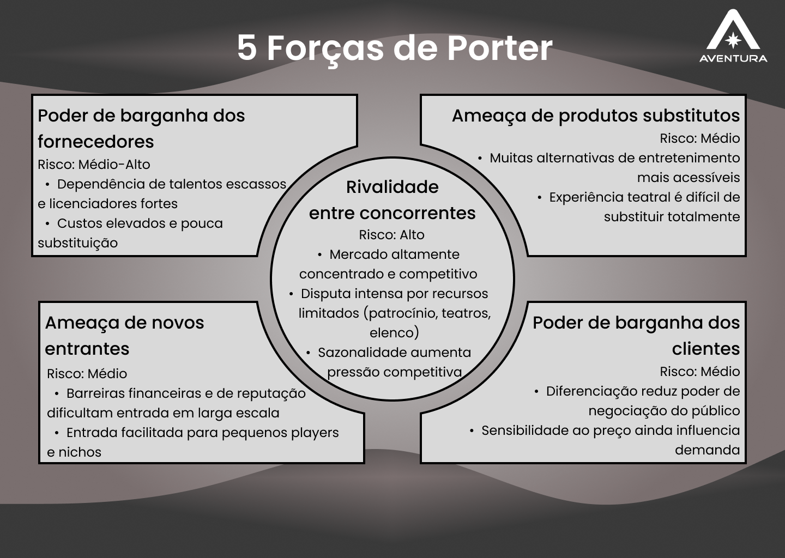<br>
  <sup>Source: Material produced by the authors, 2026.</sup>
</div>


### 2.1 Rivalidade entre concorrentes

**Risco: Alto**

A Aventura Teatros é uma empresa de produção de espetáculos que atua principalmente nas cidades de São Paulo e Rio de Janeiro, os dois maiores polos culturais do país. Nesses mercados, a rivalidade competitiva é intensa: apenas em São Paulo, a APETESP, Associação de Produtores de Espetáculos Teatrais do Estado de São Paulo, representa cerca de 108 empresas produtoras, evidenciando a densa concentração de concorrentes na principal praça de atuação da Aventura. No Rio de Janeiro, a disputa é igualmente acirrada, com a APTR, Associação dos Produtores de Teatro do Rio de Janeiro, reunindo produtoras locais de expressiva atuação.

Além da quantidade de competidores, a rivalidade se manifesta na disputa por recursos escassos: patrocínios privados, editais de fomento cultural, datas em teatros de prestígio e elencos renomados. A produção teatral abrange diferentes formatos, como musicais, teatro de grupo, produções comerciais e independentes, além de apresentações em teatros de shopping, centros culturais, praças e parques, o que amplia o leque de competidores diretos e indiretos com os quais a Aventura precisa se posicionar. Some-se a isso a sazonalidade do setor, que concentra a disputa por público em períodos específicos do ano, como férias escolares e fim de ano, intensificando ainda mais a competição. 

Diante de um mercado com mais de uma centena de produtoras concorrentes nos principais centros culturais do país, recursos finitos e demanda sazonalmente concentrada, a rivalidade entre os players estabelecidos é estruturalmente alta. Para a Aventura Teatros, isso significa que crescimento e sustentabilidade dependem não apenas da qualidade dos espetáculos, mas da capacidade de construir uma identidade de marca reconhecível e de fidelizar parceiros estratégicos.

### 2.2 Ameaça de novos entrantes

**Risco: Médio**

No mercado de produção teatral, o principal obstáculo à entrada de novos competidores é o capital. Produções musicais de grande porte podem demandar captações superiores a R$7 milhões, e mesmo projetos de menor escala envolvem custos expressivos com elenco, cenografia, figurino, iluminação e equipe técnica. O financiamento do setor é fortemente dependente de incentivos fiscais como a Lei Rouanet, cujo acesso exige histórico, credibilidade e conhecimento burocrático, ativos que novos entrantes não possuem de imediato. Além disso, a disputa por elencos qualificados, teatros com boa localização e datas estratégicas favorece as produtoras já estabelecidas, que contam com relacionamentos consolidados no setor, criando uma vantagem competitiva difícil de replicar no curto prazo.

Por outro lado, as barreiras regulatórias são baixas: não há exigências de licenças especiais ou certificações específicas para atuar como produtora teatral, o que permite que novos agentes, inclusive produtores independentes e grupos artísticos, entrem no mercado com produções de menor escala. A digitalização e o crescimento das plataformas de financiamento coletivo também reduziram parte da barreira financeira, abrindo espaço para estreantes que não dependem exclusivamente de editais ou patrocínios corporativos. Dessa forma, o risco mais concreto para a Aventura Teatros não vem de grandes produtoras entrantes, mas de competidores de nicho que operam com estruturas enxutas, custos reduzidos e propostas artísticas diferenciadas, capazes de disputar públicos e espaços específicos sem precisar competir no mesmo patamar de investimento.


### 2.3 Poder de barganha dos fornecedores

**Risco: Médio-Alto**

O poder de barganha dos fornecedores da Aventura é classificado como médio-alto. A cadeia produtiva de seus espetáculos depende de atores, diretores, cenógrafos e músicos com reconhecimento público, profissionais escassos num mercado que comporta apenas dez a doze grandes produções musicais em cartaz simultaneamente (Infoteatro, 2025). Esse cenário eleva o custo de troca para a Aventura e é agravado pela dinâmica da Lei Rouanet, que ao injetar patrocínio privado via renúncia fiscal elevou os preços de cachês e serviços técnicos ao longo dos anos (Infoteatro, 2025). Adicionalmente, títulos licenciados da Broadway presentes no portfólio da empresa, como "Mamma Mia!" e "A Noviça Rebelde" (Inteli & Aventura, 2024), criam dependência de licenciadores estrangeiros com poder de negociação elevado.

### 2.4 Poder de barganha dos clientes

**Risco: Médio**

O poder de barganha dos compradores da Aventura é classificado como médio. O alto grau de diferenciação de suas produções, com mais de 5 milhões de espectadores históricos e parcerias exclusivas com Disney-Pixar (Inteli & Aventura, 2024), limita o poder de negociação do consumidor individual ao dificultar a substituição por concorrentes. Ainda assim, a sensibilidade ao preço é uma variável relevante: o ticket médio dos espetáculos ao vivo no Brasil atingiu R$ 432 em 2024 (Anafima, 2024), e pesquisa da Revista Diálogo com a Economia Criativa (ESPM, 2018) aponta a política de preços como um dos fatores mais determinantes na decisão de consumo de teatro musical no país.

### 2.5 Ameaça de produtos substitutos

**Risco: Médio**

A Aventura Teatros compete por um bem escasso: o tempo de lazer do consumidor. Nesse campo, os substitutos são numerosos e estão em expansão acelerada. O streaming consolidou-se como o principal meio de entretenimento doméstico no Brasil, com dezenas de milhões de lares assinando ao menos uma plataforma, oferecendo acesso praticamente ilimitado a conteúdo cultural por uma fração do valor de um ingresso teatral. O cinema, por sua vez, também avança com força, em 2024, os cinemas brasileiros venderam mais de 116 milhões de ingressos, crescimento de 6,5% em relação ao ano anterior, enquanto shows e eventos ao vivo disputam as mesmas datas e o mesmo orçamento do público. Em conjunto, essas alternativas formam um ecossistema de entretenimento cada vez mais acessível e conveniente, o que pressiona o teatro a justificar seu custo mais elevado.
No entanto, a substituição é apenas parcial. O teatro acontece com a presença viva dos artistas em cena, compartilhando o mesmo espaço com a plateia por um determinado tempo, uma dimensão que nenhuma tela consegue replicar. A singularidade de cada apresentação, a efemeridade do ao vivo e o pertencimento coletivo à experiência conferem ao espetáculo teatral um valor simbólico próprio, que fideliza seu público e dificulta a substituição plena. Dessa forma, a ameaça dos substitutos é real e crescente na disputa pelo tempo e pela renda do consumidor, mas limitada quando se trata de replicar a experiência teatral em si, o que posiciona essa força em um nível médio de pressão sobre a Aventura Teatros.

### 2.6 Análise SWOT
 
Complementar às 5 Forças de Porter, a análise SWOT permite consolidar os fatores internos e externos que influenciam o posicionamento estratégico da Aventura Teatros, conectando os elementos competitivos identificados anteriormente a uma visão integrada de forças, fraquezas, oportunidades e ameaças.
 
<div align="center">
<sub>Imagem 02 - Análise SWOT</sub><br>
  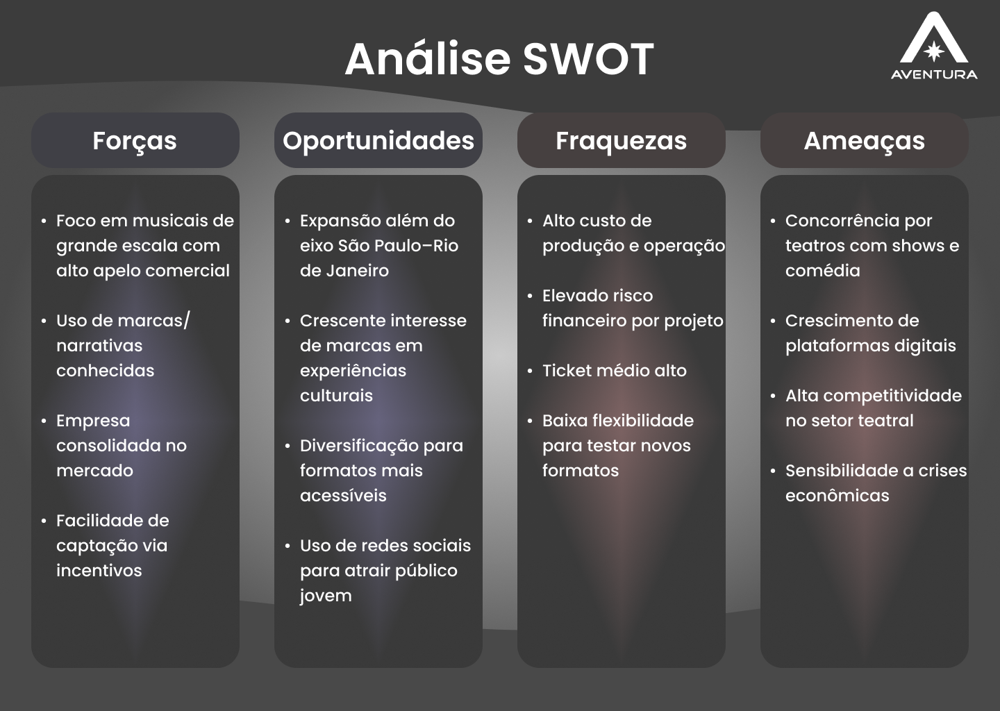<br>
  <sup>Source: Material produced by the authors, 2026.</sup>
</div>

#### **Forças**
 
A principal força da Aventura Teatros está em seu posicionamento em produções de grande escala, especialmente musicais. Esse modelo se beneficia do uso de propriedades intelectuais conhecidas, como biografias ou marcas culturais, o que reduz incertezas de demanda. Esse fenômeno é discutido no relatório Global Entertainment & Media Outlook da PwC, que aponta que conteúdos baseados em marcas consolidadas tendem a apresentar maior previsibilidade de audiência no setor de entretenimento.
 
Além disso, a empresa apresenta alto grau de consolidação, refletido em seu histórico de produções e alcance de público. Essa trajetória favorece a captação de recursos por meio de mecanismos formais de incentivo. Segundo a página oficial da Lei Rouanet (Lei nº 8.313/1991), projetos culturais aprovados podem captar recursos junto a empresas via renúncia fiscal, sendo comum que produtores com histórico consolidado tenham maior taxa de sucesso nesse processo. Essa vantagem reforça a capacidade da Aventura Teatros de viabilizar projetos de maior escala.
 
#### **Fraquezas**
 
O modelo adotado pela empresa implica um alto custo estrutural de produção, característica típica do setor de artes performáticas. De acordo com o relatório Cultural Times: The First Global Map of Cultural and Creative Industries, publicado pela UNESCO, produções ao vivo possuem elevada dependência de custos fixos e menor escalabilidade em comparação a conteúdos digitais, o que aumenta sua exposição a riscos financeiros.
 
Esse fator contribui diretamente para o alto valor do ticket médio, necessário para garantir a viabilidade econômica dos espetáculos. No contexto brasileiro, essa limitação é reforçada por dados da pesquisa Desigualdades Sociais por Cor ou Raça no Brasil e levantamentos de consumo cultural do IBGE, que indicam que o acesso a atividades culturais pagas ainda é concentrado em parcelas da população com maior renda. Assim, o modelo de precificação restringe o público potencial e torna a demanda mais sensível a variações econômicas.
 
#### **Oportunidades**
 
Uma oportunidade relevante está na expansão para mercados fora do eixo tradicional. Dados da Associação Paulista dos Produtores de Teatro mostram que a maior parte das produções teatrais está concentrada em São Paulo, enquanto o Rio de Janeiro também se destaca como polo relevante. Essa concentração sugere a existência de demanda reprimida em outras capitais, onde a concorrência é menor e o acesso a grandes produções ainda é limitado.
 
Outra oportunidade está no crescimento do investimento privado em experiências culturais. O relatório Global Entertainment & Media Outlook da PwC destaca o aumento do interesse de marcas em experiências presenciais como forma de engajamento, especialmente em um cenário de saturação da publicidade digital. No Brasil, esse movimento é potencializado por mecanismos como a Lei Rouanet, que permite às empresas direcionar parte de seus impostos para projetos culturais.
 
Além disso, a diversificação de formatos representa uma oportunidade estratégica relevante. O crescimento do stand-up comedy e de produções menores reflete uma mudança no padrão de consumo, com maior valorização de experiências mais acessíveis e frequentes. Embora não exista um único relatório centralizador desse movimento, ele é amplamente observado na expansão de circuitos de comédia e na ocupação crescente de teatros por esse tipo de espetáculo, indicando uma tendência de flexibilização do setor.
 
#### **Ameaças**
 
Entre as ameaças, destaca-se a competição por espaços físicos, intensificada pela expansão de outros formatos de entretenimento ao vivo, como shows e apresentações de comédia. Esse fenômeno impacta diretamente a disponibilidade de teatros e pode elevar custos operacionais, especialmente em grandes centros urbanos.
 
Além disso, a concorrência com plataformas digitais representa uma transformação estrutural no setor. Segundo o relatório Global Entertainment & Media Outlook 2023–2027 da PwC, o consumo de streaming continua em crescimento global, com aumento significativo do tempo gasto em plataformas digitais. Serviços como Netflix e YouTube oferecem conteúdo sob demanda, com menor custo e maior conveniência, competindo diretamente pela atenção do consumidor e reduzindo a atratividade relativa de experiências presenciais.

## 3. Visão e Objetivos do Produto

### 3.1 Visão do Produto

A visão do produto é conceber e estabelecer um novo ecossistema digital da Aventura Teatros. Através de um motor de recomendação orientado a dados, o sistema conectará o público ao vasto catálogo da produtora, antecipando interesses e sugerindo espetáculos de forma fluida. O propósito é criar uma jornada digital que retenha o usuário no ecossistema da marca, convertendo esse engajamento contínuo em um aumento real na venda de ingressos.

### 3.2 Objetivos do Produto
O desenvolvimento desta solução tem metas claras, alinhadas diretamente às necessidades de negócio da Aventura Teatros e ao valor entregue aos usuários:

* **Maximizar a Retenção e Conversão de Vendas:** Atuar como o principal motor de direcionamento estratégico da empresa. Ao sugerir de forma inteligente novos espetáculos antes que o usuário abandone a página, o sistema visa reter o cliente no portal, transformando o tempo de navegação em aumento direto na venda de ingressos.
* **Personalizar a Jornada de Descoberta:** Transformar a experiência do usuário de reativa para proativa. O objetivo é que cada visitante sinta que o portal entende suas preferências, recebendo recomendações assertivas que reduzem o atrito na busca por entretenimento.
* **Integrar o Ecossistema Aventura:** Quebrar os silos entre as diferentes produções (teatros, musical, festivais, etc.). O sistema deve criar pontes fluidas, incentivando o público de um nicho a descobrir e consumir a multiplicidade artística da produtora.
* **Implementar Arquitetura Escalável:** Entregar uma base tecnológica moderna através de uma Arquitetura Orientada a Serviços (SOA), capaz de processar os dados de interesse do usuário em tempo real e fornecer as recomendações de forma ágil, escalável e com alto desempenho.

### 3.3 Métricas de Sucesso (KPIs)
Para garantir e monitorar que os objetivos acima sejam atingidos, o produto focará nos seguintes indicadores chave:
* **Taxa de Conversão:** Aumento na porcentagem de usuários que clicam em uma recomendação e são direcionados ao parceiro de bilheteria.
* **Engajamento e Retenção:** Aumento do tempo médio de sessão e do número de páginas/telas acessadas por visita.
* **Taxa de Cliques (CTR):** Volume de interação direta com os carrosséis de vitrines dinâmicas e notificações push.

---

## 4. O que o Produto Faz e o que Não Faz

Considerando o desafio de criar um hub digital dinâmico, é fundamental estabelecer fronteiras claras de atuação. Para garantir o alinhamento de expectativas e o foco na entrega de valor estratégico para a Aventura Teatros, utilizamos a matriz **"É / Não É / Faz / Não Faz"**. Esta estrutura delimita com precisão o escopo do projeto, definindo o papel do motor de recomendação e da aplicação multiplataforma (Web e Mobile) dentro do ecossistema da empresa, e evitando sobreposições com sistemas já consolidados, como as parcerias com a bilheteria.

### 4.1. O Produto É:
* **Uma solução multiplataforma:** Uma aplicação disponível tanto em versão Web quanto em aplicativo móvel híbrido (iOS e Android), garantindo uma experiência consistente em diferentes dispositivos.
* **Um motor de recomendação inteligente:** Um sistema (via API/SOA) que personaliza o conteúdo exibido no app com base no perfil do usuário.
* **Um hub de engajamento digital:** Uma ferramenta estratégica para reter o público da Aventura Teatros através de uma jornada conectada e fluida.

### 4.2. O Produto Não É:
* **Um sistema de e-commerce ou bilheteria (Ticketing):** O produto não é um gateway de pagamento e não processa transações financeiras internamente; ele atua como um canal de captação e direcionamento.
* **Um Sistema de Gestão de Conteúdo (CMS):** Não substitui o banco de dados ou painel onde a Aventura cadastra seus eventos.
* **Uma rede social:** O foco é a recomendação de ativos da Aventura, e não a interação social entre usuários.

### 4.3. O Produto Faz:
* **Notificações Personalizadas (Push):** Utiliza o motor de recomendação para enviar sugestões relevantes diretamente ao smartphone do usuário.
* **Exibe Vitrines Dinâmicas:** Apresenta carrosséis de espetáculos, teatros e conteúdos baseados no comportamento de navegação no app.
* **Integra-se com APIs da Aventura:** Consome os dados de eventos e peças para organizar as recomendações em tempo real.
* **Monitora Interesses do Usuário:** Mapeia quais categorias (musicais, festivais) o usuário mais acessa para refinar as sugestões.

### 4.4. O Produto Não Faz:
* **Não vende ingressos diretamente:** A finalização da compra ocorre via redirecionamento para o parceiro de ticketing.
* **Não funciona offline:** Por depender de um motor de recomendação em tempo real e atualização de catálogo, o app exige conexão com a internet.
* **Não gerencia a logística dos teatros:** O escopo é estritamente informativo e de recomendação, sem controle de assentos ou entrada física (QR Code de acesso pode estar fora de escopo, dependendo do que vocês decidiram).

---

## 5. Personas e Jornada do Usuário
 
---
 
## 5.1 Personas
 
### 5.1.1 Ana Luiza — Cliente em Formação (Descoberta)
 
Ana Luiza representa um perfil emergente de consumidores culturais em formação: jovens que ainda não possuem o hábito consolidado de frequentar teatro, mas demonstram interesse quando expostos a estímulos visuais, sociais e tendências digitais. Sua relação com o lazer é fortemente influenciada por redes sociais e pelo grupo de amigos, tornando a descoberta de experiências mais espontânea do que planejada.
 
Apesar de não ser uma consumidora ativa do setor, Ana exerce influência significativa na decisão de compra, especialmente em contextos familiares. No entanto, enfrenta barreiras como a falta de direcionamento, dificuldade em identificar conteúdos adequados para sua faixa etária e baixa atratividade das plataformas tradicionais. Esse cenário evidencia a necessidade de soluções que tornem a experiência mais visual, intuitiva e alinhada ao comportamento digital, incentivando o interesse e reduzindo a distância entre o público jovem e o consumo cultural.
 
<div align="center">
  <sub>Imagem 03 - Persona do cliente</sub><br>
  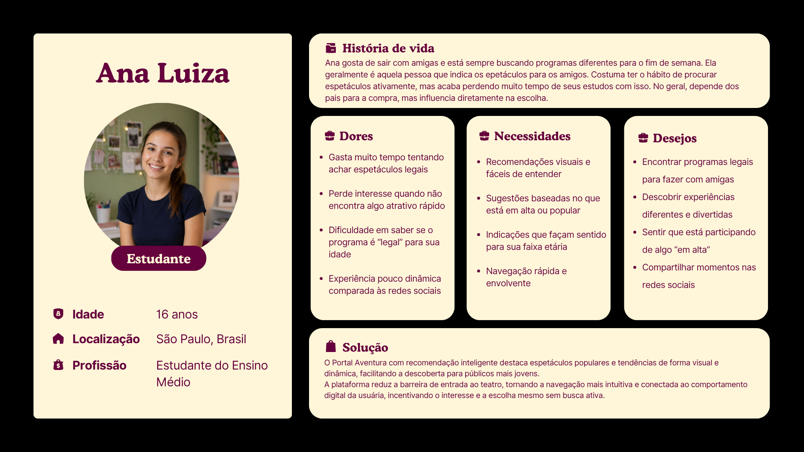<br>
  <sup>Fonte: Material produzido pelos autores, 2026.</sup>
</div>
---
 
### 5.1.2 Marcos Abrantes — Cliente Ativo (Decisão e Consumo)
 
Marcos Abrantes representa um perfil crescente de consumidores culturais urbanos: jovens adultos com rotina intensa, que buscam no lazer uma forma de descanso e inspiração, mas ainda têm uma relação pouco estruturada com o consumo de teatro. Seu contato com espetáculos acontece de forma reativa, mediado por redes sociais e indicações, o que torna sua jornada fragmentada. Apesar do interesse genuíno e do potencial de consumo, Marcos enfrenta dificuldades para descobrir novas produções com confiança, revelando uma oportunidade clara para soluções que organizem, personalizem e qualifiquem sua experiência de decisão.
 
<div align="center">
  <sub>Imagem 04 - Persona do cliente</sub><br>
  <br>
  <sup>Fonte: Material produzido pelos autores, 2026.</sup>
</div>
---
 
## 5.2 Jornada do Usuário
 
### 5.2.1 Jornada de Ana Luiza — Cliente em Formação
 
<div align="center">
  <sub>Imagem 05 - Jornada do usuário: Ana Luiza</sub><br>
  <br>
  <sup>Fonte: Material produzido pelos autores, 2026.</sup>
</div>

| Etapa | Sentimento | Ações e Percepções |
|---|---|---|
| **Necessidade** | Infeliz | **Desorientação Cultural:** Ana quer sair com as amigas, mas sente que o teatro é um "mundo distante". Não sabe por onde começar a procurar e as opções que encontra parecem chatas ou "fora da sua bolha". **Barreira de Interesse:** Perde o interesse rapidamente se a interface não for dinâmica. Sente a frustração de não encontrar algo que pareça "instagramável" ou que faça sentido para a idade dela. |
| **Procura** | Neutro | **Esperança Investigativa:** Começa a procurar por coisas para fazer aos finais de semana na internet. **Descoberta Visual:** Encontra o Portal Aventura, e se surpreende com uma interface que fala a língua dela. O sentimento é de alívio por encontrar um lugar que destaca o que está "em alta" de forma visual e rápida, sem textos cansativos. |
| **Encontro** | Feliz | **Ação:** O algoritmo recomenda espetáculos que pessoas semelhantes a ela também curtiram. **Sentimento:** Ela descobre que as recomendações são precisas com seus gostos pessoais e faixa etária. Sente o entusiasmo de quem encontrou um "atalho" para ser a pessoa que sugere ótimos roles para o grupo. |
| **Acordo** | feliz | **Validação Social:** Ela compartilha o link no grupo das amigas e a resposta é imediata. **Sentimento:** Como a plataforma mostra fotos, do que é popular, ela sente segurança de que o investimento vale a pena e que ela não vai "pagar mico" com uma escolha errada. |
| **Adaptação** | Neutro | **A Barreira do Real:** A linha de felicidade cai levemente aqui. É o momento de convencer os pais, organizar o horário do grupo e lidar com a ansiedade de sair do digital para o presencial. **Sentimento:** Uma leve insegurança sobre se o evento ao vivo será tão legal quanto as fotos que ela viu na plataforma. O esforço de deslocamento gera um pequeno cansaço pré-evento. |
| **Resultados** | Feliz | **Sentimento:** A felicidade explode porque ela viveu algo memorável com as amigas. O Portal Aventura agora é o app de referência dela para qualquer fim de semana, eliminando o medo de "ficar de fora" (FOMO) das melhores experiências. |
 
---
 
### 5.2.2 Jornada de Marcos Abrantes — Cliente Ativo
 
<div align="center">
  <sub>Imagem 06 - Jornada do usuário: Marcos Abrantes</sub><br>
  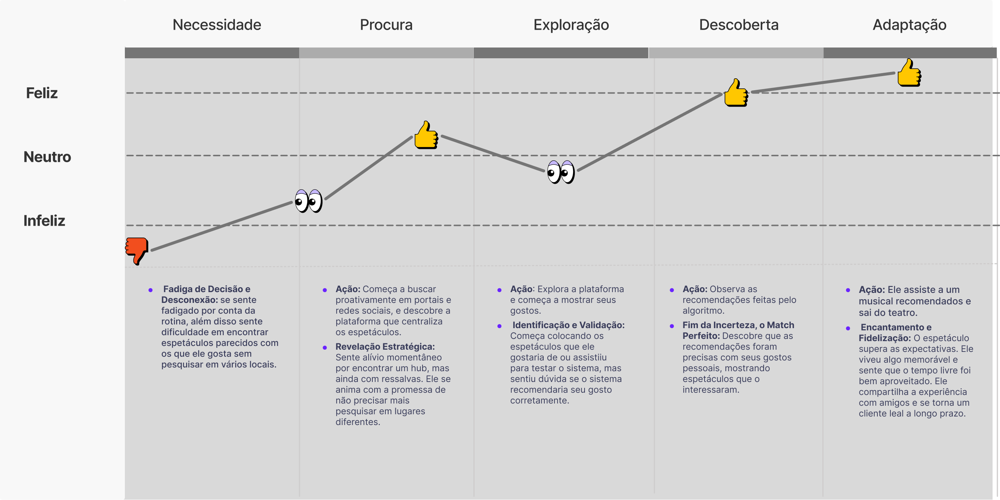<br>
  <sup>Fonte: Material produzido pelos autores, 2026.</sup>
</div>

| Etapa | Sentimento | Ações e Percepções |
|---|---|---|
| **Necessidade** |  Infeliz | **Fadiga de Decisão e Desconexão:** Se sente fadigado por conta da rotina, além disso sente dificuldade em encontrar espetáculos parecidos com os que ele gosta sem pesquisar em vários locais. |
| **Procura** |  Neutro | **Ação:** Começa a buscar proativamente em portais e redes sociais, e descobre a plataforma que centraliza os espetáculos. **Revelação Estratégica:** Sente alívio momentâneo por encontrar um hub, mas ainda com ressalvas. Ele se anima com a promessa de não precisar mais pesquisar em lugares diferentes. |
| **Exploração** | Neutro | **Ação:** Explora a plataforma e começa a mostrar seus gostos. **Identificação e Validação:** Começa colocando os espetáculos que ele gostaria de ou assistiu para testar o sistema, mas sentiu dúvida se o sistema recomendaria seu gosto corretamente. |
| **Descoberta** | Feliz | **Ação:** Observa as recomendações feitas pelo algoritmo. **Fim da Incerteza, o Match Perfeito:** Descobre que as recomendações foram precisas com seus gostos pessoais, mostrando espetáculos que o interessaram. |
| **Adaptação** | Feliz | **Ação:** Ele assiste a um musical recomendado e sai do teatro. **Encantamento e Fidelização:** O espetáculo supera as expectativas. Ele viveu algo memorável e sente que o tempo livre foi bem aproveitado. Ele compartilha a experiência com amigos e se torna um cliente leal a longo prazo. |

---

## 6. Fluxo do Negócio

Nesta seção, apresentamos o fluxo de negócios da Plataforma Aventura modelado em BPMN (Business Process Model and Notation). O diagrama mapeia as interações entre três participantes principais — o Cliente, o Sistema de Recomendação e a Gestão de Conteúdo — demonstrando como esses processos se integram para oferecer uma experiência personalizada ao usuário. A notação BPMN foi escolhida por permitir uma leitura clara e padronizada dos fluxos, facilitando tanto a comunicação entre equipes técnicas quanto a compreensão por stakeholders de negócio.

<div align="center">
<sub>Imagem 07 - Fluxo de Negócio (BPMN)</sub><br>
  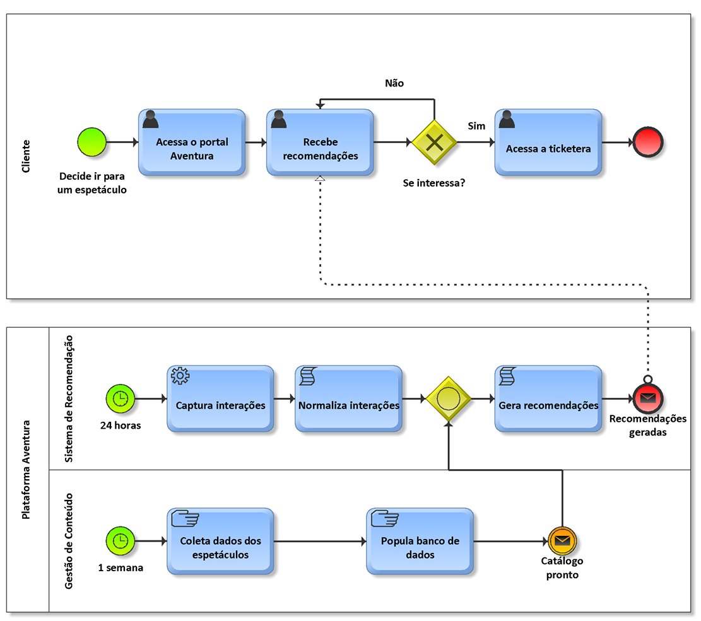<br>
  <sup>Source: Material produced by the authors, 2026.</sup>
</div>

O fluxo de negócios é composto por duas pools distintas. Na pool do Cliente, o processo tem início com o acesso ao portal Aventura, seguido da recepção de recomendações. O gateway exclusivo "Se interessa?" determina o caminho seguinte: caso haja interesse, o cliente é direcionado à ticketera, encerrando o processo; caso contrário, o fluxo retorna à etapa de recepção de recomendações.

Na pool da Plataforma Aventura, dois fluxos paralelos operam de forma independente. O Sistema de Recomendação é disparado a cada 24 horas, executando a captura de interações, o tratamento dos dados e o encaminhamento ao gateway inclusivo. A Gestão de Conteúdo, por sua vez, é disparada semanalmente, realizando a coleta de dados dos espetáculos e a população do banco de dados, finalizando com o evento "Catálogo pronto", que também alimenta o gateway inclusivo. Esse gateway OR garante que a geração de recomendações ocorra assim que ao menos uma das entradas estiver disponível, enviando o resultado ao cliente via evento de mensagem "Recomendações geradas".

---

## 7. Brainstorming de Features

Para o projeto de plataforma digital baseada em arquitetura orientada a serviços, desenvolvido em parceria com a **Aventura Teatros**, o desafio central identificado é a ausência de um sistema estruturado de recomendação no Portal Aventura. Isso limita o potencial de descoberta de novos conteúdos e impacta diretamente a conversão em vendas de ingressos.

Esta documentação detalha o brainstorm de *features* realizado em grupo.


### 1. Visão Geral do Modelo (Backend & Inteligência)

O motor de recomendação será alimentado por dados demográficos e comportamentais para personalizar a experiência do usuário no portal.

* **Geolocalização:** Filtragem baseada na localização do usuário.
* **Perfil Demográfico:** Segmentação por idade e gênero.
* **Rastreio de Ações:** Monitoramento do comportamento de navegação dentro da plataforma.
* **Indicadores de Interesse:** Gatilhos de conversão, como o clique no link da ticketeira (venda de ingressos).
* **Integração com Wishlist:** O sistema deve reconhecer se o espetáculo já está na lista de desejos para refinar as sugestões.


### 2. Interface do Usuário (Front-end)

### 2.1 Fluxo de Cadastro e Onboarding
Essencial para coletar os dados iniciais que alimentarão o sistema de recomendação inteligente.
* **Credenciais:** E-mail e senha.
* **Dados Pessoais:** Nome, Idade, Gênero e CEP.
* **Questionário de Preferências:**
    * Frequência de ida ao teatro.
    * Tipos de preferência (Show musical, stand-up, espetáculo, espetáculo musical).
    * Seleção de gêneros favoritos.

### 2.2 Estrutura de Navegação
* **Home:** Visão geral e destaques.
* **Componentes de Descoberta:** Carrosséis e "Prateleiras" de recomendações personalizadas.
* **Filtros Regionais:** Seleção rápida entre São Paulo (SP) e Rio de Janeiro (RJ).
* **Retenção:** Seção "Assista Novamente" e acesso rápido à Wishlist.
* **Perfil:** Gestão de dados e preferências do usuário.
* **Teatro:** Páginas com informações fixas sobre os equipamentos geridos pela Aventura.


### 3. Funcionalidades Core

* **Direcionamento para Compra:** Link direto e facilitado para a aquisição de ingressos.
* **Busca:** Sistema de pesquisa interna de conteúdos e espetáculos.
* **Gestão de Wishlist:** Botão para salvar experiências de interesse futuro.


### 4. Roadmap: Funcionalidades Adicionais (Futuro)

* **Sistema de Feedback:** Avaliação de espetáculos por meio de "Like/Dislike" para aprimorar o algoritmo.
* **Notificações Push:** Alertas automáticos quando um espetáculo salvo na Wishlist entrar em cartaz ou tiver novas datas disponíveis.


---

## 8. Business Model Canvas do MVP

O Business Model Canvas apresentado a seguir sintetiza a estratégia do MVP da Plataforma Aventura, estruturando em nove blocos os elementos centrais do modelo de negócio. A partir das definições de proposta de valor, segmentos de clientes, canais, recursos e parcerias, o canvas oferece uma visão integrada de como a solução se posiciona no mercado e de que forma cada componente contribui para a geração de valor, tanto para o usuário final quanto para a Aventura Teatros como negócio.

<div align="center">
<sub>Imagem 08 - Business Model Canvas do MVP</sub><br>
  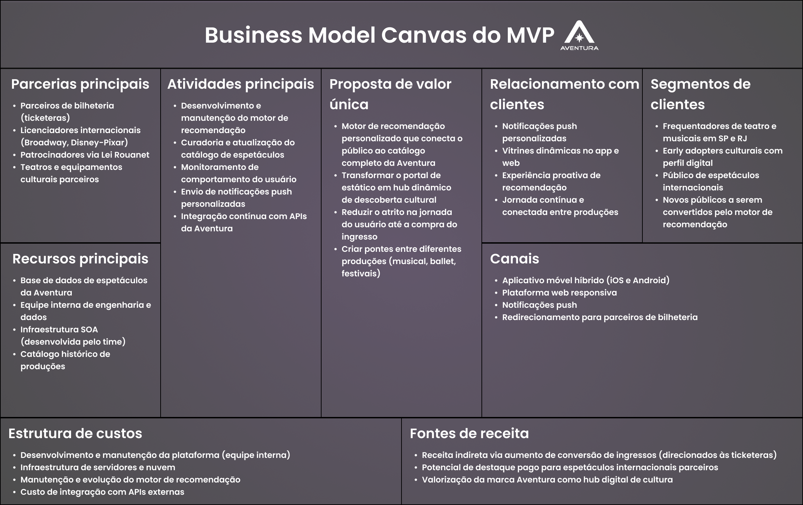<br>
  <sup>Source: Material produced by the authors, 2026.</sup>
</div>

| Bloco | Descrição |
|---|---|
| Proposta de valor | Motor de recomendação personalizado que transforma o portal da Aventura de uma navegação estática em um hub dinâmico de descoberta cultural, conectando o usuário ao catálogo completo de produções (musicais, ballet, festivais) e reduzindo o atrito na jornada até a compra do ingresso. |
| Segmentos de clientes | Frequentadores de teatro e espetáculos musicais nas praças de São Paulo e Rio de Janeiro; público digital com perfil de early adopter cultural; apreciadores de produções internacionais; e novos públicos a serem convertidos por meio das recomendações personalizadas. |
| Canais | Aplicativo móvel híbrido (iOS e Android), plataforma web responsiva e notificações push. O redirecionamento para a compra de ingressos ocorre via parceiros de bilheteria (ticketeras). |
| Relacionamento com clientes | Experiência proativa e personalizada por meio de vitrines dinâmicas no app e na web, além de notificações push baseadas no comportamento de navegação do usuário. A plataforma ainda não existe, sendo este o modelo-alvo da solução. |
| Fontes de receita | Receita indireta via aumento da taxa de conversão de ingressos, com o fluxo financeiro passando pelas ticketeras parceiras. Há potencial futuro de destaque pago para espetáculos internacionais e valorização da marca Aventura como referência digital no setor cultural. |
| Recursos principais | Base de dados de espetáculos da Aventura, equipe interna de engenharia e dados, infraestrutura SOA desenvolvida pelo time e catálogo histórico de produções. |
| Atividades principais | Desenvolvimento e manutenção do motor de recomendação, curadoria e atualização do catálogo, monitoramento de comportamento do usuário, envio de notificações push personalizadas e integração contínua com as APIs da Aventura. |
| Parcerias principais | Parceiros de bilheteria (ticketeras), licenciadores internacionais (Broadway, Disney-Pixar), patrocinadores via Lei Rouanet e teatros e equipamentos culturais parceiros da Aventura. |
| Estrutura de custos | Desenvolvimento e manutenção da plataforma pela equipe interna, infraestrutura de servidores e nuvem, evolução contínua do motor de recomendação e integração com APIs externas. Por ser desenvolvida internamente, a plataforma não exige investimento direto em licenças de software de terceiros. |

---

## 9. Requisitos Funcionais

A fim de garantir a excelência e o rigor técnico no desenvolvimento do ecossistema digital, o processo de levantamento e documentação seguiu as diretrizes da Área de Conhecimento de Requisitos de Software (KA 1 - Software Requirements) do guia internacional SWEBOK V3 (IEEE). Essa adoção assegura que o projeto não apenas atenda aos objetivos de negócio do parceiro, mas que seja estruturado de forma rastreável, modular e pronta para um ciclo de desenvolvimento de software de qualidade.

### 9.1.  Elicitação e Análise de Requisitos
A fase de elicitação buscou compreender profundamente a jornada do consumidor cultural. O foco principal foi alinhar o vasto catálogo de produções da Aventura Teatros às expectativas de um público diversificado e exigente. Utilizamos a técnica ágil de User Stories (Histórias de Usuário) para mapear o comportamento do espectador, desde a descoberta de seu perfil no primeiro contato (Onboarding) até o redirecionamento seguro para a compra do ingresso (Hand-off).

Durante a etapa de análise, delimitamos estrategicamente o escopo do sistema para focar 100% na experiência do usuário final. Concluiu-se que o maior valor do produto reside na capacidade de oferecer uma curadoria ativa e personalizada. Dessa forma, todos os esforços de definição de requisitos foram direcionados para desenhar uma plataforma de alta usabilidade, onde o sistema atue de forma inteligente e orgânica na sugestão de espetáculos, maximizando o engajamento e a conversão de vendas.

### 9.2. Especificação e Validação de Requisitos Funcionais
Conforme as premissas do SWEBOK, a especificação tem o papel de traduzir as necessidades do negócio em comportamentos claros e executáveis para o sistema, enquanto a validação garante que o produto construído seja plenamente testável.

Para a especificação, adotamos o padrão estruturado de User Stories ("Como perfil, eu quero ação, para motivação"), garantindo que o desenvolvimento seja continuamente guiado pelo valor entregue ao usuário. Paralelamente, para a etapa de validação, foram definidos Casos de Teste de Usuário para cada funcionalidade descrita. Esses testes estabelecem critérios de aceitação rigorosos, contemplando pré-condições, procedimentos de execução e os resultados sistêmicos e visuais esperados, assegurando que todas as ações e comportamentos do software possam ser homologados com precisão técnica antes de serem disponibilizados ao público. Os requisitos detalhados sob esta ótica são apresentados a seguir.

### RF01 — Onboarding de Interesses

**User story:** Como novo usuário, eu quero responder a um questionário de interesses (onboarding), para que o sistema recomende o catálogo de acordo com minhas preferências (gênero, frequência, localização).

**Testes de usuário:**

| Campo | Descrição |
|---|---|
| Pré-condição |O usuário acabou de criar a conta e está no seu primeiro acesso (sem preferências salvas). |
| Procedimento de teste | 1. Acessar a tela de Onboarding. <br> 2. Selecionar o gênero "Musical" e a cidade "São Paulo". <br>3. Clicar no botão "Salvar e Continuar". |
| Resultado esperado | O sistema redireciona o usuário para a Home, exibindo primariamente espetáculos da categoria "Musical" localizados em "SP". |
| Pós-condição |As preferências de gênero e localização são gravadas no perfil do Usuário no banco de dados.|

---

### RF02 — Recomendação por Geolocalização

**User story:** Como usuário, eu quero receber sugestões baseadas na minha localização (Geolocalização), para priorizar eventos que acontecem na minha cidade (RJ ou SP).

**Testes de usuário:**

| Campo | Descrição |
|---|---|
| Pré-condição | O usuário está logado e possui a localização definida (ex: São Paulo).|
| Procedimento de teste |1. Acessar a página inicial (Home).<br>2. Rolar a página até a seção "Em Cartaz Perto de Você". <br> 3. Verificar os locais dos espetáculos exibidos. |
| Resultado esperado |A prateleira exibe exclusivamente espetáculos vinculados a teatros localizados na cidade de São Paulo. |
| Pós-condição |O sistema registra a visualização para refinar o algoritmo de engajamento local. |

---

### RF03 — Autenticação e Persistência

**User story:** Como usuário, eu quero me cadastrar e realizar login (E-mail/Senha), para que minhas preferências e minha Wishlist sejam salvas entre diferentes sessões e dispositivos.

**Testes de usuário:**

| Campo | Descrição |
|---|---|
| Pré-condição |O usuário possui um cadastro válido, tem itens salvos na Wishlist, mas está deslogado do sistema. |
| Procedimento de teste |1. Acessar a tela de Login.<br>2. Inserir E-mail e Senha e confirmar.<br> 3. Navegar até a aba "Minha Wishlist". |
| Resultado esperado |O sistema autentica o usuário com sucesso e carrega todos os espetáculos que haviam sido salvos anteriormente. |
| Pós-condição |Uma sessão ativa (token) é gerada e armazenada de forma segura para manter o acesso durante a navegação. |

---

### RF04 — Catálogo Categorizado

**User story:** Como usuário, eu quero visualizar o catálogo completo de espetáculos organizado por categorias, para que eu tenha uma visão geral da multiplicidade artística da Aventura de forma estruturada.

**Testes de usuário:**

| Campo | Descrição |
|---|---|
| Pré-condição |O sistema possui espetáculos ativos cadastrados e vinculados a diferentes categorias de Gênero. |
| Procedimento de teste | 1. Acessar a página principal de Catálogo.<br>2. Clicar no filtro ou aba da categoria "Comédia".|
| Resultado esperado |A interface é atualizada, exibindo apenas os cards de espetáculos que contêm a tag do gênero "Comédia". |
| Pós-condição | O sistema processa a filtragem sem realizar alterações nos dados salvos do usuário.|

---
### RF05 — Busca Específica

**User story:** Como usuário, eu quero pesquisar por termos específicos (teatro, título), para encontrar rapidamente informações sobre uma produção específica.

**Testes de usuário:**

| Campo | Descrição |
|---|---|
| Pré-condição | O espetáculo "Mamma Mia" e o teatro "Riachuelo" estão devidamente cadastrados e ativos no banco de dados.|
| Procedimento de teste | 1. Clicar no ícone de pesquisa (lupa).<br>2. Digitar o termo "Riachuelo" e pressionar Enter.|
| Resultado esperado | A página de resultados exibe uma lista contendo o espetáculo "Mamma Mia" e outras peças em cartaz no referido teatro. |
| Pós-condição |O termo pesquisado é registrado temporariamente em log para métricas de interesse da plataforma. |

---
### RF06 — Gestão de Wishlist

**User story:** Como espectador, eu quero adicionar ou remover espetáculos da minha Wishlist, para sinalizar ao algoritmo meus interesses reais e salvar peças para consulta futura.

**Testes de usuário:**

| Campo | Descrição |
|---|---|
| Pré-condição |O usuário está logado e acessa a página de um espetáculo que não está em sua Wishlist. |
| Procedimento de teste |1. Clicar no botão "Adicionar à Wishlist".<br>2. Acessar a página "Minha Wishlist" para validar a inclusão.<br>3. Voltar e clicar no mesmo botão para remover. |
| Resultado esperado | O botão muda de estado visual. O espetáculo aparece na página Wishlist (passo 2) e desaparece ao ser removido (passo 3).|
| Pós-condição |O banco de dados insere (Create) ou deleta (Delete) o relacionamento entre as entidades Usuário e Espetáculo. |

---

### RF07 — Informações de Teatros

**User story:** Como espectador, eu quero encontrar informações de localização e horário de funcionamento sobre os teatros Aventura, para me preparar para assistir a um espetáculo.

**Testes de usuário:**

| Campo | Descrição |
|---|---|
| Pré-condição |O sistema possui o cadastro do teatro com metadados preenchidos (endereço, horários) vinculado ao espetáculo selecionado. |
| Procedimento de teste |1. Acessar a página de detalhes de um espetáculo qualquer.<br> 2. Rolar a página até a seção de informações do local. |
| Resultado esperado |O nome do teatro, o endereço físico completo e os dias/horários de funcionamento da bilheteria são exibidos corretamente. |
| Pós-condição |Nenhuma alteração no estado do sistema; os dados são consumidos em modo de apenas leitura. |

---

### RF08 — Gestão de Perfil e Preferências

**User story:** Como usuário, quero gerenciar e editar meus dados de perfil e preferências a qualquer momento, para garantir transparência e privacidade.

**Testes de usuário:**

| Campo | Descrição |
|---|---|
| Pré-condição |O usuário está logado no sistema e acessa a área de configurações do próprio perfil. |
| Procedimento de teste |1. Acessar "Meu Perfil" > "Gêneros Favoritos".<br> 2. Desmarcar o gênero "Comédia" e selecionar "Drama".<br> 3. Clicar em "Salvar Alterações". |
| Resultado esperado |O sistema exibe um alerta de sucesso e o motor de recomendação ajusta as próximas sugestões na Home para priorizar "Drama". |
| Pós-condição |O vetor de interesses atrelado ao Usuário é atualizado (Update) permanentemente no banco de dados.|

---

### RF09 — Redirecionamento de Compra

**User story:** Como usuário, quero ser direcionado para a bilheteria oficial via link externo, para realizar a compra do ingresso com segurança.

**Testes de usuário:**

| Campo | Descrição |
|---|---|
| Pré-condição |O espetáculo selecionado possui uma URL externa de bilheteria válida cadastrada no sistema (ex: link do Sympla). |
| Procedimento de teste | 1. Acessar a página de detalhes do espetáculo em cartaz.<br> 2. Clicar no botão principal de call-to-action "Comprar Ingressos".|
| Resultado esperado |O navegador abre uma nova janela ou aba carregando a página oficial de vendas do espetáculo na ticketeira externa. |
| Pós-condição |A interação de clique (hand-off) é registrada no sistema para geração de métricas de conversão. |

---

### RF10 — Recomendação Inteligente

**User story:** Como usuário, quero receber sugestões personalizadas com base no meu comportamento e preferências, para descobrir novos espetáculos relevantes de forma mais rápida e intuitiva.

**Testes de usuário:**

| Campo | Descrição |
|---|---|
| Pré-condição |O usuário possui preferências registradas no sistema (via Onboarding ou interações prévias). |
| Procedimento de teste | 1. Acessar a página inicial (Home).<br> 2. Localizar a seção de recomendações personalizadas.<br>3. Comparar o gênero e temática dos espetáculos sugeridos com o perfil do usuário.|
| Resultado esperado |As sugestões exibidas são condizentes com os interesses do usuário, apresentando espetáculos que correspondam ao seu perfil de consumo cultural. |
| Pós-condição |O sistema mantém a personalização da interface ativa para a conta do usuário. |

---


## 10. Requisitos Não Funcionais
### RNF01 — Tempo de resposta das recomendações

**Característica ISO 25010:** Eficiência de Desempenho → **Comportamento Temporal**

**User story:** Como usuário, quero que as recomendações personalizadas e os carrosséis da home carreguem rapidamente, para que eu possa explorar o catálogo sem frustração e manter o interesse na navegação.

**Critério de Aceitação:** sob carga nominal (até 200 usuários simultâneos), o tempo de renderização completa das prateleiras de recomendação tem **p95 ≤ 3 s** e **média ≤ 2 s**.

**Teste de usuário:**

| Campo | Descrição |
|---|---|
| Pré-condição | Usuário autenticado com onboarding preenchido, wishlist com ao menos 1 item e conexão estável de no mínimo 10 Mbps. |
| Procedimento | Acessar a Home do Portal e medir, via ferramenta de performance (ex.: Lighthouse/DevTools, marca de `paint` das prateleiras), o tempo entre o início do carregamento e a renderização completa dos carrosséis. Coletar uma amostra de pelo menos 30 execuções em horários distintos. |
| Resultado esperado | A amostra apresenta p95 ≤ 3 s e média ≤ 2 s; nenhuma execução isolada ultrapassa 5 s (p99). |
| Pós-condição | Carrosséis renderizados com itens personalizados e logs de performance (timestamps por percentil) armazenados para análise. |

---

### RNF02 — Segurança das credenciais de usuário

**Característica ISO 25010:** Segurança → **Confidencialidade** e **Integridade**

**User story:** Como usuário cadastrado, quero que minha senha e meus dados pessoais (nome, idade, gênero, CEP) sejam armazenados e transmitidos de forma criptografada, para que minhas informações não sejam expostas em caso de tentativa de invasão ou interceptação.

**Critério de Aceitação:** 100% do tráfego de autenticação ocorre via HTTPS/TLS 1.2+; senhas são persistidas com função de hash forte e com *salt* (ex.: bcrypt/Argon2), de forma não reversível; nenhum dado sensível trafega ou é registrado em texto plano.

**Teste de usuário:**

| Campo | Descrição |
|---|---|
| Pré-condição | Usuário cadastrado com e-mail e senha válidos e banco de dados de teste populado. |
| Procedimento | Inspecionar o tráfego de rede no momento do login (DevTools → aba Network), confirmando HTTPS/TLS. Consultar diretamente o banco e verificar o formato de armazenamento da senha. Tentar reverter o hash de uma senha conhecida. |
| Resultado esperado | Todo o tráfego usa HTTPS; a senha aparece como hash com *salt*, não em texto plano; a tentativa de reversão do hash falha. |
| Pós-condição | Sessão autenticada com token seguro; nenhum dado sensível visível em logs ou no *payload* em texto plano. |

---

### RNF03 — Privacidade e direitos do titular (LGPD)

**Característica ISO 25010:** Segurança → **Confidencialidade (foco em Privacidade de dados pessoais)** e **Responsabilização**

**User story:** Como usuário, quero consultar, editar e excluir meus dados pessoais e preferências a qualquer momento, para que a plataforma respeite os direitos garantidos pela LGPD e eu mantenha controle sobre minhas informações.

**Critério de Aceitação:** o usuário consegue visualizar, editar e solicitar a exclusão de todos os seus dados pessoais; após a exclusão, **0** registros pessoais permanecem associados ao identificador do usuário na base (dados removidos ou anonimizados de forma irreversível) em até **15 dias**; toda solicitação de exclusão fica registrada em log de auditoria.

**Teste de usuário:**

| Campo | Descrição |
|---|---|
| Pré-condição | Usuário autenticado com dados de perfil preenchidos no onboarding (idade, gênero, CEP, preferências). |
| Procedimento | Acessar Perfil → editar cada campo de dado pessoal e de preferência. Em seguida, solicitar a exclusão da conta e consultar a base verificando se os dados foram removidos/anonimizados. Conferir o log de auditoria da solicitação. |
| Resultado esperado | A edição e a exclusão são concluídas; consulta à base não retorna registros pessoais vinculados ao ID do usuário; o evento de exclusão consta no log de auditoria. |
| Pós-condição | Processo de exclusão/edição concluído; trilha de auditoria preservada (sem reidentificar o titular). |

---

### RNF04 — Usabilidade e responsividade em dispositivos móveis

**Característica ISO 25010:** Usabilidade → **Operabilidade**, **Apreensibilidade** e **Acessibilidade**

**User story:** Como espectador que acessa o portal pelo celular, quero que toda a navegação (home, busca, wishlist, perfil e onboarding) seja responsiva e intuitiva em telas a partir de 480 px, para que eu possa descobrir espetáculos e gerenciar minhas preferências em qualquer dispositivo.

**Critério de Aceitação:** taxa de conclusão das tarefas ≥ 90% sem ajuda externa; pontuação **SUS ≥ 70**; nenhum elemento cortado ou inacessível nas larguras de 480 px a 1920 px.

**Teste de usuário:**

| Campo | Descrição |
|---|---|
| Pré-condição | Aplicação publicada em homologação; dispositivos/emuladores disponíveis nas larguras de 480 px e 720 px. |
| Procedimento | Teste com 5 usuários executando: completar o onboarding, buscar um espetáculo, adicionar à wishlist, acessar o perfil e seguir para a bilheteria. Medir taxa de conclusão por tarefa e aplicar o questionário SUS ao final. |
| Resultado esperado | Taxa de conclusão ≥ 90%; SUS ≥ 70; nenhum elemento cortado nas resoluções testadas. |
| Pós-condição | Relatório de usabilidade documentado; ajustes de UI registrados no backlog. |

---

### RNF05 — Disponibilidade da plataforma

**Característica ISO 25010:** Confiabilidade → **Disponibilidade**

**User story:** Como usuário do Portal Aventura, quero que a plataforma esteja disponível na maior parte do tempo, inclusive em horários de pico, para que eu possa consultar a programação e ser direcionado à bilheteria sem indisponibilidades.

**Critério de Aceitação:** disponibilidade mensal ≥ **99%** (equivalente a no máximo ~7 h 18 min de indisponibilidade por mês), medida em janela contínua de 30 dias.

**Teste de usuário:**

| Campo | Descrição |
|---|---|
| Pré-condição | Plataforma publicada em produção com monitoramento ativo (ex.: ferramenta de *uptime* com checagem a cada 1 min). |
| Procedimento | Monitorar a disponibilidade do portal por um período contínuo de 30 dias, registrando cada interrupção e sua duração. |
| Resultado esperado | Uptime do período ≥ 99%. |
| Pós-condição | Relatório de uptime gerado; incidentes registrados com causa-raiz. |

---

### RNF06 — Capacidade sob carga em pico de campanha

**Característica ISO 25010:** Eficiência de Desempenho → **Capacidade**

**Premissa do volume-alvo:** o número de 1.000 usuários simultâneos representa uma estimativa de pico durante lançamentos de espetáculo/campanhas de marketing da Aventura. Esse valor deve ser recalibrado quando o parceiro disponibilizar os dados reais de tráfego do Portal.

**User story:** Como gestor da Aventura, quero que a plataforma suporte ao menos 1.000 usuários simultâneos sem degradação perceptível das recomendações, para que campanhas de lançamento não comprometam a experiência dos espectadores.

**Critério de Aceitação:** com 1.000 usuários concorrentes por 15 min, o tempo de resposta tem **p95 ≤ 3 s** e **p99 ≤ 5 s**, taxa de erro **< 1%** e nenhuma queda de serviço.

**Teste de usuário:**

| Campo | Descrição |
|---|---|
| Pré-condição | Ambiente de homologação com infraestrutura equivalente à de produção. |
| Procedimento | Executar teste de carga (ex.: k6 ou Locust) simulando 1.000 usuários concorrentes navegando pela home, acessando carrosséis e adicionando itens à wishlist, por 15 min. |
| Resultado esperado | p95 ≤ 3 s, p99 ≤ 5 s, taxa de erro < 1% e nenhuma indisponibilidade durante o teste. |
| Pós-condição | Métricas de CPU, memória e latência registradas; gargalos documentados. |

---

### RNF07 — Precisão da geolocalização

**Característica ISO 25010:** Adequação Funcional → **Correção Funcional**

**User story:** Como usuário localizado no Rio de Janeiro ou em São Paulo, quero que o sistema identifique corretamente minha cidade a partir do CEP ou da geolocalização do dispositivo, para que as recomendações priorizem espetáculos da minha região.

**Critério de Aceitação:** a cidade correta é identificada em **≥ 95%** dos casos; quando identificada, os espetáculos da região correspondente aparecem entre as primeiras posições da seção regional.

**Teste de usuário:**

| Campo | Descrição |
|---|---|
| Pré-condição | Usuários de teste cadastrados com CEPs reais de SP e RJ; permissão de geolocalização concedida em parte dos casos. |
| Procedimento | Acessar a home com 10 perfis distintos (5 SP, 5 RJ) e verificar a seção regional. Repetir com a geolocalização do navegador ativada. |
| Resultado esperado | Cidade correta em ≥ 95% dos casos; espetáculos da região correta nas primeiras posições. |
| Pós-condição | Logs de geolocalização registrados apenas no nível de cidade (sem coordenadas precisas), respeitando a LGPD. |

---

### RNF08 — Modularidade do serviço de recomendação

**Característica ISO 25010:** Manutenibilidade → **Modularidade**, **Modificabilidade** e **Testabilidade**

**User story:** Como desenvolvedor do projeto, quero que o serviço de recomendação seja modular e independente dos demais serviços, para que mudanças no algoritmo não exijam alterações em outros módulos nem causem regressões.

**Critério de Aceitação:** alterar ou reimplantar o serviço de recomendação **não** requer alteração no serviço de gestão de conteúdo (baixo acoplamento); a cobertura de testes automatizados é **≥ 70%** nos módulos críticos do serviço; um *deploy* do serviço de recomendação não derruba os demais serviços.

**Teste de usuário:**

| Campo | Descrição |
|---|---|
| Pré-condição | Repositório com serviços separados, *pipeline* de CI configurado e suíte de testes automatizados. |
| Procedimento | Modificar o algoritmo de recomendação (ex.: trocar KNN por SVD), rodar a suíte de testes, medir a cobertura e reimplantar apenas esse serviço. Verificar o estado dos demais serviços durante e após o *deploy*. |
| Resultado esperado | Nenhuma alteração necessária fora do serviço de recomendação; cobertura ≥ 70% nos módulos críticos; demais serviços permanecem disponíveis durante o *deploy*. |
| Pós-condição | Relatório de cobertura (CI) e log de *deploy* registrados. |

---


## 11. Correlação entre RFs e RNFs

> Tabela explicitando as relações diretas entre requisitos não funcionais e requisitos funcionais.

| RNF | RF relacionados | Justificativa |
|---|---|---|
| RNF01 | RF01, RF02, RF04, RF05, RF06, RF10 | O tempo de resposta impacta diretamente as funcionalidades de descoberta e personalização: o onboarding (RF01), as sugestões por geolocalização (RF02), a navegação pelo catálogo (RF04), a busca específica (RF05), a interação com a Wishlist (RF06) e, sobretudo, o feed de recomendação inteligente (RF10) dependem de carregamento ágil para que o usuário não abandone o fluxo antes de receber as sugestões. |
| RNF02 | RF03, RF08 | A proteção criptográfica de credenciais e dados pessoais sustenta diretamente o cadastro/login (RF03), em que senhas trafegam e são armazenadas, e a gestão de perfil e preferências (RF08), que manipula dados sensíveis como idade, gênero e CEP coletados no onboarding. |
| RNF03 | RF03, RF08 | A privacidade e o controle do titular sobre seus dados (LGPD) operacionalizam o direito de visualizar, editar e excluir dados pessoais e preferências previsto na gestão de perfil (RF08) e dão validade ao tratamento dos dados coletados no cadastro (RF03), garantindo transparência e rastreabilidade das solicitações. |
| RNF04 | RF01, RF04, RF05, RF06, RF08, RF09 | A responsividade mobile é crítica em toda a jornada citada na própria user story: o onboarding pelo celular (RF01), a exploração do catálogo (RF04), a busca (RF05), a gestão da Wishlist (RF06), a edição de perfil (RF08) e o redirecionamento à bilheteria externa (RF09), em que qualquer quebra de layout pode interromper a conversão em venda. |
| RNF05 | RF02, RF04, RF05, RF07, RF09, RF10 | A disponibilidade da plataforma sustenta toda a jornada de descoberta e conversão: recomendações regionais (RF02), exploração do catálogo (RF04), busca (RF05), consulta de informações dos teatros (RF07), feed de recomendação personalizada (RF10) e direcionamento à bilheteria (RF09) precisam estar ativos especialmente em horários de pico, como vésperas de estreia. |
| RNF06 | RF01, RF02, RF04, RF06, RF09, RF10 | A capacidade sob carga garante que o motor de recomendação mantenha o desempenho com muitos usuários simultâneos realizando onboarding (RF01), recebendo sugestões por geolocalização (RF02) e personalizadas (RF10), navegando pelo catálogo (RF04) e atualizando a Wishlist (RF06). Inclui o redirecionamento à bilheteria (RF09), caminho crítico de conversão que tende a concentrar acessos justamente nos picos de campanha. |
| RNF07 | RF02, RF04 | A precisão da geolocalização é pré-requisito direto da filtragem regional (RF02), que prioriza eventos da cidade do usuário (RJ ou SP), e influencia a organização do catálogo (RF04), em que prateleiras regionais aparecem como destaque na home. |
| RNF08 | RF01, RF02, RF08, RF10 | A modularidade do serviço de recomendação permite evoluir o algoritmo sem afetar os demais módulos. Atinge as funcionalidades alimentadas pelo motor: onboarding (RF01), recomendação por geolocalização (RF02), recomendação inteligente (RF10) e a atualização do vetor de interesses feita na gestão de perfil (RF08). |
---

## 12. Diagramação do banco

### 12.1 - Diagrama Lógico

<div align="center">
<sub>Imagem 09 - Diagrama Lógico</sub><br>
  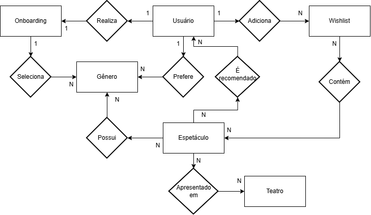<br>
  <sup>Source: Material produzido pelos autores, 2026.</sup>
</div>

O Diagrama Lógico representa as entidades principais do sistema, os relacionamentos entre elas e as cardinalidades, utilizando notação Entidade-Relacionamento (ER) com **retângulos** para as entidades e **losangos** para os relacionamentos.

---

### 12.2 - Entidades e Relacionamentos

#### **Entidades (Retângulos)**

- **Onboarding**: Representa o processo inicial de cadastro e definição de preferências do usuário.
- **Usuário**: Entidade principal que representa os usuários da plataforma.
- **Gênero**: Categorias artísticas dos espetáculos (Drama, Musical, Comédia, etc.).
- **Espetáculo**: Peças teatrais, musicais e eventos culturais disponíveis na aplicação.
- **Teatro**: Locais físicos onde os espetáculos são realizados.
- **Wishlist**: Lista de espetáculos salvos pelo usuário.

#### **Relacionamentos (Losangos) e Cardinalidades**

| Relacionamento      | Entidades Envolvidas                  | Cardinalidade | Descrição |
|---------------------|---------------------------------------|---------------|---------|
| **Realiza**         | Usuário ↔ Onboarding                 | **1:1**       | Cada usuário realiza exatamente um onboarding. |
| **Seleciona**       | Onboarding ↔ Gênero                  | **1:N**       | O usuário seleciona um ou mais gêneros durante o onboarding. |
| **Prefere**         | Usuário ↔ Gênero                     | **N:N**       | Usuário pode preferir vários gêneros e um gênero pode ser preferido por vários usuários. |
| **Adiciona**        | Usuário ↔ Wishlist                   | **1:1**       | Cada usuário possui apenas uma wishlist. |
| **Possui**          | Wishlist ↔ Espetáculo                | **1:N**       | Uma wishlist pode conter vários espetáculos. |
| **Possui**          | Espetáculo ↔ Gênero                  | **N:N**       | Um espetáculo pode pertencer a múltiplos gêneros. |
| **Recomenda**       | Espetáculo ↔ Usuário                 | **N:N**       | O sistema recomenda espetáculos aos usuários com base em suas preferências. |
| **Apresentado em**  | Espetáculo ↔ Teatro                  | **N:1**       | Muitos espetáculos podem ser apresentados em um mesmo teatro. |

---

### 12.3 - Justificativa e Regras de Negócio

O Diagrama Lógico foi construído para atender diretamente às necessidades da aplicação:

- O usuário realiza um **onboarding** para informar suas preferências de gêneros e recebe recomendações personalizadas;
- O sistema utiliza as preferências para gerar **recomendações** dinâmicas;
- O usuário tem permissão apenas de **leitura** para Espetáculos, Teatros e Gêneros;
- A **Wishlist** é a única funcionalidade que permite ao usuário **adicionar e remover** itens;
- Um espetáculo pode ser classificado em **múltiplos gêneros**, enriquecendo os filtros e recomendações;
- Suporte a filtros por gênero e localidade (via Teatro).

Este modelo garante **clareza visual**, boa escalabilidade para consultas de recomendação e forte alinhamento com as regras de negócio da aplicação.

### 12.4 Diagrama Conceitual

<div align="center">
<sub>Imagem 09 - Diagrama conceitual</sub><br>
  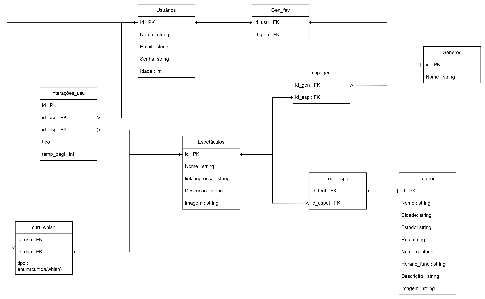<br>
  <sup>Source: Material produced by the authors, 2026.</sup>
</div>

O modelo conceitual de dados representa a estruturação dos dados seguindo as regras do modelo relacional, servindo como uma ponte entre a abstração do modelo conceitual e a implementação física no SGDB.

---

### 12.4.1 Dicionário de Dados e Mapeamento

A conversão do modelo lógico para o modelo conceitual foi realizada mapeando cada entidade conceitual para uma tabela relacional e transformando relacionamentos Muitos-para-Muitos (N:N) em tabelas associativas.

---

### A. Tabelas de Cadastro (Entidades Fortes)

| Tabela | Coluna | Tipo | Restrição | Descrição |
| :--- | :--- | :--- | :--- | :--- |
| **USUARIOS** | `Id` | INT | PK, AI | Identificador único do usuário. |
| | `Nome` | VARCHAR(100) | NN | Nome completo do usuário. |
| | `Email` | VARCHAR(100) | UNIQUE, NN | E-mail utilizado para autenticação. |
| | `Senha` | VARCHAR(255) | NN | Hash da senha de acesso. |
| | `Idade` | INT | - | Idade do usuário. |

---

| Tabela | Coluna | Tipo | Restrição | Descrição |
| :--- | :--- | :--- | :--- | :--- |
| **GENEROS** | `id` | INT | PK, AI | Identificador único do gênero. |
| | `Nome` | VARCHAR(50) | NN | Nome do gênero artístico. |

---

| Tabela | Coluna | Tipo | Restrição | Descrição |
| :--- | :--- | :--- | :--- | :--- |
| **TEATROS** | `id` | INT | PK, AI | Identificador único do teatro. |
| | `Nome` | VARCHAR(100) | NN | Nome do teatro ou espaço cultural. |
| | `Cidade` | VARCHAR(100) | NN | Cidade onde o teatro está localizado. |
| | `Estado` | VARCHAR(50) | NN | Estado onde o teatro está localizado. |
| | `Rua` | VARCHAR(150) | NN | Nome da rua do teatro. |
| | `Numero` | VARCHAR(20) | NN | Número do endereço do teatro. |
| | `Horario_func` | VARCHAR(100) | - | Horário de funcionamento do teatro. |
| | `Descricao` | TEXT | - | Descrição geral do teatro. |
| | `Imagem` | VARCHAR(255) | - | URL ou caminho da imagem do teatro. |

---

| Tabela | Coluna | Tipo | Restrição | Descrição |
| :--- | :--- | :--- | :--- | :--- |
| **ESPETACULOS** | `id` | INT | PK, AI | Identificador único do espetáculo. |
| | `Nome` | VARCHAR(150) | NN | Nome do espetáculo. |
| | `link_ingresso` | VARCHAR(255) | - | Link para compra de ingressos. |
| | `Descricao` | TEXT | - | Descrição detalhada do espetáculo. |
| | `Imagem` | VARCHAR(255) | - | URL ou caminho da imagem do espetáculo. |

---

### B. Tabelas Associativas e Operacionais

| Tabela | Coluna | Tipo | Restrição | Descrição |
| :--- | :--- | :--- | :--- | :--- |
| **ESP_GEN** | `id_esp` | INT | FK, PK(1/2) | Espetáculo relacionado ao gênero. |
| | `id_gen` | INT | FK, PK(2/2) | Gênero associado ao espetáculo. |

---

| Tabela | Coluna | Tipo | Restrição | Descrição |
| :--- | :--- | :--- | :--- | :--- |
| **GEN_FAV** | `id_usu` | INT | FK, PK(1/2) | Usuário que favoritou o gênero. |
| | `id_gen` | INT | FK, PK(2/2) | Gênero marcado como preferência pelo usuário. |

---

| Tabela | Coluna | Tipo | Restrição | Descrição |
| :--- | :--- | :--- | :--- | :--- |
| **TEAT_ESPET** | `id_teat` | INT | FK, PK(1/2) | Teatro onde o espetáculo ocorre. |
| | `id_espet` | INT | FK, PK(2/2) | Espetáculo vinculado ao teatro. |

---

| Tabela | Coluna | Tipo | Restrição | Descrição |
| :--- | :--- | :--- | :--- | :--- |
| **CURT_WISH** | `id_usu` | INT | FK, PK(1/2) | Usuário que realizou a interação. |
| | `id_esp` | INT | FK, PK(2/2) | Espetáculo alvo da interação. |
| | `tipo` | ENUM('curtida', 'wishlist') | NN | Tipo de interação realizada pelo usuário. |

---

| Tabela | Coluna | Tipo | Restrição | Descrição |
| :--- | :--- | :--- | :--- | :--- |
| **INTERAÇÕES_USU** | `id` | INT | PK, AI | Identificador único do evento registrado. |
| | `id_usu` | INT | FK, NN | Usuário que realizou a interação. |
| | `id_esp` | INT | FK, NN | Espetáculo relacionado à interação. |
| | `tipo` | VARCHAR(50) | NN | Tipo de evento/interação realizada. |
| | `temp_pagi` | INT | - | Tempo de permanência na página (segundos). |

---

### 12.4.2 Definição de Chaves e Integridade Referencial

### Chaves Primárias (PK)
As chaves primárias foram definidas para garantir a unicidade de cada registro. Nas tabelas associativas (`ESP_GEN`, `GEN_FAV`, `TEAT_ESPET`, `CURT_WISH`), utilizam-se chaves compostas pelos IDs das entidades relacionadas para evitar duplicidade de associações.

### Chaves Estrangeiras (FK)
As chaves estrangeiras garantem a integridade referencial, assegurando que as associações entre usuários, espetáculos, teatros e gêneros apontem apenas para registros existentes.

### Relacionamentos implementados
- **Usuários e Interações**: Um usuário pode gerar múltiplos registros de interação e eventos de navegação (`1:N`).
- **Gêneros Favoritos**: Relação `N:N` que permite ao usuário filtrar sua experiência com base em múltiplos interesses.
- **Espetáculos e Teatros**: Relação `N:N` via `TEAT_ESPET`, permitindo que uma produção ocorra em diferentes locais e que um teatro receba diversos eventos.
- **Categorização Multifacetada**: Através da `ESP_GEN`, um espetáculo pode ser associado a diversos gêneros simultaneamente.

---

### 12.4.3 Regras de Normalização Aplicadas

O modelo conceitual segue os princípios da Terceira Forma Normal (3FN).

### Primeira Forma Normal (1FN)
Todos os atributos possuem valores atômicos. Colunas como `tipo` em `CURT_WISH` utilizam ENUM para padronização, evitando dados multivalorados.

### Segunda Forma Normal (2FN)
Não existem dependências parciais. Em tabelas com chaves compostas, os atributos dependem da junção completa das chaves estrangeiras.

### Terceira Forma Normal (3FN)
Não há dependências transitivas. Atributos descritivos (como os detalhes de endereço em `TEATROS`) dependem exclusivamente da PK daquela tabela.

---

### 12.4.4 Justificativa e Rastreabilidade

O modelo conceitual foi estruturado para manter fidelidade ao modelo lógico, garantindo consistência entre as regras de negócio e a implementação relacional.

As tabelas associativas permitem representar corretamente relacionamentos Muitos-para-Muitos, como:

- preferências de gêneros dos usuários;
- categorização de espetáculos;
- interações entre usuários e espetáculos.

A separação das entidades reduz redundâncias, melhora a escalabilidade do sistema e facilita futuras manutenções e expansões do banco de dados.

## 13. Diagrama de Classes

O diagrama de classes representa o modelo de domínio de um sistema de gerenciamento de teatro, espetáculos e recomendações personalizadas. O sistema registra interações, além de permitir que usuários descubram espetáculos, gerenciem listas de desejos e recebam recomendações baseadas em seu comportamento e preferências.

<div align="center">
<sub>Imagem 09 - Diagrama de Classes UML</sub><br>
  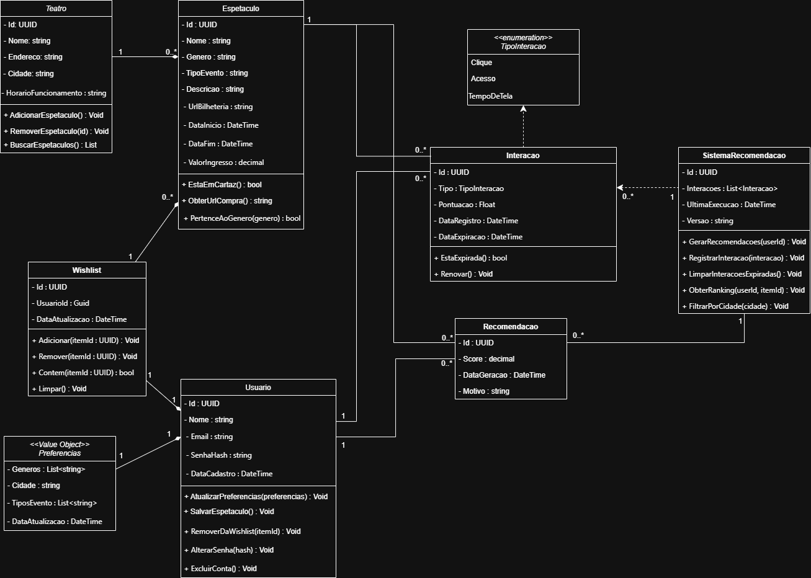<br>
  <sup>Source: Material produced by the authors, 2026.</sup>
</div>

### Teatro
 
Representa um teatro físico cadastrado no sistema. É responsável por gerenciar os espetáculos que estão em cartaz em sua estrutura.
 
| Atributo / Método | Visibilidade | Tipo | Descrição |
|---|---|---|---|
| Id | - (private) | UUID | Identificador único do teatro |
| Nome | - (private) | string | Nome do teatro |
| Endereco | - (private) | string | Endereço completo do teatro |
| Cidade | - (private) | string | Cidade onde o teatro está localizado |
| HorarioFuncionamento | - (private) | string | Horários de funcionamento do teatro |
| **Métodos** | | | |
| AdicionarEspetaculo() | + (public) | : void | Adiciona um espetáculo ao teatro |
| RemoverEspetaculo(id) | + (public) | : void | Remove um espetáculo pelo seu id |
| BuscarEspetaculos() | + (public) | : List | Retorna a lista de espetáculos do teatro |
 
---
 
### Espetaculo
 
Representa um espetáculo teatral. Contém todas as informações necessárias para exibição, compra de ingressos e categorização por gênero e tipo de evento.
 
| Atributo / Método | Visibilidade | Tipo | Descrição |
|---|---|---|---|
| Id | - (private) | UUID | Identificador único do espetáculo |
| Nome | - (private) | string | Nome do espetáculo |
| Genero | - (private) | string | Gênero artístico do espetáculo |
| TipoEvento | - (private) | string | Tipo de evento (ex: peça, musical, ópera) |
| Descricao | - (private) | string | Descrição detalhada do espetáculo |
| UrlBilheteria | - (private) | string | URL para compra de ingressos |
| DataInicio | - (private) | DateTime | Data de início das apresentações |
| DataFim | - (private) | DateTime | Data de encerramento das apresentações |
| ValorIngresso | - (private) | decimal | Valor do ingresso |
| **Métodos** | | | |
| EstaEmCartaz() | + (public) | : bool | Verifica se o espetáculo está em cartaz na data atual |
| ObterUrlCompra() | + (public) | : string | Retorna a URL de compra de ingresso |
| PertenceAoGenero(genero) | + (public) | : bool | Verifica se o espetáculo pertence a um determinado gênero |
 
---
 
### Usuario
 
Representa um usuário cadastrado na plataforma. Agrega as preferências e a wishlist do usuário, sendo o ponto central das interações com o sistema.
 
| Atributo / Método | Visibilidade | Tipo | Descrição |
|---|---|---|---|
| Id | - (private) | UUID | Identificador único do usuário |
| Nome | - (private) | string | Nome completo do usuário |
| Email | - (private) | string | Endereço de e-mail do usuário |
| SenhaHash | - (private) | string | Hash da senha do usuário |
| DataCadastro | - (private) | DateTime | Data de cadastro na plataforma |
| **Métodos** | | | |
| AtualizarPreferencias(preferencias) | + (public) | : void | Atualiza as preferências do usuário |
| SalvarEspetaculo() | + (public) | : void | Salva um espetáculo na wishlist |
| RemoverDaWishlist(itemId) | + (public) | : void | Remove um espetáculo da wishlist |
| AlterarSenha(hash) | + (public) | : void | Atualiza o hash da senha |
| ExcluirConta() | + (public) | : void | Exclui a conta do usuário |
 
---
 
### Wishlist
 
Lista de espetáculos salvos pelo usuário. Possui composição com `Usuario` — não existe independentemente de um usuário.
 
| Atributo / Método | Visibilidade | Tipo | Descrição |
|---|---|---|---|
| Id | - (private) | UUID | Identificador único da wishlist |
| UsuarioId | - (private) | Guid | Referência ao usuário dono da wishlist |
| DataAtualizacao | - (private) | DateTime | Data da última atualização da lista |
| **Métodos** | | | |
| Adicionar(itemId : UUID) | + (public) | : void | Adiciona um espetáculo à lista |
| Remover(itemId : UUID) | + (public) | : void | Remove um espetáculo da lista |
| Contem(itemId : UUID) | + (public) | : bool | Verifica se um espetáculo está na lista |
| Limpar() | + (public) | : void | Remove todos os itens da lista |
 
---
 
### Preferencias `«Value Object»`
 
Objeto de valor que representa as preferências culturais do usuário. Por ser um Value Object, não possui identidade própria — sua igualdade é definida pelo conjunto de seus atributos.
 
| Atributo | Visibilidade | Tipo | Descrição |
|---|---|---|---|
| Generos | - (private) | List\<string\> | Lista de gêneros de interesse do usuário |
| Cidade | - (private) | string | Cidade de preferência para eventos |
| TiposEvento | - (private) | List\<string\> | Tipos de evento de interesse do usuário |
| DataAtualizacao | - (private) | DateTime | Data da última atualização das preferências |
 
---
 
### Interacao
 
Registra uma interação do usuário com um espetáculo (clique, acesso ou tempo de tela). Utiliza a enumeração `TipoInteracao` para categorizar o tipo de interação registrada.
 
| Atributo / Método | Visibilidade | Tipo | Descrição |
|---|---|---|---|
| Id | - (private) | UUID | Identificador único da interação |
| Tipo | - (private) | TipoInteracao | Tipo da interação (Clique, Acesso, TempoDeTela) |
| Pontuacao | - (private) | Float | Pontuação atribuída à interação para o sistema de recomendação |
| DataRegistro | - (private) | DateTime | Data e hora em que a interação foi registrada |
| DataExpiracao | - (private) | DateTime | Data e hora em que a interação expira |
| **Métodos** | | | |
| EstaExpirada() | + (public) | : bool | Verifica se a interação já está expirada |
| Renovar() | + (public) | : void | Renova a validade da interação |
 
---
 
### Recomendacao
 
Representa uma recomendação gerada pelo `SistemaRecomendacao` para um usuário específico sobre um espetáculo. Armazena a pontuação calculada e o motivo da recomendação.
 
| Atributo | Visibilidade | Tipo | Descrição |
|---|---|---|---|
| Id | - (private) | UUID | Identificador único da recomendação |
| Score | - (private) | decimal | Pontuação de relevância da recomendação |
| DataGeracao | - (private) | DateTime | Data em que a recomendação foi gerada |
| Motivo | - (private) | string | Justificativa textual da recomendação |
 
---
 
### SistemaRecomendacao
 
Componente responsável por gerar e gerenciar recomendações personalizadas. Depende da classe `Interacao` para calcular scores e produzir sugestões relevantes para cada usuário.
 
| Atributo / Método | Visibilidade | Tipo | Descrição |
|---|---|---|---|
| Id | - (private) | UUID | Identificador do sistema |
| Interacoes | - (private) | List\<Interacao\> | Lista de interações usadas como base para recomendações |
| UltimaExecucao | - (private) | DateTime | Data da última execução do algoritmo |
| Versao | - (private) | string | Versão do algoritmo de recomendação |
| **Métodos** | | | |
| GerarRecomendacoes(userId) | + (public) | : void | Gera recomendações personalizadas para o usuário informado |
| RegistrarInteracao(i : Interacao) | + (public) | : void | Registra uma nova interação no sistema |
| LimparInteracoesExpiradas() | + (public) | : void | Remove interações cuja validade expirou |
| ObterRanking(userId, itemId) | + (public) | : void | Retorna o ranking de relevância de um item para o usuário |
| FiltrarPorCidade(cidade) | + (public) | : void | Filtra recomendações pela cidade do usuário |
 
---
 
### TipoInteracao `«enumeration»`
 
Enumeração que define os tipos possíveis de interação de um usuário com um espetáculo. Utilizada pela classe `Interacao`.
 
| Valor | Descrição |
|---|---|
| Clique | Usuário clicou no espetáculo |
| Acesso | Usuário acessou a página do espetáculo |
| TempoDeTela | Tempo que o usuário permaneceu na página do espetáculo |
 
---
 
### Relacionamentos
 
| Origem | Destino | Tipo | Descrição |
|---|---|---|---|
| Teatro | Espetaculo | Associação (1 → 0..*) | Um teatro possui zero ou mais espetáculos |
| Espetaculo | Interacao | Associação (1 → 0..*) | Um espetáculo pode ter múltiplas interações de usuários |
| Espetaculo | Recomendacao | Associação (1 → 0..*) | Um espetáculo pode aparecer em múltiplas recomendações |
| Usuario | Wishlist | Composição (1 ◆→ 1) | Usuário possui uma wishlist; a wishlist não existe sem o usuário |
| Usuario | Preferencias | Composição (1 ◆→ 1) | Usuário possui preferências; elas não existem sem o usuário |
| Usuario | Interacao | Associação (1 → 0..*) | Um usuário pode ter múltiplas interações registradas |
| Usuario | Recomendacao | Associação (1 → 0..*) | Um usuário pode receber múltiplas recomendações |
| SistemaRecomendacao | Interacao | Dependência (→→) | O sistema depende de Interacao para gerar recomendações |
| SistemaRecomendacao | Recomendacao | Associação (1 → 0..*) | O sistema gera e gerencia múltiplas recomendações |
| Interacao | TipoInteracao | Dependência (→→) | Interacao utiliza a enumeração TipoInteracao |
 
---
 
### Observações e Decisões de Design
 
**Preferencias como Value Object:** a classe `Preferencias` não possui identidade própria. Sua igualdade é definida pelo conjunto de seus valores, seguindo o padrão de Value Object do Domain-Driven Design (DDD).
 
**Composição em Wishlist e Preferencias:** ambas possuem relação de composição com `Usuario`, pois seu ciclo de vida está diretamente ligado ao do usuário — são criadas e destruídas junto com ele.
 
**Separação de responsabilidades:** o `SistemaRecomendacao` é um componente dedicado exclusivamente à lógica de recomendação, mantendo as demais classes do domínio focadas em suas responsabilidades específicas.
 
**Expiração de interações:** a classe `Interacao` possui controle de validade por meio de `DataExpiracao` e dos métodos `EstaExpirada()` e `Renovar()`, permitindo que interações antigas sejam descartadas pelo `SistemaRecomendacao`.

## 14. Diagrama de Componentes

O diagrama de componentes abaixo representa a estrutura da aplicação seguindo o padrão arquitetural MVVM no cliente (React Native) e SOA no servidor (ASP.NET Core), com dois mecanismos de persistência: um banco de dados relacional PostgreSQL para dados estruturados e transacionais e um Storage Bucket para armazenamento de eventos de comportamento, vetores latentes do modelo SVD e assets de mídia.

<div align="center">
  <sub>Imagem 10 - Diagrama de Componentes UML</sub><br>
  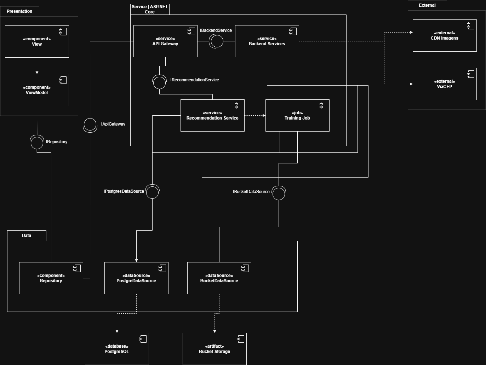<br>
  <sup>Fonte: Material produzido pelos autores, 2026.</sup>
</div>

### Packages
 
Packages são representados por um retângulo com uma abinha no topo. Servem para agrupar componentes que pertencem à mesma camada ou responsabilidade.
 
O diagrama possui quatro packages:
 
- **Presentation**: agrupa os componentes da camada de apresentação do app React Native (MVVM)
- **Service | ASP.NET Core**: agrupa os serviços do backend
- **Data**: agrupa os componentes da camada de acesso a dados
- **External**: agrupa os serviços externos consumidos pelo backend
PostgreSQL e Storage Bucket ficam **fora de qualquer package** pois são infraestrutura externa — não fazem parte do código da aplicação.
 
---
 
### Componentes
 
Componentes são representados por um retângulo com o ícone de componente no canto superior direito (dois retângulos pequenos sobrepostos). Cada componente possui um estereótipo que descreve sua natureza.
 
| Componente | Estereótipo | Package |
|---|---|---|
| View | «component» | Presentation |
| ViewModel | «component» | Presentation |
| Repository | «component» | Presentation |
| API Gateway | «service» | Service \| ASP.NET Core |
| Backend Services | «service» | Service \| ASP.NET Core |
| Recommendation Service | «service» | Service \| ASP.NET Core |
| Training Job | «job» | Service \| ASP.NET Core |
| PostgresDataSource | «dataSource» | Data |
| BucketDataSource | «dataSource» | Data |
| CDN Imagens | «external» | External |
| ViaCEP | «external» | External |
| PostgreSQL | «database» | — (externo) |
| Storage Bucket | «artifact» | — (externo) |
 
**Sobre os estereótipos:**
 
- `«component»`: unidade de software com responsabilidade própria dentro da aplicação cliente.
- `«service»`: serviço do backend exposto via HTTP, com responsabilidade bem definida.
- `«job»`: processo executado periodicamente de forma assíncrona, sem exposição via HTTP.
- `«dataSource»`: adaptador que encapsula os detalhes de acesso a uma fonte de dados externa.
- `«external»`: serviço de terceiros consumido pelo backend via HTTP.
- `«database»`: banco de dados externo ao código da aplicação.
- `«artifact»`: recurso implantado externamente, como um bucket de storage.
---
 
### Interfaces
 
As interfaces são representadas pelo padrão **ball-and-socket**:
 
- **Bolinha (provided interface)** — linha reta saindo do componente com um círculo na ponta. Indica que o componente fornece aquele contrato.
- **Semicírculo aberto (required interface)** — linha reta saindo do componente com um semicírculo na ponta. Indica que o componente precisa daquele contrato para funcionar.
O encaixe entre o semicírculo e a bolinha representa a satisfação do contrato — o componente que precisa encontra o componente que fornece.
 
O diagrama possui cinco interfaces:
 
| Interface | Fornecida por | Consumida por |
|---|---|---|
| IRepository | Repository | ViewModel |
| IApiGateway | API Gateway | Repository |
| IBackendService | Backend Services | API Gateway |
| IRecommendationService | Recommendation Service | API Gateway |
| IPostgresDataSource | PostgresDataSource | Backend Services, Training Job, Recommendation Service |
| IBucketDataSource | BucketDataSource | Backend Services, Training Job, Recommendation Service |
 
O `Repository` está no centro do cliente: fornece a bolinha `IRepository` para o ViewModel e consome a bolinha `IApiGateway` do API Gateway por meio do seu semicírculo — abstraindo todas as chamadas de rede.
 
`IPostgresDataSource` e `IBucketDataSource` são consumidas por três componentes cada — `Backend Services`, `Training Job` e `Recommendation Service` — pois todos precisam acessar dados persistidos, cada um com finalidades distintas.

### Responsabilidades do Storage Bucket
 
O Storage Bucket possui responsabilidade tripla, organizada internamente por prefixos de path:
 
| Path | Conteúdo | Escrito por | Lido por |
|---|---|---|---|
| `/media/` | Assets de mídia (imagens de eventos e atrações) | Backend Services | CDN Imagens |
| `/events/` | Eventos brutos de comportamento (cliques, visualizações, compras) | Backend Services | Training Job |
| `/model/` | Vetores latentes do modelo SVD (matrizes usuário × fator, item × fator) | Training Job | Recommendation Service |
 
### Responsabilidades do PostgreSQL
 
O PostgreSQL armazena exclusivamente dados transacionais e os hiperparâmetros do modelo SVD:
 
| Conteúdo | Escrito por | Lido por |
|---|---|---|
| Dados transacionais (usuários, pedidos, produtos, eventos) | Backend Services | Backend Services |
| Hiperparâmetros SVD (n_fatores, learning_rate, epochs, versão, data_treino) | Training Job | Recommendation Service, Training Job |

### Decisões

**Por que o ball-and-socket foi usado entre ViewModel e Repository?**
O ViewModel não depende da implementação concreta do Repository — ele depende apenas do contrato `IRepository`. O ball-and-socket torna esse contrato visível no diagrama, o que uma seta tracejada simples não expressa.
 
**Por que o Repository passou a consumir IApiGateway em vez de IPostgresDataSource e IBucketDataSource?**
O app React Native roda no dispositivo do usuário — nunca acessa banco de dados diretamente. Todo acesso a dados passa pela API do servidor. O Repository no cliente abstrai as chamadas HTTP para o API Gateway, não o acesso direto a fontes de dados. `IPostgresDataSource` e `IBucketDataSource` existem apenas no servidor.
 
**Por que IPostgresDataSource e IBucketDataSource têm múltiplos consumidores?**
Backend Services, Training Job e Recommendation Service têm necessidades distintas de acesso a dados, mas compartilham as mesmas fontes. Centralizar o acesso nos DataSources evita duplicação de lógica de conexão e mantém um único ponto de configuração para cada tecnologia de persistência.
 
**Por que o Training Job usa seta tracejada simples em vez de ball-and-socket para o Recommendation Service?**
O Training Job não consome uma interface fornecida pelo Recommendation Service — ele é acionado pelo próprio Recommendation Service periodicamente. A seta tracejada representa uma dependência de acionamento, não um contrato de interface.
 
**Por que o SVD Model Store (.zip) foi removido?**
O modelo SVD é composto por duas partes com naturezas distintas: hiperparâmetros (dados estruturados, poucos campos) e vetores latentes (arrays densos e pesados). Separar essas partes nos storages já existentes — PostgreSQL e Storage Bucket respectivamente — elimina um componente desnecessário e aproveita a infraestrutura já presente.
 
**Por que PostgreSQL e Storage Bucket ficam fora dos packages?**
Packages representam agrupamentos do código da aplicação. Infraestrutura externa não pertence a nenhuma camada do sistema — colocá-la dentro de um package seria incorreto semanticamente.

## 15. Diagrama de Casos de Uso

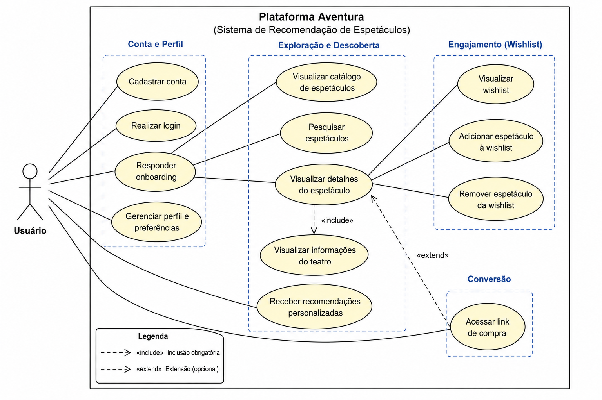

### Atores

#### Usuário
Representa o espectador autenticado na plataforma, responsável por interagir com o sistema, visualizar espetáculos, gerenciar preferências e acessar recomendações personalizadas.

---

### Casos de Uso

#### UC01 — Cadastrar conta
Como usuário, quero criar uma conta na plataforma para salvar minhas preferências e manter minha wishlist sincronizada entre diferentes sessões e dispositivos.

#### UC02 — Realizar login
Como usuário, quero realizar login utilizando e-mail e senha para acessar minhas informações personalizadas e minhas recomendações.

#### UC03 — Responder onboarding
Como novo usuário, quero responder um questionário de interesses para que o sistema personalize minhas recomendações iniciais.

#### UC04 — Gerenciar perfil e preferências
Como usuário, quero editar meus dados de perfil e minhas preferências para manter as recomendações alinhadas aos meus interesses atuais.

#### UC05 — Visualizar catálogo de espetáculos
Como usuário, quero visualizar o catálogo de espetáculos organizado por categorias para explorar produções disponíveis na plataforma.

#### UC06 — Pesquisar espetáculos
Como usuário, quero pesquisar espetáculos e teatros específicos para encontrar rapidamente informações relevantes.

#### UC07 — Visualizar detalhes do espetáculo
Como usuário, quero visualizar os detalhes de um espetáculo para conhecer informações sobre a produção, teatro e disponibilidade.

#### UC08 — Visualizar informações do teatro
Como usuário, quero visualizar endereço e horários do teatro para me planejar antes de assistir ao espetáculo.

#### UC09 — Receber recomendações personalizadas
Como usuário, quero receber sugestões personalizadas baseadas em minhas preferências e interações para descobrir novos espetáculos relevantes.

#### UC10 — Visualizar wishlist
Como usuário, quero acessar minha wishlist para visualizar os espetáculos salvos anteriormente.

#### UC11 — Adicionar espetáculo à wishlist
Como usuário, quero adicionar espetáculos à minha wishlist para salvar produções de interesse e melhorar futuras recomendações.

#### UC12 — Remover espetáculo da wishlist
Como usuário, quero remover espetáculos da wishlist para atualizar meus interesses na plataforma.

#### UC13 — Acessar link de compra
Como usuário, quero acessar a bilheteria oficial do espetáculo para realizar a compra do ingresso com segurança.

---

### Relacionamentos do Diagrama

#### Include
O caso de uso "Visualizar detalhes do espetáculo" possui relação `<<include>>` com "Visualizar informações do teatro", pois as informações do local fazem parte da experiência de visualização dos detalhes do espetáculo.

#### Extend
O caso de uso "Acessar link de compra" possui relação `<<extend>>` com "Visualizar detalhes do espetáculo", uma vez que o redirecionamento para compra ocorre opcionalmente após a visualização do espetáculo.

---

### Associação entre Requisitos Funcionais e Casos de Uso

| Requisito Funcional | Caso de Uso Relacionado |
|---|---|
| RF01 — Onboarding de Interesses | UC03 — Responder onboarding |
| RF02 — Recomendação por Geolocalização | UC09 — Receber recomendações personalizadas |
| RF03 — Autenticação e Persistência | UC01 — Cadastrar conta / UC02 — Realizar login |
| RF04 — Catálogo Categorizado | UC05 — Visualizar catálogo de espetáculos |
| RF05 — Busca Específica | UC06 — Pesquisar espetáculos |
| RF06 — Gestão de Wishlist | UC10 — Visualizar wishlist / UC11 — Adicionar espetáculo à wishlist / UC12 — Remover espetáculo da wishlist |
| RF07 — Informações de Teatros | UC08 — Visualizar informações do teatro |
| RF08 — Gestão de Perfil e Preferências | UC04 — Gerenciar perfil e preferências |
| RF09 — Redirecionamento de Compra | UC13 — Acessar link de compra |
| RF10 — Recomendação Inteligente | UC09 — Receber recomendações personalizadas |

## 16. Linguagens e Tecnologias Utilizadas

O projeto segue uma Arquitetura Orientada a Serviços (SOA), com camadas bem definidas de apresentação, serviços e dados. As tecnologias foram escolhidas para atender aos requisitos funcionais e não funcionais do sistema, e são descritas a seguir.

**Supabase (banco de dados, autenticação e armazenamento)**

O Supabase é uma plataforma open-source construída sobre PostgreSQL que oferece banco de dados relacional, autenticação de usuários e armazenamento de arquivos de forma integrada. Ele será provisionado localmente via Docker, o que garante que todos da equipe trabalhem no mesmo ambiente sem depender de serviços externos pagos durante o desenvolvimento. Usar uma única plataforma para essas três responsabilidades reduz a complexidade da infraestrutura e facilita a manutenção.

O banco de dados PostgreSQL armazenará as entidades do sistema como usuários, espetáculos, teatros e wishlists. O módulo de autenticação cuidará do cadastro, login e geração de tokens JWT, dispensando a necessidade de implementar essa lógica do zero. O Storage Bucket será usado para guardar assets de mídia e arquivos gerados pelo modelo de recomendação.

**Docker**

O Docker é a ferramenta de conteinerização utilizada para rodar o Supabase localmente. Com ele, toda a infraestrutura de banco de dados, autenticação e storage é empacotada em containers, garantindo que o ambiente seja idêntico para todos os membros da equipe independentemente do sistema operacional. Isso evita problemas de configuração e torna o setup do projeto mais simples e reproduzível.

**Backend de APIs em C# com ASP.NET Core**

O backend de APIs será desenvolvido em C# com ASP.NET Core, expondo endpoints REST a serem consumidos pelo frontend. A arquitetura prevê um API Gateway, que receberá todas as requisições e roteará para os serviços corretos, e os Backend Services, que concentrarão a lógica de negócio. O C# é fortemente tipado, o que facilita modelar as entidades do domínio e reduz erros em tempo de execução. O ASP.NET Core oferece suporte nativo a injeção de dependência, autenticação JWT e ferramentas de escalabilidade, atendendo aos requisitos de segurança e disponibilidade do sistema.

**Modelo de recomendação em Python com scikit-surprise**

O modelo de recomendação está sendo desenvolvido em Python, com a biblioteca scikit-surprise para filtragem colaborativa. Dois algoritmos estão sendo implementados e serão comparados: KNN, que recomenda espetáculos com base em usuários de comportamento similar, e Funk SVD, que fatoriza a matriz de interações em representações latentes para prever o engajamento do usuário com espetáculos não vistos. Os modelos são treinados sobre um dataset de 109.916 interações entre aproximadamente 68 mil usuários e 571 espetáculos, com hiperparâmetros otimizados via GridSearchCV. O modelo final, após a comparação entre os dois algoritmos, será integrado ao backend de recomendação em C#.

Python foi escolhido para essa etapa porque seu ecossistema de ciência de dados (pandas, numpy, scikit-learn, scikit-surprise) não tem equivalente de mesma maturidade em C# para tarefas de filtragem colaborativa, tornando a experimentação muito mais ágil.

**Frontend em React Native**

O frontend será desenvolvido em React Native, framework que permite criar aplicações móveis para iOS e Android a partir de uma única base de código. Isso é importante porque o produto precisa estar disponível nas duas plataformas sem duplicar o esforço de desenvolvimento. O React Native tem bom suporte a geolocalização, notificações push e navegação entre telas, funcionalidades centrais para o app. A proximidade com o ecossistema JavaScript facilita o consumo das APIs REST do backend.

**Padrão MVVM no frontend**

O frontend seguirá o padrão MVVM (Model-View-ViewModel), separando a interface visual (View) da lógica de estado e apresentação (ViewModel) e do acesso a dados (Repository). Essa separação torna os componentes de tela mais simples, os ViewModels testáveis de forma isolada e facilita mudanças na camada de comunicação com o backend sem impactar a interface. Para um app com muitas telas de conteúdo dinâmico, como carrosséis de recomendação e catálogo filtrado, essa organização evita que lógica e interface se misturem e tornem o código difícil de manter.

**ViaCEP**

O ViaCEP é uma API pública e gratuita que retorna dados de endereço a partir de um CEP informado. No projeto, ela será usada durante o onboarding do usuário para identificar automaticamente a cidade a partir do CEP cadastrado, sem que o usuário precise informar isso manualmente. Essa informação é essencial para o sistema de recomendação, que filtra os espetáculos de acordo com a cidade do usuário, sendo São Paulo ou Rio de Janeiro.

---

## 17. Planejamento de Testes

Esta seção apresenta a estrutura de planejamento de testes do sistema de recomendação da Aventura. O objetivo é organizar a validação sistemática da solução, cobrindo testes funcionais, testes de requisitos não funcionais, testes de usabilidade, testes de APIs externas e testes de integração.

O planejamento foi estruturado para garantir que os principais fluxos do sistema sejam avaliados antes da entrega final, considerando tanto o comportamento esperado da aplicação quanto possíveis falhas, limitações técnicas e cenários negativos.

A validação do sistema deve considerar o contexto do produto: um aplicativo mobile com onboarding, catálogo de espetáculos, recomendações personalizadas, wishlist, perfil, notificações, integração com APIs externas e redirecionamento para ticketeiras parceiras.

---

### 17.1 Objetivo do planejamento de testes

O objetivo do planejamento de testes é definir como o sistema será validado ao longo da Sprint 3, garantindo que os requisitos funcionais, requisitos não funcionais, integrações e fluxos de uso sejam verificados de forma organizada.

Os testes devem permitir identificar falhas de comportamento, problemas de usabilidade, inconsistências de integração, erros de comunicação com APIs externas e possíveis limitações de desempenho, segurança ou disponibilidade.

Este planejamento também busca garantir que cada cenário de teste possua:

- propósito;
- pré-condições;
- instruções de execução;
- cenário positivo;
- cenário negativo;
- pós-condições;
- critérios de validação;
- discussão de abrangência.

---

### 17.2 Estratégia geral de testes

A estratégia de testes do projeto está organizada em cinco frentes principais:

1. **Testes de funcionalidade:** validam se os requisitos funcionais do sistema estão sendo cumpridos corretamente.
2. **Testes de requisitos não funcionais:** avaliam atributos de qualidade, como desempenho, segurança, disponibilidade, usabilidade e manutenibilidade.
3. **Testes de usabilidade:** verificam se usuários externos conseguem compreender e executar os principais fluxos da aplicação.
4. **Testes de APIs externas:** validam o comportamento esperado das integrações com serviços externos, como ViaCEP e ticketeiras.
5. **Testes de integração:** verificam a comunicação entre frontend, backend, banco de dados, motor de recomendação e sistemas externos.

Os testes deverão contemplar cenários positivos e negativos, garantindo que o sistema seja avaliado tanto em fluxos esperados quanto em situações de erro.

---

### 17.3 Testes de funcionalidade

Esta seção evolui os testes de usuário definidos junto a cada Requisito Funcional (RFs da seção 9.2) para casos de teste funcionais completos, com propósito explícito, pré-condições, cenários positivos e negativos, instruções de execução, pós-condições e critério objetivo de sucesso. Dessa forma O plano de testes funcionais cobre **100% dos 10 RFs definidos na seção 9.2**.

A premissa adotada foi garantir cobertura mínima de **um caso de teste principal por RF** (TF-01 a TF-10), priorizando os fluxos da jornada crítica do usuário: descoberta → personalização → wishlist → conversão. Os cenários negativos foram desenhados para validar tratamento de erro, validações de entrada, indisponibilidade de serviços externos e estados-limite da aplicação.

**Casos de teste:** [TF-01](#tf-01) · [TF-02](#tf-02) · [TF-03](#tf-03) · [TF-04](#tf-04) · [TF-05](#tf-05) · [TF-06](#tf-06) · [TF-07](#tf-07) · [TF-08](#tf-08) · [TF-09](#tf-09) · [TF-10](#tf-10)

#### TF-01

**Requisito relacionado:** RF01

**Funcionalidade testada:** Onboarding de interesses não-bloqueante (gênero, cidade, frequência) com possibilidade de pular perguntas

**Propósito:** Verificar que (i) as preferências respondidas são persistidas e direcionam a personalização das seções da tela Explorar e (ii) perguntas puladas resultam em placeholders/CTAs nas seções dependentes ("Escolhidos para você" e "Perto de você") sem bloquear a navegação.

**Pré-condições:** Conta recém-criada sem preferências salvas; usuário autenticado na tela de Onboarding; base com espetáculos cadastrados em SP e RJ e em múltiplos gêneros.

**Cenário positivo:** Usuário responde gênero "Musical" e cidade "São Paulo", conclui o onboarding e chega à tela Explorar com as seções "Escolhidos para você" e "Perto de você" populadas com conteúdo aderente às respostas (musicais em SP).

**Cenários negativos:**

- **(a)** Usuário pula todas as perguntas — sistema permite avançar e a tela Explorar exibe placeholders/CTAs nas seções "Escolhidos para você" e "Perto de você" convidando o usuário a definir as preferências, sem bloquear a navegação.
- **(b)** Usuário responde parcialmente (ex.: informa apenas a cidade) — sistema persiste o que foi respondido; "Perto de você" carrega normalmente, mas "Escolhidos para você" exibe o CTA para definir gênero.

**Instruções de execução:**

1. Criar conta nova de teste.
2. Acessar a tela de Onboarding e responder gênero "Musical" e cidade "São Paulo".
3. Concluir o onboarding e conferir as seções "Escolhidos para você" e "Perto de você" na tela Explorar.
4. Repetir o fluxo com uma nova conta pulando todas as perguntas e conferir os placeholders/CTAs (cenário negativo a).
5. Repetir com resposta parcial (apenas cidade) e conferir o estado das duas seções (cenário negativo b).

**Pós-condições:** Preferências respondidas (totais ou parciais) gravadas em `Usuario.preferencias` no banco; usuário marcado como "onboarding concluído" independentemente das respostas; nenhuma resposta é exigida para liberar o acesso à Explorar.

**Critério de sucesso:** Preferências respondidas são persistidas corretamente no banco em 100% dos casos; as seções "Escolhidos para você" e "Perto de você" refletem corretamente o estado das preferências (conteúdo populado quando há resposta, placeholder/CTA quando não há); a navegação nunca é bloqueada por ausência de respostas.

---

#### TF-02

**Requisito relacionado:** RF02

**Funcionalidade testada:** Curadoria automática do carrossel "Perto de você" na tela Explorar conforme a cidade definida pelo usuário no onboarding ou no perfil (cidades suportadas: Rio de Janeiro e São Paulo)

**Propósito:** Verificar que (i) o carrossel "Perto de você" expõe exclusivamente espetáculos cujo teatro está localizado na cidade definida pelo usuário, (ii) alterações posteriores na cidade via Perfil refletem corretamente na próxima carga da tela Explorar e (iii) quando a cidade não é definida, o carrossel exibe o empty state correto convidando o usuário a informá-la.

**Pré-condições:** Usuário logado; base populada com espetáculos ativos em SP e RJ vinculados a teatros com a cidade preenchida corretamente.

**Cenário positivo:** Usuário com cidade = SP definida (no onboarding ou no Perfil) acessa a tela Explorar e o carrossel "Perto de você" expõe exclusivamente cards de espetáculos cujo teatro está localizado em São Paulo.

**Cenários negativos:**

- **(a)** Usuário acessa o Perfil, altera a cidade de SP para RJ, salva e retorna à Explorar — o carrossel "Perto de você" recarrega exibindo apenas espetáculos do RJ, sem nenhum card de SP remanescente.
- **(b)** Usuário acessa a Explorar sem cidade definida (pulou a pergunta no onboarding e nunca preencheu no Perfil) — o carrossel "Perto de você" exibe o empty state com o título "Adicione sua localidade", o texto "Compartilhar conosco sua cidade nos ajuda a encontrar espetáculos perto de você." e o botão "Adicionar cidade" que direciona para a tela de Perfil.

**Instruções de execução:**

1. Logar com usuário que possui cidade = SP definida (via onboarding ou Perfil).
2. Acessar a tela Explorar e conferir, no carrossel "Perto de você", a cidade do teatro em cada card exibido.
3. Acessar Perfil, alterar a cidade para RJ, salvar e retornar à Explorar.
4. Conferir novamente o carrossel "Perto de você" e validar que todos os cards são de teatros do RJ (cenário negativo a).
5. Logar com uma conta sem cidade definida (criada pulando a pergunta no onboarding) e acessar a Explorar para conferir o empty state do carrossel "Perto de você", incluindo título, texto e botão (cenário negativo b).
6. Clicar em "Adicionar cidade" e validar que o app direciona o usuário para a tela de Perfil.

**Pós-condições:** Cidade do perfil atualizada no banco em caso de alteração; nenhum dado de espetáculo é modificado pela navegação.

**Critério de sucesso:** Em todos os carregamentos com cidade definida, 100% dos cards exibidos no carrossel "Perto de você" possuem teatro com cidade igual à cidade do usuário; alterações de cidade via Perfil refletem corretamente na próxima visita à Explorar; quando não há cidade definida, o empty state é renderizado com o título, o texto e o botão exatos, e o botão direciona corretamente para o Perfil.

---

#### TF-03

**Requisito relacionado:** RF03

**Funcionalidade testada:** Autenticação do usuário (login via e-mail/senha ou via Auth0) e gestão da sessão persistente até o logout explícito pelo Perfil

**Propósito:** Verificar que (i) o login com credenciais válidas — seja por e-mail/senha, seja via Auth0 — autentica o usuário e libera o acesso ao app, (ii) a sessão permanece ativa entre aberturas do app até que o usuário execute logout explícito pelo Perfil, (iii) o app exige login desde a abertura, sem permitir uso anônimo e (iv) tentativas de login com credenciais incorretas exibem feedback visual ao usuário e permitem nova tentativa.

**Pré-condições:** Aplicativo instalado e iniciado; conta válida cadastrada na base, com pelo menos 2 itens previamente salvos na Wishlist para validação da persistência; conta com cidade e gênero já definidos para evitar interferência do Onboarding na execução do teste.

**Cenário positivo:** Usuário insere e-mail e senha válidos na tela de Login, é autenticado e acessa a tela Explorar; ao abrir "Minha Wishlist", os itens previamente salvos estão presentes e íntegros.

**Cenários negativos:**

- **(a)** Usuário escolhe entrar via Auth0 em vez de e-mail/senha — o fluxo do provedor externo conclui com sucesso e o usuário acessa a Explorar normalmente.
- **(b)** Usuário autenticado fecha o app completamente (encerrando a tarefa em background) e reabre — o app abre direto na Explorar, sem solicitar credenciais novamente, comprovando a persistência da sessão.
- **(c)** Usuário autenticado acessa Perfil → Logout — o app retorna à tela de Login e nenhuma feature fica acessível até uma nova autenticação.
- **(d)** Usuário insere e-mail e/ou senha incorretos e confirma — uma notificação com a mensagem "Credenciais de login inválidas" é exibida no topo da tela e os campos de e-mail e senha são reabertos para que o usuário tente novamente, sem bloqueio ou contador de tentativas.

**Instruções de execução:**

1. Abrir o app pela primeira vez no dispositivo (estado deslogado) e validar que a tela de Login é exibida antes de qualquer conteúdo, sem permitir acesso anônimo.
2. Inserir e-mail e senha válidos e confirmar.
3. Conferir o acesso à tela Explorar e validar, em "Minha Wishlist", que os itens previamente salvos estão presentes (cenário positivo).
4. Em uma segunda conta de teste, repetir o passo 1 e optar por entrar via Auth0; concluir o fluxo do provedor externo e validar o acesso ao app (cenário negativo a).
5. Com o app já autenticado, fechar a aplicação completamente (encerrar a tarefa em background) e reabrir; conferir que o app abre direto na Explorar (cenário negativo b).
6. Acessar Perfil → Logout e validar o retorno à tela de Login; tentar interagir com qualquer feature do app para confirmar que o acesso está bloqueado (cenário negativo c).
7. Na tela de Login, inserir e-mail e/ou senha incorretos e confirmar; validar a exibição da notificação "Credenciais de login inválidas" e a reabertura dos campos de e-mail e senha para nova tentativa (cenário negativo d).

**Pós-condições:** Sessão ativa registrada para o usuário após login bem-sucedido; sessão encerrada após logout explícito pelo Perfil; itens da Wishlist mantidos íntegros no banco independentemente do estado da sessão.

**Critério de sucesso:** Login com credenciais válidas via e-mail/senha e via Auth0 autentica o usuário em ambos os caminhos e libera o acesso à Explorar; a sessão persiste entre fechamentos e reaberturas do app; o logout pelo Perfil encerra a sessão e bloqueia o acesso a qualquer feature até nova autenticação; nenhum acesso ao app é permitido sem login prévio; tentativas com credenciais incorretas exibem a notificação "Credenciais de login inválidas" e permitem nova tentativa sem bloquear o usuário.

---

#### TF-04

**Requisito relacionado:** RF04

**Funcionalidade testada:** Catálogo categorizado por gênero distribuído nos carrosséis da aba Explorar ("Em alta", "Pra você", "Novidades" e "Perto de você") e no carrossel "Espetáculos semelhantes" da página de detalhes do espetáculo, com filtro por categoria aplicável na Explorar

**Propósito:** Verificar que (i) ao aplicar um filtro por gênero na aba Explorar, os carrosséis dessa aba passam a exibir apenas espetáculos da categoria selecionada, (ii) ao remover o filtro, os carrosséis voltam ao estado original sem restrição por gênero e (iii) cada espetáculo do catálogo está obrigatoriamente associado a uma categoria válida (Musical, Drama, Balé infantil, Corporativo, Comédia ou Dança).

**Pré-condições:** Usuário logado com cidade e preferências definidas; base com espetáculos cadastrados nas seis categorias suportadas (Musical, Drama, Balé infantil, Corporativo, Comédia e Dança); cada espetáculo possui categoria obrigatoriamente associada no banco.

**Cenário positivo:** Usuário acessa a aba Explorar, aplica o filtro "Comédia" e os carrosséis "Em alta", "Pra você", "Novidades" e "Perto de você" passam a exibir apenas cards de espetáculos da categoria Comédia, mantendo a estrutura visual e o scroll horizontal de cada carrossel.

**Cenários negativos:**

- **(a)** Usuário remove o filtro "Comédia" — os quatro carrosséis voltam a exibir a curadoria completa, sem restrição por gênero, recuperando o estado original da Explorar.
- **(b)** Usuário aplica o filtro em uma categoria menos representada (ex.: "Balé infantil") e algum carrossel não possui espetáculos correspondentes naquela combinação (ex.: nenhum balé infantil em "Perto de você" para a cidade do perfil) — o carrossel afetado é exibido vazio ou ocultado, sem quebrar a tela nem misturar resultados de outras categorias.

**Instruções de execução:**

1. Logar com usuário que possui cidade e preferências definidas.
2. Acessar a aba Explorar e conferir o estado padrão dos quatro carrosséis (sem filtro aplicado).
3. Aplicar o filtro "Comédia" e validar, em cada carrossel da Explorar, que todos os cards exibidos pertencem à categoria Comédia.
4. Remover o filtro e conferir que os quatro carrosséis voltam ao estado anterior (cenário negativo a).
5. Aplicar o filtro "Balé infantil" e percorrer os quatro carrosséis, registrando o comportamento de cada um (carrossel populado, vazio ou ocultado), sem que a tela apresente erro (cenário negativo b).
6. Clicar em qualquer card exibido durante o teste para validar que o app navega corretamente para a página de detalhes do respectivo espetáculo.

**Pós-condições:** Nenhuma alteração de dados do usuário; preferências, cidade do perfil e Wishlist permanecem intactas; o filtro aplicado é descartado ao sair da aba Explorar ou ao remover explicitamente.

**Critério de sucesso:** Quando há filtro ativo, 100% dos cards exibidos nos carrosséis da Explorar pertencem à categoria selecionada; remover o filtro restaura o estado original; carrosséis sem espetáculos para a combinação filtro+regra são renderizados de forma consistente (vazios ou ocultados) sem quebrar a UI; cliques em cards encaminham para a página de detalhes correta.

---

#### TF-05

**Requisito relacionado:** RF05

**Funcionalidade testada:** Busca de espetáculos por título ou por nome de teatro na aba "Buscar", com confirmação explícita (não em tempo real, sem histórico) e exibição de empty state quando não há resultados

**Propósito:** Verificar que (i) a busca por um título de espetáculo cadastrado retorna o espetáculo correspondente nos resultados, (ii) a busca por um nome de teatro cadastrado retorna todos os espetáculos em cartaz naquele teatro, (iii) a busca por um termo (título ou teatro) não cadastrado exibe o empty state "Nenhum espetáculo encontrado" e (iv) clicar em um resultado encaminha o usuário à página de detalhes do respectivo espetáculo.

**Pré-condições:** Usuário logado e na aba "Buscar"; base com pelo menos 3 espetáculos cadastrados com títulos conhecidos (ex.: "A Noviça Rebelde", "Hamlet Revisitado", "O Mágico de Oz") e seus respectivos teatros (ex.: "Vibra São Paulo", "Teatro Sérgio Cardoso"); campo de busca disponível com o placeholder "Buscar espetáculos, teatros...".

**Cenário positivo:**

- **(i)** Usuário digita "A Noviça Rebelde" no campo de busca, confirma a busca (Enter) e a lista de resultados exibe o card do espetáculo "A Noviça Rebelde", contendo título, teatro, cidade e categoria.
- **(ii)** Usuário digita "Vibra São Paulo" no campo de busca, confirma e a lista de resultados exibe todos os espetáculos em cartaz nesse teatro (incluindo "A Noviça Rebelde"), com os respectivos metadados.

**Cenários negativos:**

- **(a)** Usuário digita um termo inexistente (ex.: "Espetáculo XYZ123" ou "Teatro Inexistente") e confirma a busca — a tela exibe o empty state "Nenhum espetáculo encontrado", sem cards de resultado nem mistura com a seção "Recomendados para você".
- **(b)** Usuário clica em um dos cards retornados pela busca — o app navega corretamente para a página de detalhes do respectivo espetáculo, com título, teatro, cidade e categoria coerentes com o card.

**Instruções de execução:**

1. Logar e acessar a aba "Buscar" pela bottom nav.
2. Conferir o estado inicial da tela: campo de busca com placeholder "Buscar espetáculos, teatros...", ícone de filtro à direita e seção "Recomendados para você" abaixo.
3. Digitar "A Noviça Rebelde" no campo de busca e confirmar (Enter); validar que o resultado exibe o card do espetáculo correspondente (cenário positivo i).
4. Limpar o campo, digitar "Vibra São Paulo" e confirmar; validar que a lista exibe todos os espetáculos em cartaz nesse teatro, incluindo "A Noviça Rebelde" (cenário positivo ii).
5. Limpar o campo, digitar "Espetáculo XYZ123" e confirmar; validar a exibição do empty state "Nenhum espetáculo encontrado" (cenário negativo a).
6. Buscar novamente "A Noviça Rebelde", clicar no card resultante e validar que o app navega para a página de detalhes correspondente (cenário negativo b).

**Pós-condições:** Nenhuma alteração de dados do usuário ou do catálogo; nenhuma persistência do termo buscado (não há histórico de buscas).

**Critério de sucesso:** Busca por título de espetáculo cadastrado retorna o resultado correto com os metadados completos; busca por nome de teatro cadastrado retorna todos os espetáculos em cartaz nesse teatro; busca por termo inexistente exibe o empty state "Nenhum espetáculo encontrado"; cliques em cards encaminham corretamente para a página de detalhes do respectivo espetáculo.

---

#### TF-06

**Requisito relacionado:** RF06

**Funcionalidade testada:** Gestão da Wishlist: adição apenas a partir da página de detalhes do espetáculo (coração no canto superior direito), remoção pela página de detalhes ou pela aba Wishlist, com feedback visual por notificação a cada operação

**Propósito:** Verificar que (i) adicionar um espetáculo via página de detalhes persiste o vínculo na Wishlist do usuário e dispara notificação de confirmação, (ii) remover um espetáculo pela própria página de detalhes ou pela aba Wishlist encerra o vínculo e dispara notificação de confirmação, (iii) quando a Wishlist está vazia, a aba exibe o empty state correto convidando o usuário a explorar espetáculos e (iv) a aba Wishlist permite apenas visualizar e remover, não dispondo de mecanismo para adicionar novos espetáculos.

**Pré-condições:** Usuário logado com Wishlist inicialmente vazia; base com espetáculos cadastrados (ex.: "A Noviça Rebelde" em cartaz no "Vibra São Paulo"); permissões de notificação concedidas no dispositivo de teste.

**Cenário positivo:** Usuário acessa a página de detalhes de "A Noviça Rebelde", clica no coraçãozinho no canto superior direito — o ícone passa ao estado preenchido (roxo), são exibidas as notificações in-app e push com a mensagem "item adicionado à wishlist" e, ao acessar a aba Wishlist, o espetáculo aparece listado com coraçãozinho preenchido, título, teatro, cidade e categoria.

**Cenários negativos:**

- **(a)** Usuário com Wishlist vazia acessa a aba Wishlist — visualiza o empty state com o título "Você ainda não salvou nenhum espetáculo", o texto "Explore e salve seus favoritos para acompanhá-los depois" e o botão "Explorar espetáculos" que direciona para a aba Explorar.
- **(b)** Usuário remove o espetáculo clicando no coraçãozinho — seja na página de detalhes, seja na aba Wishlist — são exibidas as notificações com a mensagem "item removido da wishlist", o vínculo é encerrado e, se era o único item, a aba volta ao empty state.
- **(c)** Usuário inspeciona a aba Wishlist e confirma que a única ação disponível por item é remover (clique no coraçãozinho), sem nenhum mecanismo para adicionar novos espetáculos a partir dessa tela; a adição exige navegar até a página de detalhes de um espetáculo.

**Instruções de execução:**

1. Logar com usuário que possui a Wishlist vazia e acessar a aba Wishlist; validar o empty state com título, texto e botão "Explorar espetáculos" (cenário negativo a).
2. Clicar em "Explorar espetáculos" e confirmar a navegação para a aba Explorar.
3. Abrir a página de detalhes de "A Noviça Rebelde" e clicar no coraçãozinho no canto superior direito; validar a mudança do ícone para o estado preenchido e a exibição das notificações "item adicionado à wishlist" (cenário positivo).
4. Acessar a aba Wishlist e conferir que o espetáculo está listado com coraçãozinho preenchido e metadados completos (título, teatro, cidade, categoria).
5. Clicar no coraçãozinho do item diretamente na aba Wishlist; validar as notificações "item removido da wishlist" e o retorno ao empty state (cenário negativo b — remoção via Wishlist).
6. Repetir os passos 3 e 4 para readicionar o espetáculo; em seguida, voltar à página de detalhes e clicar no coraçãozinho; validar a remoção e as notificações (cenário negativo b — remoção via detalhes).
7. Inspecionar a aba Wishlist e confirmar que não existe botão, atalho ou interação que permita adicionar novos espetáculos diretamente dessa tela (cenário negativo c).

**Pós-condições:** Cada operação de adicionar ou remover persiste ou remove imediatamente o vínculo entre o usuário e o espetáculo no banco; nenhuma alteração nos dados do espetáculo, nas preferências do usuário ou na cidade do perfil.

**Critério de sucesso:** Adicionar via página de detalhes persiste o espetáculo na Wishlist do usuário e dispara as notificações "item adicionado à wishlist"; remover (via página de detalhes ou via aba Wishlist) encerra o vínculo e dispara as notificações "item removido da wishlist"; quando vazia, a aba Wishlist exibe o empty state com título, texto e botão "Explorar espetáculos" funcional; a aba Wishlist não oferece, em nenhuma condição, mecanismo para adicionar novos espetáculos.

---

#### TF-07

**Requisito relacionado:** RF07

**Funcionalidade testada:** Seção "Conheça os Teatros: espaços culturais que fazem a diferença" na aba Explorar, posicionada logo após os 4 carrosséis do catálogo, exibindo cards de teatros com imagem, título e local, e um botão "Conhecer" que direciona para o site externo do respectivo teatro

**Propósito:** Verificar que (i) a seção é renderizada corretamente na Explorar, abaixo dos 4 carrosséis, (ii) cada teatro cadastrado aparece como um card com imagem, título e local preenchidos, (iii) o botão "Conhecer" direciona o usuário para o site externo correto do respectivo teatro e (iv) a única interação possível no card é o botão "Conhecer" (não há página interna de detalhes do teatro dentro do app).

**Pré-condições:** Usuário logado e na aba Explorar; base com pelo menos 2 teatros cadastrados, cada um com imagem, título, local e URL externa válida (ex.: "Vibra São Paulo" e "Teatro Sérgio Cardoso").

**Cenário positivo:** Usuário acessa a aba Explorar, rola até a seção "Conheça os Teatros: espaços culturais que fazem a diferença" posicionada logo após os 4 carrosséis, e visualiza um card para cada teatro cadastrado, com imagem, título, local e botão "Conhecer" visíveis e preenchidos.

**Cenários negativos:**

- **(a)** Usuário clica no botão "Conhecer" de um teatro (ex.: "Vibra São Paulo") — o app abre o site externo cadastrado para esse teatro em uma nova janela ou navegador, mantendo o estado da Explorar para retorno posterior.
- **(b)** Usuário tenta interagir com outras partes do card (imagem, título, local) — apenas o botão "Conhecer" é interativo; não existe página interna de detalhes do teatro acessível dentro do app.

**Instruções de execução:**

1. Logar e acessar a aba Explorar.
2. Rolar a tela para baixo até passar os 4 carrosséis ("Em alta", "Pra você", "Novidades" e "Perto de você") e localizar a seção "Conheça os Teatros: espaços culturais que fazem a diferença".
3. Conferir que cada teatro cadastrado aparece como um card com imagem, título, local e botão "Conhecer" (cenário positivo).
4. Clicar no botão "Conhecer" do card de "Vibra São Paulo" e validar que o app abre o site externo cadastrado para esse teatro (cenário negativo a).
5. Retornar à Explorar e tentar interagir com a imagem, o título e o local de outro card; validar que essas regiões não acionam navegação, e que o botão "Conhecer" é a única interação disponível (cenário negativo b).

**Pós-condições:** Nenhuma alteração de dados do usuário ou do catálogo; nenhuma persistência do clique no botão "Conhecer".

**Critério de sucesso:** A seção "Conheça os Teatros: espaços culturais que fazem a diferença" é exibida na Explorar, após os 4 carrosséis, com todos os teatros cadastrados representados por cards completos (imagem, título, local, botão "Conhecer"); o botão "Conhecer" abre o site externo correto do respectivo teatro; nenhuma outra parte do card aciona navegação dentro do app.

---

#### TF-08

**Requisito relacionado:** RF08

**Funcionalidade testada:** Gestão dos dados do usuário pela aba Perfil: edição de nome e e-mail via botão "Editar Perfil" e edição de interesses (categorias) e cidade via atalho "Preferências e cidade" → tela "Editar Interesses", com persistência mediante o botão "Salvar Alterações" e notificação push "Preferências atualizadas"

**Propósito:** Verificar que (i) o usuário pode editar nome e e-mail a partir da aba Perfil, (ii) o usuário pode editar interesses e cidade na tela "Editar Interesses" e salvar com feedback visual via notificação push, (iii) as alterações são persistidas no banco e se refletem imediatamente nas seções da Explorar que dependem dessas preferências e (iv) o caminho de chegada à tela "Editar Interesses" inclui tanto o atalho "Preferências e cidade" no Perfil quanto o CTA "Adicionar cidade" do empty state do carrossel "Perto de você" (fechamento do fluxo iniciado em TF-01 e TF-02).

**Pré-condições:** Usuário logado com preferências já definidas; base com espetáculos cadastrados em SP e RJ em múltiplas categorias (Musical, Drama, Ballet, Infantil, Corporativo, Circo, Comédia e Dança, conforme exibido na tela "Editar Interesses"); permissão de notificação concedida no dispositivo de teste.

**Cenário positivo:** Usuário acessa a aba Perfil, abre "Preferências e cidade", ajusta os interesses (ex.: marca "Musical", "Drama" e "Dança") e seleciona a cidade ("Rio de Janeiro"), clica em "Salvar Alterações" — recebe a notificação push "Preferências atualizadas"; ao retornar à Explorar, os carrosséis dependentes (incluindo "Perto de você") refletem as novas preferências.

**Cenários negativos:**

- **(a)** Usuário clica no botão "Editar Perfil" no topo da aba Perfil e altera o nome e/ou o e-mail — não existe botão de salvar explícito; a alteração é persistida automaticamente (auto-save) e os dados atualizados passam a ser exibidos na aba Perfil.
- **(b)** Usuário desmarca todos os interesses na tela "Editar Interesses" e clica em "Salvar Alterações" — o sistema aceita a alteração sem bloqueio, pois não há validação de mínimo de interesses, e a notificação "Preferências atualizadas" é exibida normalmente.
- **(c)** Usuário que pulou a pergunta de cidade no onboarding acessa a Explorar, visualiza o empty state "Adicione sua localidade" no carrossel "Perto de você" e clica em "Adicionar cidade" — é direcionado para a tela "Editar Interesses"; seleciona a cidade (ex.: "São Paulo"), clica em "Salvar Alterações" e retorna à Explorar; o carrossel "Perto de você" passa a renderizar espetáculos da cidade selecionada (cobertura cruzada com TF-02 e fechamento do fluxo iniciado em TF-01).
- **(d)** Usuário na tela "Editar Interesses" clica no botão "Limpar Filtros" — toda a seleção atualmente marcada (interesses e cidade) é desfeita visualmente; a alteração só é persistida ao clicar em "Salvar Alterações", permitindo que o usuário desista da limpeza saindo da tela sem salvar.

**Instruções de execução:**

1. Logar com usuário que possui preferências definidas e acessar a aba Perfil; conferir os dados exibidos (foto, nome, e-mail) e os 3 atalhos disponíveis ("Preferências e cidade", "Notificações", "Informações Institucionais").
2. Clicar em "Preferências e cidade" e validar a tela "Editar Interesses" com as seções "SELECIONE SEUS INTERESSES" e "SELECIONE SUA CIDADE" (opções: São Paulo, Rio de Janeiro, Outra).
3. Alterar a seleção de interesses (ex.: marcar Musical, Drama, Dança) e a cidade (Rio de Janeiro), clicar em "Salvar Alterações" e validar a notificação push "Preferências atualizadas" (cenário positivo).
4. Retornar ao Perfil, clicar em "Editar Perfil" e alterar o nome e/ou o e-mail; sem nenhuma ação explícita de salvamento, validar que os dados atualizados aparecem imediatamente na aba Perfil (cenário negativo a — auto-save).
5. Voltar à tela "Editar Interesses", desmarcar todos os interesses e clicar em "Salvar Alterações"; validar que o sistema aceita a alteração e exibe a notificação "Preferências atualizadas" (cenário negativo b).
6. Logar com uma segunda conta sem cidade definida (criada pulando a pergunta no onboarding), acessar a Explorar e validar o empty state do carrossel "Perto de você" (TF-02). Clicar em "Adicionar cidade", validar o direcionamento para a tela "Editar Interesses", selecionar a cidade, salvar e retornar à Explorar; conferir que o carrossel "Perto de você" passa a exibir espetáculos da cidade escolhida (cenário negativo c).
7. Voltar à tela "Editar Interesses" com seleções já feitas e clicar em "Limpar Filtros"; validar que todas as seleções (interesses e cidade) são desmarcadas visualmente e que a limpeza só é persistida ao clicar em "Salvar Alterações" — sair da tela antes de salvar deve manter as preferências anteriores (cenário negativo d).

**Pós-condições:** Dados de nome, e-mail, interesses e cidade do usuário persistidos no banco; cache de recomendações invalidado para refletir as novas preferências na próxima carga da Explorar.

**Critério de sucesso:** Edição de nome e e-mail é aplicada automaticamente (auto-save) e visível na aba Perfil; edição de interesses e cidade é persistida no banco e dispara a notificação push "Preferências atualizadas"; alterações refletem nas seções dependentes da Explorar na próxima carga; navegação a partir do CTA "Adicionar cidade" chega corretamente à tela "Editar Interesses" e, após salvar, o carrossel "Perto de você" reflete a nova cidade; o botão "Limpar Filtros" desmarca toda a seleção visualmente sem persistir, exigindo clique em "Salvar Alterações" para efetivar a limpeza.

---

#### TF-09

**Requisito relacionado:** RF09

**Funcionalidade testada:** Botão "ingresso" sticky no rodapé da página de detalhes do espetáculo (posicionado logo acima da bottom nav, sempre visível independentemente da rolagem), acompanhado do indicador "ingresso a partir de R$ X", com redirecionamento para a URL externa de bilheteria em navegador externo do dispositivo

**Propósito:** Verificar que (i) o botão "ingresso" e o indicador de preço permanecem fixos e visíveis em qualquer ponto da rolagem da página de detalhes, (ii) o preço exibido corresponde ao valor mínimo cadastrado para o espetáculo, (iii) o clique no botão abre a URL externa de bilheteria correta em navegador externo do dispositivo, independentemente da ticketeira (Sympla, Ingresso.com ou outras) e (iv) o app preserva o estado da página de detalhes ao retorno do navegador externo.

**Pré-condições:** Usuário logado e na página de detalhes de um espetáculo (ex.: "A Noviça Rebelde"); espetáculo com URL externa de bilheteria e valor mínimo cadastrados (URL é obrigatória no cadastro, conforme regra do produto); dispositivo de teste com navegador padrão configurado.

**Cenário positivo:** Usuário acessa a página de detalhes de "A Noviça Rebelde", visualiza no rodapé fixo o botão "ingresso" ao lado do texto "ingresso a partir de R$ X" e, ao clicar no botão, o app abre o navegador externo do dispositivo na URL cadastrada para esse espetáculo.

**Cenários negativos:**

- **(a)** Usuário rola a página de detalhes em toda a extensão (até o final e de volta ao topo) — o botão "ingresso" e o indicador de preço permanecem fixos no rodapé, logo acima da bottom nav, sempre visíveis e clicáveis.
- **(b)** Usuário repete o teste em espetáculos com ticketeiras distintas (ex.: um cadastrado na Sympla, outro em ticketeira diferente) — o redirecionamento abre o domínio correto em cada caso, demonstrando que a funcionalidade independe da ticketeira de destino.
- **(c)** Após o redirecionamento e retorno ao app pelo botão "voltar" do dispositivo, a página de detalhes do espetáculo é mantida no estado em que estava (rolagem, conteúdo carregado), sem reinício ou perda de contexto.

**Instruções de execução:**

1. Logar e acessar a página de detalhes de "A Noviça Rebelde" via qualquer caminho (Explorar, Wishlist ou Buscar).
2. Conferir, no rodapé fixo da tela, a presença do botão "ingresso" e do texto "ingresso a partir de R$ X" com valor coerente com o cadastrado para o espetáculo (cenário positivo — visualização).
3. Rolar a página até o final e depois retornar ao topo; validar que o botão "ingresso" e o indicador de preço permanecem fixos no rodapé em todos os pontos da rolagem (cenário negativo a).
4. Clicar no botão "ingresso" e validar que o app abre o navegador externo do dispositivo na URL cadastrada para o espetáculo (cenário positivo — redirecionamento).
5. Repetir o passo 4 em pelo menos dois espetáculos com ticketeiras distintas, conferindo que cada URL aberta corresponde ao destino correto (cenário negativo b).
6. Após o redirecionamento ao navegador, retornar ao app pelo botão "voltar" do dispositivo e validar que a página de detalhes do espetáculo é mantida no estado anterior (cenário negativo c).

**Pós-condições:** Nenhuma alteração de estado dentro do app; nenhum registro de métrica de hand-off é gerado (rastreamento de clique no botão está previsto como evolução futura e não faz parte do escopo desta versão).

**Critério de sucesso:** O botão "ingresso" e o indicador "ingresso a partir de R$ X" permanecem fixos e visíveis em qualquer rolagem da página de detalhes; o clique no botão abre o navegador externo na URL correta para o respectivo espetáculo, independentemente da ticketeira cadastrada; o app preserva o estado da página de detalhes ao retorno do navegador externo.

---

#### TF-10

**Requisito relacionado:** RF10

**Funcionalidade testada:** Motor de recomendação inteligente: carrossel "Pra você" na aba Explorar (alimentado pelas preferências do onboarding e pelo comportamento de navegação do usuário) e seção "Espetáculos semelhantes" na página de detalhes (baseada no gênero do espetáculo e na proximidade geográfica da cidade do usuário), com empty state e CTA para usuário que pulou o onboarding

**Propósito:** Verificar que (i) o carrossel "Pra você" exibe espetáculos compatíveis com os gêneros selecionados no onboarding e com o comportamento de navegação do usuário, (ii) a seção "Espetáculos semelhantes" na página de detalhes exibe espetáculos do mesmo gênero e de teatros na cidade do perfil do usuário, (iii) usuário que pulou o onboarding visualiza um empty state com CTA no lugar do carrossel "Pra você" e (iv) a seção "Espetáculos semelhantes" é renderizada de forma consistente mesmo quando o volume de sugestões é reduzido.

**Pré-condições:** Dois perfis de teste: (A) usuário com onboarding concluído (gênero = "Musical", cidade = São Paulo) e histórico de ao menos 3 espetáculos do gênero Musical navegados; (B) usuário que pulou todas as perguntas do onboarding e nunca definiu preferências; base com espetáculos cadastrados em múltiplos gêneros (ao menos Musical e Drama), distribuídos entre SP e RJ, e um gênero com poucas ocorrências cadastradas para validação de borda.

**Cenário positivo:** Usuário A acessa a aba Explorar e o carrossel "Pra você" exibe espetáculos do gênero Musical, alinhados ao perfil definido no onboarding e ao comportamento de navegação; ao abrir a página de detalhes de um dos espetáculos musicais, a seção "Espetáculos semelhantes" exibe outros espetáculos do gênero Musical com teatro em São Paulo.

**Cenários negativos:**

- **(a)** Usuário B (onboarding pulado) acessa a aba Explorar — onde o carrossel "Pra você" seria exibido, aparece um empty state com CTA convidando o usuário a definir suas preferências; a navegação no restante da Explorar não é bloqueada.
- **(b)** Usuário A abre a página de detalhes de um espetáculo de gênero diferente (ex.: "Drama") — a seção "Espetáculos semelhantes" exibe espetáculos de Drama em São Paulo, sem misturar resultados de outros gêneros.
- **(c)** Usuário A acessa um espetáculo de gênero com poucas ocorrências cadastradas para SP — a seção "Espetáculos semelhantes" é renderizada vazia ou ocultada, sem erro e sem exibir espetáculos de gênero incompatível.

**Instruções de execução:**

1. Logar com o Usuário A (onboarding = Musical, SP) e acessar a aba Explorar.
2. Localizar o carrossel "Pra você" e conferir que os espetáculos exibidos pertencem ao gênero Musical (cenário positivo — carrossel).
3. Abrir a página de detalhes de um espetáculo do carrossel; rolar até a seção "Espetáculos semelhantes" e conferir que os itens exibidos são do gênero Musical e de teatros em São Paulo (cenário positivo — seção de detalhes).
4. Retornar à Explorar, abrir a página de detalhes de um espetáculo de Drama; conferir que "Espetáculos semelhantes" exibe apenas espetáculos de Drama em São Paulo, sem mistura de gêneros (cenário negativo b).
5. Abrir a página de detalhes de um espetáculo de gênero com poucas ocorrências cadastradas para SP; conferir que "Espetáculos semelhantes" é renderizado vazio ou ocultado sem erro (cenário negativo c).
6. Deslogar e logar com o Usuário B (onboarding pulado); acessar a Explorar e confirmar a presença do empty state com CTA no lugar do carrossel "Pra você", sem bloqueio de navegação nas demais seções (cenário negativo a).

**Pós-condições:** Nenhuma alteração nas preferências do usuário, no catálogo ou no histórico de navegação; o comportamento de navegação registrado durante a execução do teste pode ser desconsiderado para fins de análise do motor.

**Critério de sucesso:** O carrossel "Pra você" exibe espetáculos compatíveis com o perfil do usuário (gênero do onboarding e comportamento de navegação), com aderência mínima de 70% dos itens exibidos ao gênero de preferência; a seção "Espetáculos semelhantes" exibe espetáculos do mesmo gênero e da cidade do usuário em ≥ 70% das sugestões, sem misturar gêneros incompatíveis; o empty state com CTA é renderizado corretamente para usuário sem onboarding concluído e não bloqueia a navegação; a seção "Espetáculos semelhantes" é renderizada de forma consistente (vazia, ocultada ou populada) independentemente do volume de resultados disponíveis.

---

### 17.4 Testes de requisitos não funcionais

Nesta seção, são planejados os testes relacionados aos RNFs, avaliando atributos de qualidade como desempenho, segurança, disponibilidade, usabilidade, compatibilidade e escalabilidade.

#### RNF01 — Tempo de Resposta das Recomendações
 
**Cenário Positivo:** Carregamento dentro do SLA com conexão estável
 
| Campo | Descrição |
|---|---|
| **Pré-condição** | Usuário autenticado com perfil de onboarding preenchido e wishlist com ao menos 1 item. Conexão de rede estável de no mínimo 10 Mbps. Cache de recomendações aquecido (warm). |
| **Procedimento** | 1: Abrir DevTools → abas Network e Performance. 2: Acessar a Home do Portal e registrar o timestamp de início. 3: Aguardar o carregamento completo dos carrosséis (evento `load` + elementos visuais renderizados). 4: Registrar o tempo total de carregamento. 5: Repetir 20 vezes em horários distintos (manhã, tarde, noite). 6. Calcular p50, p95 e média dos tempos coletados. |
| **Resultado Esperado** | p95 ≤ 3 segundos; média ≤ 2 segundos; nenhuma exceção de timeout na série de 20 execuções. |
| **Pós-condição** | Carrosséis renderizados com itens personalizados; logs de performance armazenados; relatório de métricas gerado. |
 
**Cenário Negativo 1:** Degradação sob latência de rede elevada (simulação de 3G)
 
| Campo | Descrição |
|---|---|
| **Pré-condição** | Usuário autenticado com perfil preenchido. Conexão de rede simulada em Slow 3G (~1,5 Mbps, 300 ms de latência) via DevTools → Network Throttling. |
| **Procedimento** | 1: Ativar throttling para "Slow 3G" no DevTools. 2: Acessar a Home e medir o tempo de carregamento dos carrosséis. 3: Repetir 5 vezes. 4: Verificar o comportamento da interface durante a espera (spinner, skeleton screen, mensagem de erro). 5: Registrar se o sistema ultrapassa o limite de timeout configurado. |
| **Resultado Esperado** | O sistema exibe feedback visual adequado (skeleton screen ou spinner) enquanto aguarda; após timeout configurado (ex.: 10 s) apresenta mensagem amigável de erro, sem tela em branco ou crash silencioso. Métricas de latência registradas nos logs de observabilidade. |
| **Pós-condição** | Log de timeout registrado; alertas de degradação disparados no painel de monitoramento; usuário não abandonado sem feedback. |
 
**Cenário Negativo 2:** Falha do serviço de recomendação (backend indisponível)
 
| Campo | Descrição |
|---|---|
| **Pré-condição** | Usuário autenticado com perfil preenchido. Serviço de recomendação desligado ou mockado com resposta 503. |
| **Procedimento** | 1: Derrubar (ou mockar com 503) o endpoint de recomendações. 2: Acessar a Home do Portal. 3: Verificar se a página exibe fallback (carrossel com itens populares genéricos ou mensagem de erro). 4: Verificar se os demais módulos da Home continuam funcionando normalmente. |
| **Resultado Esperado** | A Home carrega com conteúdo de fallback (destaques genéricos) ou mensagem "Não foi possível carregar recomendações". Os demais carrosséis não personalizados continuam funcionando. Nenhum erro 500 exposto ao usuário. |
| **Pós-condição** | Erro registrado nos logs de aplicação; alerta disparado para a equipe de operações; usuário permanece em página funcional. |
 
#### RNF02 — Segurança das Credenciais de Usuário
 
**Cenário Positivo:** Tráfego criptografado e senha hasheada corretamente
 
| Campo | Descrição |
|---|---|
| **Pré-condição** | Usuário cadastrado com e-mail e senha válidos. Banco de dados de teste populado. Ferramentas: DevTools (aba Network), acesso direto ao banco (read-only). |
| **Procedimento** | 1: Abrir DevTools → aba Network, filtro XHR/Fetch. 2: Realizar login com usuário de teste. 3: Inspecionar a requisição: verificar protocolo HTTPS e versão TLS (≥ 1.2). 4: Verificar que o payload não contém senha em texto plano. 5: Consultar o banco de dados: o campo `password` deve conter hash bcrypt/Argon2 (prefixo `$2b$`, `$argon2id$`), nunca texto plano. 6: Verificar arquivos de log, nenhum dado sensível deve aparecer. |
| **Resultado Esperado** | 100% do tráfego via HTTPS/TLS 1.2+; senha armazenada com hash não reversível; nenhum dado sensível em logs ou payload em texto plano. |
| **Pós-condição** | Sessão autenticada com token seguro (JWT/Bearer); evidências de conformidade registradas para auditoria. |
 
**Cenário Negativo 1:** Tentativa de brute force (múltiplos logins com senha inválida)
 
| Campo | Descrição |
|---|---|
| **Pré-condição** | Usuário cadastrado. Script de automação (ex.: curl, Postman) configurado para simular múltiplas tentativas de login com senhas incorretas. |
| **Procedimento** | 1: Executar 10 tentativas consecutivas de login com senha incorreta para o mesmo usuário. 2: Verificar se o sistema implementa bloqueio temporário ou CAPTCHA após N tentativas (N definido pela política de segurança). 3: Verificar se as tentativas são registradas em log de segurança (com timestamp, IP, user-agent). 4: Tentar login com credenciais corretas após o bloqueio, verificar comportamento (desbloqueio por tempo ou por e-mail). |
| **Resultado Esperado** | Após atingir o limite configurado (ex.: 5 tentativas), o sistema bloqueia o login temporariamente ou exige CAPTCHA; todas as tentativas são registradas em log de segurança; usuário legítimo pode recuperar acesso por canal seguro. |
| **Pós-condição** | Log de tentativas de acesso indevido gerado; alerta de segurança disparado (se configurado); conta não comprometida. |
 
---
 
**Cenário Negativo 2:** Tentativa de downgrade de HTTPS para HTTP
 
| Campo | Descrição |
|---|---|
| **Pré-condição** | Ambiente de teste com proxy intermediário (ex.: Burp Suite em modo passivo) configurado para tentar interceptar tráfego HTTP. |
| **Procedimento** | 1: Configurar proxy para tentar interceptar requisições em HTTP. 2: Tentar acessar diretamente a URL via HTTP (ex.: `http://portal-aventura.com/login`). 3: Verificar se o servidor redireciona automaticamente para HTTPS (301/302). 4: Verificar se o header `Strict-Transport-Security` (HSTS) está presente na resposta. |
| **Resultado Esperado** | Toda requisição HTTP redirecionada para HTTPS; header HSTS presente com `max-age` ≥ 31536000; nenhuma credencial transmitida em texto claro. |
| **Pós-condição** | Evidência de conformidade com HSTS registrada; relatório de segurança atualizado. |
 
#### RNF03 — Privacidade e direitos do titular (LGPD)
 
**Cenário Positivo 1:** Edição e consulta de dados pessoais pelo usuário
 
| Campo | Descrição |
|---|---|
| **Pré-condição** | Usuário autenticado com dados de perfil preenchidos no onboarding (nome, idade, gênero, CEP, preferências de gênero cultural). |
| **Procedimento** | 1: Acessar Perfil → seção de dados pessoais. 2: Editar cada campo disponível (nome, CEP, preferências) e salvar. 3: Verificar se as alterações são persistidas corretamente na interface e no banco. 4: Verificar se existe indicação clara das finalidades de uso de cada dado. 5: Verificar se o registro de consentimento (opt-in) está armazenado com data, IP e finalidade. |
| **Resultado Esperado** | Todos os campos editáveis alterados com sucesso; alterações refletidas imediatamente na interface; registro de consentimento atualizado e disponível para auditoria. |
| **Pós-condição** | Dados atualizados na base; log de auditoria de edição gerado com timestamp e identificador do usuário. |
 
**Cenário Positivo 2:** Solicitação e conclusão de exclusão de conta
 
| Campo | Descrição |
|---|---|
| **Pré-condição** | Usuário autenticado com dados de perfil e histórico de interações (wishlist, preferências). |
| **Procedimento** | 1: Acessar Perfil → opção "Excluir minha conta". 2: Confirmar a exclusão conforme o fluxo definido (confirmação por e-mail ou senha). 3: Aguardar até 30 dias (simular com processo acelerado em ambiente de teste). 4: Verificar no banco se os dados pessoais foram removidos ou anonimizados (campos como nome, e-mail, CEP devem ser nulos ou substituídos por token anônimo). 5: Verificar se dados analíticos agregados sem identificação pessoal foram preservados conforme política. |
| **Resultado Esperado** | Dados pessoais identificáveis removidos ou anonimizados em até 30 dias; conta não permite novo login; dados agregados anônimos preservados conforme política de retenção. |
| **Pós-condição** | Registro de exclusão gerado com data e confirmação; log de auditoria arquivado para eventual comprovação perante a ANPD. |
 
---
 
**Cenário Negativo 1:** Tentativa de acesso a dados de outro usuário
 
| Campo | Descrição |
|---|---|
| **Pré-condição** | Dois usuários de teste cadastrados (User A e User B). User A autenticado com token de sessão ativo. |
| **Procedimento** | 1: Autenticar como User A e obter o token de sessão. 2: Tentar acessar diretamente a rota de perfil de User B (ex.: `GET /api/users/{id_user_b}/profile`) usando o token de User A. 3: Tentar editar ou excluir dados de User B via requisição direta à API (Postman/curl). 4: Registrar as respostas HTTP recebidas. |
| **Resultado Esperado** | O sistema retorna HTTP 403 (Forbidden) para todas as tentativas; nenhum dado de User B é retornado ou modificado; tentativa registrada em log de segurança. |
| **Pós-condição** | Log de tentativa de acesso não autorizado gerado; nenhum dado exposto indevidamente. |
 
**Cenário Negativo 2:** Fluxo de onboarding sem registro formal de consentimento
 
| Campo | Descrição |
|---|---|
| **Pré-condição** | Novo usuário em processo de cadastro/onboarding. Ferramenta de inspeção de banco de dados disponível. |
| **Procedimento** | 1: Realizar o cadastro completo tentando pular a etapa de consentimento (caso o sistema permita). 2: Verificar se o sistema bloqueia o avanço sem o registro formal de opt-in. 3: Verificar no banco se há registro de consentimento associado ao novo usuário antes de qualquer tratamento de dado. |
| **Resultado Esperado** | O sistema não permite conclusão do cadastro sem registro formal de consentimento para ao menos a finalidade principal; ausência de opt-in bloqueia o fluxo com mensagem clara ao usuário. |
| **Pós-condição** | Evidência de conformidade com o Art. 7º da LGPD (consentimento como base legal) documentada. |

#### RNF04 — Usabilidade e responsividade em dispositivos móveis
 
**Cenário Positivo:** Conclusão das tarefas principais em mobile (480px e 720px)
 
| Campo | Descrição |
|---|---|
| **Pré-condição** | Aplicação publicada em ambiente de homologação. Dispositivos reais ou emulados com larguras de 480px e 720px (iOS e Android). 5 usuários recrutados representando o público-alvo. |
| **Procedimento** | 1: Solicitar a cada usuário que realize, sem ajuda: (a) completar o onboarding; (b) buscar um espetáculo pelo nome; (c) adicionar à wishlist; (d) acessar a área de Perfil; (e) clicar em "Ir para bilheteria". 2: Observar e registrar onde cada usuário hesita, erra ou pede ajuda. 3: Aplicar o questionário SUS ao final de cada sessão. 4: Verificar visualmente que nenhum elemento é cortado, sobreposto ou inacessível nas resoluções testadas. |
| **Resultado Esperado** | Taxa de conclusão ≥ 90% das tarefas sem ajuda; pontuação SUS ≥ 70; nenhum elemento cortado ou inacessível; botões de ação com área de toque ≥ 44×44px. |
| **Pós-condição** | Relatório de usabilidade gerado com gravações de sessão (se autorizado), heatmaps e lista de problemas; ajustes de UI registrados no backlog. |
 
**Cenário Negativo 1:** Interface em resolução abaixo do mínimo suportado (320px)
 
| Campo | Descrição |
|---|---|
| **Pré-condição** | Aplicação em homologação. Emulador configurado para largura de 320px (dispositivos muito antigos ou com zoom ativado). |
| **Procedimento** | 1: Acessar a Home, tela de Busca, Perfil e Wishlist com viewport de 320px. 2: Verificar quebras de layout: elementos sobrepostos, texto cortado, botões inacessíveis, scroll horizontal indesejado. 3: Registrar cada elemento problemático com screenshot. |
| **Resultado Esperado** | O sistema exibe mensagem orientando o usuário a ampliar a janela OU a interface se degrada de forma controlada (sem conteúdo sobreposto). Nenhuma funcionalidade crítica fica completamente inacessível; eventuais limitações são comunicadas claramente. |
| **Pós-condição** | Lista de problemas em 320px documentada; decisão formal da equipe registrada (suportar ou não a resolução). |
 
**Cenário Negativo 2:** Fluxo de onboarding com erro de validação em mobile
 
| Campo | Descrição |
|---|---|
| **Pré-condição** | Novo usuário em dispositivo móvel (480px). Campos obrigatórios do onboarding identificados. |
| **Procedimento** | 1: Iniciar o onboarding e tentar avançar com campos obrigatórios em branco ou com dados inválidos (ex.: CEP com letras, e-mail sem @). 2: Verificar se as mensagens de erro são exibidas próximas ao campo com problema. 3: Verificar se o teclado virtual cobre a mensagem de erro ou o campo em questão. 4: Verificar se o botão de avanço fica desabilitado ou exibe feedback enquanto há erro. |
| **Resultado Esperado** | Mensagens de erro visíveis e legíveis sem scroll adicional; campo em erro recebe foco automaticamente; teclado virtual não oculta a mensagem crítica; botão desabilitado com feedback visual claro. |
| **Pós-condição** | Problemas de UX em formulários mobile documentados; correções priorizadas no backlog. |
 
#### RNF05 — Disponibilidade da Plataforma

**Cenário Positivo:** Monitoramento contínuo com disponibilidade dentro do SLA
 
| Campo | Descrição |
|---|---|
| **Pré-condição** | Plataforma publicada em produção com monitoramento ativo (ex.: UptimeRobot, Datadog, AWS CloudWatch). Health check endpoint configurado (`GET /health` retorna 200). |
| **Procedimento** | 1: Configurar monitoramento com verificações a cada 1 minuto por 24 horas contínuas. 2: Registrar todas as respostas HTTP do health check. 3: Calcular disponibilidade: (minutos com resposta 200 / 1440) × 100. 4: Verificar se alertas são disparados corretamente em caso de queda (e-mail, Slack, PagerDuty). 5: Calcular downtime total e comparar com SLA (≤ 14,4 minutos em 24h). |
| **Resultado Esperado** | Disponibilidade ≥ 99% na janela de 24h (downtime ≤ 14,4 min); alertas disparados em até 2 minutos após detecção de queda; relatório de uptime gerado automaticamente. |
| **Pós-condição** | Relatório de uptime gerado; incidentes (se houver) registrados com causa raiz e MTTR. |
 
**Cenário Negativo 1:** Simulação de queda de serviço e tempo de recuperação (RTO)
 
| Campo | Descrição |
|---|---|
| **Pré-condição** | Ambiente de produção ou staging com acesso administrativo. Runbook de recuperação disponível. |
| **Procedimento** | 1: Simular queda do serviço (ex.: desligar instância principal, simular erro de banco de dados). 2: Registrar o timestamp exato da queda. 3: Verificar se o monitoramento detecta e alerta em até 2 minutos. 4: Acionar o procedimento de recuperação (failover automático ou manual). 5: Registrar o timestamp de restauração completa e calcular o RTO. |
| **Resultado Esperado** | Alerta gerado em até 2 minutos; serviço restaurado dentro do RTO definido; dados sem corrupção após recuperação; usuários recebem página de manutenção amigável durante a indisponibilidade. |
| **Pós-condição** | Incidente documentado com causa raiz, timeline e RTO observado. Post-mortem agendado se o RTO for ultrapassado. |

**Cenário Negativo 2:** Acesso durante janela de manutenção sem comunicação prévia
 
| Campo | Descrição |
|---|---|
| **Pré-condição** | Usuário não informado sobre janela de manutenção. Manutenção programada em horário de pico. |
| **Procedimento** | 1: Simular acesso de usuário durante janela de manutenção planejada. 2: Verificar se o sistema exibe página de manutenção com mensagem amigável, previsão de retorno e canal de contato. 3: Verificar se o usuário é redirecionado automaticamente após a restauração do serviço. |
| **Resultado Esperado** | Página de manutenção exibida com mensagem clara, previsão de retorno e informações de contato; nenhum erro 500 exposto; após restauração, usuário redirecionado automaticamente ou orientado a atualizar a página. |
| **Pós-condição** | Processo de comunicação de manutenção revisado; notificação proativa a usuários incluída no plano de manutenção futuro. |

#### RNF06 — Capacidade sob carga em pico de campanha

**Cenário Positivo:** Teste de carga com 100 usuários simultâneos dentro do SLA
 
| Campo | Descrição |
|---|---|
| **Pré-condição** | Ambiente de homologação configurado com infraestrutura equivalente à produção. Ferramenta de carga instalada (k6 ou JMeter). Scripts simulando fluxo: login → home com carrosséis → adicionar à wishlist. |
| **Procedimento** | 1: Configurar script com ramp-up gradual: 0 → 50 → 100 usuários em 5 minutos. 2: Manter 100 usuários concorrentes por 15 minutos contínuos. 3: Monitorar em tempo real: latência p50/p95, taxa de erro HTTP, CPU e memória dos servidores. 4: Analisar relatório completo ao final. 5: Verificar logs por erros, timeouts ou circuit breakers acionados. |
| **Resultado Esperado** | Tempo médio de resposta ≤ 3s; p95 ≤ 5s; taxa de erro HTTP < 1%; nenhuma queda de serviço; CPU < 80% e memória < 85% durante toda a execução. |
| **Pós-condição** | Relatório de carga exportado (HTML/JSON); métricas arquivadas; gargalos documentados como backlog de otimização. |
 
**Cenário Negativo 1:** Sobrecarga além da capacidade projetada (150 usuários)
 
| Campo | Descrição |
|---|---|
| **Pré-condição** | Mesmo ambiente de homologação. Script de carga adaptado para 150 usuários concorrentes. |
| **Procedimento** | 1: Executar teste de stress com 150 usuários simultâneos por 10 minutos. 2: Monitorar latência, taxa de erro, comportamento do auto-scaling, circuit breakers e filas. 3: Verificar se o sistema aplica degradação elegante (ex.: desabilitar recomendações personalizadas e servir cache genérico). 4: Verificar se usuários recebem feedback adequado em caso de lentidão ou erro. |
| **Resultado Esperado** | O sistema não trava completamente; aplica degradação elegante com fallback para cache/conteúdo genérico; taxa de erro pode superar 1% porém sem perda total de funcionalidade; auto-scaling (se existente) acionado e registrado em logs; usuário recebe mensagem amigável. |
| **Pós-condição** | Comportamento sob sobrecarga documentado; limites reais de capacidade registrados; plano de escalonamento revisado. |
 
**Cenário Negativo 2:** Spike repentino de tráfego (0 → 100 usuários em 30 segundos)
 
| Campo | Descrição |
|---|---|
| **Pré-condição** | Ambiente de homologação. Script configurado para spike sem ramp-up gradual: 0 para 100 usuários em 30 segundos. |
| **Procedimento** | 1: Executar spike test: 0 para 100 usuários em 30 segundos. 2: Observar latência e taxa de erro nos primeiros 2 minutos após o spike. 3: Verificar se o sistema se recupera sozinho após o pico (estabilização da latência). 4: Verificar se circuit breakers ou rate limiters foram acionados. |
| **Resultado Esperado** | Sistema não cai durante o spike; latência pode elevar-se brevemente, mas retorna ao SLA em até 60 segundos após estabilização da carga; nenhuma perda de dados (wishlist, perfil) durante o pico. |
| **Pós-condição** | Métricas de spike registradas; comportamento de auto-scaling documentado; thresholds de alerta ajustados se necessário. |
 
#### RNF07 — Precisão da Geolocalização
 
**Cenário Positivo 1:** Identificação correta de cidade por CEP (SP e RJ)
 
| Campo | Descrição |
|---|---|
| **Pré-condição** | 10 perfis de usuário de teste: 5 com CEPs reais de São Paulo e 5 com CEPs reais do Rio de Janeiro. Banco de dados de CEPs atualizado. |
| **Procedimento** | 1: Para cada perfil, acessar a Home com geolocalização do navegador desativada. 2: Verificar na seção regional se a cidade exibida corresponde ao CEP cadastrado. 3: Verificar se ao menos um espetáculo da cidade correta aparece nas 3 primeiras posições da seção regional. 4: Repetir com geolocalização do navegador ativada. 5: Registrar acertos e erros por perfil. |
| **Resultado Esperado** | Cidade identificada corretamente em ≥ 95% dos perfis (≥ 19 de 20); espetáculos da região correspondente nas 3 primeiras posições; geolocalização do dispositivo, quando ativada, tem prioridade sobre o CEP. |
| **Pós-condição** | Logs de geolocalização registrados (apenas cidade, sem coordenadas precisas) em conformidade com a LGPD; relatório de precisão gerado. |
 
**Cenário Positivo 2:** Identificação por geolocalização com CEP ausente (novo usuário)
 
| Campo | Descrição |
|---|---|
| **Pré-condição** | Usuário novo sem CEP cadastrado (onboarding incompleto). Geolocalização do navegador ativada e permissão concedida. Usuário fisicamente em São Paulo (ou emulado via DevTools). |
| **Procedimento** | 1: Acessar o Portal com novo usuário sem CEP. 2: Conceder permissão de geolocalização quando solicitado. 3: Verificar se a seção regional exibe espetáculos de SP. 4: Negar a permissão de geolocalização e verificar o comportamento de fallback (ex.: prompt para inserir CEP ou exibição de conteúdo genérico). |
| **Resultado Esperado** | Com permissão concedida: região de SP identificada corretamente, seção regional exibe espetáculos de SP. Com permissão negada: sistema apresenta fallback gracioso sem erro ou tela em branco. |
| **Pós-condição** | Log de geolocalização registrado sem coordenadas precisas; consentimento de uso de geolocalização registrado. |
 
**Cenário Negativo 1:** CEP inválido ou inexistente
 
| Campo | Descrição |
|---|---|
| **Pré-condição** | Usuário de teste com CEP inválido cadastrado (ex.: 00000-000, 99999-999 ou CEP de outro país). Geolocalização desativada. |
| **Procedimento** | 1: Acessar a Home com usuário portador de CEP inválido. 2: Verificar se o sistema tenta validar o CEP contra base oficial (ex.: ViaCEP). 3: Verificar o comportamento: exibe conteúdo genérico, solicita correção do CEP ou usa geolocalização como fallback? 4: Verificar se o campo CEP no perfil permite salvar valores inválidos (validação na entrada). |
| **Resultado Esperado** | O sistema não quebra nem exibe recomendações erradas; apresenta fallback claro; campo CEP no perfil valida o formato antes de salvar; CEP inválido não é persistido sem aviso. |
| **Pós-condição** | Log de CEP inválido registrado; usuário orientado a corrigir o dado; nenhum dado incorreto armazenado sem sinalização. |
 
**Cenário Negativo 2:** Permissão de geolocalização negada e CEP não cadastrado
 
| Campo | Descrição |
|---|---|
| **Pré-condição** | Usuário novo sem CEP e com geolocalização do navegador negada. |
| **Procedimento** | 1: Acessar o Portal negando a permissão de geolocalização. 2: Navegar pela Home sem fornecer CEP. 3: Verificar o comportamento da seção regional: exibe conteúdo genérico, solicita ação do usuário ou exibe mensagem explicativa? 4: Verificar se a página carrega sem erros e as demais seções funcionam normalmente. |
| **Resultado Esperado** | A seção regional exibe conteúdo genérico ou mensagem orientando o usuário a fornecer sua localização; nenhuma seção quebra ou exibe erro técnico; as demais funcionalidades da Home operam normalmente. |
| **Pós-condição** | Experiência de usuário sem localização documentada; decisão de UX registrada no backlog (ex.: exibir modal de boas-vindas solicitando CEP). |
 
#### RNF08 — Modularidade do Serviço de Recomendação
 
**Cenário Positivo:** Troca de algoritmo sem impacto nos demais serviços
 
| Campo | Descrição |
|---|---|
| **Pré-condição** | Repositório com serviços separados. Pipeline de CI configurado com suíte de testes automatizados e relatório de cobertura (ex.: pytest-cov ou Jest --coverage). Algoritmo atual de recomendação documentado. |
| **Procedimento** | 1. Modificar o algoritmo de recomendação (ex.: substituir KNN por SVD) apenas dentro do serviço de recomendação. 2. Executar a suíte de testes automatizados do serviço de recomendação e verificar cobertura nos módulos críticos. 3. Verificar que nenhum arquivo fora do repositório do serviço de recomendação precisou ser alterado. 4. Reimplantar apenas o serviço de recomendação via pipeline. 5. Verificar o estado dos demais serviços (catálogo, gateway, bilheteria) durante e após o deploy. |
| **Resultado Esperado** | Nenhuma alteração necessária fora do serviço de recomendação; cobertura ≥ 70% nos módulos críticos reportada pelo CI; demais serviços permanecem com status 200 no health check durante todo o deploy. |
| **Pós-condição** | Relatório de cobertura exportado como artefato do CI; log de deploy registrado; versão do algoritmo documentada no changelog. |

**Cenário Negativo 1:** Deploy do serviço de recomendação causa indisponibilidade em outro serviço
 
| Campo | Descrição |
|---|---|
| **Pré-condição** | Ambiente de homologação com todos os serviços ativos e monitorados. Health check endpoints configurados para cada serviço. |
| **Procedimento** | 1. Iniciar o deploy do serviço de recomendação. 2. Durante o deploy, executar health checks contínuos (a cada 10 segundos) em todos os demais serviços (catálogo, gateway, autenticação). 3. Registrar qualquer resposta diferente de 200 nos demais serviços durante e após o deploy. 4. Verificar se o serviço de recomendação implementa deploy sem downtime (ex.: rolling update ou blue-green). |
| **Resultado Esperado** | Todos os demais serviços permanecem com status 200 durante todo o deploy; o serviço de recomendação implementa estratégia de zero-downtime deployment; qualquer falha de isolamento é registrada como incidente de acoplamento. |
| **Pós-condição** | Log de health checks durante o deploy exportado; incidentes de acoplamento registrados como dívida técnica prioritária. |

**Cenário Negativo 2:** Cobertura de testes abaixo do critério de aceitação
 
| Campo | Descrição |
|---|---|
| **Pré-condição** | Pipeline de CI configurado com ferramenta de cobertura (pytest-cov, Jest --coverage ou equivalente). Threshold de cobertura mínima configurado no pipeline (≥ 70%). |
| **Procedimento** | 1. Simular a adição de novo código nos módulos críticos do serviço de recomendação sem os respectivos testes unitários. 2. Executar o pipeline de CI. 3. Verificar se o pipeline falha automaticamente ao detectar cobertura abaixo de 70% nos módulos críticos. 4. Verificar se o relatório de cobertura indica claramente quais linhas/funções não estão cobertas. |
| **Resultado Esperado** | Pipeline retorna exit code 1 e bloqueia o merge/deploy quando cobertura < 70% nos módulos críticos; relatório HTML de cobertura indica exatamente as linhas não cobertas; desenvolvedor é notificado automaticamente. |
| **Pós-condição** | Relatório de cobertura com falha exportado como artefato; testes faltantes registrados como tarefa no backlog antes do próximo deploy. |

### 17.5 Testes de usabilidade

Os testes de usabilidade têm como objetivo avaliar se usuários externos ao grupo conseguem compreender e executar os principais fluxos do aplicativo mobile do Portal Aventura de forma clara, intuitiva e sem auxílio excessivo.

A avaliação será realizada com pelo menos **5 usuários externos ao grupo**, considerando diferentes níveis de familiaridade com aplicativos mobile e diferentes frequências de consumo cultural. Os testes serão conduzidos a partir do mockup navegável ou da versão funcional disponível do aplicativo.

Durante a execução, serão observados tempo de realização das tarefas, quantidade de erros, dúvidas verbalizadas, taxa de sucesso e percepção geral de facilidade de uso. Ao final, será aplicado o questionário **SUS — System Usability Scale**, com o objetivo de mensurar a percepção dos participantes sobre a usabilidade do sistema.

---

#### Perfil dos participantes

| Participante | Perfil | Familiaridade com apps mobile | Frequência de consumo cultural | Observações |
|---|---|---|---|---|
| P1 | Usuário externo ao grupo | Alta/Média/Baixa | Frequente/Ocasional/Rara | A preencher |
| P2 | Usuário externo ao grupo | Alta/Média/Baixa | Frequente/Ocasional/Rara | A preencher |
| P3 | Usuário externo ao grupo | Alta/Média/Baixa | Frequente/Ocasional/Rara | A preencher |
| P4 | Usuário externo ao grupo | Alta/Média/Baixa | Frequente/Ocasional/Rara | A preencher |
| P5 | Usuário externo ao grupo | Alta/Média/Baixa | Frequente/Ocasional/Rara | A preencher |

---

#### Roteiro de testes de usabilidade


| ID do teste | Fluxo avaliado | Propósito | Pré-condições | Tarefa do usuário | Cenário positivo | Cenário negativo | Pós-condições | Critério de sucesso | Métricas observadas |
|---|---|---|---|---|---|---|---|---|---|
| TU-01 | Cadastro e login | Avaliar se o usuário consegue criar uma conta ou acessar o aplicativo sem dificuldade. | O usuário está na tela inicial do aplicativo e ainda não está autenticado. | Criar uma conta ou realizar login utilizando os campos disponíveis. | O usuário preenche os dados corretamente, conclui o cadastro/login e acessa o fluxo inicial do app. | O usuário não encontra a opção de cadastro/login, preenche dados incorretos ou não entende mensagens de erro. | Usuário autenticado e direcionado para o onboarding ou tela inicial. | O usuário conclui o cadastro/login sem ajuda externa. | Tempo de execução, erros de preenchimento, dúvidas verbalizadas e taxa de sucesso. |
| TU-02 | Onboarding de preferências | Verificar se o usuário consegue concluir o onboarding inicial de forma rápida e compreende que suas respostas personalizam a experiência. | O usuário está autenticado e acessa o aplicativo pela primeira vez. | Selecionar cidade, interesses culturais e frequência de ida ao teatro. | O usuário entende as etapas, seleciona as opções e conclui o onboarding. | O usuário não entende o objetivo das perguntas, não sabe quantas opções selecionar ou abandona o fluxo. | Preferências iniciais registradas ou simuladas no sistema. | O usuário conclui o onboarding e compreende que suas escolhas influenciam as recomendações. | Tempo de conclusão, quantidade de dúvidas, erros de navegação e taxa de conclusão. |
| TU-03 | Home e recomendações iniciais | Avaliar se os primeiros espetáculos exibidos na Home estão coerentes com as preferências informadas no onboarding. | O usuário concluiu o onboarding e foi direcionado para a Home. | Observar os primeiros espetáculos exibidos na Home e indicar se eles combinam com as preferências selecionadas. | O usuário reconhece que os espetáculos recomendados estão relacionados aos interesses escolhidos. | O usuário percebe recomendações incoerentes ou não entende por que aqueles espetáculos aparecem. | Usuário visualiza a Home e interpreta a seção de recomendações. | O usuário identifica coerência entre preferências iniciais e recomendações exibidas. | Percepção de relevância, comentários do usuário, dúvidas, taxa de aceitação das recomendações e tempo até identificar a seção. |
| TU-04 | Busca de espetáculo | Verificar se o usuário consegue encontrar um espetáculo, teatro ou categoria utilizando a busca. | O usuário está na área principal do aplicativo e possui acesso à barra inferior. | Acessar a tela de busca e procurar um espetáculo, teatro ou categoria de interesse. | O usuário encontra o campo de busca, compreende os resultados e seleciona um item relevante. | O usuário não identifica a busca, não entende os resultados ou não percebe a função de filtro. | Resultado de busca visualizado ou espetáculo selecionado. | O usuário encontra um item relevante sem ajuda externa. | Tempo de busca, erros de navegação, uso de filtros, dúvidas e taxa de sucesso. |
| TU-05 | Detalhes do espetáculo e redirecionamento externo | Avaliar se o usuário entende as informações do espetáculo e compreende que a compra ocorre fora do aplicativo. | O usuário selecionou um espetáculo pela Home, recomendações ou busca. | Abrir os detalhes do espetáculo, localizar data, local, sinopse e identificar a ação de compra/redirecionamento. | O usuário encontra as informações principais e entende que será direcionado para uma ticketeira externa. | O usuário não encontra informações importantes ou acredita que o pagamento será feito dentro do aplicativo. | Usuário compreende as informações do espetáculo e o redirecionamento para a ticketeira. | O usuário consegue explicar o espetáculo e entende o redirecionamento externo. | Tempo para localizar informações, dúvidas sobre compra, confiança no redirecionamento e compreensão do botão. |
| TU-06 | Adicionar espetáculo à Wishlist | Avaliar se o usuário entende como salvar um espetáculo na Wishlist. | O usuário está visualizando um card ou a tela de detalhes de um espetáculo. | Adicionar um espetáculo à Wishlist usando o botão ou ícone de favorito. | O usuário identifica o ícone de favorito, salva o espetáculo e percebe que a ação foi realizada. | O usuário não entende o ícone, não percebe feedback visual ou não sabe se o item foi salvo. | Espetáculo salvo na Wishlist ou ação simulada no protótipo. | O usuário consegue favoritar um espetáculo sem ajuda e entende que ele foi salvo. | Tempo de execução, erros de toque, dúvidas sobre o ícone, compreensão do feedback visual e taxa de sucesso. |
| TU-07 | Acessar Wishlist | Avaliar se o usuário consegue encontrar a Wishlist e visualizar os espetáculos salvos. | O usuário já favoritou pelo menos um espetáculo ou está diante do estado vazio da Wishlist. | Acessar a Wishlist pela barra inferior e verificar os espetáculos salvos. | O usuário encontra a Wishlist, entende a lista de favoritos ou compreende o estado vazio. | O usuário não encontra a Wishlist, não entende o estado vazio ou não sabe como voltar a explorar espetáculos. | Wishlist acessada e estado da lista compreendido. | O usuário consegue acessar a Wishlist e explicar sua função. | Tempo de navegação, erros, dúvidas, compreensão da barra inferior e taxa de sucesso. |
| TU-08 | Perfil e edição de preferências | Verificar se o usuário consegue acessar o perfil e alterar suas preferências de cidade ou interesses culturais. | O usuário está logado e possui acesso à barra inferior de navegação. | Acessar o Perfil, entrar em Preferências e Cidade, editar interesses ou cidade e salvar alterações. | O usuário encontra a opção correta, altera preferências e entende que isso impacta as recomendações. | O usuário não encontra a edição de preferências, não entende o impacto da alteração ou não consegue salvar. | Preferências atualizadas ou simuladas no sistema. | O usuário consegue acessar o perfil e editar preferências sem ajuda externa. | Tempo de execução, erros de navegação, dúvidas, compreensão da relação entre preferências e recomendações e taxa de sucesso. |

---

#### Questionário SUS

Após a execução dos testes, cada participante deverá responder ao questionário SUS, utilizando escala de 1 a 5, em que:

- **1** representa “discordo totalmente”;
- **5** representa “concordo totalmente”.

| Item | Afirmação | Nota de 1 a 5 |
|---|---|---|
| 1 | Eu acho que gostaria de usar este sistema com frequência. | A preencher |
| 2 | Eu achei o sistema desnecessariamente complexo. | A preencher |
| 3 | Eu achei o sistema fácil de usar. | A preencher |
| 4 | Eu acho que precisaria de ajuda de uma pessoa técnica para usar este sistema. | A preencher |
| 5 | Eu achei que as funcionalidades do sistema estavam bem integradas. | A preencher |
| 6 | Eu achei que havia muita inconsistência no sistema. | A preencher |
| 7 | Eu imagino que a maioria das pessoas aprenderia a usar este sistema rapidamente. | A preencher |
| 8 | Eu achei o sistema muito difícil de usar. | A preencher |
| 9 | Eu me senti confiante usando o sistema. | A preencher |
| 10 | Eu precisei aprender muitas coisas antes de conseguir usar o sistema. | A preencher |

---

#### Métricas analisadas

Além do questionário SUS, serão observadas métricas qualitativas e quantitativas durante a execução dos testes.

| Métrica | Descrição | Forma de coleta |
|---|---|---|
| Taxa de sucesso | Indica se o usuário conseguiu concluir a tarefa proposta. | Observação direta durante o teste. |
| Tempo de execução | Mede quanto tempo o usuário levou para concluir cada tarefa. | Cronometragem manual ou gravação da sessão. |
| Número de erros | Registra cliques incorretos, caminhos errados ou ações mal compreendidas. | Observação direta durante o teste. |
| Dúvidas verbalizadas | Registra comentários, inseguranças ou perguntas feitas pelo participante. | Anotações do avaliador. |
| Percepção de relevância | Avalia se o usuário percebe coerência nas recomendações exibidas. | Pergunta direta após a tarefa de recomendação. |
| Confiança no redirecionamento | Avalia se o usuário entende e confia no envio para ticketeiras externas. | Pergunta direta após a tarefa de detalhes do espetáculo. |
| Pontuação SUS | Mede a percepção geral de usabilidade do sistema. | Questionário SUS aplicado ao final do teste. |

---

#### Discussão de abrangência

Os testes de usabilidade propostos cobrem os principais fluxos da jornada mobile do Portal Aventura, desde a entrada do usuário no aplicativo até a personalização, descoberta de espetáculos e gerenciamento de preferências.

Os cenários contemplam cadastro e login, onboarding, recomendações iniciais na Home, busca, detalhes do espetáculo, redirecionamento para ticketeiras externas, Wishlist, Perfil e edição de preferências. Esses fluxos foram priorizados porque representam a experiência central do produto e impactam diretamente a proposta de valor da solução: recomendar espetáculos relevantes com base nos interesses do usuário.

A amostra mínima de 5 usuários externos permite identificar problemas iniciais de navegação, compreensão da interface, clareza dos rótulos, efetividade da barra inferior e percepção de relevância das recomendações. Como limitação, os resultados representam uma avaliação qualitativa inicial e devem ser complementados posteriormente com uma amostra maior, testes em ambiente funcional completo e análise de comportamento após uso contínuo da aplicação.

A aplicação do questionário SUS complementa a observação das tarefas, permitindo obter uma medida padronizada da percepção de usabilidade do sistema. Dessa forma, o planejamento combina avaliação prática de tarefas com uma métrica reconhecida de experiência do usuário.

---

### 17.6 Testes de APIs externas

O sistema prevê a integração com a API **ViaCEP** para validação, autocomplete e enriquecimento automático de endereços. Durante esta etapa, essa integração ainda foi tratada de forma planejada e simulada, por meio de mocks/stubs, sem dependência direta de chamadas reais em produção. Essa integração é essencial para suportar a geolocalização dos usuários e entregar recomendações personalizadas na seção “Perto de você”, com foco nas cidades de São Paulo e Rio de Janeiro.

| ID do teste | API externa | Propósito | Pré-condições | Cenário positivo | Cenário negativo | Instruções de execução | Pós-condições | Critério de sucesso | Ferramentas |
|-------------|-------------|-----------|---------------|------------------|------------------|------------------------|---------------|---------------------|-------------|
| 01 | ViaCEP | Validar CEP e enriquecer automaticamente os dados completos de endereço (logradouro, bairro, cidade e UF) | Usuário autenticado na tela de cadastro ou edição de perfil com conexão estável ou ambiente mockado | Envio de CEP válido e existente (ex: 01310-100) | - | 1. Realizar requisição GET para `https://viacep.com.br/ws/{CEP}/json/` ou simular a resposta via mock/stub<br>2. Validar status code, tempo de resposta e estrutura da resposta JSON<br>3. Confirmar o mapeamento correto dos dados no backend e persistência no banco | Dados de endereço enriquecidos são salvos no perfil do usuário e utilizados nos filtros geográficos | HTTP 200, todos os campos principais preenchidos corretamente, tempo de resposta ≤ 1,5s | Postman / Insomnia / cURL / WireMock |
| 02 | ViaCEP | Testar tratamento robusto de CEPs inválidos, mal formatados ou inexistentes | Conexão com internet disponível | - | Envio de CEP inválido (ex: 123, 99999-999 ou com caracteres alfabéticos) | 1. Enviar requisição com CEP inválido<br>2. Validar resposta da API e lógica de tratamento aplicada pelo backend<br>3. Verificar feedback exibido ao usuário | Sistema exibe mensagem clara e permite prosseguimento com fallback | HTTP 200 com `erro: true` tratado corretamente, fluxo mantido sem interrupções, log registrado | Postman / Insomnia |
| 03 | ViaCEP | Avaliar performance, latência, timeout e resiliência sob diferentes condições de rede | Ambiente de homologação com ferramentas de simulação de rede | Resposta rápida em condições normais de rede | Alta latência ou indisponibilidade temporária da API | 1. Executar 30 consultas sequenciais com CEPs válidos<br>2. Aplicar Network Throttling (4G, Slow 3G e Offline)<br>3. Simular timeout forçado<br>4. Registrar todas as métricas de performance | Sistema aplica fallback de forma transparente e mantém a jornada do usuário fluida | Tempo médio ≤ 1,2s (p95 ≤ 2,0s), taxa de sucesso ≥ 98%, tratamento graceful sem impacto na experiência | Postman / Insomnia + Chrome DevTools + Network Throttling |

**Métricas dos Testes:**

Os testes da integração planejada com ViaCEP foram projetados com alto rigor para garantir desempenho, confiabilidade e excelente experiência do usuário. Como a integração ainda estava mockada nesta etapa, as métricas abaixo funcionam como critérios-alvo para a validação em homologação e produção. As principais métricas avaliadas são:

- **Tempo de Resposta**: Média ≤ 1,2 segundos e p95 ≤ 2,0 segundos em rede normal. Em condições de Slow 3G, o p95 não deve exceder 4,5 segundos.
- **Taxa de Sucesso**: ≥ 98% das requisições tratadas com sucesso ou fallback adequado.
- **Taxa de Erro Tratado**: 100% dos erros (CEP inválido ou falhas de conexão) devem ser capturados e tratados de forma amigável.
- **Latência Máxima Aceitável**: Timeout configurado em 8 segundos, com ativação automática de fallback.
- **Eficiência de Cache**: Taxa de acerto ≥ 75% em consultas repetidas, reduzindo chamadas à API externa.
- **Resiliência**: 100% dos fluxos críticos (cadastro e edição de perfil) devem ser completados mesmo em cenários de rede degradada.
- **Monitoramento**: Todos os eventos são logados com contexto completo (CEP, tempo de resposta, código de erro e usuário) para análise contínua.

Essa abordagem assegura que a futura integração real com ViaCEP contribua positivamente para a qualidade geral do sistema, oferecendo rapidez, precisão e robustez na geolocalização dos usuários do Portal Aventura.

---

### 17.7 Testes de integração

Nesta seção são planejados os testes das interações entre componentes internos e sistemas externos da Plataforma Aventura. O módulo VHS (*Virtual HTTP Store*) é utilizado como mecanismo de cache temporário obrigatório para todas as integrações com APIs externas (TI-04 e TI-05), garantindo estabilidade, isolamento e reprodutibilidade dos testes mesmo em cenários de indisponibilidade de terceiros.

---

#### 17.7.1 Configuração do módulo VHS

O VHS atua como camada intermediária entre o Backend e qualquer serviço HTTP externo. Ele intercepta as chamadas, armazena as respostas em cache com TTL configurável e as serve em requisições subsequentes idênticas. Nos testes, o VHS opera em modo *test* com TTLs reduzidos, cache flush entre suítes e inspeção habilitada via `VhsTestClient`.


#### 17.7.1 Tabela de testes

| ID do teste | Integração avaliada | Propósito | Pré-condições | Cenário positivo | Cenário negativo | Instruções de execução | Pós-condições | Critério de sucesso | Ferramentas | Uso do VHS |
|---|---|---|---|---|---|---|---|---|---|---|
| TI-01 | Frontend Mobile → Backend | Validar que as requisições HTTP originadas pelo app mobile chegam corretamente ao Backend, com autenticação JWT, serialização de payloads e tratamento de erros. Cobre os fluxos de Conta e Perfil (cadastro, login, onboarding, edição de preferências) e Exploração (catálogo, busca, detalhes, wishlist). | (1) Backend em execução; (2) banco PostgreSQL disponível; (3) dados seed de espetáculos inseridos;| Usuário realiza login com credenciais válidas: `POST /api/auth/login { email, password }`. O Backend retorna HTTP 200 com `{ token, expiresIn, userId }`. O token JWT é válido, assinado e pode ser utilizado em chamadas subsequentes. | Usuário envia `POST /api/auth/login` com senha incorreta. O Backend retorna HTTP 401 com `{ error: "InvalidCredentials" }`, sem token no response e sem exposição de dados internos. | (1) Executar `dotnet test --filter Category=TI-01`; (2) o Testcontainers sobe automaticamente o container PostgreSQL; (3) o Respawn reseta o banco antes de cada teste individual; (4) o `WebApplicationFactory` hospeda o Backend in-process; (5) as asserções validam status HTTP, campos do body e estado do banco via query direta. | (1) Token descartado ao final da suíte; (2) banco resetado via Respawn; (3) nenhum container residual em execução. | HTTP 200 e token válido no cenário positivo; HTTP 401 sem token no cenário negativo; nenhum HTTP 500 em qualquer fluxo; sem exposição de stack trace no body de erro. | xUnit, WebApplicationFactory (ASP.NET Core 8), Testcontainers (.NET), Respawn, FluentAssertions, Bogus | Não se aplica |
| TI-02 | Backend → Banco de Dados | Validar a camada de persistência: criação, leitura, atualização e remoção de entidades críticas (usuários, espetáculos, wishlist e interações), garantindo integridade referencial, ausência de duplicatas e comportamento correto em falhas de banco. | (1) PostgreSQL 15+ via Testcontainers com migrations aplicadas; (2) Respawn configurado para reset entre testes; (3) dados seed para espetáculos, teatros e usuário base; (4) connection string apontando para o container de teste. | Usuário é inserido via repositório com dados válidos. A consulta subsequente pelo e-mail retorna o registro com todos os campos obrigatórios (`name`, `email`, `passwordHash`, `createdAt`) preenchidos corretamente e sem a senha em texto puro. | Tentativa de inserir um segundo usuário com o mesmo e-mail. O banco lança violação de unique constraint; o repositório propaga a exceção sem realizar commit; o banco permanece com apenas um registro para o e-mail. | (1) Executar `dotnet test --filter Category=TI-02`; (2) cada teste recebe uma instância limpa do banco via Respawn; (3) as asserções validam tanto o retorno do repositório quanto o estado do banco por query direta; (4) para cenários de wishlist duplicada, verificar contagem de registros após duas inserções do mesmo par `(userId, espetaculoId)`. | (1) Banco resetado via Respawn; (2) sem registros órfãos por FK; (3) nenhum container residual. | Entidades persistidas corretamente com todos os campos no cenário positivo; violação de constraint tratada sem HTTP 500 e sem duplicata no negativo; todas as operações de leitura completadas em menos de 200 ms. | xUnit, Testcontainers (.NET), Respawn, FluentAssertions, Bogus | Não se aplica |
| TI-03 | Backend → Serviço de Recomendação | Validar que o Backend consulta corretamente o Serviço de Recomendação via `IRecommendationService`, recebe a lista personalizada de espetáculos e trata adequadamente os cenários de fallback (usuário sem histórico) e indisponibilidade do serviço. | (1) Serviço de Recomendação disponível (instância real via Testcontainers ou stub via WireMock.Net); (2) banco com interações seed (mínimo 10 interações por usuário de teste em gênero Musical); (3) usuário "novo" sem nenhuma interação criado para o cenário de fallback; (4) modelo de recomendação inicial disponível no Bucket Storage ou mockado. | Backend chama `GET /api/recomendacoes` com token de usuário que possui 10+ interações em espetáculos do gênero Musical. O Serviço de Recomendação retorna HTTP 200 com lista de 5 a 10 espetáculos, com peso maior para o gênero Musical e sem nenhum espetáculo já visualizado pelo usuário. | Backend chama `GET /api/recomendacoes` com o Serviço de Recomendação indisponível (WireMock retornando HTTP 503). O Backend retorna HTTP 503 com `{ error: "ServiceUnavailable", retryAfter }`, sem HTTP 500, sem exposição de stack trace e com o evento registrado nos logs. | (1) Executar `dotnet test --filter Category=TI-03`; (2) o WireMock.Net simula o Serviço de Recomendação; (3) configurar WireMock para o cenário positivo com response de lista válida e para o negativo com HTTP 503; (4) inspecionar call count do WireMock para garantir que o Backend realizou exatamente uma chamada; (5) no cenário de fallback, verificar que a lista retornada contém espetáculos populares e não está vazia. | (1) WireMock resetado entre testes; (2) banco resetado via Respawn; (3) nenhuma recomendação persiste no banco do teste anterior. | Lista de recomendações retornada com campos obrigatórios (`id`, `titulo`, `score`) no positivo; HTTP 503 tratado com mensagem amigável no negativo; fallback retorna lista não vazia para usuário sem histórico; nenhum HTTP 500 em qualquer cenário. | xUnit, WireMock.Net, Testcontainers (.NET), Respawn, FluentAssertions | Não se aplica |
| TI-04 | Backend → API externa (ViaCEP) | Validar a integração com o ViaCEP para preenchimento automático de endereço durante o cadastro, garantindo que o VHS armazene e sirva as respostas em cache, e que o Backend trate corretamente CEPs inválidos e indisponibilidade do serviço externo. | (1) WireMock.Net simulando `https://viacep.com.br/ws/{cep}/json/`; (2) VHS configurado com TTL de 24 h para CEP válido e 5 min para CEP inexistente; (3) cache VHS limpo via `VhsTestClient.Flush()` antes de cada suíte; (4) Backend configurado para rotear todas as chamadas ao ViaCEP através do VHS (nenhuma chamada direta permitida). | Backend recebe `POST /api/address/lookup { cep: "01310100" }`. A chamada passa pelo VHS (cache miss na primeira execução, `X-Cache: MISS`), o WireMock retorna os dados do CEP e o Backend responde HTTP 200 com `{ logradouro, bairro, cidade, estado }`. O VHS armazena a resposta com TTL de 24 h. Na segunda execução idêntica, o VHS responde com `X-Cache: HIT` sem consultar o WireMock. | Backend recebe `POST /api/address/lookup` com o WireMock configurado para retornar HTTP 503. O VHS não possui a resposta em cache. O Backend retorna HTTP 503 com mensagem amigável ("Serviço de CEP temporariamente indisponível"), orienta o preenchimento manual e não armazena o erro 5xx no cache do VHS. | (1) Executar `dotnet test --filter Category=TI-04`; (2) usar `VhsTestClient.Flush()` no `BeforeEach`; (3) executar o cenário positivo duas vezes e inspecionar `X-Cache` no segundo response e o `CallCount` do WireMock (deve ser 1, não 2); (4) para o negativo de indisponibilidade, parar o WireMock e verificar que o VHS não criou entrada de erro; (5) para CEP inválido (ex: `"00000"`), verificar HTTP 400 sem nenhuma chamada ao WireMock ou ao VHS. | (1) Cache VHS limpo ao final da suíte; (2) WireMock resetado; (3) nenhuma entrada de erro 5xx armazenada no VHS. | HTTP 200 com dados de endereço no positivo; `X-Cache: HIT` e call count = 1 do WireMock na segunda chamada idêntica; HTTP 400 para CEP mal formatado sem chamada ao serviço externo; HTTP 503 amigável quando ViaCEP indisponível e cache vazio; nenhum HTTP 500 em qualquer cenário. | xUnit, WireMock.Net, VhsTestClient, WebApplicationFactory, FluentAssertions | **Sim** — cache miss/hit de CEPs válidos (TTL 24 h); cache de not-found (TTL 5 min); nenhuma chamada ao ViaCEP real em nenhum cenário de teste. |
| TI-05 | Backend → Ticketera externa | Validar que o Backend obtém, cacheia via VHS e entrega corretamente os links de compra da ticketera parceira, e que trata de forma adequada links indisponíveis, espetáculos sem link cadastrado e indisponibilidade total do serviço externo. | (1) WireMock.Net simulando o endpoint de links da ticketera parceira; (2) VHS configurado com TTL de 1 h para links válidos e 5 min para respostas de erro 4xx/5xx; (3) cache VHS limpo via `VhsTestClient.Flush()` antes de cada suíte; (4) espetáculo com `compraUrl` válida e espetáculo com `compraUrl` nula cadastrados no banco seed. | Backend recebe `GET /api/espetaculos/{id}/compra-link`. O VHS não possui a URL em cache (cache miss). O Backend consulta a ticketera via WireMock, que retorna a URL de compra válida. O Backend responde HTTP 200 com `{ url, expiresAt }` e registra evento `clique_compra` para analytics. O VHS armazena o link com TTL de 1 h. Na segunda chamada idêntica, `X-Cache: HIT` e o WireMock não é consultado novamente. | Backend recebe `GET /api/espetaculos/{id}/compra-link` com o WireMock retornando HTTP 503 e o VHS sem cache para aquele espetáculo. O Backend retorna HTTP 503 com mensagem amigável, sem expor detalhes internos. Para espetáculo com `compraUrl` nula no banco, o Backend retorna HTTP 404 com `{ error: "PurchaseLinkNotAvailable" }` sem sequer consultar o VHS ou a ticketera. | (1) Executar `dotnet test --filter Category=TI-05`; (2) usar `VhsTestClient.Flush()` no `BeforeEach`; (3) executar a chamada positiva duas vezes, verificar `X-Cache: HIT` na segunda e call count = 1 do WireMock; (4) para o negativo de indisponibilidade, configurar WireMock com HTTP 503 e verificar que o VHS não armazenou o erro; (5) para espetáculo sem link, verificar que a chamada retorna HTTP 404 sem nenhuma consulta ao WireMock ou ao VHS; (6) verificar que o evento `clique_compra` foi registrado no banco apenas no cenário positivo. | (1) Cache VHS limpo ao final da suíte; (2) WireMock resetado; (3) nenhuma entrada de erro armazenada no VHS; (4) evento `clique_compra` registrado somente em chamadas bem-sucedidas. | HTTP 200 com URL válida no positivo; `X-Cache: HIT` e call count = 1 do WireMock na segunda chamada; HTTP 404 com mensagem clara para espetáculo sem link, sem consulta ao VHS ou à ticketera; HTTP 503 amigável com ticketera indisponível e cache vazio; nenhum HTTP 500 em qualquer cenário. | xUnit, WireMock.Net, VhsTestClient, WebApplicationFactory, Respawn, FluentAssertions | **Sim** — cache de links válidos (TTL 1 h); cache de not-found (TTL 5 min); nenhuma chamada à ticketera real em nenhum cenário de teste. |

---

#### 17.7.2 Método de validação dos resultados

A validação de cada teste combina quatro camadas de verificação:

**Status HTTP e body do response** — todas as asserções verificam o código de status esperado (200, 201, 400, 401, 404, 503) e os campos obrigatórios do JSON de resposta.

**Estado do banco de dados** — após cada operação de escrita, uma query direta ao PostgreSQL (via Testcontainers) confirma que o registro foi criado, atualizado ou removido conforme esperado, e que não há duplicatas nem registros órfãos por violação de FK.

**Comportamento do VHS (TI-04 e TI-05)** — o `VhsTestClient` é usado para inspecionar o header `X-Cache` (HIT ou MISS), verificar o `CallCount` do WireMock (garantindo que a segunda chamada idêntica não atinge o serviço externo) e confirmar que respostas de erro 5xx não foram armazenadas em cache.

**Logs e rastreabilidade** — o `X-Correlation-Id` é propagado em todas as requisições e verificado nos logs do Serilog/Seq, garantindo rastreabilidade ponta a ponta; a ausência de stack trace em responses de erro é validada como critério explícito de sucesso.

---

#### 17.7.3 Discussão de abrangência

As cinco integrações mapeadas cobrem todos os fluxos críticos identificados no Diagrama de Casos de Uso e no Diagrama de Componentes:

**TI-01 (Frontend → Backend)** é o ponto de entrada de toda a jornada do usuário — cadastro, login, onboarding, busca e wishlist. Sua prioridade é máxima porque qualquer falha aqui impede o acesso a todas as demais funcionalidades.

**TI-02 (Backend → Banco)** garante a integridade da camada de persistência, que sustenta tanto o catálogo quanto as interações que alimentam o motor de recomendação. Sem essa camada estável, os testes de TI-03 perdem confiabilidade.

**TI-03 (Backend → Serviço de Recomendação)** valida o diferencial central do produto — a personalização. O uso de WireMock aqui é deliberado: isola o comportamento do Backend do algoritmo interno do serviço, permitindo testar contratos e fallbacks sem depender do modelo treinado.

**TI-04 (Backend → ViaCEP)** e **TI-05 (Backend → Ticketera)** representam integrações externas previstas para o produto, mas nos testes são executadas com serviços simulados por mocks/stubs. Por isso, são as que mais se beneficiam do VHS. O módulo elimina a dependência de disponibilidade e de estado dos terceiros durante os testes, tornando as suítes completamente determinísticas e executáveis offline. Adicionalmente, os cenários de cache hit/miss validam explicitamente que o VHS está funcionando como camada de proteção — e não apenas como detalhe de implementação — por meio do WireMock call count e do header `X-Cache`.

A combinação VHS + WireMock garante que nenhum teste de integração realiza chamadas a serviços externos reais, o que atende ao princípio de isolamento de ambiente e viabiliza a execução no pipeline de CI sem necessidade de credenciais ou conectividade com terceiros.

---

### 17.8 Discussão geral de abrangência dos testes

O planejamento de testes proposto cobre as principais dimensões de qualidade necessárias para validar o Portal Aventura como uma solução integrada. A estratégia não se limita à verificação isolada de funcionalidades, mas contempla também requisitos não funcionais, usabilidade, APIs externas e integrações entre frontend, backend, banco de dados e serviço de recomendação.

Do ponto de vista funcional, os testes cobrem os fluxos centrais da jornada do usuário: cadastro, login, onboarding, busca de espetáculos, visualização de detalhes, gerenciamento de wishlist, edição de perfil, preferências e consumo de recomendações. Esses cenários foram priorizados porque representam o núcleo da experiência proposta pelo produto e sustentam diretamente a geração de valor para o usuário final.

Em relação aos requisitos não funcionais, o planejamento considera aspectos como desempenho, disponibilidade, segurança, usabilidade, confiabilidade das integrações e tratamento adequado de erros. A inclusão desses testes é importante porque o sistema depende de uma experiência fluida e responsiva, especialmente em ambiente mobile, além de exigir proteção de dados pessoais e estabilidade nos fluxos que envolvem autenticação, perfil, endereço e recomendações.

Os testes de usabilidade complementam a validação técnica ao observar como usuários reais interagem com a aplicação. Essa camada permite identificar problemas que não aparecem apenas por meio de testes automatizados, como dúvidas de navegação, falta de clareza em rótulos, dificuldade para entender feedbacks visuais ou baixa percepção de relevância nas recomendações. A aplicação do questionário SUS contribui para transformar essas percepções em uma métrica comparável de qualidade de uso.

Já os testes de APIs externas e integração ampliam a abrangência do planejamento ao validar dependências críticas do sistema. A integração com ViaCEP apoia a coleta e o enriquecimento de dados de endereço, enquanto a integração com serviços de ticketera e recomendação sustenta fluxos essenciais de compra e personalização. O uso de ferramentas como WireMock, Testcontainers, Respawn e VHS foi previsto para garantir testes reprodutíveis, isolados e menos dependentes da disponibilidade de terceiros.

Apesar da abrangência planejada, alguns riscos permanecem. Parte dos fluxos ainda pode operar com dados mockados ou integrações simuladas, o que exige validação posterior em ambiente de homologação com backend, banco e serviços externos reais. Também é necessário ampliar a massa de testes conforme o volume de usuários, espetáculos, teatros e interações aumentar, principalmente para avaliar a qualidade das recomendações em cenários mais próximos de produção.

Como próximos passos, recomenda-se executar os testes planejados de forma incremental, começando pelos fluxos críticos de autenticação, perfil, catálogo, wishlist e recomendação. Em seguida, deve registrar evidências de execução, corrigir falhas encontradas, acompanhar métricas de cobertura e repetir os testes após cada integração relevante. Dessa forma, o planejamento de testes funciona não apenas como uma etapa de verificação final, mas como um mecanismo contínuo de controle de qualidade durante a evolução do produto.

----

## 18. Desenvolvimento Do Projeto  — Sprint 3

Esta seção documenta o progresso incremental da solução de software durante a Sprint 3. O objetivo é evidenciar a evolução do backend, frontend, integrações, padrões de desenvolvimento, testes unitários, metodologia e comprovações de execução da aplicação.

---
### 18.1 Objetivo da sessão

Esta seção evidencia o progresso incremental da solução durante a Sprint 3, contemplando:

- Implementação completa do backend em .NET 10 com arquitetura em camadas (Domain, Repository, Service, Controller);
- Implementação do aplicativo mobile em React Native com Expo, adotando o padrão MVVM;
- Adoção de padrões de codificação formalizados (nomenclatura, commits, separação de responsabilidades);
- Suíte de testes unitários com 109 testes aprovados, cobrindo Domínio, Serviços, Controllers, Mappers, Middlewares e Infraestrutura;
- Documentação das rotas REST disponibilizadas pelo backend;
- Evidências de execução da aplicação e da suíte de testes.

---

### 18.2 Arquitetura de codificação e estrutura de diretórios

A organização geral do repositório separa claramente backend, frontend, banco de dados, modelos de machine learning, dataset, documentação e ferramentas auxiliares.

#### Estrutura geral do repositório

```text
g02/
├── .env                         # Variáveis de ambiente (não versionado)
├── .gitignore
├── README.md                    # Visão geral e instruções do projeto
├── docker-compose-db.yml        # Sobe container PostgreSQL local via Docker
├── requirements.txt             # Dependências Python para ML/análise
│
├── DbRunner/                    # Utilitário C# para aplicar scripts SQL
│   ├── DbRunner.csproj
│   └── Program.cs
│
├── assets/                      # Imagens e diagramas do projeto
│
├── docs/                        # Documentação técnica e de negócio
│
└── src/
    ├── aad/                     # Jupyter Notebooks de análise e modelagem ML
    │   ├── 01_analise_exploratoria_dados.ipynb
    │   ├── 02_knn.ipynb
    │   ├── 03_svd.ipynb
    │   └── 04_avaliacao_inferencia.ipynb
    │
    ├── dataset/                 # Dataset CSV utilizado no treinamento
    │   └── dataset.csv
    │
    ├── models/                  # Modelos treinados e script de inferência
    │   ├── inference.py
    │   ├── svd_model.joblib
    │   ├── knn_surprise_model.pkl
    │   └── final_model.joblib
    │
    ├── database/                # Scripts SQL e Dockerfile do banco de dados
    │   ├── 01_create_database.sql
    │   ├── 02_initial_data.sql
    │   └── Dockerfile
    │
    ├── backend/                 # Web API REST em .NET 10
    │   ├── BackEnd.Aventura.csproj
    │   ├── Program.cs
    │   ├── appsettings.json
    │   ├── controller/
    │   ├── domain/
    │   ├── dto/
    │   ├── exceptions/
    │   ├── extensions/
    │   ├── infrastructure/
    │   ├── mappings/
    │   ├── repository/
    │   ├── services/
    │   └── BackEnd.Aventura.Tests/
    │       ├── Fakes/
    │       └── *.Tests.cs
    │
    └── frontend/
        └── mobile-app-aventura/ # App React Native com Expo
            ├── App.js
            ├── RootNavigator.js
            ├── components/
            ├── constants/
            ├── data/
            ├── models/
            ├── repositories/
            ├── screens/
            ├── services/
            └── viewmodels/
```

---

### 18.3 Desenvolvimento do Backend

#### 18.3.1 Arquitetura do backend

O backend foi desenvolvido em **.NET 10 (C#)** e segue uma arquitetura em camadas inspirada nos princípios de **Domain-Driven Design (DDD)** e **Clean Architecture**, com clara separação de responsabilidades entre as camadas.

```text
src/backend/
├── domain/            # Entidades ricas de domínio com regras de negócio encapsuladas
│   ├── Espetaculo.cs
│   ├── Preferencias.cs
│   ├── Recomendacao.cs
│   ├── Teatro.cs
│   ├── Usuario.cs
│   └── EntityGuards.cs
│
├── repository/        # Interfaces (contratos) dos repositórios de dados
│   ├── IEspetaculoRepository.cs
│   ├── IGeneroRepository.cs
│   ├── IPreferenciasRepository.cs
│   ├── IRecomendacaoRepository.cs
│   ├── ITeatroRepository.cs
│   ├── IUsuarioRepository.cs
│   ├── IWishlistRepository.cs
│   ├── EspetaculoRepository.cs
│   ├── GeneroRepository.cs
│   ├── PreferenciasRepository.cs
│   ├── RecomendacaoRepository.cs
│   ├── TeatroRepository.cs
│   ├── UsuarioRepository.cs
│   └── WishlistRepository.cs
│
├── services/          # Lógica de aplicação e orquestração entre repositórios
│   ├── AuthService.cs
│   ├── EspetaculoService.cs
│   ├── GeneroService.cs
│   ├── PreferenciasService.cs
│   ├── RecomendacaoService.cs
│   ├── TeatroService.cs
│   ├── UsuarioService.cs
│   └── WishlistService.cs
│
├── controller/        # Controllers da API REST (recebem requisições HTTP)
│   ├── AuthController.cs
│   ├── EspetaculoController.cs
│   ├── GeneroController.cs
│   ├── PreferenciasController.cs
│   ├── RecomendacaoController.cs
│   ├── TeatroController.cs
│   ├── UsuarioController.cs
│   └── WishlistController.cs
│
├── dto/               # Objetos de transferência de dados (entrada e saída da API)
│   ├── AuthDtos.cs
│   ├── EspetaculoDto.cs
│   ├── PreferenciasDto.cs
│   ├── PreferenciasUpdateDto.cs
│   ├── RecomendacaoDto.cs
│   └── TeatroDto.cs
│
├── mappings/          # Extensões de mapeamento entre entidades de domínio e DTOs
│   └── DtoMapper.cs
│
├── exceptions/        # Exceções de domínio personalizadas
│   ├── NotFoundException.cs
│   └── ConflictException.cs
│
├── infrastructure/    # Infraestrutura: fábrica de conexões e middleware global
│   ├── DbConnectionFactory.cs
│   ├── IDbConnectionFactory.cs
│   ├── middleware/
│   │   └── GlobalExceptionHandler.cs
│   └── persistence/
│       ├── EspetaculoMapper.cs
│       └── EspetaculoQueries.cs
│
└── extensions/        # Registro de dependências via Injeção de Dependência
    └── DependencyInjection.cs
```

**Decisões arquiteturais justificadas:**

- **ADO.NET direto com Npgsql** (sem ORM): Escolha deliberada para ter controle total sobre as queries SQL, eliminar overhead de mapeamento de ORM e garantir máxima performance. O padrão Repository abstrai os detalhes de persistência das camadas superiores.
- **Entidades de domínio ricas**: As classes de domínio (como `Usuario`, `Teatro`, `Preferencias`) expõem métodos de comportamento (ex: `AtualizarPerfil`, `AdicionarEspetaculo`, `SetGeneros`) em vez de serem simples bags de propriedades. Isso garante que as regras de negócio sejam sempre aplicadas no lugar certo.
- **EntityGuards**: Classe estática utilitária que centraliza validações de argumentos (nulos, vazios, guids vazios), evitando código duplicado em construtores e métodos.
- **GlobalExceptionHandler**: Middleware que mapeia exceções de domínio para códigos HTTP corretos (`NotFoundException` → 404, `ConflictException` → 409, `ArgumentException` → 400), retornando respostas no padrão RFC 7807 (`ProblemDetails`).
- **Injeção de Dependência via `IServiceCollection`**: Toda a configuração de DI fica centralizada em `DependencyInjection.cs`, mantendo o `Program.cs` limpo.

---

#### 18.3.2 Rotas da API REST

Todas as rotas estão expostas sob o prefixo `/api`. O Swagger UI está disponível em `/swagger` no ambiente de desenvolvimento.

As rotas descritas nesta seção representam os contratos previstos e documentados para o backend. Na Sprint 3, parte dos fluxos consumidos pelo frontend ainda operava com dados mockados ou serviços locais simulados. Em especial, o fluxo de autenticação no aplicativo mobile foi validado por meio de simulação local, enquanto os endpoints de Auth foram documentados e testados no backend como contrato da API.

##### Auth — `/api/auth`

| Método | Rota | Descrição | Código de Sucesso | Erros possíveis |
|--------|------|-----------|:-----------------:|-----------------|
| `POST` | `/api/auth/register` | Registra um novo usuário. Valida nome, e-mail, senha (mínimo 6 caracteres) e idade (mínimo 13 anos). Cria preferências padrão automaticamente. | `201 Created` | `400 Bad Request` (dados inválidos), `409 Conflict` (e-mail duplicado) |
| `POST` | `/api/auth/login` | Autentica usuário por e-mail e senha. A senha é verificada contra o hash BCrypt armazenado. | `200 OK` | `400 Bad Request` (campo vazio), `401 Unauthorized` (credenciais inválidas) |

**Payload de resposta (`AuthResponse`):**
```json
{
  "usuarioId": "uuid",
  "nome": "string",
  "email": "string"
}
```

---

##### Espetáculos — `/api/espetaculo`

| Método | Rota | Descrição | Código de Sucesso | Erros possíveis |
|--------|------|-----------|:-----------------:|-----------------|
| `GET` | `/api/espetaculo` | Retorna todos os espetáculos cadastrados. | `200 OK` | — |
| `GET` | `/api/espetaculo/{id}` | Retorna um espetáculo pelo seu UUID. | `200 OK` | `404 Not Found` |
| `GET` | `/api/espetaculo/search?genero=&nome=` | Busca espetáculos filtrando por gênero e/ou nome (ambos opcionais, case-insensitive). | `200 OK` | — |

**Payload de resposta (`EspetaculoDto`):**
```json
{
  "id": "uuid",
  "nome": "string",
  "genero": "string",
  "tipoEvento": "string",
  "descricao": "string",
  "urlBilheteria": "string",
  "dataInicio": "datetime",
  "dataFim": "datetime",
  "valorIngresso": 0.00,
  "emCartaz": true
}
```

---

##### Teatros — `/api/teatro`

| Método | Rota | Descrição | Código de Sucesso | Erros possíveis |
|--------|------|-----------|:-----------------:|-----------------|
| `GET` | `/api/teatro` | Retorna todos os teatros cadastrados. | `200 OK` | — |
| `GET` | `/api/teatro/{id}` | Retorna um teatro pelo seu UUID, incluindo os espetáculos associados. | `200 OK` | `404 Not Found` |
| `GET` | `/api/teatro/{id}/espetaculos` | Retorna os espetáculos de um teatro específico. | `200 OK` | `404 Not Found` |

**Payload de resposta (`TeatroDto`):**
```json
{
  "id": "uuid",
  "nome": "string",
  "endereco": "string",
  "cidade": "string",
  "horarioFuncionamento": "string",
  "espetaculos": [ /* array de EspetaculoDto */ ]
}
```

---

##### Usuários — `/api/usuario`

| Método | Rota | Descrição | Código de Sucesso | Erros possíveis |
|--------|------|-----------|:-----------------:|-----------------|
| `GET` | `/api/usuario/{id}` | Retorna os dados públicos de um usuário pelo UUID. | `200 OK` | `404 Not Found` |
| `PUT` | `/api/usuario/{id}` | Atualiza nome e/ou idade do usuário. A idade mínima de 13 anos é validada no domínio. | `200 OK` | `400 Bad Request`, `404 Not Found` |

---

##### Preferências — `/api/preferencias`

| Método | Rota | Descrição | Código de Sucesso | Erros possíveis |
|--------|------|-----------|:-----------------:|-----------------|
| `GET` | `/api/preferencias/{usuarioId}` | Retorna as preferências do usuário. Se ainda não existirem, são criadas com valores padrão automaticamente. | `200 OK` | — |
| `PUT` | `/api/preferencias/{usuarioId}` | Atualiza as preferências (gêneros, tags, localização, faixa de preço, notificações). Todos os campos são opcionais. | `200 OK` | `400 Bad Request` (ex: `faixaPrecoMin` maior que `faixaPrecoMax`) |

**Payload de atualização (`PreferenciasUpdateDto`):**
```json
{
  "generos": ["Drama", "Musical"],
  "tags": ["familiar", "classico"],
  "cidade": "São Paulo",
  "cep": "01310-100",
  "faixaPrecoMin": 50.00,
  "faixaPrecoMax": 300.00,
  "receberNotificacoes": true
}
```

---

##### Wishlist — `/api/wishlist`

| Método | Rota | Descrição | Código de Sucesso | Erros possíveis |
|--------|------|-----------|:-----------------:|-----------------|
| `GET` | `/api/wishlist/{usuarioId}` | Retorna a lista de espetáculos salvos pelo usuário. | `200 OK` | — |
| `GET` | `/api/wishlist/{usuarioId}/contains/{espetaculoId}` | Verifica se um espetáculo específico está na wishlist do usuário. | `200 OK` (retorna `true` ou `false`) | — |
| `POST` | `/api/wishlist/{usuarioId}/{espetaculoId}` | Adiciona um espetáculo à wishlist. Valida existência do espetáculo e duplicidade. | `201 Created` | `404 Not Found` (espetáculo não existe), `409 Conflict` (já adicionado) |
| `DELETE` | `/api/wishlist/{usuarioId}/{espetaculoId}` | Remove um espetáculo da wishlist do usuário. | `204 No Content` | `404 Not Found` (item não está na wishlist) |

---

##### Recomendações — `/api/recomendacao`

| Método | Rota | Descrição | Código de Sucesso | Erros possíveis |
|--------|------|-----------|:-----------------:|-----------------|
| `GET` | `/api/recomendacao/{usuarioId}?limit=10` | Retorna as top-N recomendações personalizadas para o usuário (padrão: 10, máximo: 50). Se não houver recomendações calculadas, retorna um fallback baseado nos gêneros favoritos do usuário. | `200 OK` | `400 Bad Request` (limit fora do intervalo 1–50) |

**Payload de resposta (`RecomendacaoItemDto`):**
```json
{
  "espetaculo": { /* EspetaculoDto */ },
  "score": 0.92,
  "motivo": "Baseado nos seus gêneros favoritos"
}
```

---

##### Gêneros — `/api/genero`

| Método | Rota | Descrição | Código de Sucesso | Erros possíveis |
|--------|------|-----------|:-----------------:|-----------------|
| `GET` | `/api/genero` | Retorna a lista de todos os gêneros musicais/teatrais cadastrados. | `200 OK` | — |

---

### 18.4 Desenvolvimento do Frontend

O frontend da Sprint 3 foi implementado como um aplicativo móvel híbrido em `src/frontend/mobile-app-aventura`, com foco em cross-platform e entrega rápida. A escolha por React Native buscou reduzir tempo de desenvolvimento e garantir disponibilidade simultânea em iOS e Android com um único conjunto de telas.

A arquitetura do frontend foi pensada para:

- manter telas e componentes desacoplados;
- separar apresentação, estado de tela e acesso a dados por meio de um padrão inspirado em MVVM;
- preservar uma linha clara de estado entre navegação, dados e apresentação;
- facilitar testes de usabilidade e evolução de componentes visuais.

A aplicação utiliza um padrão similar a MVVM. As telas em `screens/` atuam como camada de View, os hooks em `viewmodels/` concentram estado, eventos e regras de apresentação, e os arquivos em `repositories/` abstraem a origem dos dados. Nesta sprint, a maior parte dos repositories consome dados mockados em `data/`, enquanto serviços locais em `services/` simulam autenticação e persistem dados pontuais no dispositivo, como onboarding e wishlist via `AsyncStorage`.

Essa decisão foi tomada para validar fluxo, navegação, componentes e experiência de uso antes da integração completa com o backend. A integração REST real fica prevista para as próximas sprints, mantendo os repositories como ponto natural de troca entre mocks e chamadas HTTP.

#### 18.4.1 Arquitetura do frontend

A estrutura adotada no frontend inclui:

- `screens/` — telas de fluxo principal e secundário, incluindo autenticação, onboarding, Explorar, Busca, Detalhes, Wishlist, Perfil, Preferências, Notificações e Informações Institucionais.
- `components/` — elementos reutilizáveis como cards de espetáculo, carrosséis, cabeçalhos e botões.
- `viewmodels/` — hooks responsáveis por estado de tela, filtros, seleções, eventos de navegação e preparação dos dados para a View.
- `repositories/` — camada de acesso a dados, hoje conectada principalmente a mocks locais e preparada para futura substituição por chamadas HTTP.
- `services/` — serviços auxiliares para autenticação simulada e persistência local com `AsyncStorage`, como onboarding e wishlist.
- `data/` — massas mockadas usadas na Sprint 3 para validar a experiência sem depender da API em tempo de execução.
- `models/` — estruturas-base dos dados consumidos pelas telas e viewmodels.
- `constants/` — tokens visuais e listas constantes, como cores, tipografia, espaçamentos e itens do menu de perfil.
- `assets/` — imagens, ícones e recursos estáticos usados pela interface.

Essa estrutura permite que a equipe evolua a interface e os fluxos de navegação com baixo acoplamento. Quando a integração com o backend for ativada, a principal mudança esperada estará nos repositories e services, preservando as telas e grande parte dos viewmodels.

#### 18.4.2 Telas implementadas

As telas essenciais entregues na Sprint 3 foram:

- **Splash** — tela inicial de marca, usada como ponto de entrada antes do fluxo de autenticação.
- **Login e Cadastro** — fluxo de autenticação simulado, com alternância entre entrada de usuário existente e criação de conta.
- **Onboarding** — coleta de preferências iniciais (gêneros, cidade, frequência) e alimentação do motor de recomendação.
- **Boas-vindas** — tela transicional após o onboarding, direcionando o usuário para a experiência principal.
- **Explorar / Home** — exibição de carrosséis com conteúdo dinâmico, incluindo seções de recomendação personalizada e regional.
- **Busca** — pesquisa por espetáculo e teatro com filtros básicos de nome e categoria.
- **Detalhes de Espetáculo** — informações completas, teatro associado, link de compra e sugestões de espetáculos semelhantes.
- **Wishlist** — gerenciamento de itens salvos, com adição e remoção direta do usuário.
- **Perfil** — exibição dos dados do usuário e acesso às telas de preferências, notificações e informações institucionais.
- **Preferências, Notificações e Informações Institucionais** — telas secundárias acessadas pelo Perfil, implementadas com dados mockados e interações locais nesta sprint.

A implementação foi orientada pelas decisões de produto e pela estrutura esperada das APIs, mas nesta sprint o frontend opera majoritariamente com mocks locais. Isso permitiu validar o desenho das telas e a separação MVVM antes da integração real com os endpoints do backend nas próximas etapas.

#### 18.4.3 Vídeo demonstrativo do frontend

Como evidência complementar da Sprint 3, será adicionado aqui o link para um vídeo demonstrativo do aplicativo mobile em execução, mostrando o fluxo de navegação, as telas implementadas, a bottom tab bar, o uso de dados mockados e as interações principais do frontend.

**Link do vídeo demonstrativo:** [Demonstração do frontend em execução](https://drive.google.com/drive/folders/1eGPiwsTAnqv7iXh_9Mo7P2QgqnWEykwY).

---

### 18.5 Padrões de codificação e padrões de projeto

Nesta seção documentamos as decisões que guiaram o desenvolvimento do backend e do frontend na Sprint 3. Essas escolhas foram feitas para garantir consistência no código, manutenção previsível e alinhamento com boas práticas de engenharia.

#### Padrões de codificação

Os principais padrões adotados foram:

- **Nomenclatura e organização:** classes e métodos em C# seguem PascalCase; nomes de variáveis e parâmetros seguem camelCase. A organização do backend segue camadas bem definidas: Controller → Service → Repository → Infrastructure → Domain → DTOs.
- **Separação de responsabilidades:** cada camada tem responsabilidade única. Controllers expõem apenas endpoints; Services implementam regras de negócio; Repositories manipulam SQL e transações; DTOs isolam o contrato externo.
- **Tratamento de erro:** exceptions customizadas (`NotFoundException`, `ConflictException`) são lançadas nas camadas de serviço e traduzidas em respostas HTTP padronizadas pelo middleware global. Isso evita duplicação de lógica de error handling em controllers.
- **Formatação e qualidade:** o backend foi padronizado com `dotnet format`; o frontend segue convenções de formatação consistentes com `prettier` e regras de lint quando aplicáveis.
- **Controle de versão e commits:** mensagens de commit seguem Conventional Commits, facilitando rastreabilidade e geração de changelog.
- **Documentação técnica:** o código é acompanhado de documentação inline mínima e de mapeamentos claros entre entidades e DTOs, permitindo auditoria rápida das rotas implementadas.

#### Padrões de projeto

A aplicação utiliza padrões de projeto concretos para garantir robustez e clareza:

| Tipo de padrão | Nome do padrão | Onde aparece no projeto | Justificativa |
|---|---|---|---|
| Criacional | Factory | `infrastructure/DbConnectionFactory.cs` | Centraliza a criação de `NpgsqlConnection`, reduz duplicação e valida credenciais de ambiente antes de abrir a conexão. |
| Estrutural | Mapper | `mappings/DtoMapper.cs` | Separa as entidades do domínio dos contratos de API, permitindo que alterações internas não virem quebra de contrato. |
| Comportamental | Repository | `repository/*Repository.cs` | Isola o acesso ao banco de dados, facilita testes de integração e mantém queries SQL organizadas. |
| Comportamental | Service | `services/*Service.cs` | Orquestra regras de negócio, validações e fluxos transacionais fora dos controllers. |
| Comportamental | Middleware | `extensions/middleware` | Centraliza o tratamento de exceções e a formatação de responses de erro, mantendo os controllers limpos. |

#### Justificativas das escolhas

- O padrão **Service/Repository** foi adotado para garantir que a camada de API mantenha apenas responsabilidades de roteamento e autorização, enquanto a lógica de domínio permanece testável.
- O padrão **Factory** para conexão foi usado para evitar replicação de string de conexão e para encapsular a lógica de fallback entre `appsettings` e variáveis de ambiente.
- O uso de **Mapper** evita o vazamento de entidades de domínio na API e permite evoluir o modelo interno sem alterar os resultados expostos.
- A opção por **React Native** no frontend foi tomada para reduzir o tempo de entrega e permitir uma única base de código para Android e iOS.

Essas decisões de codificação e arquitetura foram tomadas para oferecer um backend previsível e um frontend alinhado aos mesmos contratos, facilitando manutenção e continuidade do projeto.

---

### 18.6 Testes unitários do Backend e metodologia TDD

Esta seção deve documentar a estratégia de testes unitários adotada no projeto, com foco nas funcionalidades implementadas e na aplicação da metodologia TDD.

#### Estratégia de testes

Abordagem adotada na Sprint 3:

- Metodologia: TDD aplicada de forma pragmática nas camadas de `Service` e `Repository`; testes unitários escritos antes ou junto da implementação das regras críticas.
- Ferramentas: `xUnit` para testes unitários e de integração; `Testcontainers` para subir instâncias de PostgreSQL em testes de integração; `WireMock.Net` para simular serviços externos; `Respawn` para resetar o banco entre testes; `FluentAssertions` para asserções expressivas.
- Escopo priorizado: autenticação (`AuthService`), persistência (`UsuarioRepository`, `PreferenciasRepository`), e geração/consumo de recomendações (`RecomendacaoService`).

#### Testes implementados

| Teste | Camada testada | Funcionalidade | Resultado | Evidência |
|---|---|---|---|---|
| AuthService_ShouldHashAndVerifyPassword | Service | Registro e verificação de senha | Passed | `tests/BackEnd.Aventura.Tests/AuthServiceTests.cs` |
| UsuarioRepository_CRUD | Repository (integration) | Criação/Leitura/Update de usuário | Passed | `tests/BackEnd.Aventura.Integration/UsuarioRepositoryTests.cs` (Testcontainers + Respawn) |
| PreferenciasRepository_SaveAndLoad | Repository (integration) | Persistir e recuperar preferências | Passed | `tests/.../PreferenciasRepositoryTests.cs` |
| RecomendacaoService_Fallback | Service (integration) | Geração de fallback por gêneros favoritos | Passed | `tests/.../RecomendacaoServiceTests.cs` (WireMock stub) |

#### Execução dos testes

Executar todos os testes do backend (local):

```bash
dotnet test src/backend/BackEnd.Aventura.sln --logger "console;verbosity=minimal"
```

Ou executar testes no diretório de testes:

```bash
dotnet test tests/BackEnd.Aventura.Tests/BackEnd.Aventura.Tests.csproj
```

#### Resultado da cobertura

Resumo: cobertura focada nos módulos críticos (Auth, Recomendação, Repositórios) com meta de cobertura ≥ 70% nas partes essenciais. Relatórios de cobertura são gerados pelo pipeline de CI e anexados aos artefatos de build.

---

#### Link do vídeo demonstrativo

[Vídeo demonstrativo](https://drive.google.com/file/d/1VCDSsW-dxjwJJM6786tu-Pd1RauL3sNp/view?usp=sharing)

---

### 18.7 Testes unitários do Frontend (React Native)
 
Esta seção documenta a estratégia de testes unitários adotada para o frontend mobile do projeto, cobrindo as camadas de ViewModel e Service da arquitetura MVVM.
 
#### Estratégia de testes
 
Abordagem adotada:
 
- **Metodologia:** Testes unitários escritos para validar o comportamento das camadas de lógica (`ViewModel` e `Service`), isolando dependências externas via mocks. A camada de View (Screens/Components) não é coberta por testes unitários nesta sprint — requer setup de ambiente nativo.
- **Ferramentas:** `Jest` como runner e framework de asserções; `@testing-library/react` para renderização e interação com hooks React; `jest-environment-jsdom` para simular o ambiente de browser exigido pelo `renderHook`.
- **Escopo priorizado:** autenticação (`useAuthViewModel`), onboarding (`useOnboardingViewModel`, `onboardingService`), busca (`useSearchViewModel`), lista de salvos (`useWishlistViewModel`, `wishlistStorageService`), notificações (`useNotificationsViewModel`) e interesses (`useEditInterestsViewModel`).

#### Testes implementados
 
| Teste | Camada testada | Funcionalidade | Resultado | Arquivo |
|---|---|---|---|---|
| `useAuthViewModel – validação (login)` | ViewModel | Validação de campos obrigatórios no login | Passed | `tests/viewmodels/useAuthViewModel.test.js` |
| `useAuthViewModel – validação (register)` | ViewModel | Validação de nome, senha e confirmação no cadastro | Passed | `tests/viewmodels/useAuthViewModel.test.js` |
| `useAuthViewModel – handleSubmit` | ViewModel | Chamada ao repositório, navegação pós-login e controle de loading | Passed | `tests/viewmodels/useAuthViewModel.test.js` |
| `useAuthViewModel – handleGoogleAuth` | ViewModel | Autenticação via Google e restauração de loading | Passed | `tests/viewmodels/useAuthViewModel.test.js` |
| `useOnboardingViewModel – toggleCategory` | ViewModel | Seleção e remoção de categorias, canContinue | Passed | `tests/viewmodels/useOnboardingViewModel.test.js` |
| `useOnboardingViewModel – navegação` | ViewModel | Avanço e recuo entre passos do fluxo de onboarding | Passed | `tests/viewmodels/useOnboardingViewModel.test.js` |
| `useOnboardingViewModel – finalização` | ViewModel | Persistência de preferências e callback de conclusão | Passed | `tests/viewmodels/useOnboardingViewModel.test.js` |
| `useSearchViewModel – busca por texto` | ViewModel | Filtro por título, localização e cidade (case-insensitive) | Passed | `tests/viewmodels/useSearchViewModel.test.js` |
| `useSearchViewModel – filtro por categoria` | ViewModel | Filtro por categoria e combinação com busca textual | Passed | `tests/viewmodels/useSearchViewModel.test.js` |
| `useSearchViewModel – wishlist` | ViewModel | Atualização de favoritos via toggle | Passed | `tests/viewmodels/useSearchViewModel.test.js` |
| `useWishlistViewModel – carregamento` | ViewModel | Carregamento assíncrono da wishlist, isLoading e hasSavedEvents | Passed | `tests/viewmodels/useWishlistViewModel.test.js` |
| `useWishlistViewModel – filtro por texto` | ViewModel | Filtro de salvos por título, localização e cidade | Passed | `tests/viewmodels/useWishlistViewModel.test.js` |
| `useWishlistViewModel – remoção` | ViewModel | Remoção de evento da wishlist e atualização da lista | Passed | `tests/viewmodels/useWishlistViewModel.test.js` |
| `useNotificationsViewModel – toggle` | ViewModel | Ativação/desativação de opções de notificação por seção | Passed | `tests/viewmodels/useNotificationsViewModel.test.js` |
| `useEditInterestsViewModel – toggle` | ViewModel | Seleção e remoção de interesses, contagem e seleção exclusiva de cidade | Passed | `tests/viewmodels/useEditInterestsViewModel.test.js` |
| `wishlistStorageService – CRUD` | Service | get, save, add, remove, toggle e verificação de evento na wishlist | Passed | `tests/services/wishlistStorageService.test.js` |
| `onboardingService – persistência` | Service | save, load e clear de preferências via AsyncStorage | Passed | `tests/services/onboardingService.test.js` |
 
#### Execução dos testes
 
Executar todos os testes do frontend (a partir de `mobile-app-aventura/`):
 
```bash
npm test
```
 
Com relatório de cobertura:
 
```bash
npm test -- --coverage
```
 
#### Resultado da cobertura
 
Cobertura focada nas camadas de ViewModel e Service, que concentram toda a lógica de negócio do frontend. A camada de View não é coberta intencionalmente nesta sprint, pois depende de ambiente nativo para renderização.
 
| Camada | Arquivos cobertos | Cobertura estimada |
|---|---|---|
| ViewModel | 6 arquivos | ~90–95% |
| Service | 2 arquivos | ~95–100% |
| Repository | Coberto via mock | — |
| Screen/View | Não coberto | — |

---

### 18.8 Testes unitários do Backend

Esta seção documenta a estratégia de testes unitários adotada para o backend da aplicação.

#### Estratégia de testes

Abordagem adotada:

- **Metodologia:** Testes unitários escritos em padrão AAA (Arrange, Act, Assert), cobrindo as camadas de Domain, Service e Controller de forma isolada. Repositórios são substituídos por fakes in-memory para eliminar dependência de banco de dados nos testes unitários.
- **Ferramentas:** `xUnit` como framework de testes; `Moq` para mock de dependências nos testes de Controller; repositórios Fake escritos manualmente para testes de Service e Domain; `Microsoft.AspNetCore.Http` para simulação de contexto HTTP nos testes de middleware.
- **Escopo priorizado:** entidades de domínio (`Usuario`, `Espetaculo`, `Teatro`, `Preferencias`, `Recomendacao`), serviços de aplicação (`AuthService`, `EspetaculoService`, `TeatroService`, `WishlistService`, `UsuarioService`, `PreferenciasService`, `RecomendacaoService`, `GeneroService`), controllers, infraestrutura (`DbConnectionFactory`, injeção de dependência) e middleware de exceções (`GlobalExceptionHandler`).

#### Testes implementados

| Teste | Camada testada | Funcionalidade | Resultado | Arquivo |
|---|---|---|---|---|
| `Register_ValidData_ShouldCreateUser` | Service | Registro de usuário com dados válidos | Passed | `AuthServiceTests.cs` |
| `Register_DuplicateEmail_ShouldThrow` | Service | Rejeição de e-mail duplicado com `ConflictException` | Passed | `AuthServiceTests.cs` |
| `Register_InvalidEmail_ShouldThrow` | Service | Validação de formato de e-mail | Passed | `AuthServiceTests.cs` |
| `Register_PasswordTooShort_ShouldThrow` | Service | Senha mínima de 6 caracteres | Passed | `AuthServiceTests.cs` |
| `Register_UnderageUser_ShouldThrow` | Service | Rejeição de usuário menor de idade | Passed | `AuthServiceTests.cs` |
| `Register_EmptyName_ShouldThrow` | Service | Rejeição de nome vazio | Passed | `AuthServiceTests.cs` |
| `Login_ValidCredentials_ShouldReturnAuthResponse` | Service | Login com credenciais corretas | Passed | `AuthServiceTests.cs` |
| `Login_InvalidEmail_ShouldThrow` | Service | Login com e-mail inexistente | Passed | `AuthServiceTests.cs` |
| `Login_InvalidPassword_ShouldThrow` | Service | Login com senha incorreta | Passed | `AuthServiceTests.cs` |
| `Register_ShouldReturnCreatedAndResponse` | Controller | Endpoint POST /auth/register retorna 201 | Passed | `AuthControllerTests.cs` |
| `Login_ShouldReturnOkAndResponse` | Controller | Endpoint POST /auth/login retorna 200 | Passed | `AuthControllerTests.cs` |
| `GetAll_WithEspetaculos_ShouldReturnAll` | Service | Listagem de todos os espetáculos | Passed | `EspetaculoServiceTests.cs` |
| `GetById_NonExistentEspetaculo_ShouldThrow` | Service | `NotFoundException` para espetáculo inexistente | Passed | `EspetaculoServiceTests.cs` |
| `Search_ByGenero_ShouldReturnMatches` | Service | Busca de espetáculos por gênero | Passed | `EspetaculoServiceTests.cs` |
| `Search_ByGeneroAndNome_ShouldReturnMatches` | Service | Busca combinada por gênero e nome | Passed | `EspetaculoServiceTests.cs` |
| `Search_NomeIsCaseInsensitive` | Service | Busca por nome sem distinção de maiúsculas | Passed | `EspetaculoServiceTests.cs` |
| `GetAll_ShouldReturnOkAndList` (Espetaculo) | Controller | Endpoint GET /espetaculos retorna 200 com lista | Passed | `EspetaculoControllerTests.cs` |
| `Search_ShouldReturnOkAndFilteredList` | Controller | Endpoint GET /espetaculos/search retorna lista filtrada | Passed | `EspetaculoControllerTests.cs` |
| `GetAll_WithTeatros_ShouldReturnAll` | Service | Listagem de todos os teatros | Passed | `TeatroServiceTests.cs` |
| `GetById_NonExistentTeatro_ShouldThrow` | Service | `NotFoundException` para teatro inexistente | Passed | `TeatroServiceTests.cs` |
| `GetEspetaculos_TeatroWithEspetaculos_ShouldReturnAll` | Service | Espetáculos de um teatro específico | Passed | `TeatroServiceTests.cs` |
| `GetEspetaculos_NonExistentTeatro_ShouldThrow` | Service | `NotFoundException` ao buscar espetáculos de teatro inexistente | Passed | `TeatroServiceTests.cs` |
| `GetEspetaculos_ShouldReturnOkAndEspetaculosList` | Controller | Endpoint GET /teatros/{id}/espetaculos retorna 200 | Passed | `TeatroControllerTests.cs` |
| `GetWishlist_ValidUser_ShouldReturnEspetaculos` | Service | Recuperação da wishlist de um usuário | Passed | `WishlistServiceTests.cs` |
| `Add_AlreadyInWishlist_ShouldThrowConflictException` | Service | Rejeição de espetáculo duplicado na wishlist | Passed | `WishlistServiceTests.cs` |
| `Add_NonExistentEspetaculo_ShouldThrowNotFoundException` | Service | `NotFoundException` ao adicionar espetáculo inválido | Passed | `WishlistServiceTests.cs` |
| `Add_Valid_ShouldAddToWishlist` | Service | Adição válida de espetáculo à wishlist | Passed | `WishlistServiceTests.cs` |
| `Remove_Valid_ShouldRemoveFromWishlist` | Service | Remoção de espetáculo da wishlist | Passed | `WishlistServiceTests.cs` |
| `Remove_NonExistent_ShouldThrowNotFoundException` | Service | `NotFoundException` ao remover item inexistente | Passed | `WishlistServiceTests.cs` |
| `Contains_ChecksRepository` | Service | Verificação de presença de espetáculo na wishlist | Passed | `WishlistServiceTests.cs` |
| `Add_ShouldReturnCreated` | Controller | Endpoint POST /wishlist retorna 201 | Passed | `WishlistControllerTests.cs` |
| `Remove_ShouldReturnNoContent` | Controller | Endpoint DELETE /wishlist retorna 204 | Passed | `WishlistControllerTests.cs` |
| `Contains_ShouldReturnOkAndBool` | Controller | Endpoint GET /wishlist/contains retorna 200 com booleano | Passed | `WishlistControllerTests.cs` |
| `GetById_ExistingUser_ShouldReturnUser` | Service | Recuperação de dados do usuário por ID | Passed | `UsuarioServiceTests.cs` |
| `GetById_NonExistentUser_ShouldThrow` | Service | `NotFoundException` para usuário inexistente | Passed | `UsuarioServiceTests.cs` |
| `Update_ExistingUserWithValidData_ShouldUpdate` | Service | Atualização de nome e idade do usuário | Passed | `UsuarioServiceTests.cs` |
| `Update_UserWithInvalidAge_ShouldThrow` | Service | Rejeição de idade inválida na atualização | Passed | `UsuarioServiceTests.cs` |
| `Update_OnlyName_ShouldUpdateName` | Service | Atualização parcial preservando campos não informados | Passed | `UsuarioServiceTests.cs` |
| `GetById_PreservesAllUserData` | Service | Integridade de todos os campos retornados | Passed | `UsuarioServiceTests.cs` |
| `Update_ShouldReturnOkAndUpdatedDto` | Controller | Endpoint PUT /usuarios/{id} retorna 200 | Passed | `UsuarioControllerTests.cs` |
| `Update_ValidDto_ShouldUpdateAndSave` | Service | Atualização de todas as preferências do usuário | Passed | `PreferenciasServiceTests.cs` |
| `Update_NullDto_ShouldThrowArgumentNullException` | Service | Rejeição de DTO nulo em preferências | Passed | `PreferenciasServiceTests.cs` |
| `GetPreferencias_ShouldReturnOkAndDto` | Controller | Endpoint GET /preferencias/{id} retorna 200 | Passed | `PreferenciasControllerTests.cs` |
| `UpdatePreferencias_ShouldReturnOkAndUpdatedDto` | Controller | Endpoint PUT /preferencias/{id} retorna 200 | Passed | `PreferenciasControllerTests.cs` |
| `GetRecomendacoes_NoStoredData_ShouldReturnFallback` | Service | Fallback quando não há dados de recomendação armazenados | Passed | `RecomendacaoServiceTests.cs` |
| `GetRecomendacoes_WithStoredData_ShouldReturnStored` | Service | Recomendações armazenadas retornadas com score correto | Passed | `RecomendacaoServiceTests.cs` |
| `GetRecomendacoes_RespectLimit` | Service | Limite máximo de recomendações respeitado | Passed | `RecomendacaoServiceTests.cs` |
| `GetRecomendacoes_InvalidLimit_Zero_ShouldThrow` | Service | Rejeição de limite 0 | Passed | `RecomendacaoServiceTests.cs` |
| `GetRecomendacoes_InvalidLimit_OverFifty_ShouldThrow` | Service | Rejeição de limite acima de 50 | Passed | `RecomendacaoServiceTests.cs` |
| `GetRecomendacoes_EmptyGuId_ShouldThrow` | Service | Rejeição de usuário com GUID vazio | Passed | `RecomendacaoServiceTests.cs` |
| `GetRecomendacoes_ShouldReturnOkAndList` | Controller | Endpoint GET /recomendacoes/{id} retorna 200 com lista | Passed | `RecomendacaoControllerTests.cs` |
| `GetAll_WithGeneros_ShouldReturnAll` | Service | Listagem de todos os gêneros disponíveis | Passed | `GeneroServiceTests.cs` |
| `GetAll_ReturnsReadOnlyList` | Service | Retorno tipado como `IReadOnlyList<string>` | Passed | `GeneroServiceTests.cs` |
| `GetAll_ShouldReturnOkAndList` (Genero) | Controller | Endpoint GET /generos retorna 200 com lista | Passed | `GeneroControllerTests.cs` |
| `TryHandleAsync_ArgumentException_ShouldReturn400` | Middleware | Exceções de argumento mapeadas para HTTP 400 | Passed | `GlobalExceptionHandlerTests.cs` |
| `TryHandleAsync_UnauthorizedAccessException_ShouldReturn401` | Middleware | Acesso não autorizado mapeado para HTTP 401 | Passed | `GlobalExceptionHandlerTests.cs` |
| `TryHandleAsync_NotFoundException_ShouldReturn404` | Middleware | Recurso não encontrado mapeado para HTTP 404 | Passed | `GlobalExceptionHandlerTests.cs` |
| `TryHandleAsync_ConflictException_ShouldReturn409` | Middleware | Conflito de recurso mapeado para HTTP 409 | Passed | `GlobalExceptionHandlerTests.cs` |
| `TryHandleAsync_GenericException_ShouldReturn500` | Middleware | Erros inesperados mapeados para HTTP 500 com log de erro | Passed | `GlobalExceptionHandlerTests.cs` |
| `Constructor_WithDefaultConnection_ShouldSucceed` | Infrastructure | Criação de conexão via connection string completa | Passed | `DbConnectionFactoryTests.cs` |
| `Constructor_WithIndividualSettings_ShouldSucceed` | Infrastructure | Criação de conexão via variáveis individuais de ambiente | Passed | `DbConnectionFactoryTests.cs` |
| `Constructor_NullConfiguration_ShouldThrowArgumentNullException` | Infrastructure | Rejeição de configuração nula | Passed | `DbConnectionFactoryTests.cs` |
| `AddAventuraInfrastructure_ShouldRegisterInfrastructureServices` | DI | Registro correto de todos os repositórios no container | Passed | `DependencyInjectionTests.cs` |
| `AddAventuraApplication_ShouldRegisterApplicationServices` | DI | Registro correto de todos os serviços no container | Passed | `DependencyInjectionTests.cs` |
| `ToDto_Espetaculo_ShouldMapCorrectly` | Mapping | Mapeamento de `Espetaculo` para `EspetaculoDto` | Passed | `DtoMapperTests.cs` |
| `ToDto_Teatro_ShouldMapCorrectly` | Mapping | Mapeamento de `Teatro` para `TeatroDto` com espetáculos | Passed | `DtoMapperTests.cs` |
| `ToDto_Preferencias_ShouldMapCorrectly` | Mapping | Mapeamento de `Preferencias` para `PreferenciasDto` | Passed | `DtoMapperTests.cs` |
| `ToDto_Recomendacao_ShouldMapCorrectly` | Mapping | Mapeamento de `Recomendacao` para `RecomendacaoItemDto` com score | Passed | `DtoMapperTests.cs` |
| `Create_ValidParameters_ShouldCreateUsuario` | Domain | Criação de entidade `Usuario` com dados válidos | Passed | `UsuarioTests.cs` |
| `Create_InvalidAge_Throws` | Domain | Guard de idade mínima na entidade `Usuario` | Passed | `UsuarioTests.cs` |
| `AtualizarPerfil_UpdateNameAndAge_ShouldUpdate` | Domain | Atualização de nome e idade via método de domínio | Passed | `UsuarioTests.cs` |
| `AtualizarPerfil_InvalidAge_Throws` | Domain | Guard de idade mínima na atualização de perfil | Passed | `UsuarioTests.cs` |
| `SetGeneros_AddsUniqueAndTrim` | Domain | Deduplicação e trim de gêneros em `Preferencias` | Passed | `PreferenciasTests.cs` |
| `AtualizarFaixaPreco_Invalid_Throws` | Domain | Rejeição de faixa de preço inválida (min > max) | Passed | `PreferenciasTests.cs` |
| `SetLocalizacao_TrimsAndNulls` | Domain | Trim automático de CEP e cidade em `Preferencias` | Passed | `PreferenciasTests.cs` |
| `AdicionarEspetaculo_AddsSuccessfully` | Domain | Adição de espetáculo a um teatro | Passed | `TeatroTests.cs` |
| `AdicionarEspetaculo_Duplicate_Throws` | Domain | Rejeição de espetáculo duplicado em `Teatro` | Passed | `TeatroTests.cs` |
| `PertenceAoGenero_IsCaseInsensitive` | Domain | Comparação de gênero sem distinção de maiúsculas | Passed | `EspetaculoTests.cs` |
| `EstaEmCartaz_ReturnsTrueWhenBetweenDates` | Domain | Verificação de espetáculo em cartaz por datas | Passed | `EspetaculoTests.cs` |
| `NotEmpty_EmptyGuid_Throws` | Domain | Guard de GUID vazio em `EntityGuards` | Passed | `EntityGuardsTests.cs` |
| `NotNullOrWhiteSpace_Valid_Trims` | Domain | Guard de string com trim automático | Passed | `EntityGuardsTests.cs` |
| `NotFoundException_ShouldSetMessageAndInheritFromException` | Domain | Estrutura e herança de `NotFoundException` | Passed | `ExceptionTests.cs` |
| `ConflictException_ShouldSetMessageAndInheritFromException` | Domain | Estrutura e herança de `ConflictException` | Passed | `ExceptionTests.cs` |

#### Execução dos testes

Executar todos os testes do backend (a partir da raiz do projeto):

```bash
dotnet test BackEnd.Aventura.Tests/BackEnd.Aventura.Tests.csproj
```

Com saída detalhada:

```bash
dotnet test BackEnd.Aventura.Tests/BackEnd.Aventura.Tests.csproj --logger "console;verbosity=detailed"
```

#### Resultado da cobertura

Cobertura focada nas camadas de Domain, Service, Controller, Middleware e Infraestrutura. Os repositórios reais não são cobertos por testes unitários — são substituídos por fakes — e serão alvo de testes de integração em sprints futuras.

| Camada | Arquivos cobertos | Cobertura estimada |
|---|---|---|
| Domain | 6 entidades + guards + exceptions | ~90% |
| Service | 8 serviços | ~85–95% |
| Controller | 8 controllers | ~90% |
| Middleware | `GlobalExceptionHandler` | 100% |
| Infrastructure | `DbConnectionFactory`, DI | ~80% |
| Mapping | `DtoMapper` | ~90% |
| Repository (real) | Não coberto | — |

---

### 18.9 Documentação de API (Swagger)

Esta seção documenta a API REST do backend, exposta via Swagger UI em ambiente de desenvolvimento. Na Sprint 3, essa documentação serviu como contrato técnico das rotas previstas e implementadas no backend; no frontend mobile, fluxos como autenticação ainda foram consumidos de forma simulada, por meio de mocks e serviços locais.

#### Configuração

A documentação é habilitada automaticamente pelo ASP.NET em ambiente de desenvolvimento, configurada em `Program.cs`:

```csharp
builder.Services.AddEndpointsApiExplorer();
builder.Services.AddSwaggerGen();

if (app.Environment.IsDevelopment())
{
    app.UseSwagger();
    app.UseSwaggerUI();
}
```

A API está disponível em `http://localhost:5253` em ambiente local. A interface interativa do Swagger pode ser acessada em `http://localhost:5253/swagger`.

Observa-se que integrações externas, como ViaCEP, não foram tratadas como dependência real da aplicação nesta etapa. Elas aparecem no planejamento de testes e integração como contratos a validar, com execução mockada/stubada até a consolidação do ambiente integrado.

#### Endpoints documentados

| Grupo | Método | Rota | Descrição | Resposta de sucesso |
|---|---|---|---|---|
| Auth | POST | `/auth/register` | Cadastro de novo usuário | 201 Created + `AuthResponse` |
| Auth | POST | `/auth/login` | Autenticação de usuário | 200 OK + `AuthResponse` |
| Usuários | GET | `/usuarios/{id}` | Consulta de perfil por ID | 200 OK + `UsuarioResponse` |
| Usuários | PUT | `/usuarios/{id}` | Atualização de nome e/ou idade | 200 OK + `UsuarioResponse` |
| Espetáculos | GET | `/espetaculos` | Listagem de todos os espetáculos | 200 OK + `EspetaculoDto[]` |
| Espetáculos | GET | `/espetaculos/{id}` | Detalhe de um espetáculo por ID | 200 OK + `EspetaculoDto` |
| Espetáculos | GET | `/espetaculos/search?genero=&nome=` | Busca por gênero e/ou nome | 200 OK + `EspetaculoDto[]` |
| Teatros | GET | `/teatros` | Listagem de todos os teatros | 200 OK + `TeatroDto[]` |
| Teatros | GET | `/teatros/{id}` | Detalhe de um teatro por ID | 200 OK + `TeatroDto` |
| Teatros | GET | `/teatros/{id}/espetaculos` | Espetáculos de um teatro | 200 OK + `EspetaculoDto[]` |
| Preferências | GET | `/preferencias/{usuarioId}` | Consulta de preferências do usuário | 200 OK + `PreferenciasDto` |
| Preferências | PUT | `/preferencias/{usuarioId}` | Atualização de preferências | 200 OK + `PreferenciasDto` |
| Wishlist | GET | `/wishlist/{usuarioId}` | Lista de espetáculos salvos | 200 OK + `EspetaculoDto[]` |
| Wishlist | POST | `/wishlist/{usuarioId}/{espetaculoId}` | Adiciona espetáculo à wishlist | 201 Created |
| Wishlist | DELETE | `/wishlist/{usuarioId}/{espetaculoId}` | Remove espetáculo da wishlist | 204 No Content |
| Wishlist | GET | `/wishlist/{usuarioId}/contains/{espetaculoId}` | Verifica se espetáculo está salvo | 200 OK + `bool` |
| Recomendações | GET | `/recomendacoes/{usuarioId}?limit=` | Recomendações personalizadas (limite 1–50) | 200 OK + `RecomendacaoItemDto[]` |
| Gêneros | GET | `/generos` | Listagem de gêneros disponíveis | 200 OK + `string[]` |

#### Respostas de erro padronizadas

Todos os endpoints retornam erros no formato `ProblemDetails` (RFC 7807), gerenciado pelo `GlobalExceptionHandler`:

| HTTP Status | Título | Origem |
|---|---|---|
| 400 Bad Request | Requisição inválida | `ArgumentException` |
| 401 Unauthorized | Não autorizado | `UnauthorizedAccessException` |
| 404 Not Found | Recurso não encontrado | `NotFoundException` |
| 409 Conflict | Conflito | `ConflictException` |
| 500 Internal Server Error | Erro interno | Exceções não tratadas |

---

## 19. Desenvolvimento do Projeto — Sprint 4

### 19.1 Objetivo da Sprint 4

O objetivo da Sprint 4 foi consolidar a evolução técnica do Portal Aventura a partir do refinamento das principais camadas da solução: frontend mobile, backend e motor de recomendação. Nesta etapa, o foco deixou de estar apenas na implementação isolada de funcionalidades e passou a concentrar-se na integração entre os módulos do sistema, garantindo que as telas, os fluxos de dados, as regras de negócio e os serviços de recomendação funcionassem de forma mais coesa.

No frontend, a sprint teve como objetivo aprimorar a experiência do usuário por meio da padronização visual das telas, refinamento de fluxos de cadastro, perfil, preferências, wishlist, busca e detalhes de espetáculos e teatros. No backend, o trabalho concentrou-se na continuidade da estrutura de APIs, serviços e regras necessárias para sustentar os fluxos da aplicação. Já no motor de recomendação, o objetivo foi avançar na preparação e utilização dos dados para apoiar sugestões mais aderentes ao perfil e ao comportamento do usuário.

Apesar desses avanços em cada frente, o principal objetivo da Sprint 4 foi a integração do sistema e a validação do funcionamento conjunto das partes desenvolvidas. Dessa forma, os testes ganharam papel central na sprint, tanto para verificar a estabilidade das funcionalidades existentes quanto para avaliar se os fluxos integrados estavam preparados para evoluir em direção a um produto mais completo, consistente e próximo do uso real.

### 19.2 Evolução do Frontend Mobile

O frontend mobile da Sprint 4 continuou sendo desenvolvido como um aplicativo React Native no diretório `src/frontend/mobile-app-aventura`. Diferente da Sprint 3, em que o foco principal estava na construção dos fluxos iniciais e validação da arquitetura MVVM com dados mockados, esta etapa concentrou-se no refinamento visual, na melhoria de usabilidade e na substituição gradual dos mocks pela conexão com o backend e com os dados persistidos no banco de dados.

A evolução do frontend foi orientada por três objetivos principais:

- padronizar a experiência visual entre telas principais e secundárias;
- melhorar fluxos de cadastro, onboarding, perfil, wishlist, busca, teatros e detalhes de espetáculos;
- fortalecer a separação entre telas, estado, modelos e acesso a dados para viabilizar o consumo de dados reais vindos do backend.

A aplicação manteve a estrutura inspirada em MVVM. As telas em `screens/` continuam atuando como camada de View, os hooks em `viewmodels/` concentram estado e regras de apresentação, os arquivos em `repositories/` abstraem a origem dos dados e os `services/` passaram a concentrar a comunicação com o backend. Com isso, os mocks em `data/` deixaram de ser a fonte principal dos fluxos integrados e passaram a ser utilizados apenas como apoio para telas, estados ou cenários ainda não conectados à API.

#### 19.2.1 Arquitetura do frontend

A estrutura utilizada no frontend durante a Sprint 4 inclui:

- `screens/` — telas de fluxo principal e secundário, incluindo login, cadastro, onboarding, Home/Explorar, Busca, Detalhes de Espetáculo, Detalhes de Teatro, Wishlist, Perfil, Edição de Perfil, Preferências, Notificações e Informações Institucionais.
- `components/` — componentes reutilizáveis como formulários, botões, cards, inputs, cabeçalhos, estruturas visuais e elementos de feedback.
- `viewmodels/` — hooks responsáveis por estado de tela, validações, ações do usuário, navegação e preparação dos dados para exibição.
- `repositories/` — camada de acesso a dados, responsável por intermediar o consumo das informações entre viewmodels, services e fontes de dados da aplicação.
- `services/` — serviços auxiliares e clientes de comunicação com o backend, utilizados para substituir dados mockados por respostas reais da API conectada ao banco de dados.
- `data/` — massas mockadas mantidas como apoio para estados locais, fallback visual e cenários ainda não integrados completamente.
- `models/` — estruturas-base utilizadas pelos fluxos de autenticação, perfil, preferências e demais áreas do aplicativo.
- `constants/` — tokens visuais, cores, tipografia, espaçamentos e constantes compartilhadas.
- `assets/` — imagens, logos, ícones e recursos estáticos usados pela interface.

Essa organização permitiu que os refinamentos visuais fossem feitos sem concentrar regras de negócio diretamente nas telas. Com isso, os fluxos de cadastro, perfil, preferências, catálogo, teatros e wishlist puderam evoluir da leitura de mocks locais para o consumo de dados fornecidos pelo backend, preservando a organização da arquitetura e facilitando os testes de integração.

#### 19.2.2 Telas e fluxos refinados

As principais telas e fluxos refinados na Sprint 4 foram:

- **Login e Cadastro** — padronização visual com a identidade da Aventura, ajuste do logo e evolução do cadastro para um fluxo em etapas. O cadastro passou a coletar dados pessoais e informações de endereço, como CEP, cidade, bairro, rua, número e complemento.
- **Onboarding** — remoção de categorias fora do escopo atual, como opções que não seriam utilizadas no produto, e ajuste do comportamento visual para evitar deslocamento dos cards quando o contador de interesses selecionados aparece.
- **Home/Explorar e Busca** — ajustes em cards, consumo de dados vindos do backend e consistência visual para manter os espetáculos associados aos teatros previstos no escopo.
- **Detalhes de Espetáculo** — refinamentos de espaçamento, navegação e inclusão de botão de voltar, melhorando o comportamento da tela ao ser rolada.
- **Teatros e Detalhes de Teatro** — atualização dos dados dos teatros da Aventura com nome, cidade, localização, capacidade, descrição, destaques e imagens, considerando a transição dos mocks para dados persistidos. Os cards passaram a permitir navegação para uma tela com mais informações sobre cada teatro.
- **Wishlist** — revisão dos cards e inclusão de feedbacks de sistema para ações como adicionar ou remover espetáculos salvos.
- **Perfil** — refinamento visual da tela, ajuste do botão de sair para retornar ao login, remoção de elementos que não estavam no escopo e substituição da foto fixa por avatar em ícone.
- **Edição de Perfil** — criação de uma tela dedicada para edição de informações pessoais, endereço e seleção de avatar, mantendo a mesma linguagem visual das demais telas.
- **Preferências, Notificações e Informações Institucionais** — ajustes de navegação para que essas telas secundárias não exibam a tab bar, além de refinamentos visuais em cards, ícones e organização dos conteúdos.

Além dos ajustes por tela, foram adicionados feedbacks de sistema em ações importantes para o usuário, como salvar perfil, editar preferências e interagir com a wishlist. Esses retornos ajudam a confirmar o resultado das ações e tornam o fluxo mais claro em cenários que dependem de respostas do backend.

#### 19.2.3 Evidência demonstrativa do frontend

Como evidência complementar da Sprint 4, será adicionado aqui o link para um vídeo demonstrativo do aplicativo mobile em execução, destacando os refinamentos visuais, o novo fluxo de cadastro, a edição de perfil, a navegação em teatros, os feedbacks de sistema e os principais fluxos conectados ao backend.

**Link do vídeo demonstrativo:** [Adicionar link da demonstração do frontend da Sprint 4]().

### 19.3 Evolução do Backend

### 19.4 Integração com Dados e Recomendação

### 19.5 Testes e Validação

### 19.6 Evidências da Sprint

---

## 20. Termos e Abreviações

| Termo / Abreviação | Definição |
|---|---|
| Gateway (BPMN) | Elemento de controle de fluxo em diagramas BPMN que determina a divisão ou convergência de caminhos no processo. |
| Gateway de Pagamento | Serviço que processa transações financeiras eletrônicas entre o cliente e o estabelecimento. |
| Hash | Função criptográfica que converte dados de entrada em uma sequência fixa e irreversível, utilizada para armazenamento seguro de senhas. |
| HTTPS | HyperText Transfer Protocol Secure — protocolo de comunicação seguro na web, utilizando criptografia TLS. |
| IEEE | Institute of Electrical and Electronics Engineers — organização internacional que define padrões técnicos em engenharia, incluindo o SWEBOK. |
| ISO 25010 | Norma internacional que define o modelo de qualidade de software, classificando características como desempenho, segurança, usabilidade e confiabilidade. |
| Lei Rouanet | Lei nº 8.313/1991 que institui o Programa Nacional de Apoio à Cultura (PRONAC), permitindo incentivos fiscais para projetos culturais no Brasil. |
| LGPD | Lei Geral de Proteção de Dados Pessoais (Lei nº 13.709/2018) — legislação brasileira que regula o tratamento de dados pessoais. |
| MVP | Minimum Viable Product (Produto Mínimo Viável) — versão inicial de um produto contendo as funcionalidades essenciais para validar a proposta de valor. |
| Pool (BPMN) | Elemento gráfico no BPMN que representa um participante ou organização dentro de um processo de negócio. |
| Prateleira | Componente visual da interface que agrupa um conjunto temático de espetáculos exibido em formato de carrossel. |
| SWEBOK | Software Engineering Body of Knowledge — guia internacional do IEEE que consolida o conhecimento da área de engenharia de software. |
| TLS | Transport Layer Security — protocolo criptográfico que garante a segurança das comunicações em redes de computadores. |
| UI | User Interface (Interface do Usuário) — conjunto de elementos visuais e interativos com os quais o usuário interage. |
| UNESCO | United Nations Educational, Scientific and Cultural Organization — Organização das Nações Unidas para a Educação, a Ciência e a Cultura. |
| Uptime | Período em que o sistema permanece disponível e operacional, geralmente expresso em percentual. |
| Vitrine Dinâmica | Componente de interface que exibe conteúdos personalizados de forma adaptativa, baseando-se no perfil e comportamento do usuário. |
| Wishlist | Lista de desejos — conjunto de espetáculos que o cliente deseja assistir e salva para consulta futura. |
| MVVM | Model-View-ViewModel — padrão arquitetural utilizado para separar interface, lógica e dados da aplicação. |
| Include | Relação UML utilizada quando um caso de uso obrigatoriamente incorpora outro comportamento. |
| Extend | Relação UML utilizada quando um caso de uso adiciona comportamentos opcionais a outro. |


## Referências

ASSOCIAÇÃO DOS PRODUTORES DE ESPETÁCULOS TEATRAIS DO ESTADO DE SÃO PAULO (APETESP). Wikipédia, a enciclopédia livre. Disponível em: https://pt.wikipedia.org/wiki/Associa%C3%A7%C3%A3o_dos_Produtores_de_Espet%C3%A1culos_Teatrais_do_Estado_de_S%C3%A3o_Paulo. Acesso em: 23 abr. 2026.

ASSOCIAÇÃO DOS PRODUTORES DE TEATRO DO RIO DE JANEIRO (APTR). Sites Nacionais de Associações e Entidades. Centro Brasileiro Teatro para a Infância e Juventude. Disponível em: https://cbtij.org.br/associacoes-e-entidades-nacionais/. Acesso em: 23 abr. 2026.

PRADO, Miguel Arcanjo. APTI, JLeiva e iBT fazem mapeamento do teatro em pesquisa inédita. Blog do Arcanjo, 12 mar. 2025. Disponível em: https://www.blogdoarcanjo.com/2025/03/12/apti-jleiva-e-ibt-fazem-mapeamento-do-teatro-em-pesquisa-inedita/. Acesso em: 23 abr. 2026.

AGÊNCIA BRASIL. Projetos da Lei Rouanet têm novos limites; ingressos custarão R$ 150 em média. Brasília, 21 mar. 2017. Disponível em: https://agenciabrasil.ebc.com.br/cultura/noticia/2017-03/projetos-da-lei-rouanet-passam-ter-limite-ingressos-custarao-r-150-em-media. Acesso em: 23 abr. 2026.

INCENTIV. Produção teatral e leis de incentivo: entenda o impacto social positivo. Disponível em: https://incentiv.me/blog/2024/03/28/leis-de-incentivo-na-producao-teatral/. Acesso em: 23 abr. 2026.

NOTICIAS DO BRASIL. Governo libera R$ 7,1 milhões via Lei Rouanet para musical inédito sobre Ziraldo. 24 fev. 2026. Disponível em: https://noticias-do-brasil.news/cultura/cultura-eventos/lei-rouanet-libera-r-71-mi-para-musical-sobre-ziraldo.html. Acesso em: 23 abr. 2026.

PORTAL EXIBIDOR. Balanço 2024: cinemas superam expectativas e público aumenta 6,5%; filmes brasileiros crescem quase 300%. Disponível em: https://www.exibidor.com.br/noticias/mercado/14480-balanco-2024-cinemas-superam-expectativas-e-publico-aumenta-65-filmes-brasileiros-crescem-quase-300. Acesso em: 23 abr. 2026.

COREDAÇÃO. O desafio de reduzir a desigualdade no acesso ao teatro no Brasil. Disponível em: https://coredacao.com/temas-de-redacao/o-desafio-de-reduzir-a-desigualdade-no-acesso-ao-teatro-no-brasil/. Acesso em: 23 abr. 2026.

ANAFIMA. *PIB da Música no Brasil*. Valor Cultural, 2024. Disponível em: https://valorcultural.com.br/mercado-da-musica-fatura-r-116-bilhoes-mas-carece-de-valorizacao-institucional/. Acesso em: 23 abr. 2026.

ESPM. Teatro Musical no Rio de Janeiro: Uma pesquisa com consumidores cariocas. *Diálogo com a Economia Criativa*, 2018. Disponível em: https://dialogo.espm.br/revistadcec-rj/article/view/155. Acesso em: 23 abr. 2026.

INFOTEATRO. O Impacto do Teatro Musical no Cenário Brasileiro. 2025. Disponível em: https://infoteatro.com.br/o-impacto-do-teatro-musical-no-cenario-brasileiro/. Acesso em: 23 abr. 2026.

INFOTEATRO. Afinal, o que é a Lei Rouanet e como funciona? 2025. Disponível em: https://infoteatro.com.br/afinal-o-que-e-a-lei-rouanet-e-como-funciona/. Acesso em: 23 abr. 2026.

INTELI; AVENTURA. TAPI — ESMD6: Plataforma digital baseada em arquitetura orientada a serviços. 2024.

PRICEWATERHOUSECOOPERS (PwC). Global Entertainment & Media Outlook 2023–2027. Disponível em: https://www.pwc.com/outlook. Acesso em: 26 abr. 2026.

UNESCO. Cultural Times: The First Global Map of Cultural and Creative Industries. Paris: UNESCO, 2015. Disponível em: https://unesdoc.unesco.org. Acesso em: 26 abr. 2026.

INSTITUTO BRASILEIRO DE GEOGRAFIA E ESTATÍSTICA (IBGE). Pesquisa de Orçamentos Familiares 2017–2018: análise do consumo cultural no Brasil. Rio de Janeiro: IBGE, 2020. Disponível em: https://www.ibge.gov.br. Acesso em: 26 abr. 2026.
Lei Rouanet.

BRASIL. Lei nº 8.313, de 23 de dezembro de 1991. Institui o Programa Nacional de Apoio à Cultura (PRONAC). Diário Oficial da União: seção 1, Brasília, DF, 24 dez. 1991. Disponível em: http://www.planalto.gov.br. Acesso em: 26 abr. 2026.

ASSOCIAÇÃO PAULISTA DOS PRODUTORES DE TEATRO (APPT). Dados e relatórios sobre produção teatral em São Paulo. Disponível em: https://www.appt.org.br. Acesso em: 26 abr. 2026.
Aventura Teatros.

AVENTURA TEATROS. Site oficial. Disponível em: https://aventurateatros.com.br. Acesso em: 26 abr. 2026.
