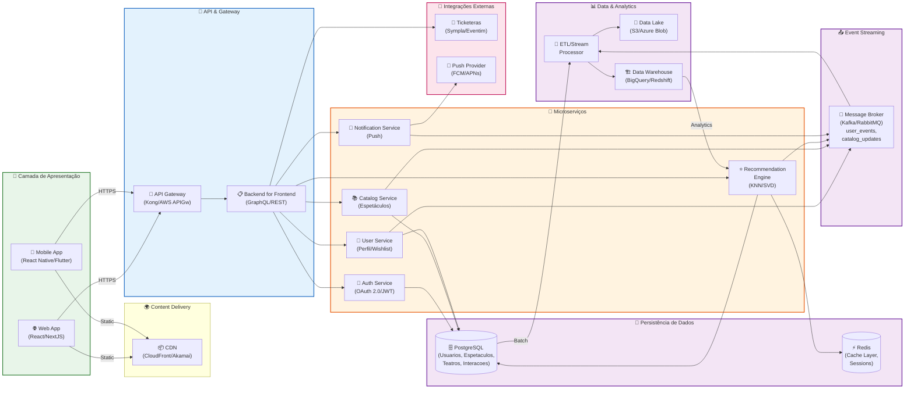

# Diagrama de Componentes - Plataforma Aventura Teatros

## Código Mermaid



## Legenda de Componentes

| Componente | Descrição |
|---|---|
| **Web App & Mobile App** | Interfaces de usuário multiplataforma (React para web, React Native/Flutter para mobile) que consomem APIs REST/GraphQL |
| **API Gateway & BFF** | Camada de orquestração que roteia requisições e fornece uma interface unificada aos clientes |
| **Auth Service** | Autenticação e autorização (OAuth 2.0, JWT) — gerencia login, sessões e controle de acesso |
| **Catalog Service** | Gerencia catálogo de espetáculos, teatros, gêneros e metadados (informações fixas, disponibilidade) |
| **Recommendation Engine** | Motor de recomendação personalizadas usando algoritmos KNN e SVD sobre matriz usuário-item |
| **User Service** | Perfil de usuário, preferências, wishlist, histórico de interações |
| **Notification Service** | Envia push notifications (FCM/APNs) baseadas em eventos e preferências |
| **PostgreSQL** | Banco de dados relacional principal — armazena usuários, espetáculos, teatros, interações, histórico |
| **Redis** | Cache em memória — sessões, cache de recomendações, dados quentes para performance |
| **Message Broker** | Kafka/RabbitMQ — Event Streaming para desacoplamento entre serviços e processamento assíncrono |
| **ETL/Stream Processor** | Processa eventos do broker e dados de batch para alimentar o Data Warehouse |
| **Data Lake** | Armazenamento de dados brutos (S3/Azure Blob) para auditoria e processamento futuro |
| **Data Warehouse** | OLAP (BigQuery/Redshift) — análises, métricas, input para modelos de recomendação |
| **Ticketeras (Externa)** | Plataforma de bilheteria parceira — o app redireciona para purchase |
| **Push Provider (Externa)** | FCM (Firebase) ou APNs (Apple) — entrega final de notificações ao usuário |

## Pressupostos e Decisões de Design

1. **Message Broker**: Assumido **Kafka** para streaming de eventos; alternativa: **RabbitMQ** se preferir throughput menor ou setup mais simples.
2. **Data Warehouse**: Assumido **BigQuery** (GCP) ou **Redshift** (AWS); alternativa: **Snowflake** para portabilidade multi-cloud.
3. **Escalabilidade do Recommendation**: Motivo de separação em serviço dedicado — requer alto I/O e processamento de matriz grande.
4. **Geolocalização**: Capturada no frontend (CEP/GPS) → armazenada no perfil → usada para filtros de recomendação.
5. **LGPD Compliance**: Dados sensíveis (CEP, idade, gênero) criptografados em repouso e em trânsito (TLS 1.3+); direito de deletion implementado em User Service.

## Fluxo de Dados Crítico (Recomendação)

```
1. Usuário interage (clica, wishlist, busca) → evento → UserSvc
2. UserSvc publica evento no Broker
3. RecoSvc consome eventos, atualiza matriz usuário-item
4. RecoSvc calcula scores (KNN/SVD)
5. RecoSvc publica recomendações ao cache Redis e banco
6. BFF consulta cache → retorna ao cliente em <3s
7. Cliente exibe vitrines dinâmicas
8. Eventos alimentam Data Warehouse para análise futura
```

