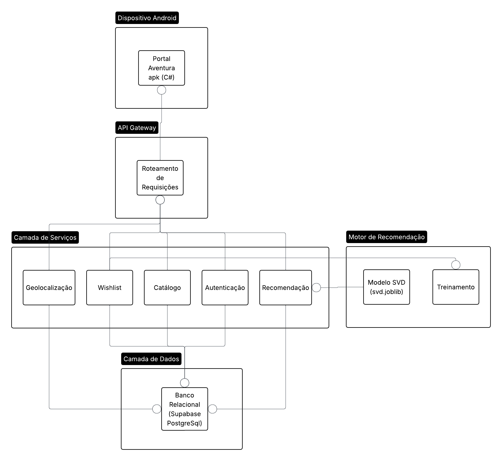
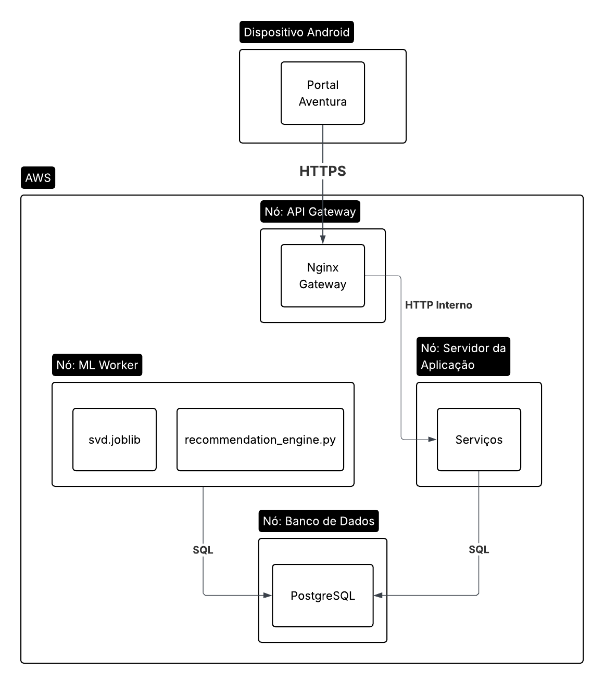

# Diagramas de Arquitetura — Portal Aventura

## Sumário

- [13. Diagrama de Componentes (SOA)](#13-diagrama-de-componentes-soa)
- [14. Diagrama de Deploy](#14-diagrama-de-deploy)

---

## 13. Diagrama de Componentes (SOA)

O diagrama representa a arquitetura orientada a serviços (SOA) do sistema, organizada em quatro camadas com responsabilidades bem delimitadas. A separação em componentes independentes permite que cada serviço evolua, escale e seja substituído de forma isolada, sem impactar os demais — princípio central do SOA.

### 13.1 Dispositivo Android — Portal Aventura apk (C#)

O aplicativo é desenvolvido em C# com .NET MAUI, gerando um único artefato `.apk` distribuído para Android. Toda comunicação com o backend ocorre exclusivamente via HTTPS, sem lógica de negócio local além da renderização de interface.

**Justificativa técnica:**
- **RNF02** — A ausência de lógica sensível no cliente garante que credenciais e dados pessoais trafeguem apenas por canal criptografado. O `.apk` não armazena senhas nem tokens de forma persistente e legível.
- **RNF04** — .NET MAUI fornece layout responsivo nativo para Android, permitindo adaptação automática a partir de 480px de largura de tela sem retrabalho de interface.

### 13.2 API Gateway — Roteamento de Requisições

Ponto único de entrada para todas as requisições do aplicativo. Responsável por validar tokens JWT antes de encaminhar a chamada ao serviço de destino, aplicar rate limiting e registrar logs de acesso centralizados.

**Justificativa técnica:**
- **RNF02** — Centralizar a validação de autenticação no gateway impede que requisições não autorizadas cheguem aos serviços internos. Nenhum serviço precisa reimplementar verificação de token.
- **RNF05** — Um gateway gerenciado opera com SLA de alta disponibilidade e pode redirecionar tráfego automaticamente em caso de falha de instância de serviço, contribuindo para a meta de 99% de uptime.
- **RNF06** — O gateway absorve picos de carga aplicando rate limiting antes que o tráfego chegue aos serviços, protegendo a infraestrutura em campanhas de lançamento com até 1.000 usuários simultâneos.

### 13.3 Camada de Serviços SOA

Cada serviço encapsula um domínio funcional específico e expõe uma interface REST bem definida. A comunicação entre serviços, quando necessária, passa pelo barramento interno — nunca pelo gateway público.

#### Autenticação

Gerencia registro, login e invalidação de sessão. Armazena senhas exclusivamente como hash bcrypt, nunca em texto plano.

**Justificativa técnica:**
- **RNF02** — O uso de hash irreversível garante que mesmo um acesso indevido ao banco não exponha credenciais. A geração e validação de tokens JWT ocorre neste serviço, isolando o segredo de assinatura dos demais componentes.
- **RNF03** — O serviço implementa o endpoint de exclusão de conta que remove ou anonimiza todos os dados pessoais do usuário no banco, atendendo ao direito de apagamento previsto na LGPD.

#### Catálogo

Provê listagem, busca por texto livre e detalhes de espetáculos e teatros. Realiza consultas de leitura no banco relacional com índices otimizados para os filtros mais frequentes.

**Justificativa técnica:**
- **RNF01** — Consultas de catálogo são operações de leitura pura com índices em `nome`, `id_genero` e `id_teatro`, garantindo tempo de resposta dentro do limite de 3 segundos mesmo com o volume de dados projetado.
- **RNF06** — Por ser stateless, o serviço de catálogo pode ter múltiplas instâncias em execução simultânea sem necessidade de sincronização de estado, facilitando escala horizontal sob carga.

#### Wishlist

Registra curtidas e itens salvos pelo usuário na tabela `CURT_WISH`. Essas interações também alimentam o motor de recomendação com sinais implícitos de preferência.

**Justificativa técnica:**
- **RNF01** — Operações de wishlist são escritas simples em tabela com chave primária composta `(id_usuario, id_espetaculo)`, executadas em milissegundos, sem impacto no tempo de resposta percebido.
- **RNF03** — Ao excluir a conta, todas as entradas de `CURT_WISH` vinculadas ao usuário são removidas em cascata, eliminando dados comportamentais pessoais conforme exige a LGPD.

#### Geolocalização

Resolve o CEP informado no onboarding para identificar se o usuário está em São Paulo ou Rio de Janeiro, utilizando a API pública ViaCEP. O resultado é persistido no perfil do usuário para evitar chamadas repetidas.

**Justificativa técnica:**
- **RNF07** — A resolução via CEP, combinada à base atualizada do ViaCEP, garante precisão de identificação de cidade em ≥ 95% dos casos, superando a variabilidade de geolocalização por GPS em redes móveis.
- **RNF03** — Apenas a cidade resolvida (SP ou RJ) é armazenada, sem persistir coordenadas geográficas precisas, respeitando o princípio de minimização de dados da LGPD.

#### Recomendação

Serve as recomendações personalizadas ao aplicativo. Em operação normal, consulta os resultados pré-calculados pelo Motor de Recomendação. Aplica o filtro de geolocalização antes de retornar a lista ao cliente.

**Justificativa técnica:**
- **RNF01** — Consultar resultados pré-calculados no banco, em vez de executar inferência em tempo real a cada requisição, é o mecanismo central para garantir resposta ≤ 3 segundos, mesmo sob carga simultânea de 1.000 usuários.
- **RNF06** — O desacoplamento entre servir recomendações (online) e calculá-las (batch) elimina a contenção de recursos: o pico de tráfego no servidor da aplicação não interfere com a execução do modelo Python.

### 13.4 Motor de Recomendação Python

Componente separado da camada de serviços, executado como job periódico. Não expõe interface HTTP pública — sua saída é escrita diretamente no banco relacional, de onde o serviço de Recomendação as lê.

#### Treinamento

Script que lê as interações registradas em `INTERACOES_USU` e `CURT_WISH`, treina o modelo SVD com scikit-surprise e persiste o artefato `svd.joblib`.

#### Modelo SVD (svd.joblib)

Modelo de fatoração de matrizes SVD serializado. Carregado em memória a cada execução do job para gerar as predições de ranking e atualizar as recomendações pré-calculadas no banco.

**Justificativa técnica:**
- **RNF01** — A serialização do modelo em `.joblib` permite carregamento em poucos milissegundos, eliminando o custo de re-treinamento a cada requisição. As predições são pré-calculadas e armazenadas, não computadas sob demanda.
- **RNF06** — O treinamento e a inferência batch ocorrem em um nó isolado (ML Worker), sem consumir CPU/memória do servidor da aplicação durante picos de tráfego.

### 13.5 Camada de Dados — Banco Relacional (Supabase PostgreSQL)

Banco de dados relacional PostgreSQL gerenciado via Supabase. Armazena todas as entidades do modelo lógico: `USUARIOS`, `ESPETACULOS`, `TEATROS`, `GENEROS`, `ESP_GEN`, `GEN_FAV`, `CURT_WISH` e `INTERACOES_USU`. Também armazena as recomendações pré-calculadas pelo motor Python, eliminando a necessidade de um cache externo separado.

**Justificativa técnica:**
- **RNF03** — O PostgreSQL suporta operações de exclusão em cascata (`ON DELETE CASCADE`) e anonimização via `UPDATE`, permitindo atender ao direito de apagamento da LGPD sem lógica customizada complexa.
- **RNF05** — O Supabase opera com replicação automática e backups contínuos (point-in-time recovery), contribuindo diretamente para a meta de disponibilidade de 99%.
- **RNF06** — O Supabase oferece connection pooling nativo (PgBouncer), permitindo que 1.000 conexões simultâneas do servidor da aplicação sejam multiplexadas eficientemente sem saturar o banco.

---

## 14. Diagrama de Deploy

O diagrama representa a topologia de implantação do sistema na AWS, com os nós de execução, artefatos implantados e protocolos de comunicação entre cada camada. A infraestrutura é organizada de forma que apenas o API Gateway tem exposição à internet pública, mantendo todos os nós internos em rede privada.

### 14.1 Dispositivo Android — Portal Aventura

Artefato `.apk` instalado no dispositivo do usuário. Toda comunicação com a infraestrutura cloud ocorre via HTTPS sobre a internet pública, sem acesso direto a nenhum nó interno.

**Justificativa técnica:**
- **RNF02** — O uso exclusivo de HTTPS/TLS garante criptografia em trânsito de ponta a ponta entre o dispositivo e o gateway, impedindo interceptação de credenciais e dados pessoais em redes Wi-Fi públicas.
- **RNF04** — O artefato MAUI é compilado nativamente para Android, com suporte a diferentes densidades de tela e tamanhos a partir de 480px, atendendo aos critérios de usabilidade mobile.

### 14.2 Nó: API Gateway (Nginx)

Único nó com endereço público. Recebe conexões HTTPS na porta 443, realiza TLS termination e encaminha o tráfego para o servidor da aplicação via HTTP interno na rede privada da AWS.

**Justificativa técnica:**
- **RNF02** — A TLS termination no gateway centraliza o gerenciamento de certificados SSL e elimina a necessidade de configurar HTTPS em cada serviço interno, reduzindo a superfície de erro de segurança.
- **RNF05** — O Nginx é amplamente utilizado como proxy reverso de alta disponibilidade e suporta recarregamento de configuração sem downtime (`nginx -s reload`), contribuindo para a meta de 99% de uptime.
- **RNF06** — O Nginx suporta dezenas de milhares de conexões simultâneas com consumo de memória baixo, absorvendo os picos de até 1.000 usuários simultâneos sem saturar o servidor da aplicação.

### 14.3 Nó: Servidor da Aplicação — Serviços

Hospeda todos os serviços REST da camada de negócio (Autenticação, Catálogo, Wishlist, Geolocalização, Recomendação). Recebe tráfego somente do gateway via HTTP interno, sem exposição direta à internet.

**Justificativa técnica:**
- **RNF01** — A comunicação via HTTP interno na rede privada da AWS tem latência de sub-milissegundo entre gateway e serviços, preservando o orçamento de tempo disponível para consultas ao banco dentro do limite de 3 segundos.
- **RNF05** — Ao isolar os serviços do gateway, é possível reiniciar ou atualizar serviços individualmente sem interromper o recebimento de requisições no gateway, minimizando janelas de indisponibilidade.
- **RNF06** — O nó pode ser escalado horizontalmente (múltiplas instâncias) com balanceamento de carga gerenciado pelo gateway, permitindo absorver o crescimento de usuários simultâneos sem mudança na arquitetura.

### 14.4 Nó: ML Worker

Nó isolado executando o runtime Python. Contém dois artefatos:

- **`svd.joblib`** — modelo treinado serializado, lido pelo engine a cada ciclo de inferência batch.
- **`recommendation_engine.py`** — script que carrega o modelo, gera predições para todos os usuários ativos e escreve os resultados no banco PostgreSQL.

O ML Worker **não recebe requisições HTTP**. É ativado por um cron job periódico e se comunica exclusivamente com o banco de dados via SQL.

**Justificativa técnica:**
- **RNF01** — Executar o treinamento e a inferência em nó separado garante que o processamento computacionalmente intenso do modelo SVD não dispute CPU/memória com os serviços que atendem requisições em tempo real, preservando o SLA de 3 segundos.
- **RNF06** — O isolamento do ML Worker permite dimensioná-lo com instâncias de uso intensivo de memória (ex.: AWS `r`-series) sem encarecer o servidor da aplicação, que demanda mais CPU e menor memória.

### 14.5 Nó: Banco de Dados — PostgreSQL (Supabase)

Gerenciado via Supabase, que provisiona PostgreSQL com replicação, backups automáticos e connection pooling. Recebe conexões SQL tanto do servidor da aplicação quanto do ML Worker.

**Justificativa técnica:**
- **RNF01** — O connection pooling nativo do Supabase (PgBouncer) evita o overhead de estabelecer nova conexão TCP a cada requisição, reduzindo a latência de acesso ao banco e contribuindo para a meta de resposta em ≤ 3 segundos sob carga simultânea.
- **RNF03** — O PostgreSQL permite implementar exclusão e anonimização de dados pessoais com precisão por `user_id`, atendendo ao direito de apagamento da LGPD via comandos SQL transacionais com rollback seguro.
- **RNF05** — O Supabase oferece replicação automática e point-in-time recovery, garantindo durabilidade dos dados e recuperação rápida em caso de falha, sustentando a meta de 99% de disponibilidade.

### 14.6 Protocolos de Comunicação

| Conexão | Protocolo | Justificativa |
|---|---|---|
| Dispositivo → API Gateway | HTTPS / TLS 1.3 | **RNF02** — criptografia em trânsito de ponta a ponta |
| API Gateway → Servidor da Aplicação | HTTP interno | Rede privada AWS; TLS desnecessário em canal fechado |
| Servidor da Aplicação → Banco | SQL / TCP | **RNF01** — comunicação de baixa latência em rede privada |
| ML Worker → Banco | SQL / TCP | Leitura de interações e escrita de recomendações em lote |
