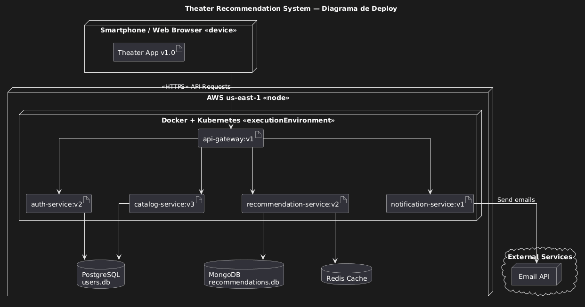

# Entrega 1 — Diagrama de Componentes SOA e Justificativa

## 1.1 Descrição dos Componentes

### Camada Cliente

O componente **Theater App v1.0** representa a interface do usuário final, acessível via smartphone ou navegador web. Toda comunicação com o backend é realizada via protocolo HTTPS. O cliente interage exclusivamente com o **API Gateway**, sem conhecimento direto dos serviços internos — princípio fundamental da arquitetura SOA.

---

## Backend — AWS us-east-1

| Componente | Versão | Responsabilidade |
|---|---|---|
| api-gateway | v1 | Ponto único de entrada; roteamento, validação de token, rate limiting e load balancing |
| auth-service | v2 | Autenticação e autorização; emissão e validação de JWT |
| catalog-service | v3 | CRUD do catálogo de peças teatrais; busca e filtragem |
| recommendation-service | v2 | Motor de recomendação personalizada baseado em perfil e histórico |
| notification-service | v1 | Envio de notificações por e-mail via Email API externa |
| Orquestrador | — | Coordena fluxos cross-service; expõe interfaces contratuais (IAuth, IUser, ICatalog, IRecommendation, INotification) |

---

## Persistência

| Banco | Tecnologia | Dados Armazenados |
|---|---|---|
| users.db | PostgreSQL | Credenciais, perfis e preferências de usuários |
| recommendations.db | MongoDB | Histórico e dados de recomendação (schema flexível) |
| — | Redis Cache | Cache de sessões, catálogo e recomendações frequentes |

---

## Serviço Externo

| Componente | Integração |
|---|---|
| Email API | Chamada HTTP do notification-service para envio de e-mails transacionais |

---

# 1.2 Justificativa da Arquitetura

## Desacoplamento e independência dos serviços

A divisão em microsserviços autônomos — auth, catalog, recommendation e notification — permite que cada um evolua, seja atualizado e escalado de forma independente. O diagrama de deploy evidencia que o catalog-service já está na versão v3, enquanto o auth-service permanece em v2, comprovando ciclos de entrega assíncronos sem impacto nos demais.

Isso é especialmente relevante para o parceiro: novas funcionalidades do catálogo de peças (filtros avançados, integração com sistemas de bilheteria) podem ser lançadas sem qualquer interrupção na autenticação de usuários já em sessão.

---

## API Gateway como ponto de controle centralizado

O API Gateway é o único componente exposto ao cliente externo, funcionando como a “porta” da arquitetura SOA. Essa decisão centraliza a aplicação de políticas de segurança (validação de JWT), rate limiting e roteamento por versão de serviço em um único ponto.

Em cenários de pico de acesso — como o lançamento de uma temporada popular —, o Gateway permite aplicar throttling seletivo sem alterações nos serviços internos, protegendo toda a infraestrutura de sobrecarga em cascata.

---

## Persistência poliglota alinhada ao domínio de cada serviço

Cada serviço utiliza o banco de dados mais adequado ao seu modelo de dados. O PostgreSQL oferece consistência transacional ACID, ideal para dados críticos e estruturados de usuários.

O MongoDB, orientado a documentos, acomoda o schema flexível e evolutivo das recomendações, onde diferentes algoritmos podem gerar estruturas distintas.

O Redis provê acesso em memória de baixíssima latência para cache de sessões e recomendações frequentes, reduzindo drasticamente a carga sobre os bancos primários em momentos de pico.

---

## Orquestrador como facilitador de fluxos cross-service

O Orquestrador coordena processos que cruzam múltiplos serviços — por exemplo, o fluxo de primeiro acesso: validar autenticação (IAuth), carregar perfil (IUser), buscar catálogo personalizado (ICatalog) e gerar recomendações (IRecommendation).

Ao centralizar essa lógica de orquestração em um componente dedicado, os serviços individuais permanecem coesos e com responsabilidade única, facilitando a substituição ou expansão de qualquer um deles sem reescrever os fluxos de negócio.

---

## Escalabilidade horizontal via Kubernetes

A execução sobre Docker + Kubernetes permite escalar horizontalmente qualquer microsserviço de forma independente conforme a demanda.

O recommendation-service e o catalog-service são os candidatos naturais a escalonamento em picos, pois concentram a maior carga computacional. Novos pods podem ser provisionados automaticamente sem afetar os demais serviços, garantindo que o sistema do parceiro lide com cenários críticos de acesso sem degradação perceptível ao usuário.

---

## Integração desacoplada com serviços externos

A comunicação com a Email API é isolada no notification-service, que atua como único ponto de integração com o mundo externo.

Caso o parceiro precise trocar o provedor de e-mail, substituir por SMS ou integrar com sistemas legados de CRM, apenas esse serviço precisa ser modificado — os demais continuam operando normalmente.

Esse isolamento é o que garante a extensibilidade da arquitetura a longo prazo.

---

# Entrega 2 — Requisitos Não Funcionais (RNFs)

Os requisitos a seguir são categorizados conforme a norma ISO/IEC 25010, que organiza a qualidade de software em características mensuráveis. Para cada RNF é indicado o componente do diagrama SOA diretamente responsável por sua garantia.

---

# RNF-01 — Eficiência de Desempenho

## Categoria ISO 25010
**Eficiência de Desempenho (Performance Efficiency) — Comportamento Temporal**

## Requisito
O sistema deve suportar até 500 requisições simultâneas com tempo de resposta inferior a 2 segundos em condições normais e inferior a 5 segundos em situações de pico de carga.

## Justificativa
O sistema de recomendação de teatro pode enfrentar picos intensos de acesso durante períodos de lançamento de novas temporadas ou campanhas promocionais.

A degradação do tempo de resposta impacta diretamente a experiência do usuário e eleva a taxa de abandono da plataforma.

Além disso, latência elevada em chamadas ao banco de recomendações pode gerar gargalos em cascata que afetam todos os demais serviços.

## Componentes responsáveis
- api-gateway:v1 (controle de throughput e throttling)
- Redis Cache (redução de consultas redundantes ao banco)
- Docker + Kubernetes (escalabilidade horizontal automática de pods)

---

# RNF-02 — Segurança

## Categoria ISO 25010
**Segurança (Security) — Confidencialidade e Integridade**

## Requisito
Todo acesso ao sistema deve ser autenticado e autorizado via tokens JWT com expiração configurável.

A comunicação deve ocorrer exclusivamente via HTTPS/TLS 1.2+.

Dados sensíveis de usuários devem ser criptografados em repouso.

## Justificativa
O sistema gerencia dados pessoais de usuários — perfis, histórico de preferências e credenciais —, exigindo conformidade com a LGPD.

Vazamentos de credenciais ou acesso não autorizado ao catálogo ou às recomendações podem comprometer a reputação do parceiro e gerar sanções legais.

A arquitetura SOA aumenta a superfície de ataque, tornando a segurança em camadas ainda mais essencial.

## Componentes responsáveis
- auth-service:v2 (emissão e validação de JWT)
- api-gateway:v1 (validação de token em todas as rotas antes do roteamento)
- PostgreSQL users.db (armazenamento criptografado de credenciais)

---

# RNF-03 — Manutenibilidade

## Categoria ISO 25010
**Manutenibilidade (Maintainability) — Modularidade e Modificabilidade**

## Requisito
Cada microsserviço deve ser implantável e atualizável de forma independente, sem downtime para os demais serviços.

O sistema deve suportar rollback de qualquer serviço em menos de 5 minutos.

## Justificativa
A arquitetura SOA desacoplada exige que atualizações em um serviço não afetem os demais componentes.

Isso é crítico para o parceiro manter ciclos rápidos de entrega sem janelas de manutenção que interrompam o acesso dos usuários à plataforma.

## Componentes responsáveis
- Docker + Kubernetes (versionamento de containers, deploy blue-green e canary)
- api-gateway:v1 (roteamento por versão de serviço)

---

# RNF-04 — Confiabilidade

## Categoria ISO 25010
**Confiabilidade (Reliability) — Disponibilidade e Tolerância a Falhas**

## Requisito
O sistema deve garantir disponibilidade mínima de 99,5% (uptime mensal).

Em caso de falha de um serviço, o sistema deve continuar operando com funcionalidade degradada e se recuperar automaticamente sem intervenção manual.

## Justificativa
A indisponibilidade da plataforma impacta diretamente a proposta de valor do parceiro.

A falha da Email API externa, por exemplo, não deve derrubar o fluxo de navegação e recomendação para o usuário.

## Componentes responsáveis
- Docker + Kubernetes (self-healing e reinício automático de pods)
- Redis Cache (disponibilidade de dados cacheados)
- notification-service:v1 (isolamento de falhas externas)

---

# RNF-05 — Compatibilidade

## Categoria ISO 25010
**Compatibilidade (Compatibility) — Interoperabilidade**

## Requisito
O sistema deve ser acessível via API RESTful padronizada (JSON/HTTP), compatível com clientes web e mobile (iOS e Android).

A integração com a Email API externa deve seguir contratos versionados e documentados.

## Justificativa
O mesmo api-gateway:v1 atende tanto aplicações web quanto mobile.

Mudanças unilaterais nos contratos externos podem quebrar integrações sem aviso.

## Componentes responsáveis
- api-gateway:v1
- notification-service:v1
- Orquestrador

---

# RNF-06 — Usabilidade (Desempenho Percebido)

## Categoria ISO 25010
**Usabilidade (Usability) — Operabilidade e Proteção contra Erros do Usuário**

## Requisito
O tempo de carregamento da listagem do catálogo deve ser inferior a 1,5 segundos para 90% dos usuários.

As recomendações personalizadas devem ser apresentadas em menos de 3 segundos após o login.

## Justificativa
A experiência do usuário em plataformas de entretenimento cultural é altamente sensível a latências.

Pesquisas de UX indicam que usuários abandonam aplicações que demoram mais de 3 segundos para responder.

## Componentes responsáveis
- Redis Cache
- recommendation-service:v2
- MongoDB recommendations.db
