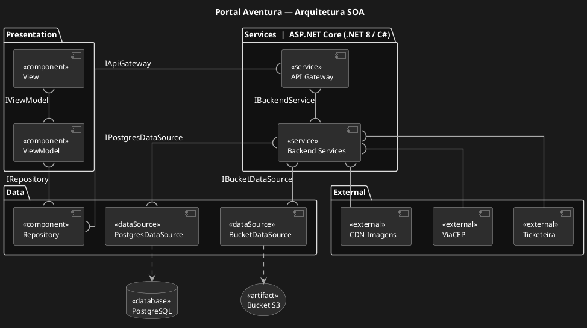
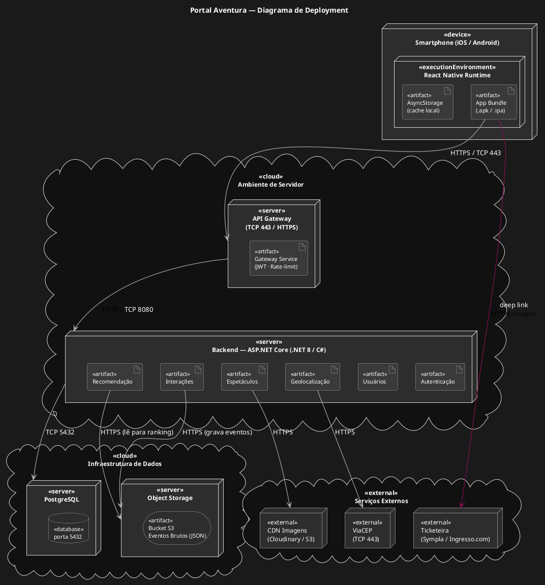

# Ponderada — Arquitetura SOA + Requisitos Não Funcionais
 
## 1. Arquitetura SOA
 
### 1a. Blocos Principais
 
A solução é estruturada em quatro camadas internas fundamentais:
 
| Camada | Tecnologia | Responsabilidade |
|---|---|---|
| **Frontend Mobile** | React Native (iOS / Android) | Aplicativo nativo organizado em padrão MVVM: telas (View) em React Native com FlatList, SafeAreaView e TouchableOpacity; lógica de estado (ViewModel) via Hooks e Context API; acesso a dados (Model) via API Client e AsyncStorage para cache local |
| **API Gateway** | C# / ASP.NET Core | Ponto único de entrada. Aplica autenticação JWT, rate-limiting e roteamento para os serviços internos via rotas de porta (`/auth/*`, `/users/*`, `/shows/*`, `/recommendations/*`, `/interactions/*`, `/geo/*`) |
| **Backend — Serviços SOA** | C# / ASP.NET Core | Seis serviços independentes: Autenticação (JWT + ASP.NET Identity), Usuários (CRUD + LGPD), Espetáculos (catálogo + filtros), Recomendação (motor de ranking 24h), Interações (rastreio + wishlist) e Geolocalização (CEP → cidade) |
| **Persistência** | PostgreSQL + Bucket S3 | PostgreSQL armazena entidades relacionais (USUARIOS, ESPETACULOS, TEATROS, GENEROS, GEN_FAV, CURT_WISH, INTERACOES_USU). O Bucket S3 absorve eventos brutos de comportamento (cliques, scroll, tempo de tela) em JSON antes da persistência no banco, protegendo o PostgreSQL de contenção em picos |
 
---
 
### 1b. Integração com Serviços Externos (SOA)
 
A arquitetura integra três serviços externos desacoplados do núcleo da aplicação via interfaces bem definidas:
 
| Serviço Externo | Protocolo | Função no Sistema |
|---|---|---|
| **Ticketeira (Sympla / Ingresso.com)** | HTTPS — deep link | O usuário é redirecionado ao app/site da ticketeira ao tocar em "Comprar Ingressos". O toque é registrado como evento de conversão no `Serviço de Interações` e gravado no Bucket S3 |
| **API de CEP (ViaCEP)** | REST / JSON — TCP 443 | O `Serviço de Geolocalização` converte o CEP do onboarding em cidade/estado, filtrando espetáculos geograficamente (SP ou RJ) |
| **CDN de Imagens (Cloudinary / S3)** | HTTPS | O `Serviço de Espetáculos` referencia URLs externas para imagens dos espetáculos e teatros. O app React Native carrega as imagens via componente `Image` com cache nativo, sem armazenamento binário no banco relacional |
 
---
 
### 1c. Diagramas da Arquitetura
 
#### Diagrama de Componentes SOA + MVVM
 
Evidencia os módulos internos, as interfaces lollipop/socket entre camadas e a conexão com serviços externos. A notação segue UML de componentes:
 
- **Lollipop** (`--(`) — interface provida: contrato que um componente oferece (ex: `IRepository`, `IApiGateway`)
- **Socket** (`)--`) — interface requerida: dependência que um componente consome
- **Dependência** (`..>`) — uso entre componentes sem contrato formal (ex: View → ViewModel, DataSources → Infraestrutura)

 
#### Diagrama de Deployment
 
Evidencia onde cada artefato é executado fisicamente, os protocolos de rede entre nós e as fronteiras entre dispositivo, servidor e infraestrutura de dados:
 

 
---
 
### 1d. Justificação dos Elementos
 
#### Por que SOA?
 
O projeto da Aventura Teatros tem como núcleo um **motor de recomendação** que opera de forma assíncrona a cada 24 horas. Isso impõe uma exigência técnica clara: o serviço de recomendação não pode bloquear nem depender do ciclo de vida dos demais. A organização em serviços SOA independentes, orquestrados pelo API Gateway, atende a essa exigência por três motivos estruturais:
 
**1. Escalabilidade horizontal seletiva:** Os serviços de Recomendação e de Interações (`Backend Services`) são os de maior demanda computacional — o primeiro processa rankings personalizados por usuário; o segundo registra eventos de navegação em tempo real. Com serviços desacoplados via `IBackendService`, é possível escalar horizontalmente **apenas esses dois** em momentos de pico (ex: lançamento de um espetáculo), sem aumentar recursos dos demais. Isso é diretamente relevante para o parceiro: a Aventura realiza campanhas de lançamento que concentram acessos em janelas curtas.
 
**2. Bucket S3 como buffer de escrita:** O serviço de Interações não persiste eventos diretamente no `PostgreSQL` — grava-os primeiro como JSON no `Bucket S3` via `IBucketDataSource`. O banco recebe apenas os agregados processados. Isso é crítico porque eventos de comportamento (cliques, scroll no FlatList, tempo de tela) chegam em rajadas durante picos, e inserções massivas simultâneas causariam contenção de lock e degradação de desempenho. O bucket absorve o volume bruto; o serviço de Recomendação lê esses eventos a cada 24h para gerar os rankings.
 
**3. Substituição de fornecedor sem impacto sistêmico:** Os serviços externos (Ticketeira, ViaCEP, CDN) são consumidos pelo `Backend Services` via socket — sem acoplamento direto com a camada `Presentation` ou `Data`. Se a Aventura mudar de ticketeira, apenas o contrato desse serviço externo precisa ser ajustado; o app React Native, o banco e o motor de recomendação permanecem intocados. Essa é a essência do desacoplamento SOA: mudanças de fornecedor não propagam risco sistêmico.
 
O **API Gateway** como ponto único de entrada centraliza autenticação JWT, rate-limiting e roteamento via interface `IApiGateway` — eliminando duplicação de lógica de segurança nos serviços e permitindo controle centralizado de tráfego. No diagrama de deployment isso é representado como um nó físico dedicado (TCP 443), separado do servidor de backend (TCP 8080), tornando explícita a fronteira de segurança.
 
O padrão **MVVM** dentro do app React Native garante que as telas (`View`) nunca chamem a API diretamente — toda lógica de estado passa pelo `ViewModel` e toda comunicação com o backend passa pelo `Repository` via `IRepository`. Isso torna o frontend testável por camada e preparado para evoluir sem impactar os serviços SOA.

---
 
## 2. Requisitos Não Funcionais
 
### Tabela de RNFs — ISO/IEC 25010
 
| # | Requisito | Característica ISO 25010 | Subcaracterística | SLA Mensurável | Componente Responsável |
|---|---|---|---|---|---|
| RNF01 | Tempo de resposta das recomendações ≤ 3s | Eficiência de Desempenho | Comportamento Temporal | Tempo médio ≤ 3s em ≥ 80% das requisições | `Backend Services` + `API Gateway` |
| RNF02 | Segurança das credenciais (HTTPS + PasswordHasher) | Segurança | Confidencialidade + Integridade dos Dados | 100% do tráfego via HTTPS/TLS; senhas armazenadas via `PasswordHasher` do ASP.NET Identity (PBKDF2 + salt) | `Backend Services` + `API Gateway` |
| RNF03 | Conformidade com a LGPD | Segurança | Conformidade (Compliance) | 100% dos dados editáveis/deletáveis; exclusão em ≤ 24h | `Backend Services` + `PostgresDataSource` + `PostgreSQL` |
| RNF04 | Experiência nativa em iOS e Android | Usabilidade | Operabilidade + Adequação ao Contexto de Uso | Taxa de conclusão de tarefas ≥ 90%; pontuação SUS ≥ 70 em telas de 5" a 6,7" | `View` + `ViewModel` (Presentation) |
| RNF05 | Disponibilidade da plataforma ≥ 99% | Confiabilidade | Disponibilidade | Uptime mensal ≥ 99% (downtime máx ≈ 7,2h/mês); recuperação em ≤ 5 min | `API Gateway` + `Repository` (cache via AsyncStorage) |
| RNF06 | Escalabilidade para ≥ 1.000 usuários simultâneos | Eficiência de Desempenho | Utilização de Recursos | Resposta ≤ 3s e taxa de erro < 1% com 1.000 usuários por 15 min | `Backend Services` + `BucketDataSource` + `Bucket S3` |
| RNF07 | Precisão da geolocalização ≥ 95% | Adequação Funcional | Correção Funcional | Cidade identificada corretamente em ≥ 95% dos casos | `Backend Services` + `ViaCEP` (External) |
| RNF08 | Manutenibilidade dos serviços SOA | Manutenibilidade | Modularidade + Modificabilidade | Zero acoplamento direto entre serviços (toda comunicação via Gateway); cobertura de testes ≥ 70% por serviço | `Backend Services` + `API Gateway` |
| RNF09 | Compatibilidade com iOS 14+ e Android 10+ | Compatibilidade | Interoperabilidade + Coexistência | App sem crash em 100% dos dispositivos alvo; APIs produzem JSON-REST sem dependência de SO | `Presentation` + `API Gateway` |
 
---
 
### Justificativas por RNF
 
**RNF01 — Eficiência de Desempenho / Comportamento Temporal:**  
O `Backend Services` pré-computa os rankings de recomendação a cada 24h e armazena o resultado no `PostgreSQL` via `PostgresDataSource`. Na requisição do usuário, o `API Gateway` retorna esse resultado já pronto — sem reprocessamento em tempo real. A latência de rede é minimizada pela CDN (External), referenciada pelo backend para URLs de imagens carregadas com cache nativo pelo componente `Image` do React Native na camada `View`.
 
**RNF02 — Segurança / Confidencialidade e Integridade:**  
O `Backend Services` em C# / ASP.NET Core é o único bloco que manipula credenciais, limitando a superfície de ataque. O `PasswordHasher` do ASP.NET Identity aplica PBKDF2 com salt aleatório — algoritmo resistente a ataques de dicionário e rainbow table. O JWT gerado é validado pelo `API Gateway` em todas as rotas protegidas via interface `IApiGateway` — sem que o backend consulte o banco a cada requisição. O React Native bloqueia HTTP em produção por padrão (App Transport Security no iOS; Network Security Config no Android), garantindo HTTPS em toda comunicação com o `API Gateway`.
 
**RNF03 — Segurança / Conformidade (LGPD):**  
O `Backend Services` expõe endpoints de visualização, edição e exclusão de dados pessoais. A exclusão anonimiza registros tanto no `PostgreSQL` (via `PostgresDataSource`) quanto no `Bucket S3` (via `BucketDataSource`), substituindo `id_usuario` por um ID genérico. Isso preserva a integridade histórica do modelo de recomendação sem manter vínculo com o titular — exigência da LGPD (art. 52, multa de até 2% do faturamento).
 
**RNF04 — Usabilidade / Operabilidade + Adequação ao Contexto:**  
A camada `Presentation` do app React Native usa `FlatList` para carrosséis com scroll inercial, `TouchableOpacity` com feedback de pressão nativo e `SafeAreaView` para respeitar notch e barra inferior. O `ViewModel` gerencia o estado das telas via Hooks (`useState`, `useEffect`) e Context API, sem acoplamento direto à API, permitindo que a `View` se atualize de forma reativa. O backend em C# / ASP.NET Core expõe endpoints REST consumidos pelo `Repository` via `IApiGateway`. O layout em unidades `dp`/`pt` funciona de um iPhone SE (4,7") a um Galaxy S24 Ultra (6,8"). A pontuação SUS ≥ 70 classifica o sistema como "Bom" (Bangor et al., 2008).
 
**RNF05 — Confiabilidade / Disponibilidade:**  
O `API Gateway` com health checks e auto-restart redireciona tráfego para instâncias saudáveis. O `Repository` na camada `Data` mantém o último resultado de recomendações em cache local (AsyncStorage), garantindo degradação graciosa: falhas no `Backend Services` não derrubam a Home — o app exibe o último conjunto armazenado no dispositivo.
 
**RNF06 — Eficiência de Desempenho / Utilização de Recursos:**  
O `BucketDataSource` e o `Bucket S3` são o elemento central dessa garantia: eventos brutos chegam em rajadas durante lançamentos e são absorvidos pelo bucket antes de qualquer processamento, evitando milhares de INSERTs simultâneos no `PostgreSQL`. O `Backend Services` pode ser escalado horizontalmente de forma independente via `API Gateway` (ex: Kubernetes HPA), sem afetar a camada `Presentation` — conexão direta entre o desacoplamento SOA e a capacidade de suportar picos do parceiro.
 
**RNF07 — Adequação Funcional / Correção Funcional:**  
O `Backend Services` consome o serviço `ViaCEP` (External) via HTTPS para converter CEP em cidade/estado. Em caso de indisponibilidade, faz fallback para tabela local de prefixos (SP: 01000–09999; RJ: 20000–28999). O app pode complementar com `expo-location` (GPS) na camada `Presentation`, enviando apenas cidade/estado ao backend — nunca coordenadas precisas, respeitando a LGPD.
 
**RNF08 — Manutenibilidade / Modularidade e Modificabilidade:**  
Nenhum bloco chama outro sem passar por uma interface nomeada — `IRepository`, `IApiGateway`, `IPostgresDataSource`, `IBucketDataSource`. Isso garante que refatorações no `Backend Services` (ex: novo algoritmo de ranking) não gerem efeito cascata na camada `Presentation` ou `Data`. Essa manutenibilidade é estratégica: o modelo de recomendação evoluirá conforme dados reais de comportamento forem acumulados no `Bucket S3`.
 
**RNF09 — Compatibilidade / Interoperabilidade e Coexistência:**  
A camada `Presentation` em React Native suporta iOS 14+ e Android 10+, cobrindo mais de 95% dos dispositivos ativos no Brasil. O `API Gateway` expõe JSON-REST sem headers proprietários via interface `IApiGateway` — uma futura versão web ou integração com parceiros externos consumiria os mesmos endpoints sem adaptação. O `BucketDataSource` usa protocolo S3-compatible, permitindo troca de provedor de nuvem sem reescrever o `Backend Services`.

---
 
## Referências
 
- ISO/IEC 25010:2011 — *Systems and software engineering — Systems and software Quality Requirements and Evaluation (SQuaRE)*
- LGPD — Lei nº 13.709/2018
- Bangor, A.; Kortum, P. T.; Miller, J. T. (2008). *An empirical evaluation of the System Usability Scale*. International Journal of Human-Computer Interaction.
- Documentação do projeto: INTELI; AVENTURA. TAPI — ESMD6: Plataforma digital baseada em arquitetura orientada a serviços. 2024.