# Projeto Visual
----

## Grupo 2 - Aventureiros

## Projeto - RecomendaShow

## Integrantes

- [Alexsander da Silva Barbosa](https://www.linkedin.com/in/alexsander-dsbarbosa/)
- [Carlos Eduardo Serrano Quaglia](https://www.linkedin.com/in/carlos-quaglia-309088357/)
- [Catarina Sayuri Arashiro Braga Felipe](https://www.linkedin.com/in/catarina-sayuri/)
- [Débora Pereira Nogueira](https://www.linkedin.com/in/debora-pereira-nogueira/)
- [Isaac Souza Santos](https://www.linkedin.com/in/isaac-souza-santos/)
- [Nicholas Anantha Krishnan Millani](https://www.linkedin.com/in/nicholas-millani-83a950357/)
- [Paulo Henrique Bueno Fernandes](https://www.linkedin.com/in/paulo-henrique0601/)

## Objetivo do Documento

Este documento registra as decisões visuais e de experiência do usuário do protótipo mobile first, reunindo abordagem de navegação, wireframes, mockups, guia de estilos, componentes visuais, interações e comportamentos responsivos. Seu objetivo é servir como referência para validação, comunicação com stakeholders e apoio à implementação da interface do projeto.

## Sumário

1. [Introdução](#1-introdução)
2. [Abordagem Mobile First](#2-abordagem-mobile-first)
3. [Estrutura de Navegação](#3-estrutura-de-navegação)
4. [Wireframes](#4-wireframes)
5. [Mockups Navegáveis](#5-mockups-navegáveis)
6. [Guia de Estilos](#6-guia-de-estilos-componentes-visuais)
7. [Interações e Comportamentos Mobile](#7-interações-e-comportamentos-mobile)
8. [Considerações Finais](#8-considerações-finais)

---

## 1. Introdução

### 1.1 Objetivo desta documentação
Este documento registra as decisões visuais e de experiência do usuário do protótipo mobile, servindo como referência para stakeholders (comunicando a abordagem visual), guia de implementação para desenvolvedores (garantindo consistência), instrumento de validação (avaliando alinhamento com objetivos de negócio e experiência) e base para futuras iterações que mantenham a estratégia visual e comportamental desejada.

### 1.2 Contexto da solução

O Portal Aventura é uma plataforma de descoberta de espetáculos culturais que atualmente funciona como um catálogo estático. A solução proposta transforma isso em um hub dinâmico com recomendações personalizadas. O mobile é um ponto de entrada complementar  utilizado por usuários em momentos de navegação e consultas rápidas (5-15 min), exigindo experiência que priorize rapidez, clareza e simplicidade.

### 1.3 Objetivo da experiência Mobile First
A experiência mobile foi concebida com três objetivos: (1) descoberta rápida e intuitiva em poucos toques, com recomendação como centro da experiência; (2) leitura confortável em movimento com hierarquia clara, textos diretos, imagens de impacto e tamanhos de toque adequados para uso com uma mão; (3) conversão acelerada para venda removendo barreiras entre descoberta e compra através de botão sempre visível, wishlist persistente, redirecionamento direto para vendas e micro-animações confirmando ações.

### 1.4 Escopo do protótipo visual
O protótipo abrange 11 telas em nível mockup navegável, cobrindo todos os fluxos críticos: autenticação (Splash, Login, Cadastro), onboarding do usuário (Onboarding, Boas-Vindas), descoberta de conteúdo (Home, Buscar, Detalhes do Espetáculo), gestão de preferências (Wishlist, Perfil, Editar Interesses). As interações são plenamente navegáveis, permitindo validar tanto a jornada do novo usuário quanto os fluxos de exploração e conversão para compra.

Na implementação da Sprint 3, esse escopo foi materializado com dados mockados e persistência local pontual, priorizando validação visual, navegação e organização MVVM. A integração completa com os endpoints do backend está planejada para as próximas sprints.

---

## 2. Abordagem Mobile First
A abordagem Mobile First consiste em iniciar o desenvolvimento pensando primeiro nos dispositivos de telas menores, como smartphones. Ele segue o conceito de Progressive Enhancement (melhoramento progressivo), que defende a criação inicial voltada para dispositivos mais simples, priorizando as funcionalidades essenciais e a boa experiência do usuário.

A partir disso, conforme o aumento do tamanho da tela e da capacidade de processamento do dispositivo, novas funcionalidades e melhorias visuais podem ser adicionadas gradualmente. Dessa forma, o sistema cresce de maneira progressiva sem comprometer a usabilidade nos dispositivos móveis.

### 2.1 Priorização da experiência mobile
O wireframe foi desenvolvido inicialmente para dispositivos móveis, priorizando as funcionalidades essenciais e a navegação rápida em telas pequenas. As principais ações permanecem visíveis sem excesso de rolagem, reduzindo etapas e facilitando o uso com apenas uma mão.

Os elementos mais importantes foram posicionados em áreas de maior destaque e fácil acesso, melhorando a usabilidade e a eficiência da navegação.

### 2.2 Adaptação para diferentes tamanhos de tela
O layout foi projetado de forma responsiva para funcionar corretamente em resoluções como 360×640, 390×844 e 414×896.

Foram aplicadas regras como:

- Organização vertical do conteúdo;
- Componentes flexíveis e redimensionáveis;
- Ajuste automático de espaçamentos e elementos;
- Redução de colunas em telas menores;
- Priorização das informações principais nas  primeiras áreas visíveis da tela.

Essas adaptações garantem boa visualização e usabilidade em diferentes dispositivos móveis.

### 2.3 Legibilidade
A hierarquia tipográfica foi definida para facilitar a leitura em dispositivos móveis e ambientes com baixa luminosidade. Títulos possuem maior destaque visual, enquanto textos secundários mantêm tamanhos adequados para leitura confortável.

Também foram mantidas regras de:

- Bom contraste entre texto e fundo;
- Espaçamento adequado entre elementos;
- Redução de blocos extensos de texto;
- Organização clara entre títulos e conteúdos.

### 2.4 Organização de conteúdo em telas pequenas
O conteúdo foi organizado em blocos verticais e hierárquicos para reduzir a carga cognitiva do usuário.

A interface prioriza:

- Separação clara das informações;
- Destaque para ações principais;
- Exibição gradual do conteúdo;
- Layout limpo e com pouca poluição visual.

Isso torna a navegação mais intuitiva e confortável em telas pequenas.

---

## 3. Estrutura de Navegação

A navegação do Portal Aventura foi desenhada para sustentar o pilar estratégico do produto — descoberta contínua e baixo atrito até a conversão — adotando um modelo *mobile-first* baseado em barra de abas inferior e hierarquia plana entre as áreas principais. Telas de configuração e detalhe operam em uma camada secundária, acessadas por *drill-down*, sem interromper o contexto da área raiz.

### 3.1 Fluxo principal do usuário

O fluxo é segmentado em três estados de jornada:

**Primeiro acesso (não autenticado):**
Splash → Login → (Cadastro, se novo usuário) → Onboarding de Interesses (gêneros → cidade → frequência) → Bem-vinda → Explorar.

O caminho alternativo do "Pular" no onboarding leva diretamente a Bem-vinda → Explorar, com a seção "Para você" exibindo *empty state* até que o usuário visite Editar Interesses pelo Perfil.

**Uso recorrente (autenticado):**
Splash → Explorar. A partir desse ponto, o usuário transita livremente entre as quatro áreas principais (Explorar, Buscar, Wishlist, Perfil) via barra de abas inferior, sem hierarquia entre elas.

**Fluxo de conversão (objetivo de negócio):**
Qualquer área principal → *card* de espetáculo → Informações do Espetáculo → CTA "Ingressos" → *hand-off* para parceiro de bilheteria (saída do app). Em paralelo, o CTA "Salvar" alimenta a Wishlist, retendo o usuário no ecossistema para uma decisão futura.

### 3.2 Hierarquia entre telas

A arquitetura de informação se organiza em três níveis:

**Nível 0 — Telas de entrada (fora da navegação principal):**
Splash, Login, Cadastro, Onboarding (3 passos), Bem-vinda. São transicionais, não fazem parte do uso recorrente e não exibem a *tab bar*. Operam em um fluxo linear com saída única para a área principal.

**Nível 1 — Áreas principais (raízes da navegação):**
Explorar, Buscar, Wishlist e Perfil. Todas exibem a *tab bar* inferior e funcionam como pontos de partida para *drill-down*. São consideradas pares — nenhuma é "filha" de outra.

**Nível 2 — Telas de detalhe e configuração (sub-telas):**
- A partir de qualquer área principal: **Informações do Espetáculo** (detalhe de conteúdo, ponto de conversão).
- A partir do Perfil: **Editar Interesses**, **Notificações** e **Informações Institucionais** (telas de configuração).
- A partir da Buscar: o **modal de Filtros** (overlay, não consome rota).

Telas de nível 2 herdam o contexto da raiz pela qual foram acessadas e devolvem o usuário a esse mesmo ponto ao retornar.

### 3.3 Navegação principal

O padrão predominante é a **barra de abas inferior fixa** (*bottom tab bar*) com quatro itens, na ordem:

1. **Explorar** — ícone de casa (raiz da descoberta).
2. **Buscar** — ícone de lupa (descoberta ativa).
3. **Wishlist** — ícone de coração (retenção).
4. **Perfil** — ícone de pessoa (conta e configurações).

A *tab bar* aparece em todas as telas de nível 1 e é ocultada nas telas de nível 0 (entrada/onboarding). Na implementação atual da Sprint 3, as telas de configuração acessadas pelo Perfil (Notificações, Informações Institucionais e Editar Interesses) mantêm a *tab bar* inferior para preservar acesso rápido às áreas principais, além do botão "voltar" no header. Em Informações do Espetáculo, a *tab bar* pode ser substituída pela barra de ação fixa ("Salvar" + "Ingressos"), priorizando a conversão sobre a troca de contexto.

Acima da *tab bar*, cada tela usa um header próprio com regras descritas em 3.4. Filtros na Buscar abrem como *bottom sheet* sobre a tela atual, sem alterar a rota — preservando o input e o contexto da busca.

### 3.4 Comportamento de menus e navegação inferior/superior

**Botão "voltar" (header):**
- Disponível em todas as telas de nível 2 (Informações do Espetáculo, Editar Interesses, Notificações, Informações Institucionais).
- Retorna o usuário à tela imediatamente anterior na pilha de navegação, preservando *scroll position* e estado de filtros quando aplicável.
- Não aparece nas áreas principais (nível 1) — a navegação entre elas se dá exclusivamente pela *tab bar*.
- Nas telas de onboarding, o avanço é unidirecional pelo CTA "Continuar"; o retorno entre passos pode ser oferecido como secundário, mas o "Pular" tem prioridade visual.

**Persistência e ocultação de barras ao scroll:**
- *Tab bar* inferior: **fixa**, sem ocultação ao scroll, garantindo acesso constante às áreas principais. Na Sprint 3, esse comportamento também foi mantido nas telas secundárias de Perfil.
- Header superior: **fixo** nas áreas principais (logo + ações). Em Informações do Espetáculo, o header pode ter comportamento *sticky* com *parallax* sobre a imagem hero.
- Chips de categoria em Explorar: podem ser *sticky* ao scroll, mantendo o filtro visível durante a varredura do *feed*.
- Barra de ação fixa em Informações do Espetáculo ("Salvar" + "Ingressos"): persistente em todo o scroll, alinhada à heurística de "ação visível em qualquer ponto do scroll".

**Estados ativos e rotas:**
- O ícone da aba ativa é destacado por preenchimento e/ou peso de fonte mais forte no label.
- Tocar em uma aba já ativa **rola a tela ao topo**.
- Cada aba representa uma área principal da aplicação. A implementação atual utiliza um `BottomTabNavigator` para Home, Busca, Wishlist e Perfil, com telas secundárias abertas pela pilha principal.

**Títulos e ações do topo:**
- **Áreas principais (Explorar, Wishlist, Perfil):** header com logo "Aventura" à esquerda.
- **Buscar:** header com logo + campo de busca compacto; o campo de busca da própria tela fica logo abaixo, em destaque.
- **Telas de configuração (Notificações, Informações Institucionais, Editar Interesses):** header simplificado com botão "voltar" à esquerda e título da seção, sem ações à direita — reduzindo distrações em contexto de leitura/edição.
- **Informações do Espetáculo:** header com botão "voltar" e, opcionalmente, ação de compartilhar à direita.

**Overlays e modais:**
- O modal de Filtros (Buscar) abre como *bottom sheet* com transição *slide-up*, fundo escurecido e botão de fechar (X) no canto superior direito. Os CTAs "Aplicar Filtros" e "Limpar Filtros" são fixos no rodapé do *sheet*.
- Toque fora do *sheet* ou no X o fecha sem aplicar mudanças; "Aplicar" confirma e fecha, retornando à lista de resultados atualizada.

---

## 4. Wireframes

### Introdução

Esta seção documenta os wireframes de média fidelidade do aplicativo móvel do **Portal Aventura**, a camada de interface da plataforma de recomendação cultural desenvolvida para a Aventura Teatros. O escopo dos wireframes traduz para a UI o pilar estratégico do produto: adicionar um *hub* de descoberta personalizada para o espectador, concentrando-se em três jornadas críticas: **onboarding de interesses** (que alimenta o motor de recomendação), **descoberta** (Explorar, Buscar, Wishlist) e **conversão** (página de informações do espetáculo com *hand-off* para a bilheteria parceira).

A fidelidade média foi escolhida deliberadamente: o objetivo é validar hierarquia, fluxo e padrões de interação sem comprometer a discussão com decisões estéticas prematuras. Toda a documentação adota a abordagem *mobile-first*, dado que o aplicativo é o canal prioritário definido no Business Model Canvas do MVP. Componentes recorrentes (header com logo, *tab bar* de navegação inferior, *cards* de espetáculo) são tratados como padrões reutilizáveis, garantindo consistência visual e cognitiva entre as telas.

> **Arquivo Figma:** [WireFrame — Portal Aventura](https://www.figma.com/design/1MhhzP1FCg9BETFkPsi8T3/WireFrame---Portal-aventura-app?node-id=0-1)

> **Nota sobre estados:** algumas telas possuem variantes de estado (vazio, filtros aplicados, fluxo alternativo). Quando aplicável, essas variantes são descritas dentro da subseção da tela-mãe.

## 4.1 Splash / Intro
- **Objetivo da tela:** estabelecer presença de marca e cobrir o tempo de inicialização do app, comunicando posicionamento da Aventura logo no primeiro contato.
- **Descrição funcional:** tela passiva, sem interação. Exibida automaticamente na abertura do app antes do roteamento para Login (não-autenticado) ou Explorar (sessão ativa).
- **Componentes principais:** logotipo "AVENTURA" centralizado, *slogan/tagline* da marca abaixo do logo, lista de categorias culturais separadas por pontos no rodapé (reforço de portfólio).
- **Organização do layout:** alinhamento central vertical e horizontal; fundo escuro para alto contraste com o logo; uso de espaço negativo para destacar a marca.
- **Comportamento mobile:** exibição de 3 segundos; transição por *fade* para a próxima tela; ocupa 100% da viewport (sem *status bar* customizada).
- **Observações de usabilidade:** o rodapé com categorias funciona como *micro-pitch* do que o app oferece, mitigando a expectativa de "tela vazia". 

## 4.2 Login
- **Objetivo da tela:** autenticar usuários recorrentes e devolvê-los ao estado de sessão com preferências e Wishlist sincronizadas (RF03).
- **Descrição funcional:** o usuário insere e-mail e senha e clica em "Entrar"; alternativamente, autentica via Google. Há *atalho* para "Criar conta".
- **Componentes principais:** logo + mensagem de boas-vindas, campo de e-mail, campo de senha (com toggle de visibilidade), botão primário "Entrar", divisor "ou continue com", botão de login social (Google), *links* de cadastro e recuperação no rodapé.
- **Organização do layout:** hierarquia em três blocos verticais: identidade da marca, formulário, opções alternativas. CTA primário tem peso visual diferenciado para guiar o caminho preferencial.
- **Comportamento mobile:** teclado virtual abre ao focar nos campos sem ocultar o botão "Entrar"; validação inline de formato de e-mail; teclado do tipo `email` no campo correspondente.
- **Observações de usabilidade:** posicionar "Criar conta" no rodapé prioriza o caminho de retorno (usuário recorrente). Login social reduz fricção para personas em formação (Ana Luiza), que tendem a abandonar formulários longos.

## 4.3 Cadastro
- **Objetivo da tela:** capturar credenciais e dados mínimos para criar conta, habilitando a persistência de preferências do onboarding (RF03).
- **Descrição funcional:** o usuário preenche nome completo, e-mail, senha e confirmação de senha, e clica em "Criar conta". *Link* secundário "Já tenho uma conta" retorna ao Login.
- **Componentes principais:** título "Criar conta" + subtítulo, quatro campos de formulário com *placeholders* descritivos (incluindo regra "mínimo 8 caracteres" inline), botão primário "Criar conta", *link* de retorno ao login.
- **Organização do layout:** formulário em coluna única com espaçamento consistente entre campos; *labels* externos para acessibilidade; CTA único e proeminente.
- **Comportamento mobile:** validação inline de força de senha e confirmação; campos crescem na vertical sem comprometer o CTA; teclado adapta-se ao tipo de campo (email, password).
- **Observações de usabilidade:** manter o formulário enxuto no cadastro inicial (apenas o essencial) e transferir a coleta de preferências para o onboarding evita abandono no primeiro passo. O *placeholder* "Mínimo 8 caracteres" antecipa erro de validação, reduzindo retrabalho.

## 4.4 Onboarding de Interesses
- **Objetivo da tela:** coletar os sinais iniciais que alimentam o motor de recomendação (RF01) — gêneros preferidos, cidade e frequência de consumo cultural.
- **Descrição funcional:** sequência de três passos com seleção guiada. O usuário avança via botão "Continuar" a cada passo; pode interromper o fluxo a qualquer momento pelo *link* "Pular" no canto superior direito.
- **Estados desta tela (três passos do mesmo fluxo):**
  1. **Gêneros:** seleção múltipla em grade 2×4 com instrução "Escolha pelo menos 3 categorias".
  2. **Cidade:** seleção única entre "São Paulo", "Rio de Janeiro" e "Outra" (RF02).
  3. **Frequência:** seleção única entre "Toda semana", "Todo mês", "Algumas vezes por ano" e "É minha primeira vez".
- **Componentes principais:** indicador de progresso (*step indicator* de três pontos), *link* "Pular", título da pergunta, descrição auxiliar, grade ou lista de opções selecionáveis, CTA "Continuar" fixo no rodapé.
- **Organização do layout:** topo dedicado à orientação (progresso + escape), centro à pergunta, base ao CTA. O padrão se repete nos três passos, reduzindo carga cognitiva entre etapas.
- **Comportamento mobile:** o estado das seleções é preservado ao navegar entre passos; "Pular" leva direto a Bem-vinda e desencadeia o estado de *empty state* em "Para você" em Explorar (ver 4.6).
- **Observações de usabilidade:** dividir a coleta em micro-tarefas (uma pergunta por tela) reduz percepção de esforço — particularmente importante para Ana Luiza, que abandona formulários densos. O "Pular" preserva agência do usuário, mas o sistema deve sinalizar a perda de personalização downstream.

## 4.5 Bem-vinda
- **Objetivo da tela:** marcar o encerramento do onboarding com reforço positivo e direcionar o usuário à Home com intenção clara de exploração.
- **Descrição funcional:** tela transicional com mensagem personalizada ("Bem-vinda, [nome]!") e CTA único "Explorar Espetáculos".
- **Componentes principais:** logo da marca, ilustração/imagem placeholder, saudação personalizada com nome do usuário, mensagem motivacional ou pergunta engajadora, botão primário de transição.
- **Organização do layout:** composição centralizada vertical com hierarquia clara — marca → imagem → mensagem → CTA. Bastante respiro entre elementos para reforçar o caráter celebratório.
- **Comportamento mobile:** transição em fade ou *slide* a partir da última tela de onboarding; ao clicar no CTA, navega para Explorar.
- **Observações de usabilidade:** personalizar com o nome do usuário cria *anchoring* emocional. O CTA único elimina ambiguidade — o caminho desejado é uma decisão de produto, não do usuário neste momento.

## 4.6 Explorar (Home)
- **Objetivo da tela:** materializar a proposta de valor do produto — entregar uma vitrine dinâmica personalizada que reduz o atrito da descoberta e direciona à conversão.
- **Descrição funcional:** *feed* vertical scrollável com múltiplas prateleiras (*carrosséis*) de espetáculos, contemplando recomendações personalizadas e curadoria editorial. O usuário pode filtrar a vitrine por categoria no topo, scrollar lateralmente em cada prateleira e abrir o detalhe ao tocar em um *card*.
- **Estados desta tela:**
  - **Estado padrão (usuário com preferências):** todas as prateleiras populadas, incluindo a seção **"Para você"** com recomendações baseadas no perfil capturado no onboarding.
  - **Estado alternativo (usuário pulou o onboarding):** a seção "Para você" exibe *empty state* dedicado, com ícone (lâmpada), mensagem orientando a personalização e CTA "Editar Interesses" que leva ao fluxo 4.11. Demais prateleiras (curadoria editorial não personalizada, "Em alta", etc.) permanecem populadas.
- **Componentes principais:** header com saudação/data, barra de filtros por categoria (chips horizontais), prateleiras temáticas ("Em alta", "Para você", "Novidades", "Perto de você"), seções de retenção ("Continue assistindo aos trailers"), *tab bar* fixa inferior com quatro itens (Explorar, Buscar, Wishlist, Perfil).
- **Organização do layout:** *scroll* vertical da página, *scroll* horizontal dentro de cada prateleira; densidade visual modulada por seções com títulos claros para facilitar varredura; *tab bar* sempre acessível.
- **Comportamento mobile:** *infinite scroll* opcional nas prateleiras; *cards* otimizados para *thumb zone*; chips de categoria fixos ou sticky ao rolar.
- **Observações de usabilidade:** o padrão "prateleiras" (familiar de plataformas de *streaming*) reduz curva de aprendizado para o público-alvo. A seção "Perto de você" responde ao RF02 (geolocalização) e é peça-chave da estratégia de relevância local. O *empty state* personalizado de "Para você" transforma uma fraqueza (falta de dados) em um *hook* de coleta, sem bloquear o restante da experiência.

## 4.7 Buscar
- **Objetivo da tela:** permitir busca ativa por espetáculos, teatros ou cidades, complementando a descoberta passiva do feed.
- **Descrição funcional:** campo de busca no topo, sugestões/recomendações no estado inicial, lista de resultados ao digitar ou aplicar filtros. Filtros avançados acessíveis via ícone dedicado.
- **Estados desta tela:**
  - **Inicial:** campo de busca vazio + lista "Recomendados para você" como conteúdo de fallback.
  - **Filtros abertos:** *bottom sheet* / modal sobreposto com filtros por categoria, data, local/cidade e CTAs "Aplicar Filtros" e "Limpar Filtros".
  - **Resultados com filtro aplicado:** lista de resultados, badge numérico no ícone de filtro indicando filtros ativos, *link* "Limpar" para reset rápido, texto descrevendo filtros aplicados.
- **Componentes principais:** campo de busca com ícone de lupa, ícone de filtros (com *badge* de contagem ativa), texto descritivo de filtros ativos, lista vertical de *cards* de resultado, *tab bar* inferior.
- **Organização do layout:** input no topo (alcance natural do polegar para digitação), resultados em lista vertical scrollável. O modal de filtros ocupa a metade inferior, preservando contexto da busca acima.
- **Comportamento mobile:** *autofocus* no campo ao abrir; teclado fica visível imediatamente; histórico de buscas pode ser exposto entre o estado inicial e o resultado; modal de filtros aplica-se com transição *slide-up*.
- **Observações de usabilidade:** o *empty state* inicial popular com recomendações evita a sensação de "tela em branco" e mantém o usuário em fluxo de descoberta. O *badge* no ícone de filtros torna o estado do sistema visível (heurística de Nielsen).

## 4.8 Wishlist
- **Objetivo da tela:** consolidar os espetáculos salvos pelo usuário, oferecendo um acesso rápido a interesses futuros (peça da estratégia de retenção descrita no brainstorm de features).
- **Descrição funcional:** lista vertical de *cards* de espetáculos salvos. Cada *card* expõe título, tag de categoria, local e data; ícone de coração permite remover do favoritos. Toque no *card* leva à página de informações.
- **Estados desta tela:**
  - **Com itens:** lista de espetáculos salvos com layout consistente; o coração preenchido indica estado de "salvo".
  - **Vazia:** ícone de coração outline centralizado, mensagem de *empty state* explicativa, CTA "Explorar Espetáculos" que leva à Home.
- **Componentes principais:** header com título "Wishlist" e subtítulo, lista de *cards* (ou *empty state*), *tab bar* inferior com o ícone de coração destacado.
- **Organização do layout:** densidade média de informação por *card*, otimizando varredura; *empty state* segue padrão central com mensagem + CTA.
- **Comportamento mobile:** *pull-to-refresh* para sincronizar; remoção via *tap* no coração com confirmação opcional via *toast*; navegação para detalhe via *tap* no *card*.
- **Observações de usabilidade:** o *empty state* converte um momento de "nada para mostrar" em um ponto de entrada para a descoberta, conectando-se à Explorar. Manter o estado visual do coração consistente em todas as superfícies (Explorar, Buscar, Informações, Wishlist) é crítico para coerência do modelo mental.

## 4.9 Informações do Espetáculo
- **Objetivo da tela:** apresentar todas as informações necessárias para a decisão de compra e fazer o *hand-off* para a bilheteria parceira (ponto de conversão central do produto).
- **Descrição funcional:** página de detalhe scrollável com imagem principal, metadados (categoria, data, local), sinopse, elenco, recomendações relacionadas, e botões de ação ("Salvar" e "Ingressos") fixos no rodapé.
- **Componentes principais:** logo + categorias no header, imagem principal do espetáculo, título + bloco de tags de categoria, dados estruturados (data, local, mapa miniatura), seção "Sobre o espetáculo" (descrição + duração), seção "Elenco principal", seção "Você pode gostar" (recomendações cruzadas), barra inferior fixa com preço "RS [XX]", botão "Salvar" e botão primário "Ingressos".
- **Organização do layout:** *scroll* vertical longo, hierarquizado por seções com títulos. Barra inferior fixa garante acesso constante às duas ações principais (salvar = retenção; ingressos = conversão).
- **Comportamento mobile:** *parallax* ou *sticky header* opcional na imagem; o botão "Ingressos" redireciona o usuário para o parceiro de bilheteria (fluxo de saída, alinhado à definição de "o que o produto não faz"); a ação "Salvar" alterna o estado do coração e atualiza a Wishlist.
- **Observações de usabilidade:** a barra inferior persistente respeita a heurística de "ação visível em qualquer ponto do scroll", reduzindo distância até a conversão. A seção "Você pode gostar" alavanca o motor de recomendação para evitar *dead-ends* (alinhado ao objetivo de "Sinergia do Ecossistema"). Exibir o preço junto ao CTA elimina surpresas e qualifica o clique antes do redirecionamento à ticketeira.

## 4.10 Perfil
- **Objetivo da tela:** dar ao usuário controle sobre dados pessoais, preferências e canais de comunicação, sustentando a confiança no produto e a longevidade do relacionamento.
- **Descrição funcional:** painel de conta com identidade do usuário e três grupos de configuração — preferências/cidade, notificações e informações institucionais.
- **Componentes principais:** *card* de identidade (avatar, nome, e-mail, *link* "Editar Perfil"), lista de itens de configuração (Preferências e cidade, Notificações, Informações Institucionais), *tab bar* inferior com "Perfil" destacado.
- **Organização do layout:** identidade no topo (referência clara de "quem está logado"), lista de ações em *cards* com *chevron* indicando navegação para subpáginas; espaçamento generoso para legibilidade.
- **Comportamento mobile:** cada item navega para uma subpágina dedicada (4.11, 4.12, 4.13); o *link* "Editar Perfil" abre o fluxo de edição de dados básicos.
- **Observações de usabilidade:** agrupar configurações por intenção (preferências = recomendação; notificações = comunicação; institucional = transparência) é mais escaneável que uma lista plana. A separação clara entre "editar perfil" e "preferências" evita confusão entre dados pessoais e sinais para o algoritmo.

## 4.11 Editar Interesses
- **Objetivo da tela:** permitir ao usuário ajustar a qualquer momento os sinais que alimentam o motor de recomendação, fechando o *loop* iniciado no onboarding.
- **Descrição funcional:** reedição dos mesmos campos coletados no onboarding (gêneros e cidade) em uma única tela, com CTA de salvar e dica auxiliar ao final.
- **Componentes principais:** header com botão de voltar e título "Preferências", *card* informativo "Ajuste suas recomendações", seção "Interesses" (grade de tags multiseleção), contador "[N] interesses selecionados", seção "Cidade" (lista de opções), botão primário "Salvar alterações", dica final sobre flexibilidade de mudança e *tab bar* inferior.
- **Organização do layout:** estrutura de formulário verticalizada com agrupamento por tema; CTA no fim da página em hierarquia clara.
- **Comportamento mobile:** as seleções refletem o estado mockado no carregamento e mudam localmente durante a interação. Nesta sprint, o botão "Salvar alterações" ainda não persiste no backend nem dispara recálculo real das recomendações; esse comportamento fica previsto para a etapa de integração.
- **Observações de usabilidade:** consolidar tudo em uma tela (ao contrário do onboarding em três passos) é apropriado aqui — o usuário já conhece o sistema e busca eficiência. A "dica" final reforça que mudar interesses é seguro e reversível, reduzindo a fricção da edição. Esta tela é também o destino do CTA do *empty state* "Para você" na Explorar (ver 4.6), fechando o fluxo do usuário que pulou o onboarding.

## 4.12 Notificações
- **Objetivo da tela:** dar controle granular sobre os canais e tipos de comunicação, item crítico para conformidade e para manter relevância da estratégia de *push* (descrita no brainstorm).
- **Descrição funcional:** lista de *toggles* agrupados por categoria: canais (Push, E-mail), conteúdo (Novos espetáculos, Recomendações personalizadas, Espetáculos salvos) e marketing (Newsletter, Atualizações do app).
- **Componentes principais:** header com botão voltar e título "Notificações", *card* explicativo de topo, blocos de toggles com título de seção, label e descrição auxiliar por item, além da *tab bar* inferior mantida na Sprint 3.
- **Organização do layout:** agrupamento semântico em três blocos verticais, separados visualmente por títulos de seção; cada item ocupa altura confortável para alvo de toque.
- **Comportamento mobile:** toggles aplicam mudança imediatamente no estado local da tela. A solicitação de permissão nativa para push e a persistência remota das preferências ficam para a integração futura.
- **Observações de usabilidade:** separar canais de tipos de conteúdo respeita a expectativa do usuário de modular comunicação em duas dimensões. Descrições auxiliares por item reduzem ambiguidade sobre o que cada toggle controla, evitando *opt-outs* indesejados.

## 4.13 Informações Institucionais
- **Objetivo da tela:** consolidar informações sobre a Aventura Teatros e canais oficiais, reforçando confiança e cumprindo expectativas de transparência institucional.
- **Descrição funcional:** página estática com descrição da empresa, links de redes sociais, contato, site oficial e localização.
- **Componentes principais:** header com botão voltar e título "Informações", bloco "Sobre a Aventura" com texto institucional, bloco "Siga-nos" com lista de redes sociais, blocos de contato com e-mail, site e localização, rodapé com copyright e tagline, além da *tab bar* inferior.
- **Organização do layout:** estrutura informativa em blocos verticais por categoria, com ícones para reconhecimento visual rápido das redes sociais; rodapé fecha a página com identidade da marca.
- **Comportamento mobile:** *taps* em redes/e-mail/site/endereço abrem o app nativo correspondente (browser, mail, maps); versão do app é informativa para diagnóstico de suporte.
- **Observações de usabilidade:** página de baixo tráfego mas alta importância simbólica — sinaliza profissionalismo e oferece pontos de contato verificáveis, especialmente relevantes para o público sênior do catálogo da Aventura. A versão do app facilita troubleshooting quando o usuário entra em contato com suporte.

---

## 5. Mockups Navegáveis

### Introdução

Esta seção documenta os mockups de alta fidelidade do aplicativo móvel do **Portal Aventura**, traduzindo os wireframes de média fidelidade em uma camada visual que materializa identidade, hierarquia cromática, tipografia e componentes finais. O escopo mantém alinhamento com as mesmas jornadas críticas: **onboarding de interesses** (alimentando o motor de recomendação), **descoberta** (Explorar, Buscar, Wishlist) e **conversão** (informações do espetáculo com *hand-off* para a bilheteria), agora com o detalhe necessário para validação estética, implementação e testes com usuários.

> **Arquivo Figma:** [Mockup — Portal Aventura (visualização completa)](https://www.figma.com/design/0lPbGGZo6VHkp0eKkrQlWs/Mockup-din%C3%A2mico---aventura?node-id=0-1&t=Fi9f611m1ZjL91kD-1)

> **Nota:** o link acima aponta ao quadro com o **mockup completo** das telas para revisão visual no Figma; o protótipo **dinâmico** navegável (fluxo interativo entre telas) está referenciado ao fim desta seção.

### 5.1 Objetivo visual do mockup
O objetivo visual do mockup de alta fidelidade é representar uma experiência mobile clara, moderna e alinhada ao universo cultural da Aventura. A proposta busca transmitir a sensação de descoberta, personalização e facilidade de navegação, permitindo que o usuário encontre espetáculos, salve favoritos, ajuste preferências e acesse informações relevantes com poucos toques.

A identidade visual utiliza uma base limpa, com predominância de fundo branco, tipografia de boa legibilidade e uso do roxo como cor principal de ação e destaque. Essa escolha cria contraste suficiente para botões, categorias selecionadas, estados ativos e elementos de navegação. O laranja aparece como cor de apoio para categorias e detalhes de destaque, reforçando a comunicação visual sem competir com a ação principal.

A percepção esperada para o usuário é de um aplicativo confiável, simples de usar e personalizado. O design procura valorizar imagens de espetáculos e teatros, pois o produto está ligado à experiência cultural e à tomada de decisão visual. Dessa forma, cards, banners, fotos de eventos e imagens de espaços culturais assumem papel central na navegação.

---

### 5.2 Coerência com os wireframes
Na passagem dos wireframes de média fidelidade para o mockup de alta fidelidade, foi mantida a estrutura principal da jornada do usuário. As telas continuam organizadas em fluxos de autenticação, onboarding, descoberta de espetáculos, busca, favoritos, detalhes do espetáculo e perfil.

O que foi mantido:

- fluxo inicial com splash screen, login e onboarding;
- coleta de preferências para personalização das recomendações;
- tela inicial com seções de descoberta e recomendações;
- busca por espetáculos e teatros;
- wishlist para espetáculos salvos;
- tela de detalhes com informações de data, local, mapa e descrição;
- perfil com edição de preferências, notificações e informações institucionais.

O que foi ajustado na alta fidelidade:

- aplicação da identidade visual da Aventura;
- definição de cores finais, com roxo como cor primária;
- refinamento da tipografia e hierarquia textual;
- uso de imagens reais ou simuladas de espetáculos e teatros;
- criação de cards visuais para eventos e espaços culturais;
- inclusão de estados selecionados nos botões de interesse, cidade e frequência;
- melhoria da legibilidade dos textos e espaçamentos;
- maior clareza nos estados vazios, como a wishlist sem itens salvos.

Esses ajustes tornam o mockup mais próximo da experiência final do aplicativo, permitindo validar não apenas a estrutura funcional, mas também a percepção visual e a usabilidade da solução.

### 5.3 Fluxo navegável
O fluxo navegável do aplicativo começa com a **Splash Screen**, responsável por apresentar a marca Aventura. Em seguida, o usuário acessa a tela de **Login/Cadastro**, onde pode entrar com e-mail e senha, autenticar com Google ou criar uma nova conta.

Após o acesso, o usuário passa pelo fluxo de **onboarding**, que coleta informações essenciais para personalização:

1. tela de boas-vindas;
2. seleção de cidade;
3. seleção de interesses culturais;
4. frequência com que o usuário vai ao teatro.

Essa organização de alta fidelidade mantém os mesmos dados previstos nos wireframes, mas apresenta a localização antes dos interesses para contextualizar recomendações geográficas logo no início. As respostas alimentam a experiência personalizada do aplicativo, especialmente as seções de recomendações e eventos próximos.

Depois de concluir o onboarding, o usuário chega à **Home principal**, onde encontra banners, categorias, espetáculos em alta e recomendações personalizadas. A partir da home, ele pode navegar para:

- **Busca**, para pesquisar espetáculos, teatros ou filtrar resultados;
- **Seções de recomendação da própria Home**, como “Para você”, “Novidades” e “Perto de você”;
- **Detalhes do espetáculo**, ao selecionar um evento específico;
- **Wishlist**, para visualizar espetáculos salvos;
- **Perfil**, para editar preferências, gerenciar notificações e consultar informações institucionais.

Durante a navegação principal, o aplicativo utiliza uma barra fixa inferior para permitir acesso rápido às áreas centrais da experiência, como Home, Busca, Wishlist e Perfil. Dessa forma, o usuário pode circular entre descoberta, pesquisa, favoritos e configurações sem depender de retornos sucessivos ou menus ocultos.

Na tela de **Detalhes do espetáculo**, o usuário visualiza imagem, data, local, mapa e descrição. Quando houver interesse em compra, a aplicação deve realizar o *hand-off* para a ticketeira externa responsável. A compra não é processada dentro do aplicativo.

No perfil, o usuário pode retornar ao ajuste de interesses e cidade, controlar notificações, consultar informações institucionais da Aventura e sair da conta.

### 5.4 Decisões visuais
As principais decisões visuais do mockup foram tomadas para favorecer clareza, navegação rápida e valorização do conteúdo cultural.

**Uso do roxo como cor principal:**  
O roxo foi utilizado em botões principais, estados selecionados e elementos de destaque. Essa cor reforça a identidade visual da aplicação e orienta o usuário sobre ações importantes, como continuar, entrar, salvar alterações e identificar preferências selecionadas.

**Predominância de fundo branco:**  
A maior parte das telas utiliza fundo branco para reduzir ruído visual e aumentar a legibilidade. Essa decisão também permite que imagens de espetáculos, teatros e banners tenham maior destaque.

**Cards visuais para espetáculos e teatros:**  
Os espetáculos aparecem em cards com imagem, título e informações resumidas. Essa decisão favorece a descoberta, pois o usuário consegue identificar rapidamente eventos de interesse. Os teatros também são apresentados em cards com imagens amplas, reforçando o aspecto cultural e presencial da experiência.

**Hierarquia textual objetiva:**  
Os títulos possuem maior peso visual, enquanto descrições e informações complementares aparecem em cinza. Isso facilita a leitura em telas pequenas e ajuda o usuário a encontrar rapidamente as informações mais importantes.

**Estados selecionados claros:**  
Nas telas de onboarding e edição de interesses, opções selecionadas recebem borda e fundo em roxo claro, além de ícone de confirmação. Isso oferece feedback imediato e reduz dúvidas sobre quais preferências foram escolhidas.

**Estados vazios orientativos:**  
A wishlist vazia não aparece apenas como uma tela sem conteúdo. Ela apresenta mensagem explicativa e link para explorar espetáculos, orientando o usuário para a próxima ação.

**Ênfase na personalização:**  
Telas como onboarding, recomendações e edição de interesses reforçam que a experiência será adaptada ao gosto do usuário. Isso está diretamente relacionado ao sistema de recomendação do projeto.

### 5.5 Experiência mobile
A experiência foi pensada para uso em dispositivos móveis, priorizando toque, legibilidade e navegação vertical.

Os botões principais possuem largura ampla e altura confortável para toque, como nas telas de login, onboarding e edição de interesses. As opções de seleção também aparecem em formatos grandes, facilitando a interação com o dedo e reduzindo erros de toque.

A navegação utiliza listas e cards verticais ou horizontais, padrões comuns em aplicativos mobile. Na home e nas recomendações, os cards horizontais permitem explorar vários espetáculos sem sair da tela principal. Já nas telas de busca e wishlist, a listagem vertical facilita comparação entre itens.

Outro ponto importante da experiência mobile é o uso de uma **barra de navegação fixa na parte inferior da tela**. Esse padrão facilita o acesso às principais áreas do aplicativo com apenas um toque, sem exigir que o usuário retorne para a home ou abra menus complexos.

A barra inferior funciona como ponto de orientação durante a navegação, permitindo alternar rapidamente entre seções como início, busca, wishlist e perfil. Essa decisão melhora a usabilidade em dispositivos móveis, pois mantém as rotas principais sempre visíveis e acessíveis ao alcance do polegar.

A legibilidade foi priorizada por meio de títulos destacados, descrições curtas e bom espaçamento entre elementos. Informações secundárias aparecem em cinza, enquanto ações e estados ativos usam roxo para chamar atenção.

Os feedbacks visuais aparecem principalmente em:

- opções selecionadas no onboarding;
- switches ativados ou desativados em notificações;
- botão de favoritar na tela de detalhes;
- estado vazio da wishlist;
- destaque de categorias selecionadas;
- botões principais com cor sólida.

Esses elementos ajudam o usuário a entender o estado atual da interface e reduzem incertezas durante a navegação.

### 5.6 Telas do mockup de alta fidelidade

A seguir, são apresentadas as telas do mockup de alta fidelidade do aplicativo mobile do Portal Aventura. Cada tela representa uma etapa da jornada do usuário, desde a entrada no aplicativo até a descoberta de espetáculos, personalização de preferências, visualização de detalhes, wishlist e configurações de perfil.

Imagem 01 - Splash Screen do aplicativo 
  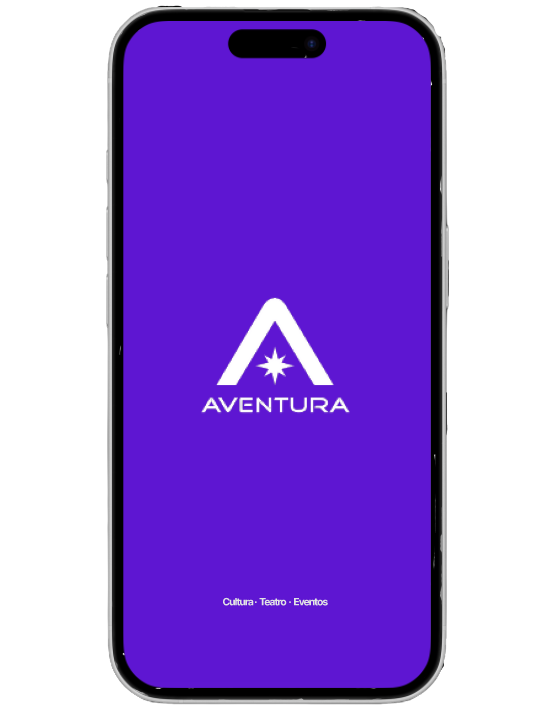 
  Fonte: Material produzido pelos autores, 2026.

A Splash Screen apresenta a identidade visual da Aventura no momento de abertura do aplicativo. A tela utiliza fundo roxo, logotipo centralizado e a frase “Cultura • Teatro • Eventos”, reforçando o posicionamento da marca antes do início da navegação.

Imagem 02 - Tela de Login 
  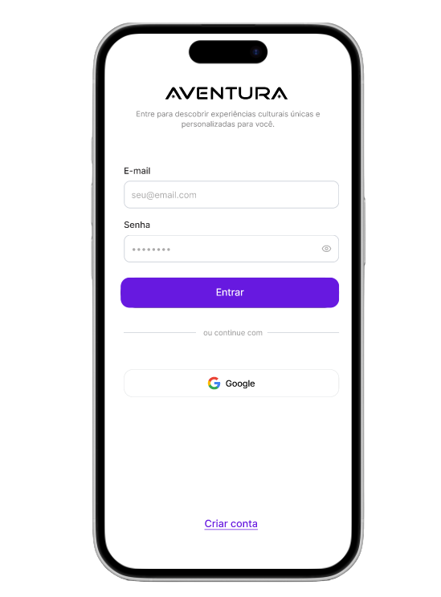 
  Fonte: Material produzido pelos autores, 2026.

A tela de login permite que o usuário acesse sua conta utilizando e-mail e senha ou autenticação com Google. Também há a opção de criação de conta. A tela prioriza simplicidade, com campos bem espaçados e botão principal em roxo para destacar a ação de entrada.

Imagem 03 - Tela inicial de boas-vindas 
  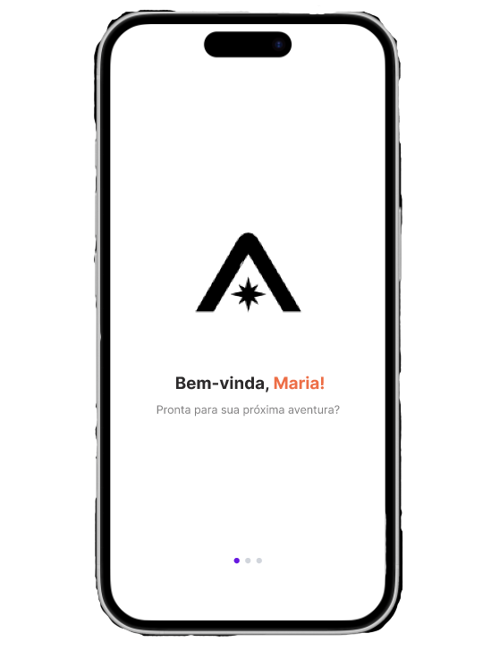 
  Fonte: Material produzido pelos autores, 2026.

A tela de boas-vindas inicia o processo de personalização. Ela apresenta uma saudação nominal ao usuário e prepara a navegação para as próximas etapas do onboarding. Os indicadores inferiores mostram que há um fluxo progressivo a ser concluído.

Imagem 04 - Onboarding de localização 
  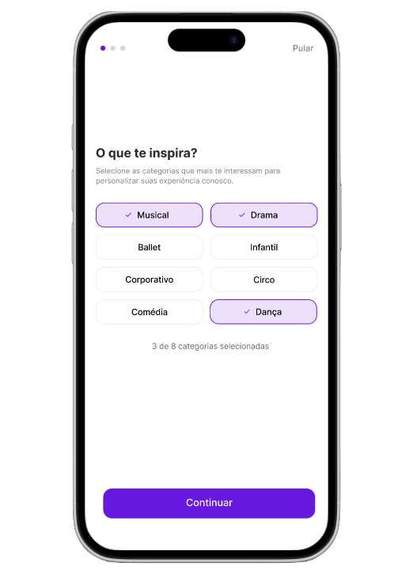 
  Fonte: Material produzido pelos autores, 2026.

A tela de localização pergunta onde o usuário está, permitindo selecionar uma cidade. Essa informação é importante para recomendações geográficas, especialmente seções como “Perto de você”. A opção selecionada aparece destacada em roxo.

Imagem 05 - Onboarding de interesses 
  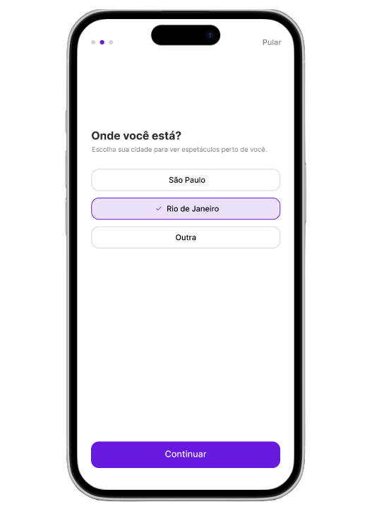 
  Fonte: Material produzido pelos autores, 2026.

A tela de interesses permite que o usuário selecione categorias culturais, como Musical, Drama, Ballet, Infantil, Comédia e Dança. Essas preferências ajudam a alimentar a lógica de recomendação e tornam a experiência inicial mais personalizada.

Imagem 06 - Onboarding de frequência 
  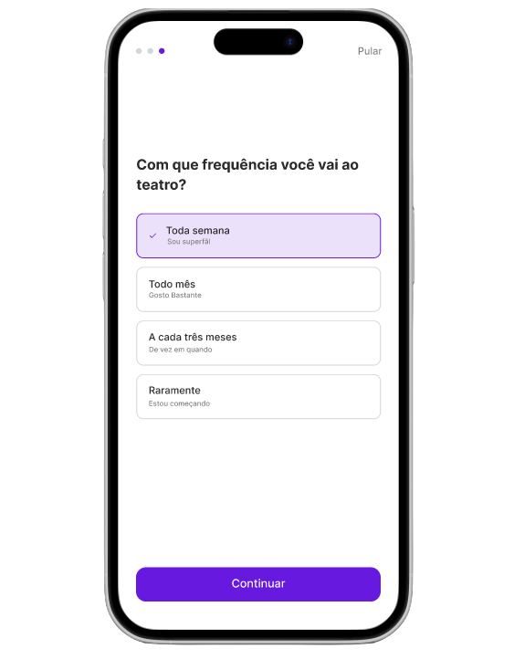 
  Fonte: Material produzido pelos autores, 2026.

A tela de frequência busca entender o hábito cultural do usuário, perguntando com que frequência ele vai ao teatro. Essa informação pode apoiar a personalização de recomendações e notificações, diferenciando usuários recorrentes de usuários iniciantes.

Imagem 07 - Home principal 
  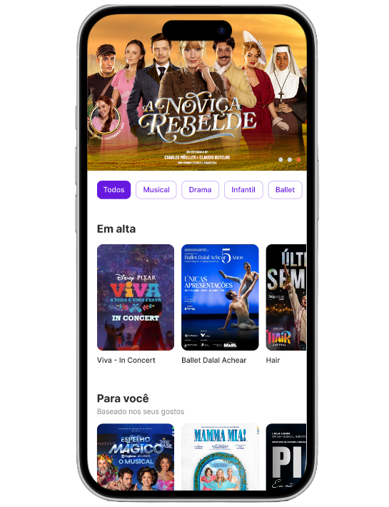 
  Fonte: Material produzido pelos autores, 2026.

A Home principal funciona como ponto central de descoberta. Ela apresenta banner de destaque, filtros por categoria, seção “Em alta” e recomendações personalizadas em “Para você”. O uso de imagens e cards favorece a exploração rápida de espetáculos.

Imagem 08 - Tela de recomendações 
  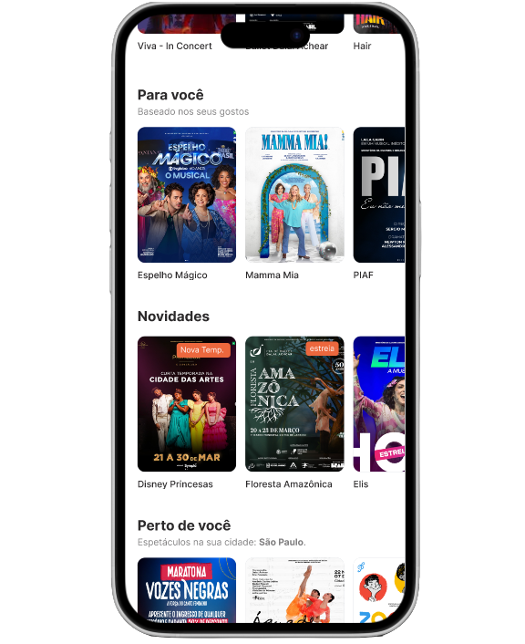 
  Fonte: Material produzido pelos autores, 2026.

A tela de recomendações aprofunda a descoberta de conteúdo por meio de seções como “Para você”, “Novidades” e “Perto de você”. Essa organização separa recomendações por contexto, facilitando a navegação em um catálogo amplo de espetáculos.

Imagem 09 - Tela de busca 
  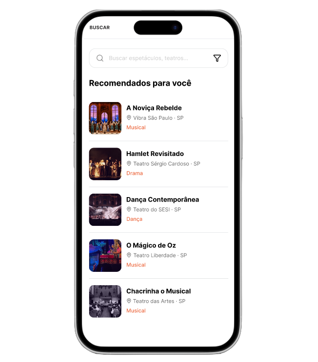 
  Fonte: Material produzido pelos autores, 2026.

A tela de busca permite pesquisar espetáculos e teatros. Ela também apresenta uma lista de recomendações, contendo imagem, título, local e categoria. O campo de busca e o ícone de filtro indicam possibilidade de refinamento dos resultados.

Imagem 10 - Detalhes do espetáculo 
  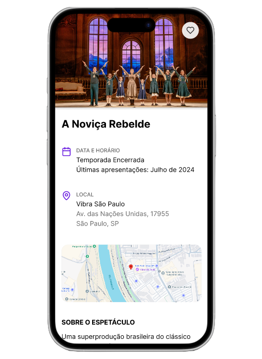 
  Fonte: Material produzido pelos autores, 2026.

A tela de detalhes apresenta informações completas sobre um espetáculo selecionado, incluindo imagem de capa, título, data, local, endereço, mapa e descrição. Essa tela apoia a decisão do usuário antes do redirecionamento para a ticketeira externa.

A compra não é realizada dentro da aplicação. O aplicativo atua como ponto de descoberta e informação, encaminhando o usuário para a plataforma externa responsável pela bilheteria.

Imagem 11 - Wishlist 
  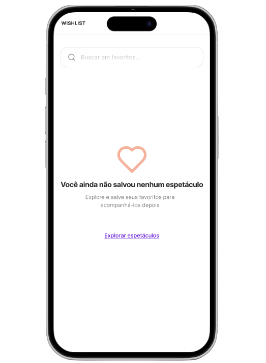 
  Fonte: Material produzido pelos autores, 2026.

A tela de Wishlist apresenta o estado vazio da lista de favoritos. Em vez de exibir apenas uma tela sem conteúdo, ela informa que nenhum espetáculo foi salvo e oferece o caminho “Explorar espetáculos”, incentivando o usuário a continuar navegando.

Imagem 12 - Tela de teatros 
  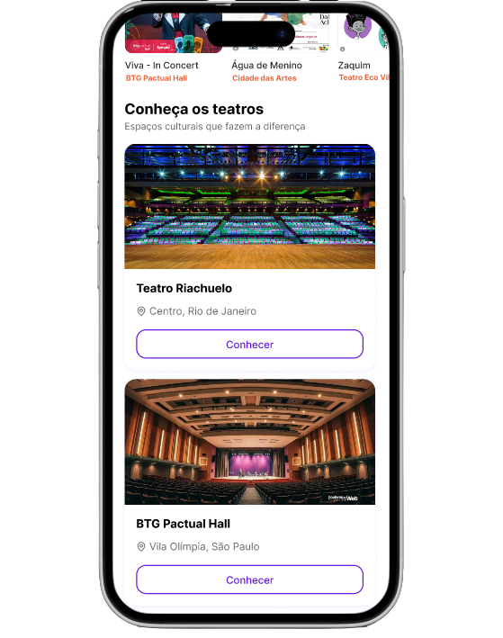 
  Fonte: Material produzido pelos autores, 2026.

A seção de teatros apresenta espaços culturais relevantes, com imagem, nome, localização e botão “Conhecer”. Essa tela amplia a experiência do aplicativo, permitindo que o usuário descubra não apenas espetáculos, mas também os locais onde eles acontecem.

Imagem 13 - Perfil do usuário 
  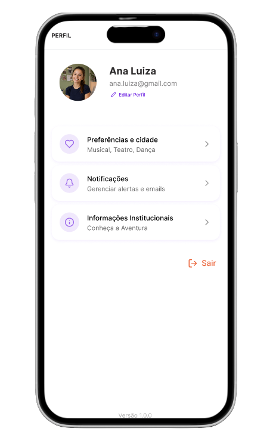 
  Fonte: Material produzido pelos autores, 2026.

A tela de perfil centraliza informações e configurações do usuário. Ela apresenta foto, nome, e-mail, edição de perfil, preferências e cidade, notificações, informações institucionais e opção de sair. A organização em cards facilita a navegação entre configurações.

Imagem 14 - Editar interesses 
  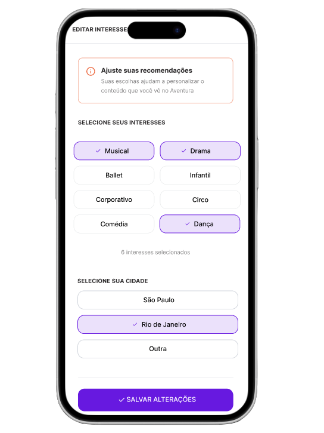 
  Fonte: Material produzido pelos autores, 2026.

A tela de edição de interesses permite atualizar categorias culturais e cidade. Essa funcionalidade é importante porque as preferências do usuário podem mudar com o tempo, e o sistema de recomendação precisa refletir essas mudanças para continuar relevante.

Imagem 15 - Configurações de notificações 
  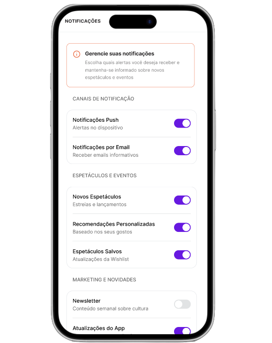 
  Fonte: Material produzido pelos autores, 2026.

A tela de notificações permite gerenciar alertas do aplicativo. O usuário pode ativar ou desativar notificações push, e-mails, novidades, recomendações personalizadas, espetáculos salvos, newsletter e atualizações do app. Os switches deixam claro o estado de cada opção.

Imagem 16 - Informações institucionais 
  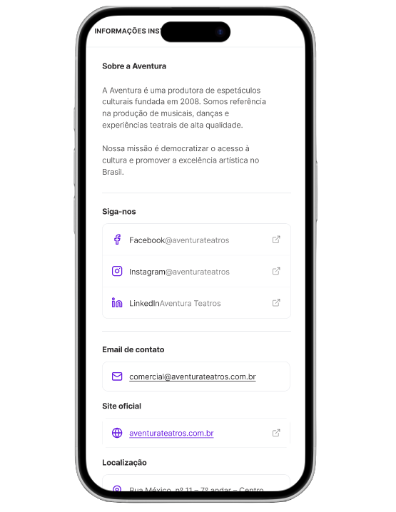 
  Fonte: Material produzido pelos autores, 2026.

A tela de informações institucionais apresenta dados sobre a Aventura, redes sociais, e-mail de contato, site oficial e localização. Essa área reforça a transparência, credibilidade e conexão institucional com o usuário.

### 5.7 Link do protótipo dinâmico navegável
- **Protótipo navegável no Figma:** [Mockup — Portal Aventura](https://www.figma.com/proto/0lPbGGZo6VHkp0eKkrQlWs/Mockup-din%C3%A2mico---aventura?node-id=21-13&p=f&t=uWxNLlnplSpPBNjH-1&scaling=scale-down&content-scaling=fixed&page-id=0%3A1&starting-point-node-id=21%3A4&show-proto-sidebar=1) 
---

## 6. Guia de Estilos (Componentes Visuais)

  Imagem 03 - Guia de estilos 
  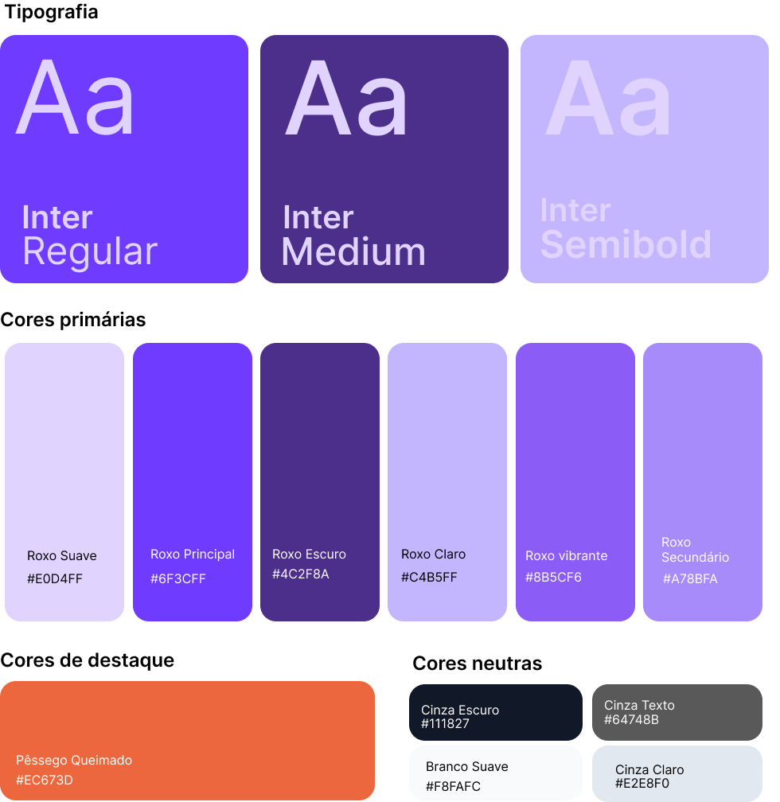 
  Fonte: Material produzido pelos autores, 2026.

### 6.1 Tipografia

**Família principal:** Inter

**Escala e Pesos:**

| Estilo                | Peso       | Tamanho (px) | Uso por Contexto |
|-----------------------|------------|--------------|------------------|
| **Inter Semi Bold**   | 600        | 28–32px      | Títulos principais (H1), nomes de espetáculos |
| **Inter Semi Bold**   | 600        | 20–24px      | Títulos de seção (Em alta, Para você, Novidades) |
| **Inter Medium**      | 500        | 16–18px      | Subtítulos, nomes de teatro, preços |
| **Inter Regular**     | 400        | 16px         | Textos corridos, descrições, endereços |
| **Inter Regular**     | 400        | 14px         | Legendas, metadados, captions, tags |

**Regras:** 
- Hierarquia clara com no máximo 3 níveis de peso por tela.
- Todo texto deve respeitar contraste mínimo WCAG AA.

### 6.2 Paleta de cores

**Primary Colors**
- **Roxo Principal** — `#6F3CFF` → Botões primários, tabs ativos, links principais, marca
- **Roxo Escuro** — `#4C2F8A` → Header, Bottom Navigation, textos fortes
- **Roxo Claro** — `#C4B5FF` → Estados selecionados, chips ativos
- **Roxo Vibrante** — `#8B5CF6` → Destaques e hovers
- **Roxo Suave** — `#E0D4FF` → Fundos suaves de cards e seções
- **Roxo Secundário** — `#A78BFA` → Bordas e elementos secundários

**Accent Colors**

- **Pêssego Queimado** — `#EC673D` → Tags de categoria (Musical, Drama, Dança etc.), ícones de destaque, e textos chamativos.

**Neutral Colors**
- **Cinza Escuro** — `#111827` → Textos principais
- **Cinza Texto** — `#64748B` → Textos secundários e metadados
- **Branco Suave** — `#F8FAFC` → Fundo principal das telas
- **Cinza Claro** — `#E2E8F0` → Bordas e divisórias

### 6.3 Botões

**Variantes:**
- **Primário**: Fundo `#6F3CFF`, texto branco, altura 48px, border-radius 12px
- **Secundário**: Fundo `#C4B5FF`, texto `#4C2F8A`, altura 48px, border-radius 12px
- **Ghost / Outline**: Borda `#6F3CFF`, texto `#6F3CFF`, fundo transparente
- **Text Button**: Apenas texto roxo, sem fundo

**Estados:**
- **Normal**: Opacidade 100%
- **Press / Active**: Escala 0.98 + leve escurecimento
- **Disabled**: Opacidade 40% + cursor not-allowed
- **Loading**: Spinner + texto desabilitado

**Regras:** Padding horizontal mínimo de 24px. Largura total em telas mobile quando possível.

### 6.4 Ícones

**Estilo:** Line Icons (traço fino) — preferência por biblioteca **Lucide Icons** ou **Feather**.

**Tamanhos:**
- Small: 20px
- Medium (padrão): 24px
- Large: 28px

**Uso Semântico:**
- Casa → Explorar
- Lupa → Buscar
- Coração → Wishlist
- Usuário → Perfil
- Seta para esquerda → Voltar
- Lâmpada → Sugestões / "Para você"

**Regras:** Todos os ícones devem ter a mesma espessura de traço e alinhamento centralizado com o texto.

### 6.5 Cards

**Estrutura Padrão:**
1. Imagem de capa (proporção 16:9 ou 2:3 para posters)
2. Título do espetáculo (1–2 linhas, truncamento com `...`)
3. Local + data/horário (1 linha)
4. Tag de categoria (Musical, Drama, Dança etc.)
5. Botão de ação (quando aplicável)

**Regras:**
- Border radius: 16px
- Sombra sutil (elevação baixa)
- Truncamento de título em 2 linhas
- Espaçamento interno: 16px

### 6.6 Inputs

**Padrão de Campo:**
- Label acima do campo (Medium 14px)
- Placeholder em cinza claro
- Altura: 52px
- Border radius: 12px
- Borda padrão: `#E2E8F0`

**Estados:**
- **Foco**: Borda `#6F3CFF` + sombra suave
- **Erro**: Borda vermelha + texto de erro abaixo
- **Sucesso**: Borda verde + ícone de check
- **Disabled**: Fundo cinza claro, opacidade 60%

### 6.7 Barra de navegação

**Padrão:** Bottom Navigation (mobile-first)

**Itens:**
- Explorar (ícone casa)
- Buscar (ícone lupa)
- Wishlist (ícone coração)
- Perfil (ícone usuário)

**Comportamento:**
- Ícone + label
- Estado ativo: Roxo Principal (`#6F3CFF`) com preenchimento
- Estado inativo: Cinza Texto (`#64748B`)
- Fixa no bottom da tela
- Esconde em telas de onboarding e pagamento quando necessário

### 6.8 Espaçamentos

**Escala base:** Múltiplos de 8px (8px grid)

| Escala   | Valor   | Uso comum |
|----------|---------|---------|
| 2x       | 16px    | Padding interno de cards e botões |
| 3x       | 24px    | Espaçamento entre seções |
| 4x       | 32px    | Margens laterais principais |
| 5x       | 40px    | Espaçamento vertical grande |
| 6x       | 48px    | Altura mínima de botões |

**Gaps:** Entre cards e chips → 12px ou 16px

### 6.9 Consistência visual

**Regras Gerais a serem mantidas em todas as telas:**
- Border radius padrão: **12px** (elementos pequenos) e **16px** (cards e modais)
- Alinhamento: Esquerda na maioria dos conteúdos (exceto botões centrados)
- Sombras: Suaves e consistentes (0 1px 3px rgba(0,0,0,0.08))
- Densidade: Espaçamento generoso para boa legibilidade em mobile
- Hierarquia: Sempre destacar o título do espetáculo como elemento mais forte
- Contraste: Mínimo 4.5:1 em textos sobre fundos claros

---

## 7. Interações e Comportamentos Mobile

### 7.1 Scroll

O scroll vertical é utilizado como principal forma de navegação entre conteúdos extensos da aplicação.

Comportamentos definidos:

- Rolagem vertical contínua em listas, feeds e páginas de conteúdo.
- Header superior permanece fixo em telas principais para preservar contexto de navegação.
- Navegação inferior permanece visível durante a rolagem para facilitar acesso rápido às funcionalidades principais.
- Conteúdos são carregados progressivamente para evitar excesso de informações simultâneas.
- Em páginas longas, o usuário pode retornar ao topo rapidamente através de interação simplificada.
- Barras de rolagem seguem comportamento nativo do sistema operacional do dispositivo.

---

### 7.2 Swipe

O gesto de swipe é utilizado em áreas específicas da interface para melhorar navegação e dinamismo.

Comportamentos definidos:

- Swipe horizontal em carrosséis de categorias e destaques.
- Navegação limitada ao conteúdo disponível, impedindo movimentações excessivas.
- Feedback visual suave acompanha o movimento do usuário.
- Swipe utilizado apenas em componentes que exigem navegação horizontal, evitando conflitos com o scroll vertical.

---

### 7.3 Transições

As transições foram planejadas para manter fluidez e previsibilidade durante a navegação entre telas.

Padrões definidos:

- Transições suaves entre páginas principais.
- Abertura e fechamento de menus com animações rápidas e discretas.
- Alterações de estado ocorrem sem interrupções bruscas.
- Tempo de transição reduzido para evitar sensação de lentidão.
- Componentes seguem comportamento visual consistente em toda a aplicação.
- Navegação de retorno respeita o comportamento padrão do dispositivo móvel.

---

### 7.4 Feedback visual

O sistema fornece respostas visuais imediatas para informar o usuário sobre ações e estados da interface.

Feedbacks implementados:

- Alteração visual ao pressionar botões e cards.
- Indicadores de carregamento durante buscas e carregamento de conteúdo.
- Destaque visual para itens selecionados.
- Mensagens de sucesso para ações concluídas corretamente.
- Mensagens de erro em situações de falha ou conexão indisponível.
- Estados desabilitados representados com menor contraste visual.
- Campos de formulário apresentam validação visual em tempo real.

---

### 7.5 Microinterações

As microinterações auxiliam na percepção de controle e melhoram a experiência do usuário.

Microinterações previstas:

- Efeito visual ao tocar em botões.
- Destaque em itens ativos da navegação.
- Animações sutis em abertura de cards e conteúdos.
- Alteração de estado em botões favoritos e interações rápidas.
- Feedback visual em campos preenchidos corretamente.
- Respostas visuais em ações concluídas pelo usuário.
- Mudança de aparência em componentes selecionados.

Objetivos das microinterações:

- Confirmar ações executadas.
- Melhorar percepção de responsividade.
- Facilitar entendimento da interface.
- Tornar a navegação mais fluida e intuitiva.

---

### 7.6 Estados de navegação

A interface contempla diferentes estados para garantir clareza durante o uso.

#### Tela ativa/inativa

- A seção ativa da navegação inferior permanece destacada visualmente.
- Itens inativos possuem menor contraste visual.

#### Estado vazio

- Exibição de mensagens informativas quando não houver conteúdo disponível.
- Sugestões de navegação ou novas ações são apresentadas ao usuário.

#### Carregando

- Indicadores de loading são exibidos durante carregamento de conteúdo.
- Estruturas visuais simplificadas evitam sensação de travamento.

#### Erro

- Mensagens claras comunicam falhas de carregamento ou conexão.
- Usuário recebe possibilidade de tentar novamente.

#### Sem resultados

- Interface informa ausência de resultados encontrados.
- Sugestões alternativas podem ser exibidas para continuidade da navegação.

---

### 7.7 Comportamento responsivo

A interface foi estruturada para adaptação eficiente em diferentes resoluções mobile.

Regras definidas:

- Componentes organizados prioritariamente em coluna.
- Cards e imagens ajustam largura automaticamente.
- Textos possuem truncamento controlado para evitar quebra excessiva.
- Botões mantêm tamanho mínimo adequado para interação por toque.
- Espaçamentos internos preservam legibilidade em telas menores.
- Blocos de conteúdo são reorganizados conforme dimensão disponível.
- Navegação permanece acessível independentemente da resolução utilizada.
- Elementos secundários possuem menor prioridade visual em telas reduzidas.

O comportamento responsivo busca garantir acessibilidade, legibilidade e consistência visual em toda a experiência mobile.

---

## 8. Considerações Finais

### 8.1 Aderência aos objetivos do projeto

O projeto visual do Portal Aventura foi estruturado para apoiar a transição do catálogo estático para um **hub de descoberta personalizada**. Nesse sentido, a abordagem mobile-first orientou cada decisão visual e de interação, tratando o smartphone como ambiente primário de uso. As decisões documentadas nas seções de navegação, wireframes e mockups convergem para três entregas centrais do MVP:

**Recomendação e personalização.** O onboarding de interesses (gêneros, cidade, frequência) e a tela **Editar Interesses** no perfil coletam e atualizam os sinais que alimentam o motor de recomendação (RF01). Na interface, isso se materializa em seções como **“Para você”**, **“Perto de você”** e recomendações na busca: com *empty state* orientativo, convertendo ausência de dados em convite à personalização em vez de bloquear a descoberta.

**Descoberta contínua.** A arquitetura de quatro abas (Explorar, Buscar, Wishlist, Perfil), prateleiras horizontais na Home, busca com filtros em *bottom sheet* e cards visuais de espetáculos e teatros reduzem o atrito entre “não sei o que ver” e “encontrei algo relevante”. O padrão de vitrine por seções (Em alta, Novidades, Para você) aproxima o modelo mental de plataformas de streaming já familiares ao público-alvo.

**Conversão sem fricção desnecessária.** A tela **Informações do Espetáculo** concentra dados para decisão (data, local, sinopse, elenco, recomendações cruzadas) e mantém **“Ingressos”** e **“Salvar”** sempre acessíveis na barra inferior fixa, alinhado ao *hand-off* para a bilheteria parceira — papel explícito do app como descoberta e informação, não como processador de pagamento. Em paralelo, a Wishlist sustenta **retenção** para decisões futuras.

Em conjunto, wireframes (validação de fluxo) e mockups de alta fidelidade (validação de percepção e implementação) permitem que stakeholders, design e desenvolvimento compartilhem a mesma referência sobre **o que** o produto entrega na experiência visual e **como** isso se conecta aos requisitos de negócio.

### 8.2 Alinhamento com a proposta Mobile First

A proposta *mobile-first* não se limita ao formato de tela: ela orienta priorização de tarefas, ergonomia e densidade de informação em todo o documento.

**Priorização de tarefas e alcance.** Ações principais (entrar, continuar onboarding, explorar, buscar, salvar, ingressos) aparecem em CTAs amplos, na *thumb zone* e, nas áreas recorrentes, na **tab bar fixa** — sem ocultação ao scroll — garantindo acesso com uma mão em contextos de deslocamento. Telas de entrada e onboarding operam em fluxo linear, sem *tab bar*, para não competir com a configuração inicial.

**Leitura e hierarquia.** Fundo predominantemente claro, títulos com peso maior e metadados em cinza favorecem varredura rápida. Imagens de espetáculos e teatros ocupam papel central nos cards, adequado a um produto cuja decisão é em grande parte visual e emocional.

**Toque e feedback.** Seleções no onboarding e em Editar Interesses usam estados visuais explícitos (roxo, borda, confirmação); notificações usam *switches* com estado imediato; favoritos e *empty states* comunicam o estado do sistema sem depender de mensagens técnicas.

**Navegação previsível.** Pilhas independentes por aba, botão voltar em nível 2, filtros em overlay que preservam o contexto da busca e barra de ação fixa na conversão seguem heurísticas de consistência e visibilidade do status — especialmente relevantes em sessões curtas, em que o usuário não pode “reaprender” o app a cada uso.

**Escopo consciente do canal.** O documento delimita o que o mobile faz bem (descobrir, personalizar, salvar, informar) e o que fica fora (compra in-app), evitando expectativas incorretas na implementação e na validação com usuários.

### 8.3 Resultado esperado da experiência visual

Para o usuário final, a experiência visual pretendida pode ser resumida em quatro percepções:

1. **Clareza** — em poucos toques, entender onde explorar, como buscar, como salvar um espetáculo e como seguir para ingressos, sem ambiguidade entre áreas do app.
2. **Personalização perceptível** — sentir que o conteúdo em “Para você” e recomendações relacionadas refletem gostos e localização, com caminho simples para ajustar interesses quando a curadoria não encaixar.
3. **Confiança** — identidade Aventura consistente (roxo como ação, layout limpo), informações completas na ficha do espetáculo e transparência institucional no perfil reforçam credibilidade antes do redirecionamento à ticketeira.
4. **Fluidez** — navegação inferior estável, listas e carrosséis familiares, estados vazios que orientam a próxima ação e transições entre descoberta passiva (Home) e ativa (Busca) sem ruptura de contexto.

O resultado esperado para o negócio é um aplicativo que **aumenta a descoberta de espetáculos relevantes**, **retém intenção de compra** via Wishlist e **encaminha conversão** ao parceiro de bilheteria com menor abandono por dúvida ou por interface confusa: mantendo o Portal Aventura como extensão natural do ecossistema cultural da Aventura Teatros, e não apenas um catálogo digital estático.
